<div dir="rtl" align="center">

<h1>🏥 سامانه جامع مدیریت درمانگاه سهند</h1>

<h3>Sahand ClinicPro — v1.3.0</h3>

**نخستین سامانه یکپارچه فارسی‌زبان درمانگاه با اتصال مستقیم به دستگاه حضور و غیاب، سامانه‌های دولتی و نسخه الکترونیک**

[](https://dotnet.microsoft.com)
[](https://learn.microsoft.com/dotnet/csharp)
[](https://www.microsoft.com/sql-server)
[](https://materialdesigninxaml.net)
[](LICENSE)
[](#-تست‌ها)
[](https://github.com/pranses2011/Sahand_ClinicPro/releases)

[✨ امکانات](#-ماژول‌ها--امکانات) · [🖼 تصاویر](#-تصاویر-محیط-نرم‌افزار) · [🚀 نصب](#-راه‌اندازی-سریع) · [🕐 حضور و غیاب](#-ماژول-حضور-و-غیاب--جدید-v130) · [🔐 لایسنس](#%EF%B8%8F-سامانه-لایسنس) · [📚 مستندات](#-مستندات)

</div>

---

<div dir="rtl">

## 📋 معرفی

سامانه جامع مدیریت درمانگاه **سهند** برای محیط کسب‌وکار ایران طراحی شده: از پذیرش و نوبت‌دهی هوشمند تا پرونده بالینی پیشرفته با نمودار رشد WHO، از صندوق و حسابداری دوبل تا فیش حقوقی با قواعد ۱۴۰۴، و از اتصال به **دستگاه‌های حضور و غیاب ZKTeco و Hikvision** تا پایش بلادرنگ SignalR.

| شاخص | مقدار |
|:---|:---|
| 🧱 لایه‌های معماری | Clean Architecture + CQRS + Repository/UnitOfWork |
| 📦 پروژه‌های .NET | ۸ پروژه (Domain/Application/Infrastructure/API/Desktop/LicensePortal/Shared) + سرور لایسنس PHP |
| 🗄 جداول دیتابیس | ۹۴ جدول + ۱۵ ایندکس جدید حضور و غیاب + جدول اقلام انبارگردانی |
| 🔌 API | ۲۵ کنترلر — ۳۰۰+ endpoint |
| 🖥 صفحات دسکتاپ | ۳۰ صفحه WPF با Material Design و RTL کامل |
| 🧪 تست‌های خودکار | **۱۳۳ تست سبز** در ۴ پروژه — بیلد بدون هیچ هشدار |
| 🧩 ماژول‌های لایسنس | ۲۴ ماژول قابل فعال‌سازی جداگانه |
| 🌐 زبان | فارسی کامل — تقویم جلالی، رقم فارسی، RTL |

---

## 🖼 تصاویر محیط نرم‌افزار

| داشبورد مدیریتی | حضور و غیاب (جدید v1.3.0) |
|:---:|:---:|
| 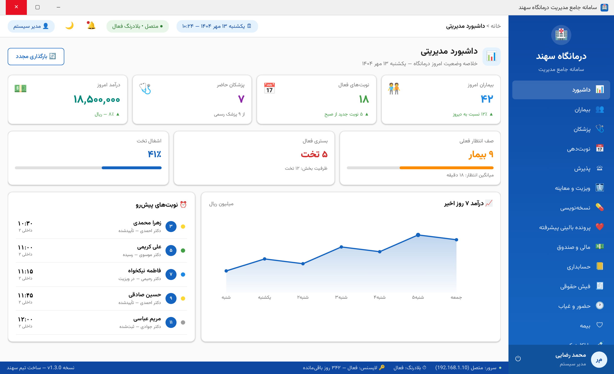 | 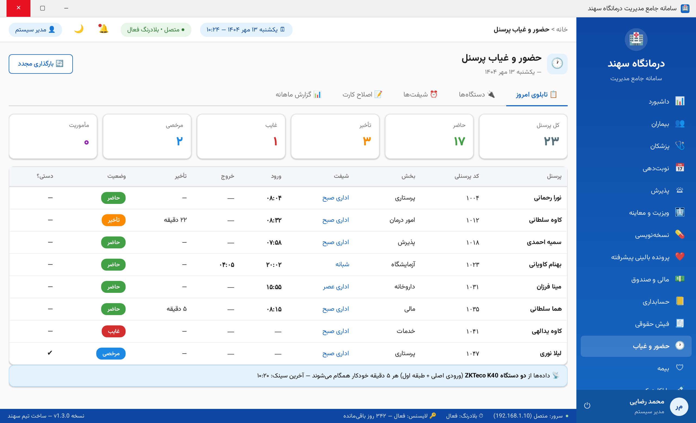 |

| پذیرش و صف زنده بلادرنگ | پرونده بالینی با نمودار WHO |
|:---:|:---:|
| 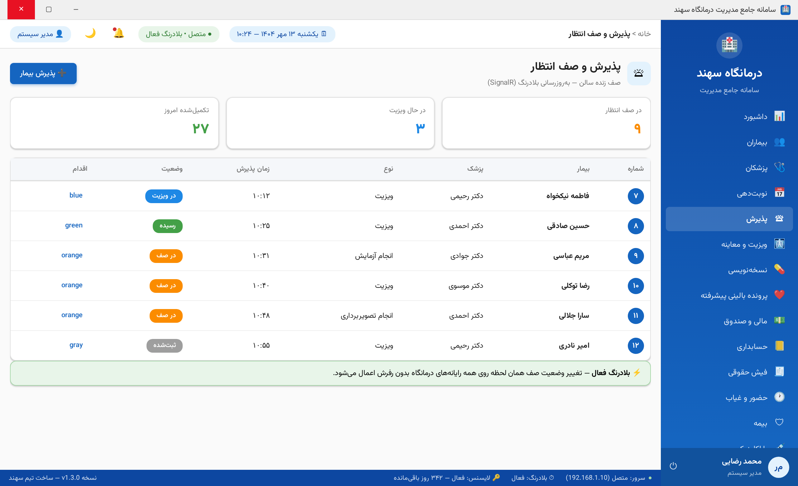 | 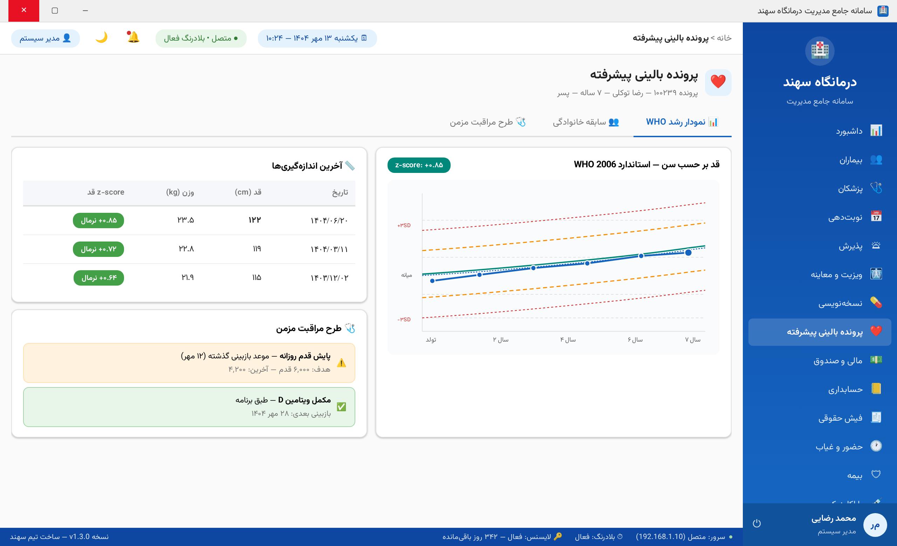 |

| نسخه‌نویسی با تداخل‌سنجی | فیش حقوقی قواعد ۱۴۰۴ |
|:---:|:---:|
| 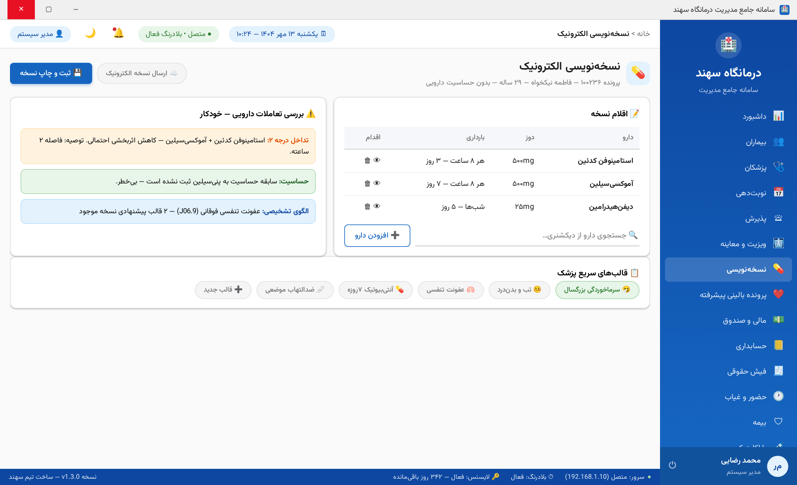 | 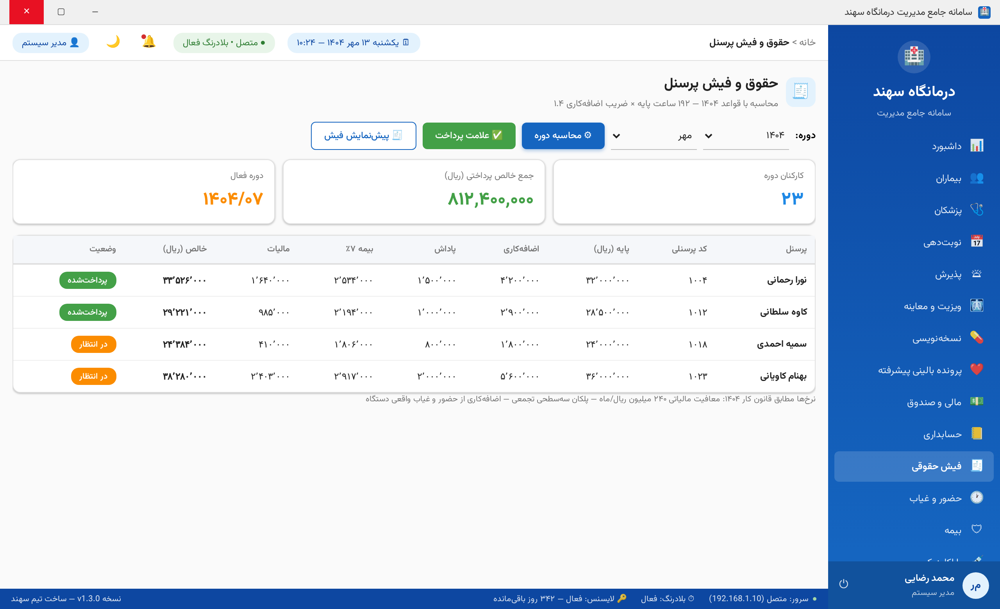 |

<details>
<summary>📷 ۸ تصویر دیگر — ورود، بیماران، نوبت‌دهی، دستگاه‌های حضور و غیاب، آزمایشگاه، گزارش‌ساز، لایسنس</summary>

| ورود | بیماران |
|:---:|:---:|
| 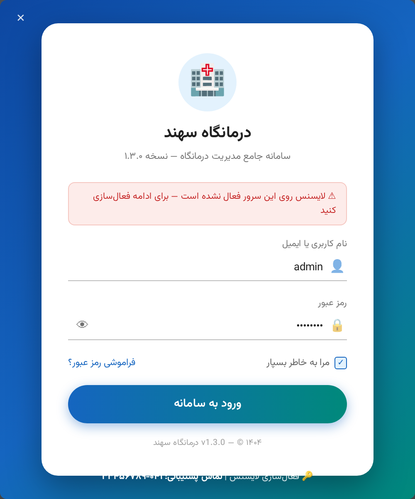 | 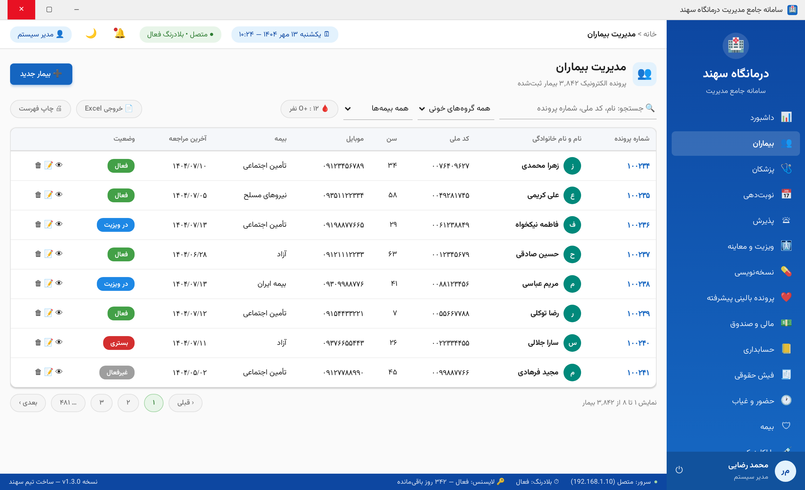 |

| نوبت‌دهی | دستگاه‌های حضور و غیاب |
|:---:|:---:|
| 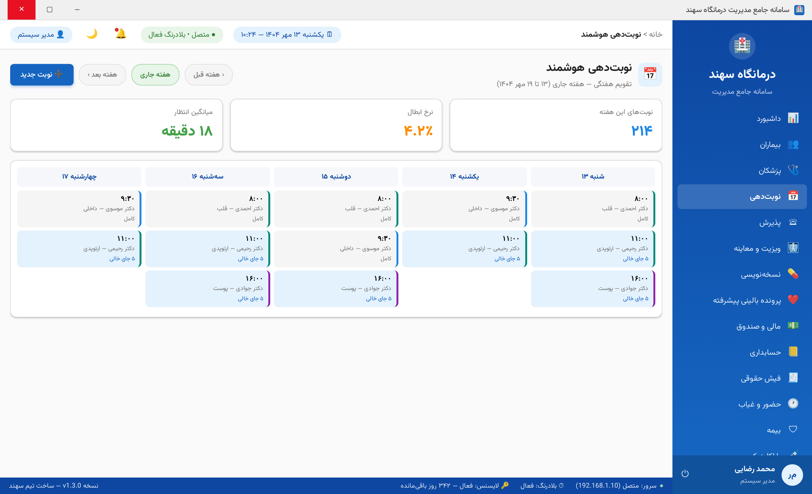 | 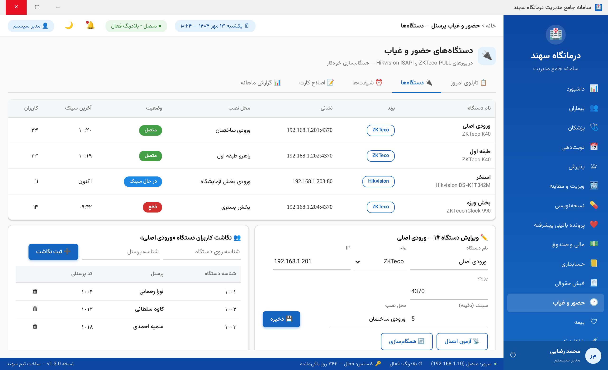 |

| آزمایشگاه | گزارش‌ساز |
|:---:|:---:|
| 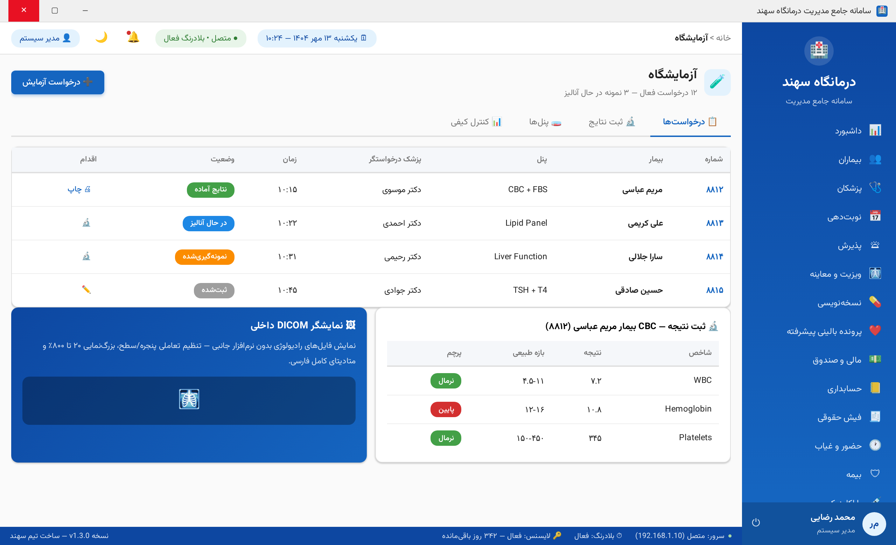 | 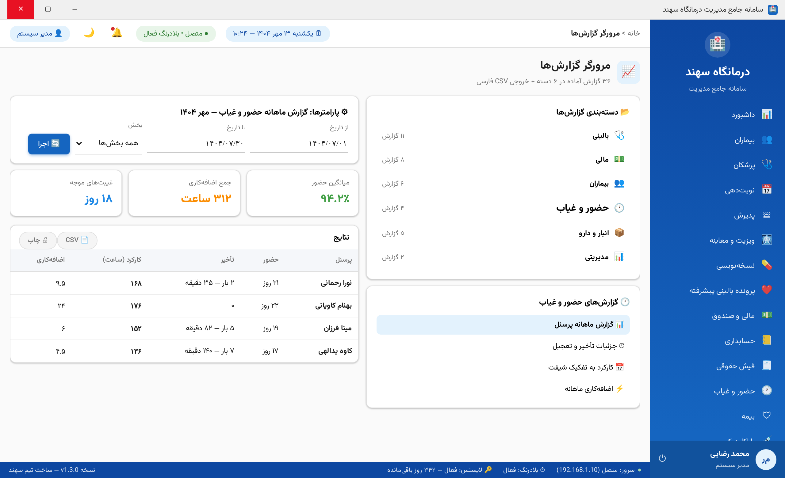 |

| لایسنس با چیپ ماژول‌ها | |
|:---:|:---:|
| 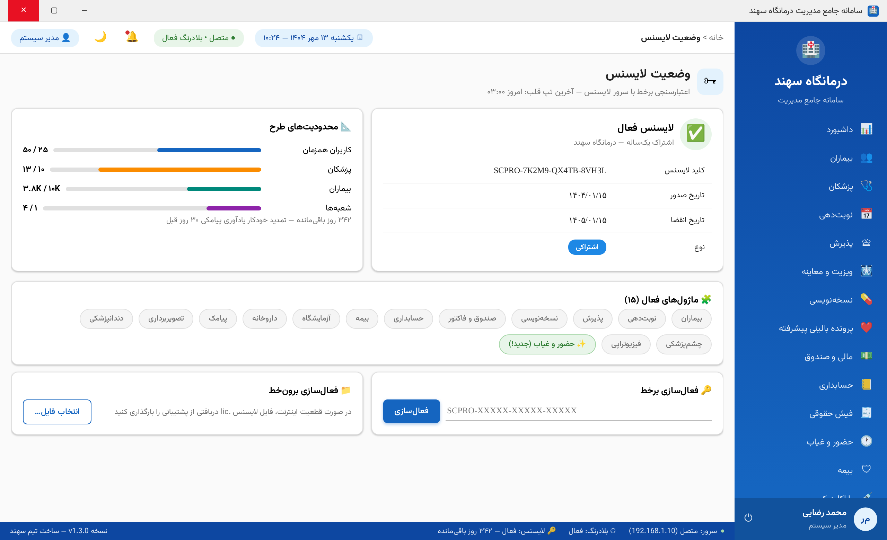 | |
</details>

---

## 🧩 ماژول‌ها و امکانات

### 🕐 ماژول حضور و غیاب — 🆕 جدید v1.3.0

اتصال مستقیم به دستگاه‌های حضور و غیاب با درایورهای اختصاصی:

| قابلیت | شرح |
|:---|:---|
| 🔌 درایور ZKTeco | پروتکل PULL روی TCP/4370 — وفادار به مرجع pyzk (هدر ۴×u16، چک‌سام zkemsdk، رکورد ۴۰ بایتی) |
| 🌐 درایور Hikvision | ISAPI با احراز Digest — سریال و گزارش حوادث |
| 💫 شبیه‌ساز دمو | تولید ضربه منطقی برای آموزش و تست |
| ⚙ همگام‌سازی خودکار | کار Hangfire هر دقیقه با بازه اختصاصی هر دستگاه + حذف تکراری |
| 📜 لاگ خام تغییرناپذیر | منبع حقیقت ممیزی — هیچ ضربه‌ای حذف نمی‌شود |
| 👥 نگاشت کاربر دستگاه | هر شناسه کارت/اثر انگشت → پرسنل |
| ⏰ شیفت‌های پیشرفته | تحمل تأخیر/تعجیل، استراحت، شیفت شب عبور از نیمه‌شب، شبانه‌روزی ۲۴ ساعته |
| 🗓 تخصیص الگودار | ثابت / هفتگی / روزهای منتخب + اولویت‌بندی تعارض |
| 🏖 مرخصی و تعطیلات | پوشش مرخصی/مأموریت تأییدشده + تقویم تعطیلات رسمی و تکرارشونده |
| 📝 اصلاح کارت | جریان درخواست → تأیید سرپرست → اعمال خودکار با پرچم ممیزی |
| 📊 گزارش ماهانه شمسی | کارکرد/تأخیر/اضافه‌کاری/غیبت هر پرسنل + جمع کل |
| 🖥 تابلوی زنده | ۷ شاخص لحظه‌ای + وضعیت تک‌تک پرسنل |

### سایر ماژول‌ها

| حوزه | امکانات کلیدی |
|:---|:---|
| 🧑‍🤝‍🧑 **بیماران** | پرونده الکترونیک با MRN خودکار، اعتبارسنجی کد ملی، سوابق کامل |
| 🩺 **پزشکان** | تخصص/فوق‌تخصص، برنامه کاری، غیبت‌ها، عملکرد |
| 📅 **نوبت‌دهی** | تقویم هفتگی، ظرفیت، تداخل‌سنجی، ۵ وضعیت ردیابی |
| 🛎 **پذیرش و صف** | صف پویا با فراخوان، **به‌روزرسانی بلادرنگ SignalR**، زمان انتظار |
| 🩻 **ویزیت (SOAP)** | شرح‌حال هدف‌دار + ICD-10 الزامی |
| ❤️ **پرونده بالینی پیشرفته** | نمودار رشد WHO با z-score، سابقه خانوادگی ۱۲ خویشاوندی، طرح مراقبت مزمن |
| 💊 **نسخه‌نویسی** | دیکشنری دارو، **تداخل‌سنجی خودکار**، قالب‌های سریع، نسخه الکترونیک |
| 🧪 **آزمایشگاه** | پنل‌ها، جریان وضعیت، کنترل کیفی، پرچم مقادیر |
| 🩻 **تصویربرداری** | **نمایشگر DICOM داخلی** — پنجره/سطح تعاملی، بزرگ‌نمایی ۲۰-۸۰۰٪ |
| 🏥 **داروخانه** | تحویل FEFO، هشدار موجودی و انقضا، **انبارگردانی با اعمال مغایرت** |
| 💵 **صندوق و فاکتور** | پوشش بیمه، **سند حسابداری خودکار دوبل** |
| 📒 **حسابداری** | سلسله‌مراتب چهارسطحی، قانون توازن، تراز آزمایشی |
| 🛡 **بیمه** | مطالبه دوره‌ای، استعلام برخط سه‌تلاشی + کش + سقوط برون‌خط |
| 🧾 **فیش حقوقی** | قواعد ۱۴۰۴: اضافه‌کاری ۱.۴×، بیمه ۷٪، پلکان مالیات — از حضور واقعی دستگاه |
| 📈 **گزارش‌ساز** | ۳۱ گزارش کاملاً واقعی (سود و زیان، صورت‌حساب بیمار، بیماری‌های مزمن، الگوی مراجعات و…) + پارامترهای پویا + انتخابگر بیمار + خروجی CSV فارسی |
| 💬 **پیامک** | زنجیره جایگزینی پنل‌ها، صف Hangfire، تمپلیت، آمار |
| 📝 **نظرسنجی بیماران** 🆕 | سازنده پویا سوالات (امتیاز/متن/چندگزینه‌ای)، ارسال لینک پیامکی پس از ویزیت، میانگین امتیاز پزشکان و توزیع ستاره |
| 🏛 **سامانه‌های دولتی** | سپاس، سیب، ناب، سینا، نسخه الکترونیک — همه پشت `IGovIntegrationService` |
| 👤 **کاربران و نقش‌ها** | RBAC با ۱۵۰+ دسترسی، ماتریس نقش، قفل ۵ تلاشی |
| 🏘 **چندشعبه‌ای** | فیلتر سراسری شعبه با هدر X-Branch-Id |
| 🔄 **بلادرنگ** | SignalR: صف سالن، اعلان‌ها، زنگ — بدون رفرش |
| 💾 **بکاپ و ممیزی** | بکاپ خودکار ۳ سطحی + لاگ کامل عملیات با Old/New |

---

## 🚀 راه‌اندازی سریع

### پیش‌نیازها

| نیازمندی | نسخه |
|:---|:---|
| [.NET SDK](https://dotnet.microsoft.com/download/dotnet/8.0) | 8.0+ |
| [SQL Server](https://www.microsoft.com/sql-server) | 2019+ (یا Docker) |
| ویندوز کلاینت | 10+ با .NET 8 Desktop Runtime |

### ۱️⃣ API و دیتابیس

```bash
cd src/Sahand.ClinicPro.API
dotnet ef database update --project ../Sahand.ClinicPro.Infrastructure
dotnet run
```

| نشانی | شرح |
|:---|:---|
| `http://localhost:5000/swagger` | مستندات تعاملی API |
| `http://localhost:5000/health` | سنجه سلامت |
| `http://localhost:5000/hangfire` | داشبورد کارهای زمان‌بندی |

بذرهای خودکار: ۸ نقش، **۱۶۰+ دسترسی**، ادمین، ۱۴ تخصص، ICD-10، ۸ بیمه، ۲۴ ماژول لایسنس

### ۲️⃣ ورود اول

| فیلد | مقدار |
|:---|:---|
| نام کاربری | `admin` |
| رمز عبور | `Admin@123` |

> ⚠️ تغییر رمز پس از نخستین ورود الزامی است (MustChangePassword)

### ۳️⃣ کلاینت دسکتاپ (ویندوز)

```bash
cd src/Sahand.ClinicPro.Desktop
dotnet run
```

نشانی API در `appsettings.json` کلاینت → `ApiSettings:BaseUrl`

### ۴️⃣ سرور لایسنس (اختیاری — cPanel/هاست اشتراکی)

```bash
# آپلود Sahand-LicenseServer-cPanel-v1.1.zip در ریشه هاست → استخراج → بازکردن /install.php
# فقط PHP 8 + MySQL — بدون Composer و بدون افزونه
```

<details>
<summary>⚙️ پیکربندی کلیدی (appsettings.json)</summary>

| کلید | توضیح |
|:---|:---|
| `ConnectionStrings:DefaultConnection` | رشته اتصال SQL Server |
| `Jwt:SecretKey` | ⚠️ در تولید از متغیر محیطی/KeyVault |
| `Jobs:Enabled` | فعال‌سازی Hangfire و همگام‌سازی حضور و غیاب |
| `License:PortalUrl` | نشانی سرور لایسنس PHP |
| `License:RsaPublicKey` | کلید عمومی بررسی امضای لایسنس |
| `Sms:Kavenegar:ApiKey` | کلید پنل پیامک |
| `Government:Sepas` | نشانی و توکن سامانه سپاس |
</details>

---

## 🔐️ سامانه لایسنس

معماری سه‌طرفه با **سرور لایسنس PHP+MySQL بهینه cPanel** (بدون هیچ پیش‌نیاز):

```
┌────────────────┐    activate/validate/heartbeat    ┌─────────────────────┐
│  کلاینت WPF    │ ◄────────────────────────────► │  سرور لایسنس PHP     │
│  (فروش، آفلاین │     امضای RSA + اثر انگشت سخت‌افزار  │  (هاست اشتراکی)     │
│   تا ۳۰ روز)   │                                  └─────────────────────┘
└────────────────┘
```

| ویژگی | شرح |
|:---|:---|
| 🔑 کلید | قالب `SCPRO-XXXXX-XXXXX-XXXXX` با الفبای بدون ابهام |
| 🧩 ماژول‌بندی | **۲۴ ماژول** جداگانه — از «بیماران» تا «حضور و غیاب» |
| 📏 محدودیت‌ها | سقف کاربر/پزشک/بیمار/شعبه per-license |
| 🩺 اثر انگشت | قفل روی سخت‌افزار — جابه‌جایی با تشخیص سریال |
| 💓 تپ قلب | روزانه + مهلت آفلاین ۳۰ روز |
| 🧾 فعال‌سازی برون‌خط | فایل `.lic` امضاشده RSA |
| 🛡 پنل مدیریت | داشبورد + لایسنس‌ها + فعال‌سازی‌ها + لاگ + تنظیمات |
| 🧯 نرخ‌حدی و CSRF | محافظت خودکار در API و پنل |

> 📦 بسته نصب: `Sahand-LicenseServer-cPanel-v1.1.zip` در [رلیزها](https://github.com/pranses2011/Sahand_ClinicPro/releases)

---

## 🧪 تست‌ها

```bash
dotnet test Sahand.ClinicPro.sln
```

| پروژه | شمار | پوشش |
|:---|:---:|:---|
| Domain.UnitTests | ۲۸ | ValueObject ها + منطق شیفت/تخصیص |
| Application.UnitTests | ۶۷ | تقویم شمسی + گرداننده‌ها + ۱۶ سناریوی محاسباتگر حضور |
| Infrastructure.IntegrationTests | ۲۲ | گرداننده بیمار + امضای لایسنس + **۱۲ سناریوی انبارگردانی** |
| API.IntegrationTests | ۱۲ | جریان کامل بیمار تا فاکتور |

---

## 📂 ساختار پروژه

```
Sahand_ClinicPro/
├── 📁 src/
│   ├── Sahand.ClinicPro.Domain          # ۹۳ موجودیت — خالص و بدون وابستگی
│   ├── Sahand.ClinicPro.Application     # CQRS × ۱۹ ماژول + Behaviors
│   ├── Sahand.ClinicPro.Infrastructure  # EF Core 8 + Identity + SMS + Gov + License + درایورها
│   ├── Sahand.ClinicPro.API             # ۲۵ کنترلر + SignalR + Hangfire
│   ├── Sahand.ClinicPro.Desktop         # WPF — ۳۰ صفحه Material Design RTL
│   ├── Sahand.ClinicPro.LicensePortal   # پنل وب لایسنس (Blazor)
│   ├── Sahand.ClinicPro.Shared          # DICOM + WHO رشد + قراردادها
│   └── LicenseServer.Php                # سرور لایسنس cPanel (PHP 8 + MySQL)
├── 📁 tests/                            # ۴ پروژه تست — ۱۳۳ تست
├── 📁 docs/
│   ├── design/                          # ۷ سند طراحی (معماری تا حضور و غیاب)
│   ├── screenshots/                     # ۱۴ اسکرین‌شات رتینا
│   └── guides/                          # راهنماهای فارسی
└── 📁 scripts/                          # ابزارها و بیلد
```

---

## 🔒 امنیت

| لایه | سازوکار |
|:---|:---|
| احراز هویت | BCrypt ضریب ۱۲ + سیاست رمز + تاریخچه ۵ رمز + قفل ۳۰ دقیقه پس از ۵ تلاش |
| نشست | JWT کوتاه‌عمر + چرخش RefreshToken |
| مجوزدهی | پویای `PERMISSION:x` — ۱۶۰+ دسترسی |
| شبکه | Rate limit ۱۰۰/دقیقه (ورود ۵/دقیقه) + سرآیندهای امنیتی |
| داده | AES-256-GCM داده حساس + لاگ با پاک‌سازی خودکار |
| لایسنس | امضای RSA + اثر انگشت + تپ قلب + مهلت آفلاین |

---

## 📚 مستندات

| سند | مسیر |
|:---|:---|
| 📐 سند طراحی حضور و غیاب | [docs/design/07-attendance-module.md](docs/design/07-attendance-module.md) |
| 📐 سایر اسناد طراحی | [docs/design/](docs/design/) |
| 📋 گام‌های توسعه | [PROGRESS.md](PROGRESS.md) — ۵ چرخه کامل |
| 🔄 تاریخ تغییرات | [CHANGELOG.md](CHANGELOG.md) |
| 🗺 نقشه راه | [TODO.md](TODO.md) |

---

## 🗓 تاریخچه نسخه‌ها

| نسخه | تاریخ | جهش اصلی |
|:---|:---|:---|
| **v1.5.0** | ۱۴۰۴/۰۷/۱۳ | 📝 ماژول نظرسنجی بیماران (فرم ۳۴/۳۴) + ارسال لینک پیامکی + ۱۳۳ تست |
| **v1.4.0** | ۱۴۰۴/۰۷/۱۳ | 🏷 انبارگردانی داروخانه + ۳۱/۳۱ گزارش واقعی + بیلد صفر هشدار + ۱۲۹ تست |
| v1.3.0 | ۱۴۰۴/۰۷/۱۳ | 🕐 ماژول حضور و غیاب + اتصال دستگاه ZKTeco/Hikvision + ۱۱۷ تست |
| v1.3.0-alpha | ۱۴۰۴/۰۷/۱۳ | ⚡ SignalR بلادرنگ + EMR پیشرفته WHO + فیش حقوقی + DICOM |
| v1.2.0-alpha | ۱۴۰۴/۰۷/۱۳ | 🖥 تکمیل ۲۸ صفحه دسکتاپ + چندشعبه‌ای + گزارش‌ساز ۳۶گانه |
| v1.1.0-alpha | ۱۴۰۴/۰۷/۱۲ | 🌐 سرور لایسنس cPanel + پنل Blazor + استعلام بیمه |
| v1.0.0 | ۱۴۰۴/۰۷/۱۱ | 🏗 هسته Clean Architecture + ۱۹ ماژول پایه |

---

## 🤝 مشارکت و پشتیبانی

- 🐛 [گزارش اشکال](https://github.com/pranses2011/Sahand_ClinicPro/issues)
- 💡 [درخواست قابلیت](https://github.com/pranses2011/Sahand_ClinicPro/issues)
- 📧 پشتیبانی: `dev@sahand-clinicpro.ir`

## 📄 مجوز

MIT — جزئیات در [LICENSE](LICENSE)

</div>

<div dir="rtl" align="center">

**ساخته‌شده با ❤️ برای درمانگاه‌های ایران**

⭐ اگر این پروژه برایتان مفید بود، ستاره بدهید

</div>
