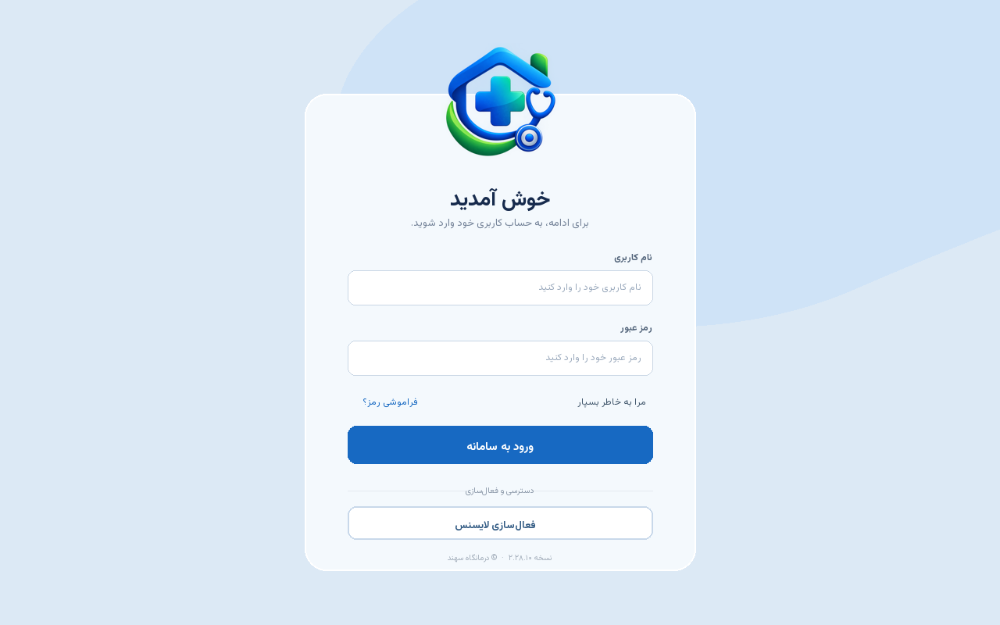
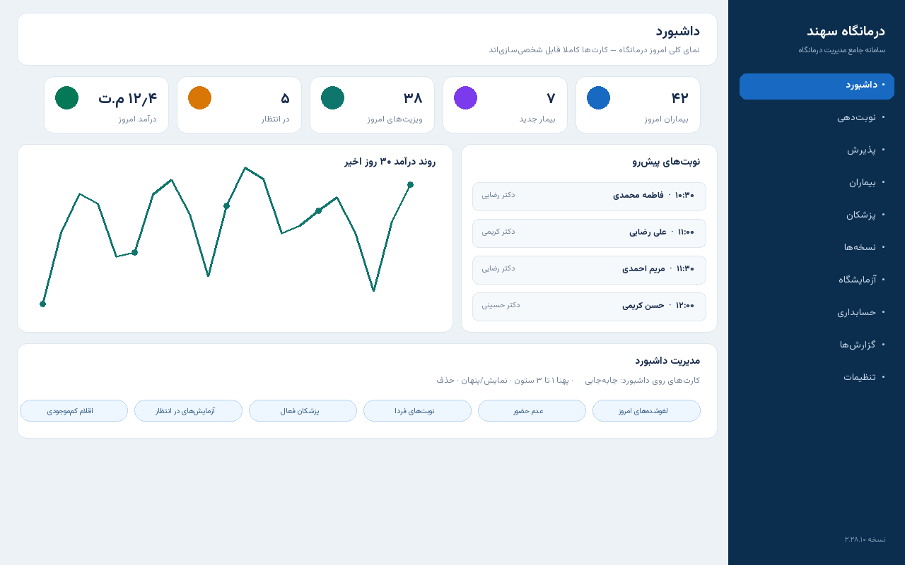
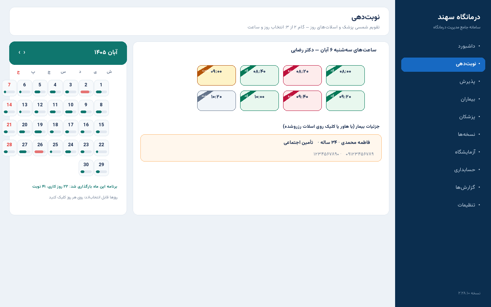
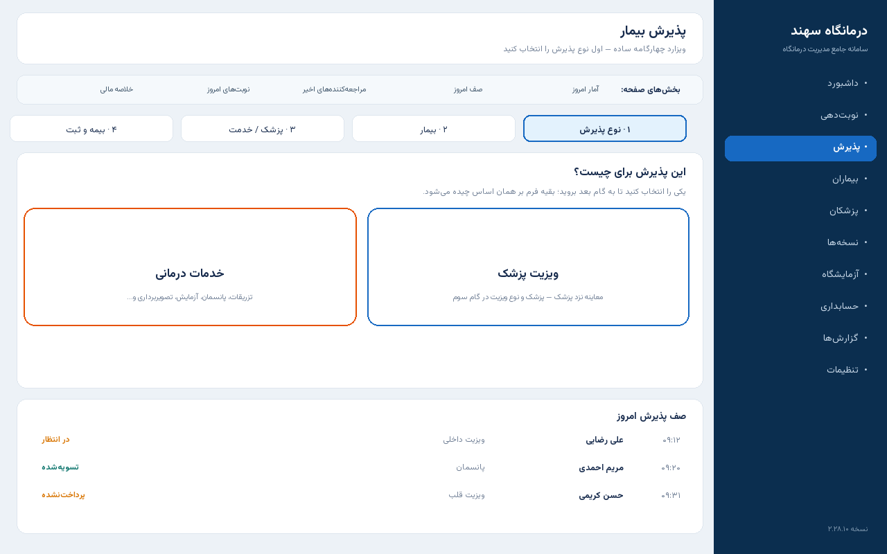

<div dir="rtl" align="center">


# 🏥 سامانه جامع مدیریت درمانگاه سهند

### Sahand ClinicPro

**سامانهٔ یکپارچهٔ فارسی‌زبان مدیریت درمانگاه — از نوبت‌دهی و پذیرش تا پروندهٔ بالینی، آزمایشگاه، حسابداری و پشتیبانی زنده**

[](https://github.com/pranses2011/Sahand_ClinicPro/releases)
[](https://dotnet.microsoft.com)
[](https://learn.microsoft.com/dotnet/csharp)
[](https://materialdesigninxaml.net)
[](https://www.microsoft.com/sql-server)
[](https://github.com/pranses2011/Sahand_ClinicPro/actions)
[](LICENSE)

[✨ امکانات](#-امکانات) · [🖼️ اسکرین‌شات‌ها](#️-اسکرین‌شات‌های-محیط-نرم‌افزار) · [🚀 نصب](#-نصب-و-راه‌اندازی) · [🧱 معماری](#-معماری) · [📦 انتشارها](https://github.com/pranses2011/Sahand_ClinicPro/releases)

</div>

---

<div dir="rtl">

## 📖 معرفی

**درمانگاه سهند (Sahand ClinicPro)** یک سامانهٔ کامل مدیریت درمانگاه است که برای محیط کاری ایران ساخته شده: تقویم و ارقام جلالی، چیدمان راست‌به‌چپ، بیمه‌های ایرانی، نسخهٔ الکترونیک و اتصال به دستگاه‌های حضور و غیاب. برنامه از دو بخش تشکیل می‌شود: یک **کلاینت دسکتاپ ویندوزی (WPF)** برای کارکنان درمانگاه و یک **سرور (ASP.NET Core API)** که روی شبکهٔ داخلی یا سرور درمانگاه اجرا می‌شود؛ به‌همراه **سرور لایسنس** برای فعال‌سازی و پشتیبانی.

| 📊 شاخص | مقدار |
|:--|:--|
| 🧱 معماری | Clean Architecture + CQRS + Repository / UnitOfWork |
| 🗄️ پایگاه داده | SQL Server — بیش از ۹۷ جدول |
| 🔌 API | بیش از ۳۰۰ نقطهٔ پایانی (Endpoint) در ۲۵+ کنترلر |
| 🖥️ کلاینت | ۶۴ فرم WPF با Material Design و RTL کامل |
| 🧩 ماژول‌های لایسنس | ۳۹ ماژول قابل فعال‌سازی جداگانه |
| 🌐 زبان و تقویم | فارسی کامل — جلالی، ارقام فارسی، راست‌به‌چپ |
| 💾 پشتیبان‌گیری | خودکار زمان‌بندی‌شده + ارسال نسخه به ایمیل پشتیبانی و درمانگاه |
| 📦 نصب | نصب کامل یا «فقط به‌روزرسانی» با تشخیص خودکار نسخهٔ نصب‌شده |

---

## 🖼️ اسکرین‌شات‌های محیط نرم‌افزار

> تصاویر زیر محیط فعلی نرم‌افزار (نسخهٔ ۲.۲۸) را نشان می‌دهند. گالری کامل فرم‌ها در پوشهٔ [`docs/screenshots`](docs/screenshots) است.

| 🔐 ورود و فعال‌سازی لایسنس | 📊 داشبورد قابل شخصی‌سازی |
|:--:|:--:|
|  |  |
| **📅 نوبت‌دهی — تقویم شمسی و اسلات‌ها** | **🧾 پذیرش — ویزارد چهارگامه** |
|  |  |

---

## ✨ امکانات

### 📅 نوبت‌دهی و پذیرش

| قابلیت | توضیح |
|:--|:--|
| تقویم شمسی پزشک | نمای ماهانهٔ جلالی با نوار ظرفیت هر روز (سبز تا قرمز)، شمار نوبت و روزهای تعطیل/غیبت |
| اسلات‌های ساعت | کاشی‌های فشردهٔ رنگی: آزاد 🟩، رزروشده 🟥 هاشوردار، استراحت 🟨، گذشته خاکستری؛ روبان وضعیت در گوشهٔ کاشی |
| جزئیات بیمار روی اسلات | هاور = نمایش موقت، کلیک = سنجاق با قاب متحرک؛ جنسیت، سن، بیمه، کد ملی و تلفن فقط در نوار جزئیات |
| پذیرش چهارگامه | ۱) نوع پذیرش: «ویزیت پزشک» یا «خدمات درمانی» ← ۲) بیمار ← ۳) پزشک/خدمت ← ۴) بیمه و ثبت |
| بخش‌های اختیاری پذیرش | آمار امروز، صف امروز، مراجعه‌کننده‌های اخیر، نوبت‌های امروز و خلاصهٔ مالی — با تیک به صفحه اضافه می‌شوند و انتخاب کاربر ذخیره می‌شود |
| استعلام بیمه | بیمه از پروندهٔ بیمار خودکار می‌نشیند؛ درصد پوشش از تنظیمات شرکت بیمه؛ حالت «آزاد» یعنی کل مبلغ با بیمار |
| لوازم مصرفی | فقط در خدمات درمانی؛ ۱۰۰٪ سهم بیمار، با کسر خودکار موجودی انبار |

### 📊 داشبورد مدیریتی

| قابلیت | توضیح |
|:--|:--|
| کارت‌های قابل افزودن | کاتالوگ کارت: بیماران امروز، ویزیت‌ها، در انتظار، درآمد، لغوشده‌ها، عدم حضور، نوبت‌های فردا، کل پرونده‌ها، پزشکان فعال، درآمد ۳۰ روز، آزمایش‌های در انتظار، اقلام کم‌موجودی |
| چیدمان آزاد | افزودن/حذف کارت، جابه‌جایی (دکمه و کشیدن‌ورهاکردن)، پهنای ۱ تا ۳ ستون، نمایش/پنهان — همه خودکار ذخیره می‌شود |
| بخش‌های داشبورد | نمودار درآمد، نوبت‌های پیش‌رو و فعالیت‌های اخیر با همان آزادی چیدمان |

### 🩺 بالینی و تخصصی

| ماژول | توضیح |
|:--|:--|
| 👥 بیماران | پروندهٔ کامل با اعتبارسنجی الگوریتمی کد ملی، آلرژی، بیمه و سوابق |
| 👨‍⚕️ پزشکان | برنامهٔ هفتگی شیفت، اتاق، حق ویزیت و مرخصی/غیبت |
| 💊 نسخه و EMR | نسخه‌نویسی، پروندهٔ بالینی پیشرفته و نمودار رشد WHO |
| 🔬 آزمایشگاه و تصویربرداری | درخواست، جواب‌دهی و ارجاع بین‌بخشی |
| 🕐 حضور و غیاب | اتصال به دستگاه‌های ZKTeco و Hikvision، شیفت و حقوق و دستمزد با قواعد روز |
| 💰 حسابداری و صندوق | فاکتور، پرداخت (نقدی/کارتخوان)، سهم بیمه و بیمار، گزارش‌های مالی و نموداری |
| 📨 پشتیبانی زنده | ارسال پیام از پنل لایسنس مستقیم روی داشبورد درمانگاه (۴ سطح اهمیت) |
| 🔐 لایسنس و نقش‌ها | فعال‌سازی آنلاین، نقش‌ها و مجوزهای فارسی (مدیر سامانه، مدیر درمانگاه، پزشک، پذیرش، حسابدار، پرستار، داروساز، کارشناس آزمایشگاه) |
| 💾 پشتیبان‌گیری خودکار | زمان‌بندی‌شده با ارسال همیشگی نسخه به ایمیل پشتیبانی و — در صورت فعال‌بودن — ایمیل درمانگاه |

---

## 🚀 نصب و راه‌اندازی

از صفحهٔ [**انتشارها (Releases)**](https://github.com/pranses2011/Sahand_ClinicPro/releases) آخرین نسخه را بگیرید:

| بسته | کاربرد | حجم تقریبی |
|:--|:--|--:|
| `SahandClinicPro-Setup-v*.exe` | نصب کامل کلاینت (ویندوز) | ~۷۲ MB |
| `SahandClinicPro-Update-v*.exe` | به‌روزرسانی سبک کلاینتِ نصب‌شده | ~۱۲ MB |
| `SahandClinicPro-Server-v*.zip` | نصب کامل سرور (API + سرویس ویندوزی) | ~۷۱ MB |
| `SahandClinicPro-Server-Update-v*.zip` | به‌روزرسانی سبک سرور نصب‌شده | ~۲۵ MB |
| `SahandClinicPro-LicenseServer-v*.zip` | سرور لایسنس (PHP) | ~۷۰ KB |

> 💡 نصب‌کننده‌ها نصب قبلی و نسخه‌اش را خودکار تشخیص می‌دهند و بین «نصب کامل» و «فقط به‌روزرسانی فایل‌های تغییریافته» حق انتخاب می‌دهند. سلامت سرور با نقطهٔ پایانی `/health/live` سنجیده می‌شود.

### اجرای توسعه‌ای

```bash
# پیش‌نیاز: .NET SDK 8 + SQL Server
dotnet build Sahand.ClinicPro.sln
dotnet run --project src/Sahand.ClinicPro.API          # سرور
dotnet run --project src/Sahand.ClinicPro.Desktop      # کلاینت (ویندوز)
```

حساب پیش‌فرض مدیر پس از اولین اجرا: `admin` / `Admin@123` (در اولین ورود حتماً تغییر دهید).

---

## 🧱 معماری

```
Sahand_ClinicPro/
├── src/
│   ├── Sahand.ClinicPro.Domain/          # موجودیت‌ها و قوانین دامنه
│   ├── Sahand.ClinicPro.Application/     # CQRS، DTO و منطق کاربردی
│   ├── Sahand.ClinicPro.Infrastructure/  # EF Core، ایمیل، سرویس‌های بیرونی
│   ├── Sahand.ClinicPro.API/             # ASP.NET Core API + سلامت و Hangfire
│   ├── Sahand.ClinicPro.Desktop/         # کلاینت WPF (MVVM + Material Design)
│   └── Sahand.ClinicPro.LicensePortal/   # پرتال لایسنس
├── license-server/                       # سرور لایسنس PHP
├── installer/                            # اسکریپت‌های ساخت نصب‌کننده (Inno Setup)
├── docs/                                 # مستندات و اسکرین‌شات‌ها
└── tests/                                # تست‌های خودکار
```

| لایه | فناوری |
|:--|:--|
| کلاینت | WPF · .NET 8 · Material Design In XAML · CommunityToolkit.Mvvm |
| سرور | ASP.NET Core 8 · MediatR (CQRS) · FluentValidation · Hangfire |
| داده | EF Core 8 · SQL Server · Repository + UnitOfWork |
| احراز هویت | JWT + نقش‌ها و مجوزهای دانه‌ای (Permission-based) |
| لایسنس | سرور PHP + فعال‌سازی آنلاین و اعتبارسنجی دوره‌ای |

---

## 🤝 مشارکت و پشتیبانی

- 🐞 گزارش خطا: از بخش [Issues](https://github.com/pranses2011/Sahand_ClinicPro/issues) گیت‌هاب
- 📧 پشتیبانی: داخل خود نرم‌افزار (پشتیبانی زندهٔ سهند) یا ایمیل پشتیبانی ثبت‌شده در تنظیمات
- 📚 مستندات بیشتر: پوشهٔ [`docs`](docs) و [یادداشت‌های انتشار](installer/RELEASE-NOTES.md)

## 📄 مجوز

این پروژه تحت مجوز MIT منتشر شده است — فایل [LICENSE](LICENSE) و [ترجمهٔ فارسی](LICENSE-fa.md).

<div align="center">

**ساخته‌شده با ❤️ برای درمانگاه‌های ایران**

</div>

</div>
