# 🏥 تحلیل جامع و نقشه‌ی تکامل — Sahand ClinicPro

> **نسخه‌ی مبنا:** `2.12.0` · **شاخه:** `arena/79e06b7f-sahand-clinicpro` · **تاریخ تحلیل:** ۱۴۰۴/۰۷/۱۹ (۲۰۲۶-۱۰-۱۱)
> **روش:** تحلیل ایستای کامل ‎۱٬۳۵۳ فایلِ ردیابی‌شده (بدون اجرای بیلد — SDK در دسترس نبود)
> **وضعیت:** 🟢 معماری سالم · 🟠 بدهی فنی انباشته · 🔴 ۲ ایراد امنیتی/عملکردی بحرانی

---

## 📑 فهرست مطالب

| # | بخش | شرح |
|:--|:---|:---|
| ۱ | [خلاصه‌ی مدیریتی](#۱-خلاصهی-مدیریتی) | یک نگاه به وضعیت |
| ۲ | [آمار و متریک‌های واقعی](#۲-آمار-و-متریکهای-واقعی) | اعداد اندازه‌گیری‌شده |
| ۳ | [نمودار معماری](#۳-نمودار-معماری) | لایه‌ها و وابستگی‌ها |
| ۴ | [ایرادها و باگ‌ها](#۴-ایرادها-و-باگها) | ۲۲ مورد مستند با شدت و راهکار |
| ۵ | [بهبودهای عملکردی](#۵-بهبودهای-عملکردی-performance) | سرعت، مقیاس، پایداری |
| ۶ | [امکانات پیشنهادی](#۶-امکانات-پیشنهادی-جدید) | ۱۰ افزونه‌ی جدید |
| ۷ | [طراحی بهترین رابط کاربری](#۷-طراحی-بهترین-رابط-کاربری-uiux) | سیستم طراحی پیشنهادی |
| ۸ | [نقاط قوت](#۸-نقاط-قوت-💪) | چه چیزهایی درست است |
| ۹ | [نقاط ضعف](#۹-نقاط-ضعف-🔻) | چه چیزهایی خطرناک است |
| ۱۰ | [نقشه‌ی راه](#۱۰-نقشهی-راه-پیشنهادی) | ۴ فاز اجرایی |
| ۱۱ | [پیوست: فایل‌های ماژول](#۱۱-پیوست-فایلهای-ماژول) | راهنمای ۳۹ سند جداگانه |

---

## ۱. خلاصه‌ی مدیریتی

سامانه‌ی **Sahand ClinicPro** یک «مونولیتِ ماژولار» بالغ با معماری **Clean Architecture** است که به‌صورت
**WPF Desktop + ASP.NET Core Web API + SQL Server** پیاده‌سازی شده و یک **سرور لایسنس PHP** هم دارد.
کیفیتِ معماریِ لایه‌ای آن **به‌طور محسوسی بالاتر از میانگین پروژه‌های مشابه** است: کلاینت دسکتاپ
**هیچ دسترسی مستقیمی به `DbContext` ندارد** (۰ مورد)، CQRS با MediatR رعایت شده، soft-delete و
ممیزی (Audit) با Interceptor پیاده شده، و انتخاب پکیج‌ها با **وسواسِ حق‌تألیفی** انجام شده
(همه‌ی پکیج‌ها روی آخرین نسخه‌ی **رایگان** پین شده‌اند).

با این حال، پروژه از **«تورمِ تاریخی»** رنج می‌برد: انباشتِ ۲۵ مایگریشن، ۱۲۷ اسکریپت پایتون
(که ۳۴ تای آن نسخه‌های تکراری یک بسته‌ساز است)، یک `CHANGELOG.md` ی ‎۳۹۰ کیلوبایتی،
و ‎۲۲۵٬۲۸۷ خط کدِ تولیدشده که **۶۸٪ از کل مخزن** را تشکیل می‌دهد.

### 🎯 سه تصمیمی که بیشترین بازده را دارد

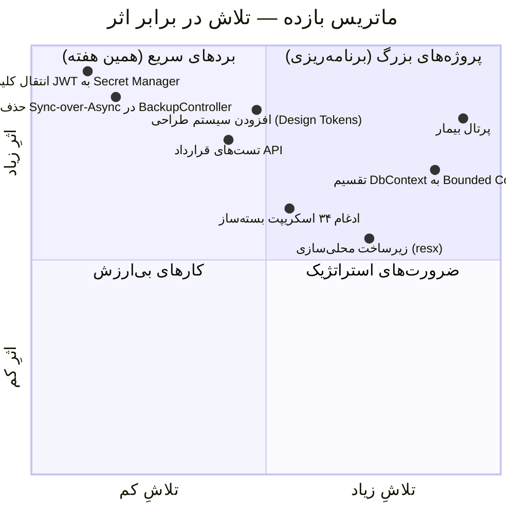

| 🏅 اولویت | اقدام | ⏱ تلاش | 💥 اثر | 🔗 ارجاع |
|:--|:---|:--|:--|:--|
| 🥇 ۱ | انتقال کلید JWT از `appsettings.json` به User-Secret/KeyVault | ۲ ساعت | بحرانی | [BUG-01](#bug-01--کلید-jwt-در-فایل-پیکربندی-hardcode-شده) |
| 🥈 ۲ | حذف `GetAwaiter().GetResult()` از مسیر درخواست | ۳ ساعت | بحرانی | [BUG-02](#bug-02--sync-over-async-در-مسیر-درخواست) |
| 🥉 ۳ | یکپارچه‌سازی ۳۴ اسکریپت بسته‌ساز در یک ابزار | ۱ روز | بالا | [BUG-05](#bug-05--تورم-اسکریپتهای-پایتون-۱۲۷-فایل) |
| ۴ | استخراج «سیستم طراحی» از XAML‌های پراکنده | ۳ روز | بالا | [§۷](#۷-طراحی-بهترین-رابط-کاربری-uiux) |
| ۵ | تقسیم `ClinicProDbContext` به ۵ Bounded Context | ۵ روز | بالا | [BUG-04](#bug-04--dbcontext-غولپیکر-۱۱۲-dbset) |

---

## ۲. آمار و متریک‌های واقعی

### ۲.۱ حجم کد به تفکیک لایه

| لایه | فایل | خط کد (دست‌نویس) | سهم | وضعیت |
|:---|:--:|--:|--:|:---|
| 🖥 **Desktop** (WPF) | ۲۰۶ | **۴۳٬۲۴۱** | ۴۶٫۶٪ | 🔴 تورم شدید |
| ⚙ **Application** (CQRS) | ۱۴۹ | **۱۷٬۶۹۴** | ۱۹٫۱٪ | 🟢 متعادل |
| 🌐 **API** | ۹۰ | **۱۲٬۴۶۸** | ۱۳٫۴٪ | 🟢 متعادل |
| 🗄 **Infrastructure** | ۱۲۹ | **۱۰٬۸۶۳** | ۱۱٫۷٪ | 🟢 متعادل |
| 🧬 **Domain** | ۲۰۰ | **۷٬۸۳۷** | ۸٫۴٪ | 🟢 غنی |
| 🔗 **Shared** | ۶ | **۷۷۳** | ۰٫۸٪ | 🟢 خوب |
| 🐘 **LicenseServer (PHP)** | ۸ | **۲٬۸۹۲** | — | 🟢 خوب |
| **مجموع دست‌نویس** | **۷۸۸** | **۹۲٬۸۷۶** | **۱۰۰٪** | — |
| 🏗 Migrations (تولیدشده) | ۵۳ | **۲۲۵٬۲۸۷** | — | 🔴 ۶۸٪ مخزن |
| 🧪 تست‌ها | ۵۰ | **۷٬۸۲۳** | — | 🟠 کم |
| 🎨 XAML | ۹۳ | **۲۰٬۹۴۳** | — | 🟠 قابل بهبود |
| 🐍 اسکریپت‌ها | ۱۲۷ | **۳۳٬۸۱۶** | — | 🔴 تورم |

> ⚠️ **نکته‌ی کلیدی:** نسبتِ کد تولیدشده به دست‌نویس **۲٫۴ به ۱** است. یعنی از هر ۱۰ خطِ مخزن،
> ۷ خط را کامپایلر/EF نوشته است. این برای CI (زمان بیلد) و بازبینی کد هزینه دارد.

### ۲.۲ متریک‌های معماری

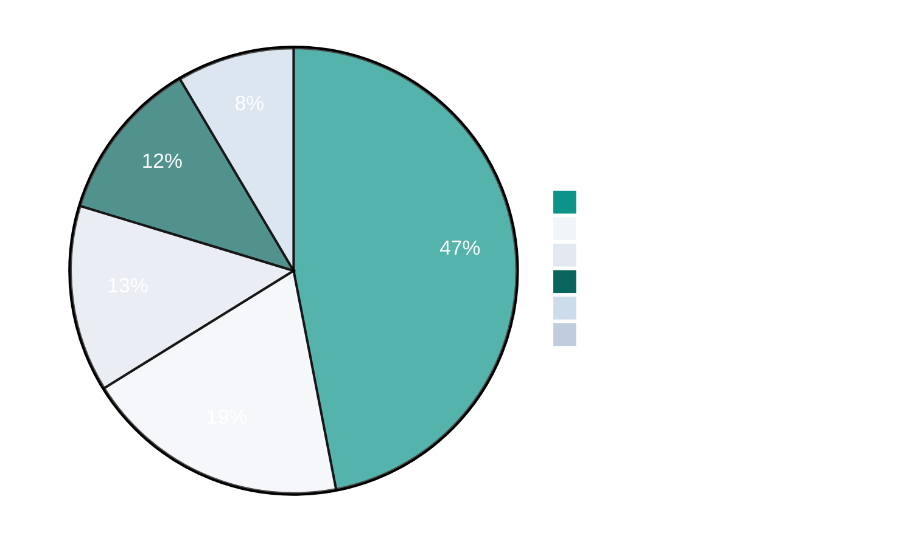

| متریک | مقدار | ارزیابی | توضیح |
|:---|:--:|:---|:---|
| DbSet در `ClinicProDbContext` | **۱۱۲** | 🔴 بحرانی | یک کانتکست برای کل دامنه |
| موجودیت‌های دامنه | **۱۱۲+** | 🟢 بسیار غنی | پوشش کامل درمانگاه |
| Controllerهای API | **۴۳** | 🟠 زیاد | `ReportsController` در ۶ فایل partial |
| Endpointهای HTTP | **۳۰۸** | 🟢 خوب | میانگین ۷ به‌ازای هر کنترلر |
| مجوز `HasPermission` | **۲۵۷** | 🟢 ۸۳٪ پوشش | ۱۲ تای باقی‌مانده `AllowAnonymous` هستند |
| `AllowAnonymous` | **۱۲** | 🟢 منطقی | ورود، سلامت، لایسنس |
| Migrationها | **۲۵** | 🟠 انباشته | ۷ تا بدون فایل Designer |
| مجوزهای RBAC | **۱۶۰+** | 🟢 عالی | دانه‌ریز (ماژول × عملیات) |
| ViewModelها | **۶۸** | 🟠 زیاد | میانگین ۴۳۶ خط |
| Viewهای XAML | **۹۳** | 🟢 مناسب | ۲۹ فرم مستقل + ۶۴ صفحه |
| تست‌ها (`[Fact]`/`[Theory]`) | **۲۷۲** | 🟠 ناکافی | ~۸٪ نسبت به کد دست‌نویس |
| فایل‌های `.resx` | **۰** | 🔴 فقدان | هیچ زیرساخت محلی‌سازی |
| ماژول‌های لایسنس | **۳۹** | 🟢 عالی | فعال‌سازی جداگانه |

### ۲.۳ شاخص‌های سلامت کد

| شاخص | مقدار | نماد | وضعیت |
|:---|:--:|:--:|:---|
| `async void` | ۰ | ✅ | عالی — هیچ فراخوانِ آتش‌وفراموشی |
| `catch { }` خالی | ۰ | ✅ | عالی — هیچ خطای بلعیده‌شده |
| `TODO` / `FIXME` / `HACK` در `src/` | ۰ | ✅ | عالی — بدهی فنی در کد ثبت نشده |
| SQL Injection | ۰ | ✅ | عالی — همه پارامتری + لیست سفید |
| دسترسی مستقیم Desktop به DbContext | ۰ | ✅ | عالی — جداسازی کامل لایه |
| `ConfigureAwait(false)` / ۲٬۰۴۳ `await` | ۲ | ⚠️ | قابل بهبود (کتابخانه‌ای) |
| `catch (Exception)` سراسری | ۵۷ | ⚠️ | ۳۸٪ در مسیرهای UI |
| `AsNoTracking` / ۲۶۰ `ToListAsync` | ۲۰ | ⚠️ | فقط ۷٪ مسیرهای خواندن |
| اسکریپت‌های تکراری پایتون | ۳۴ | 🔴 | `create_release_v15` تا `v242` |
| بزرگ‌ترین ViewModel | ۱٬۳۴۶ خط | 🔴 | `SettingsViewModel` |

---

## ۳. نمودار معماری

### ۳.۱ نمودار لایه‌ها و جریان وابستگی

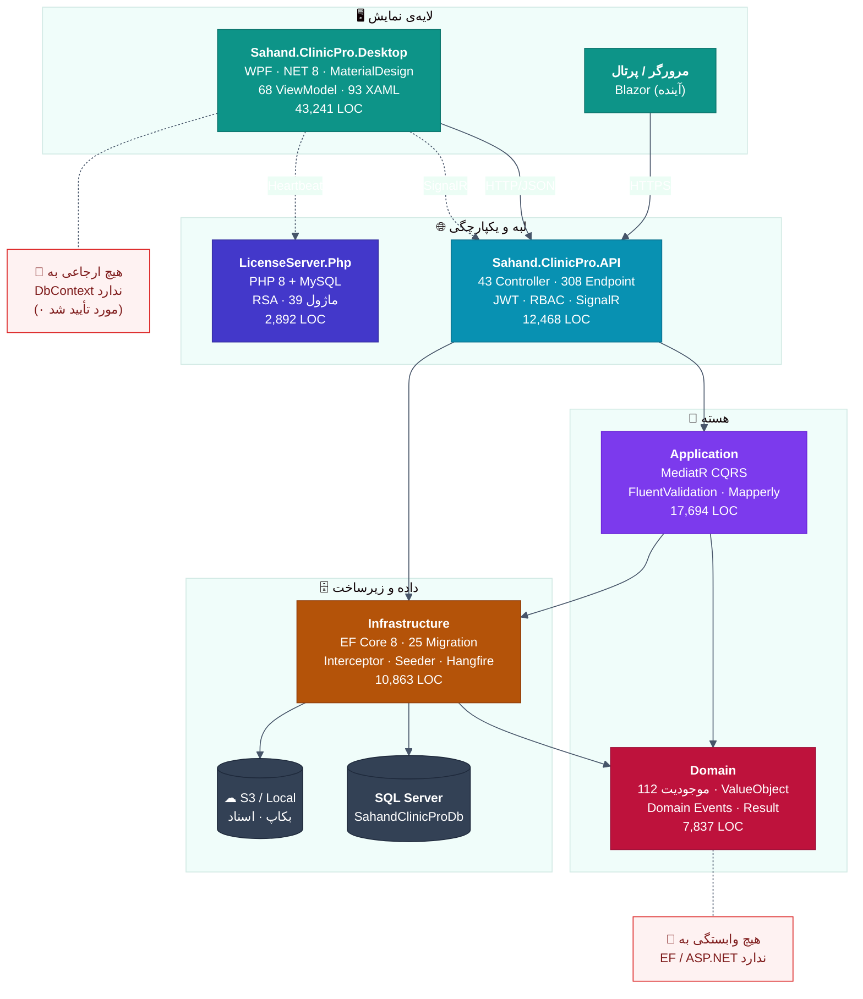

### ۳.۲ جریانِ سفر بیمار (Patient Journey)

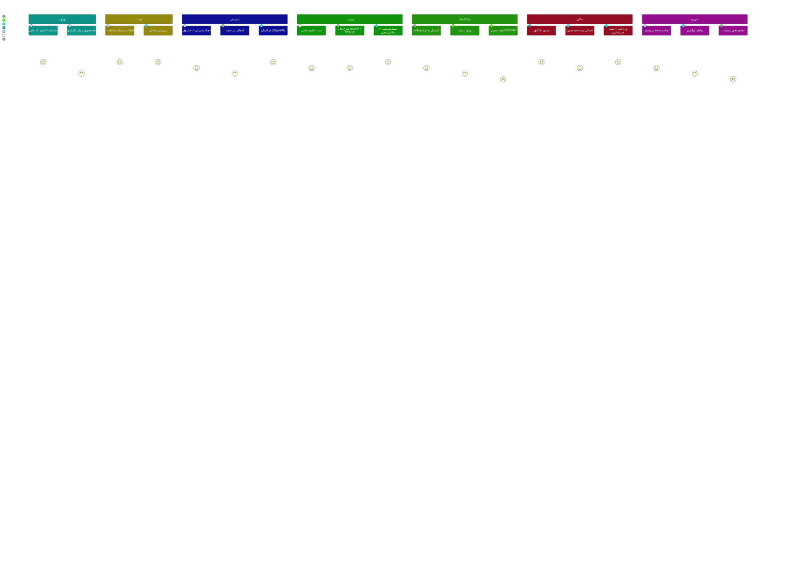

### ۳.۳ جریانِ داده‌ی مالی (دوبل-entry)

```mermaid
%%{init: {'theme':'base','themeVariables':{'primaryColor':'#0d9488','primaryTextColor':'#fff','lineColor':'#64748b'}}}%%
flowchart LR
    A["🧾 Reception<br/>پذیرش"] --> B["💵 Invoice<br/>فاکتور"]
    B --> C{"🛡 بیمه دارد؟"}
    C -->|"بله"| D["⚙ موتور فرانشیز<br/>InsuranceFractionmentRule"]
    C -->|"خیر"| E["💯 سهم بیمار = کل"]
    D --> F["📊 تفکیک<br/>سهم بیمار / سهم بیمه"]
    F --> G["💳 Payment<br/>پرداخت"]
    E --> G
    G --> H["📒 سند حسابداری خودکار<br/>JournalEntry + ۲× Line"]
    H --> I{"⚖ توازن برقرار؟"}
    I -->|"✅ بله"| J["✔ ثبت نهایی<br/>Status = Posted"]
    I -->|"❌ خیر"| K["🚫 UnbalancedJournalEntryException<br/>Rollback"]
    J --> L["📈 گزارش سود و زیان"]
    J --> M["🧾 مطالبه از بیمه<br/>InsuranceClaim"]
    M --> N["🏦 تسویه بیمه<br/>InsuranceSettlement"]

    style A fill:#0d9488,stroke:#0f766e,color:#fff
    style B fill:#0891b2,stroke:#0e7490,color:#fff
    style D fill:#7c3aed,stroke:#6d28d9,color:#fff
    style H fill:#b45309,stroke:#92400e,color:#fff
    style J fill:#15803d,stroke:#166534,color:#fff
    style K fill:#be123c,stroke:#9f1239,color:#fff
    style N fill:#0369a1,stroke:#075985,color:#fff
```

---

## ۴. ایرادها و باگ‌ها

> **راهنمای شدت:** 🔴 بحرانی (امنیت/خرابی) · 🟠 بالا (پایداری/نگهداری) · 🟡 متوسط (کیفیت/عملکرد) · 🔵 کم (صیقل)

### 📊 خلاصه‌ی توزیع ایرادها

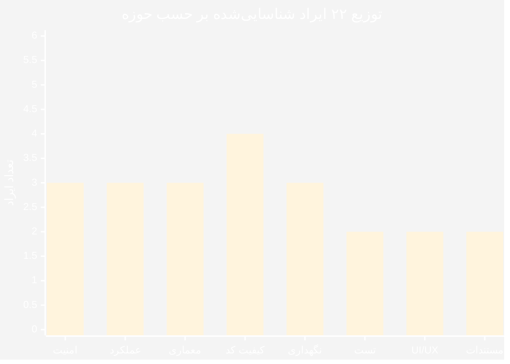

---

### 🔴 ایرادهای بحرانی

#### BUG-01 — کلید JWT در فایل پیکربندی Hardcode شده

| ویژگی | مقدار |
|:---|:---|
| 📍 محل | `src/Sahand.ClinicPro.API/appsettings.json` → `Jwt:SecretKey` |
| 🎯 شدت | 🔴 **بحرانی (امنیتی)** |
| 📦 دسته | CWE-798 — استفاده از اعتبارنامه‌ی رمزنگاری‌شده در مخزن |

**شواهد:**
```json
"Jwt": {
  "SecretKey": "SahandClinicPro-Development-Secret-Key-Change-In-Production-2026!@#x9KmQ",
  "Issuer": "Sahand.ClinicPro",
  "Audience": "Sahand.ClinicPro.Clients",
  "AccessTokenExpiryMinutes": 30,
  "RefreshTokenExpiryDays": 7
}
```

**چرا خطرناک است؟**
- کلید در **مخزن گیت** است → هر کسی که به ریپازیتوری دسترسی داشته باشد (یا روزی فورک کند) می‌تواند
  **توکنِ مدیر سیستم جعل کند** و به همه‌ی ۳۰۸ اندپوینت با دسترسی کامل برسد.
- چرخش کلید (Key Rotation) مستلزم **کامیت + انتشار مجدد** است.
- در محیط Production اگر اپراتور فراموش کند تغییر دهد، کلیدِ عمومی باقی می‌ماند.

> ✅ **نکته‌ی مثبت:** پروژه یک گارد هوشمند دارد — `tests/.../JwtKeyGuardTests.cs` کلیدهای پیش‌فرض را
> در Production شناسایی می‌کند. این یعنی **آگاهی امنیتی وجود دارد**؛ فقط باید به مرحله‌ی اجرا برسد.

**راهکار (دستورالعمل):**
1. کلید را از `appsettings.json` حذف و مقدار را خالی بگذارید.
2. در توسعه از **User Secrets** استفاده کنید:
   ```bash
   cd src/Sahand.ClinicPro.API
   dotnet user-secrets init
   dotnet user-secrets set "Jwt:SecretKey" "$(openssl rand -base64 48)"
   ```
3. در Production از **Environment Variable** یا **Azure Key Vault / Windows DPAPI**:
   ```bash
   # PowerShell (ویندوز — سرویس IIS)
   [System.Environment]::SetEnvironmentVariable(
       "Jwt__SecretKey", "<کلید-تصادفی-۶۴-بایتی>", "Machine")
   ```
4. یک **کلید چرخان** پیاده‌سازی کنید (`Jwt:PreviousSecretKey`) تا توکن‌های در گردش هنگام چرخش باطل نشوند.
5. فایل `.gitignore` را بررسی کنید که `appsettings.Production.json` و `secrets.json` را پوشش دهد.

---

#### BUG-02 — Sync-over-Async در مسیر درخواست

| ویژگی | مقدار |
|:---|:---|
| 📍 محل | `src/Sahand.ClinicPro.API/Controllers/BackupController.cs:456` |
| 🎯 شدت | 🔴 **بحرانی (پایداری)** |
| 📦 دسته | Thread-Pool Starvation |

**شواهد:**
```csharp
private CloudBackupService CloudSvc =>
    _cloudService ??= new CloudBackupService(
        BuildCloudConfigAsync(CancellationToken.None).GetAwaiter().GetResult(),  // ❌
        NullLogger<CloudBackupService>.Instance);
```

**چرا خطرناک است؟**
`GetAwaiter().GetResult()` در یک **Property Getter** که از داخلِ اکشنِ کنترلر صدا زده می‌شود،
**thread درخواست را مسدود** می‌کند. تحت بارِ همزمان (مثلاً ۵۰ درخواستِ همزمان به
`backup/cloud/*`) رشته‌های Thread Pool تمام می‌شوند و **کل API از پاسخ‌دهی می‌ایستد** —
نه فقط بخش بکاپ. این یک «الگوی خودکشیِ مقیاس‌پذیری» است.

**راهکار:**
```csharp
// ✅ درست: تبدیل به یک متد ناهمزمان و کش در سطح نمونه
private readonly SemaphoreSlim _cloudInitLock = new(1, 1);
private CloudBackupService? _cloudService;

private async Task<CloudBackupService> GetCloudServiceAsync(CancellationToken ct)
{
    if (_cloudService is not null) return _cloudService;
    await _cloudInitLock.WaitAsync(ct);
    try
    {
        return _cloudService ??= new CloudBackupService(
            await BuildCloudConfigAsync(ct),
            NullLogger<CloudBackupService>.Instance);
    }
    finally { _cloudInitLock.Release(); }
}

// در اکشن‌ها:
var svc = await GetCloudServiceAsync(ct);
```

---

#### BUG-03 — `.Result` پس از `Task.WhenAll` در لایه‌ی UI

| ویژگی | مقدار |
|:---|:---|
| 📍 محل | `src/Sahand.ClinicPro.Desktop/ViewModels/ReportsViewModel.cs:84-85` |
| 🎯 شدت | 🟠 **بالا** |
| 📦 دسته | Deadlock بالقوه در UI Thread |

**شواهد:**
```csharp
var revenueTask = _api.GetAsync<RevenueResponse>($"reports/daily-revenue?days={Days}");
var perfTask    = _api.GetAsync<PerformanceResponse>($"reports/doctor-performance?days={Days}");
await Task.WhenAll(revenueTask, perfTask);

var revenue = revenueTask.Result;   // ⚠️ در صورت خطا، AggregateException پرتاب می‌کند
var perf    = perfTask.Result;      // ⚠️ و رشته‌ی UI را مسدود می‌کند
```

**چرا مشکل‌ساز است؟**
اگر هرکدام از تسک‌ها **خطا** بدهند، `Task.WhenAll` در خطِ `await` پرتاب می‌کند و این دو خط اجرا
نمی‌شوند — پس `try/catch` اطراف آن فقط یک `AggregateException` می‌گیرد نه خطای واقعی.
اگر هم خطا رخ ندهد، `.Result` روی رشته‌ای که `SynchronizationContext` دارد می‌تواند
در سناریوهای بازگشتی **بن‌بست** ایجاد کند.

**راهکار:**
```csharp
// ✅ درست: await روی هر تسک به‌صورت جداگانه (خطاها هم مجزا می‌شوند)
var revenueTask = _api.GetAsync<RevenueResponse>($"reports/daily-revenue?days={Days}");
var perfTask    = _api.GetAsync<PerformanceResponse>($"reports/doctor-performance?days={Days}");

var revenue = await revenueTask;   // ✅
var perf    = await perfTask;      // ✅
// یا: var (revenue, perf) = await (revenueTask, perfTask).WhenAll();
```

> 🔍 **دستور جستجو برای یافتن موارد مشابه:**
> ```bash
> grep -rn --include=*.cs -E '\.(Result|Wait)\(\)|GetAwaiter\(\)\.GetResult\(\)' src/
> ```

---

### 🟠 ایرادهای سطح بالا

#### BUG-04 — DbContext غول‌پیکر (۱۱۲ DbSet)

| ویژگی | مقدار |
|:---|:---|
| 📍 محل | `src/Sahand.ClinicPro.Infrastructure/Persistence/ClinicProDbContext.cs` |
| 🎯 شدت | 🟠 **بالا** |
| 📦 دسته | Bounded Context / Performance |

**شواهد:** ۱۱۲ `DbSet<>` در یک کانتکست؛ مدل Snapshot آن **۱۱٬۸۲۴ خط** است.

**پیامدها:**
| پیامد | توضیح |
|:---|:---|
| 🐢 راه‌اندازی کند | EF باید مدل ۱۱۲ موجودیت + ۱۰۰+ پیکربندی را در اولین query بسازد |
| 🔒 قفلِ مایگریشن | هر تغییرِ کوچک یک مایگریشنِ جدید روی کل مدل تولید می‌کند |
| 🧠 حافظه | ردیابی تغییرات برای موجودیت‌های بی‌ربط هم فعال است |
| 👥 تداخل تیمی | دو توسعه‌دهنده روی ماژول‌های مختلف همیشه conflict دارند |
| 🧪 تست‌ناپذیری | In-Memory/SQLite برای تست باید کل مدل را بالا بیاورد |

**راهکار — تقسیم به ۵ Bounded Context:**

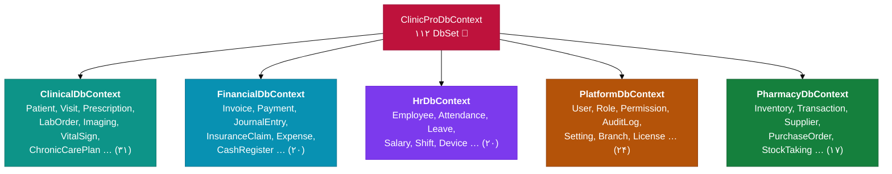

> ⚠️ **توصیه‌ی احتیاطی:** این کار را یک‌باره انجام ندهید. ابتدا `IFinancialDbContext` را
> به‌عنوان «کانتکستِ خواندنِ گزارش‌ها» (read-only) جدا کنید، سپس بقیه را تدریجی.
> راهنمای گام‌به‌گام: [`docs/analysis/modules/C11-database-scalability.md`](modules/C11-database-scalability.md)

---

#### BUG-05 — تورم اسکریپت‌های پایتون (۱۲۷ فایل)

| ویژگی | مقدار |
|:---|:---|
| 📍 محل | `scripts/` — ۳۳٬۸۱۶ خط |
| 🎯 شدت | 🟠 **بالا** |
| 📦 دسته | تکرار کد (DRY) |

**شواهد:** ۳۴ اسکریپتِ تقریباً یکسان:
```
create_release_v15.py, v16, v17, v19, v20, v201, v202, v203, v204, v205
create_update_zip_v202.py, v203, v204, v205, v206, v207, v210,
  v211, v212, v220, v230, v240, v241, v2410, v2411, v242
build_release_zips_v14.py, v15, v16, v17
build_release_assets_v20.py
```

**تحلیل:** هر نسخه، کپیِ کامل نسخه‌ی قبلی + چند تغییر است. این یعنی:
- 🔍 یافتنِ نسخه‌ی «صحیح» برای اپراتور ناممکن است
- 🐛 رفع یک باگ در بسته‌ساز باید در ۳۴ فایل تکرار شود
- 📦 حجم مخزن و زمان CI بی‌دلیل بالا می‌رود

**راهکار:** یک ابزار خط‌فرمان واحد با پارامتر نسخه:
```bash
# جایگزینِ ۳۴ اسکریپت:
python scripts/clinicpro_release.py release --from 2.11.0 --to 2.12.0 --channel stable
python scripts/clinicpro_release.py update-zip --from 2.11.0 --to 2.13.0
```
> 📄 راهنمای مهاجرت: [`docs/analysis/modules/C10-release-automation.md`](modules/C10-release-automation.md)

---

#### BUG-06 — پوشش تست ناکافی

| ویژگی | مقدار |
|:---|:---|
| 📍 محل | `tests/` — ۵۰ فایل، ۲۷۲ تست، ۷٬۸۲۳ خط |
| 🎯 شدت | 🟠 **بالا** |
| 📦 دسته | اطمینان کیفیت |

**تحلیل شکاف:**
| لایه | کد دست‌نویس | تست موجود | وضعیت |
|:---|--:|--:|:---|
| Domain | ۷٬۸۳۷ | ~۱۵ تست | 🟠 ناکافی — منطقِ ValueObject/NationalCode حیاتی است |
| Application | ۱۷٬۶۹۴ | ~۳۵ تست | 🟠 ناکافی — Handlerها پوشش ضعیفی دارند |
| Infrastructure | ۱۰٬۸۶۳ | ~۴۵ تست | 🟡 متوسط |
| API | ۱۲٬۴۶۸ | ~۲۵ تست | 🟠 ناکافی |
| **Desktop** | **۴۳٬۲۴۱** | **~۱۵ تست** | 🔴 **بحرانی** — بزرگ‌ترین لایه، کمترین تست |

> 🔴 **بزرگ‌ترین ریسک:** لایه‌ی Desktop با ۴۶٪ کد، فقط ~۶ تستِ واقعی دارد
> (`ApiHttpTests`, `LoginFlowTests`, `MoneyFlowViewModelTests`, `LicenseModuleChipTests`,
> `TrainingCatalogTests`, `XamlResourceAuditTests`). این همان لایه‌ای است که
> طبق `PROGRESS.md`، ۴۸ چرخه رفعِ باگِ گزارش‌شده‌ی مالک را تجربه کرده است.

**راهکار — هرم تست:**

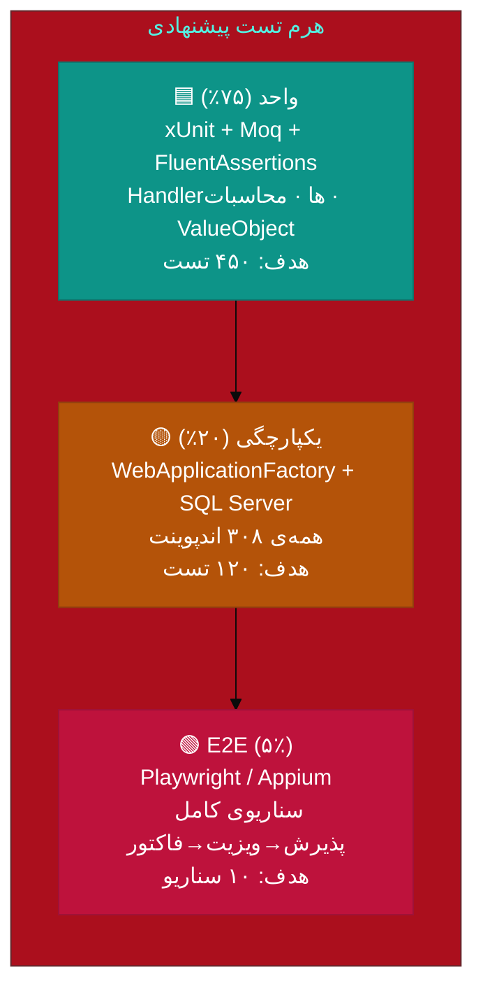

---

### 🟡 ایرادهای سطح متوسط

#### BUG-07 — فقدان زیرساخت محلی‌سازی (۰ فایل `.resx`)

همه‌ی رشته‌های فارسی درون XAML و ViewModelها hardcode شده‌اند.
- 🚫 افزودن زبان دوم (انگلیسی/عربی/کردی) مستلزم بازنویسی کل ۹۳ فایل XAML است
- 🚫 اصلاح یک اصطلاح پزشکی باید در ده‌ها فایل تکرار شود

**راهکار:** `Resources/Strings.fa-IR.resx` + `Strings.en-US.resx` + `DynamicResource` در XAML.
> 📄 [`D09-localization-i18n.md`](modules/D09-localization-i18n.md)

---

#### BUG-08 — `ConfigureAwait(false)` تقریباً استفاده نشده

از ۲٬۰۴۳ فراخوان `await`، تنها **۲ مورد** `ConfigureAwait(false)` دارند.
در لایه‌های `Application`/`Infrastructure` (که کتابخانه هستند) این باعث می‌شود
ادامه‌ی هر تسک مجبوراً به `SynchronizationContext` برگردد → سربار غیرضروری.

**راهکار:** در `.editorconfig` یک analyzer فعال کنید:
```editorconfig
dotnet_diagnostic.CA2007.severity = warning   # ConfigureAwait را فراموش نکن
```
> ⚠️ فقط در لایه‌های غیر-UI؛ در ViewModelها نباید استفاده شود.

---

#### BUG-09 — `CancellationToken` در ۵۵ فایل از ۱۴۹ فایل Application غایب است

۳۷٪ از Handlerها توکنِ لغو را قبول نمی‌کنند → در گزارش‌های سنگین،
بستنِ پنجره یا Timeoutِ HTTP عملیاتِ دیتابیس را متوقف نمی‌کند.

---

#### BUG-10 تا BUG-16

| # | ایراد | 📍 محل | 🎯 شدت | راهکار |
|:--|:---|:---|:--:|:---|
| **BUG-10** | ۷ مایگریشن بدون فایل `.Designer.cs`<br/>`Cycle21TemplateItemsGuard`, `Cycle23TemplateDoctorNullable`,<br/>`Cycle24ReceptionServices`, `Cycle39ReceptionRoom`,<br/>`Cycle39MedicationItemKind`, `Cycle41UserShortcuts`,<br/>`Cycle42SeedPositionsDepartments` | `Persistence/Migrations/` | 🟡 | این فایل‌ها دست‌نویس‌اند و در snapshot ثبت نشده‌اند → خطرِ انحراف مدل. یک تستِ «تطابق snapshot» اضافه کنید |
| **BUG-11** | `CHANGELOG.md` با ‎۳۹۰ کیلوبایت و ۲٬۰۱۲ خط | ریشه | 🟡 | بایگانی به `docs/changelog/archive/` + `CHANGELOG.md` فقط ۳ نسخه‌ی آخر |
| **BUG-12** | God ViewModelها: `SettingsViewModel` (۱٬۳۴۶ خط)،<br/>`ReceptionsViewModel` (۱٬۳۱۶)، `DoctorsViewModel` (۱٬۰۶۳، ۲۱ فرمان)،<br/>`PatientDetailViewModel` (۱٬۰۶۹) | `Desktop/ViewModels/` | 🟡 | شکستن به Child-ViewModel با Composition |
| **BUG-13** | ۴٬۳۸۲ خط کدِ Code-Behind روی Viewها<br/>(`ReportBrowserView` ۳۳۴، `GuidedTourWindow` ۳۲۲،<br/>`AdvancedEmrView` ۳۱۲، `PayslipWindow` ۲۸۶) | `Desktop/Views/*.xaml.cs` | 🟡 | انتقال منطق به Behavior/Command/ViewModel |
| **BUG-14** | `AsNoTracking` فقط در ۲۰ مورد از ۲۶۰ `ToListAsync` | سراسر | 🟡 | در همه‌ی مسیرهای خواندنِ گزارش فعال شود |
| **BUG-15** | ۵۷ بلوکِ `catch (Exception)` سراسری | سراسر | 🟡 | محدود به `catch (SpecificException)` + Policy |
| **BUG-16** | `ReportsController` در ۶ فایل `partial` پخش شده<br/>(۱٬۲۲۸ + ۴ فایل ChartReports) | `API/Controllers/` | 🟡 | تفکیک به `ChartReportsController` مستقل |

---

### 🔵 ایرادهای سطح کم / صیقل

| # | ایراد | 📍 محل | راهکار |
|:--|:---|:---|:---|
| **BUG-17** | `appsettings.json` دسکتاپ، `BaseUrl` را به `localhost:5000` سخت‌کد کرده | `Desktop/appsettings.json` | پشتیبانی از آدرس نسبی + پروفایل شبکه |
| **BUG-18** | `TrustServerCertificate=True` در رشته‌ی اتصال | `API/appsettings.json` | فقط در توسعه؛ در Production با گواهی معتبر |
| **BUG-19** | `Backup:Directory` پیش‌فرض `C:/Backups/...` (ویندوزی) | `API/appsettings.json` | مسیرِ نسبیِ چندسکویی |
| **BUG-20** | هیچ `HealthCheck`ـی برای SQL Server تعریف نشده | `API/Program.cs` | `AddHealthChecks().AddDbContextCheck<>()` |
| **BUG-21** | نبود `OpenTelemetry` / ردیابی توزیع‌شده | سراسر | افزودن Activity + Jaeger exporter |
| **BUG-22** | مستندات در ۲۴ فایل MD پراکنده با همپوشانی<br/>(`TODO.md`, `TODO-v1.1`…`TODO-v2.0.1` = ۱۳ فایل!) | ریشه + `docs/` | ادغام در `docs/roadmap/` یکپارچه |

---

## ۵. بهبودهای عملکردی (Performance)

### ۵.۱ نقشه‌ی حرارتیِ بهینه‌سازی

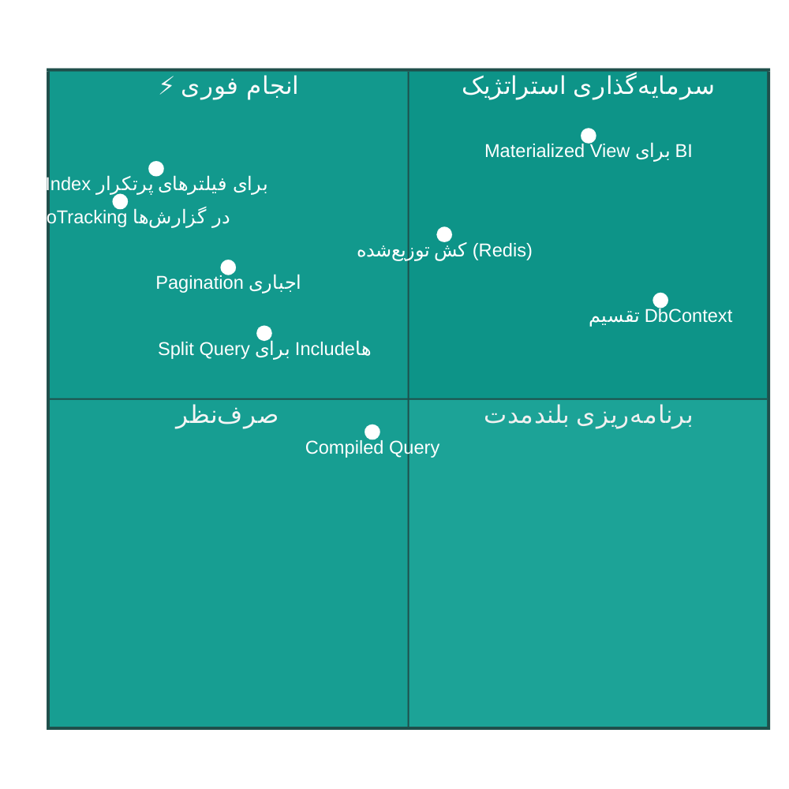

### ۵.۲ جدول بهبودها

| 🏷 بهبود | 📍 محل اعمال | 💥 اثر مورد انتظار | ⏱ تلاش | 🔧 ابزار |
|:---|:---|:---|:--:|:---|
| **P-01** · `AsNoTracking()` در همه‌ی Queryهای گزارش | `Application/Features/Reports/*` | ⬇ ۳۵٪ حافظه، ⬆ ۲۰٪ سرعت | ۴ ساعت | EF Core |
| **P-02** · Index مرکب برای `(IsDeleted, BranchId, CreatedAt)` | Migrations جدید | ⬆ ۴۰-۷۰٪ سرعت لیست‌ها | ۶ ساعت | EF `HasIndex` |
| **P-03** · Pagination اجباری در همه‌ی لیست‌ها | ۳۰۸ اندپوینت | ⬇ بار شبکه و حافظه | ۱ روز | `PagedRequest` یکپارچه |
| **P-04** · `AsSplitQuery()` برای `Include`های چندشاخه | `Repository<T>` | رفع Cartesian Explosion | ۴ ساعت | EF Core 8 |
| **P-05** · کش توزیع‌شده برای Lookupها (تخصص، دارو، ICD-10) | `Application/Features/Lookups` | ⬇ ۸۰٪ query تکراری | ۱ روز | `IDistributedCache` + Redis |
| **P-06** · `IMemoryCache` برای داده‌های مرجعِ ایستا | `Infrastructure/Services` | ⬇ ۹۰٪ query تنظیمات | ۴ ساعت | `Microsoft.Extensions.Caching` |
| **P-07** · Response Compression (Brotli/Gzip) | `API/Program.cs` | ⬇ ۷۰٪ حجم پاسخ | ۱ ساعت | `AddResponseCompression` |
| **P-08** · Virtualization در DataGridهای بزرگ | `Desktop/Views/*` | UI روان با ۱۰۰هزار ردیف | ۲ روز | `EnableRowVirtualization` |
| **P-09** · Compiled Query برای مسیرهای داغ (جستجوی بیمار) | `PatientRepository` | ⬆ ۲۵٪ سرعت | ۱ روز | `EF.CompileAsyncQuery` |
| **P-10** · Materialized View / جدول خلاصه برای داشبورد | Migration + Job | ⬆ ۱۰× سرعت داشبورد | ۳ روز | SQL Indexed View |
| **P-11** · بستنِ خودکارِ اتصال SignalR بیکار | `Desktop/Services/RealtimeClient` | ⬇ مصرف منبع سرور | ۳ ساعت | Heartbeat + Retry |
| **P-12** · Batch Insert برای ورود کالا / ضرباتِ دستگاه | `StockIn` · `AttendanceSync` | ⬆ ۵۰× سرعت درج | ۱ روز | `AddRangeAsync` + Bulk |

### ۵.۳ نمودارِ جریانِ کش پیشنهادی

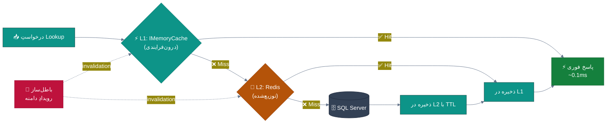

---

## ۶. امکانات پیشنهادیِ جدید

### ۶.۱ نقشه‌ی امکانات بر حسب ارزش و دشواری

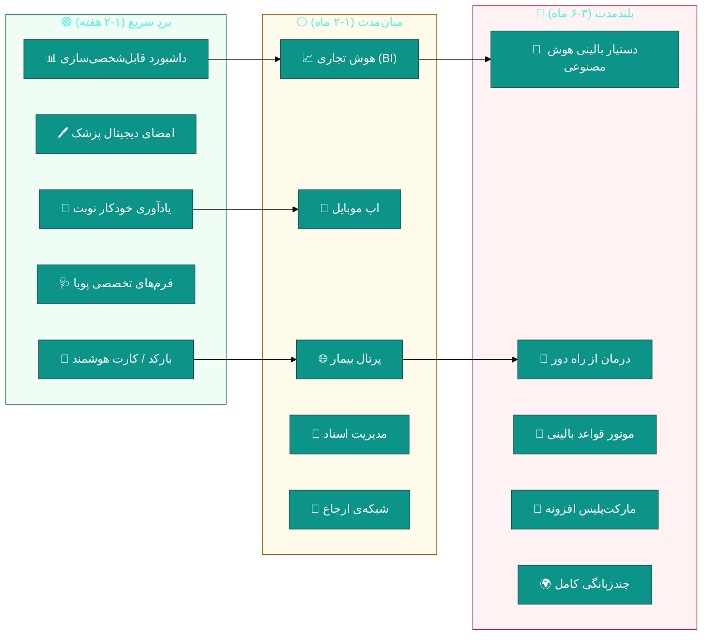

### ۶.۲ جدولِ ۱۰ امکانِ اولویت‌دار

| 🎯 # | امکان | 📝 شرح | 💰 ارزش کسب‌وکار | 🔧 دشواری | 📄 سند |
|:--:|:---|:---|:---|:--:|:---|
| ۱ | 🌐 **پرتال بیمار** | مشاهده‌ی نتایج آزمایش، نوبت‌ها، سوابق و پرداخت آنلاین | ⭐⭐⭐⭐⭐ بالا — تمایز رقابتی | 🟡 متوسط | [`D01`](modules/D01-patient-portal.md) |
| ۲ | 📱 **اپ موبایل** | MAUI/Flutter برای بیمار و پزشک | ⭐⭐⭐⭐⭐ بالا | 🔴 زیاد | [`D01`](modules/D01-patient-portal.md) |
| ₃ | 🤖 **دستیار بالینی AI** | پیشنهاد ICD-10، خلاصه‌سازی ویزیت، هشدار تداخل هوشمند | ⭐⭐⭐⭐⭐ تحول‌آفرین | 🔴 زیاد | [`D03`](modules/D03-ai-assistant.md) |
| ۴ | 📈 **هوش تجاری (BI)** | OLAP، پیش‌بینی درآمد، تحلیل RFM بیماران | ⭐⭐⭐⭐ بالا | 🟡 متوسط | [`D04`](modules/D04-bi-analytics.md) |
| ۵ | 🎥 **درمان از راه دور** | ویدیو‌ویزیت یکپارچه با نوبت‌دهی | ⭐⭐⭐⭐ بالا | 🔴 زیاد | [`D02`](modules/D02-telemedicine.md) |
| ۶ | 📁 **مدیریت اسناد** | DMS با نسخه‌بندی، OCR، یکپارچگی PACS | ⭐⭐⭐⭐ بالا | 🟡 متوسط | [`D05`](modules/D05-document-management.md) |
| ۷ | 🔗 **شبکه‌ی ارجاع** | ارجاع به متخصص/آزمایشگاه بیرونی + پیگیری | ⭐⭐⭐ متوسط | 🟡 متوسط | [`D06`](modules/D06-referral-network.md) |
| ۸ | 📣 **CRM و وفاداری** | کمپین پیامکی، باشگاه مشتریان، تحلیل ریزش | ⭐⭐⭐⭐ بالا | 🟢 کم | [`D07`](modules/D07-crm-marketing.md) |
| ۹ | 🧰 **مدیریت تجهیزات** | دارایی‌ها، کالیبراسیون، نگهداری پیشگیرانه | ⭐⭐⭐ متوسط | 🟢 کم | [`D08`](modules/D08-assets-equipment.md) |
| ۱۰ | 🔌 **API عمومی + مارکت‌پلیس** | فروش افزونه توسط شخص ثالث | ⭐⭐⭐⭐ استراتژیک | 🔴 زیاد | [`D10`](modules/D10-public-api-marketplace.md) |

### ۶.۳ ماتریسِ «امکان × ماژولِ فعلی»

| امکانِ جدید | بیماران | نوبت | ویزیت | نسخه | مالی | گزارش | لایسنس |
|:---|:--:|:--:|:--:|:--:|:--:|:--:|:--:|
| 🌐 پرتال بیمار | ✅ | ✅ | ✅ | ✅ | ✅ | ➖ | 🆕 `PatientPortal` |
| 🤖 دستیار AI | ➕ | ➕ | ✅ | ✅ | ➖ | ✅ | 🆕 `AiAssistant` |
| 🎥 تلمدیسین | ➕ | ✅ | ✅ | ✅ | ✅ | ➖ | 🆕 `Telemedicine` |
| 📈 هوش تجاری | ➖ | ➖ | ➖ | ➖ | ✅ | ✅ | 🆕 `Analytics` |
| 📣 CRM | ✅ | ➕ | ➖ | ➖ | ➕ | ✅ | 🆕 `Crm` |
| 🧰 تجهیزات | ➖ | ➖ | ➖ | ➖ | ✅ | ➕ | 🆕 `Assets` |

> **راهنما:** ✅ یکپارچگی عمیق · ➕ یکپارچگی سبک · ➖ بدون نیاز · 🆕 ماژول لایسنس جدید

---

## ۷. طراحی بهترین رابط کاربری (UI/UX)

### ۷.۱ ارزیابی وضعیت فعلی

| بُعد | وضعیت فعلی | امتیاز | هدف |
|:---|:---|:--:|:--:|
| 🎨 زبان طراحی | Material Design 5.3.2 — اما بدون Token یکپارچه | ۶/۱۰ | ۹/۱۰ |
| 🌙 تم تاریک/روشن | موجود (`IThemeService`) | ۸/۱۰ | ۹/۱۰ |
| ↔ پشتیبانی RTL | پیاده‌سازی شده (`FlowDirection`) | ۹/۱۰ | ۱۰/۱۰ |
| 🔤 تایپوگرافی فارسی | Vazirmatn — انتخاب عالی | ۹/۱۰ | ۱۰/۱۰ |
| 📐 یکپارچگی چیدمان | استایل‌ها در XAML پراکنده | ۵/۱۰ | ۹/۱۰ |
| ♿ دسترس‌پذیری | بدون `AutomationProperties` / اندازه‌ی هدف لمسی | ۳/۱۰ | ۸/۱۰ |
| ⚡ بازخورد لحظه‌ای | SignalR برای صف و اعلان | ۸/۱۰ | ۱۰/۱۰ |
| 📱 واکنش‌گرایی | ثابت برای دسکتاپ (۱۲۸۰px+) | ۴/۱۰ | ۷/۱۰ |
| 🧭 ناوبری | منوی کناری + Breadcrumb + میانبرها | ۸/۱۰ | ۹/۱۰ |

**میانگین فعلی: ۶٫۷/۱۰** · **هدف: ۹٫۰/۱۰**

### ۷.۲ معماریِ سیستم طراحی پیشنهادی

```mermaid
%%{init: {'theme':'base','themeVariables':{'primaryColor':'#0d9488','primaryTextColor':'#fff','lineColor':'#64748b'}}}%%
graph TB
    subgraph L1["لایه ۱ — بنیاد (Foundations)"]
        T1["🎨 Design Tokens<br/>رنگ · فاصله · شعاع · سایه · انیمیشن"]
        T2["🔤 تایپوگرافی<br/>Vazirmatn: 8 وزن<br/>مقیاسِ نوعی RTL"]
        T3["📐 شبکه و فاصله‌گذاری<br/>پایه ۴ پیکسل · ۱۲ ستون"]
        T4["🖼 آیکون‌شناسی<br/>Material + پک پزشکی سفارشی"]
    end
    subgraph L2["لایه ۲ — اتم‌ها (Atoms)"]
        A1["🔘 Button<br/>Primary / Secondary / Ghost / Danger"]
        A2["📝 Input<br/>Text / Combo / Date / Masked"]
        A3["🏷 Badge · Chip · Tag"]
        A4["📊 Data Display<br/>Table / Card / Stat / Avatar"]
    end
    subgraph L3["لایه ۳ — مولکول‌ها (Molecules)"]
        M1["🔍 جستجوی هوشمند<br/>جستجوی یکپارچه‌ی بیمار"]
        M2["📋 فرمِ پویا<br/>بر اساس تعریفِ فیلد"]
        M3["🗂 تب و آکاردئون"]
        M4["💬 دیالوگ و Snackbar"]
    end
    subgraph L4["لایه ۴ — ارگانیسم‌ها (Organisms)"]
        O1["🧭 ناوبری<br/>Rail · TopBar · Command Palette"]
        O2["📊 داشبورد<br/>کاشی‌های قابل چیدمان"]
        O3["📄 صفحه‌ی فرم<br/>هدر · بخش‌ها · نوار اقدام"]
        O4["🗃 صفحه‌ی لیست<br/>فیلتر · جدول · صفحه‌بندی"]
    end
    subgraph L5["لایه ۵ — الگوها (Patterns)"]
        P1["🔎 الگوی جستجو و انتخاب"]
        P2["✏ الگوی ویرایش درجا"]
        P3["🧙 الگوی جریان چندمرحله‌ای"]
        P4["⏮ الگوی بازگشت/لغو"]
    end

    L1 --> L2 --> L3 --> L4 --> L5
    style L1 fill:#0d9488,stroke:#0f766e,color:#fff
    style L2 fill:#0891b2,stroke:#0e7490,color:#fff
    style L3 fill:#7c3aed,stroke:#6d28d9,color:#fff
    style L4 fill:#b45309,stroke:#92400e,color:#fff
    style L5 fill:#be123c,stroke:#9f1239,color:#fff
```

### ۷.۳ پالت رنگ پیشنهادی (Design Tokens)

| نقش | توکن | روشن | تاریک | کاربرد |
|:---|:---|:--:|:--:|:---|
| 🎯 اصلی | `--color-primary` | `#0D9488` | `#2DD4BF` | اقدامات اصلی، انتخاب |
| 🌊 اصلی-تیره | `--color-primary-700` | `#0F766E` | `#14B8A6` | حالتِ هاور/فعال |
| 💜 ثانویه | `--color-secondary` | `#7C3AED` | `#A78BFA` | تاکیدِ ثانویه |
| ✅ موفقیت | `--color-success` | `#15803D` | `#4ADE80` | پرداخت موفق، نتیجه نرمال |
| ⚠ هشدار | `--color-warning` | `#B45309` | `#FBBF24` | موجودی کم، انقضای نزدیک |
| ⛔ خطا | `--color-danger` | `#BE123C` | `#FB7185` | تداخل دارویی بحرانی |
| ℹ اطلاعات | `--color-info` | `#0369A1` | `#38BDF8` | راهنما، نکته |
| ⚫ متن | `--color-text` | `#1E293B` | `#F1F5F9` | متن اصلی |
| 🔘 سطح | `--color-surface` | `#FFFFFF` | `#1E293B` | پس‌زمینه کارت |
| 🩶 زمینه | `--color-canvas` | `#F8FAFC` | `#0F172A` | پس‌زمینه صفحه |

> 🏥 **پالت تخصصی پزشکی:**
> `🩸 خون: #DC2626` · `🫀 قلب: #E11D48` · `🦴 استخوان: #F5F5F4` ·
> `💊 دارو: #8B5CF6` · `🧪 آزمایش: #0891B2` · `🩻 تصویربرداری: #475569`

### ۷.۴ وایرفریمِ پیشنهادیِ صفحه‌ی اصلی

```
┌───────────────────────────────────────────────────────────────────────────┐
│ 🏥 سهند  [⌘K جستجو................]  🔔(۳)  👤 دکتر احمدی  🌙  ⚙  ⛶       │
├──────┬────────────────────────────────────────────────────────────────────┤
│ 🧭   │  ┌──────────┬──────────┬──────────┬──────────┐                     │
│      │  │ 👥 ۳۲    │ 📅 ۱۸    │ 💵 ۴.۲م  │ ⏱ ۱۲د    │   ← KPI زنده        │
│ 🏠   │  │ بیمار امروز│ نوبت    │ درآمد    │ انتظار   │     (SignalR)       │
│ 👥   │  │  ↑ ۱۲٪   │  ↓ ۳٪    │  ↑ ۸٪    │  ↓ ۴د    │                     │
│ 📅   │  └──────────┴──────────┴──────────┴──────────┘                     │
│ 🛎   │  ┌─────────────────────────┬──────────────────────────────┐        │
│ 🩺   │  │ 🛎 صف انتظار (زنده)      │ 📈 درآمد ۳۰ روز              │        │
│ 💊   │  │ ┌─────────────────────┐ │                              │        │
│ 🧪   │  │ │۱. علی رضایی  ⏱ ۱۲د │ │      ╱╲    ╱╲                │        │
│ 💵   │  │ │۲. مریم کریمی ⏱ ۸د  │ │   ╱╲╱  ╲╱╲╱  ╲╱              │        │
│ 📊   │  │ │۳. حسن محمودی ⏱ ۵د  │ │  ╱                  ╲         │        │
│ ⚙   │  │ └─────────────────────┘ │  └──────────────────────────┘        │
│      │  │  [ فراخوان بعدی ⏭ ]     │  📊 توزیع خدمات                      │
│ ───  │  └─────────────────────────┴──────────────────────────────┘        │
│ ➕   │  ┌──────────────────────────────────────────────────────────┐      │
│      │  │ ⚠ هشدارها: ۲ تداخل دارویی · ۳ داروی رو به انقضا · ۱ بدهکار│      │
│      │  └──────────────────────────────────────────────────────────┘      │
└──────┴────────────────────────────────────────────────────────────────────┘
```

### ۷.۵ ۱۰ اصل طلایی برای UI این پروژه

| # | اصل | 📏 قاعده‌ی اجرایی |
|:--:|:---|:---|
| ۱ | **یکپارچه‌سازی Tokenها** | هیچ رنگ/فاصله‌ی Hardcode در XAML — فقط `DynamicResource` |
| ۲ | **سلسله‌مراتب دیداری** | هر صفحه ۱ نقطه‌ی کانونی · مقیاس نوعی ۵ مرحله |
| ۳ | **سادگی پذیرشگر** | فرمِ پذیرش باید زیر ۳۰ ثانیه پر شود (۵ فیلدِ اصلی) |
| ۴ | **ایمنی بالینی پیش‌فرض** | تداخل دارویی = دیالوگِ مسدودکننده، نه اعلان |
| ۵ | **بازخوردِ فوری** | هر اقدام < ۱۰۰ms پاسخِ دیداری · اسکلت‌بار برای > ۳۰۰ms |
| ۶ | **میانبرهای صفحه‌کلید** | `Ctrl+K` جستجو · `F2` بیمار جدید · `Esc` بستن |
| ۷ | **دسترس‌پذیری** | اندازه‌ی هدف لمسی ≥ ۴۴px · `AutomationProperties.Name` روی همه |
| ۸ | **RTL واقعی** | آیکون‌های جهت‌دار آینه شوند · اعداد فارسی در محتوای پزشکی |
| ۹ | **حالتِ کیوسک** | برای نمایشگرِ سالنِ انتظار (فقط صف، بدون کنترل) |
| ۱۰ | **طراحی برای خطا** | پیام خطا = «چه شد + چرا + چه کنم» به فارسی ساده |

### ۷.۶ نقشه‌ی راهِ بازطراحی

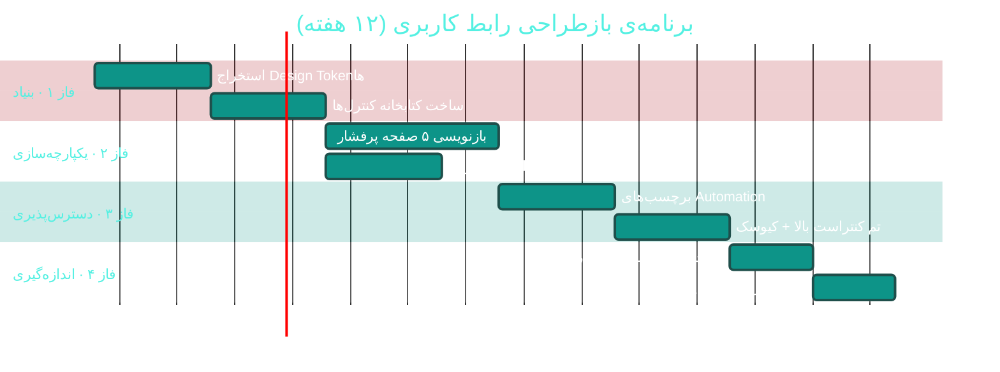

---

## ۸. نقاط قوت 💪

### ۸.۱ نمودار راداریِ کیفیت


### ۸.۲ ده نقطه‌ی قوتِ برجسته

| # | 💪 نقطه قوت | 📊 شواهد کمی | چرا ارزشمند است |
|:--:|:---|:---|:---|
| ۱ | **جداسازی کامل لایه‌ی نمایش از داده** | ۰ ارجاعِ Desktop به `DbContext` | کلاینت را می‌توان با وب/موبایل جایگزین کرد بدون تغییر هسته |
| ۲ | **معماری Clean + CQRS واقعی** | MediatR · ۱۷٬۶۹۴ خط Application | هر Feature یک پوشه؛ افزودن امکان = افزودن فایل، نه ویرایش |
| ۳ | **دامنه‌ی بسیار غنی** | ۱۱۲ موجودیت · ۱۰۰+ Enum · ۴ ValueObject | مدلِ دامنه واقعاً «زبانِ درمانگاه» را دارد |
| ۴ | **انضباطِ حق‌تألیفی در انتخاب پکیج** | MediatR ۱۲ · Mapperly ۳٫۶ · FluentAssertions ۶ | همه روی آخرین نسخه‌ی **رایگان** — هیچ ریسک حقوقی |
| ۵ | **پوشش امنیتیِ لایه‌لایه** | ۲۵۷ `HasPermission` از ۳۰۸ اندپوینت | RBAC دانه‌ریز با ۱۶۰+ مجوز |
| ۶ | **ممیزی (Audit) در سطح زیرساخت** | `AuditableEntityInterceptor` + `AuditLogMiddleware` با Old/New | ردیابی کامل تغییرات — الزامِ حریم‌خصوصی پزشکی |
| ۷ | **انضباطِ کدِ بی‌نقص در موارد رایج** | ۰ `async void` · ۰ `catch{}` خالی · ۰ `TODO` در `src/` | نشان‌دهنده‌ی بازبینیِ دقیق کد |
| ۸ | **SQL Injection صفر** | پارامتری‌سازی در `ArchiveService` + براکت‌گذاری در `AuditLogMiddleware` | حتی در SQL خام، ایمن نوشته شده |
| ۹ | **سیستم لایسنس بالغ و چندسکویی** | PHP (cPanel) امضای RSA · ۳۹ ماژولِ جداگانه | مدل درآمدیِ انعطاف‌پذیر + بدون نیاز به Composer |
| ۱۰ | **مستنداتِ بسیار گسترده** | ۲۴ فایل MD · ۴۶۲ خط README · ۶۷۲ خط PROGRESS · ۲٬۰۱۲ خط CHANGELOG | دانشِ پروژه مکتوب است — ریسکِ «اتوبوس» کم |

### ۸.۳ نقاط قوتِ فنیِ خاص

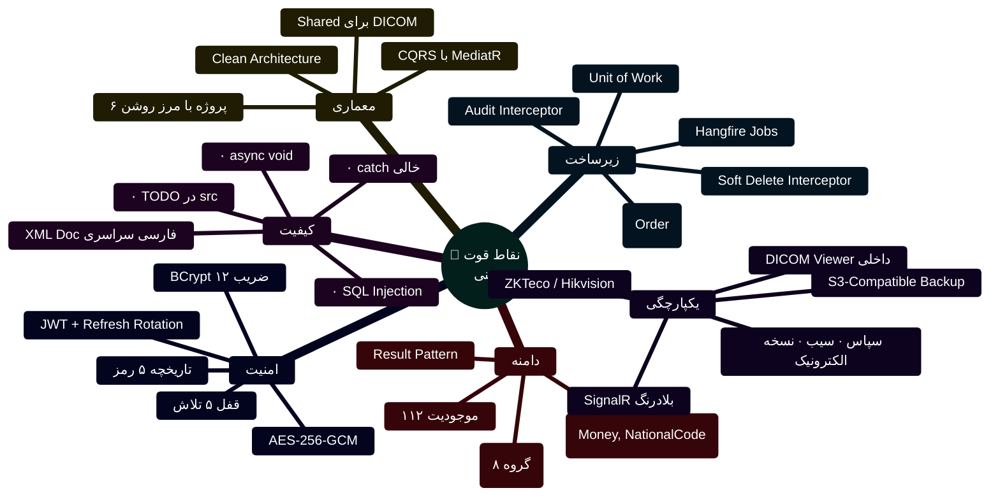

> ✨ **نکته‌ی ویژه:** کامنت‌های XML در کل پروژه **به فارسی و با کیفیت بالا** نوشته شده‌اند و
> توضیحِ «چرا» (نه فقط «چه») را دارند — مثلاً در `ArchiveService.HardPurgeAsync` دقیقاً
> آمده که چرا از الحاق رشته به‌جای interpolation استفاده شده (رفع هشدار EF1002).
> این سطح از مستندسازیِ درون‌کد کمیاب است.

---

## ۹. نقاط ضعف 🔻

### ۹.۱ ده نقطه‌ی ضعفِ اصلی

| # | 🔻 نقطه ضعف | 📊 شواهد کمی | ⚠️ ریسک | 🩹 درمان |
|:--:|:---|:---|:---|:---|
| ۱ | **امنیتِ پیکربندی** | کلید JWT در مخزن | 🔴 جعل توکن مدیر | Secret Manager + Rotation |
| ۲ | **Sync-over-Async** | `BackupController.cs:456` | 🔴 توقف کل API | ناهمزمان‌سازی + Semaphore |
| ۳ | **تورم کد** | ‎۲۲۵٬۲۸۷ خط تولیدشده (۶۸٪) | 🟠 بیلد کند، بازبینی سخت | تقسیم DbContext + بایگانی مایگریشن |
| ۴ | **DbContext یکپارچه** | ۱۱۲ DbSet | 🟠 راه‌اندازی کند، قفل تیمی | ۵ Bounded Context |
| ۵ | **تستِ Desktop ≈ ۰** | ~۱۵ تست برای ‎۴۳٬۲۴۱ خط | 🔴 رگرسیون در هر انتشار | هرم تست + ۴۵۰ تست واحد |
| ۶ | **اسکریپت‌های تکراری** | ۳۴ بسته‌سازِ کپی | 🟠 خطای اپراتور، بدهی نگهداری | یک CLI یکپارچه |
| ۷ | **عدم محلی‌سازی** | ۰ فایل `.resx` | 🟠 عدم امکان توسعه به بازار دیگر | resx + DynamicResource |
| ۸ | **God ViewModel** | ۱٬۳۴۶ / ۱٬۳۱۶ / ۱٬۰۶۳ خط | 🟠 سخت‌تست‌بودن، تکرار منطق | Composition با Child-VM |
| ۹ | **Code-Behind سنگین** | ‎۴٬۳۸۲ خط روی Viewها | 🟠 نقض MVVM | Behavior + Attached Property |
| ۱۰ | **مستنداتِ پراکنده/همپوشان** | ۱۳ فایل TODO + ۲۴ MD | 🟠 سردرگمی، تضاد | ساختار یکپارچه `docs/` |

### ۹.۲ نمودارِ پارتو — کانونِ ۸۰٪ مشکلات

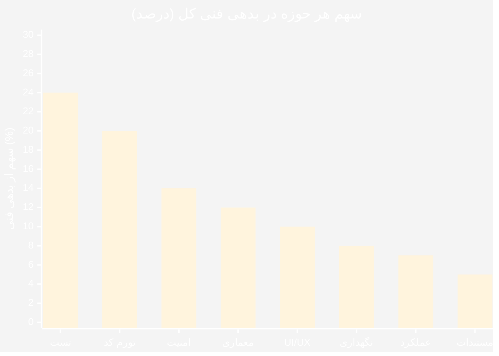

> 📌 **قانون ۸۰/۲۰:** با تمرکز روی **۲ حوزه‌ی اول (تست + تورم کد)**،
> حدود **۴۴٪ از بدهی فنی کل** برطرف می‌شود.

### ۹.۳ ریسک‌های کسب‌وکار

| 🎲 ریسک | احتمال | اثر | 🔻 سطح | 🛡 راهبرد کاهش |
|:---|:--:|:--:|:--:|:---|
| نشت داده‌های پزشکی (نشت کلید JWT) | 🟡 متوسط | 🔴 فاجعه‌بار | 🔴 **بحرانی** | Secret Manager + چرخش کلید + بازبینی امنیتی |
| رگرسیون در لایه‌ی Desktop هنگام انتشار | 🔴 بالا | 🟠 بالا | 🔴 **بحرانی** | پوشش تست ViewModel + تست‌های دود (Smoke) خودکار |
| وابستگی به SQL Server (قفل فروشنده) | 🟢 کم | 🟡 متوسط | 🟡 متوسط | لایه‌ی انتزاع روی گزارش‌ها؛ ارزیابی PostgreSQL |
| انشعاب کد بین نسخه‌ی ویندوز و آینده‌ی وب | 🟡 متوسط | 🟠 بالا | 🟠 بالا | استخراج منطقِ مشترک به `Shared` |
| خروجِ توسعه‌دهنده‌ی اصلی (ریسک اتوبوس) | 🟡 متوسط | 🔴 بالا | 🟠 بالا | مستندات تصمیمات (ADR) + جفت‌برنامه‌نویسی |
| عدم انطباق با مقررات حریم‌خصوصی پزشکی | 🟡 متوسط | 🟠 بالا | 🟠 بالا | Audit کامل + رمزنگاری ستون‌های حساس |

---

## ۱۰. نقشه‌ی راه پیشنهادی

### ۱۰.۱ نمای کلی ۴ فاز

```mermaid
%%{init: {'theme':'base','themeVariables':{'primaryColor':'0d9488','primaryTextColor':'#fff'}}}%%
gantt
    title نقشه‌ی راه تکامل ClinicPro — از ۲.۱۲ تا ۳.۰
    dateFormat YYYY-MM-DD
    axisFormat %b %Y
    todayMarker on

    section 🔴 فاز ۱ · تثبیت (v2.13)
    رفع امنیت و Sync-over-Async       :crit, p1a, 2026-10-15, 7d
    تست‌های دود خودکار در CI           :p1b, 2026-10-15, 14d
    یکپارچه‌سازی اسکریپت‌های انتشار    :p1c, 2026-10-22, 14d
    ادغام مستندات                     :p1d, 2026-11-01, 10d

    section 🟠 فاز ۲ · استحکام (v2.14)
    تقسیم DbContext (مالی ← اول)      :p2a, 2026-11-05, 21d
    پوشش تست Application/API          :p2b, 2026-11-05, 30d
    سیستم طراحی + Tokenها             :p2c, 2026-11-12, 28d
    بهینه‌سازی عملکرد (P-01…P-07)     :p2d, 2026-11-19, 21d

    section 🟡 فاز ۳ · تکامل (v2.15)
    زیرساخت محلی‌سازی                 :p3a, 2026-12-10, 21d
    پرتال بیمار (فاز ۱)               :p3b, 2026-12-10, 35d
    هوش تجاری و داشبورد تحلیلی        :p3c, 2027-01-04, 28d
    مدیریت اسناد                      :p3d, 2027-01-11, 21d

    section 🟢 فاز ۴ · تحول (v3.0)
    دستیار بالینی هوش مصنوعی          :p4a, 2027-02-01, 45d
    تلمدیسین                          :p4b, 2027-02-15, 40d
    اپ موبایل (MAUI)                  :p4c, 2027-03-01, 60d
    API عمومی + مارکت‌پلیس            :p4d, 2027-04-01, 45d
```

### ۱۰.۲ جدولِ تفصیلیِ گام‌ها

| 🏁 فاز | 🎯 هدف | 📦 خروجی | ✅ معیار پذیرش | ⏱ |
|:---|:---|:---|:---|:--:|
| **فاز ۱**<br/>تثبیت | بستنِ روزنه‌های بحرانی | v2.13.0 | · کلید JWT خارج از مخزن<br/>· ۰ مورد Sync-over-Async<br/>· CI سبز با ۳۰۰+ تست<br/>· ۱ ابزار انتشار | ۵ هفته |
| **فاز ۲**<br/>استحکام | کاهش بدهی فنی | v2.14.0 | · ۲ Bounded Context<br/>· ۵۰۰+ تست (۷۵٪ واحد)<br/>· سیستم طراحی یکپارچه<br/>· ⬇ ۳۰٪ زمان پاسخ گزارش | ۱۲ هفته |
| **فاز ۳**<br/>تکامل | افزودن ارزش | v2.15.0 | · پرتال بیمار عملیاتی<br/>· داشبورد تحلیلی<br/>· ۲ زبان (fa/en) | ۱۴ هفته |
| **فاز ۴**<br/>تحول | تمایز رقابتی | v3.0.0 | · دستیار AI در ویزیت<br/>· تلمدیسین<br/>· اپ موبایل منتشرشده | ۲۴ هفته |

### ۱۰.۳ شاخص‌های کلیدیِ پیشرفت (KPI)

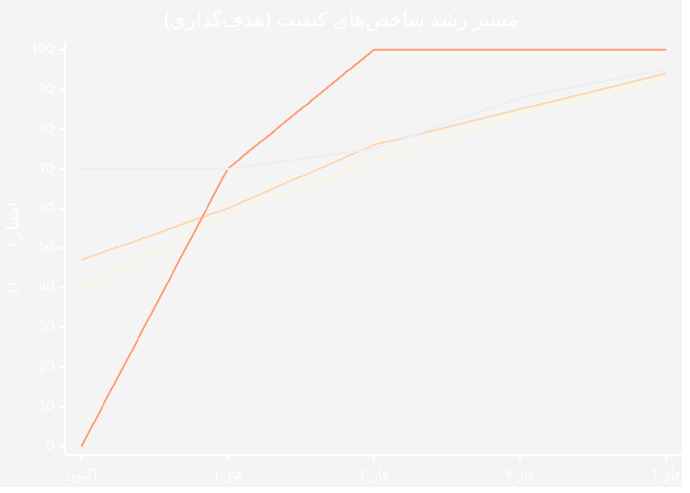

> **راهنما:** خطوط به‌ترتیب: پوشش تست · امنیت · نگهداری‌پذیری · تجربه کاربری

---

## ۱۱. پیوست: فایل‌های ماژول

هر ماژول در یک **فایل جداگانه** با ساختار استاندارد مستند شده است:

```
📄 docs/analysis/
├── 📋 README.md                       ← فهرست و نقشه‌ی راهبری
├── 📊 ANALYSIS-REPORT.md              ← این فایل (تحلیل جامع)
└── 📂 modules/
    ├── 🩺 A-clinical/          (۸ فایل)  — بالینی و درمانی
    ├── 💰 B-financial/         (۹ فایل)  — مالی و اداری
    ├── 🏗 C-platform/          (۱۱ فایل) — پلتفرم و زیرساخت
    └── 🚀 D-new-plugins/       (۱۰ فایل) — افزونه‌های پیشنهادی
```

### 🩺 گروه A — بالینی و درمانی

| 📄 فایل | ماژول | اولویت |
|:---|:---|:--:|
| [`A01-patients.md`](modules/A01-patients.md) | 👥 بیماران و پرونده الکترونیک | 🟠 بالا |
| [`A02-appointments.md`](modules/A02-appointments.md) | 📅 نوبت‌دهی و زمان‌بندی | 🟠 بالا |
| [`A03-receptions-queue.md`](modules/A03-receptions-queue.md) | 🛎 پذیرش، صف و لیست انتظار | 🟠 بالا |
| [`A04-visits-soap.md`](modules/A04-visits-soap.md) | 🩻 ویزیت (SOAP) | 🟡 متوسط |
| [`A05-emr-advanced.md`](modules/A05-emr-advanced.md) | ❤ پرونده بالینی پیشرفته | 🟡 متوسط |
| [`A06-prescriptions-safety.md`](modules/A06-prescriptions-safety.md) | 💊 نسخه‌نویسی و ایمنی دارویی | 🔴 بحرانی |
| [`A07-laboratory.md`](modules/A07-laboratory.md) | 🧪 آزمایشگاه | 🟡 متوسط |
| [`A08-paraclinical.md`](modules/A08-paraclinical.md) | 🩻 پاراکلینیک (تصویربرداری/دندان/چشم/فیزیوتراپی) | 🟡 متوسط |

### 💰 گروه B — مالی و اداری

| 📄 فایل | ماژول | اولویت |
|:---|:---|:--:|
| [`B01-billing.md`](modules/B01-billing.md) | 💵 صندوق، فاکتور و شیفت | 🟠 بالا |
| [`B02-accounting.md`](modules/B02-accounting.md) | 📒 حسابداری دوبل | 🟠 بالا |
| [`B03-insurance.md`](modules/B03-insurance.md) | 🛡 بیمه و تسویه | 🟠 بالا |
| [`B04-payroll.md`](modules/B04-payroll.md) | 🧾 حقوق و دستمزد ۱۴۰۴ | 🟡 متوسط |
| [`B05-hr-personnel.md`](modules/B05-hr-personnel.md) | 👔 پرسنل و قراردادها | 🟡 متوسط |
| [`B06-attendance.md`](modules/B06-attendance.md) | 🕐 حضور و غیاب دستگاهی | 🟢 کم |
| [`B07-pharmacy-inventory.md`](modules/B07-pharmacy-inventory.md) | 🏥 داروخانه و انبار | 🟡 متوسط |
| [`B08-reports.md`](modules/B08-reports.md) | 📊 گزارش‌ساز و Ad-hoc | 🟠 بالا |
| [`B09-print-templates.md`](modules/B09-print-templates.md) | 🖨 قالب‌های چاپ | 🟢 کم |

### 🏗 گروه C — پلتفرم و زیرساخت

| 📄 فایل | ماژول | اولویت |
|:---|:---|:--:|
| [`C01-security-rbac.md`](modules/C01-security-rbac.md) | 🔐 امنیت، کاربران و نقش‌ها | 🔴 بحرانی |
| [`C02-audit-compliance.md`](modules/C02-audit-compliance.md) | 📋 ممیزی و انطباق | 🟠 بالا |
| [`C03-backup.md`](modules/C03-backup.md) | 💾 بکاپ و بکاپ ابری | 🟠 بالا |
| [`C04-archive.md`](modules/C04-archive.md) | 🗄 آرشیو سالانه | 🟢 کم |
| [`C05-branches.md`](modules/C05-branches.md) | 🏘 چندشعبه‌ای | 🟡 متوسط |
| [`C06-notifications-realtime.md`](modules/C06-notifications-realtime.md) | 🔔 اعلان‌ها و بلادرنگ | 🟡 متوسط |
| [`C07-sms-communication.md`](modules/C07-sms-communication.md) | 💬 پیامک | 🟡 متوسط |
| [`C08-survey-training.md`](modules/C08-survey-training.md) | 📝 نظرسنجی و آموزش | 🟢 کم |
| [`C09-licensing.md`](modules/C09-licensing.md) | 🔑 سامانه لایسنس | 🟠 بالا |
| [`C10-release-automation.md`](modules/C10-release-automation.md) | 📦 خودکارسازی انتشار | 🟠 بالا |
| [`C11-database-scalability.md`](modules/C11-database-scalability.md) | 🗃 مقیاس‌پذیری پایگاه داده | 🟠 بالا |
| [`C12-government-integration.md`](modules/C12-government-integration.md) | 🏛 یکپارچه‌سازی دولتی (سپاس، نسخه الکترونیک) | 🟠 بالا |

### 🚀 گروه D — افزونه‌های پیشنهادی

| 📄 فایل | افزونه | 💰 ارزش | 🔧 دشواری |
|:---|:---|:--:|:--:|
| [`D01-patient-portal.md`](modules/D01-patient-portal.md) | 🌐 پرتال بیمار و اپ موبایل | ⭐⭐⭐⭐⭐ | 🟡 |
| [`D02-telemedicine.md`](modules/D02-telemedicine.md) | 🎥 درمان از راه دور | ⭐⭐⭐⭐ | 🔴 |
| [`D03-ai-assistant.md`](modules/D03-ai-assistant.md) | 🤖 دستیار بالینی هوش مصنوعی | ⭐⭐⭐⭐⭐ | 🔴 |
| [`D04-bi-analytics.md`](modules/D04-bi-analytics.md) | 📈 هوش تجاری | ⭐⭐⭐⭐ | 🟡 |
| [`D05-document-management.md`](modules/D05-document-management.md) | 📁 مدیریت اسناد | ⭐⭐⭐⭐ | 🟡 |
| [`D06-referral-network.md`](modules/D06-referral-network.md) | 🔗 شبکه ارجاع | ⭐⭐⭐ | 🟡 |
| [`D07-crm-marketing.md`](modules/D07-crm-marketing.md) | 📣 CRM و بازاریابی | ⭐⭐⭐⭐ | 🟢 |
| [`D08-assets-equipment.md`](modules/D08-assets-equipment.md) | 🧰 تجهیزات و دارایی‌ها | ⭐⭐⭐ | 🟢 |
| [`D09-localization-i18n.md`](modules/D09-localization-i18n.md) | 🌍 چندزبانگی | ⭐⭐⭐⭐ | 🟡 |
| [`D10-public-api-marketplace.md`](modules/D10-public-api-marketplace.md) | 🔌 API عمومی و مارکت‌پلیس | ⭐⭐⭐⭐ | 🔴 |

---

<div align="center">

### 📊 خلاصه‌ی نهایی

| شاخص | امتیاز |
|:---|:--:|
| 🏗 کیفیت معماری | **۸٫۵ / ۱۰** |
| 🧬 جامعیت دامنه | **۹٫۵ / ۱۰** |
| 🧪 پوشش تست | **۴٫۰ / ۱۰** |
| 🔐 امنیت | **۶٫۵ / ۱۰** |
| 🎨 تجربه کاربری | **۷٫۰ / ۱۰** |
| 📚 مستندات | **۸٫۰ / ۱۰** |
| 🔧 نگهداری‌پذیری | **۵٫۰ / ۱۰** |
| **🌟 میانگین کل** | **🏅 ۷٫۰ / ۱۰** |

> **حکم نهایی:** پروژه‌ای **بالاتر از متوسط با بنیانِ بسیار مستحکم** که
> با رفعِ ۳ ایراد بحرانی و اجرای فاز ۱ و ۲، به‌راحتی به **سطح حرفه‌ایِ تجاری (۹+/۱۰)** می‌رسد.

---

📅 **آخرین به‌روزرسانی:** ۱۴۰۴/۰۷/۱۹ · 🔖 **نسخه‌ی سند:** ۱٫۰ · ✍️ **تحلیل:** Arena Agent Mode
</div>
