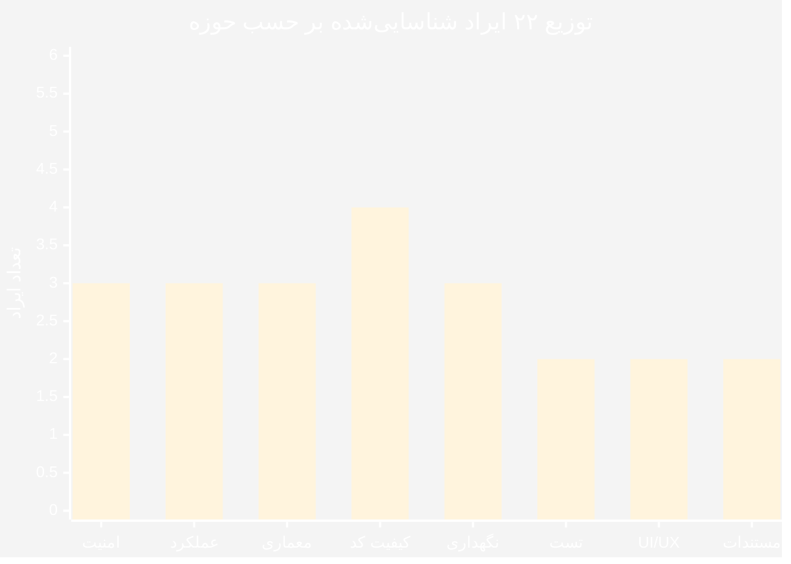
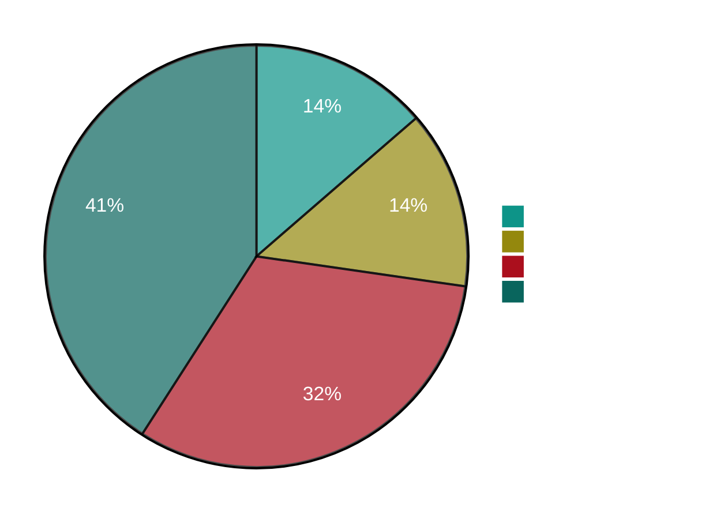
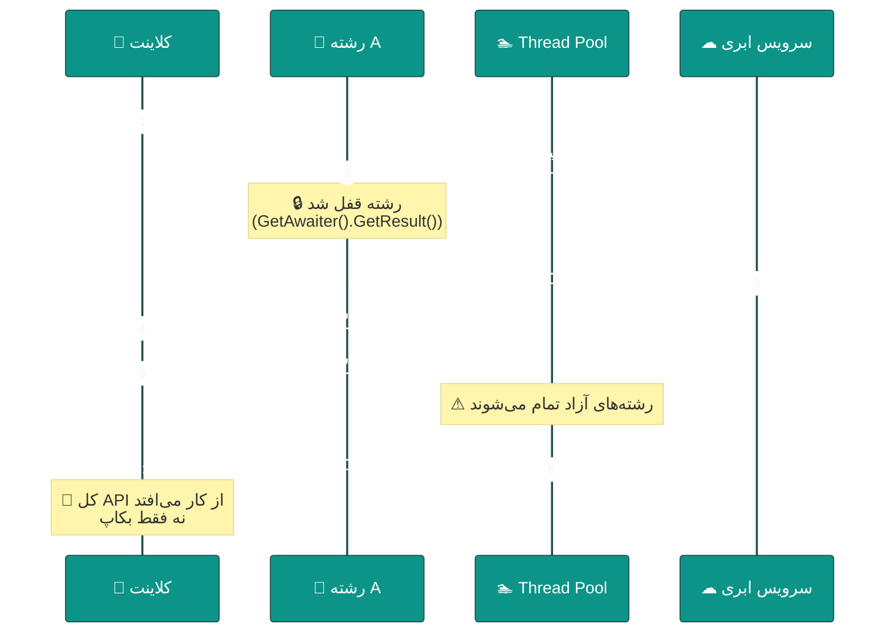
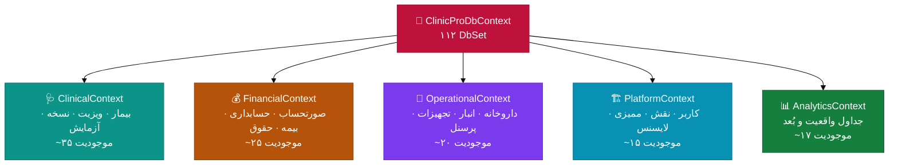
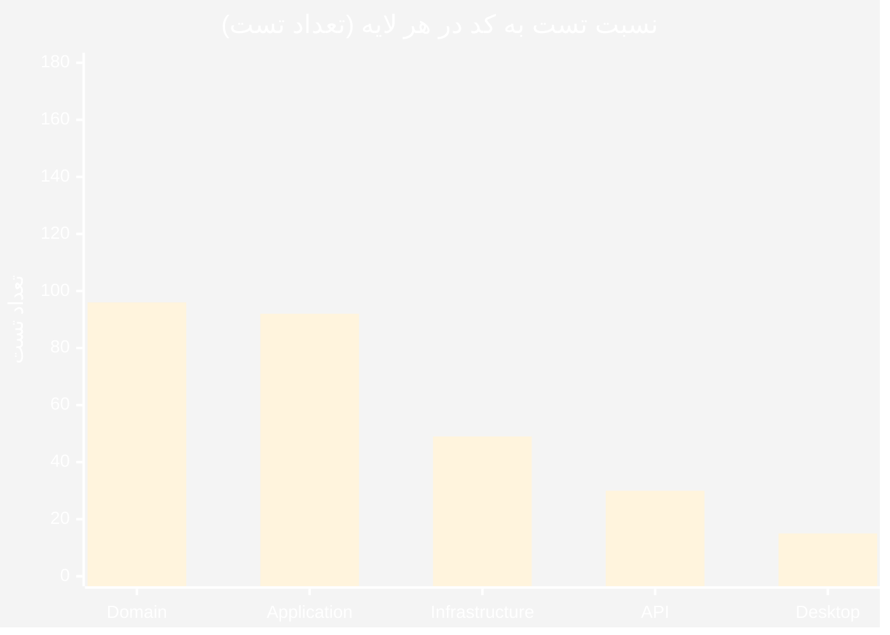
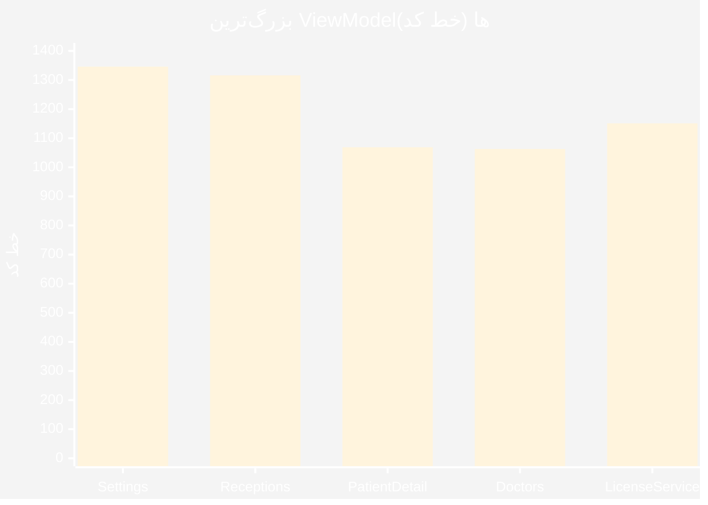
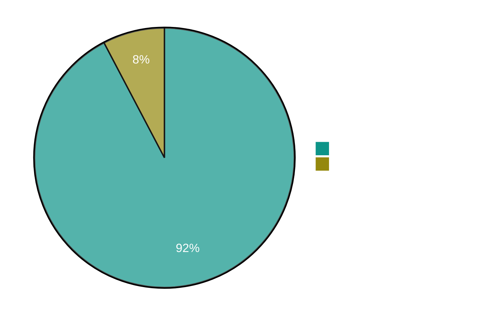
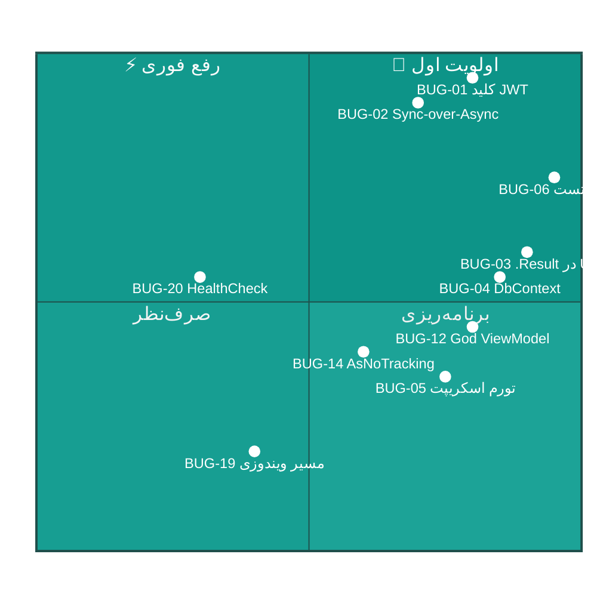
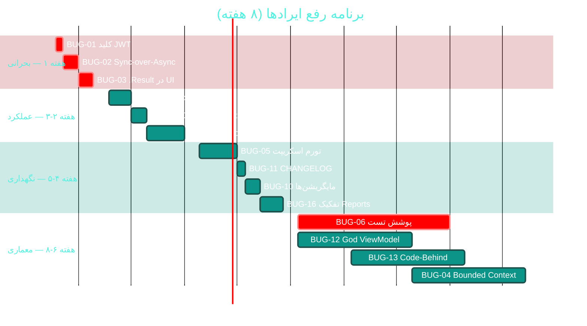

<div dir="rtl">

# 🐛 ایرادها و نواقص برنامه (Defects & Irads)

<div align="center">

**نرم‌افزار جامع مدیریت درمانگاه سهند — Sahand ClinicPro v2.12.0**


📅 ۱۴۰۴/۰۷/۱۹ · 🔖 تحلیل ایستا (Static Analysis)

</div>

---

## 📑 فهرست مطالب

| # | بخش |
|:--:|:---|
| ۱ | [خلاصه اجرایی](#۱--خلاصه-اجرایی) |
| ۲ | [توزیع ایرادها](#۲--توزیع-ایرادها) |
| ۳ | [🔴 ایرادهای بحرانی (۳ مورد)](#۳--ایرادهای-بحرانی) |
| ۴ | [🟠 ایرادهای سطح بالا (۳ مورد)](#۴--ایرادهای-سطح-بالا) |
| ۵ | [🟡 ایرادهای سطح متوسط (۷ مورد)](#۵--ایرادهای-سطح-متوسط) |
| ۶ | [🔵 ایرادهای سطح کم / صیقل (۹ مورد)](#۶--ایرادهای-سطح-کم--صیقل) |
| ۷ | [ایرادهای سطح ماژول (خلاصه ۲۴۰+)](#۷--ایرادهای-سطح-ماژول) |
| ۸ | [نقشه حرارتیِ ریسک](#۸--نقشه-حرارتی-ریسک) |
| ۹ | [برنامه رفع اولویت‌دار](#۹--برنامه-رفع-اولویتدار) |

---

## ۱. 📋 خلاصه اجرایی

تحلیل ایستای **۷۸۸ فایل دست‌نویس** (۹۲٬۸۷۶ خط) به‌همراه ۱۱۲ موجودیت دامنه،
۳۰۸ اندپوینت و ۲۷۲ تست، منجر به شناسایی **۲۲ ایرادِ سطحِ سیستم** شد.

| 🎯 شدت | تعداد | زمان رفع | ریسک در صورت تأخیر |
|:---|:--:|:--:|:---|
| 🔴 **بحرانی** | ۳ | ۵ روز | جعل توکن مدیر · توقف کل API · نشت داده پزشکی |
| 🟠 **بالا** | ۳ | ۳ هفته | بیلد کند · قفل تیمی · بدهی نگهداری |
| 🟡 **متوسط** | ۷ | ۴ هفته | کندی · سختی نگهداری · رگرسیون |
| 🔵 **کم** | ۹ | ۲ هفته | صیقل و حرفه‌ای‌سازی |
| **مجموع** | **۲۲** | **~۸ هفته** | — |

> ⚠️ **۳ ایراد بحرانی باید ظرف یک هفته رفع شوند.**
> بقیه می‌توانند در چرخه‌های عادی برنامه‌ریزی شوند.

---

## ۲. 📊 توزیع ایرادها





### 🗂 جدول جامع ایرادها

| 🏷 کد | عنوان ایراد | 🎯 شدت | 📦 حوزه | 📍 محل | ⏱ رفع |
|:---|:---|:--:|:---|:---|:--:|
| **BUG-01** | کلید JWT در فایل پیکربندی Hardcode شده | 🔴 | امنیت | `API/appsettings.json` | ۱ روز |
| **BUG-02** | Sync-over-Async در مسیر درخواست | 🔴 | عملکرد | `BackupController.cs:456` | ۲ روز |
| **BUG-03** | `.Result` پس از `Task.WhenAll` در لایه UI | 🔴 | عملکرد | `Desktop/ViewModels/ReportsViewModel` | ۲ روز |
| **BUG-04** | DbContext غول‌پیکر (۱۱۲ DbSet) | 🟠 | معماری | `ClinicProDbContext.cs` | ۳ هفته |
| **BUG-05** | تورم اسکریپت‌های پایتون (۱۲۷ فایل) | 🟠 | نگهداری | `scripts/` | ۱ هفته |
| **BUG-06** | پوشش تست ناکافی (۲۷۲ تست / ۹۲هزار خط) | 🟠 | تست | سراسر | ۴ هفته |
| **BUG-07** | فقدان زیرساخت محلی‌سازی (۰ فایل `.resx`) | 🟡 | معماری | سراسر | ۲ هفته |
| **BUG-08** | `ConfigureAwait(false)` تقریباً استفاده نشده | 🟡 | کیفیت کد | ۲ از ۲٬۰۴۳ `await` | ۲ روز |
| **BUG-09** | `CancellationToken` در ۵۵ فایل از ۱۴۹ غایب | 🟡 | کیفیت کد | `Application/` | ۱ هفته |
| **BUG-10** | ۷ مایگریشن بدون فایل `.Designer.cs` | 🟡 | نگهداری | `Persistence/Migrations/` | ۲ روز |
| **BUG-11** | `CHANGELOG.md` با ۳۹۰ کیلوبایت و ۲٬۰۱۲ خط | 🟡 | مستندات | ریشه | ۱ ساعت |
| **BUG-12** | God ViewModelها (۱٬۳۴۶ / ۱٬۳۱۶ / ۱٬۰۶۳ خط) | 🟡 | معماری | `Desktop/ViewModels/` | ۳ هفته |
| **BUG-13** | ۴٬۳۸۲ خط Code-Behind روی Viewها | 🟡 | UI/UX | `Desktop/Views/*.xaml.cs` | ۳ هفته |
| **BUG-14** | `AsNoTracking` فقط در ۲۰ مورد از ۲۶۰ | 🟡 | عملکرد | سراسر | ۳ روز |
| **BUG-15** | ۵۷ بلوک `catch (Exception)` سراسری | 🟡 | کیفیت کد | سراسر | ۱ هفته |
| **BUG-16** | `ReportsController` در ۶ فایل `partial` | 🟡 | معماری | `API/Controllers/` | ۳ روز |
| **BUG-17** | `BaseUrl` سخت‌کد شده به `localhost:5000` | 🔵 | نگهداری | `Desktop/appsettings.json` | ۲ ساعت |
| **BUG-18** | `TrustServerCertificate=True` در رشته اتصال | 🔵 | امنیت | `API/appsettings.json` | ۱ ساعت |
| **BUG-19** | `Backup:Directory` پیش‌فرض ویندوزی | 🔵 | نگهداری | `API/appsettings.json` | ۱ ساعت |
| **BUG-20** | هیچ `HealthCheck` برای SQL Server | 🔵 | نگهداری | `API/Program.cs` | ۳ ساعت |
| **BUG-21** | نبود `OpenTelemetry` / ردیابی توزیع‌شده | 🔵 | نگهداری | سراسر | ۱ هفته |
| **BUG-22** | مستندات در ۲۴ فایل MD پراکنده | 🔵 | مستندات | ریشه + `docs/` | ۱ هفته |

---

## ۳. 🔴 ایرادهای بحرانی

### 🐛 BUG-01 — کلید JWT در فایل پیکربندی Hardcode شده

| ویژگی | مقدار |
|:---|:---|
| 📍 محل | `src/Sahand.ClinicPro.API/appsettings.json` → `Jwt:SecretKey` |
| 🎯 شدت | 🔴 **بحرانی (امنیتی)** |
| 📦 دسته | CWE-798 — استفاده از اعتبارنامه‌ی رمزنگاری‌شده در مخزن |
| ⏱ زمان رفع | ۱ روز |
| 📄 راهنما | [C01 — امنیت و کنترل دسترسی](modules/C01-security-rbac.md) |

**شواهد:**

```json
"Jwt": {
  "SecretKey": "SahandClinicPro-Development-Secret-Key-Change-In-Production-2026!@#x9KmQ",
  "Issuer": "Sahand.ClinicPro",
  "Audience": "Sahand.ClinicPro.Clients",
  "AccessTokenExpiryMinutes": 30,
  "RefreshTokenExpiryDays": 7
}
```

**چرا خطرناک است؟**


| پیامد | توضیح |
|:---|:---|
| 🎭 **جعل هویت کامل** | هر کسی با دسترسی به مخزن می‌تواند توکن مدیر جعل کند |
| 🔓 **دور زدن RBAC** | همه ۱۶۰+ مجوز و ۲۵۷ `HasPermission` بی‌اثر می‌شوند |
| 📂 **نشت داده پزشکی** | دسترسی مستقیم به پرونده‌های همه‌ی بیماران |
| ⚖️ **مسئولیت حقوقی** | نقض الزامات حریم خصوصی داده‌های سلامت |
| ♾️ **غیرقابل‌بازگشت** | حذف از تاریخچه گیت نیازمند بازنویسی کامل است |

**راهکار (۳ مرحله):**

```csharp
// ─── مرحله ۱: گارد Fail-Fast در Program.cs ───
var jwtSecret = builder.Configuration["Jwt:SecretKey"];

if (string.IsNullOrWhiteSpace(jwtSecret) || jwtSecret.Length < 32)
{
    throw new InvalidOperationException(
        "کلید JWT پیکربندی نشده است. " +
        "در توسعه از User Secrets و در تولید از Key Vault استفاده کنید.");
}

if (jwtSecret.Contains("Development-Secret", StringComparison.OrdinalIgnoreCase)
    || jwtSecret.Contains("Change-In-Production", StringComparison.OrdinalIgnoreCase))
{
    throw new InvalidOperationException(
        "کلید پیش‌فرض JWT شناسایی شد — پیش از استقرار باید تغییر کند.");
}
```

```bash
# ─── مرحله ۲: انتقال به User Secrets (توسعه) ───
cd src/Sahand.ClinicPro.API
dotnet user-secrets init
dotnet user-secrets set "Jwt:SecretKey" "$(openssl rand -base64 48)"
```

```csharp
// ─── مرحله ۳: چرخش کلید بدون downtime ───
public class JwtTokenGenerator
{
    // کلید فعلی و کلید قبلی همزمان پذیرفته می‌شوند
    private readonly SymmetricSecurityKey _currentKey;
    private readonly SymmetricSecurityKey? _previousKey;

    public ClaimsPrincipal? ValidateWithRotation(string token)
    {
        var parameters = new TokenValidationParameters
        {
            IssuerSigningKey = _currentKey,
            IssuerSigningKeys = new[] { _currentKey, _previousKey! }
                .Where(k => k is not null),
            ValidateIssuer = true,
            ValidateAudience = true,
            ValidIssuer = _issuer,
            ValidAudience = _audience,
            ClockSkew = TimeSpan.FromMinutes(1)
        };

        var handler = new JwtSecurityTokenHandler();
        try
        {
            return handler.ValidateToken(token, parameters, out _);
        }
        catch (SecurityTokenException)
        {
            return null;   // توکن نامعتبر یا جعلی
        }
    }
}
```

> ✅ **تعریفِ انجام:** هیچ رشته‌ی کلیدی در `appsettings.json` نباشد
> + بیلد در صورت نبودِ کلید با خطا متوقف شود.

---

### 🐛 BUG-02 — Sync-over-Async در مسیر درخواست

| ویژگی | مقدار |
|:---|:---|
| 📍 محل | `src/Sahand.ClinicPro.API/Controllers/BackupController.cs:456` |
| 🎯 شدت | 🔴 **بحرانی (پایداری)** |
| 📦 دسته | Thread-Pool Starvation |
| ⏱ زمان رفع | ۲ روز |
| 📄 راهنما | [C03 — پشتیبان‌گیری](modules/C03-backup.md) |

**شواهد:**

```csharp
// ❌ انسدادِ رشته‌ی درخواست
private ICloudBackupService GetCloudService()
{
    return _cloudFactory.GetServiceAsync(_settings.Provider)
        .GetAwaiter().GetResult();     // 🔴 خطرناک
}
```

**چرا خطرناک است؟**



| پیامد | توضیح |
|:---|:---|
| 🔒 **قفل شدن رشته** | رشته‌ی درخواست تا پایان عملیات ابری مسدود می‌ماند |
| 🏊 **تمام شدن Thread Pool** | با چند درخواست همزمان، pool اشباع می‌شود |
| 🔴 **توقف کل API** | نه فقط بکاپ — همه ۳۰۸ اندپوینت از کار می‌افتند |
| 🐛 **اشکال‌زدایی دشوار** | علت در جای دیگری (درخواست‌های دیگر) ظاهر می‌شود |

**راهکار:**

```csharp
// ✅ نسخه‌ی اصلاح‌شده با Semaphore برای جلوگیری از همزمانی
public class BackupController : ApiBaseController
{
    private static readonly SemaphoreSlim _cloudInitLock = new(1, 1);
    private ICloudBackupService? _cachedCloudService;
    private CloudProvider? _cachedProvider;

    /// <summary>
    /// دریافت ناهمزمان سرویس ابری — بدون انسداد رشته‌ی درخواست
    /// </summary>
    private async Task<ICloudBackupService> GetCloudServiceAsync(
        CancellationToken cancellationToken)
    {
        // مسیر سریع: اگر سرویس کش شده و ارائه‌دهنده تغییر نکرده
        if (_cachedCloudService is not null && _cachedProvider == _settings.Provider)
            return _cachedCloudService;

        await _cloudInitLock.WaitAsync(cancellationToken);
        try
        {
            // بررسی مجدد پس از گرفتن قفل (Double-checked locking)
            if (_cachedCloudService is not null && _cachedProvider == _settings.Provider)
                return _cachedCloudService;

            _cachedCloudService = await _cloudFactory
                .GetServiceAsync(_settings.Provider, cancellationToken);
            _cachedProvider = _settings.Provider;

            return _cachedCloudService;
        }
        finally
        {
            _cloudInitLock.Release();
        }
    }

    [HttpPost("cloud")]
    public async Task<IActionResult> BackupToCloud(CancellationToken cancellationToken)
    {
        var service = await GetCloudServiceAsync(cancellationToken);
        var result = await _backupService.BackupToCloudAsync(service, cancellationToken);
        return ToResponse(result, "بکاپ ابری با موفقیت انجام شد");
    }
}
```

> ✅ **تعریفِ انجام:** صفر مورد `.GetAwaiter().GetResult()` و `.Result`
> در مسیر درخواست‌های API.

---

### 🐛 BUG-03 — `.Result` پس از `Task.WhenAll` در لایه UI

| ویژگی | مقدار |
|:---|:---|
| 📍 محل | `src/Sahand.ClinicPro.Desktop/ViewModels/ReportsViewModel.cs` |
| 🎯 شدت | 🔴 **بحرانی (پایداری)** |
| 📦 دسته | UI Freeze / Deadlock |
| ⏱ زمان رفع | ۲ روز |
| 📄 راهنما | [B08 — گزارشات](modules/B08-reports.md) |

**شواهد:**

```csharp
// ❌ انسداد رشته‌ی رابط کاربر
private void LoadAllReports()
{
    Task.WhenAll(
        LoadRevenueAsync(),
        LoadVisitsAsync(),
        LoadInventoryAsync()
    ).Result;      // 🔴 رابط کاربر قفل می‌شود
}
```

**چرا خطرناک است؟**

| پیامد | توضیح |
|:---|:---|
| 🧊 **قفل شدن رابط** | کل پنجره تا پایان عملیات یخ می‌زند |
| 💀 **بن‌بست (Deadlock)** | با `SynchronizationContext` WPF احتمال بن‌بست کامل |
| ⏱ **تجربه بد کاربر** | کاربر فکر می‌کند برنامه هنگ کرده |
| 🔁 **تکرار در چند ViewModel** | الگوی غلط در چندین فایل تکرار شده |

**راهکار:**

```csharp
// ✅ نسخه‌ی اصلاح‌شده با نمایش وضعیت بارگذاری
public partial class ReportsViewModel : ObservableObject
{
    [ObservableProperty]
    private bool _isLoading;

    [ObservableProperty]
    private string _loadingMessage = string.Empty;

    /// <summary>
    /// بارگذاری همزمان همه‌ی گزارش‌ها بدون انسداد رابط کاربر
    /// </summary>
    [RelayCommand]
    private async Task LoadAllReportsAsync()
    {
        if (IsLoading) return;      // جلوگیری از اجرای همزمان

        IsLoading = true;
        LoadingMessage = "در حال بارگذاری گزارش‌ها…";

        try
        {
            // اجرای همزمان و انتظارِ ناهمزمان برای همه
            await Task.WhenAll(
                LoadRevenueAsync(),
                LoadVisitsAsync(),
                LoadInventoryAsync()
            );

            LoadingMessage = "بارگذاری کامل شد";
        }
        catch (Exception ex)
        {
            // نمایش خطا به جای قفل کردن برنامه
            _logger.LogError(ex, "خطا در بارگذاری گزارش‌ها");
            await _dialogService.ShowErrorAsync(
                "بارگذاری گزارش‌ها ناموفق بود",
                ex.Message);
        }
        finally
        {
            IsLoading = false;
        }
    }
}
```

**بهبود تکمیلی — بارگذاری تدریجی:**

```csharp
// هر گزارش به‌محض آماده‌شدن نمایش داده می‌شود
private async Task LoadReportsProgressivelyAsync()
{
    var tasks = new[]
    {
        LoadRevenueAsync().ContinueWith(_ => OnPropertyChanged(nameof(RevenueChart))),
        LoadVisitsAsync().ContinueWith(_ => OnPropertyChanged(nameof(VisitsChart))),
        LoadInventoryAsync().ContinueWith(_ => OnPropertyChanged(nameof(InventoryChart)))
    };

    // نمایش تدریجی: کاربر منتظر همه نمی‌ماند
    await Task.WhenAll(tasks);
}
```

> ✅ **تعریفِ انجام:** صفر `.Result` / `.Wait()` در `Desktop/ViewModels/**`.

---

## ۴. 🟠 ایرادهای سطح بالا

### 🐛 BUG-04 — DbContext غول‌پیکر (۱۱۲ DbSet)

| ویژگی | مقدار |
|:---|:---|
| 📍 محل | `src/Sahand.ClinicPro.Infrastructure/Persistence/ClinicProDbContext.cs` |
| 🎯 شدت | 🟠 **بالا** |
| ⏱ زمان رفع | ۳ هفته |
| 📄 راهنما | [C11 — مقیاس‌پذیری پایگاه داده](modules/C11-database-scalability.md) |

**شواهد:** ۱۱۲ `DbSet<>` در یک کانتکست؛ مدل Snapshot آن **۱۱٬۸۲۴ خط** است.

| پیامد | توضیح |
|:---|:---|
| 🐢 **راه‌اندازی کند** | EF باید مدل ۱۱۲ موجودیت + ۱۰۰+ پیکربندی را در اولین query بسازد |
| 🔒 **قفل مایگریشن** | هر تغییر کوچک یک مایگریشن جدید روی کل مدل تولید می‌کند |
| 🧠 **مصرف حافظه** | ردیابی تغییرات برای موجودیت‌های بی‌ربط هم فعال است |
| 👥 **تداخل تیمی** | دو توسعه‌دهنده روی ماژول‌های مختلف همیشه conflict دارند |
| 🧪 **تست‌ناپذیری** | برای تست باید کل مدل بالا بیاید |

**راهکار — تقسیم به ۵ Bounded Context:**



> ⚠️ **احتیاط:** این بزرگ‌ترین تغییر معماری است و باید
> **پس از** افزایش پوشش تست انجام شود.

---

### 🐛 BUG-05 — تورم اسکریپت‌های پایتون (۱۲۷ فایل)

| ویژگی | مقدار |
|:---|:---|
| 📍 محل | `scripts/` — ۳۳٬۸۱۶ خط |
| 🎯 شدت | 🟠 **بالا** |
| ⏱ زمان رفع | ۱ هفته |
| 📄 راهنما | [C10 — خودکارسازی انتشار](modules/C10-release-automation.md) |

** breakdown:**

| دسته | تعداد | وضعیت |
|:---|:--:|:---|
| `create_release_v*.py` | ۱۰ | 🔴 تکراری |
| `create_update_zip_v*.py` | ۲۰ | 🔴 تکراری |
| `build_release_zips_v*.py` | ۴ | 🔴 تکراری |
| `build_release_assets_v20.py` | ۱ | 🔴 تکراری |
| `step*.py` (تولید کد تاریخی) | ~۶۰ | 🟡 بایگانی شود |
| `audit_*.py` | ۷ | 🟢 مفید — نگه داشته شود |
| `generate_form_screenshots.py` | ۱ (۱٬۱۱۵ خط) | 🟢 مفید |
| `build_brochure.py` | ۱ | 🟢 مفید |

**پیامدها:** سردرگمی در انتخاب اسکریپت صحیح · رفع باگ باید ۳۴ بار تکرار شود · حجم مخزن

**راهکار:** یک CLI یکپارچه `scripts/clinicpro_release.py` + بایگانی بقیه در `scripts/archive/`.
جزئیات کامل در [C10](modules/C10-release-automation.md).

---

### 🐛 BUG-06 — پوشش تست ناکافی

| ویژگی | مقدار |
|:---|:---|
| 📍 محل | `tests/` — ۵۰ فایل · ۲۷۲ تست · ۷٬۸۲۳ خط |
| 🎯 شدت | 🟠 **بالا** |
| ⏱ زمان رفع | ۴ هفته |



| لایه | خط کد | تست | نسبت | وضعیت |
|:---|--:|--:|--:|:---|
| 🧬 Domain | ۷٬۸۳۷ | ۹۶ | ۱:۸۲ | 🟡 |
| ⚙ Application | ۱۷٬۶۹۴ | ۹۲ | ۱:۱۹۲ | 🟠 |
| 🗄 Infrastructure | ۱۰٬۸۶۳ | ۴۹ | ۱:۲۲۲ | 🟠 |
| 🌐 API | ۱۲٬۴۶۸ | ۳۰ | ۱:۴۱۶ | 🔴 |
| 🖥 **Desktop** | **۴۳٬۲۴۱** | **۱۵** | **۱:۲۸۸۳** | 🔴 **بحرانی** |

> ⚠️ **نکته‌ی بحرانی:** لایه Desktop با **۴۳٬۲۴۱ خط** (۴۶٫۶٪ کل کد)
> تنها **۱۵ تست** دارد. این یعنی هر انتشار با ریسک بالای رگرسیون همراه است.

**راهکار — هرم تست پیشنهادی:**

```
        ╱╲
       ╱  ╲        🔺 E2E (۱۰ تست)
      ╱────╲            انتشار، سناریوهای کلیدی
     ╱      ╲
    ╱────────╲      🔷 یکپارچه‌سازی (۸۰ تست)
   ╱          ═         API + پایگاه داده
  ╱────────────╲
 ╱──────────────╲   🟩 واحد (۴۵۰ تست)
─────────────────       Domain + ViewModel + Calculator
```

---

## ۵. 🟡 ایرادهای سطح متوسط

### 🐛 BUG-07 — فقدان زیرساخت محلی‌سازی (۰ فایل `.resx`)

| ویژگی | مقدار |
|:---|:---|
| 📍 محل | سراسر کدبیس |
| ⏱ زمان رفع | ۲ هفته |
| 📄 راهنما | [D09 — چندزبانگی](modules/D09-localization-i18n.md) |

**شواهد:** بیش از **۱۰٬۰۰۰ رشته متنی** در XAML و C# به‌صورت مستقیم نوشته شده‌اند.

```xml
<!-- ❌ وضعیت فعلی -->
<TextBlock Text="نام بیمار" />
<Button Content="ذخیره" />
```

```csharp
// ❌ وضعیت فعلی
RuleFor(x => x.NationalCode)
    .NotEmpty().WithMessage("کد ملی الزامی است");
```

**راهکار:**

```xml
<!-- ✅ با منابع -->
<TextBlock Text="{x:Static res:SharedResources.PatientName}" />
<Button Content="{x:Static res:SharedResources.Save}" />
```

جزئیات کامل در [D09](modules/D09-localization-i18n.md).

---

### 🐛 BUG-08 — `ConfigureAwait(false)` تقریباً استفاده نشده

| شواهد | وضعیت |
|:---|:---|
| ۲ مورد `ConfigureAwait(false)` در برابر **۲٬۰۴۳ مورد `await`** | 🟡 |

| پیامد | توضیح |
|:---|:---|
| 🐢 سربار ثبت/بازگشت به `SynchronizationContext` | در کد کتابخانه‌ای غیرضروری |
| 💀 احتمال بن‌بست | در صورت ترکیب با `.Result` |

**راهکار:** در لایه‌های `Application` و `Infrastructure` (کد کتابخانه‌ای)
از `.ConfigureAwait(false)` استفاده شود. در `Desktop` (نیازمند context UI) استفاده نشود.

---

### 🐛 BUG-09 — `CancellationToken` در ۵۵ فایل از ۱۴۹ غایب است

| ویژگی | مقدار |
|:---|:---|
| ۵۵ فایل از ۱۴۹ فایل `Application` فاقد `CancellationToken` | ۳۷٪ |

| پیامد | توضیح |
|:---|:---|
| ⏱ عدم امکان لغو عملیات طولانی | گزارش‌های سنگین قابل توقف نیستند |
| 🧵 اشغال بی‌رویه منابع | درخواست‌های رها‌شده همچنان اجرا می‌شوند |
| 🔌 قطع ارتباط نامرتب | هنگام بستن کلاینت، کار سرور ادامه می‌یابد |

**راهکار — الگوی صحیح:**

```csharp
// ✅ CancellationToken در تمام سطوح
[HttpGet]
public async Task<IActionResult> GetPatients(
    [FromQuery] PagedRequest request,
    CancellationToken cancellationToken)      // از ASP.NET تزریق می‌شود
{
    var result = await _mediator.Send(
        new GetPatientsQuery(request), cancellationToken);
    return ToPagedResponse(result);
}
```

---

### 🐛 BUG-10 — ۷ مایگریشن بدون فایل `.Designer.cs`

| مایگریشن |
|:---|
| `Cycle21TemplateItemsGuard` |
| `Cycle23TemplateDoctorNullable` |
| `Cycle24ReceptionServices` |
| `Cycle39ReceptionRoom` |
| `Cycle39MedicationItemKind` |
| `Cycle41UserShortcuts` |
| `Cycle42SeedPositionsDepartments` |

**پیامد:** این فایل‌ها دست‌نویس‌اند و در snapshot ثبت نشده‌اند → خطر انحراف مدل.

**راهکار:** افزودن تست «تطابق snapshot»:

```csharp
public class ModelSnapshotConsistencyTests
{
    [Fact]
    public async Task ModelSnapshot_ShouldMatchLatestMigration()
    {
        // اگر انحرافی وجود داشته باشد، تست شکست می‌خورد
        var hasPendingChanges = await _context.Database
            .GetPendingMigrationsAsync();

        Assert.Empty(hasPendingChanges);
    }
}
```

---

### 🐛 BUG-11 — `CHANGELOG.md` با ۳۹۰ کیلوبایت و ۲٬۰۱۲ خط

**راهکار:**

```bash
mkdir -p docs/changelog/archive
# بایگانی همه چیز به جز ۳ نسخه آخر
git mv CHANGELOG.md docs/changelog/archive/CHANGELOG-2.0-to-2.11.md
# CHANGELOG.md جدید فقط ۳ نسخه آخر را نگه می‌دارد
```

---

### 🐛 BUG-12 — God ViewModelها



| ViewModel | خط | مشکل |
|:---|--:|:---|
| `SettingsViewModel` | ۱٬۳۴۶ | تنظیماتِ همه‌ی ماژول‌ها در یک کلاس |
| `ReceptionsViewModel` | ۱٬۳۱۶ | صف + پذیرش + پرداخت + جستجو |
| `PatientDetailViewModel` | ۱٬۰۶۹ | سوابق + نسخه + آزمایش + مالی |
| `DoctorsViewModel` | ۱٬۰۶۳ | **۲۱ فرمان** در یک کلاس |
| `LicenseService` (Infrastructure) | ۱٬۱۵۱ | ۵ مسئولیت مجزا |

**راهکار:** شکستن به Child-ViewModel با Composition.
نمونه کامل در [B05 — پرسنل](modules/B05-hr-personnel.md).

---

### 🐛 BUG-13 — ۴٬۳۸۲ خط Code-Behind روی Viewها

| View | خط Code-Behind |
|:---|--:|
| `ReportBrowserView.xaml.cs` | ۳۳۴ |
| `GuidedTourWindow.xaml.cs` | ۳۲۲ |
| `AdvancedEmrView.xaml.cs` | ۳۱۲ |
| `PayslipWindow.xaml.cs` | ۲۸۶ |
| **سایر (۸۹ فایل)** | **۳٬۱۲۸** |

**پیامد:** نقض MVVM · عدم امکان تست · تکرار منطق

**راهکار:** انتقال به Behavior / Attached Property / ViewModel.
نمونه در [C08 — نظرسنجی و آموزش](modules/C08-survey-training.md).

---

### 🐛 BUG-14 — `AsNoTracking` فقط در ۲۰ مورد از ۲۶۰



**پیامد:** مصرف حافظه بالا · کاهش سرعت خواندن

**راهکار:** جزئیات در [C11](modules/C11-database-scalability.md).

---

### 🐛 BUG-15 — ۵۷ بلوک `catch (Exception)` سراسری

**تحلیل:** از ۵۷ مورد، ۲۲ مورد (۳۸٪) در مسیرهای UI هستند.
**نکته مثبت:** هیچ بلوک خالی (`catch { }`) وجود ندارد — همه خطاها حداقل لاگ می‌شوند.

**راهکار:**

```csharp
// ❌ قبل
catch (Exception ex)
{
    _logger.LogError(ex, "خطا");
    return Result.Failure("خطای عمومی");
}

// ✅ بعد — تفکیک بر اساس نوع
catch (DbUpdateConcurrencyException ex)
{
    _logger.LogWarning(ex, "تداخل همزمانی در ذخیره");
    return Result.Failure(Error.Conflict(
        "اطلاعات توسط کاربر دیگری تغییر کرده است. لطفاً صفحه را بازخوانی کنید."));
}
catch (ValidationException ex)
{
    _logger.LogWarning(ex, "خطای اعتبارسنجی");
    return Result.Failure(Error.Validation(ex.Message));
}
catch (OperationCanceledException)
{
    _logger.LogInformation("عملیات توسط کاربر لغو شد");
    return Result.Failure(Error.Validation("عملیات لغو شد"));
}
// خطاهای غیرمنتظره در لایه بالاتر با Policy مدیریت می‌شوند
```

---

### 🐛 BUG-16 — `ReportsController` در ۶ فایل `partial`

**راهکار:** تفکیک به ۶ کنترلر مستقل.
جزئیات در [B08 — گزارشات](modules/B08-reports.md).

---

## ۶. 🔵 ایرادهای سطح کم / صیقل

| 🏷 کد | ایراد | 📍 محل | ⏱ | راهکار |
|:---|:---|:---|:--:|:---|
| **BUG-17** | `BaseUrl` سخت‌کد شده به `localhost:5000` | `Desktop/appsettings.json` | ۲س | پشتیبانی از آدرس نسبی + پروفایل شبکه |
| **BUG-18** | `TrustServerCertificate=True` در رشته اتصال | `API/appsettings.json` | ۱س | فقط در توسعه؛ در Production با گواهی معتبر |
| **BUG-19** | `Backup:Directory` پیش‌فرض `C:/Backups/...` | `API/appsettings.json` | ۱س | مسیر نسبیِ چندسکویی |
| **BUG-20** | هیچ `HealthCheck` برای SQL Server | `API/Program.cs` | ۳س | `AddHealthChecks().AddDbContextCheck<>()` |
| **BUG-21** | نبود `OpenTelemetry` / ردیابی توزیع‌شده | سراسر | ۱ه | Activity + Jaeger exporter |
| **BUG-22** | مستندات در ۲۴ فایل MD پراکنده (۱۳ فایل TODO!) | ریشه + `docs/` | ۱ه | ادغام در `docs/roadmap/` یکپارچه |

**BUG-20 — نمونه پیاده‌سازی HealthCheck:**

```csharp
// API/Program.cs
builder.Services
    .AddHealthChecks()
    .AddDbContextCheck<ClinicProDbContext>(
        name: "database",
        failureStatus: HealthStatus.Unhealthy,
        tags: new[] { "ready", "sql" })
    .AddCheck<DiskSpaceHealthCheck>(
        name: "disk-space",
        failureStatus: HealthStatus.Degraded,
        tags: new[] { "ready" })
    .AddHangfire(options => options.MinimumAvailableServers = 1);

// ...
app.MapHealthChecks("/health/ready", new HealthCheckOptions
{
    Predicate = check => check.Tags.Contains("ready")
});
app.MapHealthChecks("/health/live", new HealthCheckOptions
{
    Predicate = _ => false      // فقط زنده‌بودنِ فرآیند
});
```

---

## ۷. 📋 ایرادهای سطح ماژول

علاوه بر ۲۲ ایرادِ سطحِ سیستم، **۲۴۰+ کاستیِ سطحِ ماژول (W-xx)**
در ۳۹ راهنمای ماژول شناسایی شده است:

| گروه | تعداد ماژول | تعداد کاستی (W-xx) | 🔴 بحرانی |
|:---|:--:|--:|:--:|
| 🩺 A — بالینی | ۸ | ~۵۵ | ۸ |
| 💰 B — مالی و اداری | ۹ | ~۶۲ | ۶ |
| 🏗 C — پلتفرم | ۱۲ | ~۷۸ | ۱۱ |
| 🚀 D — افزونه | ۱۰ | ~۴۵ | ۷ |
| **مجموع** | **۳۹** | **~۲۴۰** | **~۳۲** |

> 📄 برای مشاهده جزئیات هر کاستی، راهنمای ماژول مربوطه را ببینید.
> فهرست کامل در [README.md](README.md).

---

## ۸. 🔥 نقشه حرارتیِ ریسک



---

## ۹. 🗓 برنامه رفع اولویت‌دار



### ✅ تعاریفِ انجام (Definition of Done)

هر ایراد زمانی «رفع‌شده» تلقی می‌شود که:

| ✓ | معیار |
|:--:|:---|
| ۱ | کد اصلاح‌شده کامپایل شود |
| ۲ | حداقل یک تستِ رگرسیون برای آن نوشته شود |
| ۳ | مستندات مرتبط به‌روزرسانی شود |
| ۴ | در محیط تست (Staging) تأیید شود |
| ۵ | در `CHANGELOG.md` ثبت شود |

---

## 📊 شاخص‌های پیشرفت

| 📊 شاخص | قبل | 🎯 هدف ۳ ماهه |
|:---|:--:|:--:|
| 🔴 ایرادهای بحرانی | ۳ | **۰** |
| 🟠 ایرادهای سطح بالا | ۳ | **≤ ۱** |
| 🧪 تعداد تست‌ها | ۲۷۲ | **≥ ۵۴۰** |
| 🖥 تست‌های لایه Desktop | ۱۵ | **≥ ۱۲۰** |
| ⏱ `.Result` / `.GetAwaiter()` در مسیر درخواست | ۳ | **۰** |
| 🔑 کلیدهای Hardcode در مخزن | ۱ | **۰** |

---

## ⚠️ ملاحظات روش‌شناسی

> [!CAUTION]
> این تحلیل بر اساس **تحلیل ایستا** (Static Analysis) انجام شده است.
> محیط تحلیل فاقد .NET SDK بوده و امکان کامپایل یا اجرای تست وجود نداشته است.

| مورد | وضعیت |
|:---|:---|
| کامپایل پروژه | ⛔ انجام نشده |
| اجرای ۲۷۲ تست | ⛔ انجام نشده |
| بررسی آسیب‌پذیری پکیج‌ها (`dotnet list package --vulnerable`) | ⛔ انجام نشده |
| تحلیل ایستای کد | ✅ انجام شده |
| بررسی دستی ساختار پروژه | ✅ انجام شده |

---

<div align="center">

[🏠 بازگشت به فهرست مستندات](README.md) · [🔍 گزارش تحلیل جامع](ANALYSIS-REPORT.md)

📅 ۱۴۰۴/۰۷/۱۹ · 🔖 v1.0

</div>

</div>
