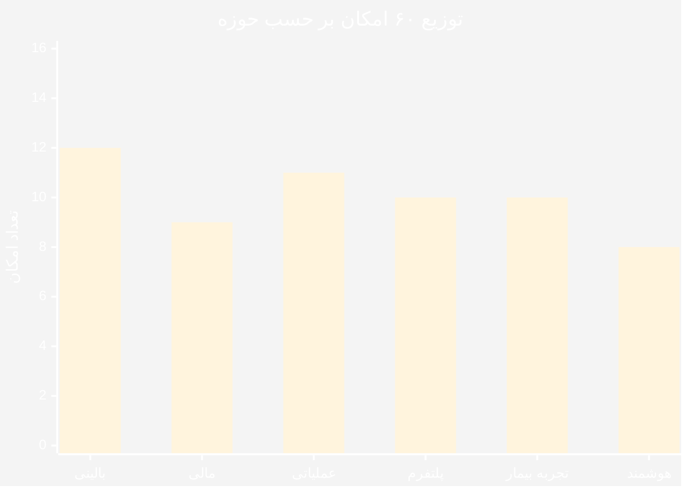
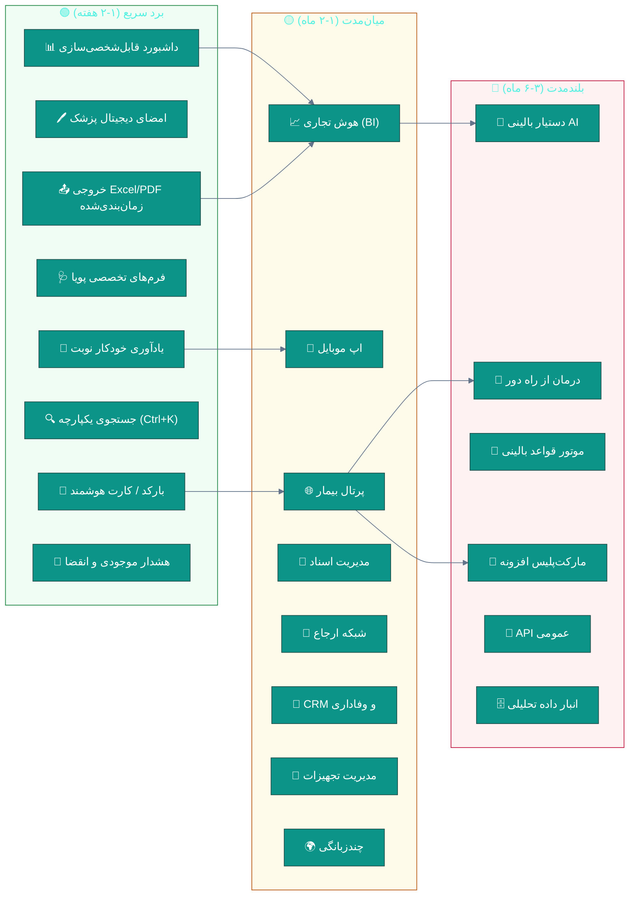
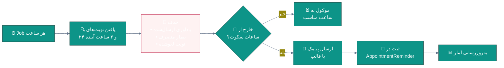
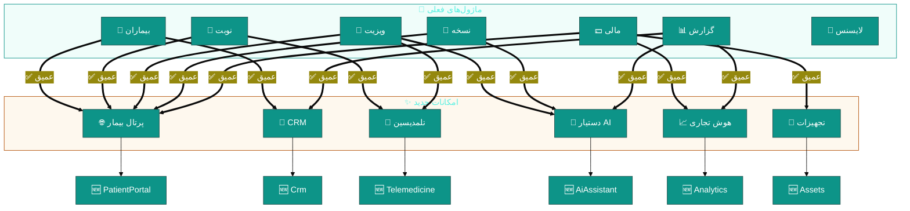
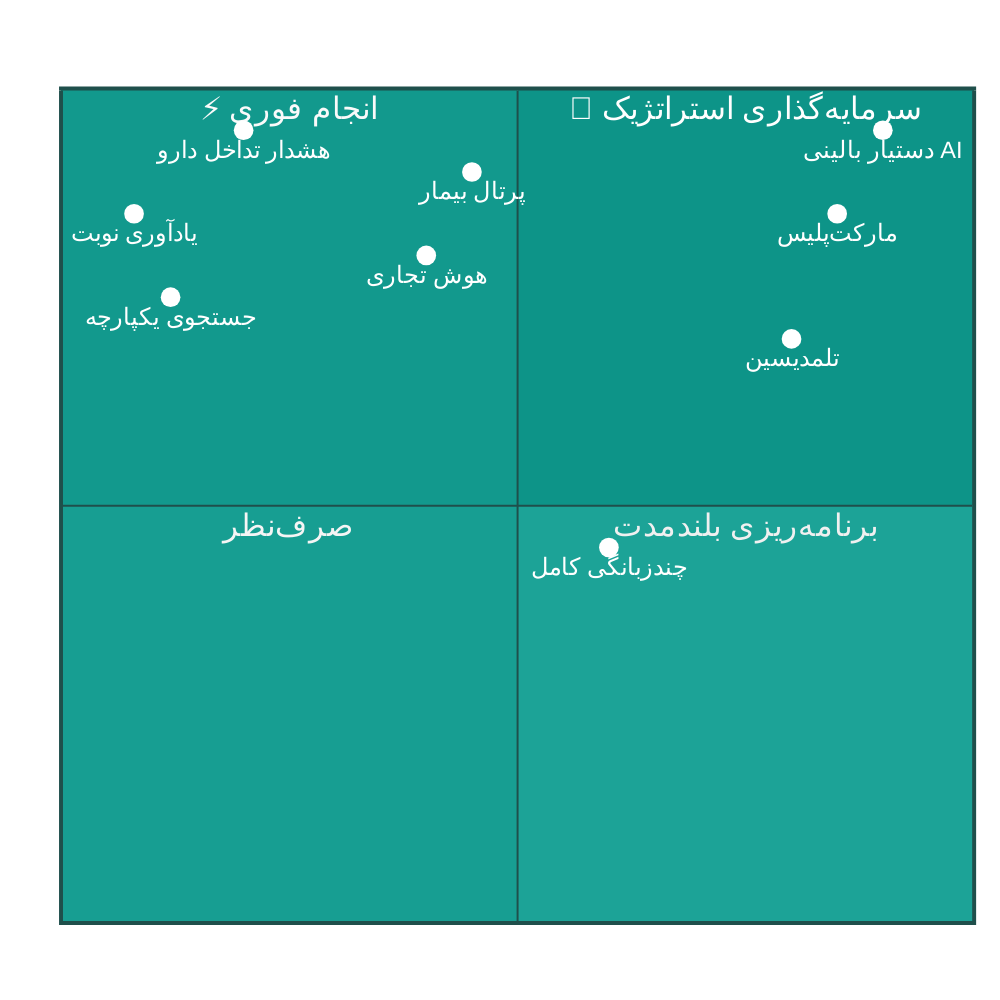
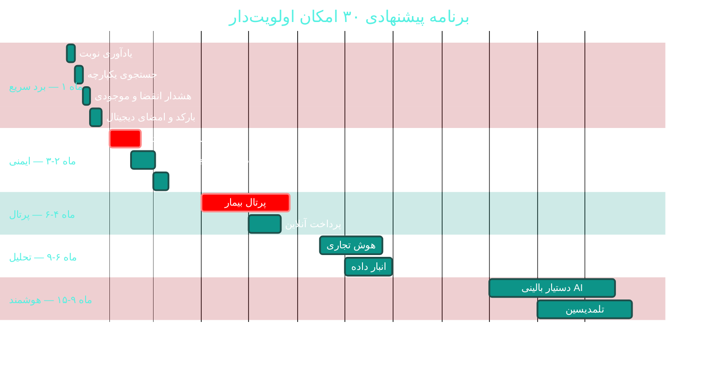

<div dir="rtl">

# ✨ امکانات پیشنهادی برای بهینه‌تر، حرفه‌ای‌تر و کامل‌تر شدن

<div align="center">

**نرم‌افزار جامع مدیریت درمانگاه سهند — Sahand ClinicPro v2.12.0**


📅 ۱۴۰۴/۰۷/۱۹ · 🔖 v1.0

</div>

---

## 📑 فهرست مطالب

| # | بخش |
|:--:|:---|
| ۱ | [خلاصه اجرایی](#۱--خلاصه-اجرایی) |
| ۲ | [نقشه امکانات](#۲--نقشه-امکانات) |
| ۳ | [🟢 برد سریع (۱۸ امکان)](#۳--برد-سریع-۱۸-امکان--۱-۲-هفته) |
| ۴ | [🟡 میان‌مدت (۲۲ امکان)](#۴--میانمدت-۲۲-امکان--۱-۲-ماه) |
| ۵ | [🔴 بلندمدت (۲۰ امکان)](#۵--بلندمدت-۲۰-امکان--۳-۶-ماه) |
| ۶ | [ماتریس امکان × ماژول](#۶--ماتریس-امکان--ماژول-فعلی) |
| ۷ | [تحلیل بازگشت سرمایه](#۷--تحلیل-بازگشت-سرمایه-roi) |
| ۸ | [اولویت‌بندی نهایی](#۸--اولویتبندی-نهایی) |

---

## ۱. 📋 خلاصه اجرایی

این سند **۶۰ امکانِ قابل‌افزودن** را معرفی می‌کند که ClinicPro را
از یک «نرم‌افزار مدیریت درمانگاهِ کامل» به یک
**«پلتفرم جامع سلامت»** ارتقا می‌دهد.

| 🎯 دسته | تعداد | زمان کل | بازگشت سرمایه |
|:---|:--:|:--:|:---|
| 🟢 **برد سریع** (۱-۲ هفته) | ۱۸ | ~۲۰ هفته | ⭐⭐⭐⭐⭐ فوری |
| 🟡 **میان‌مدت** (۱-۲ ماه) | ۲۲ | ~۳۰ ماه | ⭐⭐⭐⭐ بالا |
| 🔴 **بلندمدت** (۳-۶ ماه) | ۲۰ | ~۷۰ ماه | ⭐⭐⭐⭐⭐ تحول‌آفرین |

> 💡 **نکته:** امکانات «برد سریع» با تلاش کم،
> بیشترین بهبودِ ملموس را برای کاربر نهایی ایجاد می‌کنند و
> باید **پیش از** پروژه‌های بزرگ انجام شوند.



---

## ۲. 🗺 نقشه امکانات



---

## ۳. 🟢 برد سریع (۱۸ امکان · ۱-۲ هفته)

> 🎯 **هدف:** بهبود ملموس با کمترین تلاش — اجرای فوری توصیه می‌شود.

### ۳.۱ جدول امکانات

| # | امکان | 📝 شرح | 💰 ارزش | 🔧 دشواری | ⏱ | 📄 راهنما |
|:--:|:---|:---|:--:|:--:|:--:|:---|
| F-01 | 🎫 **بارکد روی نسخه و برچسب نمونه** | چاپ Code128 برای پیگیری آزمایش | ⭐⭐⭐⭐ | 🟢 | ۲روز | [A07](modules/A07-laboratory.md) |
| F-02 | 🖊 **امضای دیجیتال پزشک در چاپ** | نشانه `{{Signature:}}` در قالب | ⭐⭐⭐⭐ | 🟢 | ۳روز | [B09](modules/B09-print-templates.md) |
| F-03 | 📅 **یادآوری خودکار نوبت (پیامک)** | ۲۴ و ۲ ساعت پیش از نوبت | ⭐⭐⭐⭐⭐ | 🟢 | ۲روز | [A02](modules/A02-appointments.md) |
| F-04 | 🩺 **فرم‌های تخصصی پویا** | تعریف فیلد بدون تغییر کد | ⭐⭐⭐ | 🟡 | ۱هفته | [A05](modules/A05-emr-advanced.md) |
| F-05 | 📊 **داشبورد قابل‌شخصی‌سازی** | کاشی‌های قابل چیدمان توسط کاربر | ⭐⭐⭐ | 🟢 | ۳روز | [B08](modules/B08-reports.md) |
| F-06 | 🔍 **جستجوی یکپارچه (Ctrl+K)** | جستجوی بیمار/نوبت/نسخه در یکجا | ⭐⭐⭐⭐⭐ | 🟢 | ۳روز | [UI-UX](UI-UX-DESIGN-BEST.md) |
| F-07 | 📤 **خروجی زمان‌بندی‌شده** | ارسال خودکار گزارش به ایمیل | ⭐⭐⭐⭐ | 🟢 | ۲روز | [B08](modules/B08-reports.md) |
| F-08 | 🔔 **هشدار موجودی کم و انقضا** | آستانه‌های ۹۰/۶۰/۳۰/۷ روز | ⭐⭐⭐⭐⭐ | 🟢 | ۲روز | [B07](modules/B07-pharmacy-inventory.md) |
| F-09 | 🧮 **ماشین‌حساب‌های بالینی** | eGFR · BMI · CHA₂DS₂-VASc | ⭐⭐⭐⭐ | 🟢 | ۳روز | [A05](modules/A05-emr-advanced.md) |
| F-10 | 🖨 **نسخه‌بندی قالب‌های چاپ** | تاریخچه و بازگشت قالب | ⭐⭐⭐ | 🟢 | ۲روز | [B09](modules/B09-print-templates.md) |
| F-11 | 📱 **یادآوری مصرف دارو** | پیامک زمان‌بندی‌شده به بیمار | ⭐⭐⭐ | 🟢 | ۲روز | [C07](modules/C07-sms-communication.md) |
| F-12 | 🎂 **پیام تبریک تولد** | خودکار با قالب شخصی | ⭐⭐ | 🟢 | ۱روز | [D07](modules/D07-crm-marketing.md) |
| F-13 | 🔖 **میانبرهای صفحه‌کلید** | F2 بیمار جدید · Ctrl+S ذخیره | ⭐⭐⭐ | 🟢 | ۲روز | [UI-UX](UI-UX-DESIGN-BEST.md) |
| F-14 | 🌙 **حالت کیوسک برای سالن انتظار** | نمایشگرِ فقط صف | ⭐⭐⭐ | 🟢 | ۲روز | [A03](modules/A03-receptions-queue.md) |
| F-15 | 📋 **کپی ویزیت قبلی** | تکرار ویزیت با یک کلیک | ⭐⭐⭐⭐ | 🟢 | ۱روز | [A04](modules/A04-visits-soap.md) |
| F-16 | 🔐 **خروج از همه نشست‌ها** | باطل‌سازی همه توکن‌ها | ⭐⭐⭐⭐ | 🟢 | ۱روز | [C01](modules/C01-security-rbac.md) |
| F-17 | 📝 **یادداشت سریع روی بیمار** | بدون باز کردن ویزیت کامل | ⭐⭐⭐ | 🟢 | ۱روز | [A01](modules/A01-patients.md) |
| F-18 | 🏷 **برچسب‌گذاری بیماران** | دسته‌بندی آزاد (VIP، مزمن و…) | ⭐⭐⭐ | 🟢 | ۲روز | [A01](modules/A01-patients.md) |

### ۳.۲ نمونه پیاده‌سازی — F-03 یادآوری نوبت



```csharp
// Infrastructure/Jobs/AppointmentReminderJob.cs (جدید)
using Hangfire;

namespace Sahand.ClinicPro.Infrastructure.Jobs;

/// <summary>
/// ارسال خودکار یادآوری نوبت — ۲۴ و ۲ ساعت پیش از زمان نوبت
/// </summary>
public class AppointmentReminderJob
{
    private readonly IUnitOfWork _unitOfWork;
    private readonly ISmsService _smsService;
    private readonly IDateTimeService _dateTime;
    private readonly ILogger<AppointmentReminderJob> _logger;

    /// <summary>فاصله‌های یادآوری بر حسب ساعت</summary>
    private static readonly int[] ReminderHours = { 24, 2 };

    /// <summary>ساعات مجاز ارسال (اجتناب از مزاحمت شبانه)</summary>
    private const int QuietHourStart = 21;   // ۹ شب
    private const int QuietHourEnd = 8;      // ۸ صبح

    public AppointmentReminderJob(
        IUnitOfWork unitOfWork,
        ISmsService smsService,
        IDateTimeService dateTime,
        ILogger<AppointmentReminderJob> logger)
    {
        _unitOfWork = unitOfWork;
        _smsService = smsService;
        _dateTime = dateTime;
        _logger = logger;
    }

    [AutomaticRetry(Attempts = 3)]
    public async Task SendRemindersAsync(CancellationToken cancellationToken = default)
    {
        var now = _dateTime.UtcNow;

        // احترام به ساعات سکوت
        if (IsQuietHour(now))
        {
            _logger.LogInformation("در ساعات سکوت هستیم — ارسال موکول شد");
            return;
        }

        var totalSent = 0;

        foreach (var hoursBefore in ReminderHours)
        {
            var targetTime = now.AddHours(hoursBefore);
            var windowStart = targetTime.AddMinutes(-30);
            var windowEnd = targetTime.AddMinutes(30);

            // نوبت‌های در پنجره‌ی زمانی که هنوز یادآوری نگرفته‌اند
            var appointments = await _unitOfWork.Repository<Domain.Entities.Appointment>()
                .QueryableNoTracking
                .Include(a => a.Patient)
                .Include(a => a.Doctor)
                .Where(a => a.AppointmentDate >= windowStart
                         && a.AppointmentDate <= windowEnd
                         && a.Status == Domain.Enums.AppointmentStatus.Scheduled
                         && !a.ReminderSentAtUtc.HasValue)
                .ToListAsync(cancellationToken);

            foreach (var appointment in appointments)
            {
                // احترام به انصراف بیمار
                if (appointment.Patient.SmsOptOut) continue;

                var sent = await _smsService.SendTemplatedAsync(
                    appointment.Patient.MobileNumber,
                    templateId: "AppointmentReminder",
                    parameters: new Dictionary<string, string>
                    {
                        ["PatientName"] = appointment.Patient.FirstName,
                        ["DoctorName"] = appointment.Doctor.FullName,
                        ["Time"] = appointment.AppointmentDate.ToString("HH:mm"),
                        ["Date"] = PersianDateHelper.ToShamsi(appointment.AppointmentDate)
                    },
                    cancellationToken);

                if (sent)
                {
                    appointment.ReminderSentAtUtc = now;
                    totalSent++;
                }
            }
        }

        await _unitOfWork.SaveEntitiesAsync(cancellationToken);

        _logger.LogInformation("{Count} یادآوری نوبت ارسال شد", totalSent);
    }

    /// <summary>بررسی اینکه آیا در ساعات سکوت هستیم</summary>
    private static bool IsQuietHour(DateTime now)
        => now.Hour >= QuietHourStart || now.Hour < QuietHourEnd;
}
```

---

## ۴. 🟡 میان‌مدت (۲۲ امکان · ۱-۲ ماه)

| # | امکان | 📝 شرح | 💰 ارزش | 🔧 دشواری | ⏱ | 📄 راهنما |
|:--:|:---|:---|:--:|:--:|:--:|:---|
| F-19 | 🌐 **پرتال بیمار** | نتایج آزمایش، نوبت، سوابق، پرداخت | ⭐⭐⭐⭐⭐ | 🟡 | ۸هفته | [D01](modules/D01-patient-portal.md) |
| F-20 | 📱 **اپ موبایل (MAUI)** | برای بیمار و پزشک | ⭐⭐⭐⭐⭐ | 🔴 | ۸هفته | [D01](modules/D01-patient-portal.md) |
| F-21 | 📈 **هوش تجاری (BI)** | پیش‌بینی درآمد، تحلیل RFM | ⭐⭐⭐⭐ | 🟡 | ۸هفته | [D04](modules/D04-bi-analytics.md) |
| F-22 | 📁 **مدیریت اسناد (DMS/PACS)** | نسخه‌بندی، OCR، DICOM | ⭐⭐⭐⭐ | 🟡 | ۸هفته | [D05](modules/D05-document-management.md) |
| F-23 | 🔗 **شبکه ارجاع** | ارجاع + پیگیری خودکار | ⭐⭐⭐ | 🟡 | ۶هفته | [D06](modules/D06-referral-network.md) |
| F-24 | 📣 **CRM و باشگاه وفاداری** | کمپین، امتیاز، تحلیل ریزش | ⭐⭐⭐⭐ | 🟢 | ۵هفته | [D07](modules/D07-crm-marketing.md) |
| F-25 | 🧰 **مدیریت تجهیزات** | دارایی، کالیبراسیون، PM | ⭐⭐⭐ | 🟢 | ۴هفته | [D08](modules/D08-assets-equipment.md) |
| F-26 | 🌍 **چندزبانگی (i18n)** | فارسی · انگلیسی · عربی · کردی | ⭐⭐⭐⭐ | 🟡 | ۵هفته | [D09](modules/D09-localization-i18n.md) |
| F-27 | 💊 **هشدار تداخل پیشرفته** | شدت · جایگزین · منبع علمی | ⭐⭐⭐⭐⭐ | 🟡 | ۴هفته | [A06](modules/A06-prescriptions-safety.md) |
| F-28 | 🧪 **محدوده مرجعِ سنی/جنسیتی** | تفسیر خودکار نتایج آزمایش | ⭐⭐⭐⭐ | 🟡 | ۳هفته | [A07](modules/A07-laboratory.md) |
| F-29 | ⚠ **مقادیر بحرانی آزمایش** | هشدار فوری به پزشک | ⭐⭐⭐⭐⭐ | 🟢 | ۲هفته | [A07](modules/A07-laboratory.md) |
| F-30 | 💳 **پرداخت اشتراکی** | چند روش در یک صورتحساب | ⭐⭐⭐⭐ | 🟡 | ۲هفته | [B01](modules/B01-billing.md) |
| F-31 | 🧾 **استرداد با سند معکوس** | برگشت مالی حسابداری | ⭐⭐⭐⭐ | 🟡 | ۲هفته | [B01](modules/B01-billing.md) |
| F-32 | 📊 **پیری مطالبات بیمه** | سطل‌های ۳۰/۶۰/۹۰ روز | ⭐⭐⭐⭐ | 🟢 | ۲هفته | [B03](modules/B03-insurance.md) |
| F-33 | 🏥 **نسخه‌های قراردادی بیمه** | قیمت‌گذاری پویا بر اساس بیمه | ⭐⭐⭐⭐ | 🟡 | ۳هفته | [B03](modules/B03-insurance.md) |
| F-34 | 💵 **جداول مالیات و بیمه پویا** | به‌روزرسانی سالانه بدون کد | ⭐⭐⭐⭐ | 🟡 | ۲هفته | [B04](modules/B04-payroll.md) |
| F-35 | 👔 **ردیابی اعتبارنامه‌های پرسنل** | هشدار انقضای پروانه | ⭐⭐⭐⭐ | 🟢 | ۲هفته | [B05](modules/B05-hr-personnel.md) |
| F-36 | 🕐 **کشف ناهنجاری حضور و غیاب** | ضربات مشکوک | ⭐⭐⭐ | 🟡 | ۳هفته | [B06](modules/B06-attendance.md) |
| F-37 | 📦 **تخصیص FEFO در انبار** | مصرف از نزدیک‌ترین انقضا | ⭐⭐⭐⭐⭐ | 🟡 | ۲هفته | [B07](modules/B07-pharmacy-inventory.md) |
| F-38 | 📝 **نظرسنجی و NPS** | سنجش رضایت بیمار | ⭐⭐⭐ | 🟢 | ۳هفته | [C08](modules/C08-survey-training.md) |
| F-39 | 🏘 **چندشعبه‌ای سراسری** | فیلتر خودکار بر اساس شعبه | ⭐⭐⭐⭐ | 🟡 | ۲هفته | [C05](modules/C05-branches.md) |
| F-40 | 🔔 **مرکز اعلان‌های یکپارچه** | تلاش مجدد + تأیید دریافت | ⭐⭐⭐ | 🟡 | ۲هفته | [C06](modules/C06-notifications-realtime.md) |

---

## ۵. 🔴 بلندمدت (۲۰ امکان · ۳-۶ ماه)

| # | امکان | 📝 شرح | 💰 ارزش | 🔧 دشواری | ⏱ | 📄 راهنما |
|:--:|:---|:---|:--:|:--:|:--:|:---|
| F-41 | 🤖 **دستیار بالینی AI** | پیشنهاد ICD-10، خلاصه ویزیت | ⭐⭐⭐⭐⭐ | 🔴 | ۱۶هفته | [D03](modules/D03-ai-assistant.md) |
| F-42 | 🎥 **درمان از راه دور** | ویدیوویزیت یکپارچه | ⭐⭐⭐⭐ | 🔴 | ۱۲هفته | [D02](modules/D02-telemedicine.md) |
| F-43 | 🧬 **موتور قواعد بالینی** | هشدار بر اساس پروتکل | ⭐⭐⭐⭐⭐ | 🔴 | ۱۲هفته | [A06](modules/A06-prescriptions-safety.md) |
| F-44 | 🏪 **مارکت‌پلیس افزونه‌ها** | نصب افزونه توسط شخص ثالث | ⭐⭐⭐⭐ | 🔴 | ۱۲هفته | [D10](modules/D10-public-api-marketplace.md) |
| F-45 | 🔌 **API عمومی مستند** | OAuth 2.0 + وب‌هوک | ⭐⭐⭐⭐ | 🔴 | ۱۰هفته | [D10](modules/D10-public-api-marketplace.md) |
| F-46 | 🗄 **انبار داده تحلیلی** | جداول واقعیت و بُعد | ⭐⭐⭐⭐ | 🟡 | ۶هفته | [D04](modules/D04-bi-analytics.md) |
| F-47 | 🔄 **آپدیت خودکار کلاینت** | بررسی manifest و دانلود | ⭐⭐⭐⭐ | 🟡 | ۳هفته | [C10](modules/C10-release-automation.md) |
| F-48 | 🏛 **یکپارچه‌سازی سپاس** | ارسال به پرونده الکترونیک سلامت | ⭐⭐⭐⭐⭐ | 🔴 | ۱۰هفته | [C12](modules/C12-government-integration.md) |
| F-49 | 📋 **نسخه الکترونیک ملی** | صدور و امضای دیجیتال | ⭐⭐⭐⭐⭐ | 🔴 | ۱۲هفته | [C12](modules/C12-government-integration.md) |
| F-50 | 🔐 **احراز هویت دوعاملی** | TOTP / پیامک | ⭐⭐⭐⭐ | 🟡 | ۱هفته | [C01](modules/C01-security-rbac.md) |
| F-51 | 🔗 **زنجیره هش ممیزی** | ضد دستکاری برای لاگ‌ها | ⭐⭐⭐⭐ | 🟡 | ۳هفته | [C02](modules/C02-audit-compliance.md) |
| F-52 | 🩻 **نمایشگر DICOM کامل** | ابزارهای اندازه‌گیری پیشرفته | ⭐⭐⭐ | 🔴 | ۸هفته | [D05](modules/D05-document-management.md) |
| F-53 | 🦷 **چارت دندانپزشکی تعاملی** | FDI ۳۲ دندان با وضعیت | ⭐⭐⭐ | 🟡 | ۴هفته | [A08](modules/A08-paraclinical.md) |
| F-54 | 📊 **پیش‌بینی هوشمند موجودی** | بر اساس روند مصرف | ⭐⭐⭐⭐ | 🟡 | ۳هفته | [B07](modules/B07-pharmacy-inventory.md) |
| F-55 | 🧭 **راهنمای تعاملی (Tour)** | آموزش درون‌برنامه | ⭐⭐⭐ | 🟢 | ۲هفته | [C08](modules/C08-survey-training.md) |
| F-56 | 🎙 **تبدیل گفتار به متن** | دیکته شرح‌حال فارسی | ⭐⭐⭐⭐ | 🔴 | ۸هفته | [D03](modules/D03-ai-assistant.md) |
| F-57 | 🔍 **جستجوی شباهت بیمار** | یافتن موارد مشابه | ⭐⭐⭐ | 🔴 | ۶هفته | [D03](modules/D03-ai-assistant.md) |
| F-58 | 📱 **دستیار صوتی پذیرش** | ثبت نوبت با صدا | ⭐⭐⭐ | 🔴 | ۱۰هفته | [D03](modules/D03-ai-assistant.md) |
| F-59 | 🕐 **جدول‌های زمانی پویا** | بهینه‌سازی خودکار نوبت‌دهی | ⭐⭐⭐⭐ | 🔴 | ۸هفته | [A02](modules/A02-appointments.md) |
| F-60 | 🌐 **نسخه وب کامل** | جایگزین دسکتاپ (Blazor) | ⭐⭐⭐⭐⭐ | 🔴 | ۲۴هفته | [D01](modules/D01-patient-portal.md) |

---

## ۶. 🔀 ماتریس «امکان × ماژول فعلی»



| امکان جدید | بیماران | نوبت | ویزیت | نسخه | مالی | گزارش | لایسنس |
|:---|:--:|:--:|:--:|:--:|:--:|:--:|:--:|
| 🌐 پرتال بیمار | ✅ | ✅ | ✅ | ✅ | ✅ | ➖ | 🆕 `PatientPortal` |
| 🤖 دستیار AI | ➕ | ➕ | ✅ | ✅ | ➖ | ✅ | 🆕 `AiAssistant` |
| 🎥 تلمدیسین | ➕ | ✅ | ✅ | ✅ | ✅ | ➖ | 🆕 `Telemedicine` |
| 📈 هوش تجاری | ➖ | ➖ | ➖ | ➖ | ✅ | ✅ | 🆕 `Analytics` |
| 📣 CRM | ✅ | ➕ | ➖ | ➖ | ➕ | ✅ | 🆕 `Crm` |
| 🧰 تجهیزات | ➖ | ➖ | ➖ | ➖ | ✅ | ➕ | 🆕 `Assets` |
| 📁 مدیریت اسناد | ✅ | ➖ | ✅ | ➕ | ➖ | ➖ | 🆕 `Documents` |
| 🔗 شبکه ارجاع | ✅ | ➕ | ✅ | ➖ | ➕ | ➖ | 🆕 `Referrals` |

> **راهنما:** ✅ یکپارچگی عمیق · ➕ یکپارچگی سبک · ➖ بدون نیاز · 🆕 ماژول لایسنس جدید

---

## ۷. 💰 تحلیل بازگشت سرمایه (ROI)



### 📊 جدول تحلیل ROI (تخمینی)

| 🎯 امکان | 💵 هزینه تقریبی | 📈 ارزش سالانه | ⏱ بازگشت |
|:---|:---|:---|:--:|
| 📅 یادآوری خودکار نوبت | ۲ روز | کاهش ۳۰٪ عدم‌حضور | **< ۱ ماه** |
| 💊 هشدار تداخل پیشرفته | ۴ هفته | جلوگیری از خطای بالینی | **نامحاسبه (حیاتی)** |
| 🔍 جستجوی یکپارچه | ۳ روز | صرفه‌جویی ۵ دقیقه/کاربر/روز | **< ۲ ماه** |
| 🌐 پرتال بیمار | ۸ هفته | کاهش ۴۰٪ تماس تلفنی | **~۶ ماه** |
| 📈 هوش تجاری | ۸ هفته | بهبود ۱۰٪ تصمیم‌گیری مالی | **~۹ ماه** |
| 🤖 دستیار بالینی AI | ۱۶ هفته | صرفه‌جویی ۳۰٪ زمان مستندسازی | **~۱۲ ماه** |
| 🎥 تلمدیسین | ۱۲ هفته | بازار جدید + ۱۵٪ درآمد | **~۱۲ ماه** |
| 🏪 مارکت‌پلیس | ۱۲ هفته | اکوسیستم + درآمد مشارکت | **~۱۸ ماه** |

---

## ۸. 🎯 اولویت‌بندی نهایی

### 🥇 ده امکان اولویت‌دار



### 📋 جدول اولویت‌بندی با معیار WSJF

> **WSJF** = ارزش کسب‌وکار + حساسیت زمانی + کاهش ریسک ÷ اندازه کار

| رتبه | امکان | ارزش | فوریت | ریسک | اندازه | **WSJF** |
|:--:|:---|:--:|:--:|:--:|:--:|:--:|
| ۱ | 📅 یادآوری خودکار نوبت | ۸ | ۹ | ۵ | ۲ | **۱۱٫۰** |
| ۲ | 🔍 جستجوی یکپارچه | ۸ | ۷ | ۳ | ۳ | **۶٫۰** |
| ۳ | 🔔 هشدار موجودی/انقضا | ۹ | ۸ | ۷ | ۳ | **۸٫۰** |
| ۴ | 💊 هشدار تداخل پیشرفته | ۱۰ | ۹ | ۱۰ | ۸ | **۳٫۶** |
| ۵ | ⚠ مقادیر بحرانی آزمایش | ۹ | ۸ | ۹ | ۵ | **۵٫۲** |
| ۶ | 🌐 پرتال بیمار | ۱۰ | ۷ | ۵ | ۲۰ | **۱٫۱** |
| ۷ | 📈 هوش تجاری | ۸ | ۵ | ۴ | ۱۶ | **۱٫۱** |
| ۸ | 🤖 دستیار بالینی AI | ۱۰ | ۶ | ۴ | ۳۲ | **۰٫۶** |
| ۹ | 🎥 تلمدیسین | ۸ | ۵ | ۳ | ۲۴ | **۰٫۷** |
| ۱۰ | 🏪 مارکت‌پلیس | ۸ | ۳ | ۳ | ۲۴ | **۰٫۶** |

> 📌 **توصیه:** با امکانات رتبه ۱ تا ۵ شروع کنید
> (جمعاً ~۷ هفته) پیش از آغاز هر پروژه بزرگ.

---

## ✅ چک‌لیست ارزیابی امکان جدید

پیش از افزودن هر امکان، پرسش‌های زیر را پاسخ دهید:

| ✓ | پرسش |
|:--:|:---|
| ۱ | آیا این امکان یک **مشکل واقعیِ کاربر** را حل می‌کند؟ |
| ۲ | آیا با **معماری موجود** (CQRS + Clean) سازگار است؟ |
| ۳ | آیا **تست‌پذیر** است؟ |
| ۴ | آیا به **ماژول لایسنس جدید** نیاز دارد؟ |
| ۵ | آیا داده‌های بیمار را **به خطر** می‌اندازد؟ |
| ۶ | آیا **مستندات** آن قابل نگهداری است؟ |
| ۷ | آیا **بازگشت سرمایه** قابل اندازه‌گیری است؟ |

---

## ⚠️ ملاحظات

> [!IMPORTANT]
> امکانات مرتبط با **ایمنی بیمار** (تداخل دارویی، مقادیر بحرانی،
> هشدار آزمایشگاهی) صرف‌نظر از ROI، **باید** در اولویت باشند.

> [!WARNING]
> امکانات شامل **هوش مصنوعی** نیازمند بررسی حقوقی
> درباره‌ی ارسال داده‌های بیمار به سرویس‌های خارجی هستند.
> جزئیات در [D03](modules/D03-ai-assistant.md).

> [!CAUTION]
> زمان‌ها بر اساس **تحلیل ایستا** و با فرض یک توسعه‌دهنده تمام‌وقت برآورد شده‌اند.

---

<div align="center">

[🏠 بازگشت به فهرست مستندات](README.md) · [🚀 نقشه راه](IMPROVEMENTS-ROADMAP.md) · [🎨 طراحی UI](UI-UX-DESIGN-BEST.md)

📅 ۱۴۰۴/۰۷/۱۹ · 🔖 v1.0

</div>

</div>
