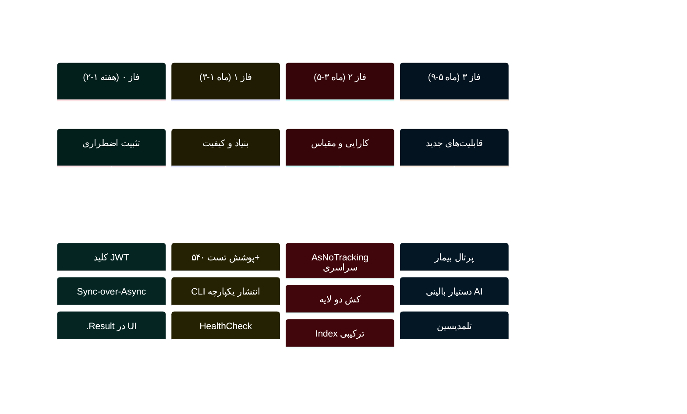
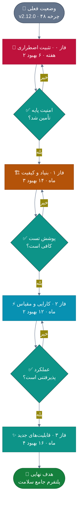
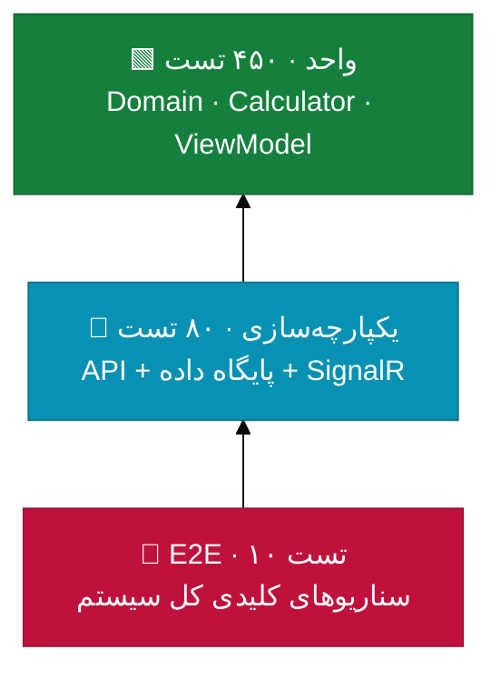
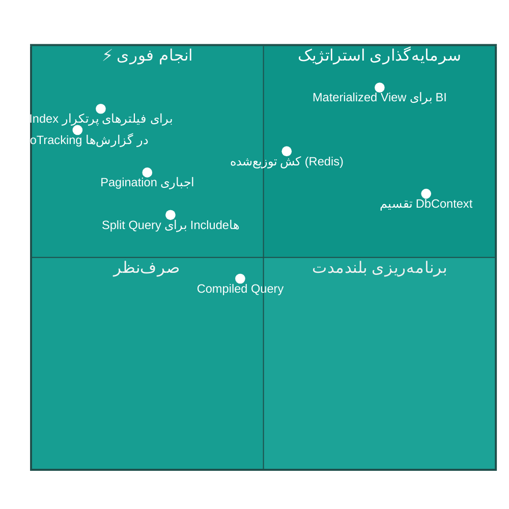
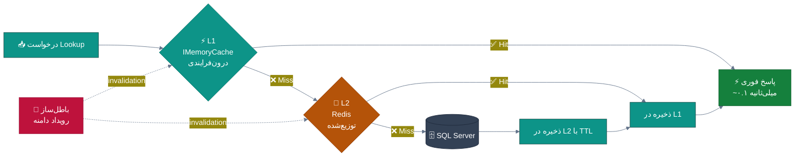
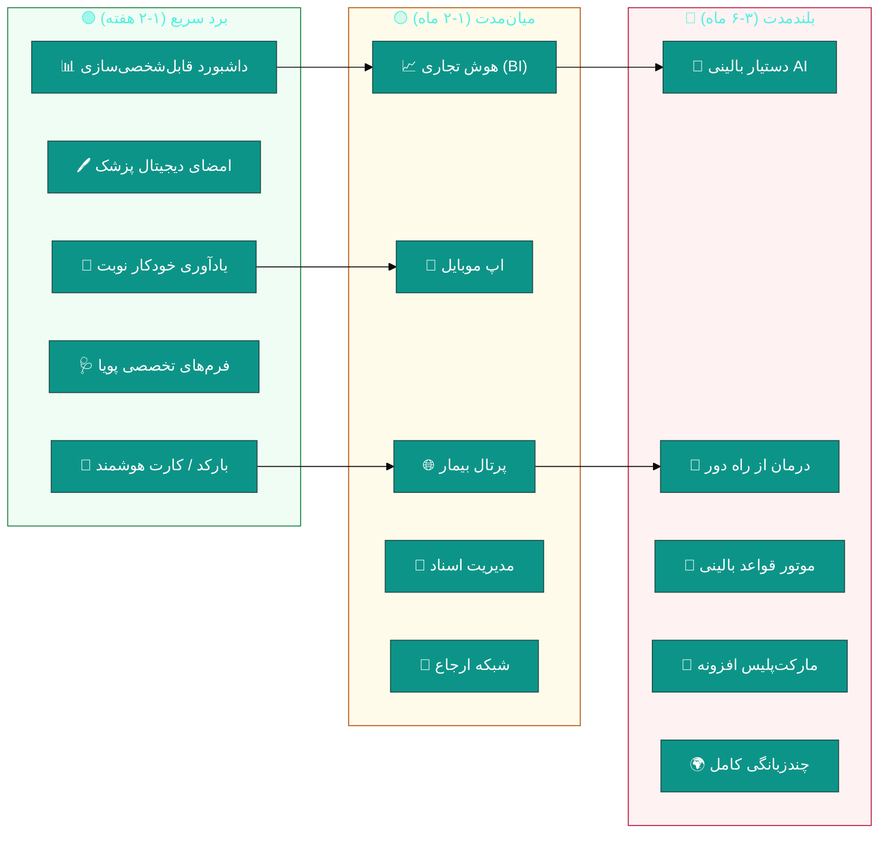
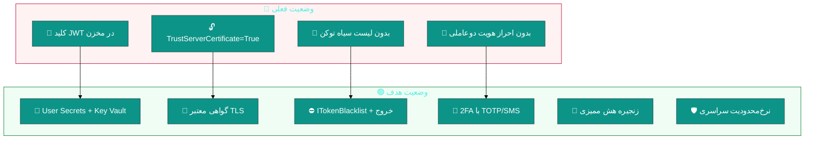
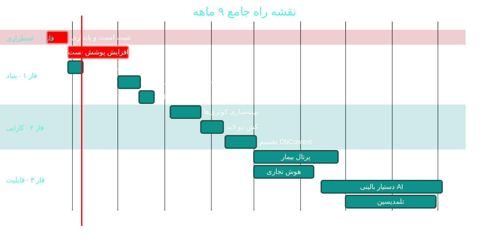

<div dir="rtl">

# 🚀 بهبودها و نقشه راه تکامل (Improvements Roadmap)

<div align="center">

**نرم‌افزار جامع مدیریت درمانگاه سهند — Sahand ClinicPro v2.12.0**


📅 ۱۴۰۴/۰۷/۱۹ · 🔖 v1.0

</div>

---

## 📑 فهرست مطالب

| # | بخش |
|:--:|:---|
| ۱ | [خلاصه اجرایی](#۱--خلاصه-اجرایی) |
| ۲ | [۴ فاز تحول](#۲--۴-فاز-تحول) |
| ۳ | [فاز صفر: تثبیت اضطراری](#۳--فاز-صفر-تثبیت-اضطراری-هفته-۱-۲) |
| ۴ | [فاز ۱: بنیاد و کیفیت](#۴--فاز-۱-بنیاد-و-کیفیت-ماه-۱-۳) |
| ۵ | [فاز ۲: کارایی و مقیاس](#۵--فاز-۲-کارایی-و-مقیاس-ماه-۳-۵) |
| ۶ | [فاز ۳: قابلیت‌های جدید](#۶--فاز-۳-قابلیتهای-جدید-ماه-۵-۹) |
| ۷ | [بهبودهای عملکردی](#۷--بهبودهای-عملکردی-performance) |
| ۸ | [بهبودهای امنیتی](#۸--بهبودهای-امنیتی) |
| ۹ | [بهبودهای معماری](#۹--بهبودهای-معماری) |
| ۱۰ | [شاخص‌های پیشرفت](#۱۰--شاخصهای-پیشرفت) |

---

## ۱. 📋 خلاصه اجرایی

این سند **۴۸ بهبودِ مشخص** را در ۴ فاز زمانی سازماندهی می‌کند:
از تثبیتِ اضطراریِ امنیت تا تبدیل محصول به یک پلتفرم.

| 🎯 فاز | نام | زمان | تعداد بهبود | خروجی اصلی |
|:--:|:---|:--:|:--:|:---|
| **۰** | 🚨 تثبیت اضطراری | ۲ هفته | ۶ | رفع ۳ ایراد بحرانی |
| **۱** | 🏗 بنیاد و کیفیت | ۳ ماه | ۱۴ | پوشش تست + یکپارچه‌سازی انتشار |
| **۲** | ⚡ کارایی و مقیاس | ۲ ماه | ۱۲ | سرعت + مقیاس‌پذیری |
| **۳** | ✨ قابلیت‌های جدید | ۴ ماه | ۱۶ | پرتال · هوش مصنوعی · تلمدیسین |



---

## ۲. 🗺 ۴ فاز تحول



> 💡 **نکته کلیدی:** هر فاز دارای یک **دروازه کیفیت (Gate)** است.
> ورود به فاز بعد بدون عبور از دروازه، ریسک را به‌شدت بالا می‌برد.
> به‌ویژه **فاز ۲ (تقسیم DbContext) هرگز نباید پیش از فاز ۱ انجام شود.**

---

## ۳. 🚨 فاز ۰ — تثبیت اضطراری (هفته ۱-۲)

> 🎯 **هدف:** رفع ۳ ایراد بحرانی که امنیت و پایداری را تهدید می‌کنند.

| # | بهبود | 🐛 مرتبط | ⏱ | 📄 راهنما |
|:--:|:---|:---|:--:|:---|
| I-01 | 🔑 انتقال کلید JWT به User Secrets + گارد Fail-Fast | BUG-01 | ۱ روز | [C01](modules/C01-security-rbac.md) |
| I-02 | 🔄 ناهمزمان‌سازی `BackupController` با `SemaphoreSlim` | BUG-02 | ۲ روز | [C03](modules/C03-backup.md) |
| I-03 | 🧊 حذف `.Result` از `ReportsViewModel` | BUG-03 | ۲ روز | [B08](modules/B08-reports.md) |
| I-04 | 🔍 اسکن مخزن برای کلیدهای تصادفی دیگر | BUG-01 | ۱ روز | — |
| I-05 | 📋 بررسی دستی ۱۲ اندپوینت `AllowAnonymous` | BUG-01 | ۲ روز | [C01](modules/C01-security-rbac.md) |
| I-06 | 💾 چرخش کلید JWT فعلی (Rotate) | BUG-01 | ۱ روز | [C01](modules/C01-security-rbac.md) |

**نمونه بهبود I-04 — اسکن امنیتی:**

```bash
#!/usr/bin/env bash
# scripts/security/scan_secrets.sh (جدید)
# جستجوی الگوهای کلید در کل مخزن

echo "🔍 در حال جستجوی کلیدهای احتمالی…"

PATTERNS=(
  'SecretKey.*=.*".{20,}"'
  'Password.*=.*".{8,}"'
  'ApiKey.*=.*".{16,}"'
  'ConnectionString.*Password='
  '-----BEGIN.*PRIVATE KEY-----'
)

FOUND=0
for pattern in "${PATTERNS[@]}"; do
  matches=$(git grep -n -E "$pattern" -- '*.json' '*.cs' '*.config' 2>/dev/null \
    | grep -v -E '(Example|Sample|\*\*\*\*|\{|\})')
  if [ -n "$matches" ]; then
    echo "⚠️  الگو: $pattern"
    echo "$matches"
    FOUND=1
  fi
done

if [ "$FOUND" -eq 0 ]; then
  echo "✅ هیچ کلید Hardcode یافت نشد"
  exit 0
else
  echo "❌ کلیدهای احتمالی یافت شد — بررسی کنید"
  exit 1
fi
```

> ✅ **تعریف انجام فاز ۰:** اسکن امنیتی خروجی موفق داشته باشد
> + هیچ `.Result` / `.GetAwaiter()` در مسیر درخواست نباشد.

---

## ۴. 🏗 فاز ۱ — بنیاد و کیفیت (ماه ۱-۳)

> 🎯 **هدف:** ایجاد شبکه ایمنی (تست) پیش از هر تغییر معماری بزرگ.

### ۴.۱ جدول بهبودها

| # | بهبود | 📝 شرح | ⏱ | 📄 راهنما |
|:--:|:---|:---|:--:|:---|
| I-07 | 🧪 **رسیدن به ۵۴۰ تست** | از ۲۷۲ به ۵۴۰ (دوبرابر) | ۴ هفته | [BUG-06](DEFECTS-IRADS.md#-bug-06--پوشش-تست-ناکافی) |
| I-08 | 🖥 **تست ViewModel** | پوشش ۵ God ViewModel از ۱۵ به ۱۲۰ تست | ۳ هفته | [B05](modules/B05-hr-personnel.md) |
| I-09 | 📦 **CLI انتشار یکپارچه** | جایگزینی ۳۴ اسکریپت تکراری | ۱ هفته | [C10](modules/C10-release-automation.md) |
| I-10 | 🗄 **بایگانی اسکریپت‌های تاریخی** | انتقال ~۹۴ اسکریپت به `archive/` | ۱ روز | [C10](modules/C10-release-automation.md) |
| I-11 | ❤ **HealthCheck** | پایگاه داده · دیسک · Hangfire | ۳ ساعت | [BUG-20](DEFECTS-IRADS.md) |
| I-12 | 🔭 **OpenTelemetry** | ردیابی توزیع‌شده + Jaeger | ۱ هفته | [BUG-21](DEFECTS-IRADS.md) |
| I-13 | ⏱ **CancellationToken سراسری** | رفع ۵۵ فایل فاقد آن | ۱ هفته | [BUG-09](DEFECTS-IRADS.md) |
| I-14 | 🔄 **ConfigureAwait در لایه‌های کتابخانه‌ای** | Application + Infrastructure | ۲ روز | [BUG-08](DEFECTS-IRADS.md) |
| I-15 | 🗂 **ادغام مستندات پراکنده** | ۱۳ فایل TODO → `docs/roadmap/` | ۱ هفته | [BUG-22](DEFECTS-IRADS.md) |
| I-16 | 📋 **تفکیک CHANGELOG** | بایگانی + ۳ نسخه آخر | ۱ ساعت | [BUG-11](DEFECTS-IRADS.md) |
| I-17 | 🧩 **تفکیک ReportsController** | ۶ فایل partial → ۶ کنترلر | ۳ روز | [B08](modules/B08-reports.md) |
| I-18 | 🧪 **تست تطابق ModelSnapshot** | جلوگیری از انحراف مدل | ۲ روز | [BUG-10](DEFECTS-IRADS.md) |
| I-19 | 🌐 **مسیر نسبی چندسکویی** | رفع `C:/Backups` و `localhost:5000` | ۴ ساعت | [BUG-17..19](DEFECTS-IRADS.md) |
| I-20 | 🔐 **گواهی معتبر در Production** | رفع `TrustServerCertificate=True` | ۱ ساعت | [BUG-18](DEFECTS-IRADS.md) |

### ۴.۲ هرم تست هدف



**توزیع ۵۴۰ تست هدف:**

| لایه | فعلی | 🎯 هدف | تمرکز |
|:---|:--:|:--:|:---|
| 🧬 Domain | ۹۶ | ۱۵۰ | ValueObject · Domain Events |
| ⚙ Application | ۹۲ | ۲۰۰ | همه Handlerهای CQRS |
| 🗄 Infrastructure | ۴۹ | ۹۰ | Repository · Job · Service |
| 🌐 API | ۳۰ | ۶۰ | Controller · Middleware |
| 🖥 Desktop | ۱۵ | ۱۲۰ | ViewModel · Converter |
| 🔺 E2E | ۰ | ۱۰ | سناریوهای کلیدی |
| **مجموع** | **۲۷۲** | **۶۳۰** | — |

### ۴.۳ نمونه — تست ViewModel

```csharp
// tests/Sahand.ClinicPro.Desktop.UnitTests/ViewModels/ReceptionsViewModelTests.cs (جدید)
public class ReceptionsViewModelTests
{
    private readonly Mock<IApiClient> _apiClient = new();
    private readonly Mock<IDialogService> _dialogService = new();
    private readonly Mock<ILogger<ReceptionsViewModel>> _logger = new();

    [Fact]
    public async Task LoadQueueAsync_WhenApiReturnsPatients_ShouldPopulateQueue()
    {
        // Arrange
        var patients = new List<ReceptionQueueItem>
        {
            new() { Id = Guid.NewGuid(), PatientName = "علی رضایی", WaitMinutes = 12 },
            new() { Id = Guid.NewGuid(), PatientName = "مریم کریمی", WaitMinutes = 8 }
        };

        _apiClient
            .Setup(c => c.GetAsync<List<ReceptionQueueItem>>(
                "api/v1/receptions/queue", It.IsAny<CancellationToken>()))
            .ReturnsAsync(patients);

        var viewModel = new ReceptionsViewModel(
            _apiClient.Object, _dialogService.Object, _logger.Object);

        // Act
        await viewModel.LoadQueueCommand.ExecuteAsync(null);

        // Assert
        Assert.Equal(2, viewModel.QueueItems.Count);
        Assert.Equal("علی رضایی", viewModel.QueueItems[0].PatientName);
        Assert.False(viewModel.IsLoading);
    }

    [Fact]
    public async Task LoadQueueAsync_WhenApiFails_ShouldShowErrorAndNotThrow()
    {
        // Arrange
        _apiClient
            .Setup(c => c.GetAsync<List<ReceptionQueueItem>>(
                It.IsAny<string>(), It.IsAny<CancellationToken>()))
            .ThrowsAsync(new HttpRequestException("خطای شبکه"));

        var viewModel = new ReceptionsViewModel(
            _apiClient.Object, _dialogService.Object, _logger.Object);

        // Act
        await viewModel.LoadQueueCommand.ExecuteAsync(null);

        // Assert — برنامه نباید crash کند
        Assert.Empty(viewModel.QueueItems);
        Assert.False(viewModel.IsLoading);
        _dialogService.Verify(
            d => d.ShowErrorAsync(It.IsAny<string>(), It.IsAny<string>()), Times.Once);
    }

    [Theory]
    [InlineData(0, "اکنون")]
    [InlineData(5, "۵ دقیقه")]
    [InlineData(65, "۱ ساعت و ۵ دقیقه")]
    public void WaitTimeDisplay_GivenMinutes_ShouldFormatCorrectly(
        int minutes, string expected)
    {
        // Act
        var actual = ReceptionsViewModel.FormatWaitTime(minutes);

        // Assert
        Assert.Equal(expected, actual);
    }
}
```

---

## ۵. ⚡ فاز ۲ — کارایی و مقیاس (ماه ۳-۵)

> 🎯 **هدف:** آماده‌سازی زیرساخت برای ۱۰ برابر شدن حجم داده.

### ۵.۱ نقشه حرارتیِ بهینه‌سازی



### ۵.۲ جدول بهبودهای عملکردی

| 🏷 | بهبود | 📍 محل | 💥 اثر | ⏱ |
|:---|:---|:---|:---|:--:|
| **P-01** | `AsNoTracking()` در همه Queryهای گزارش | `Application/Features/Reports/*` | ⬇۳۵٪ حافظه · ⬆۲۰٪ سرعت | ۴س |
| **P-02** | Index مرکب برای `(IsDeleted, BranchId, CreatedAt)` | Migrations جدید | ⬆۴۰-۷۰٪ سرعت لیست‌ها | ۶س |
| **P-03** | Pagination اجباری در همه لیست‌ها | ۳۰۸ اندپوینت | ⬇ بار شبکه و حافظه | ۱روز |
| **P-04** | `AsSplitQuery()` برای `Include`های چندشاخه | `Repository<T>` | رفع Cartesian Explosion | ۴س |
| **P-05** | کش توزیع‌شده برای Lookupها | `Application/Features/Lookups` | ⬇۸۰٪ query تکراری | ۱روز |
| **P-06** | `IMemoryCache` برای داده‌های مرجعِ ایستا | `Infrastructure/Services` | ⬇۹۰٪ query تنظیمات | ۴س |
| **P-07** | Response Compression (Brotli/Gzip) | `API/Program.cs` | ⬇۷۰٪ حجم پاسخ | ۱س |
| **P-08** | Virtualization در DataGridهای بزرگ | `Desktop/Views/*` | UI روان با ۱۰۰هزار ردیف | ۲روز |
| **P-09** | Compiled Query برای مسیرهای داغ | `PatientRepository` | ⬆۲۵٪ سرعت | ۱روز |
| **P-10** | Materialized View برای داشبورد | Migration + Job | ⬆۱۰× سرعت داشبورد | ۳روز |
| **P-11** | بستن خودکار اتصال SignalR بیکار | `RealtimeClient` | ⬇ مصرف منبع سرور | ۳س |
| **P-12** | Batch Insert برای ورود کالا / ضربات دستگاه | `StockIn` · `AttendanceSync` | ⬆۵۰× سرعت درج | ۱روز |

### ۵.۳ معماری کش دو لایه



**پیاده‌سازی:**

```csharp
// Infrastructure/Services/Caching/TwoLevelCacheService.cs (جدید)
public class TwoLevelCacheService : ICacheService
{
    private readonly IMemoryCache _l1;
    private readonly IDistributedCache _l2;
    private readonly ILogger<TwoLevelCacheService> _logger;

    public async Task<T?> GetOrCreateAsync<T>(
        string key,
        Func<CancellationToken, Task<T>> factory,
        TimeSpan? l1Ttl = null,
        TimeSpan? l2Ttl = null,
        CancellationToken cancellationToken = default) where T : class
    {
        // لایه ۱: حافظه درون‌فرایندی
        if (_l1.TryGetValue(key, out T? cached))
            return cached;

        // لایه ۲: Redis
        var serialized = await _l2.GetStringAsync(key, cancellationToken);
        if (serialized is not null)
        {
            var fromL2 = JsonSerializer.Deserialize<T>(serialized);
            if (fromL2 is not null)
            {
                _l1.Set(key, fromL2, l1Ttl ?? TimeSpan.FromMinutes(5));
                return fromL2;
            }
        }

        // منبع اصلی
        var value = await factory(cancellationToken);
        if (value is null) return null;

        await _l2.SetStringAsync(key,
            JsonSerializer.Serialize(value),
            new DistributedCacheEntryOptions
            {
                AbsoluteExpirationRelativeToNow = l2Ttl ?? TimeSpan.FromHours(1)
            },
            cancellationToken);

        _l1.Set(key, value, l1Ttl ?? TimeSpan.FromMinutes(5));
        return value;
    }

    /// <summary>باطل‌سازی همزمان هر دو لایه</summary>
    public async Task InvalidateAsync(string key, CancellationToken ct = default)
    {
        _l1.Remove(key);
        await _l2.RemoveAsync(key, ct);
    }
}
```

### ۵.۴ ایندکس‌های ترکیبی پیشنهادی

```csharp
// Infrastructure/Persistence/Configurations/PatientConfiguration.cs
public void Configure(EntityTypeBuilder<Patient> builder)
{
    // الگوی پرتکرار ۱: جستجوی بیمار در یک شعبه
    builder.HasIndex(p => new { p.NationalCode, p.IsDeleted })
        .HasDatabaseName("IX_Patient_NationalCode_IsDeleted")
        .HasFilter("[IsDeleted] = 0");

    // الگوی پرتکرار ۲: لیست بیماران فعال یک شعبه بر اساس زمان
    builder.HasIndex(p => new { p.BranchId, p.IsDeleted, p.CreatedAtUtc })
        .HasDatabaseName("IX_Patient_Branch_Active_Created");

    // الگوی پرتکرار ۳: جستجوی متنی روی نام
    builder.HasIndex(p => new { p.LastName, p.FirstName })
        .HasDatabaseName("IX_Patient_Name");
}

// نوبت‌ها: پرتکرارترین کوئری سیستم
public void Configure(EntityTypeBuilder<Appointment> builder)
{
    builder.HasIndex(a => new { a.DoctorId, a.AppointmentDate, a.Status })
        .HasDatabaseName("IX_Appointment_Doctor_Date_Status");

    builder.HasIndex(a => new { a.PatientId, a.AppointmentDate })
        .HasDatabaseName("IX_Appointment_Patient_Date");
}
```

---

## ۶. ✨ فاز ۳ — قابلیت‌های جدید (ماه ۵-۹)

> 🎯 **هدف:** تبدیل از «نرم‌افزار درمانگاه» به «پلتفرم سلامت».

### ۶.۱ نقشه امکانات بر حسب ارزش و دشواری



### ۶.۲ جدول ۱۶ قابلیت فاز ۳

| # | قابلیت | 💰 ارزش | 🔧 دشواری | ⏱ | 📄 راهنما |
|:--:|:---|:--:|:--:|:--:|:---|
| I-21 | 🌐 **پرتال بیمار** | ⭐⭐⭐⭐⭐ | 🟡 | ۸ه | [D01](modules/D01-patient-portal.md) |
| I-22 | 📱 **اپ موبایل (MAUI)** | ⭐⭐⭐⭐⭐ | 🔴 | ۸ه | [D01](modules/D01-patient-portal.md) |
| I-23 | 🤖 **دستیار بالینی AI** | ⭐⭐⭐⭐⭐ | 🔴 | ۱۶ه | [D03](modules/D03-ai-assistant.md) |
| I-24 | 📈 **هوش تجاری (BI)** | ⭐⭐⭐⭐ | 🟡 | ۸ه | [D04](modules/D04-bi-analytics.md) |
| I-25 | 🎥 **درمان از راه دور** | ⭐⭐⭐⭐ | 🔴 | ۱۲ه | [D02](modules/D02-telemedicine.md) |
| I-26 | 📁 **مدیریت اسناد (DMS/PACS)** | ⭐⭐⭐⭐ | 🟡 | ۸ه | [D05](modules/D05-document-management.md) |
| I-27 | 🔗 **شبکه ارجاع** | ⭐⭐⭐ | 🟡 | ۶ه | [D06](modules/D06-referral-network.md) |
| I-28 | 📣 **CRM و وفاداری** | ⭐⭐⭐⭐ | 🟢 | ۵ه | [D07](modules/D07-crm-marketing.md) |
| I-29 | 🧰 **مدیریت تجهیزات** | ⭐⭐⭐ | 🟢 | ۴ه | [D08](modules/D08-assets-equipment.md) |
| I-30 | 🌍 **چندزبانگی (i18n)** | ⭐⭐⭐⭐ | 🟡 | ۵ه | [D09](modules/D09-localization-i18n.md) |
| I-31 | 🔌 **API عمومی + مارکت‌پلیس** | ⭐⭐⭐⭐ | 🔴 | ۱۲ه | [D10](modules/D10-public-api-marketplace.md) |
| I-32 | 🎫 **بارکد و کارت هوشمند** | ⭐⭐⭐ | 🟢 | ۲ه | [A07](modules/A07-laboratory.md) |
| I-33 | 🖊 **امضای دیجیتال پزشک** | ⭐⭐⭐⭐ | 🟡 | ۳ه | [B09](modules/B09-print-templates.md) |
| I-34 | 📅 **یادآوری خودکار نوبت** | ⭐⭐⭐⭐ | 🟢 | ۲ه | [A02](modules/A02-appointments.md) |
| I-35 | 🩺 **فرم‌های تخصصی پویا** | ⭐⭐⭐ | 🟡 | ۳ه | [A05](modules/A05-emr-advanced.md) |
| I-36 | 📊 **داشبورد قابل‌شخصی‌سازی** | ⭐⭐⭐ | 🟢 | ۲ه | [B08](modules/B08-reports.md) |

---

## ۷. 📊 بهبودهای عملکردی (Performance)

> 📄 تکمیل‌شده در فصل ۵ بالا — شامل ۱۲ بهبود P-01 تا P-12.

---

## ۸. 🔐 بهبودهای امنیتی



| # | بهبود امنیتی | 🎯 اولویت | ⏱ | 📄 راهنما |
|:--:|:---|:--:|:--:|:---|
| S-01 | مدیریت امن کلیدها (Secrets/Key Vault) | 🔴 | ۱روز | [C01](modules/C01-security-rbac.md) |
| S-02 | چرخش کلید JWT بدون downtime | 🔴 | ۲روز | [C01](modules/C01-security-rbac.md) |
| S-03 | لیست سیاه توکن (Token Blacklist) | 🟠 | ۲روز | [C01](modules/C01-security-rbac.md) |
| S-04 | احراز هویت دوعاملی (2FA) | 🟠 | ۵روز | [C01](modules/C01-security-rbac.md) |
| S-05 | زنجیره هش برای لاگ ممیزی | 🟠 | ۳روز | [C02](modules/C02-audit-compliance.md) |
| S-06 | ثبت دسترسی به اطلاعات سلامت (PHI) | 🟠 | ۳روز | [C02](modules/C02-audit-compliance.md) |
| S-07 | محدودیت نرخ سراسری | 🟡 | ۲روز | [D10](modules/D10-public-api-marketplace.md) |
| S-08 | رمزنگاری اعتبارنامه‌های دولتی | 🟠 | ۲روز | [C12](modules/C12-government-integration.md) |
| S-09 | بررسی یکپارچگی ساعت لایسنس | 🟡 | ۲روز | [C09](modules/C09-licensing.md) |
| S-10 | اسکن خودکار آسیب‌پذیری پکیج‌ها | 🟡 | ۱روز | — |

---

## ۹. 🏛 بهبودهای معماری

| # | بهبود معماری | 🎯 اولویت | ⏱ | ریسک | 📄 راهنما |
|:--:|:---|:--:|:--:|:--:|:---|
| A-01 | تقسیم DbContext به ۵ Bounded Context | 🟠 | ۳هفته | 🔴 بالا | [C11](modules/C11-database-scalability.md) |
| A-02 | شکستن God ViewModelها با Composition | 🟠 | ۳هفته | 🟡 متوسط | [B05](modules/B05-hr-personnel.md) |
| A-03 | حذف Code-Behind با Behavior | 🟡 | ۳هفته | 🟡 متوسط | [C08](modules/C08-survey-training.md) |
| A-04 | فیلتر سراسری حذف منطقی | 🟠 | ۲روز | 🟢 کم | [C11](modules/C11-database-scalability.md) |
| A-05 | تفکیک کنترلرهای گزارش | 🟠 | ۳روز | 🟢 کم | [B08](modules/B08-reports.md) |
| A-06 | شکستن `LicenseService` (۱٬۱۵۱ خط) | 🟡 | ۱هفته | 🟡 متوسط | [C09](modules/C09-licensing.md) |
| A-07 | زیرساخت محلی‌سازی (resx) | 🟡 | ۲هفته | 🟢 کم | [D09](modules/D09-localization-i18n.md) |
| A-08 | الگوی Outbox برای ارسال تضمین‌شده | 🟠 | ۱هفته | 🟡 متوسط | [C12](modules/C12-government-integration.md) |
| A-09 | چندشعبه‌ای سراسری (`IBranchScoped`) | 🟡 | ۲هفته | 🟡 متوسط | [C05](modules/C05-branches.md) |
| A-10 | مانیتورینگ کوئری‌های کند | 🟢 | ۲روز | 🟢 کم | [C11](modules/C11-database-scalability.md) |

### نمونه A-02 — شکستن God ViewModel

```csharp
// ❌ قبل: ReceptionsViewModel با ۱٬۳۱۶ خط و ۴ مسئولیت
public partial class ReceptionsViewModel : ObservableObject
{
    // مسئولیت ۱: صف و لیست انتظار (~۴۰۰ خط)
    // مسئولیت ۲: ثبت پذیرش جدید (~۳۰۰ خط)
    // مسئولیت ۳: پرداخت و صورتحساب (~۳۰۰ خط)
    // مسئولیت ۴: جستجوی بیمار (~۳۰۰ خط)
}

// ✅ بعد: ترکیب ۴ زیر-ViewModel
public partial class ReceptionsViewModel : ObservableObject
{
    public QueueSubViewModel Queue { get; }
    public NewReceptionSubViewModel NewReception { get; }
    public PaymentSubViewModel Payment { get; }
    public PatientSearchSubViewModel Search { get; }

    public ReceptionsViewModel(
        QueueSubViewModel queue,
        NewReceptionSubViewModel newReception,
        PaymentSubViewModel payment,
        PatientSearchSubViewModel search)
    {
        Queue = queue;
        NewReception = newReception;
        Payment = payment;
        Search = search;

        // هماهنگی بین زیر-ViewModelها
        NewReception.ReceptionCreated += async (s, e) =>
            await Queue.RefreshAsync();
        Search.PatientSelected += (s, patientId) =>
            NewReception.SetPatient(patientId);
    }
}
```

> ✅ هر زیر-ViewModel حالا **قابل تست مستقل** است.

---

## ۱۰. 📈 شاخص‌های پیشرفت



### 📊 جدول شاخص‌ها

| 📊 شاخص | وضعیت فعلی | 🎯 پایان فاز ۱ | 🎯 پایان فاز ۲ | 🎯 پایان فاز ۳ |
|:---|:--:|:--:|:--:|:--:|
| 🔴 ایرادهای بحرانی | ۳ | **۰** | ۰ | ۰ |
| 🧪 تعداد تست‌ها | ۲۷۲ | **۵۴۰** | ۶۳۰ | ۷۵۰ |
| 🖥 تست‌های Desktop | ۱۵ | **۱۲۰** | ۱۵۰ | ۲۰۰ |
| ⏱ زمان بیلد CI | ~۱۵د | **~۱۲د** | **~۶د** | ~۶د |
| 🗄 حجم مایگریشن‌ها | ۲۲۵ه خط | ۲۲۵ه | **< ۳۰ه** | < ۳۰ه |
| 🚀 زمان راه‌اندازی API | ~۸ث | ~۸ث | **< ۳ث** | < ۳ث |
| 🔍 کوئری‌های کند (>۱ث) | نامشخص | اندازه‌گیری | **۰** | ۰ |
| 🌐 پرتال بیمار | ❌ | ❌ | ❌ | **✅** |
| 🤖 دستیار AI | ❌ | ❌ | ❌ | **✅** |

---

## ✅ چک‌لیست اجرا

### پیش از شروع هر فاز

- [ ] شاخص‌های فاز قبل اندازه‌گیری و ثبت شده‌اند
- [ ] دروازه کیفیت عبور شده است
- [ ] تیم آموزش لازم را دیده است
- [ ] برنامه بازگشت (Rollback) مستند شده است

### در حین اجرا

- [ ] هر بهبود دارای تست رگرسیون است
- [ ] مستندات همزمان به‌روزرسانی می‌شوند
- [ ] خروجی در محیط Staging تأیید شده است

### پس از پایان

- [ ] شاخص‌های جدید اندازه‌گیری شدند
- [ ] `CHANGELOG.md` به‌روزرسانی شد
- [ ] بازنگری با ذینفعان انجام شد

---

## ⚠️ ملاحظات

> [!CAUTION]
> این برنامه بر اساس **تحلیل ایستا** تدوین شده است.
> زمان‌های برآوردی با فرض **یک توسعه‌دهنده تمام‌وقت** است
> و باید با ظرفیت واقعی تیم تطبیق داده شود.

> [!IMPORTANT]
> **فاز ۲ (تقسیم DbContext) بزرگ‌ترین ریسک فنی است.**
> هرگز پیش از رسیدن به ۵۴۰ تست (پایان فاز ۱) آغاز نشود.

---

<div align="center">

[🏠 بازگشت به فهرست مستندات](README.md) · [🐛 ایرادها](DEFECTS-IRADS.md) · [✨ امکانات](FEATURES-PROPOSALS.md)

📅 ۱۴۰۴/۰۷/۱۹ · 🔖 v1.0

</div>

</div>
