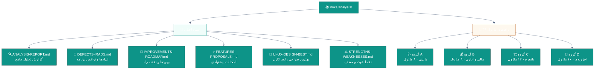
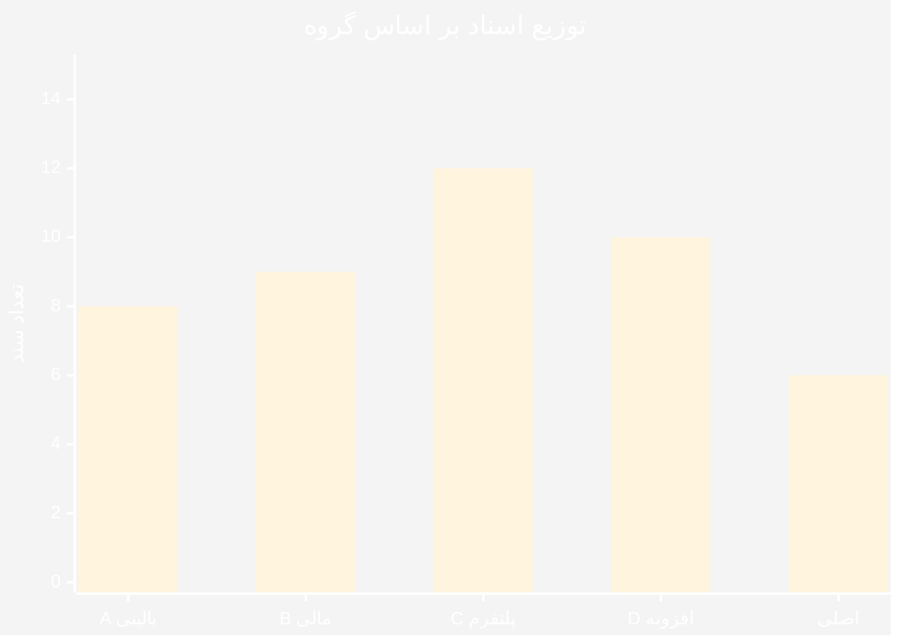
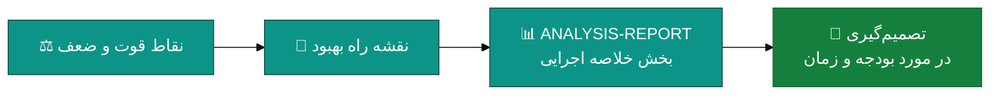
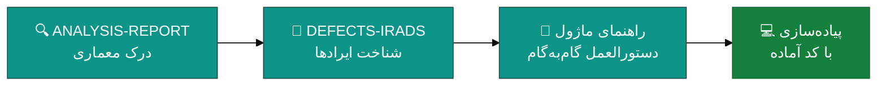

<div dir="rtl">

# 📚 مستندات تحلیل و بهبود — نرم‌افزار جامع مدیریت درمانگاه سهند (ClinicPro)

<div align="center">


**تحلیل کامل و دقیق کدبیس · فهرست ایرادها · نقشه راه بهبود · راهنمای پیاده‌سازی ماژول‌ها**

</div>

---

## 🗺 نقشه راه مستندات



---

## 📄 ۱. اسناد اصلی تحلیل

شش سند مستقل که هرکدام یکی از محورهای درخواستی را به‌طور کامل پوشش می‌دهند:

| # | 📄 سند | 🎯 موضوع | 📊 حجم |
|:--:|:---|:---|:--:|
| ۱ | [🔍 **ANALYSIS-REPORT.md**](ANALYSIS-REPORT.md) | **گزارش تحلیل جامع** — معماری، کدبیس، وابستگی‌ها، آسیب‌پذیری‌ها و پیوست ۳۹ ماژول | بسیار بزرگ |
| ۲ | [🐛 **DEFECTS-IRADS.md**](DEFECTS-IRADS.md) | **ایرادها و نواقص برنامه** — دسته‌بندی‌شده بر اساس شدت، محل و پیامد | بزرگ |
| ۳ | [🚀 **IMPROVEMENTS-ROADMAP.md**](IMPROVEMENTS-ROADMAP.md) | **بهبودهای پیشنهادی و نقشه راه** — از بحرانی تا بلندمدت | بزرگ |
| ۴ | [✨ **FEATURES-PROPOSALS.md**](FEATURES-PROPOSALS.md) | **امکانات قابل‌افزودن** — برای بهینه‌تر، حرفه‌ای‌تر و کامل‌تر شدن | بزرگ |
| ۵ | [🎨 **UI-UX-DESIGN-BEST.md**](UI-UX-DESIGN-BEST.md) | **بهترین طراحی رابط کاربر** — وایرفریم، سیستم طراحی، رنگ و دسترسی‌پذیری | بزرگ |
| ۶ | [⚖ **STRENGTHS-WEAKNESSES.md**](STRENGTHS-WEAKNESSES.md) | **نقاط قوت و ضعف** — همراه با تحلیل رقابتی و ماتریس ارزیابی | بزرگ |

> 💡 **توصیه مسیر مطالعه:**
> اگر وقت کمی دارید: `STRENGTHS-WEAKNESSES.md` → `DEFECTS-IRADS.md` → `IMPROVEMENTS-ROADMAP.md`
> اگر قصد توسعه دارید: `ANALYSIS-REPORT.md` → راهنمای ماژول مربوطه

---

## 📁 ۲. راهنماهای ماژول (۳۹ سند مستقل)

هر ماژول در یک فایل جداگانه با **۹ بخش استاندارد** مستند شده است:

```
۱. 📋 خلاصه و جدول ویژگی‌ها
۲. 🎯 وضعیت فعلی در کدبیس (فایل · خط · وضعیت)
۳. 📊 نمودارهای Mermaid (جریان، توالی، وضعیت، گانت)
۴. ⚠️ جدول کاستی‌ها (W-xx با شدت · محل · پیامد)
۵. ✨ جدول امکانات پیشنهادی (F-xx با ارزش · دشواری · زمان)
۶. 🛠 دستورالعمل پیاده‌سازی + کد واقعی C#
۷. 🧪 جدول تست‌های الزامی
۸. 📈 جدول شاخص‌های موفقیت (KPI)
۹. 🗓 برنامه زمانی + پیوندهای مرتبط
```

### 🩺 گروه A — ماژول‌های بالینی (۸ ماژول)

| 📄 فایل | ماژول | 🎯 اولویت | ⏱ زمان |
|:---|:---|:--:|:--:|
| [A01-patients.md](modules/A01-patients.md) | 👥 بیماران و پرونده الکترونیک | 🟠 بالا | — |
| [A02-appointments.md](modules/A02-appointments.md) | 📅 نوبت‌دهی و زمان‌بندی | 🟠 بالا | — |
| [A03-receptions-queue.md](modules/A03-receptions-queue.md) | 🛎 پذیرش، صف و لیست انتظار | 🟠 بالا | — |
| [A04-visits-soap.md](modules/A04-visits-soap.md) | 🩻 ویزیت (SOAP) | 🟡 متوسط | — |
| [A05-emr-advanced.md](modules/A05-emr-advanced.md) | ❤ پرونده بالینی پیشرفته | 🟡 متوسط | — |
| [A06-prescriptions-safety.md](modules/A06-prescriptions-safety.md) | 💊 نسخه‌نویسی و ایمنی دارویی | 🔴 بحرانی | — |
| [A07-laboratory.md](modules/A07-laboratory.md) | 🧪 آزمایشگاه (LIS) | 🟡 متوسط | — |
| [A08-paraclinical.md](modules/A08-paraclinical.md) | 🩻 پاراکلینیک (تصویربرداری · دندان · چشم) | 🟡 متوسط | — |

### 💰 گروه B — ماژول‌های مالی و اداری (۹ ماژول)

| 📄 فایل | ماژول | 🎯 اولویت |
|:---|:---|:--:|
| [B01-billing.md](modules/B01-billing.md) | 🧾 صورتحساب و دریافت | 🟠 بالا |
| [B02-accounting.md](modules/B02-accounting.md) | 📒 حسابداری و دفتر کل | 🟠 بالا |
| [B03-insurance.md](modules/B03-insurance.md) | 🏥 بیمه و مطالبات | 🟠 بالا |
| [B04-payroll.md](modules/B04-payroll.md) | 💵 حقوق و دستمزد | 🟡 متوسط |
| [B05-hr-personnel.md](modules/B05-hr-personnel.md) | 👔 پرسنل و قراردادها | 🟡 متوسط |
| [B06-attendance.md](modules/B06-attendance.md) | 🕐 حضور و غیاب دستگاهی | 🟢 کم |
| [B07-pharmacy-inventory.md](modules/B07-pharmacy-inventory.md) | 💊 داروخانه و انبار | 🟡 متوسط |
| [B08-reports.md](modules/B08-reports.md) | 📊 گزارش‌ساز و Ad-hoc | 🟠 بالا |
| [B09-print-templates.md](modules/B09-print-templates.md) | 🖨 قالب‌های چاپ | 🟢 کم |

### 🏗 گروه C — پلتفرم و زیرساخت (۱۲ ماژول)

| 📄 فایل | ماژول | 🎯 اولویت |
|:---|:---|:--:|
| [C01-security-rbac.md](modules/C01-security-rbac.md) | 🔐 امنیت، کاربران و نقش‌ها | 🔴 بحرانی |
| [C02-audit-compliance.md](modules/C02-audit-compliance.md) | 📋 ممیزی و انطباق | 🟠 بالا |
| [C03-backup.md](modules/C03-backup.md) | 💾 پشتیبان‌گیری و بازیابی | 🟠 بالا |
| [C04-archive.md](modules/C04-archive.md) | 🗄 آرشیو و نگهداری داده | 🟢 کم |
| [C05-branches.md](modules/C05-branches.md) | 🏘 چندشعبه‌ای | 🟡 متوسط |
| [C06-notifications-realtime.md](modules/C06-notifications-realtime.md) | 🔔 اعلان‌ها و بلادرنگ | 🟡 متوسط |
| [C07-sms-communication.md](modules/C07-sms-communication.md) | 💬 پیامک و ارتباطات | 🟡 متوسط |
| [C08-survey-training.md](modules/C08-survey-training.md) | 📝 نظرسنجی و آموزش | 🟢 کم |
| [C09-licensing.md](modules/C09-licensing.md) | 🔑 سامانه لایسنس | 🟠 بالا |
| [C10-release-automation.md](modules/C10-release-automation.md) | 📦 خودکارسازی انتشار | 🟠 بالا |
| [C11-database-scalability.md](modules/C11-database-scalability.md) | 🗃 مقیاس‌پذیری پایگاه داده | 🟠 بالا |
| [C12-government-integration.md](modules/C12-government-integration.md) | 🏛 یکپارچه‌سازی دولتی (سپاس · نسخه الکترونیک) | 🟠 بالا |

### 🚀 گروه D — افزونه‌های پیشنهادی (۱۰ ماژول)

| 📄 فایل | افزونه | 💰 ارزش | 🔧 دشواری |
|:---|:---|:--:|:--:|
| [D01-patient-portal.md](modules/D01-patient-portal.md) | 🌐 پرتال بیمار و اپ موبایل | ⭐⭐⭐⭐⭐ | 🟡 متوسط |
| [D02-telemedicine.md](modules/D02-telemedicine.md) | 🎥 درمان از راه دور | ⭐⭐⭐⭐ | 🔴 زیاد |
| [D03-ai-assistant.md](modules/D03-ai-assistant.md) | 🤖 دستیار بالینی هوش مصنوعی | ⭐⭐⭐⭐⭐ | 🔴 زیاد |
| [D04-bi-analytics.md](modules/D04-bi-analytics.md) | 📈 هوش تجاری و تحلیل‌ها | ⭐⭐⭐⭐ | 🟡 متوسط |
| [D05-document-management.md](modules/D05-document-management.md) | 📁 مدیریت اسناد و تصاویر پزشکی | ⭐⭐⭐⭐ | 🟡 متوسط |
| [D06-referral-network.md](modules/D06-referral-network.md) | 🔗 شبکه ارجاع | ⭐⭐⭐ | 🟡 متوسط |
| [D07-crm-marketing.md](modules/D07-crm-marketing.md) | 📣 CRM و بازاریابی | ⭐⭐⭐⭐ | 🟢 کم |
| [D08-assets-equipment.md](modules/D08-assets-equipment.md) | 🧰 مدیریت تجهیزات و دارایی‌ها | ⭐⭐⭐ | 🟢 کم |
| [D09-localization-i18n.md](modules/D09-localization-i18n.md) | 🌍 چندزبانگی و بومی‌سازی | ⭐⭐⭐⭐ | 🟡 متوسط |
| [D10-public-api-marketplace.md](modules/D10-public-api-marketplace.md) | 🔌 API عمومی و مارکت‌پلیس | ⭐⭐⭐⭐ | 🔴 زیاد |

---

## 📊 ۳. آمار کلی مجموعه اسناد



| 📊 شاخص | مقدار |
|:---|:--:|
| 📄 تعداد کل اسناد | **۴۵** (۶ اصلی + ۳۹ ماژول) |
| 🩺 اسناد گروه A (بالینی) | ۸ |
| 💰 اسناد گروه B (مالی و اداری) | ۹ |
| 🏗 اسناد گروه C (پلتفرم) | ۱۲ |
| 🚀 اسناد گروه D (افزونه) | ۱۰ |
| 📈 نمودارهای Mermaid | بیش از ۱۲۰ |
| 📋 جداول | بیش از ۳۰۰ |
| 🧪 تست‌های پیشنهادی | بیش از ۳۰۰ |
| 💻 قطعه‌کدهای C# آماده | بیش از ۹۰ |

---

## 🎯 ۴. راهنمای استفاده سریع

### 👔 برای مدیریت و تصمیم‌گیران



### 👨‍💻 برای توسعه‌دهندگان



### 🎨 برای طراحان رابط کاربر


---

## 🔑 ۵. کلیدواژه‌های پرتکرار

| کلمه | اشاره به | کاربرد |
|:---|:---|:---|
| **W-xx** | Weakness / کاستی | جدول شماره ۴ هر ماژول |
| **F-xx** | Feature / امکان | جدول شماره ۵ هر ماژول |
| **BUG-xx** | ایراد قطعی کد | در [DEFECTS-IRADS.md](DEFECTS-IRADS.md) و [ANALYSIS-REPORT.md](ANALYSIS-REPORT.md) |
| **Cycle49…** | نام مایگریشن جدید | آخرین چرخه کدبیس = ۴۸ |
| **🔴/🟠/🟡/🟢** | شدت اولویت | بحرانی / بالا / متوسط / کم |

---

## 📐 ۶. قراردادهای فنی به‌کاررفته در اسناد

همه قطعه‌کدهای ارائه‌شده از قراردادهای واقعی پروژه پیروی می‌کنند:

| قرارداد | الگو |
|:---|:---|
| 🏗 معماری | Clean Architecture + CQRS (MediatR) |
| 📁 مسیر ویژگی | `Application/Features/<Module>/<Verb><Entity>/<Verb><Entity>.cs` |
| 🎛 کنترلر | ارث‌بری از `ApiBaseController` با `ToResponse(...)` |
| 🔐 مجوز | `[HasPermission("module.action")]` |
| 📝 اعتبارسنجی | FluentValidation با پیام‌های فارسی |
| 🗄 مایگریشن | `Cycle{NN}{PascalName}` با `#nullable disable` |
| 💉 تزریق | `IUnitOfWork` + `ILogger<T>` در سازنده |
| ❌ خطا | `Result<T>.Failure(Error.Validation/NotFound/Conflict/Forbidden(...))` |

> 📖 جزئیات کامل در [ANALYSIS-REPORT.md](ANALYSIS-REPORT.md) — بخش «قراردادهای کدبیس».

---

## 🔗 ۷. پیوندهای مرتبط در مخزن

| 📄 سند | مسیر | توضیح |
|:---|:---|:---|
| 📖 مستندات پروژه | [`docs/PROJECT-ANALYSIS.md`](../PROJECT-ANALYSIS.md) | تحلیل پیشین (چرخه ۱۱) |
| 💡 ایده‌های ویژگی | [`docs/FEATURE-IDEAS.md`](../FEATURE-IDEAS.md) | ۸ محور + پیشنهاد چرخه ۱۳ |
| 🎨 مستندات طراحی | [`docs/design/`](../design/) | ۷ فایل HTML/MD |
| 📚 راهنماهای کاربر | [`docs/guides/`](../guides/) | استقرار، نصب، کاربری |
| 📸 تصاویر فرم‌ها | [`docs/screenshots/forms/`](../screenshots/forms/) | ۶۳ فرم |
| 🌐 قرارداد API | [`docs/api/openapi.json`](../api/openapi.json) | OpenAPI |
| 📋 تغییرات | [`CHANGELOG.md`](../../CHANGELOG.md) | ۳۹۰ کیلوبایت تاریخچه |
| 📝 پیشرفت | [`PROGRESS.md`](../../PROGRESS.md) | وضعیت چرخه‌ها |

---

## ⚠️ ۸. ملاحظات مهم پیش از پیاده‌سازی

> [!CAUTION]
> **هیچ‌کدام از کدهای ارائه‌شده در این مجموعه کامپایل و تست نشده‌اند.**
> محیط تحلیل فاقد .NET SDK بوده و همه یافته‌ها بر اساس
> **تحلیل ایستا** (Static Analysis) استخراج شده‌اند.

> [!WARNING]
> پیش از استفاده از هر قطعه‌کد:
> ۱. نام‌های موجودیت‌ها و ویژگی‌ها را با کدبیس واقعی تطبیق دهید.
> ۲. رابط‌ها (`IRepository<T>`, `INotificationService` و غیره) را بررسی کنید.
> ۳. در محیط توسعه کامپایل و تست کنید.

> [!IMPORTANT]
> اولویت‌های 🔴 **بحرانی** (به‌ویژه [C01 امنیت](modules/C01-security-rbac.md) و
> [A06 ایمنی دارو](modules/A06-prescriptions-safety.md)) باید
> پیش از هر توسعهٔ جدید رفع شوند.

---

<div align="center">

### 🏥 نرم‌افزار جامع مدیریت درمانگاه سهند (Sahand ClinicPro)

**نسخه ۲.۱۲.۰ · چرخه ۴۸ · .NET 8 · ۱۱ پروژه · ۲۷۲ تست**

📅 مستندات تولید‌شده: ۱۴۰۴/۰۷/۱۹ (۲۰۲۶-۱۰-۱۱)

</div>

</div>
