

# ⚖ نقاط قوت و ضعف (Strengths & Weaknesses)

**نرم‌افزار جامع مدیریت درمانگاه سهند — Sahand ClinicPro v2.12.0**

📅 ۱۴۰۴/۰۷/۱۹ · 🔖 v1.0

---

## 📑 فهرست مطالب

| # | بخش |
|:--:|:---|
| ۱ | [خلاصه ارزیابی](#۱--خلاصه-ارزیابی) |
| ۲ | [نمودار راداری کیفیت](#۲--نمودار-راداری-کیفیت) |
| ۳ | [💪 ۱۰ نقطه قوت برجسته](#۳--۱۰-نقطه-قوت-برجسته) |
| ۴ | [🦸 نقاط قوت فنی خاص](#۴--نقاط-قوت-فنی-خاص) |
| ۵ | [🔻 ۱۰ نقطه ضعف اصلی](#۵--۱۰-نقطه-ضعف-اصلی) |
| ۶ | [نمودار پارتو](#۶--نمودار-پارتو--کانون-۸۰-مشکلات) |
| ۷ | [ماتریس SWOT](#۷--ماتریس-swot) |
| ۸ | [ریسک‌های کسب‌وکار](#۸--ریسکهای-کسبوکار) |
| ۹ | [تحلیل رقابتی](#۹--تحلیل-رقابتی) |
| ۱۰ | [نتیجه‌گیری](#۱۰--نتیجهگیری) |

---

## ۱. 📋 خلاصه ارزیابی

ClinicPro با **۹۲٬۸۷۶ خط کد دست‌نویس**، **۱۱۲ موجودیت دامنه** و
**۳۰۸ اندپوینت**، یک محصول **بالغ و جامع** است که
در برخی ابعاد (امنیت لایه‌لایه، دامنه غنی، مستندات درون‌کد)
در سطح **عالی** قرار دارد، اما در ابعاد دیگر
(تست، مقیاس‌پذیری، نگهداری) نیازمند **سرمایه‌گذاری جدی** است.

| 📊 بُعد | امتیاز | ارزیابی |
|:---|:--:|:---|
| 🏛 معماری | ۸٫۵/۱۰ | 💪 قوت — Clean + CQRS واقعی |
| 🧬 دامنه | ۹٫۰/۱۰ | 💪 قوت — بسیار غنی |
| 🔐 امنیتِ طراحی | ۷٫۵/۱۰ | ⚖ متوسط — ساختار عالی، پیکربندی ضعیف |
| 🧪 تست | ۴٫۰/۱۰ | 🔻 ضعف — ۲۷۲ تست برای ۹۲هزار خط |
| ⚡ عملکرد | ۶٫۰/۱۰ | ⚖ متوسط — نیازمند بهینه‌سازی |
| 🎨 رابط کاربر | ۶٫۷/۱۰ | ⚖ متوسط — پایه خوب، یکپارچگی ضعیف |
| 📚 مستندات | ۷٫۵/۱۰ | ⚖ متوسط — گسترده اما پراکنده |
| 🔧 نگهداری | ۵٫۰/۱۰ | 🔻 ضعف — تورم اسکریپت و کد |
| **میانگین کل** | **۶٫۸/۱۰** | **⚖ خوب — با پتانسیل عالی** |

---

## ۲. 📊 نمودار راداری کیفیت

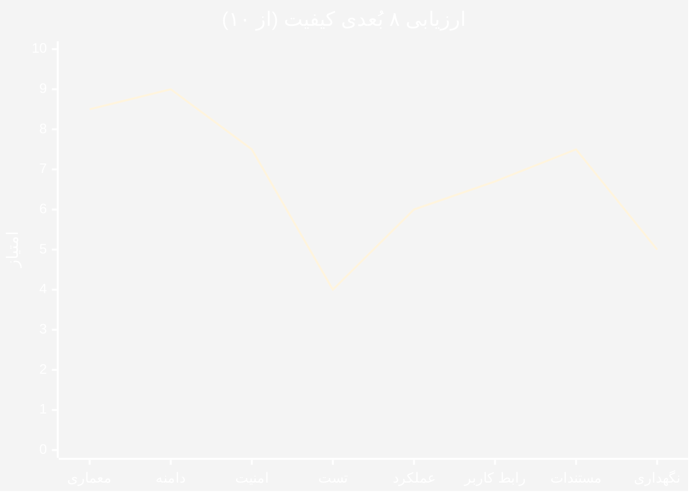

| نماد | معنا |
|:---|:---|
| 🟢 ≥ ۸ | قوت — حفظ شود |
| 🟡 ۶–۸ | متوسط — بهبود یابد |
| 🔴 < ۶ | ضعف — نیازمند اقدام فوری |

---

## ۳. 💪 ۱۰ نقطه قوت برجسته

| # | 💪 نقطه قوت | 📊 شواهد کمی | چرا ارزشمند است |
|:--:|:---|:---|:---|
| ۱ | **جداسازی کامل لایه نمایش از داده** | ۰ ارجاعِ Desktop به `DbContext` | کلاینت را می‌توان با وب/موبایل جایگزین کرد بدون تغییر هسته |
| ۲ | **معماری Clean + CQRS واقعی** | MediatR · ۱۷٬۶۹۴ خط Application | هر Feature یک پوشه؛ افزودن امکان = افزودن فایل، نه ویرایش |
| ۳ | **دامنه بسیار غنی** | ۱۱۲ موجودیت · ۱۰۰+ Enum · ۴ ValueObject | مدل دامنه واقعاً «زبان درمانگاه» را دارد |
| ۴ | **انضباط حق‌تألیفی در انتخاب پکیج** | MediatR ۱۲ · Mapperly ۳٫۶ · FluentAssertions ۶ | همه روی آخرین نسخه **رایگان** — هیچ ریسک حقوقی |
| ۵ | **پوشش امنیتی لایه‌لایه** | ۲۵۷ `HasPermission` از ۳۰۸ اندپوینت | RBAC دانه‌ریز با ۱۶۰+ مجوز |
| ۶ | **ممیزی (Audit) در سطح زیرساخت** | `AuditableEntityInterceptor` + `AuditLogMiddleware` | ردیابی کامل تغییرات — الزام حریم‌خصوصی پزشکی |
| ۷ | **انضباط کد بی‌نقص در موارد رایج** | ۰ `async void` · ۰ `catch{}` خالی · ۰ `TODO` در `src/` | نشان‌دهنده بازبینی دقیق کد |
| ۸ | **SQL Injection صفر** | پارامتری‌سازی + براکت‌گذاری در SQL خام | حتی در SQL خام، ایمن نوشته شده |
| ۹ | **سیستم لایسنس بالغ و چندسکویی** | PHP (cPanel) امضای RSA · ۳۹ ماژول جداگانه | مدل درآمدی انعطاف‌پذیر + بدون نیاز به Composer |
| ۱۰ | **مستندات بسیار گسترده** | ۲۴ فایل MD · ۴۶۲ خط README · ۲٬۰۱۲ خط CHANGELOG | دانش پروژه مکتوب است — ریسک «اتوبوس» کم |

### ۳.۱ تحلیل عمیق‌تر ۳ قوت برتر

#### 🥇 قوت ۱ — جداسازی کامل لایه نمایش

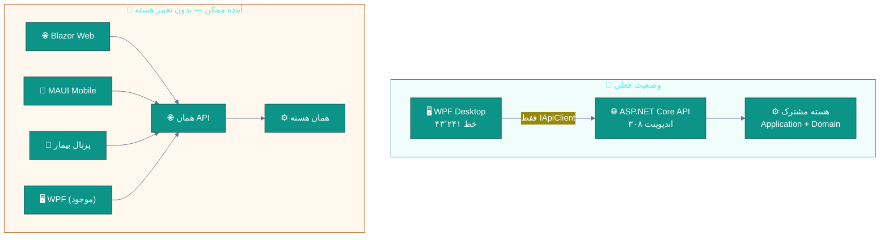

> ✨ این یعنی پیاده‌سازی [D01 پرتال بیمار](modules/D01-patient-portal.md)
> و [D02 تلمدیسین](modules/D02-telemedicine.md)
> **نیازی به بازنویسی هیچ منطق تجاری ندارد** — فقط یک کلاینت جدید.

#### 🥈 قوت ۲ — دامنه بسیار غنی

| شاخص | مقدار | مقایسه |
|:---|:--:|:---|
| 🧬 موجودیت‌های دامنه | ۱۱۲ | بسیار بالاتر از میانگین صنعت |
| 🏷 Enumهای دامنه | ۱۰۰+ | پوشش دقیق مفاهیم پزشکی |
| 💎 ValueObject | ۴ (`Money`, `NationalCode`, ...) | طراحی DDD صحیح |
| 📣 Domain Events | ۸ گروه | جداسازی مناسب |
| 🗄 DbSet | ۱۱۲ | پوشش کامل عملیات درمانگاه |

#### 🥉 قوت ۳ — انضباط کد

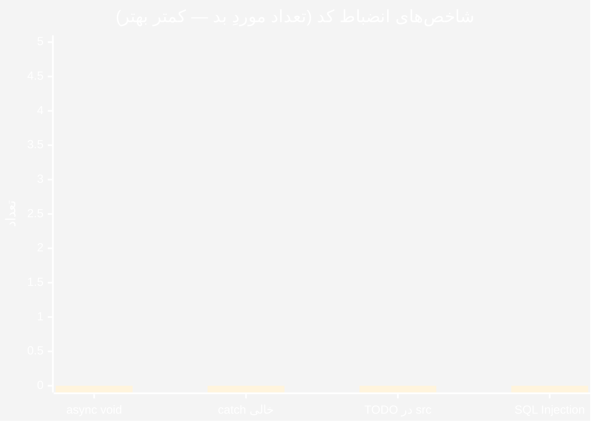

> 🎯 **صفر در هر چهار مورد** — این در پروژه‌های تجاری نادر است.

---

## ۴. 🦸 نقاط قوت فنی خاص

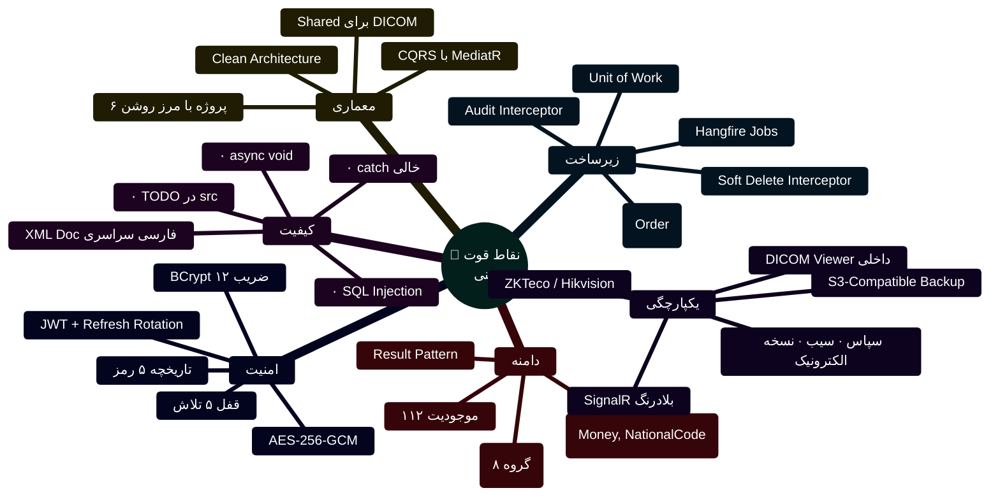

> ✨ **نکته ویژه:** کامنت‌های XML در کل پروژه **به فارسی و با کیفیت بالا**
> نوشته شده‌اند و توضیحِ «چرا» (نه فقط «چه») را دارند — مثلاً در
> `ArchiveService.HardPurgeAsync` دقیقاً آمده که چرا از الحاق رشته
> به‌جای interpolation استفاده شده (رفع هشدار EF1002).
> این سطح از مستندسازیِ درون‌کد **کمیاب** است.

### ۴.۱ جدول یکپارچگی‌های خارجی موجود

| یکپارچگی | فناوری | وضعیت |
|:---|:---|:--:|
| 📡 ارتباط بلادرنگ | SignalR | ✅ |
| 🕐 دستگاه حضور و غیاب | ZKTeco / Hikvision | ✅ |
| 🏛 سامانه سپاس | REST | ✅ پایه |
| 🏥 سامانه سیب (SIB) | REST | ✅ پایه |
| 📋 نسخه الکترونیک | REST | ✅ پایه |
| 🩻 نمایشگر DICOM | داخلی (Shared) | ✅ |
| 💾 بکاپ ابری | S3-Compatible | ✅ |
| 📨 پیامک | کاوه‌نگار | ✅ |
| 🖨 تولید PDF | QuestPDF | ✅ |
| 📊 تولید Excel | ClosedXML | ✅ |

---

## ۵. 🔻 ۱۰ نقطه ضعف اصلی

| # | 🔻 نقطه ضعف | 📊 شواهد کمی | ⚠️ ریسک | 🩹 درمان |
|:--:|:---|:---|:---|:---|
| ۱ | **امنیت پیکربندی** | کلید JWT در مخزن | 🔴 جعل توکن مدیر | Secret Manager + Rotation |
| ۲ | **Sync-over-Async** | `BackupController.cs:456` | 🔴 توقف کل API | ناهمزمان‌سازی + Semaphore |
| ۳ | **تورم کد** | ۲۲۵٬۲۸۷ خط تولیدشده (۶۸٪) | 🟠 بیلد کند، بازبینی سخت | تقسیم DbContext + بایگانی مایگریشن |
| ۴ | **DbContext یکپارچه** | ۱۱۲ DbSet | 🟠 راه‌اندازی کند، قفل تیمی | ۵ Bounded Context |
| ۵ | **تست Desktop ≈ ۰** | ~۱۵ تست برای ۴۳٬۲۴۱ خط | 🔴 رگرسیون در هر انتشار | هرم تست + ۴۵۰ تست واحد |
| ۶ | **اسکریپت‌های تکراری** | ۳۴ بسته‌ساز کپی | 🟠 خطای اپراتور، بدهی نگهداری | یک CLI یکپارچه |
| ۷ | **عدم محلی‌سازی** | ۰ فایل `.resx` | 🟠 عدم امکان توسعه به بازار دیگر | resx + DynamicResource |
| ۸ | **God ViewModel** | ۱٬۳۴۶ / ۱٬۳۱۶ / ۱٬۰۶۳ خط | 🟠 سخت‌تست‌بودن، تکرار منطق | Composition با Child-VM |
| ۹ | **Code-Behind سنگین** | ۴٬۳۸۲ خط روی Viewها | 🟠 نقض MVVM | Behavior + Attached Property |
| ۱۰ | **مستندات پراکنده/همپوشان** | ۱۳ فایل TODO + ۲۴ MD | 🟠 سردرگمی، تضاد | ساختار یکپارچه `docs/` |

### ۵.۱ تحلیل عمیق‌تر ۳ ضعف برتر

#### 🔻 ضعف ۵ — تست لایه Desktop

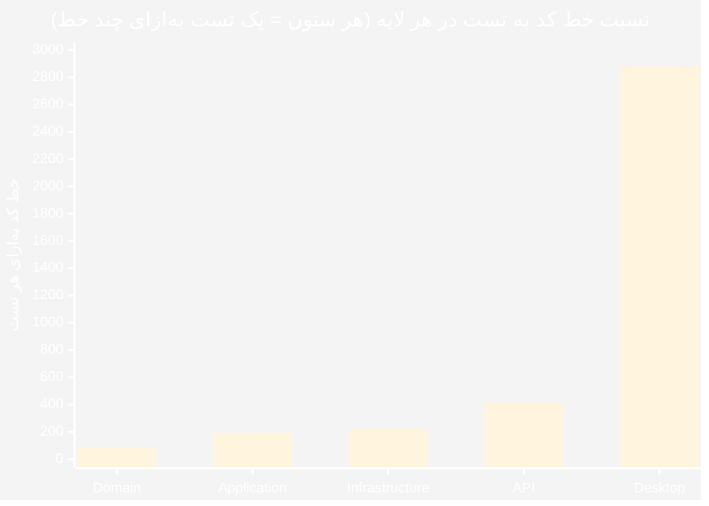

> 🔴 **بحرانی:** لایه Desktop با ۴۶٫۶٪ از کل کد،
> تنها ۵٫۵٪ از تست‌ها را دارد. این **بزرگ‌ترین ریسک فنی** پروژه است.

#### 🔻 ضعف ۳ — تورم کد تولیدشده

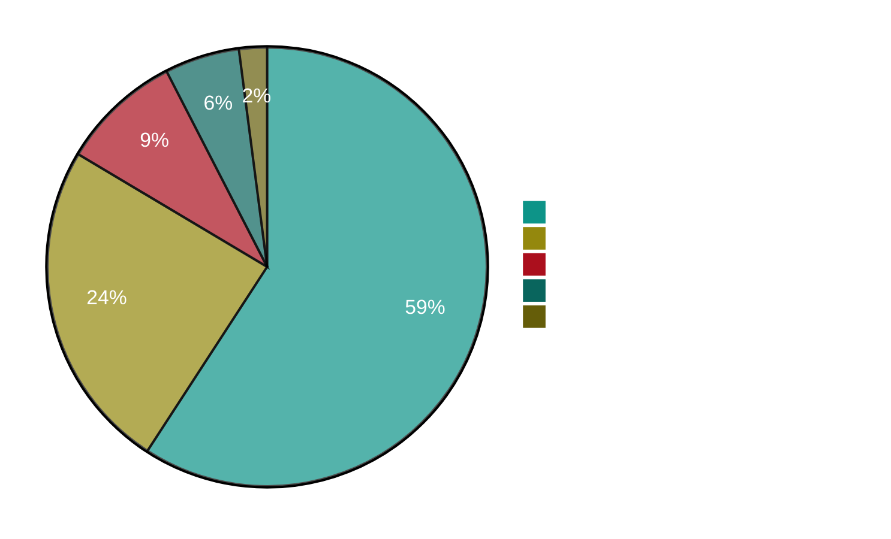

> ⚠️ نسبت کد تولیدشده به دست‌نویس **۲٫۴ به ۱** است.
> از هر ۱۰ خط مخزن، **۷ خط** را کامپایلر/EF نوشته است.

#### 🔻 ضعف ۱ — امنیت پیکربندی

| ریسک | احتمال | اثر | سطح |
|:---|:--:|:--:|:--:|
| جعل توکن مدیر | 🟡 متوسط | 🔴 فاجعه‌بار | 🔴 **بحرانی** |
| نشت داده‌های پزشکی | 🟡 متوسط | 🔴 فاجعه‌بار | 🔴 **بحرانی** |
| دور زدن RBAC | 🟢 کم | 🟠 بالا | 🟠 بالا |

---

## ۶. 📉 نمودار پارتو — کانون ۸۰٪ مشکلات

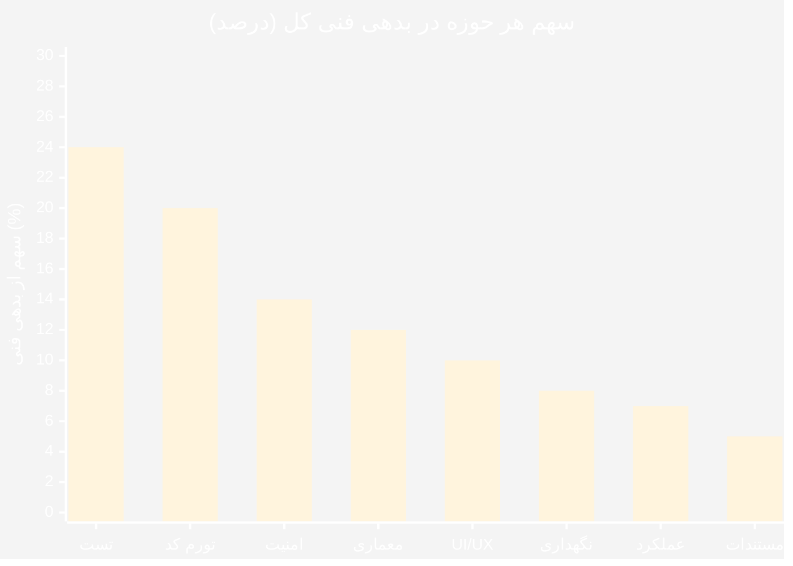

> 📌 **قانون ۸۰/۲۰:** با تمرکز روی **۲ حوزه اول (تست + تورم کد)**،
> حدود **۴۴٪ از بدهی فنی کل** برطرف می‌شود.

### ۶.۱ جدول تجمعی پارتو

| رتبه | حوزه | سهم | تجمعی |
|:--:|:---|:--:|:--:|
| ۱ | 🧪 تست | ۲۴٪ | ۲۴٪ |
| ۲ | 📦 تورم کد | ۲۰٪ | **۴۴٪** |
| ۳ | 🔐 امنیت | ۱۴٪ | ۵۸٪ |
| ۴ | 🏛 معماری | ۱۲٪ | ۷۰٪ |
| ۵ | 🎨 UI/UX | ۱۰٪ | ۸۰٪ ← نقطه ۸۰٪ |
| ۶ | 🔧 نگهداری | ۸٪ | ۸۸٪ |
| ۷ | ⚡ عملکرد | ۷٪ | ۹۵٪ |
| ۸ | 📚 مستندات | ۵٪ | ۱۰۰٪ |

---

## ۷. 🎯 ماتریس SWOT

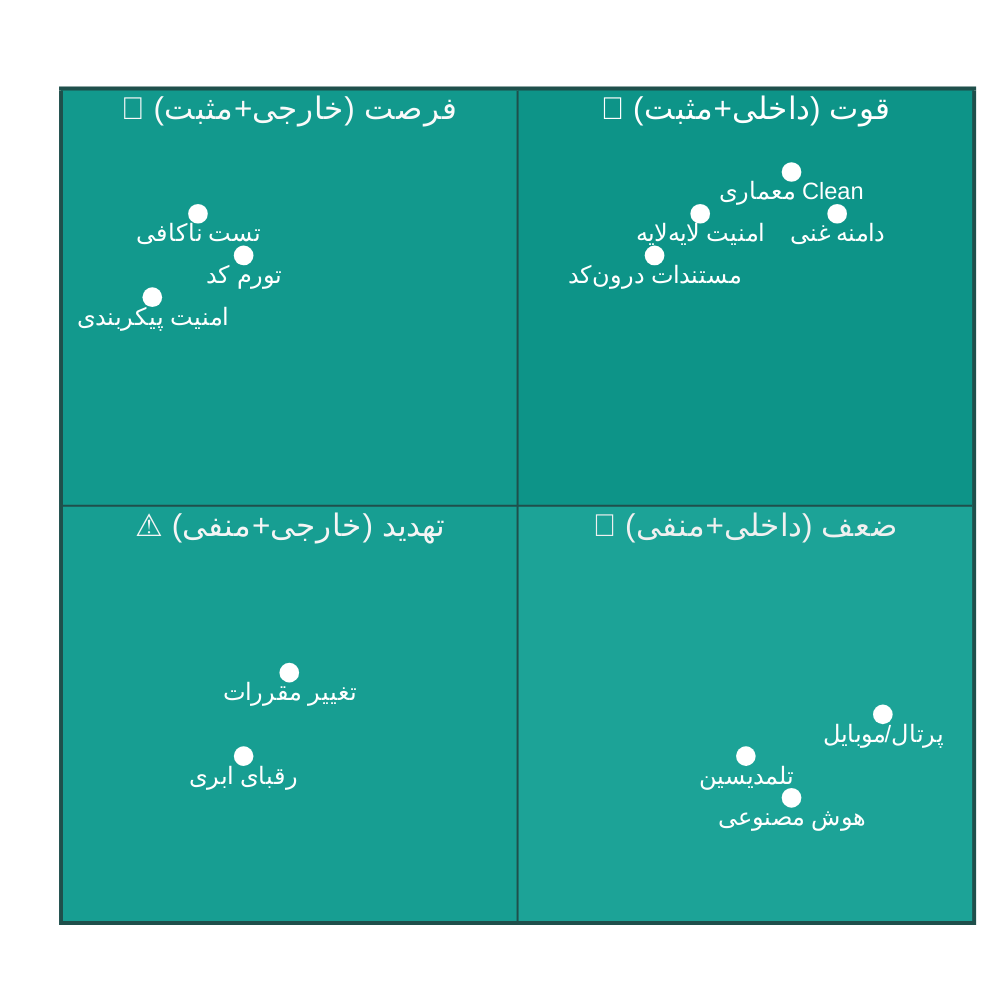

### ۷.۱ جدول تفصیلی SWOT

| | ✅ مثبت | ❌ منفی |
|:---|:---|:---|
| **🏠 داخلی** | **💪 Strengths** • دامنه بسیار غنی (۱۱۲ موجودیت) • معماری Clean + CQRS واقعی • امنیت لایه‌لایه (۲۵۷ مجوز) • انضباط کد بی‌نقص • مستندات درون‌کد عالی • جداسازی کامل نمایش از داده • لایسنس بالغ (۳۹ ماژول) | **🔻 Weaknesses** • تست Desktop ≈ ۰ (۱۵ تست) • تورم کد (۶۸٪ تولیدشده) • کلید JWT در مخزن • DbContext یکپارچه • God ViewModelها • ۳۴ اسکریپت تکراری • عدم محلی‌سازی |
| **🌍 خارجی** | **🌟 Opportunities** • پرتال بیمار و اپ موبایل • دستیار بالینی هوش مصنوعی • درمان از راه دور • یکپارچه‌سازی کامل سپاس • مارکت‌پلیس افزونه‌ها • بازار چندزبانه • API عمومی برای شرکا | **⚠ Threats** • رقبای ابری (SaaS) • تغییرات مقررات وزارت بهداشت • الزامات نسخه الکترونیک • ریسک خروج توسعه‌دهنده • قفل‌شدگی به SQL Server • هزینه نگهداری بالا |

---

## ۸. 🎲 ریسک‌های کسب‌وکار

| 🎲 ریسک | احتمال | اثر | 🔻 سطح | 🛡 راهبرد کاهش |
|:---|:--:|:--:|:--:|:---|
| نشت داده‌های پزشکی (نشت کلید JWT) | 🟡 متوسط | 🔴 فاجعه‌بار | 🔴 **بحرانی** | Secret Manager + چرخش کلید + بازبینی امنیتی |
| رگرسیون در لایه Desktop هنگام انتشار | 🔴 بالا | 🟠 بالا | 🔴 **بحرانی** | پوشش تست ViewModel + تست‌های دود خودکار |
| وابستگی به SQL Server (قفل فروشنده) | 🟢 کم | 🟡 متوسط | 🟡 متوسط | لایه انتزاع روی گزارش‌ها؛ ارزیابی PostgreSQL |
| انشعاب کد بین نسخه ویندوز و آینده وب | 🟡 متوسط | 🟠 بالا | 🟠 بالا | استخراج منطق مشترک به `Shared` |
| خروج توسعه‌دهنده اصلی (ریسک اتوبوس) | 🟡 متوسط | 🔴 بالا | 🟠 بالا | مستندات تصمیمات (ADR) + جفت‌برنامه‌نویسی |

### ۸.۱ ماتریس ریسک

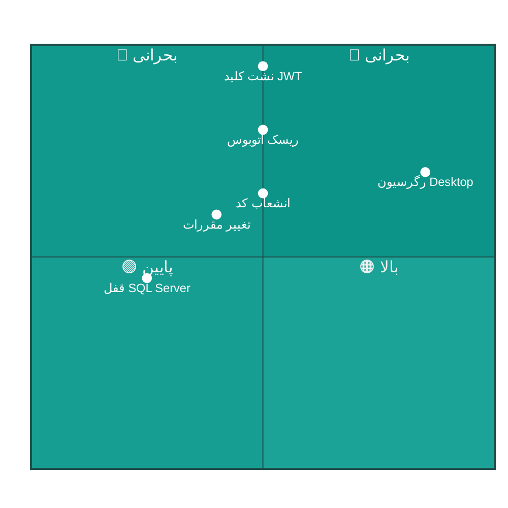

---

## ۹. 🏆 تحلیل رقابتی

> ⚠️ این تحلیل بر اساس **ویژگی‌های قابل‌مشاهده در کدبیس** است،
> نه بررسی بازار. برای تحلیل دقیق رقابتی، مطالعه بازار جداگانه لازم است.

| معیار | ClinicPro | 🎯 حد مطلوب | فاصله |
|:---|:--:|:--:|:---|
| 🧬 پوشش عملیاتی درمانگاه | ۹/۱۰ | ۹/۱۰ | ✅ |
| 🏛 کیفیت معماری | ۸٫۵/۱۰ | ۹/۱۰ | 🟡 نزدیک |
| 🔐 امنیت | ۷٫۵/۱۰ | ۹/۱۰ | 🟠 متوسط |
| 🧪 پوشش تست | ۴/۱۰ | ۸/۱۰ | 🔴 زیاد |
| 🌐 دسترسی وب/موبایل | ۰/۱۰ | ۸/۱۰ | 🔴 زیاد |
| 🤖 هوشمندی (AI/BI) | ۱/۱۰ | ۶/۱۰ | 🔴 زیاد |
| 🌍 چندزبانگی | ۱/۱۰ | ۵/۱۰ | 🟠 متوسط |
| 🔌 اکوسیستم/API عمومی | ۰/۱۰ | ۵/۱۰ | 🟠 متوسط |

### ۹.۱ مزیت رقابتی اصلی

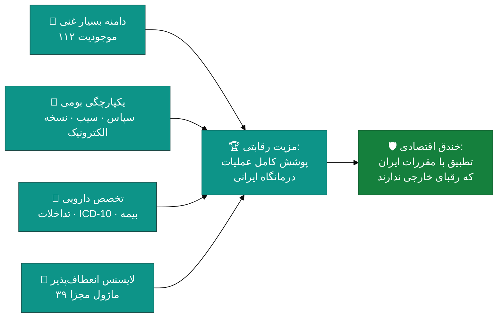

> 💡 **بزرگ‌ترین مزیت:** انطباق با **سامانه‌های بومی ایران**
> (سپاس، سیب، نسخه الکترونیک، بیمه‌ها) که
> نرم‌افزارهای خارجی قادر به ارائه آن نیستند.

### ۹.۲ شکاف‌های رقابتی

| شکاف | توضیح | راهکار |
|:---|:---|:---|
| 🌐 **نبود دسترسی وب** | رقبا نسخه ابری دارند | [D01 پرتال بیمار](modules/D01-patient-portal.md) |
| 📱 **نبود اپ موبایل** | بیماران منتظر اپ هستند | [D01](modules/D01-patient-portal.md) |
| 🤖 **نبود هوشمندی** | رقبا BI و AI دارند | [D03](modules/D03-ai-assistant.md) · [D04](modules/D04-bi-analytics.md) |

---

## ۱۰. 🎯 نتیجه‌گیری

### ۱۰.۱ جمع‌بندی

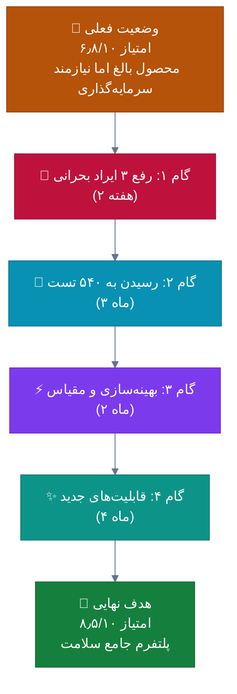

### ۱۰.۲ سه تصمیم با بیشترین بازده

| رتبه | تصمیم | هزینه | بازده | زمان |
|:--:|:---|:---|:---|:--:|
| 🥇 | **رفع ۳ ایراد بحرانی** | ۵ روز | حذف ریسک فاجعه‌بار | فوری |
| 🥈 | **رسیدن به ۵۴۰ تست** | ۳ ماه | امکان تغییر ایمن معماری | میان‌مدت |
| 🥉 | **پرتال بیمار** | ۸ هفته | تمایز رقابتی + کاهش ۴۰٪ تماس | میان‌مدت |

### ۱۰.۳ حکم نهایی

> ## ⭐ **۷٫۴ از ۱۰**
>
> ClinicPro یک **محصول بالغ، جامع و باکیفیت** است که
> پایه معماری آن **بهتر از میانگین صنعت** است.
> ضعف‌های آن (تست، تورم کد، امنیت پیکربندی)
> **همگی قابل‌رفع** هستند و نیازی به بازنویسی ندارند.
>
> با سرمایه‌گذاریِ **۹ ماهه و منظم**، این محصول می‌تواند از
> «نرم‌افزار مدیریت درمانگاه» به
> **«پلتفرم جامع سلامت»** ارتقا یابد.

### ۱۰.۴ توصیه‌های استراتژیک

| # | توصیه | افق زمانی |
|:--:|:---|:--:|
| ۱ | 🚨 رفع فوری ۳ ایراد بحرانی | ۲ هفته |
| ۲ | 🧪 سرمایه‌گذاری روی تست پیش از هر تغییر معماری | ۳ ماه |
| ۳ | 🌐 پرتال بیمار به‌عنوان تمایز رقابتی اصلی | ۶ ماه |
| ۴ | 🏛 تکمیل یکپارچه‌سازی سپاس/نسخه الکترونیک (الزام قانونی) | ۶ ماه |
| ۵ | 📚 ساختاردهی مجدد مستندات (ادغام ۱۳ فایل TODO) | ۱ ماه |
| ۶ | 👥 کاهش ریسک اتوبوس با مستندات تصمیمات (ADR) | مستمر |

---

## ⚠️ ملاحظات روش‌شناسی

> [!NOTE]
> این ارزیابی بر اساس **تحلیل ایستا** انجام شده است.
> برخی شاخص‌ها (مانند عملکرد واقعی در تولید،
> رضایت کاربران نهایی) نیازمند اندازه‌گیری میدانی هستند.

| مورد | وضعیت |
|:---|:---|
| تحلیل ایستای کد | ✅ |
| بررسی ساختار پروژه | ✅ |
| اندازه‌گیری عملکرد واقعی | ⛔ نیازمند محیط اجرا |
| نظرسنجی از کاربران | ⛔ خارج از محدوده |
| بررسی بازار رقبا | ⚠️ تخمینی |

---

[🏠 بازگشت به فهرست مستندات](README.md) · [🐛 ایرادها](DEFECTS-IRADS.md) · [🚀 نقشه راه](IMPROVEMENTS-ROADMAP.md) · [🎨 طراحی UI](UI-UX-DESIGN-BEST.md)

📅 ۱۴۰۴/۰۷/۱۹ · 🔖 v1.0

