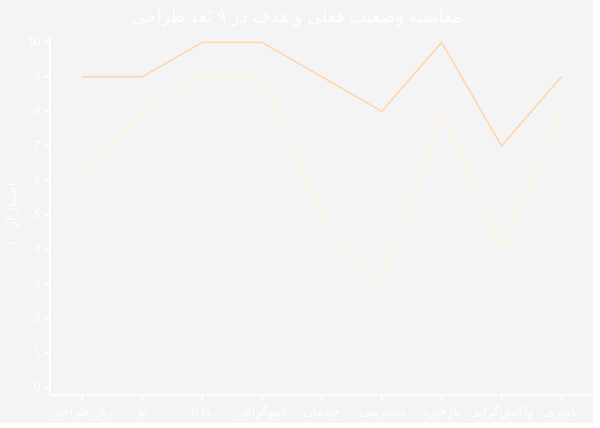
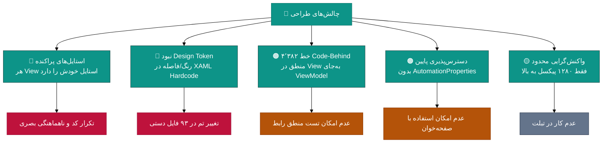
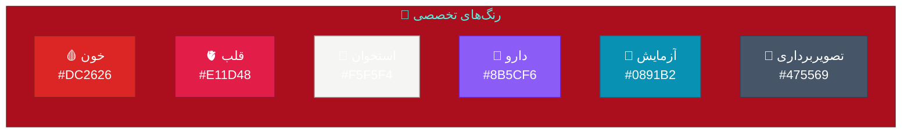
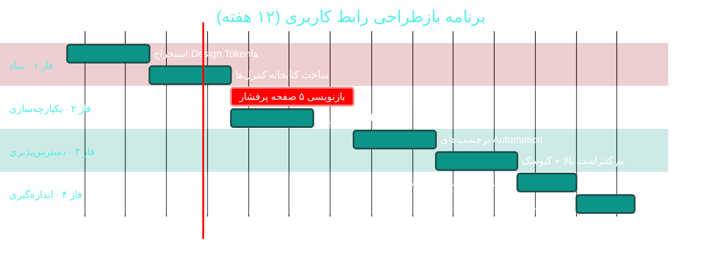

<div dir="rtl">

# 🎨 بهترین طراحی رابط کاربری (Best UI/UX Design)

<div align="center">

**نرم‌افزار جامع مدیریت درمانگاه سهند — Sahand ClinicPro v2.12.0**


📅 ۱۴۰۴/۰۷/۱۹ · 🔖 v1.0

</div>

---

## 📑 فهرست مطالب

| # | بخش |
|:--:|:---|
| ۱ | [ارزیابی وضعیت فعلی](#۱--ارزیابی-وضعیت-فعلی) |
| ۲ | [معماری سیستم طراحی](#۲--معماری-سیستم-طراحی) |
| ۳ | [پالت رنگ و Design Tokens](#۳--پالت-رنگ-و-design-tokens) |
| ۴ | [تایپوگرافی و شبکه](#۴--تایپوگرافی-و-شبکه) |
| ۵ | [وایرفریم صفحه اصلی](#۵--وایرفریم-صفحه-اصلی) |
| ۶ | [الگوهای صفحات کلیدی](#۶--الگوهای-صفحات-کلیدی) |
| ۷ | [۱۰ اصل طلایی](#۷--۱۰-اصل-طلایی) |
| ۸ | [دسترس‌پذیری (a11y)](#۸--دسترسپذیری-a11y) |
| ۹ | [نقشه راه بازطراحی](#۹--نقشه-راه-بازطراحی) |

---

## ۱. 📊 ارزیابی وضعیت فعلی

### ۱.۱ جدول ارزیابی ۹ بُعدی

| بُعد | وضعیت فعلی | امتیاز | 🎯 هدف |
|:---|:---|:--:|:--:|
| 🎨 زبان طراحی | Material Design 5.3.2 — بدون Token یکپارچه | ۶/۱۰ | ۹/۱۰ |
| 🌙 تم تاریک/روشن | موجود (`IThemeService`) | ۸/۱۰ | ۹/۱۰ |
| ↔ پشتیبانی RTL | پیاده‌سازی شده (`FlowDirection`) | ۹/۱۰ | ۱۰/۱۰ |
| 🔤 تایپوگرافی فارسی | Vazirmatn — انتخاب عالی | ۹/۱۰ | ۱۰/۱۰ |
| 📐 یکپارچگی چیدمان | استایل‌ها در XAML پراکنده | ۵/۱۰ | ۹/۱۰ |
| ♿ دسترس‌پذیری | بدون `AutomationProperties` / اندازه هدف | ۳/۱۰ | ۸/۱۰ |
| ⚡ بازخورد لحظه‌ای | SignalR برای صف و اعلان | ۸/۱۰ | ۱۰/۱۰ |
| 📱 واکنش‌گرایی | ثابت برای دسکتاپ (۱۲۸۰px+) | ۴/۱۰ | ۷/۱۰ |
| 🧭 ناوبری | منوی کناری + Breadcrumb + میانبرها | ۸/۱۰ | ۹/۱۰ |

**میانگین فعلی: ۶٫۷/۱۰** · **هدف: ۹٫۰/۱۰**

### ۱.۲ نمودار راداری



> 🔵 خط اول = وضعیت فعلی · 🟢 خط دوم = هدف

### ۱.۳ نقاط قوت فعلی رابط کاربر

| 💪 نقطه قوت | توضیح |
|:---|:---|
| ✅ Material Design | استفاده از MaterialDesignThemes 5.3.2 — پایه حرفه‌ای |
| ✅ تایپوگرافی Vazirmatn | بهترین انتخاب برای فارسی |
| ✅ RTL کامل | `FlowDirection` پیاده‌سازی شده |
| ✅ SignalR بلادرنگ | صف انتظار و اعلان‌ها زنده هستند |
| ✅ ۹۳ View | پوشش کامل عملیات درمانگاه |

### ۱.۴ چالش‌های اصلی



---

## ۲. 🏛 معماری سیستم طراحی

### ۲.۱ پنج لایه طراحی (Atomic Design)

```mermaid
%%{init: {'theme':'base','themeVariables':{'primaryColor':'#0d9488','primaryTextColor':'#fff','lineColor':'#64748b'}}}%%
graph TB
    subgraph L1["لایه ۱ — بنیاد (Foundations)"]
        T1["🎨 Design Tokens<br/>رنگ · فاصله · شعاع · سایه · انیمیشن"]
        T2["🔤 تایپوگرافی<br/>Vazirmatn: ۸ وزن<br/>مقیاس نوعی RTL"]
        T3["📐 شبکه و فاصله‌گذاری<br/>پایه ۴ پیکسل · ۱۲ ستون"]
        T4["🖼 آیکون‌شناسی<br/>Material + پک پزشکی سفارشی"]
    end
    subgraph L2["لایه ۲ — اتم‌ها (Atoms)"]
        A1["🔘 Button<br/>Primary / Secondary / Ghost / Danger"]
        A2["📝 Input<br/>Text / Combo / Date / Masked"]
        A3["🏷 Badge · Chip · Tag"]
        A4["📊 Data Display<br/>Table / Card / Stat / Avatar"]
    end
    subgraph L3["لایه ۳ — مولکول‌ها (Molecules)"]
        M1["🔍 جستجوی هوشمند"]
        M2["📋 فرم پویا"]
        M3["🗂 تب و آکاردئون"]
        M4["💬 دیالوگ و Snackbar"]
    end
    subgraph L4["لایه ۴ — ارگانیسم‌ها (Organisms)"]
        O1["🧭 ناوبری<br/>Rail · TopBar · Command Palette"]
        O2["📊 داشبورد<br/>کاشی‌های قابل چیدمان"]
        O3["📄 صفحه فرم<br/>هدر · بخش‌ها · نوار اقدام"]
        O4["🗃 صفحه لیست<br/>فیلتر · جدول · صفحه‌بندی"]
    end
    subgraph L5["لایه ۵ — الگوها (Patterns)"]
        P1["🔎 الگوی جستجو و انتخاب"]
        P2["✏ الگوی ویرایش درجا"]
        P3["🧙 الگوی جریان چندمرحله‌ای"]
        P4["⏮ الگوی بازگشت/لغو"]
    end

    L1 --> L2 --> L3 --> L4 --> L5

    style L1 fill:#0d9488,stroke:#0f766e,color:#fff
    style L2 fill:#0891b2,stroke:#0e7490,color:#fff
    style L3 fill:#7c3aed,stroke:#6d28d9,color:#fff
    style L4 fill:#b45309,stroke:#92400e,color:#fff
    style L5 fill:#be123c,stroke:#9f1239,color:#fff
```



### ۲.۲ ساختار فایل پیشنهادی

```
📂 src/Sahand.ClinicPro.Desktop/
├── 📂 Styles/
│   ├── 📄 Tokens.xaml              ⭐ همه Design Tokenها
│   ├── 📄 Colors.Light.xaml        پالت روشن
│   ├── 📄 Colors.Dark.xaml         پالت تاریک
│   ├── 📄 Typography.xaml          مقیاس نوعی Vazirmatn
│   ├── 📄 Spacing.xaml             مقیاس فاصله‌گذاری (پایه ۴)
│   ├── 📄 Elevation.xaml           سایه‌ها
│   └── 📄 Motion.xaml              زمان‌بندی انیمیشن
├── 📂 Controls/                    کتابخانه کنترل‌های سفارشی
│   ├── 📄 StatCard.xaml
│   ├── 📄 PatientSearchBox.xaml
│   ├── 📄 PersianDatePicker.xaml
│   └── 📄 MedicationBadge.xaml
├── 📂 Behaviors/                   جایگزین Code-Behind
└── 📂 Views/                       ۹۳ View موجود
```

### ۲.۳ نمونه فایل Tokens.xaml

```xml
<!-- src/Sahand.ClinicPro.Desktop/Styles/Tokens.xaml (جدید) -->
<ResourceDictionary xmlns="http://schemas.microsoft.com/winfx/2006/xaml/presentation"
                    xmlns:x="http://schemas.microsoft.com/winfx/2006/xaml"
                    xmlns:sys="clr-namespace:System;assembly=mscorlib">

    <!-- ══════════════════════════════════════════════════════
         🎨 رنگ‌های معنایی — همیشه با DynamicResource استفاده شوند
         ══════════════════════════════════════════════════════ -->
    <Color x:Key="Color.Primary">#0D9488</Color>
    <Color x:Key="Color.Primary.Dark">#0F766E</Color>
    <Color x:Key="Color.Secondary">#7C3AED</Color>
    <Color x:Key="Color.Success">#15803D</Color>
    <Color x:Key="Color.Warning">#B45309</Color>
    <Color x:Key="Color.Danger">#BE123C</Color>
    <Color x:Key="Color.Info">#0369A1</Color>

    <SolidColorBrush x:Key="Brush.Primary" Color="{DynamicResource Color.Primary}" />
    <SolidColorBrush x:Key="Brush.Success" Color="{DynamicResource Color.Success}" />
    <SolidColorBrush x:Key="Brush.Warning" Color="{DynamicResource Color.Warning}" />
    <SolidColorBrush x:Key="Brush.Danger"  Color="{DynamicResource Color.Danger}" />
    <SolidColorBrush x:Key="Brush.Info"    Color="{DynamicResource Color.Info}" />

    <!-- ══════════════════════════════════════════════════════
         🏥 رنگ‌های تخصصی پزشکی
         ══════════════════════════════════════════════════════ -->
    <Color x:Key="Color.Medical.Blood">#DC2626</Color>
    <Color x:Key="Color.Medical.Heart">#E11D48</Color>
    <Color x:Key="Color.Medical.Bone">#F5F5F4</Color>
    <Color x:Key="Color.Medical.Drug">#8B5CF6</Color>
    <Color x:Key="Color.Medical.Lab">#0891B2</Color>
    <Color x:Key="Color.Medical.Imaging">#475569</Color>

    <!-- ══════════════════════════════════════════════════════
         📐 مقیاس فاصله‌گذاری — پایه ۴ پیکسل
         ══════════════════════════════════════════════════════ -->
    <sys:Double x:Key="Space.0">0</sys:Double>
    <sys:Double x:Key="Space.1">4</sys:Double>
    <sys:Double x:Key="Space.2">8</sys:Double>
    <sys:Double x:Key="Space.3">12</sys:Double>
    <sys:Double x:Key="Space.4">16</sys:Double>
    <sys:Double x:Key="Space.5">20</sys:Double>
    <sys:Double x:Key="Space.6">24</sys:Double>
    <sys:Double x:Key="Space.8">32</sys:Double>
    <sys:Double x:Key="Space.10">40</sys:Double>
    <sys:Double x:Key="Space.12">48</sys:Double>

    <Thickness x:Key="Padding.Card">16</Thickness>
    <Thickness x:Key="Padding.Page">24</Thickness>

    <!-- ══════════════════════════════════════════════════════
         🔘 شعاع گوشه
         ══════════════════════════════════════════════════════ -->
    <CornerRadius x:Key="Radius.Small">4</CornerRadius>
    <CornerRadius x:Key="Radius.Medium">8</CornerRadius>
    <CornerRadius x:Key="Radius.Large">12</CornerRadius>
    <CornerRadius x:Key="Radius.Pill">999</CornerRadius>

    <!-- ══════════════════════════════════════════════════════
         ⚡ زمان‌بندی انیمیشن
         ══════════════════════════════════════════════════════ -->
    <Duration x:Key="Duration.Fast">0:0:0.1</Duration>
    <Duration x:Key="Duration.Normal">0:0:0.2</Duration>
    <Duration x:Key="Duration.Slow">0:0:0.4</Duration>

</ResourceDictionary>
```

> ⚠️ **قانون طلایی:** هیچ رنگ یا فاصله‌ای نباید مستقیماً در XAML بنشیند.
> همیشه از `{DynamicResource ...}` استفاده شود تا تعویض تم بلادرنگ کار کند.

---

## ۳. 🎨 پالت رنگ و Design Tokens

### ۳.۱ جدول رنگ‌های اصلی

| نقش | توکن | ☀️ روشن | 🌙 تاریک | کاربرد |
|:---|:---|:--:|:--:|:---|
| 🎯 اصلی | `--color-primary` | `#0D9488` | `#2DD4BF` | اقدامات اصلی، انتخاب |
| 🌊 اصلی-تیره | `--color-primary-700` | `#0F766E` | `#14B8A6` | حالت هاور/فعال |
| 💜 ثانویه | `--color-secondary` | `#7C3AED` | `#A78BFA` | تاکید ثانویه |
| ✅ موفقیت | `--color-success` | `#15803D` | `#4ADE80` | پرداخت موفق، نتیجه نرمال |
| ⚠ هشدار | `--color-warning` | `#B45309` | `#FBBF24` | موجودی کم، انقضای نزدیک |
| ⛔ خطا | `--color-danger` | `#BE123C` | `#FB7185` | تداخل دارویی بحرانی |
| ℹ اطلاعات | `--color-info` | `#0369A1` | `#38BDF8` | راهنما، نکته |
| ⚫ متن | `--color-text` | `#1E293B` | `#F1F5F9` | متن اصلی |
| 🔘 سطح | `--color-surface` | `#FFFFFF` | `#1E293B` | پس‌زمینه کارت |
| 🩶 زمینه | `--color-canvas` | `#F8FAFC` | `#0F172A` | پس‌زمینه صفحه |

### ۳.۲ پالت تخصصی پزشکی



### ۳.۳ کنتراست و WCAG

| ترکیب | نسبت کنتراست | WCAG AA | WCAG AAA |
|:---|:--:|:--:|:--:|
| متن `#1E293B` روی `#FFFFFF` | **۱۴٫۸:۱** | ✅ | ✅ |
| متن `#F1F5F9` روی `#1E293B` | **۱۳٫۹:۱** | ✅ | ✅ |
| `#0D9488` روی `#FFFFFF` | **۳٫۳:۱** | ⚠️ فقط برای عناصر بزرگ | ❌ |
| `#BE123C` روی `#FFFFFF` | **۵٫۹:۱** | ✅ | ❌ |
| `#B45309` روی `#FFFFFF` | **۴٫۶:۱** | ✅ | ❌ |

> ⚠️ **توصیه:** برای متن روی پس‌زمینه اصلی از `#0F766E`
> (کنتراست ۵٫۱:۱) استفاده شود، نه `#0D9488`.

---

## ۴. 🔤 تایپوگرافی و شبکه

### ۴.۱ مقیاس نوعی (Type Scale)

| نام | اندازه | وزن | فاصله خط | کاربرد |
|:---|:--:|:--:|:--:|:---|
| `Display` | ۳۲px | Bold | ۱۲۵٪ | عنوان صفحه |
| `Headline` | ۲۴px | SemiBold | ۱۳۰٪ | عنوان بخش |
| `Title` | ۲۰px | SemiBold | ۱۴۰٪ | عنوان کارت |
| `Subtitle` | ۱۶px | Medium | ۱۵۰٪ | زیرعنوان |
| `Body` | ۱۴px | Regular | ۱۶۰٪ | متن اصلی |
| `Caption` | ۱۲px | Regular | ۱۵۰٪ | توضیح، برچسب |
| `Overline` | ۱۱px | Medium | ۱۴۰٪ | برچسب کوچک (حروف بزرگ) |

```xml
<!-- Styles/Typography.xaml -->
<Style x:Key="Text.Display" TargetType="TextBlock">
    <Setter Property="FontFamily" Value="{StaticResource Font.Vazirmatn}" />
    <Setter Property="FontSize" Value="32" />
    <Setter Property="FontWeight" Value="Bold" />
    <Setter Property="LineHeight" Value="40" />
    <Setter Property="Foreground" Value="{DynamicResource Brush.Text}" />
</Style>

<Style x:Key="Text.Body" TargetType="TextBlock">
    <Setter Property="FontFamily" Value="{StaticResource Font.Vazirmatn}" />
    <Setter Property="FontSize" Value="14" />
    <Setter Property="FontWeight" Value="Regular" />
    <Setter Property="LineHeight" Value="22" />
    <Setter Property="Foreground" Value="{DynamicResource Brush.Text}" />
</Style>
```

### ۴.۲ شبکه و فاصله‌گذاری

```
┌────────────────────────────────────────────────────────────┐
│  ← ۲۴px حاشیه صفحه →                                        │
│  ┌────┬────┬────┬────┬────┬────┬────┬────┬────┬────┬────┐  │
│  │ ۱  │ ۲  │ ۳  │ ۴  │ ۵  │ ۶  │ ۷  │ ۸  │ ۹  │ ۱۰ │ ۱۱ │  │  شبکه ۱۲ ستون
│  └────┴────┴────┴────┴────┴────┴────┴────┴────┴────┴────┘  │
│       ↑ ۱۶px فاصله ستون                                     │
│  پایه فاصله‌گذاری: ۴ پیکسل (۴ · ۸ · ۱۲ · ۱۶ · ۲۴ · ۳۲ · ۴۸)   │
└────────────────────────────────────────────────────────────┘
```

| سطح | فاصله | کاربرد |
|:---|:--:|:---|
| `Space.1` | ۴px | بین آیکون و متن |
| `Space.2` | ۸px | بین فیلدهای فرم (عمودی) |
| `Space.3` | ۱۲px | داخل کارت |
| `Space.4` | ۱۶px | بین کارت‌ها |
| `Space.6` | ۲۴px | حاشیه صفحه |
| `Space.8` | ۳۲px | بین بخش‌های اصلی |

---

## ۵. 🖼 وایرفریم صفحه اصلی

```
┌───────────────────────────────────────────────────────────────────────────┐
│ 🏥 سهند  [⌘K جستجو................]  🔔(۳)  👤 دکتر احمدی  🌙  ⚙  ⛶       │
├──────┬────────────────────────────────────────────────────────────────────┤
│ 🧭   │  ┌──────────┬──────────┬──────────┬──────────┐                     │
│      │  │ 👥 ۳۲    │ 📅 ۱۸    │ 💵 ۴.۲م  │ ⏱ ۱۲د    │   ← KPI زنده        │
│ 🏠   │  │ بیمار امروز│ نوبت    │ درآمد    │ انتظار   │     (SignalR)       │
│ 👥   │  │  ↑ ۱۲٪   │  ↓ ۳٪    │  ↑ ۸٪    │  ↓ ۴د    │                     │
│ 📅   │  └──────────┴──────────┴──────────┴──────────┘                     │
│ 🛎   │  ┌─────────────────────────┬──────────────────────────────┐        │
│ 🩺   │  │ 🛎 صف انتظار (زنده)      │ 📈 درآمد ۳۰ روز              │        │
│ 💊   │  │ ┌─────────────────────┐ │                              │        │
│ 🧪   │  │ │۱. علی رضایی  ⏱ ۱۲د │ │      ╱╲    ╱╲                │        │
│ 💵   │  │ │۲. مریم کریمی ⏱ ۸د  │ │   ╱╲╱  ╲╱╲╱  ╲╱              │        │
│ 📊   │  │ │۳. حسن محمودی ⏱ ۵د  │ │  ╱                  ╲         │        │
│ ⚙   │  │ └─────────────────────┘ │  └──────────────────────────┘        │
│      │  │  [ فراخوان بعدی ⏭ ]     │  📊 توزیع خدمات                      │
│ ───  │  └─────────────────────────┴──────────────────────────────┘        │
│ ➕   │  ┌──────────────────────────────────────────────────────────┐      │
│      │  │ ⚠ هشدارها: ۲ تداخل دارویی · ۳ داروی رو به انقضا · ۱ بدهکار│      │
│      │  └──────────────────────────────────────────────────────────┘      │
└──────┴────────────────────────────────────────────────────────────────────┘
```

### ۵.۱ اجزای صفحه اصلی

| بخش | اولویت | به‌روزرسانی | منبع داده |
|:---|:--:|:--:|:---|
| 🔍 نوار جستجوی یکپارچه | 🔴 حیاتی | بلادرنگ | بیمار · نوبت · نسخه |
| 📊 کارت‌های KPI | 🔴 حیاتی | هر ۳۰ ثانیه | Query خلاصه |
| 🛎 صف انتظار زنده | 🔴 حیاتی | بلادرنگ (SignalR) | `ReceptionsController` |
| 📈 نمودار درآمد | 🟠 بالا | هر ۵ دقیقه | `FactVisit` |
| ⚠ نوار هشدارها | 🔴 حیاتی | بلادرنگ | تداخل · انقضا · بدهی |

---

## ۶. 📐 الگوهای صفحات کلیدی

### ۶.۱ الگوی صفحه لیست

```
┌────────────────────────────────────────────────────────────┐
│ 👥 بیماران                                    [+ بیمار جدید]│
├────────────────────────────────────────────────────────────┤
│ 🔍[جستجو............] 🏥[همه شعب ▾] ⚡[فعال ▾] 📅[امسال ▾]  │  ← نوار فیلتر
├────────────────────────────────────────────────────────────┤
│ ☑ │ کد ملی      │ نام            │ موبایل       │ عملیات  │
├───┼─────────────┼────────────────┼──────────────┼─────────┤
│ ☐ │ ۰۰۱۲۳۴۵۶۷۸ │ علی رضایی      │ ۰۹۱۲•••۴۵۶۷ │ 👁 ✏ 🗑  │
│ ☐ │ ۰۰۲۳۴۵۶۷۸۹ │ مریم کریمی     │ ۰۹۱۳•••۷۸۹۰ │ 👁 ✏ 🗑  │
│ ☐ │ ۰۰۳۴۵۶۷۸۹۰ │ حسن محمودی     │ ۰۹۱۴•••۱۲۳۴ │ 👁 ✏ 🗑  │
├────────────────────────────────────────────────────────────┤
│ نمایش ۱-۲۰ از ۱٬۲۴۵          [‹ قبلی] ۱ ۲ ۳ ... ۶۳ [بعدی ›]│
└────────────────────────────────────────────────────────────┘
```

| ویژگی | الزام |
|:---|:---|
| 📄 صفحه‌بندی | اجباری در همه لیست‌ها |
| 🔍 جستجو | با تأخیر ۳۰۰ میلی‌ثانیه (Debounce) |
| ⚡ مجازی‌سازی | `EnableRowVirtualization="True"` برای لیست‌های بزرگ |
| 🔄 مرتب‌سازی | با کلیک روی سرستون |
| ⌨ میانبر | `/` برای تمرکز روی جستجو |

### ۶.۲ الگوی صفحه فرم

```
┌────────────────────────────────────────────────────────────┐
│ ← بازگشت    👤 بیمار جدید              [لغو] [💾 ذخیره]     │
├────────────────────────────────────────────────────────────┤
│ ┌─ اطلاعات شناسایی ────────────────────────────────────┐   │
│ │ نام*        [....................]                    │   │
│ │ نام خانوادگی* [....................]                  │   │
│ │ کد ملی*     [..............] ✓ معتبر                 │   │
│ └──────────────────────────────────────────────────────┘   │
│ ┌─ اطلاعات تماس ───────────────────────────────────────┐   │
│ │ موبایل*     [..............] 📱                       │   │
│ │ شهر         [تهران ▾]                                 │   │
│ └──────────────────────────────────────────────────────┘   │
└────────────────────────────────────────────────────────────┘
```

| اصل | توضیح |
|:---|:---|
| ⭐ نشانه‌گذاری اجباری | فیلدهای الزامی با `*` |
| ✅ اعتبارسنجی درجا | بلافاصله پس از خروج از فیلد |
| 🧩 گروه‌بندی | بخش‌بندی بر اساس موضوع |
| 💾 ذخیره در پایین | نوار اقدام ثابت در انتها |
| ⌨ Ctrl+S | میانبر ذخیره |

### ۶.۳ الگوی دیالوگ هشدار بحرانی

> برای **تداخل دارویی** — مسدودکننده است، نه صرفاً اعلان.

```
╔══════════════════════════════════════════════════════════╗
║  ⛔  هشدار تداخل دارویی بحرانی                             ║
╠══════════════════════════════════════════════════════════╣
║                                                          ║
║  💊 وارفارین ۵mg  ⟷  💊 آسپرین ۸۰mg                       ║
║                                                          ║
║  ⚠ افزایش شدید خطر خونریزی                                ║
║                                                          ║
║  📖 منبع: DrugBank · سطح شواهد: A                         ║
║                                                          ║
║  💡 اقدام توصیه‌شده:                                      ║
║     جایگزینی آسپرین با استامینوفن یا تنظیم دوز وارفارین   ║
║                                                          ║
╠══════════════════════════════════════════════════════════╣
║  [ لغو نسخه ]   [ ویرایش نسخه ]   [ ادامه با توجیه ⚠ ]    ║
╚══════════════════════════════════════════════════════════╝
```

> 🔴 **نکته ایمنی:** گزینه «ادامه با توجیه» باید
> **دلیل اجباری** بخواهد و در لاگ ممیزی ثبت شود.

---

## ۷. ⭐ ۱۰ اصل طلایی

| # | اصل | 📏 قاعده اجرایی |
|:--:|:---|:---|
| ۱ | **یکپارچه‌سازی Tokenها** | هیچ رنگ/فاصله Hardcode در XAML — فقط `DynamicResource` |
| ۲ | **سلسله‌مراتب دیداری** | هر صفحه ۱ نقطه کانونی · مقیاس نوعی ۵ مرحله |
| ۳ | **سادگی پذیرشگر** | فرم پذیرش زیر ۳۰ ثانیه (۵ فیلد اصلی) |
| ۴ | **ایمنی بالینی پیش‌فرض** | تداخل دارویی = دیالوگ مسدودکننده، نه اعلان |
| ۵ | **بازخورد فوری** | هر اقدام < ۱۰۰ms پاسخ دیداری · اسکلت‌بار برای > ۳۰۰ms |
| ۶ | **میانبرهای صفحه‌کلید** | `Ctrl+K` جستجو · `F2` بیمار جدید · `Esc` بستن |
| ۷ | **دسترس‌پذیری** | هدف لمسی ≥ ۴۴px · `AutomationProperties.Name` روی همه |
| ۸ | **RTL واقعی** | آیکون‌های جهت‌دار آینه شوند · اعداد فارسی در محتوای پزشکی |
| ۹ | **حالت کیوسک** | برای نمایشگر سالن انتظار (فقط صف، بدون کنترل) |
| ۱۰ | **طراحی برای خطا** | پیام خطا = «چه شد + چرا + چه کنم» به فارسی ساده |

### ۷.۱ نمونه پیاده‌سازی اصل ۴ — دیالوگ ایمنی

```csharp
// Application/Features/Prescriptions/CheckInteractions/ (تکمیل)
public record DrugInteractionAlert(
    string Severity,           // Critical | Major | Moderate | Minor
    string DrugA,
    string DrugB,
    string Description,
    string MechanismFa,
    string RecommendedAction,
    string? SourceReference,
    bool RequiresOverrideReason);   // آیا ادامه نیاز به توجیه دارد؟

/// <summary>
/// دیالوگ هشدار تداخل — مسدودکننده برای سطوح بحرانی
/// </summary>
public class DrugInteractionDialogViewModel : ObservableObject
{
    [ObservableProperty]
    private string _overrideReason = string.Empty;

    public IReadOnlyList<DrugInteractionAlert> Alerts { get; }

    /// <summary>آیا سطحی بحرانی وجود دارد که نیاز به توجیه داشته باشد</summary>
    public bool RequiresOverride =>
        Alerts.Any(a => a.Severity == "Critical" || a.Severity == "Major");

    /// <summary>آیا دکمه ادامه فعال است (توجیه کافی وارد شده)</summary>
    public bool CanOverride =>
        !RequiresOverride || OverrideReason.Trim().Length >= 20;

    partial void OnOverrideReasonChanged(string value)
        => OnPropertyChanged(nameof(CanOverride));
}
```

### ۷.۲ نمونه پیاده‌سازی اصل ۵ — اسکلت‌بار

```xml
<!-- Controls/SkeletonBar.xaml (جدید) -->
<UserControl x:Class="Sahand.ClinicPro.Desktop.Controls.SkeletonBar"
             xmlns="http://schemas.microsoft.com/winfx/2006/xaml/presentation">
    <UserControl.Resources>
        <Storyboard x:Key="PulseAnimation" RepeatBehavior="Forever">
            <DoubleAnimation Storyboard.TargetProperty="Opacity"
                             From="0.4" To="1" Duration="0:0:0.8"
                             AutoReverse="True" />
        </Storyboard>
    </UserControl.Resources>

    <Border Background="{DynamicResource Brush.Surface}"
            CornerRadius="{DynamicResource Radius.Medium}"
            Height="16">
        <Border.Triggers>
            <EventTrigger RoutedEvent="Loaded">
                <BeginStoryboard Storyboard="{StaticResource PulseAnimation}" />
            </EventTrigger>
        </Border.Triggers>
    </Border>
</UserControl>
```

---

## ۸. ♿ دسترس‌پذیری (a11y)

### ۸.۱ وضعیت فعلی و هدف

| معیار | فعلی | 🎯 هدف | اولویت |
|:---|:--:|:--:|:--:|
| 🎯 اندازه هدف لمسی | متغیر | **≥ ۴۴×۴۴ پیکسل** | 🔴 |
| 🏷 `AutomationProperties.Name` | ۰٪ | **۱۰۰٪ روی کنترل‌های تعاملی** | 🔴 |
| ⌨ ناوبری با صفحه‌کلید | جزئی | **کامل (Tab Order منطقی)** | 🟠 |
| 🎨 کنتراست رنگ | متغیر | **≥ ۴٫۵:۱ (WCAG AA)** | 🟠 |
| 🔊 صفحه‌خوان (NVDA) | پشتیبانی نمی‌شود | **تست و پشتیبانی** | 🟡 |
| ⚡ کاهش حرکت | ندارد | **احترام به تنظیم سیستم** | 🟡 |

### ۸.۲ نمونه بهبود دسترس‌پذیری

```xml
<!-- ❌ قبل -->
<Button Content="ذخیره" Command="{Binding SaveCommand}" />

<!-- ✅ بعد -->
<Button Content="ذخیره"
        Command="{Binding SaveCommand}"
        MinWidth="88"
        MinHeight="44"
        AutomationProperties.Name="ذخیره اطلاعات بیمار"
        AutomationProperties.HelpText="اطلاعات وارد‌شده را ذخیره می‌کند"
        AutomationProperties.AcceleratorKey="Ctrl+S"
        ToolTip="ذخیره (Ctrl+S)" />
```

```xml
<!-- فیلد ورودی با برچسب مرتبط -->
<StackPanel>
    <TextBlock Text="کد ملی"
               AutomationProperties.LabeledBy="{Binding ElementName=NationalCodeBox}" />
    <TextBox x:Name="NationalCodeBox"
             AutomationProperties.Name="کد ملی بیمار"
             AutomationProperties.IsRequiredForForm="True"
             AutomationProperties.HelpText="۱۰ رقم، بدون خط تیره" />
</StackPanel>
```

### ۸.۳ چک‌لیست دسترس‌پذیری

| ✓ | مورد |
|:--:|:---|
| ☐ | همه دکمه‌ها حداقل ۴۴×۴۴ پیکسل |
| ☐ | همه کنترل‌های تعاملی دارای `AutomationProperties.Name` |
| ☐ | ترتیب Tab منطقی (از بالا به پایین، راست به چپ) |
| ☐ | کنتراست متن ≥ ۴٫۵:۱ |
| ☐ | پیام‌های خطا با `AutomationProperties.LiveSetting="Assertive"` |
| ☐ | اطلاعات فقط با رنگ منتقل نشوند (آیکون هم باشد) |
| ☐ | تست با NVDA انجام شود |

---

## ۹. 🗓 نقشه راه بازطراحی



### ۹.۱ پنج صفحه پرفشار (اولویت بازنویسی)

| رتبه | صفحه | دلیل |
|:--:|:---|:---|
| ۱ | 🛎 **پذیرش و صف** | پراستفاده‌ترین · نیاز به سرعت بالا |
| ۲ | 🩺 **ویزیت (SOAP)** | طولانی‌ترین تعامل پزشک |
| ۳ | 💊 **نسخه‌نویسی** | حساس‌ترین از نظر ایمنی |
| ۴ | 👥 **جستجوی بیمار** | نقطه ورود همه جریان‌ها |
| ۵ | 💵 **صورتحساب** | تماس مستقیم با بیمار |

### ۹.۲ شاخص‌های موفقیت

| 📊 شاخص | فعلی | 🎯 هدف |
|:---|:--:|:--:|
| ⏱ زمان ثبت پذیرش | ~۹۰ ثانیه | **< ۳۰ ثانیه** |
| 🖱 تعداد کلیک برای نوبت جدید | ~۸ | **≤ ۳** |
| ⌨ پوشش میانبرهای صفحه‌کلید | جزئی | **۱۰۰٪ عملیات پرتکرار** |
| ♿ امتیاز دسترس‌پذیری | ۳/۱۰ | **۸/۱۰** |
| 🎨 یکپارچگی بصری | ۵/۱۰ | **۹/۱۰** |
| 😊 رضایت کاربر (SUS) | اندازه‌گیری نشده | **≥ ۷۵** |

---

## 💡 توصیه‌های تکمیلی

### برای نمایشگر سالن انتظار (حالت کیوسک)

| ویژگی | تنظیم |
|:---|:---|
| 🖥 اندازه فونت | حداقل ۴۸ پیکسل برای شماره نوبت |
| 🔄 به‌روزرسانی | بلادرنگ با SignalR |
| 🔒 کنترل‌ها | غیرفعال (فقط نمایش) |
| 🎨 کنتراست | بسیار بالا برای خوانایی از دور |
| 🔊 صدا | اعلان صوتی برای فراخوان |

### برای استفاده در تبلت (آینده)

| breakpoint | ستون‌ها | تغییرات |
|:--:|:--:|:---|
| ≥ ۱۶۰۰px | ۱۲ | نمای کامل |
| ۱۲۸۰–۱۵۹۹px | ۱۲ | نمای فعلی |
| ۱۰۲۴–۱۲۷۹px | ۸ | منوی کناری جمع‌شونده |
| ۷۶۸–۱۰۲۳px | ۴ | ناوبری پایین صفحه |

---

<div align="center">

[🏠 بازگشت به فهرست مستندات](README.md) · [✨ امکانات](FEATURES-PROPOSALS.md) · [⚖ نقاط قوت و ضعف](STRENGTHS-WEAKNESSES.md)

📅 ۱۴۰۴/۰۷/۱۹ · 🔖 v1.0

</div>

</div>
