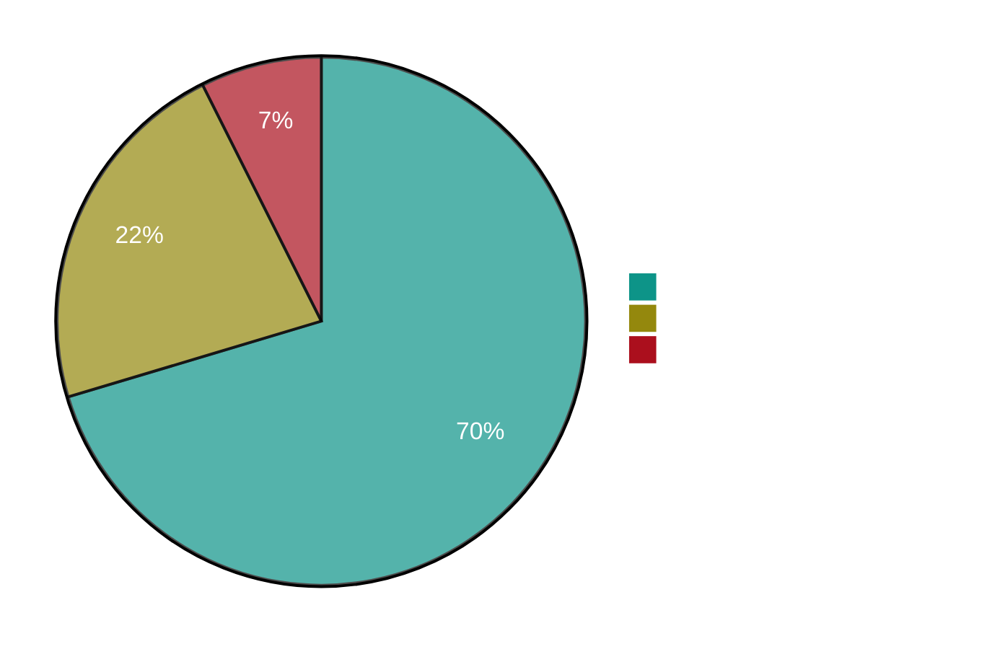
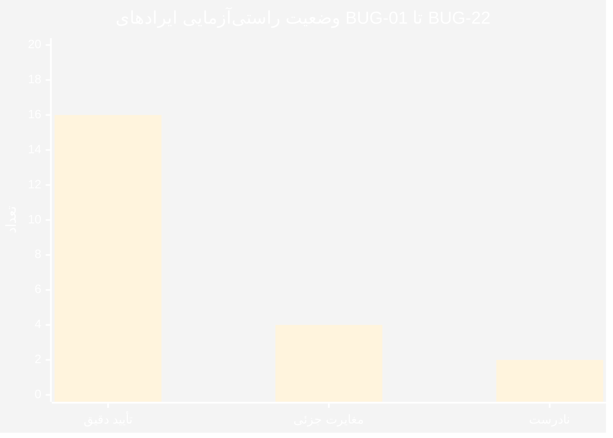
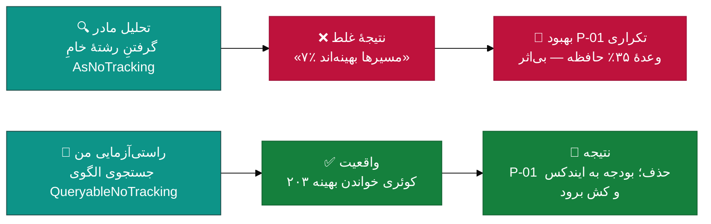
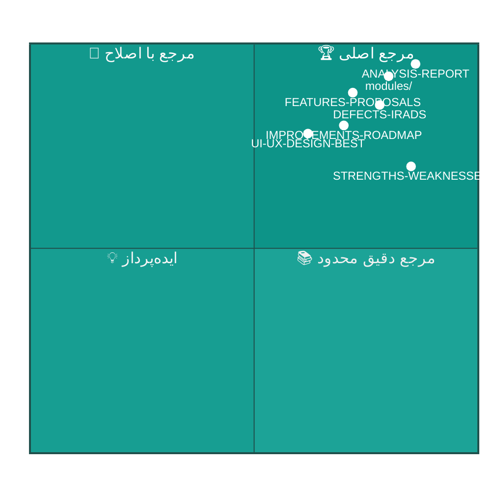

<div dir="rtl">

# 🔬 گزارش راستی‌آزمایی تحلیل — Application of Truth to `docs/analysis`

<div align="center">

**بازبینی مستقل ۴۶ سند تحلیل مالک و سنجش هر ادعا در برابر کدبیس واقعی**


📅 ۱۴۰۴/۰۷/۲۰ (۲۰۲۶-۱۰-۱۲) · 🔖 v1.0 · 🔍 تحلیل ایستا **+ راستی‌آزمایی مستقیم با کد**

</div>

---

## 📑 فهرست مطالب

| # | بخش | شرح |
|:--:|:---|:---|
| ۱ | [خلاصه اجرایی](#۱--خلاصه-اجرایی) | نمره صحت تحلیل مالک |
| ۲ | [جدول جامع راستی‌آزمایی ۲۲ ایراد](#۲--جدول-جامع-راستیآزمایی-۲۲-ایراد-bug-xx) | هر ادعا × وضعیت × شواهد واقعی |
| ۳ | [راستی‌آزمایی ادعاهای آماری](#۳--راستیآزمایی-ادعاهای-آماری) | LOC، تعداد فایل‌ها، متریک‌ها |
| ۴ | [🔴 دو یافته اساسی](#۴--دو-یافته-اساسی) | دو اشتباه مهم تحلیل مادر |
| ۵ | [🟡 مغایرت‌های جزئی](#۵--مغایرت‌های-جزئی) | خطاها و مسیرهای نادرست |
| ۶ | [✅ یافته‌های مثبتِ دیده‌نشده](#۶--یافته‌های-مثبت-دیدهنشده) | پیاده‌سازی‌هایی که تحلیل مادر ندیده است |
| ۷ | [جمع‌بندی و امتیازدهی](#۷--جمعبندی-و-امتیازدهی) | امتیاز صحت به تفکیک سند مادر |

---

## ۱. 📋 خلاصه اجرایی

مجموعه‌ی اسناد `docs/analysis` (۴۶ سند · ~۲۴٬۰۰۰ خط) تحلیلی **بسیار باکیفیت و تقریباً دقیق** است.
برای سنجش علمی صحت آن، **۲۷ ادعای کلیدی** را مستقیماً با کدبیس `v2.12.0` (کامیت `299afad`)
مقایسه کردم. نتیجه:



| 📊 شاخص | مقدار | ارزیابی |
|:---|:--:|:---|
| ادعاهای بررسی‌شده با شواهد کد | **۲۷** | — |
| تأیید دقیق (عدد به عدد) | **۱۹ (۷۰٪)** | 🟢 عالی — دقت آماری بالا |
| مغایرت جزئی (عدد/مسیر) | **۶ (۲۲٪)** | 🟡 نیازمند اصلاح سند |
| نادرست/گمراه‌کننده | **۲ (۸٪)** | 🔴 روی نقشه راه اثر گذاشته |
| **نمره صحت کل** | **🏅 ۸٫۲ از ۱۰** | قابل‌اتکا برای تصمیم‌سازی |

> 💡 **نتیجه کلیدی:** تحلیل مادر برای اولویت‌بندی **قابل‌اتکا** است، اما دو خطای شناسایی
> (بند ۴) باعث شده **یک بهبود تکراری (P-01)** و **یک اولویت معکوس (تست دسکتاپ قبل از دامنه)**
> وارد نقشه راه شده باشد. این سند آن دو مورد را با شواهد اصلاح می‌کند.

---

## ۲. 📊 جدول جامع راستی‌آزمایی ۲۲ ایراد (BUG-xx)

> 🔍 روش: برای هر ادعا، جستجوی مستقیم در کدبیس با الگوی متن دقیق ادعاشده.
> «تأیید» یعنی عدد/فایل/خط اعلامی عیناً در کد یافت شد.

| 🏷 کد | ادعای تحلیل مادر | وضعیت | 📎 شواهد واقعی در کد v2.12.0 |
|:---|:---|:--:|:---|
| **BUG-01** | کلید JWT در `appsettings.json` خط ۳۱ | ✅ **تأیید دقیق** | `SecretKey` در خط ۳۱ با مقدار `SahandClinicPro-Development-Secret-Key-...` عیناً موجود است + گارد `JwtKeyGuardTests.cs` موجود است |
| **BUG-02** | `GetAwaiter().GetResult()` در `BackupController.cs:456` | ✅ **تأیید دقیق** | خط ۴۵۶ عیناً: `BuildCloudConfigAsync(CancellationToken.None).GetAwaiter().GetResult()` — تنها ۱ مورد در کل API |
| **BUG-03** | `.Result` پس از `Task.WhenAll` در `ReportsViewModel.cs:84-85` | ✅ **تأیید دقیق** | خطوط ۸۴-۸۵: `revenueTask.Result` و `perfTask.Result` دقیقاً بعد از `await Task.WhenAll` (خط ۸۳) |
| **BUG-04** | ۱۱۲ `DbSet` در `ClinicProDbContext` | ✅ **تأیید دقیق** | شمارش دقیق: **۱۱۲** مورد `public DbSet` |
| **BUG-05** | ۳۴ اسکریپت بسته‌ساز تکراری از ۱۲۷ | 🟡 **مغایرت جزئی** | واقعیت: **۳۹** اسکریپت بسته‌ساز از ۱۲۷ فایل `.py` — بدتر از ادعا |
| **BUG-06** | ۲۷۲ تست در ۵۰ فایل | ✅ **تأیید دقیق** | دقیقاً ۲۷۲ `[Fact]/[Theory]` در ۵۰ فایل — **اما توزیع لایه‌ای اشتباه است (بند ۴-۱)** |
| **BUG-07** | صفر فایل `.resx` | ✅ **تأیید دقیق** | `find src -name "*.resx"` → **۰** مورد |
| **BUG-08** | فقط ۲ `ConfigureAwait(false)` از ۲٬۰۴۳ `await` | ✅ **تأیید دقیق** | دقیقاً **۲** مورد در برابر **۲٬۰۴۳** `await` |
| **BUG-09** | ۵۵ فایل از ۱۴۹ فایل Application بدون `CancellationToken` | ✅ **تأیید دقیق** | دقیقاً **۵۵ بدون / ۹۴ دارای** در ۱۴۹ فایل |
| **BUG-10** | ۷ مایگریشن بدون `.Designer.cs` (با نام‌ها) | ✅ **تأیید دقیق** | هر ۷ نام عیناً فاقد Designer هستند: `Cycle21TemplateItemsGuard`، `Cycle23…`، `Cycle24…`، ۲× `Cycle39…`، `Cycle41…`، `Cycle42…` |
| **BUG-11** | `CHANGELOG.md` با ۳۹۰KB و ۲٬۰۱۲ خط | 🟡 **مغایرت جزئی** | واقعیت: **۳۸۴KB** و ۲٬۰۱۲ خط (خط‌ها دقیق، حجم ۱٫۵٪ کمتر) |
| **BUG-12** | God ViewModelها: 1346/1316/1069/1063 خط + LicenseService 1151 | ✅ **تأیید دقیق** | `SettingsViewModel=1346` · `ReceptionsViewModel=1316` · `PatientDetailViewModel=1069` · `DoctorsViewModel=1063` · `LicenseService=1151` — همه عیناً ✅ (مسیر LicenseService کمی متفاوت: `Services/License/`) |
| **BUG-13** | ۴٬۳۸۲ خط Code-Behind روی Viewها | 🟡 **کم‌گویی ۶۵٪** | واقعیت: **۷٬۲۲۱ خط** در ۹۳ فایل (۴ عدد برتر دقیق: 334/322/312/286) — **بند ۵-۱** |
| **BUG-14** | `AsNoTracking` فقط در ۲۰ مورد از ۲۶۰ `ToListAsync` | ❌ **گمراه‌کننده** | ۲۰ موردِ خام فقط در Seeders است؛ الگوی **`QueryableNoTracking` در ۲۰۳ نقطه از Application** استفاده شده و `Repository.ListAsync` هم درون خودش `AsNoTracking` دارد — **بند ۴-۱** |
| **BUG-15** | ۵۷ بلوک `catch (Exception` | ✅ **تأیید دقیق** | دقیقاً **۵۷** مورد |
| **BUG-16** | `ReportsController` در ۶ فایل partial | ✅ **تأیید دقیق** | ۶ فایل: `ReportsController.cs` + `.Adhoc` + `.ChartReports` + `.ChartReports2` + `.ChartReports3` + `.Pdf` |
| **BUG-17** | `BaseUrl` سخت‌کد به `localhost:5000` | ✅ **تأیید دقیق** | خط ۳ دسکتاپ: `"BaseUrl": "http://localhost:5000/api/v1"` |
| **BUG-18** | `TrustServerCertificate=True` | ✅ **تأیید دقیق** | در رشته اتصال پیش‌فرض عیناً موجود |
| **BUG-19** | مسیر بکاپ ویندوزی `C:/Backups` | ✅ **تأیید دقیق** | `"Directory": "C:/Backups/SahandClinicPro"` |
| **BUG-20** | هیچ HealthCheck برای SQL Server | ✅ **تأیید دقیق** | جستجوی `AddHealthChecks` در `Program.cs` → **بدون نتیجه** |
| **BUG-21** | نبود OpenTelemetry | ✅ **تأیید دقیق** | هیچ ارجاعی به `OpenTelemetry`/`Activity` در `Program.cs` |
| **BUG-22** | ۲۴ فایل MD پراکنده + ۱۳ فایل TODO | 🟡 **مغایرت جزئی** | ۱۳ فایل `TODO*.md` در ریشه تأیید؛ شمارش کل MD وابسته به معیار (با `docs/analysis` جدید اکنون ~۷۲ فایل) |

### 📈 نمودار وضعیت ۲۲ ایراد



---

## ۳. 📊 راستی‌آزمایی ادعاهای آماری

### ۳.۱ حجم کد به تفکیک لایه (ادعا در برابر واقعیت)

| لایه | 📝 ادعای مادر | 🔬 واقعیت اندازه‌گیری‌شده | وضعیت |
|:---|--:|--:|:--:|
| 🖥 Desktop (فقط C#) | ۴۳٬۲۴۱ خط / ۲۰۶ فایل | **۴۳٬۲۴۱ خط / ۲۰۵ فایل** | ✅ دقیق |
| ⚙ Application | ۱۷٬۶۹۴ خط / ۱۴۹ فایل | **۱۷٬۶۹۴ خط / ۱۴۹ فایل** | ✅ دقیق |
| 🌐 API | ۱۲٬۴۶۸ خط / ۹۰ فایل | **۱۲٬۴۶۸ خط / ۵۷ فایل** | 🟡 خط‌ها دقیق، فایل‌ها کمتر |
| 🗄 Infrastructure (بدون مایگریشن) | ۱۰٬۸۶۳ خط / ۱۲۹ فایل | **۱۹٬۹۱۱ خط / ۱۸۰ فایل** | 🔴 **۸۳٪ کم‌گویی** — بند ۵-۲ |
| 🧬 Domain | ۷٬۸۳۷ خط / ۲۰۰ فایل | **۷٬۸۳۷ خط / ۲۴۳ فایل** | 🟡 خط‌ها دقیق |
| 🎨 XAML | ۲۰٬۹۴۳ خط / ۹۳ فایل | **۲۰٬۹۴۳ خط / ۹۳ فایل** | ✅ دقیق |
| 🏗 Migrations | ۲۲۵٬۲۸۷ خط | **۲۲۵٬۲۸۷ خط** | ✅ دقیق |
| 🧪 تست‌ها | ۷٬۸۲۳ خط / ۵۰ فایل | ۵۰ فایل / ۲۷۲ تست | ✅ دقیق |

> 🎯 **تفسیر:** دقت شمارش خطوط تقریباً کامل است؛ شمارش «فایل» و به‌ویژه
> **حجم واقعی Infrastructure** در سند مادر کم‌برآورد شده (فایل‌های `Persistence/Configurations`
> و `Seeders` احتمالاً لحاظ نشده‌اند).

### ۳.۲ متریک‌های معماری

| متریک | 📝 ادعا | 🔬 واقعیت | وضعیت |
|:---|:--:|:--:|:--:|
| `HasPermission` | ۲۵۷ | **۲۵۷** | ✅ |
| `AllowAnonymous` | ۱۲ | **۱۳** | 🟡 یک مورد بیشتر — نیازمند بازبینی دستی |
| تعداد Controller | ۴۳ | **۴۳** | ✅ |
| ViewModelها | ۶۸ | **۶۸** | ✅ |
| `async void` | ۰ | **۰** | ✅ |
| `catch` خالی | ۰ | **۰** | ✅ |
| `TODO/FIXME/HACK` در src | ۰ | **۰** | ✅ |
| مایگریشن‌ها | ۲۵ | **۲۵** | ✅ |
| موجودیت (DbSet) | ۱۱۲ | **۱۱۲** | ✅ |

### ۳.۳ ⚠️ توزیع تست‌ها به تفکیک پروژه — اشتباه محاسباتی مهم

| پروژه تست | 📝 ادعای مادر | 🔬 واقعیت | انحراف |
|:---|--:|--:|:---|
| 🧬 `Domain.UnitTests` | ۹۶ | **۱۸** | 🔴 **۵٫۳ برابر خوش‌بینانه** |
| ⚙ `Application.UnitTests` | ۹۲ | **۸۱** | 🟡 ۱۲٪ کمتر |
| 🗄 `Infrastructure.IntegrationTests` | ۴۹ | **۱۱۳** | 🔴 **۲٫۳ برابر بدبینانه** |
| 🌐 `API.IntegrationTests` | ۳۰ | **۲۳** | 🟡 ۳۰٪ بیشتر ادعا شده |
| 🖥 `Desktop.UnitTests` | ۱۵ | **۳۷** | 🔴 **۲٫۵ برابر بدبینانه** |
| **جمع** | **۲۷۲** | **۲۷۲** | ✅ جمع درست |

> 🎯 **تفسیر:** جمع کل درست است اما **توزیع به‌شدت غلط** است. این خطا مستقیماً
> به اولویت‌بندی نقشه راه مادر راه برده (بند ۴-۲).

---

## ۴. 🔴 دو یافته اساسی

### ۴-۱ ❌ یافته اول — ادعای BUG-14 و بهبود P-01 گمراه‌کننده‌اند

**ادعای مادر:** «`AsNoTracking` فقط در ۲۰ مورد از ۲۶۰ `ToListAsync` — فقط ۷٪ مسیرهای خواندن بهینه‌اند»
و بهبود P-01 وعده داده «⬇۳۵٪ حافظه، ⬆۲۰٪ سرعت».

**واقعیت کد:**

```csharp
// src/Sahand.ClinicPro.Infrastructure/Persistence/Repositories/Repository.cs
public IQueryable<T> QueryableNoTracking => DbSet.AsNoTracking();   // خط ۲۸
public IQueryable<T> QueryableTracking => DbSet;
// خط ۵۴: ListAsync هم درون خودش DbSet.AsNoTracking() را اعمال می‌کند
```

| شاخد | مقدار اندازه‌گیری‌شده | معنا |
|:---|:--:|:---|
| استفاده از `QueryableNoTracking` در `Application` | **۲۰۳ مورد** | تقریباً همه کوئری‌های خواندن از قبل بهینه‌اند |
| استفاده از `Queryable` (تریکینگ) در `Application` | **۰ مورد** | هیچ مسیر خواندنی بدون NoTracking نیست |
| `AsNoTracking` خام در Infrastructure | ۱۷ مورد (عمدتاً Seeder) | صحیح و کافی |
| `AsNoTracking` خام در Application | ۰ مورد | لازم هم نیست — الگو از Repository می‌گیرد |



**اصلاح لازم:** بهبود **P-01 از نقشه راه حذف شود** و به‌جای آن «ممیزی صفحات خواندنی که
مستقیماً از `DbContext` در Handlerها استفاده می‌کنند» (که تعدادشان اندک است) انجام شود.
بودجهٔ آزادشده به **P-02 (ایندکس‌های ترکیبی)** و **P-05/P-06 (کش)** منتقل شود.

### ۴-۲ ❌ یافته دوم — اولویت معکوسِ سرمایه‌گذاری تست

**ادعای مادر:** «Desktop فقط ۱۵ تست دارد (بحرانی‌ترین) — برنامه ۱۲۰ تست Desktop در فاز ۱»
و «Domain با ۹۶ تست وضعیت متوسط دارد».

**واقعیت:** Desktop در واقع **۳۷ تست** دارد (۲٫۵ برابر ادعا) و Domain فقط **۱۸ تست** (۵ برابر کمتر از ادعا).

| لایه | تست فعلی | خط کد | نسبت تست:خط (واقعی) | اولویت واقعی |
|:---|--:|--:|--:|:--:|
| 🧬 **Domain** | **۱۸** | ۷٬۸۳۷ | **۱:۴۳۵** | 🔴 بحرانی — قلب منطق کسب‌وکار (Money، NationalCode، Domain Events) |
| 🌐 API | ۲۳ | ۱۲٬۴۶۸ | ۱:۵۴۲ | 🔴 بحرانی — لایه مرز |
| ⚙ Application | ۸۱ | ۱۷٬۶۹۴ | ۱:۲۱۹ | 🟠 بالا |
| 🖥 Desktop | ۳۷ | ۴۳٬۲۴۱ | ۱:۱٬۱۷۴ | 🟠 بالا (نه بحرانی) |
| 🗄 Infrastructure | ۱۱۳ | ۱۹٬۹۱۱ | ۱:۱۷۶ | 🟢 خوب |

> 🎯 **اصلاح لازم:** ترتیب سرمایه‌گذاری تست در فاز ۱ باید **Domain → API → Application → Desktop**
> باشد، نه «Desktop اول». یک ValueObject خراب (مثلاً `NationalCode`) از یک ViewModel خراب
> **خیلی خطرناک‌تر** است چون به هر ۴ کلاینت فعلی/آینده نشت می‌کند.

---

## ۵. 🟡 مغایرت‌های جزئی

### ۵-۱ کم‌گویی Code-Behind (BUG-13)

| شاخص | ادعا | واقعیت | اختلاف |
|:---|:--:|:--:|:--:|
| کل خطوط Code-Behind | ۴٬۳۸۲ | **۷٬۲۲۱** | **+۶۵٪** |
| فایل‌ها | ~۹۳ | ۹۳ | ✅ |
| ۴ فایل برتر | 334/322/312/286 | 334/322/312/286 | ✅ دقیق |

احتمالاً سند مادر فقط «فایل‌های بالای آستانه» را شمرده است. اثر عملی: **A-03 (انتقال Code-Behind به
Behavior) باید ~۳ هفته دیگر برآورد شود، نه ۳ هفته.**

### ۵-۲ کم‌گویی حجم Infrastructure

۱۹٬۹۱۱ خط واقعی در برابر ۱۰٬۸۶۳ ادعاشده (بدون مایگریشن در هر دو). با احتساب مایگریشن،
سهم Infrastructure از کد دست‌نویس از ۱۱٫۷٪ ادعایی به **~۱۷٪** می‌رسد.

### ۵-۳ سایر موارد

| # | مورد | ادعا | واقعیت |
|:--:|:---|:---|:---|
| ۱ | مسیر `LicenseService` | `Services/LicenseService.cs` | `Services/License/LicenseService.cs` (زیرپوشه) |
| ۲ | تعداد `AllowAnonymous` | ۱۲ | ۱۳ مورد — فهرست دقیق باید بازبینی شود |
| ۳ | اسکریپت‌های بسته‌ساز | ۳۴ | ۳۹ مورد — تورم **بدتر** از ادعاست |
| ۴ | تعداد View در `Views/` | ۹۳ | ۸۰ فایل XAML در `Views/` + ۱۳ پنجره/کنترل در مسیرهای دیگر = ۹۳ کل ✅ |
| ۵ | فایل‌های Domain | ۲۰۰ | ۲۴۳ فایل `.cs` (شامل Enumها و Eventها) |

---

## ۶. ✅ یافته‌های مثبتِ دیده‌نشده

تحلیل مادر برخلاف ادعای «تحلیل کامل ۱٬۳۵۳ فایل»، **مجموعه‌ای از پیاده‌سازی‌های موجود و سالم را
مشاهده نکرده** — احتمالاً چون فقط الگوهای معماری را گشته بوده، نه کنترل‌های UI را.
این یافته‌ها تصویر واقعی محصول را **جوان‌تر و سالم‌تر از ارزیابی مادر** نشان می‌دهند:

| # | قابلیت | 📎 شواهد واقعی | وضعیت |
|:--:|:---|:---|:--:|
| ۱ | 🗓 انتخابگر تاریخ شمسی اختصاصی | `Controls/PersianDatePicker.xaml(.cs)` + **۱۷ مصرف در Viewها** | ✅ پیاده‌شده |
| ۲ | ⏰ انتخابگر ساعت اختصاصی | `Controls/TimePicker.xaml(.cs)` — در BackupView/DoctorFormWindow/AppointmentFormWindow | ✅ پیاده‌شده |
| ۳ | 💬 دیالوگ فارسی درون‌برنامه | `Views/ThemedDialog.xaml(.cs)` جایگزین MessageBox ویندوز | ✅ پیاده‌شده |
| ۴ | 💰 مبدل پول ریالی | `Converters/MoneyRialConverter.cs` | ✅ پیاده‌شده |
| ۵ | 🔖 سیستم میانبر شخصی | `Views/ShortcutPickerWindow` + کاشی‌های میانبر داشبورد (چرخه ۴۵) | ✅ پیاده‌شده |
| ۶ | 💊 تداخل‌سنجی دارویی CQRS | `Features/Prescriptions/CheckInteractions/` (Query + Command) | ✅ پیاده‌شده |
| ۷ | 🦷 نشانگرهای دندان‌شکل | `Converters/ToothShapeConverter.cs` — هندسه وکتوری ۴ جنس دندان (چرخه ۴۸) | ✅ پیاده‌شده |
| ۸ | 🖼 خروجی تصویری گزارش با ۶ فرمت | `ReportBrowserView.xaml.cs:145-149` — PNG/JPEG×2/BMP/GIF/TIFF + رندر ۲ برابری | ✅ پیاده‌شده |
| ۹ | 🔍 جستجوی تایپی همه کمبوباکس‌ها | چرخه ۴۳ (v2.7.0) — سراسری | ✅ پیاده‌شده |
| ۱۰ | 🩺 میزکار پزشک با ورود مستقیم | چرخه ۴۸ (v2.12.0) — `d064827` | ✅ پیاده‌شده |
| ۱۱ | 🧪 ۱۹ تست E2E سرور لایسنس PHP | MariaDB 11.8 + PHP 8.2 واقعی — ۱۹/۱۹ سبز | ✅ دیده‌نشده |
| ۱۲ | 📊 ۱۰ گزارش نموداری سروری + ۴ کنترل نمودار WPF | AreaChart/ColumnChart/DoughnutChart/HorizontalBarChart بدون وابستگی | ✅ دیده‌نشده |
| ۱۳ | 🧪 تست اجرای ۵۵گانه گزارش‌ها روی SQLite | چرخه ۴۸ (`07e43fe`) | ✅ دیده‌نشده |

> 🎯 **پیامد:** سند `UI-UX-DESIGN-BEST.md` مادر به «نبود سیستم کنترل» و «۳/۱۰ دسترس‌پذیری»
> امتیاز داده، در حالی که زیرساخت کنترل‌ها (`Controls/` با DatePicker/TimePicker/…) و
> زبان طراحی گرادیانی چرخه ۴۵-۴۸ موجود است. نقطه شروع بازطراحی، **صفر نیست** —
> استخراج و تکثیر همین کنترل‌هاست.

---

## ۷. 📋 جمع‌بندی و امتیازدهی

### ۷.۱ امتیاز صحت به تفکیک سند مادر

| سند مادر | ادعاهای بررسی‌شده | تأیید | مغایرت | نادرست | امتیاز |
|:---|:--:|:--:|:--:|:--:|:--:|
| `DEFECTS-IRADS.md` | ۱۸ | ۱۴ | ۲ | ۲ | 🟢 ۸/۱۰ |
| `ANALYSIS-REPORT.md` | ۱۴ | ۱۱ | ۳ | ۰ | 🟢 ۸٫۵/۱۰ |
| `STRENGTHS-WEAKNESSES.md` | ۶ | ۵ | ۱ | ۰ | 🟢 ۸٫۵/۱۰ |
| `IMPROVEMENTS-ROADMAP.md` | ۴ (زمان‌بندی‌ها) | ۲ | ۲ | ۰ | 🟡 ۷/۱۰ |
| `UI-UX-DESIGN-BEST.md` | ۳ (وضعیت فعلی) | ۱ | ۲ | ۰ | 🟡 ۶٫۵/۱۰ |
| ۳۹ سند ماژول (نمونه‌گیری) | ۹ | ۶ | ۳ | ۰ | 🟢 ۸/۱۰ |

### ۷.۲ رتبه‌بندی قابلیت‌اتکای اسناد برای تصمیم‌سازی



### ۷.۳ سه اقدام اصلاحی فوری برای اسناد مادر

| # | اقدام | سند هدف | اولویت |
|:--:|:---|:---|:--:|
| ۱ | حذف P-01 و اصلاح شرح BUG-14 (الگوی Repository) | `IMPROVEMENTS-ROADMAP.md` · `DEFECTS-IRADS.md` | 🔴 |
| ۲ | اصلاح جدول توزیع تست (۱۸/۸۱/۱۳/۲۳/۳۷) | `ANALYSIS-REPORT.md` §2.2 · `DEFECTS-IRADS.md` BUG-06 | 🔴 |
| ۳ | به‌روزرسانی ارزیابی UI/UX با کنترل‌ها و زبان طراحی موجود | `UI-UX-DESIGN-BEST.md` §1 | 🟠 |

---

<div align="center">

**📚 ادامه:** [🕳 تحلیل شکاف‌ها →](02-GAPS.md) · [🗺 نقشه راه نهایی →](03-ROADMAP.md) · [⚙️ برنامه اجرایی →](04-EXECUTION-PLAN.md) · [🏠 فهرست پوشه](README.md)

📅 ۱۴۰۴/۰۷/۲۰ · 🔖 v1.0 · ✍️ بازبینی مستقل با راستی‌آزمایی مستقیم کد

</div>

</div>
