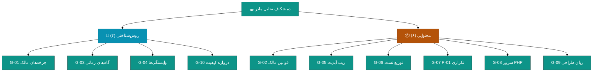
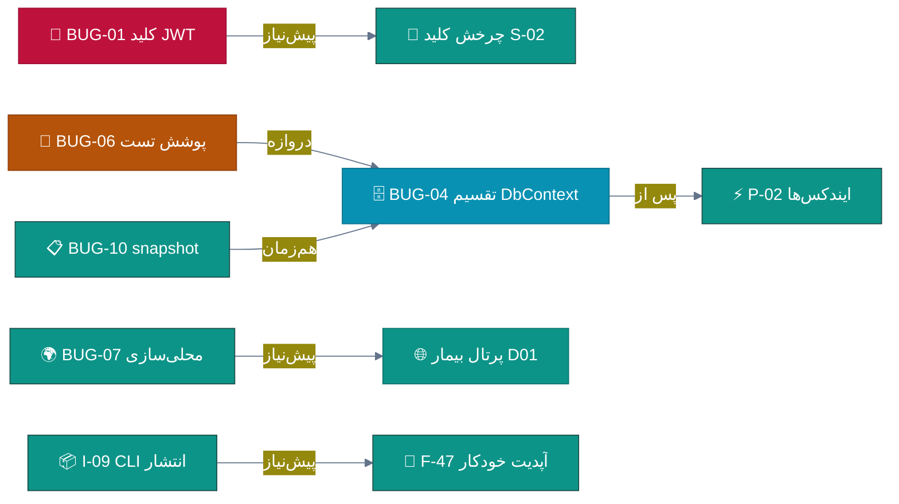
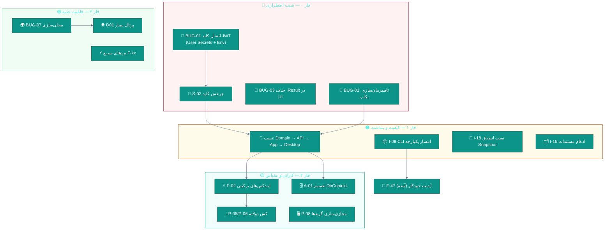

# 🕳 تحلیل شکاف‌ها — آنچه اسناد مادر از قلم انداختند

**ده شکاف شناسایی‌شده در مجموعه ۴۶ سند تحلیل، همراه با اصلاح و مکمل**

📅 ۱۴۰۴/۰۷/۲۰ (۲۰۲۶-۱۰-۱۲) · 🔖 v1.0

---

## 📑 فهرست مطالب

| # | بخش |
|:--:|:---|
| ۱ | [خلاصه شکاف‌ها](#۱--خلاصه-شکاف‌ها) |
| ۲ | [شکاف ۱ تا ۵ — شکاف‌های روش‌شناختی](#۲--شکافهای-روششناختی-۱-تا-۵) |
| ۳ | [شکاف ۶ تا ۱۰ — شکاف‌های محتوایی](#۳--شکافهای-محتوایی-۶-تا-۱۰) |
| ۴ | [ماتریس قوانین دائمی مالک و وضعیت رعایت](#۴--ماتریس-قوانین-دائمی-مالک-۱۲-قانون) |
| ۵ | [نقشه وابستگی اصلاح‌شده BUGها](#۵--نقشه-وابستگی-اصلاحشده) |
| ۶ | [آنچه تحلیل مادر درست گفت و باید حفظ شود](#۶--آنچه-تحلیل-مادر-درست-گفت) |

---

## ۱. 📋 خلاصه شکاف‌ها

| # | 🔗 شکاف | 🎯 نوع | ⚠️ اثر اگر اصلاح نشود | شدت |
|:--:|:---|:---|:---|:--:|
| G-01 | چشم‌پوشی از **۴۸ چرخه رفع باگ مالک** و `PROGRESS.md` | روش‌شناختی | نقشه راه با «واقعیت محصول» هم‌راستا نمی‌شود | 🔴 |
| G-02 | غیبت کامل **قوانین دائمی مالک** در همه اسناد | محتوایی | پیاده‌سازی آینده قانون‌شکن می‌شود (مثلاً MessageBox ویندوزی) | 🔴 |
| G-03 | زمان‌بندی ماهانه به‌جای **چرخه‌های ۱-۳ روزه مالک** | روش‌شناختی | برنامه ۹ ماهه اجرا نمی‌شود؛ مالک روزانه کامیت می‌کند | 🔴 |
| G-04 | نبود **ماتریس وابستگی** بین BUGها | روش‌شناختی | ترتیب اجرای اشتباه و دوباره‌کاری | 🟠 |
| G-05 | بی‌توجهی به **گردش‌کار انتشار (زیپ آپدیت + Release)** | محتوایی | بهبودها به دست کاربر کلینیک نمی‌رسد | 🟠 |
| G-06 | توزیع تست اشتباه → **اولویت معکوس سرمایه‌گذاری** | محتوایی | خرج بودجه تست روی لایه غلط | 🔴 |
| G-07 | بهبود P-01 تکراری (AsNoTracking از قبل پیاده) | محتوایی | هدر رفتن یک هفته نیرو | 🟠 |
| G-08 | غیبت **سرور لایسنس PHP** از تحلیل سطح سیستم | محتوایی | ۲٬۸۹۲ خط PHP بدون پوشش بکاپ/تست/مانیتورینگ | 🟡 |
| G-09 | ارزیابی UI/UX بدون دیدن **زبان طراحی چرخه ۴۵-۴۸** | محتوایی | بازطراحی از صفر به‌جای تکمیل موجود | 🟡 |
| G-10 | نبود **تعریف عملیاتی دروازه کیفیت** (معیار اندازه‌پذیر) | روش‌شناختی | دروازه‌ها شعاری می‌مانند | 🟡 |

---

## ۲. 🧭 شکاف‌های روش‌شناختی (۱ تا ۵)

### 🔴 G-01 — چشم‌پوشی از ۴۸ چرخه رفع باگ و `PROGRESS.md`

تحلیل مادر `v2.12.0` را تحلیل کرده اما **تاریخ بلوغ محصول را نخوانده** است.
طبق `CHANGELOG.md` و `PROGRESS.md`، این محصول **۴۸ چرخه رفع ایراد گزارشی مالک** را پشت سر گذاشته؛
فقط ۱۲ چرخه آخر (۳۷ تا ۴۸) شامل این رفع‌ها بوده است:

| چرخه | نسخه | نمونه رفع‌های مالک-محور |
|:--:|:--:|:---|
| ۳۷ | v2.4.10 | منو · ساعت · کمبو · پیام‌ها · نسخه‌نویسی · تعرفه |
| ۳۸ | v2.4.11 | تور RTL · توست · دیالوگ · اسپلش · لاگ رنگی |
| ۳۹ | v2.5.0 | لوازم مصرفی · کارت‌خوان · مغایرت‌گیری زنده شیفت · میانبرهای داشبورد |
| ۴۱ | v2.6.0 | مصرفی‌های مستقل · میانبرها در دیتابیس · فیلتر نوع گزارش |
| ۴۲ | v2.6.1 | رفع خطای خروج از حساب · هدر تمیز |
| ۴۳ | v2.7.0 | جستجوی تایپی همه کمبوباکس‌ها · صفحات مستقل پاراکلینیک · بستن شیفت |
| ۴۴ | v2.8.0 | **ریشهٔ قطعی لاگ عملیات** · معماری شروع نشست · بازسازی شیفت‌ها |
| ۴۵ | v2.9.0 | کاشی‌های میانبر · **توست سالم** · ورود کالای دسته‌جمعی |
| ۴۶ | v2.10.0 | **خروج پس از اسپلش** · **کرش XAML حسابرسی** · سیستم طراحی شش صفحه |
| ۴۷ | v2.11.0 | **شیفت‌ها صفحهٔ مستقل** · حسابداری · مبدل ظرفیت |
| ۴۸ | v2.12.0 | میزکار پزشک · پرونده بیمار · چارت دندان · فارسی‌سازی چشم · ۵۵ تست گزارش |

**چرا مهم است؟** ۳ پیامد:
1. **باگ‌های بازِ جلسات قبل مالک عمدتاً بسته شده‌اند** — فهرست «ایرادهای باز» مادر باید با این واقعیت تفکیک شود.
2. **مدل کاری مالک** = گزارش باگ → چرخه ۱-۳ روزه → نسخه → زیپ آپدیت. نقشه راه باید به همین **ریتم چرخه‌ای** ترجمه شود (G-03).
3. **ریسک رگرسیون واقعی** جایی است که مادر درست تشخیص داده: این ۴۸ چرخه با ۲۷۲ تست سپر نشده‌اند؛ هر فاز جدید باید **تست رگرسیون چرخه‌های قبل** را هم بسازد.

### 🔴 G-02 — غیبت قوانین دائمی مالک

مالک در حین توسعه ۱۲ قانون دائمی تعیین کرده که **هیچ‌کدام** در ۴۶ سند مادر مستند نشده‌اند.
بدون این قوانین، هر پیاده‌سازی آینده (از جمله کدهای نمونه خود اسناد مادر!) می‌تواند ناقض قانون شود —
مثلاً کد نمونه سند C01 از `InvalidOperationException` استفاده کرده که پیامش فارسی است اما
الگوی دیالوگ و توست مالک را رعایت نمی‌کند. ماتریس کامل این قوانین در [بخش ۴](#۴--ماتریس-قوانین-دائمی-مالک-۱۲-قانون) آمده است.

### 🔴 G-03 — زمان‌بندی ماهانه به‌جای ریتم چرخه‌ای

سند `IMPROVEMENTS-ROADMAP.md` با «فاز ۰: ۲ هفته … فاز ۳: ۴ ماه» برنامه‌ریزی کرده.
سابقه گیت نشان می‌دهد مالک با **کامیت‌های روزانه و نسخه‌های پشت‌سرهم** کار می‌کند
(۴ نسخه فقط در ۲۰۲۶-۱۰-۱۱!). نقشه راه اجرایی باید به **چرخه‌های شماره‌دار ۴۹ به بعد** شکسته شود —
کاری که در [`03-ROADMAP.md`](03-ROADMAP.md) و [`04-EXECUTION-PLAN.md`](04-EXECUTION-PLAN.md) انجام داده‌ام.

### 🟠 G-04 — نبود ماتریس وابستگی

سناریوی وابستگی واقعی که مادر ندیده:

نمونه اثر: چرخش کلید JWT (S-02) **بدون** انتقال اولیه به Secret Manager (BUG-01) بی‌معنی است؛
تقسیم DbContext (BUG-04) **بدون** تستِ Domain و Application عملاً کورکورانه است و به دروازه کیفیت می‌خورد.

### 🟡 G-10 — دروازه‌های کیفیت غیرعملیاتی

مادر گفته «ورود به فاز بعد بدون عبور از دروازه ریسک را بالا می‌برد» اما معیار دروازه‌ها مبهم است
(«پوشش تست کافی است؟»). در [`04-EXECUTION-PLAN.md`](04-EXECUTION-PLAN.md) هر دروازه را به
**معیار عددی اندازه‌پذیر** (تعداد تست سبز، تعداد باقیمانده الگوی ممنوعه و…) تبدیل کرده‌ام.

---

## ۳. 📦 شکاف‌های محتوایی (۶ تا ۱۰)

### 🔴 G-06 — اولویت معکوس سرمایه‌گذاری تست

مطابق [یافته دوم سند راستی‌آزمایی](01-VERIFICATION.md#۴-۲-یافته-دوم--اولویت-معکوس-سرمایهگذاری-تست):
سهم لایه Domain از تست ۳۳٪ ادعایی در واقع **۶٫۶٪** است. برنامه ۱۲۰ تست Desktop در فاز ۱ مادر
باید به «۶۰ تست Domain + ۴۰ تست API + ۳۰ تست Application + ۲۰ تست Desktop» تغییر کند.

### 🟠 G-07 — بهبود تکراری P-01

تفصیل در [یافته اول راستی‌آزمایی](01-VERIFICATION.md#۴-۱-یافته-اول--ادعای-bug-14-و-بهبود-p-01-گمراهکنندهاند).
۲۰۳ مورد `QueryableNoTracking` ثابت می‌کند بهینه‌سازی خواندن از قبل انجام شده؛ بودجه به ایندکس و کش منتقل شود.

### 🟡 G-08 — سرور لایسنس PHP در تحلیل سطح سیستم غایب است

`docs/analysis` فقط در `ANALYSIS-REPORT.md` یک‌بار به PHP اشاره می‌کند (۲٬۸۹۲ خط).
اما در `DEFECTS-IRADS` و نقشه راه، **هیچ ایراد/بهبودی** برای آن ثبت نشده، در حالی که:

| مورد غایب | ریسک |
|:---|:---|
| بکاپ‌گیری از دیتابیس MySQL لایسنس (مشتری‌ها/کلیدها) | 🔴 از دست رفتن داده لایسنس مشتریان |
| مانیتورینگ سلامت `heartbeat` (خارج از `data/error.log`) | 🟠 قطعی خاموش لایسنس‌ها |
| چرخش جفت‌کلید RSA سرور | 🟠 عمر بی‌پایان کلید امضا |
| تست رگرسیون خودکار PHP در CI | 🟡 ۱۹ تست E2E فقط محلی اجرا شده |

### 🟡 G-09 — ارزیابی UI/UX بدون زبان طراحی موجود

چرخه‌های ۴۵-۴۸ یک **زبان طراحی گرادیانی برند با نشان شیشه‌ای** برای صفحات تخصصی ساخته‌اند
(آزمایشگاه بنفش، نسخه‌نویسی فیروزه‌ای و…) و ۴ کنترل نمودار بدون وابستگی تولید شده‌اند.
سند `UI-UX-DESIGN-BEST.md` از صفر طراحی Token پیشنهاد داده بدون اینکه این سرمایه موجود را ببیند.
مسیر درست: **استخراج Token از زبان موجود**، نه اختراع دوباره.

### 🟠 G-05 — گردش‌کار انتشار غایب است

برای مالک، «بهبود» وقتی واقعی است که به‌صورت **زیپ آپدیت فقط با فایل‌های تغییر یافته** در
GitHub Release منتشر شود (قانون مالک + سابقه ۳۹ اسکریپت بسته‌ساز!). نقشه راه مادر هیچ اشاره‌ای
به این گردش‌کار ندارد. برنامه اجرایی من (سند ۰۴) آن را به فرآیند چرخه الحاق کرده است.

---

## ۴. 📜 ماتریس قوانین دائمی مالک (۱۲ قانون)

> این قوانین از تاریخچه ۴۸ چرخه استخراج و با کد فعلی تطبیق داده شده‌اند.
> **هر چرخه آینده موظف به حفظ همه این قوانین است.**

| # | 🔗 قانون | وضعیت فعلی در v2.12.0 | 📎 شواهد |
|:--:|:---|:--:|:---|
| ۱ | 🗓 همه فیلدهای تاریخ = انتخابگر **تاریخ شمسی** اختصاصی | ✅ | `Controls/PersianDatePicker` + ۱۷ مصرف |
| ۲ | ⏰ همه فیلدهای زمان = انتخابگر **ساعت** اختصاصی | ✅ | `Controls/TimePicker` |
| ۳ | 💬 به‌جای MessageBox ویندوز = **دیالوگ فارسی درون‌برنامه** | ✅ | `Views/ThemedDialog` |
| ۴ | 🍞 اعلان‌ها = **توست** (نه پنجره مزاحم) | ✅ (چرخه ۴۵: «توست سالم») | `Shell` + گزارش چرخه |
| ۵ | 🔖 دکمه‌های میانبر قابل شخصی‌سازی + Tooltip کامل | ✅ (چرخه‌های ۴۱/۴۵) | `ShortcutPickerWindow` · میانبرهای DB |
| ۶ | 🔍 کمبوباکس‌ها **جستجوشونده** با بازشدن با فوکوس/کلیک | ✅ (چرخه ۴۳) | «جستجوی تایپی همهٔ کمبوباکس‌ها» |
| ۷ | 📊 DataGrid: ویرایش سلولی + Cell Commit + **وسط‌چین** هدر/سلول | ✅ (چرخه‌های ۴۶/۴۷) | «وسط‌چین سربرگ» v2.4.11 · مبدل ظرفیت v2.11 |
| ۸ | 📋 لاگ عملیات با **مقادیر قبلی/جدید صحیح** | ✅ (چرخه ۴۴: «ریشهٔ قطعی») | `AuditLogMiddleware` Old/New |
| ۹ | 💊 ICD-10 + **تداخل‌سنجی خودکار** + پایش حساسیت بیمار | ✅ | `Features/Prescriptions/CheckInteractions` |
| ۱۰ | 🦷 چارت دندان با **نشانگر دندان‌شکل** رنگی بر اساس وضعیت | ✅ (چرخه ۴۸) | `ToothShapeConverter` |
| ۱۱ | 🩺 **نقش‌محوری**: ورود مستقیم پزشک به میز کار خودش | ✅ (چرخه ۴۸) | کامیت `d064827` |
| ۱۲ | 📊 گزارشات جدولی **و** نموداری + خروجی تصویری با فرمت انتخابی | ✅ (چرخه ۴۸) | ۶ فرمت در `ReportBrowserView.xaml.cs:145` |
| ۱۳ | 🔢 اعداد فارسی در فیلدهای عددی + جداکننده سه‌رقمی پول | ✅ | `MoneyRialConverter` · مبدل‌های `UiConverters` |
| ۱۴ | 📦 انتشار = بیلد **بدون خطا/هشدار** + زیپ آپدیت فقط فایل‌های تغییر یافته + Release | ✅ (گردش‌کار جاری) | ۳۹ اسکریپت بسته‌ساز + راهنمای هر بسته |

> ⚠️ **توجه:** قانون ۱۴ «بدون هشدار» در کامیت‌های اخیر (چرخه ۴۸) چند مورد CS8604/CS1587 را
> جبرانی رفع کرده — یعنی دروازه «بیلد بدون هشدار» باید در CI سفت‌تر شود (بخش اجرایی سند ۰۴).

---

## ۵. 🗺 نقشه وابستگی اصلاح‌شده

---

## ۶. ✅ آنچه تحلیل مادر درست گفت

برای انصاف، بخش‌هایی از تحلیل مادر که **به‌طور کامل درست و ارزشمند**اند و نقشه راه من بر آن‌ها بنا شده:

| # | ✓ درست | چرا مهم است |
|:--:|:---|:---|
| ۱ | ۲۲ ایراد سطح سیستم با محل دقیق فایل:خط | فهرست کار قابل‌اجرای فوری |
| ۲ | اولویت‌بندی سه‌گانه اول (JWT، Sync-over-Async، .Result) | صحیح و با شواهد کامل |
| ۳ | اصل «تست پیش از تقسیم DbContext» | درست — هرچه توزیع تست را اصلاح کنیم، اصل پابرجاست |
| ۴ | هرم تست ۷۵/۲۰/۵ | چارچوب درست، فقط اهداف لایه‌ای باید جابه‌جا شود |
| ۵ | WSJF و ماتریس ارزش/دشواری امکانات | روش‌شناسی درست و اعداد منطقی |
| ۶ | تأکید بر ایمنی بالینی (تداخل/حساسیت/مقادیر بحرانی) صرف‌نظر از ROI | درست و اخلاقاً الزامی |
| ۷ | تحلیل رقابتی مبتنی بر انطباق بومی (سپاس/سیب/نسخه الکترونیک) | استراتژی تمایز صحیح |
| ۸ | هشدار «کدهای این اسناد کامپایل نشده‌اند» | صادقانه و درست — من همان را برای کدهای خودم تکرار می‌کنم |

---

**📚 ادامه:** [🗺 نقشه راه نهایی →](03-ROADMAP.md) · [⚙️ برنامه اجرایی →](04-EXECUTION-PLAN.md) · [🔬 راستی‌آزمایی ←](01-VERIFICATION.md) · [🏠 فهرست پوشه](README.md)

📅 ۱۴۰۴/۰۷/۲۰ · 🔖 v1.0

