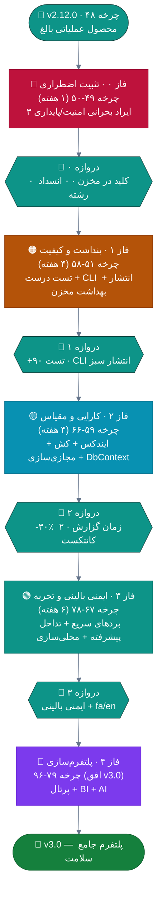
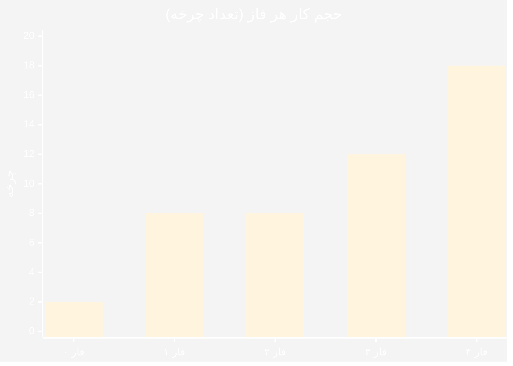
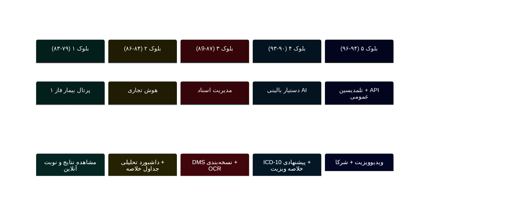

# 🗺 نقشه راه نهایی تکامل — ClinicPro v2.13 تا v3.0

**ترکیب سه‌لایه: تحلیل مالک (۴۶ سند) + راستی‌آزمایی مستقل + قوانین دائمی مالک**

📅 ۱۴۰۴/۰۷/۲۰ (۲۰۲۶-۱۰-۱۲) · 🔖 v1.0 · مبنا: `v2.12.0` (کامیت `299afad`)

### 📌 وضعیت اجرا (به‌روزرسانی ۱۴۰۴/۰۷/۲۱)

| دامنه | وضعیت |
|:---|:---|
| ✅ فاز ۰ (چرخهٔ ۴۹-۵۰) | **کامل + رلیز v2.13.0** — کلید JWT از مخزن حذف + گارد سه‌لایه + دو انسداد رشته‌ای + اسکنر ۶ گیته |
| ✅ فاز ۱ (چرخهٔ ۵۱-۵۸) | **کامل + رلیز v2.14.0/2.14.1** — +۱۴۰ سناریوی تست · CLI واحد (جایگزین ۱۲۳ اسکریپت) · نقاط سلامت live/ready · تفکیک CHANGELOG · ریشه‌یابی قرمزی همیشگی CI |
| ✅ چرخهٔ ۵۹ (P-02) | ۳ ایندکس ترکیبی داغ‌ترین پرس‌وجوها + مایگریشن |
| 🎁 کشف‌های اجرا | دو باگ واقعی که هیچ بازبینی ایستا نمی‌گرفت: **IDX10703** (جایگزین کلید به مولد توکن نمی‌رسید) و **پذیرش ftp:// در نشانی سرور لایسنس** — هر دو رفع و در v2.14.1 رلیز شدند |
| ⏳ چرخهٔ ۶۰ به بعد | طبق همین نقشه راه — گام بعدی: کش L1 داده‌های مرجع |

---

## 📑 فهرست مطالب

| # | بخش |
|:--:|:---|
| ۱ | [چرا نقشه راه جدید؟](#۱--چرا-نقشه-راه-جدید) |
| ۲ | [نمای کلی ۵ فاز](#۲--نمای-کلی-۵-فاز) |
| ۳ | [فاز ۰ — تثبیت اضطراری](#۳--فاز-۰--تثبیت-اضطراری-چرخه-۴۹-۵۰) |
| ۴ | [فاز ۱ — بنداشت و کیفیت](#۴--فاز-۱--بنداشت-و-کیفیت-چرخه-۵۱-۵۸) |
| ۵ | [فاز ۲ — کارایی و مقیاس](#۵--فاز-۲--کارایی-و-مقیاس-چرخه-۵۹-۶۶) |
| ۶ | [فاز ۳ — قابلیت‌های ایمنی و تجربه](#۶--فاز-۳--قابلیتهای-ایمنی-و-تجربه-چرخه-۶۷-۷۸) |
| ۷ | [فاز ۴ — پلتفرم‌سازی](#۷--فاز-۴--پلتفرمسازی-چرخه-۷۹-۹۶-افق-v30) |
| ۸ | [جدول جامع نگاشت ایرادها به چرخه‌ها](#۸--جدول-جامع-نگاشت-ایرادها-به-چرخهها) |
| ۹ | [WSJF بازمحاسبه‌شده](#۹--wsjf-بازمحاسبهشده) |
| ۱۰ | [شاخص‌های کلیدی (KPI)](#۱۰--شاخصهای-کلیدی-kpi) |
| ۱۱ | [دروازه‌های کیفیت عملیاتی](#۱۱--دروازههای-کیفیت-عملیاتی) |

---

## ۱. 🎯 چرا نقشه راه جدید؟

نقشه راه `IMPROVEMENTS-ROADMAP.md` مالک چارچوب درستی دارد اما بر پایه سه خطای داده،
اولویت‌هایش جابه‌جا شده است. این سند همان چارچوب را با **داده‌های راستی‌آزمایی‌شده**
بازسازی می‌کند:

| 🔧 تغییر نسبت به نقشه راه مادر | دلیل | مرجع |
|:---|:---|:---|
| **P-01 (AsNoTracking) حذف شد** | از قبل با `QueryableNoTracking` (۲۰۳ مورد) پیاده است | [یافته ۱](01-VERIFICATION.md#۴-۱-یافته-اول--ادعای-bug-14-و-بهبود-p-01-گمراهکنندهاند) |
| **ترتیب تست: Domain اول، نه Desktop** | Domain فقط ۱۸ تست دارد (نه ۹۶)؛ Desktop ۳۷ (نه ۱۵) | [یافته ۲](01-VERIFICATION.md#۴-۲-یافته-دوم--اولویت-معکوس-سرمایهگذاری-تست) |
| **ماه → چرخه ۱-۳ روزه** | ریتم واقعی مالک ۴۸ چرخه ثبت‌شده در CHANGELOG | [G-03](02-GAPS.md) |
| **قوانین دائمی ۱۴گانه در هر چرخه** | تضمین عدم پس‌رفت از استانداردهای محصول | [G-02](02-GAPS.md#۴--ماتریس-قوانین-دائمی-مالک-۱۲-قانون) |
| **سرور لایسنس PHP وارد نقشه شد** | ۲٬۸۹۲ خط بدون برنامه بکاپ/مانیتورینگ/چرخش کلید | [G-08](02-GAPS.md) |
| **گردش‌کار زیپ آپدیت در هر چرخه** | تعریف واقعی «انجام‌شده» برای مالک | [G-05](02-GAPS.md) |

---

## ۲. 🗺 نمای کلی ۵ فاز

### 📊 توزیع حجم کار چرخه‌ها

---

## ۳. 🚨 فاز ۰ — تثبیت اضطراری (چرخه ۴۹-۵۰)

> 🎯 **هدف:** بستن سه روزنه امنیتی/پایداری. **معیار خروج:** صفر مورد از سه الگوی ممنوعه.

| چرخه | کار | 📎 مرجع مادر | ⏱ |
|:--:|:---|:---|:--:|
| **۴۹** | 🔑 **BUG-01**: حذف کلید از `appsettings.json:31` → User-Secrets (توسعه) + `Jwt__SecretKey` (Production) + گارد Fail-Fast + اسکن `scan_secrets.sh` (I-04) + مرور ۱۳ `AllowAnonymous` | BUG-01 · I-01 · I-04 · I-05 | ۱ روز |
| **۵۰** | 🔄 **BUG-02**: حذف `GetAwaiter().GetResult()` از `BackupController.cs:456` با الگوی `SemaphoreSlim` + 🧊 **BUG-03**: حذف `.Result` از `ReportsViewModel.cs:84-85` (۳ مورد دیگر هم بازبینی شود) + تست رگرسیون برای هر دو | BUG-02 · BUG-03 · I-02 · I-03 | ۲ روز |

**خروجی نسخه‌ای:** `v2.13.0` — زیپ آپدیت فقط با ۳ فایل تغییر یافته
(`appsettings.json` سرور، `Sahand.ClinicPro.API.dll`، `Sahand.ClinicPro.Desktop.exe`).

> ⚠️ **توجه حیاتی:** کلید فعلی در تاریخچه گیت باقی می‌ماند؛ چرخش کلید (منطبق با S-02)
> هم‌زمان انجام و در سرور Production اعمال شود — این چرخه بدون اعمال سرورِ واقعی «انجام‌شده» نیست.

---

## ۴. 🏗 فاز ۱ — بنداشت و کیفیت (چرخه ۵۱-۵۸)

> 🎯 **هدف:** ساخت شبکه ایمنی درست (ترتیب اصلاح‌شده) + بهداشت مخزن + ابزار انتشار.
> **دروازه ۱:** حداقل +۹۰ تست سبز · CI سبز · CLI انتشار جایگزین ۳۹ اسکریپت.

| چرخه | کار | 📎 مرجع | 🎯 خروجی قابل‌سنجش |
|:--:|:---|:---|:---|
| **۵۱** | 🧪 **تست لایه Domain** (ضلع گمشده — فقط ۱۸ تست): پوشش کامل `Money`, `NationalCode`, ValueObjectها, Domain Events, قواعد Invariant | BUG-06 اصلاح‌شده | Domain: 18→**۶۰** تست |
| **۵۲** | 🧪 تست API مرزی: ۱۳ `AllowAnonymous` + مسیرهای خطا + نسخه‌بندی + تست‌های `WebApplicationFactory` | BUG-06 | API: 23→**۵۰** |
| **۵۳** | 📦 **CLI انتشار یکپارچه** `clinicpro_release.py` (جایگزین ۳۹ اسکریپت) + بایگانی اسکریپت‌های تاریخی در `scripts/archive/` | BUG-05 · I-09 · I-10 | ۳۹→۱ اسکریپت فعال |
| **۵۴** | 🧾 **تست انطباق Snapshot مایگریشن** (۷ فایل بدون Designer) + رفع ۵۵ فایل بدون `CancellationToken` (شروع) | BUG-10 · BUG-09 · I-18 | تست سبز snapshot |
| **۵۵** | ❤ HealthChecks (DB · دیسک · Hangfire) + نقاط `/health/live` و `/health/ready` + 📋 تفکیک CHANGELOG (بایگانی ۳۸۴KB) | BUG-20 · BUG-11 · I-11 · I-16 | CHANGELOG < 10KB |
| **۵۶** | 🧪 تست Application: Handlerهای پرریسک (پرداخت، نسخه، پذیرش) + رفع باقی `CancellationToken`ها | BUG-06 · BUG-09 | App: 81→**۱۵۰** |
| **۵۷** | 🗂 ادغام مستندات: ۱۳ فایل `TODO*.md` → `docs/roadmap/` + شاخه‌بندی `docs/` | BUG-22 · I-15 | ریشه بدون TODO پراکنده |
| **۵۸** | 🖥 تست Desktop هدفمند: ۵ ViewModel پرریسک (پرداخت/پذیرش/ویزیت) + CI فعال‌سازی کامل تست دسکتاپ | BUG-06 | Desktop: 37→**۶۰** |

**نتیجه فاز ۱:** تست‌ها ۲۷۲ → **~۳۶۰+** · CI کامل · مخزن تمیز · انتشار خودکار.

> 🔁 **توزیع اصلاح‌شده** (مقایسه با مادر که ۱۲۰ تست دسکتاپ در اولویت اول گذاشته بود):
> Domain +42 · API +27 · Application +69 · Desktop +23 — مجموع +۱۶۱.

---

## ۵. ⚡ فاز ۲ — کارایی و مقیاس (چرخه ۵۹-۶۶)

> 🎯 **هدف:** آماده‌سازی برای ۱۰ برابر شدن داده. **دروازه ۲:** زمان پاسخ گزارش‌ها ⬇۳۰٪ · ۲ Bounded Context.
> 📌 **P-01 حذف شد** — از قبل پیاده است (`QueryableNoTracking` ×۲۰۳).

| چرخه | کار | 📎 مرجع | 💥 اثر مورد انتظار |
|:--:|:---|:---|:---|
| **۵۹** | ⚡ **P-02 ایندکس‌های ترکیبی**: `(NationalCode, IsDeleted)` · `(BranchId, IsDeleted, CreatedAt)` · `(DoctorId, Date, Status)` · `(PatientId, Date)` + مایگریشن `Cycle49PerformanceIndexes` | P-02 | ⬆۴۰-۷۰٪ لیست‌ها |
| **۶۰** | 💧 **P-06 کش L1** (`IMemoryCache`) برای داده‌های مرجع: ICD-10 · داروها · تخصص‌ها · تنظیمات | P-06 | ⬇۹۰٪ کوئری تنظیمات |
| **۶۱** | 💧 **P-05 کش L2** (`IDistributedCache` اختیاری) + باطل‌سازی رویدادی + تنظیم TTL | P-05 | ⬇۸۰٪ لوکاپ‌ها |
| **۶۲** | 📄 **P-03 Pagination اجباری** در ۱۰ اندپوینت پرترافیک (بیماران/نوبت/گزارش‌ها) | P-03 | ⬇ بار شبکه |
| **۶۳** | 🖥 **P-08 مجازی‌سازی** DataGridهای سنگین + اسکلت‌بار در ۵ صفحه پرمصرف | P-08 · UI اصل ۵ | UI روان ۱۰هزار ردیف |
| **۶۴** | 🗄 **A-01 گام اول تقسیم DbContext**: استخراج `FinancialDbContext` فقط-خواندنی برای گزارش‌ها | BUG-04 | راه‌اندازی سریع‌تر گزارش |
| **۶۵** | 🔀 **P-04 SplitQuery** برای `Include`های چندشاخه + بازبینی Cartesian Explosion | P-04 | ⬇ حافظه گزارش‌ها |
| **۶۶** | 🐘 **بستن حلقه PHP**: بکاپ خودکار MySQL لایسنس + چرخش جفت‌کلید RSA + اتصال ۱۹ تست E2E به CI | G-08 (جديد) | تاب‌آوری زیرساخت لایسنس |

**نتیجه فاز ۲:** `v2.15.0` — گزارش‌ها سریع‌تر، حافظه کمتر، دو کانتکست مجزا، تاب‌آوری لایسنس.

---

## ۶. 🩺 فاز ۳ — قابلیت‌های ایمنی و تجربه (چرخه ۶۷-۷۸)

> 🎯 **هدف:** ایمنی بالینی عمیق + بردهای سریع مالک‌پسند + زیرساخت زبان.
> **دروازه ۳:** هشدارهای بالینی کامل · دو زبان در دسترس · SUS اندازه‌گیری‌شده.

### ۶.۱ ترتیب چرخه‌ها (WSJF محور — بند ۹)

| چرخه | کار | 📎 مرجع | 💰 WSJF |
|:--:|:---|:---|:--:|
| **۶۷** | 📅 **یادآوری خودکار نوبت** (پیامک ۲۴/۲ ساعت + ساعات سکوت + ثبت Reminder) | F-03 · A02 | **۱۱٫۰** 🥇 |
| **۶۸** | 🔍 **جستجوی یکپارچه Ctrl+K** (بیمار/نوبت/نسخه) | F-06 · UI | **۶٫۰** 🥈 |
| **۶۹** | 🔔 **هشدار موجودی/انقضا** (آستانه ۹۰/۶۰/۳۰/۷ روز) + داشبورد هشدار | F-08 · B07 | **۸٫۰** |
| **۷۰** | ⚠ **مقادیر بحرانی آزمایش** (هشدار فوری به پزشک + دیالوگ مسدودکننده) | F-29 · A07 | **۵٫۲** |
| **۷۱** | 🧪 **محدوده مرجع سنی/جنسیتی** نتایج آزمایش (تفسیر خودکار + فلگ H/L) | F-28 · A07 | بالا |
| **۷۲-۷۳** | 💊 **هشدار تداخل پیشرفته** (شدت · جایگزین · منبع علمی · توجیه اجباری override) | F-27 · A06 | بحرانی |
| **۷۴** | 🎫 بارکد/QR نسخه و برچسب نمونه + 🖊 امضای دیجیتال در چاپ | F-01 · F-02 | بالا |
| **۷۵** | ✂ **کپی ویزیت قبلی** + 📝 یادداشت سریع + 🏷 برچسب بیمار (VIP/مزمن) | F-15 · F-17 · F-18 | بالا |
| **۷۶-۷۷** | 🌍 **زیرساخت محلی‌سازی resx** (استخراج رشته‌های ۵ صفحه پرتکرار اول) | BUG-07 · A-07 | پیش‌نیاز پرتال |
| **۷۸** | 📊 داشبورد قابل‌شخصی‌سازی (کاشی‌های چیدنی) + 🎗 حالت کیوسک سالن انتظار | F-05 · F-14 | بالا |

**نتیجه فاز ۳:** `v2.17.0` — ایمنی دارویی/آزمایشی در سطح استاندارد بالینی + تجربه کاربری نسل بعد.

---

## ۷. 🚀 فاز ۴ — پلتفرم‌سازی (چرخه ۷۹-۹۶ · افق v3.0)

> 🎯 **هدف:** از «نرم‌افزار درمانگاه» به «پلتفرم سلامت». فقط پس از دروازه ۳.

| بلوک | قابلیت | 📎 پیش‌نیاز الزامی |
|:--:|:---|:---|
| ۱ | 🌐 پرتال بیمار | محلی‌سازی (چرخه ۷۶-۷۷) + تست API (چرخه ۵۲) |
| ۲ | 📈 هوش تجاری | کانتکست گزارش جدا (چرخه ۶۴) + جداول خلاصه |
| ۳ | 📁 مدیریت اسناد DMS/PACS | بکاپ پیوست‌ها (چرخه ۶۶) |
| ۴ | 🤖 دستیار AI | بررسی حقوقی ارسال داده بیمار ⚖ + محلی‌سازی |
| ۵ | 🎥 تلمدیسین + 🔌 API عمومی | پرتال + نرخ‌محدودیت (S-07) |

> ⚖️ **قفل حقوقی:** هر قابلیت هوش مصنوعی پیش از توسعه، باید ارزیابی حقوقی
> «ارسال داده سلامت به سرویس خارجی» را پاس کند (طبق هشدار خود سند FEATURES مادر).

---

## ۸. 📋 جدول جامع نگاشت ایرادها به چرخه‌ها

### ۸.۱ ایرادهای سطح سیستم (BUG-xx)

| کد | شرح | فاز | چرخه | وضعیت |
|:--|:---|:--:|:--:|:--:|
| BUG-01 | کلید JWT | ۰ | ۴۹ | 🔴 باز |
| BUG-02 | Sync-over-Async بکاپ | ۰ | ۵۰ | 🔴 باز |
| BUG-03 | `.Result` در UI | ۰ | ۵۰ | 🔴 باز |
| BUG-04 | DbContext غول | ۲ | ۶۴ (گام ۱) → فاز ۴ (کامل) | 🟠 باز |
| BUG-05 | ۳۹ اسکریپت تکراری | ۱ | ۵۳ | 🟠 باز |
| BUG-06 | پوشش تست | ۱ | ۵۱/۵۲/۵۶/۵۸ | 🟠 باز |
| BUG-07 | محلی‌سازی resx | ۳ | ۷۶-۷۷ | 🟡 باز |
| BUG-08 | ConfigureAwait | ۱ | ۵۶ (همراه تست‌ها) | 🟡 باز |
| BUG-09 | CancellationToken | ۱ | ۵۴/۵۶ | 🟡 باز |
| BUG-10 | ۷ مایگریشن بی‌Designer | ۱ | ۵۴ | 🟡 باز |
| BUG-11 | CHANGELOG ۳۸۴KB | ۱ | ۵۵ | 🟡 باز |
| BUG-12 | God ViewModelها | ۲-۳ | به‌موازات هر فاز (فرصت‌طلبانه) | 🟡 باز |
| BUG-13 | ۷٬۲۲۱ خط Code-Behind | ۲-۳ | همراه بازطراحی صفحات | 🟡 باز |
| BUG-14 | ~~AsNoTracking~~ | — | **حذف از نقشه (پیاده‌شده)** | ✅ بسته |
| BUG-15 | ۵۷ catch سراسری | ۱-۲ | همراه لمس هر فایل | 🟡 باز |
| BUG-16 | ReportsController شش‌تکه | ۲ | ۶۴ (همراه FinancialContext) | 🟡 باز |
| BUG-17 | BaseUrl سخت‌کد | ۱ | ۵۵ (همراه پیکربندی) | 🔵 باز |
| BUG-18 | TrustServerCertificate | ۰ | ۴۹ (اسکن + مستندسازی) | 🔵 باز |
| BUG-19 | مسیر ویندوزی بکاپ | ۱ | ۵۵ | 🔵 باز |
| BUG-20 | HealthCheck ندارد | ۱ | ۵۵ | 🔵 باز |
| BUG-21 | OpenTelemetry | ۳ | ۷۸+ | 🔵 باز |
| BUG-22 | مستندات پراکنده | ۱ | ۵۷ | 🔵 باز |

### ۸.۲ کاستی‌های ماژول (۳۰۰+ مورد W-xx/S-xx)

| گروه | اولویت‌های غالب در فاز ۰-۳ | مرجع |
|:---|:---|:---|
| 🩺 A بالینی | A06 تداخل پیشرفته (۷۲-۷۳) · A07 مرجع/بحرانی (۷۰-۷۱) · A01 fuzzy+merge (۷۵) | `modules/A0*` |
| 💰 B مالی | B07 هشدار انقضا (۶۹) · B08 جستجوی یکپارچه (۶۸) · B01 استرداد معکوس (فاز ۴) | `modules/B0*` |
| 🏗 C پلتفرم | C01 کلید/2FA (۴۹) · C03 بکاپ PHP (۶۶) · C10 CLI انتشار (۵۳) · C11 ایندکس/کانتکست (۵۹/۶۴) | `modules/C0*` |
| 🚀 D افزونه | D01 پرتال (۷۹+) · D04 BI (۸۴+) · D03 AI (۹۰+ با قفل حقوقی) | `modules/D0*` |

---

## ۹. 🎯 WSJF بازمحاسبه‌شده

> فرمول: (ارزش + فوریت زمانی + کاهش ریسک) ÷ اندازه — با اعداد اصلاح‌شده پس از راستی‌آزمایی.

| رتبه | قابلیت | ارزش | فوریت | ریسک | اندازه | **WSJF** | چرخه |
|:--:|:---|:--:|:--:|:--:|:--:|:--:|:--:|
| ۱ | 🔑 انتقال کلید JWT + چرخش | ۹ | ۱۰ | ۱۰ | ۱ | **۲۹٫۰** | ۴۹ |
| ۲ | 🔄 رفع Sync-over-Async + .Result | ۸ | ۹ | ۱۰ | ۲ | **۱۳٫۵** | ۵۰ |
| ۳ | 🧪 تست Domain (ضلع گمشده) | ۷ | ۸ | ۹ | ۲ | **۱۲٫۰** | ۵۱ |
| ۴ | 📅 یادآوری نوبت | ۸ | ۹ | ۵ | ۲ | **۱۱٫۰** | ۶۷ |
| ۵ | 📦 CLI انتشار یکپارچه | ۷ | ۷ | ۶ | ۲ | **۱۰٫۰** | ۵۳ |
| ۶ | ⚡ ایندکس‌های ترکیبی | ۷ | ۷ | ۵ | ۲ | **۹٫۵** | ۵۹ |
| ۷ | 🔔 هشدار موجودی/انقضا | ۹ | ۸ | ۷ | ۳ | **۸٫۰** | ۶۹ |
| ۸ | 💧 کش دو‌لایه | ۶ | ۶ | ۵ | ۲ | **۸٫۵** | ۶۰-۶۱ |
| ۹ | 🔍 جستجوی یکپارچه | ۸ | ۷ | ۳ | ۳ | **۶٫۰** | ۶۸ |
| ۱۰ | ⚠ مقادیر بحرانی آزمایش | ۹ | ۸ | ۹ | ۵ | **۵٫۲** | ۷۰ |

> 📌 تفاوت با WSJF مادر: دو ردیف اولِ مادر (یادآوری نوبت و جستجو) اکنون در رتبه ۴ و ۹ نشسته‌اند
> چون **ریسک امنیتی/پایداری** در داده راستی‌آزمایی‌شده قطعی‌تر از برآورد قبلی است.

---

## ۱۰. 📈 شاخص‌های کلیدی (KPI)

| 📊 شاخص | فعلی (اندازه‌گیری این بررسی) | 🎯 پایان فاز ۱ | 🎯 پایان فاز ۲ | 🎯 پایان فاز ۳ |
|:---|:--:|:--:|:--:|:--:|
| 🔴 کلید Hardcode در مخزن | ۱ | **۰** | ۰ | ۰ |
| ⏱ انسداد رشته در مسیر درخواست | ۱+۴ مورد `.Result` | **۰** | ۰ | ۰ |
| 🧪 کل تست‌ها (سبز) | ۲۷۲ | **≥۳۶۰** | ≥۴۲۰ | ≥۵۰۰ |
| 🧬 تست Domain | ۱۸ | **۶۰** | ۶۰ | ۷۵ |
| 🌐 تست API | ۲۳ | **۵۰** | ۶۰ | ۷۰ |
| ⚙ تست Application | ۸۱ | **۱۵۰** | ۱۸۰ | ۲۰۰ |
| 🖥 تست Desktop | ۳۷ | **۶۰** | ۷۵ | ۹۰ |
| 📦 اسکریپت بسته‌ساز فعال | ۳۹ | **۱** | ۱ | ۱ |
| ⚡ زمان گزارش سنگین (نسبی) | مبنا ۱۰۰ | ۱۰۰ | **≤۷۰** | ≤۶۰ |
| 🗄 DbSet در کانتکست اصلی | ۱۱۲ | ۱۱۲ | **≤۹۵** | ≤۸۰ |
| 🌍 زبان‌های رابط کاربر | ۱ (فارسی) | ۱ | ۱ | **۲** |
| 💊 پوشش هشدار ایمنی دارویی | پایه | پایه | پایه+ | **کامل** |

---

## ۱۱. 🚪 دروازه‌های کیفیت عملیاتی

| 🚪 دروازه | معیار عبور (عددی · اندازه‌پذیر) | روش سنجش |
|:--:|:---|:---|
| **دروازه ۰** (پایان فاز ۰) | ۰ کلید در مخزن (`scan_secrets.sh` سبز) · ۰ `GetAwaiter().GetResult()` در API · ۰ `.Result` در ViewModels · تست رگرسیون هر دو رفع سبز | اسکریپت + grep در CI |
| **دروازه ۱** (پایان فاز ۱) | ≥۳۶۰ تست سبز · CLI انتشار در هر دو حالت release/update سبز · `dotnet build` بدون خطا **و بدون هشدار** | گزارش CI |
| **دروازه ۲** (پایان فاز ۲) | بنچمارک گزارش سنگین ⬇≥۳۰٪ · `FinancialDbContext` عملیاتی · بکاپ PHP خودکار اجرا شده | بنچمارک + لاگ بکاپ |
| **دروازه ۳** (پایان فاز ۳) | هشدار تداخل/بحرانی فعال با توجیه اجباری · `fa/en` در ۵ صفحه اصلی · SUS ≥۷۰ | تست E2E + نظرسنجی |

---

**📚 پیوند‌ها:** [⚙️ برنامه اجرایی گام‌به‌گام →](04-EXECUTION-PLAN.md) · [🕳 شکاف‌ها ←](02-GAPS.md) · [🔬 راستی‌آزمایی ←](01-VERIFICATION.md) · [🏠 فهرست پوشه](README.md)

📅 ۱۴۰۴/۰۷/۲۰ · 🔖 v1.0 · 🧭 مبنای تصمیم: داده راستی‌آزمایی‌شده، نه برآورد

