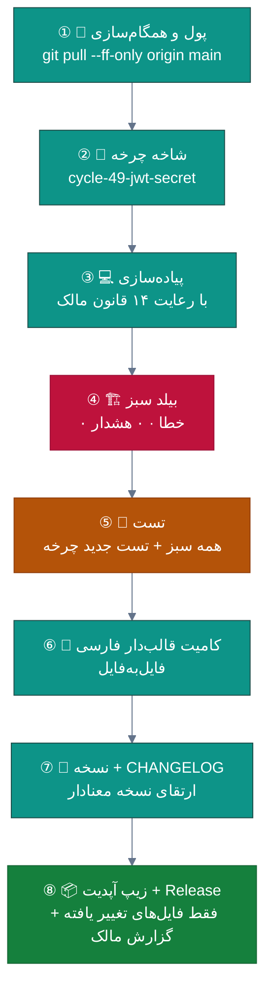
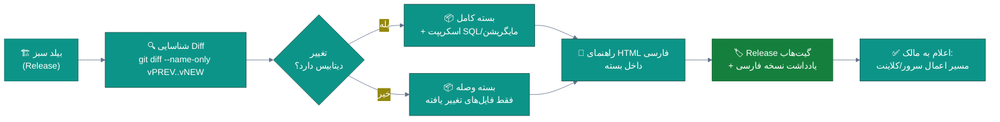

<div dir="rtl">

# ⚙️ برنامه اجرایی گام‌به‌گام — از چرخه ۴۹ تا ۵۳

<div align="center">

**فرآیند چرخه استاندارد، جزئیات پنج چرخه نخست، و چک‌لیست‌های عملیاتی برای شروع بی‌درنگ**


📅 ۱۴۰۴/۰۷/۲۰ (۲۰۲۶-۱۰-۱۲) · 🔖 v1.0

</div>

---

## 📑 فهرست مطالب

| # | بخش |
|:--:|:---|
| ۱ | [فرآیند چرخه استاندارد (۸ گام)](#۱--فرآیند-چرخه-استاندارد-۸-گام) |
| ۲ | [چرخه ۴۹ — انتقال کلید JWT](#۲--چرخه-۴۹--انتقال-کلید-jwt-به-محیط-ایمن) |
| ۳ | [چرخه ۵۰ — رفع انسدادهای رشته](#۳--چرخه-۵۰--رفع-انسدادهای-رشته-sync-over-async--result) |
| ۴ | [چرخه ۵۱ — تست دامنه](#۴--چرخه-۵۱--تست-لایه-domain-ضلع-گمشده) |
| ۵ | [چرخه ۵۲ — تست مرز API](#۵--چرخه-۵۲--تست-مرز-api--مرور-anonymous) |
| ۶ | [چرخه ۵۳ — CLI انتشار یکپارچه](#۶--چرخه-۵۳--cli-انتشار-یکپارچه) |
| ۷ | [تعریف انجام (DoD) و قالب کامیت](#۷--تعریف-انجام-dod-و-قالب-کامیت) |
| ۸ | [استراتژی بسته آپدیت](#۸--استراتژی-بسته-آپدیت-زیپ) |
| ۹ | [چک‌لیست پیش از هر انتشار](#۹--چکلیست-پیش-از-هر-انتشار) |

---

## ۱. 🔄 فرآیند چرخه استاندارد (۸ گام)

هر چرخه **بدون استثنا** این ۸ گام را طی می‌کند (الگوی تثبیت‌شده در ۴۸ چرخه گذشته + بهبودها):



| گام | 🔍 نکات اجرایی |
|:--:|:---|
| ① | **هرگز روی نسخه قدیمی کار نکن** — همیشه `git pull --ff-only`؛ در صورت واگرایی: بازبینی دستی |
| ③ | مرور ماتریس [۱۴ قانون مالک](02-GAPS.md#۴--ماتریس-قوانین-دائمی-مالک-۱۲-قانون) پیش از اولین کامیت |
| ④ | `dotnet build -warnaserror` در هر دو پروژه API و Desktop — **قانون مالک: بدون خطا و بدون هشدار** |
| ⑥ | قالب: `<ایموجی> [<حوزه>]: <شرح فارسی> — چرخهٔ N` (نمونه‌های معتبر در بند ۷) |
| ⑧ | زیپ فقط با فایل‌های تغییر یافته از نسخه قبل + گارد انسجام نسخه (بند ۸) |

---

## ۲. 🔑 چرخه ۴۹ — انتقال کلید JWT به محیط ایمن

> 📎 مرجع: [BUG-01 مادر](../DEFECTS-IRADS.md) · [یافته راستی‌آزمایی](01-VERIFICATION.md) · نسخه هدف: **v2.13.0**

### ۲.۱ شرح کار

| # | فایل/عمل | تغییر | ⚠️ نکته |
|:--:|:---|:---|:---|
| ۱ | `src/Sahand.ClinicPro.API/appsettings.json` خط ۳۱ | مقدار `SecretKey` → رشته خالی + کامنت راهنما | کلید از تاریخچه گیت حذف **نمی‌شود** — چرخش الزامی است |
| ۲ | `src/Sahand.ClinicPro.API/Program.cs` | گارد Fail-Fast: نبود کلید یا داشتن الگوی پیش‌فرض → Exception فارسی پیام‌دار | با دیالوگ/پیام سازگار قانون ۳ مالک |
| ۳ | User-Secrets (ماشین توسعه) | `dotnet user-secrets set "Jwt:SecretKey" "$(openssl rand -base64 48)"` | برای توسعه‌دهنده |
| ۴ | مستندات استقرار | `docs/guides/deploy-jwt.md` جدید: Environment برای IIS و systemd + DPAPI/KeyVault اختیاری | — |
| ۵ | `scripts/security/scan_secrets.sh` | اسکنر الگوهای کلید (I-04 مادر) — اجرای آن در CI | خروجی باید سبز شود |
| ۶ | مرور ۱۳ `AllowAnonymous` | فهرست دقیق + مستندسازی دلیل هر مورد | یک مورد بیشتر از ادعای مادر (۱۲) |
| ۷ | چرخش عملی کلید در سرور Production | مقدار تصادفی جدید + اعمال در Environment سرور | **بدون این گام، چرخه انجام‌شده نیست** |

### ۲.۲ تست‌های الزامی چرخه

| تست | نوع | ادعا |
|:---|:--:|:---|
| `Jwt_MissingKey_ThrowsWithPersianMessage` | واحد | پیام فارسی گارد |
| `Jwt_DefaultKeyPattern_Rejected` | واحد | الگوی `Development-Secret` شناسایی شود |
| `JwtKeyGuardTests` (موجود) | یکپارچه | در محیط Production فعال بماند |
| `scan_secrets` در CI | زیرساخت | خروجی سبز |

### ۲.۳ ریسک‌ها و پلان بازگشت

| ریسک | احتمال | 🛡 mitigación |
|:---|:--:|:---|
| فراموشی Environment در سرور → API بالا نمی‌آید | 🟠 | گارد Fail-Fast پیام شفاف می‌دهد + راهنمای deploy |
| توکن‌های فعال باطل شوند پس از چرخش | 🟡 | اعمال در ساعات کم‌بار یا پذیرش PreviousKey در چرخه بعدی |

---

## ۳. 🧵 چرخه ۵۰ — رفع انسدادهای رشته (Sync-over-Async و .Result)

> 📎 مرجع: BUG-02 · BUG-03 مادر · نسخه هدف: **v2.13.0** (همان چرخه ۴۹ یا بلافاصله پس از آن)

### ۳.۱ اصلاح BackupController (خط ۴۵۶)

```csharp
// ❌ وضعیت فعلی (تأییدشده در راستی‌آزمایی):
private CloudBackupService CloudSvc =>
    _cloudService ??= new CloudBackupService(
        BuildCloudConfigAsync(CancellationToken.None).GetAwaiter().GetResult(),  // خط ۴۵۶
        NullLogger<CloudBackupService>.Instance);

// ✅ الگوی جایگزین (با حفظ امضای فراخوان‌ها):
private readonly SemaphoreSlim _cloudInitLock = new(1, 1);
private CloudBackupService? _cloudService;

private async Task<CloudBackupService> GetCloudServiceAsync(CancellationToken ct)
{
    if (_cloudService is not null) return _cloudService;
    await _cloudInitLock.WaitAsync(ct);
    try
    {
        return _cloudService ??= new CloudBackupService(
            await BuildCloudConfigAsync(ct),
            NullLogger<CloudBackupService>.Instance);
    }
    finally { _cloudInitLock.Release(); }
}
```

### ۳.۲ اصلاح ReportsViewModel (خطوط ۸۴-۸۵)

```csharp
// ❌ فعلی:
var revenue = revenueTask.Result;   // خط ۸۴
var perf    = perfTask.Result;      // خط ۸۵

// ✅ جایگزین:
var revenue = await revenueTask;
var perf    = await perfTask;
```

> ⚠️ نکته راستی‌آزمایی‌شده: موارد ۳‌گانه دیگر `payVm.Result` در `ReceptionsViewModel:998-1000`
> و `LabResultViewModel:78` از نوع `Result`-property DTO هستند نه `Task.Result` — نیازی به تغییر ندارند (تشخیص دقیق مهم است!).

### ۳.۳ تست‌ها و خروجی

- تست واحد: «۵۰ درخواست همزمان به `backup/cloud/*` → هیچ تایم‌اوتی رخ نمی‌دهد» (یکپارچه).
- گات CI: `grep -E '\.GetAwaiter\(\)\.GetResult\(\)' src/Sahand.ClinicPro.API/` → خروجی صفر.
- زیپ آپدیت: `Sahand.ClinicPro.API.dll` + `Sahand.ClinicPro.Desktop.exe` + مستند deploy.

---

## ۴. 🧬 چرخه ۵۱ — تست لایه Domain (ضلع گمشده)

> 📎 مرجع: [یافته ۲ راستی‌آزمایی](01-VERIFICATION.md#۴-۲-یافته-دوم--اولویت-معکوس-سرمایهگذاری-تست) — نسخه هدف: **v2.14.0**

| اولویت | کلاس تست هدف | سناریوهای کلیدی |
|:--:|:---|:---|
| ۱ | `Money` (ValueObject) | جمع/تفریق/ضرب · گرد کردن ریال · مقایسه · نال‌ناپذیری |
| ۲ | `NationalCode` (ValueObject) | ارقام کنترلی معتبر/نامعتبر · طول · صفرهای ابتدایی · نال |
| ۳ | Domain Events (۸ گروه) | انتشار در تغییر وضعیت · ترتیب · idempotency |
| ۴ | Invariantهای موجودیت‌های پول | فاکتور متوازن · سند دوبل متوازن · فرانشیز بیمه |
| ۵ | Enumهای دامنه (۱۰۰+) | مقداردهی‌های نامعتبر · نگاشت فارسی برچسب‌ها |

**هدف:** Domain از ۱۸ تست به **۶۰ تست** — بزرگ‌ترین جهش ارزش/ریسک کل نقشه راه.

---

## ۵. 🌐 چرخه ۵۲ — تست مرز API + مرور Anonymous

> 📎 مرجع: BUG-06 + AllowAnonymous=۱۳ (یافته راستی‌آزمایی) — نسخه: **v2.14.x**

| کار | شرح |
|:---|:---|
| فهرست ۱۳ `AllowAnonymous` | جدول: اندپوینت · دلیل مجاز بودن · ریسک |
| تست‌های `WebApplicationFactory` | ۴۰۱ روی مسیرهای محافظت‌شده · ۲۰۰ روی عمومی · shape خطا |
| تست نرخ/قفل | ۵ تلاش ناموفق → قفل (سازگار با سیاست موجود) |
| هدف | API از ۲۳ به **۵۰ تست** |

---

## ۶. 📦 چرخه ۵۳ — CLI انتشار یکپارچه

> 📎 مرجع: BUG-05 (۳۹ اسکریپت تکراری — بدتر از ادعای ۳۴) · I-09/I-10 مادر — نسخه: **v2.14.x**

### ۶.۱ طراحی CLI

```bash
# ابزار واحد جایگزین ۳۹ اسکریپت:
python scripts/clinicpro_release.py release --from 2.13.0 --to 2.14.0 --channel stable
python scripts/clinicpro_release.py update-zip --from 2.13.0 --to 2.14.0
python scripts/clinicpro_release.py doctor   # گارد انسجام نسخه/فایل/CHANGELOG
```

| ویژگی الزامی | شرح |
|:---|:---|
| گارد انسجام | نسخه در `Directory.Build.props` == CHANGELOG == اسم تگ — نبود هرکدام = خطا |
| Diff هوشمند | فقط فایل‌های تغییر یافته از `--from` (سازگار با الگوی بسته‌های فعلی مالک) |
| خروجی گزارش | جدول فایل‌ها + راهنمای HTML فارسی داخل بسته (الگوی موجود) |
| بایگانی | انتقال ۳۸ اسکریپت قدیمی به `scripts/archive/` (حذف نشوند — تاریخ است) |

### ۶.۲ پذیرش

`doctor` روی مخزن فعلی سبز شود + تولید زیپ تستی `2.13→2.14` موفق + راهنمای مالک بروز شود.

---

## ۷. ✅ تعریف انجام (DoD) و قالب کامیت

### ۷.۱ DoD هر چرخه (همه باید ✅ شوند)

| ✓ | معیار |
|:--:|:---|
| ☐ | بیلد API و Desktop: **۰ خطا، ۰ هشدار** (`-warnaserror`) |
| ☐ | همه تست‌های قبلی + تست‌های جدید چرخه سبز |
| ☐ | ۱۴ قانون دائمی مالک رعایت شده (مرور ماتریس) |
| ☐ | CHANGELOG فارسی با شرح کاربر-محور |
| ☐ | نسخه در `Directory.Build.props` ارتقا و تگ خورده |
| ☐ | زیپ آپدیت فقط با فایل‌های تغییر یافته ساخته و در Release بارگذاری شده |
| ☐ | گزارش چرخه برای مالک (چه چیزی عوض شد · چه چیزی باید روی سرور اعمال شود) |

### ۷.۲ قالب کامیت (مطابق سبک ۴۸ چرخه گذشته)

```
<ایموجی> [<حوزه>]: <شرح فارسی مختصر> — چرخهٔ <N>
```

| حوزه | ایموجی | نمونه واقعی این نقشه راه |
|:---|:--:|:---|
| مستندات | 📚 | `📚 [مستندات]: فهرست پوشه بازبینی — چرخهٔ ۴۹` |
| رفع باگ | 🐞 | `🐞 [امنیت]: حذف کلید JWT از مخزن + گارد Fail-Fast — چرخهٔ ۴۹` |
| تست | 🧪 | `🧪 [تست]: ۴۲ تست جدید لایه Domain (Money/NationalCode) — چرخهٔ ۵۱` |
| نسخه | 🔖 | `🔖 [نسخه]: ارتقای به 2.13.0 + CHANGELOG چرخهٔ ۴۹` |
| بسته | 📦 | `📦 [بسته]: زیپ آپدیت 2.12.0→2.13.0 (۳ فایل) — چرخهٔ ۴۹` |

---

## ۸. 📦 استراتژی بسته آپدیت (زیپ)

> 📎 این گردش‌کار میراث ۴۸ چرخه مالک است و **قانون ۱۴** محسوب می‌شود.



| قاعده | شرح |
|:---|:---|
| تغییر دیتابیس = مهاجرت خودکار | مایگریشن EF در اولین اجرا اعمال شود (الگوی فعلی `Cycle{NN}` حفظ شود) |
| تغییر API = بستن API جدید در بسته | حتی اگر کلاینت تغییر نکرده باشد (الگوی موجود) |
| همیشه راهنمای فارسی داخل بسته | گام‌های اعمال + عیب‌یابی + راهنمای Clean/Rebuild در صورت کش BAML |
| نشان نسخه در برنامه | برای تشخیص بسته‌های ناقص (درس آموخته از چرخه‌های ۳۷-۳۹!) |

---

## ۹. 🧾 چک‌لیست پیش از هر انتشار

| ✓ | مورد | روش بررسی |
|:--:|:---|:---|
| ☐ | بیلد بدون خطا/هشدار هر دو پروژه | `dotnet build -warnaserror` |
| ☐ | همه تست‌ها سبز | `dotnet test` (شامل ۱۹ تست E2E PHP در صورت لمس لایسنس) |
| ☐ | گات الگوهای ممنوعه | اسکریپت scan (کلید · GetAwaiter · .Result · async void · catch خالی) |
| ☐ | نسخه سه‌گانه همسان | Build.props == CHANGELOG == تگ گیت |
| ☐ | زیپ آپدیت تولید و باز شده (smoke-test استخراج) | — |
| ☐ | راهنمای فارسی داخل بسته | — |
| ☐ | یادداشت Release فارسی با شرح کاربر-محور | — |
| ☐ | در صورت تغییر API/دیتابیس: راهنمای اعمال سرور صریح | — |

---

<div align="center">

**📚 پیوند‌ها:** [🗺 نقشه راه نهایی ←](03-ROADMAP.md) · [🕳 شکاف‌ها ←](02-GAPS.md) · [🔬 راستی‌آزمایی ←](01-VERIFICATION.md) · [🏠 فهرست پوشه](README.md)

📅 ۱۴۰۴/۰۷/۲۰ · 🔖 v1.0 · ⚙️ آماده اجرا از چرخه ۴۹

</div>

</div>
