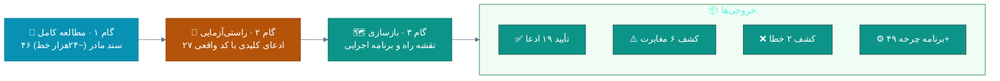
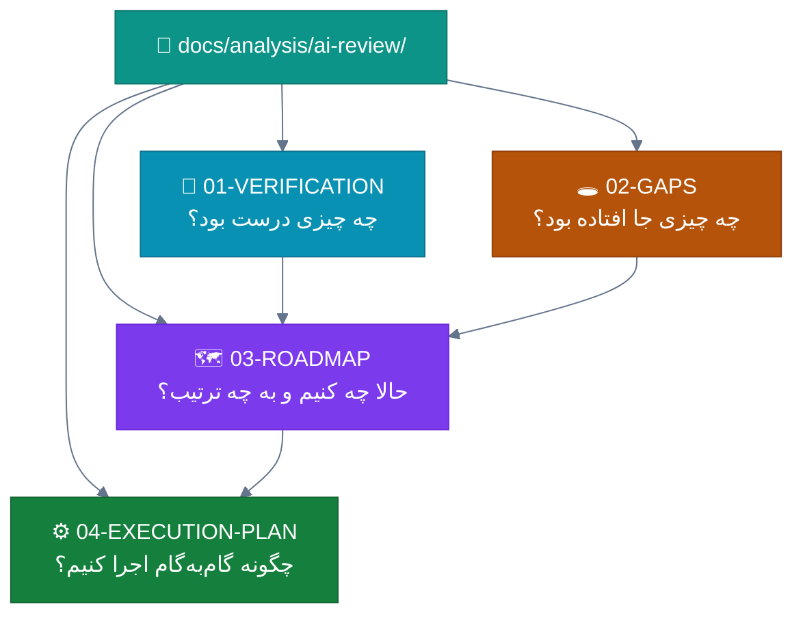

# 🔬 پوشه بازبینی مستقل و نقشه راه اجرایی — AI Review & Roadmap

**نتیجه بازبینی نویسه‌به‌نویسه ۴۶ سند تحلیل مالک (`docs/analysis`) و راستی‌آزمایی مستقیم هر ادعا با کدبیس `v2.12.0`**

-0d9488?style=for-the-badge)

📅 تولید: ۱۴۰۴/۰۷/۲۰ (۲۰۲۶-۱۰-۱۲) · زبان: فارسی (RTL)

---

## 🎯 این پوشه چیست؟

مالک کل پروژه را تحلیل کرده و نتیجه را در ۴۶ سند `docs/analysis` (گزارش جامع، فهرست ایرادها،
نقشه راه، امکانات، UI/UX، قوت/ضعف + ۳۹ سند ماژول) نگاشته است. این پوشه **بازبینی مستقل** آن
مجموعه است و سه کار انجام داده:

---

## 📂 فهرست اسناد این پوشه

| # | 📄 سند | 🎯 محتوا | 📊 حجم | مخاطب |
|:--:|:---|:---|:--:|:---|
| ۱ | [🔬 **01-VERIFICATION.md**](01-VERIFICATION.md) | **گزارش راستی‌آزمایی** — تک‌تک ۲۲ ایراد و ادعاهای آماری در برابر کد واقعی؛ کشف دو خطای مؤثر بر نقشه راه | ۱۳KB | مالک · توسعه‌دهنده |
| ۲ | [🕳 **02-GAPS.md**](02-GAPS.md) | **تحلیل شکاف‌ها** — ۱۰ چیزی که تحلیل مادر از قلم انداخته + ماتریس ۱۴ قانون دائمی مالک + نقشه وابستگی اصلاح‌شده | ۱۴KB | مالک |
| ۳ | [🗺 **03-ROADMAP.md**](03-ROADMAP.md) | **نقشه راه نهایی ۵ فازه** — چرخه ۴۹ تا ۹۶ با اولویت اصلاح‌شده، WSJF بازمحاسبه‌شده، دروازه‌های کیفیت عددی، KPI | ۱۵KB | مالک · تصمیم‌گیر |
| ۴ | [⚙️ **04-EXECUTION-PLAN.md**](04-EXECUTION-PLAN.md) | **برنامه اجرایی** — فرآیند ۸گامی چرخه، جزئیات کامل چرخه ۴۹ تا ۵۳ با کد و تست، DoD، قالب کامیت، استراتژی زیپ آپدیت | ۱۵KB | توسعه‌دهنده |
| ۵ | [🏠 **README.md**](README.md) | همین فایل — فهرست و راهنمای مسیر خواندن | — | همه |

---

## 🗺 نقشه راهبری اسناد

### مسیرهای خواندن پیشنهادی

| 👤 شما هستید | 📖 مسیر | ⏱ زمان |
|:---|:---|:--:|
| 👔 **مالک (تصمیم‌گیر)** | `01` §۱و۴ ← `02` §۱و۴ ← `03` کامل | ~۲۵ دقیقه |
| 👨‍💻 **توسعه‌دهنده (اجرا)** | `03` §۳و۴ ← `04` کامل ← مرجع: `01` §۲ | ~۳۰ دقیقه |
| 🔍 **بازبین کیفیت** | `01` کامل ← `03` §۱۰و۱۱ (دروازه‌ها) | ~۲۰ دقیقه |

---

## 🏆 پنج یافته سرنوشت‌ساز این بازبینی

| # | 🔎 یافته | اثر بر تصمیم | سند |
|:--:|:---|:---|:--:|
| ۱ | ✅ **دقت تحلیل مالک عالی است** — ۱۹ از ۲۷ ادعا عدد‌به‌عدد تأیید شد (نمره ۸٫۲/۱۰) | تحلیل مادر قابل‌اتکاست | [01](01-VERIFICATION.md) |
| ۲ | ❌ **ادعای «AsNoTracking فقط ۲۰ مورد» نادرست** — الگوی `QueryableNoTracking` در ۲۰۳ نقطه پیاده است | بهبود P-01 حذف شد؛ بودجه به ایندکس/کش | [01 §۴-۱](01-VERIFICATION.md) |
| ۳ | ❌ **توزیع تست‌ها اشتباه بود** — Domain فقط ۱۸ تست دارد (نه ۹۶)؛ Desktop ۳۷ (نه ۱۵) | ترتیب تست: Domain اول، نه Desktop | [01 §۴-۲](01-VERIFICATION.md) |
| ۴ | 📜 **۱۴ قانون دائمی مالک** در ۴۶ سند مادر مستند نشده بود — همه فعلاً ✅ پیاده‌اند | باید در هر چرخه حفاظت شوند | [02 §۴](02-GAPS.md) |
| ۵ | 🔄 **ریتم واقعی کار = چرخه ۱-۳ روزه** (۴۸ چرخه ثبت‌شده) — نه اسپرینت ماهانه | نقشه راه به ۴۸ چرخه شماره‌دار شکسته شد | [03](03-ROADMAP.md) |

---

## 📊 آمار کلی این بازبینی

| 📈 شاخص | مقدار |
|:---|:--:|
| 📄 اسناد مادر خوانده‌شده | ۴۶ (کامل) |
| 🔍 ادعاهای راستی‌آزمایی‌شده | ۲۷ |
| ✅ تأیید دقیق | ۱۹ (۷۰٪) |
| ⚠️ مغایرت جزئی | ۶ (۲۲٪) |
| ❌ نادرست/گمراه‌کننده | ۲ (۸٪) |
| 🐛 کاستی‌های W/S-xx مستخرج | ۳۰۰+ |
| ✨ امکانات F-xx مستخرج | ۲۹۴ |
| 🗓 چرخه‌های برنامه‌ریزی‌شده | ۴۸ (چرخه ۴۹ تا ۹۶) |
| 🚪 دروازه کیفیت عملیاتی | ۴ (با معیار عددی) |

---

## ⚠️ ملاحظات روش‌شناسی

> [!NOTE]
> روش این بازبینی: مطالعه کامل متنی ۴۶ سند + جستجوی الگویی مستقیم در کدبیس `v2.12.0`
> (شمارش دقیق DbSet/تست/LOC/الگوها) + مقایسه با تاریخچه ۴۸ چرخه (`CHANGELOG`/`PROGRESS`).
> برخلاف اسناد مادر، اینجا **هر ادعا با خروجی واقعی ابزار** سنجیده شده است.

> [!CAUTION]
> کدهای نمونه ارائه‌شده در سند ۰۴ (الگوی Semaphore و await) **کامپایل نشده‌اند** و
> پیش از کامیت اصلی باید در ویژوال استودیو با بیلد `۰ خطا/۰ هشدار` اعتبارسنجی شوند —
> مطابق قانون ۱۴ مالک.

---

## 🔗 پیوند به اسناد مادر

| سند مادر | نقش در این بازبینی |
|:---|:---|
| [`docs/analysis/README.md`](../README.md) | فهرست مجموعه اصلی |
| [`docs/analysis/ANALYSIS-REPORT.md`](../ANALYSIS-REPORT.md) | مرجع آمار — راستی‌آزمایی §۳ سند ۰۱ |
| [`docs/analysis/DEFECTS-IRADS.md`](../DEFECTS-IRADS.md) | مرجع ۲۲ ایراد — راستی‌آزمایی §۲ سند ۰۱ |
| [`docs/analysis/IMPROVEMENTS-ROADMAP.md`](../IMPROVEMENTS-ROADMAP.md) | چارچوب فازها — بازسازی در سند ۰۳ |
| [`docs/analysis/FEATURES-PROPOSALS.md`](../FEATURES-PROPOSALS.md) | منبع WSJF — بازمحاسبه در سند ۰۳ §۹ |
| [`docs/analysis/UI-UX-DESIGN-BEST.md`](../UI-UX-DESIGN-BEST.md) | نقطه شروع بازطراحی — اصلاح در سند ۰۱ §۶ |
| [`docs/analysis/STRENGTHS-WEAKNESSES.md`](../STRENGTHS-WEAKNESSES.md) | جمع‌بندی قوت/ضعف — تأیید در سند ۰۱ §۷ |
| `docs/analysis/modules/` (۳۹ سند) | جزئیات ماژول‌ها — استخراج ساختاری کامل |

---

### 🏥 Sahand ClinicPro — بازبینی مستقل نسخه ۱٫۰

**مسیر پیشنهادی شروع:** [🔬 01-VERIFICATION.md](01-VERIFICATION.md) ← [🗺 03-ROADMAP.md](03-ROADMAP.md) ← [⚙️ 04-EXECUTION-PLAN.md](04-EXECUTION-PLAN.md)

📅 ۱۴۰۴/۰۷/۲۰ · آماده برای آغاز **چرخه ۴۹** 🚀

