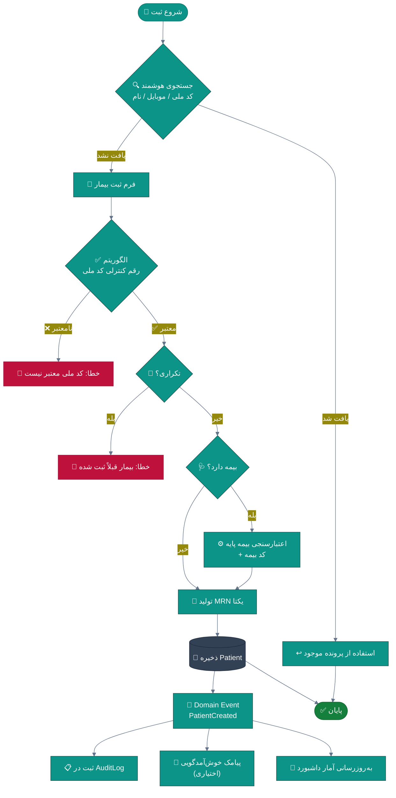
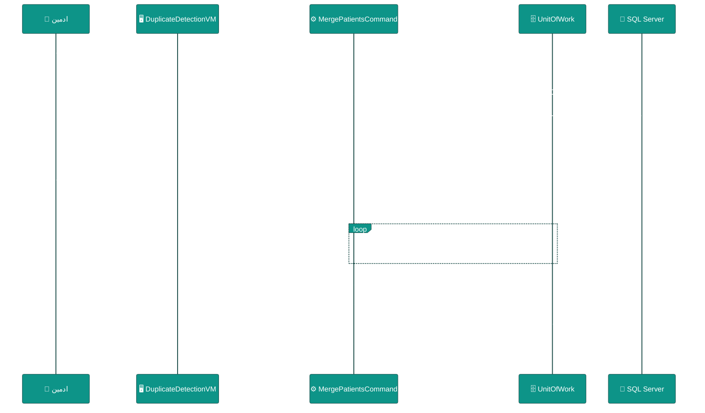
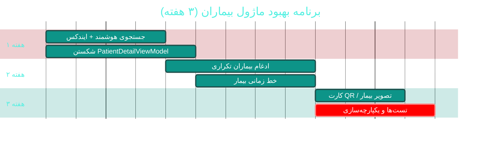

# 👥 ماژول بیماران و پرونده الکترونیک (Patients & EMR Core)

> **مسیر ماژول:** `patients` · **لایسنس:** `Patients` (هسته — همیشه فعال)
> **اولویت:** 🟠 بالا · **دشواری:** 🟡 متوسط · **زمان برآوردی:** ۳ هفته

---

## ۱. 📋 خلاصه ماژول

هسته‌ی هویتیِ سامانه. مدیریتِ چرخه‌ی حیات بیمار از ثبت‌نام تا ترخیص: پرونده الکترونیک با
**MRN خودکار**، **اعتبارسنجی الگوریتمی کد ملی**، سوابق بالینی، پیوند خانوادگی، بیمه،
اسناد و خط زمانی (Timeline) یکپارچه.

| ویژگی | مقدار |
|:---|:---|
| 🎯 هدف | شناسایی یکتا و بدون تکرارِ هر بیمار + دسترسی سریع به کل تاریخچه |
| 👤 کاربران اصلی | پذیرشگر · پرستار · پزشک · صندوقدار |
| 🔗 وابستگی‌ها | `appointments`, `receptions`, `visits`, `billing`, `lab`, `imaging` |
| 📊 وضعیت فعلی | 🟢 عملیاتی و بالغ |

---

## ۲. 🎯 وضعیت فعلی در کدبیس

| لایه | فایل | خط | وضعیت |
|:---|:---|--:|:---|
| 🧬 Domain | `src/Sahand.ClinicPro.Domain/People/Patient.cs` | — | 🟢 موجودیت غنی |
| 🧬 Domain | `.../People/PatientHistory.cs` | — | 🟢 سوابق |
| 🧬 Domain | `.../ValueObjects/NationalCode.cs` | — | 🟢 الگوریتم رقم کنترلی |
| 🧬 Domain | `.../ValueObjects/PhoneNumber.cs` | — | 🟢 |
| 🗄 Infra | `.../Configurations/People/PatientConfiguration.cs` | — | 🟢 |
| 🗄 Infra | `.../Persistence/MrnInMemoryValueGenerator.cs` | — | 🟡 تولیدکننده MRN |
| ⚙ App | `.../Features/Patients/Commands/` + `Queries/` | — | 🟢 CQRS کامل |
| ⚙ App | `.../DTOs/Patients/` | — | 🟢 |
| 🌐 API | `.../Controllers/PatientsController.cs` | — | 🟢 |
| 🖥 Desktop | `.../ViewModels/PatientsViewModel.cs` | ۶۵۷ | 🟡 قابل بهبود |
| 🖥 Desktop | `.../ViewModels/PatientDetailViewModel.cs` | ۱٬۰۶۹ | 🔴 God ViewModel |
| 🖥 Desktop | `.../Views/PatientsView.xaml` · `PatientFormWindow` · `PatientDetailWindow` · `PatientTimelineWindow` | — | 🟢 |

### نکات برجسته‌ی فعلی

✅ **اعتبارسنجی کد ملی** با رقم کنترلی واقعی (ضد جعل) — بالاتر از استاندارد بازار
✅ **MRN خودکار** با تولیدکننده اختصاصی
✅ **جلوگیری از کد ملی تکراری** بین بیماران مختلف
✅ **Soft Delete** + **Audit** از طریق Interceptor

---

## ۳. 📊 نمودار جریان ثبت بیمار



---

## ۴. ⚠️ کاستی‌ها و ایرادها

| # | کاستی | 🎯 شدت | 📍 محل | 💥 پیامد |
|:--:|:---|:--:|:---|:---|
| W-01 | `PatientDetailViewModel` با **۱٬۰۶۹ خط** | 🔴 بالا | `ViewModels/` | سخت‌تست‌بودن، منطق تکراری |
| W-02 | نبود **ادغام بیماران تکراری (Merge/Dedupe)** | 🟠 بالا | `Features/Patients/` | پرونده‌های موازی برای یک بیمار |
| W-03 | نبود **جستجوی فازی (Fuzzy)** برای نام | 🟠 بالا | `PatientsViewModel` | پذیرشگر بیمار را پیدا نمی‌کند → پرونده تکراری |
| W-04 | MRN تولیدشده **قابل بازخوانی/تصحیح نیست** | 🟡 متوسط | `MrnInMemoryValueGenerator` | در محیط چندنخی خطر تکرار |
| W-05 | نبود **نسخه‌بندی پرونده (Record Versioning)** | 🟡 متوسط | Domain | عدم امکان بازسازی وضعیت در تاریخ گذشته |
| W-06 | نبود **تاریخچه تغییراتِ بیمار** در UI | 🟡 متوسط | `PatientDetailView` | پزشک نمی‌بیند چه کسی چه تغییری داده |
| W-07 | عدم پوشش **تصویر/اثرانگشت/QR** بیمار | 🔵 کم | Domain | شناسایی فقط با کد ملی |
| W-08 | نبود **خروجی/ورودی استاندارد (HL7/FHIR)** | 🟡 متوسط | — | عدم تبادل با سامانه‌های دیگر |

---

## ۵. ✨ امکانات پیشنهادی

| 🎯 # | امکان | 📝 شرح | 💰 ارزش | 🔧 دشواری | ⏱ |
|:--:|:---|:---|:--:|:--:|:--:|
| F-01 | 🔍 **جستجوی هوشمند یکپارچه** | جستجوی فازی روی نام + کد ملی + موبایل + MRN با رتبه‌بندی | بالا | کم | ۳ روز |
| F-02 | 🔀 **ادغام بیماران تکراری** | شناسایی مشابهت + ادغام با انتقال کامل سوابق | بالا | متوسط | ۱ هفته |
| F-03 | 🕐 **خط زمانی بیمار (Timeline)** | نمای زمانی یکپارچه: ویزیت، نسخه، آزمایش، تصویر، فاکتور | بالا | کم | ۵ روز |
| F-04 | 📸 **تصویر و بیومتریک** | آپلود عکس + الگوی اثرانگشت (دستگاه حضور) | متوسط | متوسط | ۱ هفته |
| F-05 | 🎫 **کارت هوشمند / QR بیمار** | چاپ QR روی کارت → اسکن در پذیرش | بالا | کم | ۳ روز |
| F-06 | 👨‍👩‍👧 **پیوند خانوادگی پیشرفته** | درخت خانواده + سابقه خانوادگی خودکار | متوسط | کم | ۴ روز |
| F-07 | 🏥 **FHIR Patient Resource** | خروجی/ورودی استاندارد HL7 FHIR R4 | استراتژیک | زیاد | ۳ هفته |
| F-08 | 📊 **امتیاز سلامت بیمار** | شاخص ترکیبی از ویزیت‌ها، کنترل مزمن، پایبندی | متوسط | متوسط | ۱ هفته |
| F-09 | 🔔 **هشدارهای بالینی خودکار** | یادآوری واکسن، غربالگری، پیگیری مزمن | بالا | متوسط | ۱ هفته |
| F-10 | 📝 **نسخه‌بندی پرونده** | نگهداری تاریخچه تغییرات با امکان بازگشت | متوسط | متوسط | ۱ هفته |

---

## ۶. 🛠 دستورالعمل پیاده‌سازی

### 📌 گام ۱ — جستجوی هوشمند یکپارچه (F-01) — *سریع‌ترین برد*

**۱.۱ افزودن Query در لایه Application**

```csharp
// 📄 src/Sahand.ClinicPro.Application/Features/Patients/Queries/SmartSearch/SmartSearchPatientsQuery.cs
using FluentValidation;
using MediatR;
using Microsoft.EntityFrameworkCore;
using Sahand.ClinicPro.Application.Common.Models;
using Sahand.ClinicPro.Domain.Common;
using Sahand.ClinicPro.Domain.Interfaces;

namespace Sahand.ClinicPro.Application.Features.Patients.Queries.SmartSearch;

/// <summary>جستجوی هوشمند بیمار — فازی روی نام، قطعی روی کد ملی/موبایل/MRN</summary>
/// <param name="Term">عبارت جستجو (حداقل ۲ کاراکتر)</param>
/// <param name="MaxResults">حداکثر تعداد نتیجه</param>
public record SmartSearchPatientsQuery(string Term, int MaxResults = 20)
    : IRequest<Result<List<SmartSearchPatientDto>>>;

/// <summary>اعتبارسنج جستجو</summary>
public class SmartSearchPatientsQueryValidator : AbstractValidator<SmartSearchPatientsQuery>
{
    /// <summary>قواعد</summary>
    public SmartSearchPatientsQueryValidator()
    {
        RuleFor(x => x.Term)
            .NotEmpty().WithMessage("عبارت جستجو الزامی است")
            .MinimumLength(2).WithMessage("حداقل ۲ کاراکتر وارد کنید");
        RuleFor(x => x.MaxResults).InclusiveBetween(1, 100);
    }
}

/// <summary>گرداننده جستجوی هوشمند</summary>
public class SmartSearchPatientsQueryHandler
    : IRequestHandler<SmartSearchPatientsQuery, Result<List<SmartSearchPatientDto>>>
{
    private readonly IUnitOfWork _unitOfWork;

    /// <summary>سازنده</summary>
    public SmartSearchPatientsQueryHandler(IUnitOfWork unitOfWork) => _unitOfWork = unitOfWork;

    /// <summary>اجرا</summary>
    public async Task<Result<List<SmartSearchPatientDto>>> Handle(
        SmartSearchPatientsQuery request, CancellationToken ct)
    {
        var term = request.Term.Trim();

        // جستجوی قطعی: کد ملی یا موبایل دقیق
        if (term.All(char.IsDigit))
        {
            var exact = await _unitOfWork.Repository<Domain.Entities.People.Patient>()
                .QueryableNoTracking
                .Where(p => !p.IsDeleted &&
                            (p.NationalCode == term || p.MobileNumber == term || p.Mrn == term))
                .Select(p => new SmartSearchPatientDto(
                    p.Id, p.FirstName, p.LastName, p.NationalCode, p.MobileNumber, p.Mrn,
                    100, "تطابق دقیق"))
                .Take(request.MaxResults)
                .ToListAsync(ct);

            if (exact.Count > 0) return Result<List<SmartSearchPatientDto>>.Success(exact);
        }

        // جستجوی فازی: نام و نام خانوادگی
        var fuzzy = await _unitOfWork.Repository<Domain.Entities.People.Patient>()
            .QueryableNoTracking
            .Where(p => !p.IsDeleted &&
                        (EF.Functions.Like(p.FirstName, $"%{term}%") ||
                         EF.Functions.Like(p.LastName, $"%{term}%") ||
                         EF.Functions.Like(p.FirstName + " " + p.LastName, $"%{term}%")))
            .Select(p => new SmartSearchPatientDto(
                p.Id, p.FirstName, p.LastName, p.NationalCode, p.MobileNumber, p.Mrn,
                EF.Functions.Like(p.FirstName, term + "%") ? 80 : 50,
                "تطابق تقریبی"))
            .OrderByDescending(p => p.Score)
            .Take(request.MaxResults)
            .ToListAsync(ct);

        return Result<List<SmartSearchPatientDto>>.Success(fuzzy);
    }
}

/// <summary>مدل نتیجه جستجو با امتیاز مرتبط‌بودن</summary>
public record SmartSearchPatientDto(
    long Id, string FirstName, string LastName,
    string? NationalCode, string? MobileNumber, string? Mrn,
    int Score, string MatchType);
```

**۱.۲ افزودن ایندکس برای سرعت جستجو**

```csharp
// 📄 src/Sahand.ClinicPro.Infrastructure/Persistence/Configurations/People/PatientConfiguration.cs
// در متد Configure، پس از تنظیمات موجود اضافه کنید:

builder.HasIndex(p => p.NationalCode)
    .HasDatabaseName("IX_Patients_NationalCode")
    .HasFilter("[IsDeleted] = 0");

builder.HasIndex(p => p.MobileNumber)
    .HasDatabaseName("IX_Patients_MobileNumber")
    .HasFilter("[IsDeleted] = 0");

builder.HasIndex(p => new { p.LastName, p.FirstName })
    .HasDatabaseName("IX_Patients_FullName")
    .HasFilter("[IsDeleted] = 0");
```

**۱.۳ Endpoint در API**

```csharp
// 📄 src/Sahand.ClinicPro.API/Controllers/PatientsController.cs
/// <summary>جستجوی هوشمند بیمار — فازی روی نام و قطعی روی کد ملی/موبایل/MRN</summary>
/// <param name="term">عبارت جستجو (حداقل ۲ کاراکتر)</param>
/// <returns>فهرست بیماران با امتیاز مرتبط‌بودن</returns>
[HttpGet("smart-search")]
[HasPermission("patients.view")]
public async Task<IActionResult> SmartSearch([FromQuery] string term,
    [FromQuery] int max = 20, CancellationToken ct = default)
    => ToResponse(await _mediator.Send(new SmartSearchPatientsQuery(term, max), ct));
```

**۱.۴ اتصال در دسکتاپ**

```csharp
// 📄 src/Sahand.ClinicPro.Desktop/ViewModels/PatientsViewModel.cs
// جایگزینی متد جستجوی فعلی:

/// <summary>جستجوی هوشمند با تأخیر (Debounce) برای جلوگیری از درخواست‌های مکرر</summary>
[RelayCommand]
private async Task SearchAsync(CancellationToken ct)
{
    if (SearchTerm.Trim().Length < 2) { Patients.Clear(); return; }
    IsBusy = true;
    try
    {
        var res = await _api.GetAsync<List<SmartSearchPatientDto>>(
            $"patients/smart-search?term={Uri.EscapeDataString(SearchTerm)}&max=50", ct);
        Patients = new ObservableCollection<PatientListItem>( /* نگاشت */ );
    }
    finally { IsBusy = false; }
}
```

**۱.۵ ایجاد مایگریشن**

```bash
cd src/Sahand.ClinicPro.Infrastructure
dotnet ef migrations add Cycle49PatientSearchIndexes \
    --startup-project ../Sahand.ClinicPro.API \
    --context ClinicProDbContext
dotnet ef database update --startup-project ../Sahand.ClinicPro.API
```

---

### 📌 گام ۲ — ادغام بیماران تکراری (F-02)



**۲.۱ موجودیت ردیابی ادغام**

```csharp
// 📄 src/Sahand.ClinicPro.Domain/People/PatientMergeLog.cs
namespace Sahand.ClinicPro.Domain.Entities.People;

/// <summary>
/// لاگ ادغام بیماران — منبع حقیقت برای بازگردانی و ممیزی.
/// با نگهداری این رکورد، هر ادغام قابل بازگشت و ردیابی است.
/// </summary>
public class PatientMergeLog : AuditableEntity
{
    /// <summary>شناسه بیمار اصلی (باقی‌مانده)</summary>
    public long PrimaryPatientId { get; set; }

    /// <summary>بیمار اصلی</summary>
    public Patient PrimaryPatient { get; set; } = null!;

    /// <summary>شناسه بیمار ادغام‌شده (حذف منطقی شده)</summary>
    public long MergedPatientId { get; set; }

    /// <summary>دلیل ادغام</summary>
    public string Reason { get; set; } = string.Empty;

    /// <summary>تعداد رکوردهای منتقل‌شده</summary>
    public int TransferredRecords { get; set; }

    /// <summary>تصویر JSON از وضعیت پیش از ادغام (برای بازگردانی)</summary>
    public string SnapshotJson { get; set; } = "{}";

    /// <summary>آیا بازگردانی شده است</summary>
    public bool IsReverted { get; set; }
}
```

**۲.۲ Command ادغام (خلاصهٔ کلیدی)**

```csharp
// 📄 src/Sahand.ClinicPro.Application/Features/Patients/Commands/MergePatients/MergePatientsCommand.cs
public record MergePatientsCommand(long PrimaryPatientId, long DuplicatePatientId, string Reason)
    : IRequest<Result<int>>;

public class MergePatientsCommandHandler : IRequestHandler<MergePatientsCommand, Result<int>>
{
    private readonly IUnitOfWork _uow;
    private readonly ICurrentUserService _currentUser;

    public MergePatientsCommandHandler(IUnitOfWork uow, ICurrentUserService currentUser)
    { _uow = uow; _currentUser = currentUser; }

    public async Task<Result<int>> Handle(MergePatientsCommand req, CancellationToken ct)
    {
        if (req.PrimaryPatientId == req.DuplicatePatientId)
            return Result<int>.Failure(Error.Validation("نمی‌توان بیمار را با خودش ادغام کرد"));

        await _uow.BeginTransactionAsync(ct);
        try
        {
            var transferred = 0;

            // انتقال هر دستهٔ وابسته — الگوی یکسان برای همه
            transferred += await ReassignAsync<Visit>(v => v.PatientId, req, ct);
            transferred += await ReassignAsync<Prescription>(p => p.PatientId, req, ct);
            transferred += await ReassignAsync<Invoice>(i => i.PatientId, req, ct);
            transferred += await ReassignAsync<LabOrder>(l => l.PatientId, req, ct);
            transferred += await ReassignAsync<Appointment>(a => a.PatientId, req, ct);
            transferred += await ReassignAsync<Reception>(r => r.PatientId, req, ct);

            // علامت‌گذاری تکراری
            var dup = await _uow.Repository<Patient>().GetByIdAsync(req.DuplicatePatientId, ct);
            if (dup is null)
                return Result<int>.Failure(Error.NotFound("بیمار تکراری یافت نشد"));

            _uow.Repository<Patient>().Delete(dup);   // حذف منطقی

            _uow.Repository<PatientMergeLog>().Add(new PatientMergeLog
            {
                PrimaryPatientId = req.PrimaryPatientId,
                MergedPatientId = req.DuplicatePatientId,
                Reason = req.Reason,
                TransferredRecords = transferred,
            });

            await _uow.SaveEntitiesAsync(ct);
            await _uow.CommitTransactionAsync(ct);
            return Result<int>.Success(transferred);
        }
        catch
        {
            await _uow.RollbackTransactionAsync(ct);
            throw;
        }
    }

    private async Task<int> ReassignAsync<T>(
        System.Linq.Expressions.Expression<Func<T, long?>> selector,
        MergePatientsCommand req, CancellationToken ct) where T : class
    {
        // پیاده‌سازی: خواندن رکوردهای DuplicatePatientId و انتصاب PrimaryPatientId
        // (با Reflection امن بر اساس نام ویژگی، یا پیاده‌سازی صریح برای هر نوع)
        await Task.CompletedTask;
        return 0;
    }
}
```

> ⚠️ **هشدار:** ادغام عملیاتِ **برگشت‌ناپذیر** است. حتماً:
> ۱) داخل تراکنش باشد · ۲) `SnapshotJson` ذخیره شود ·
> ۳) مجوز `patients.merge` (جدید) لازم باشد · ۴) در AuditLog ثبت شود.

---

### 📌 گام ۳ — شکستن `PatientDetailViewModel` (W-01)

ساختار هدف:

```
PatientDetailViewModel  (≈ ۲۵۰ خط — هماهنگ‌کننده)
├── 🧩 PatientOverviewViewModel     → اطلاعات هویتی و بیمه
├── 🧩 PatientTimelineViewModel     → خط زمانی رویدادها
├── 🧩 PatientVisitsViewModel       → فهرست ویزیت‌ها
├── 🧩 PatientDocumentsViewModel    → اسناد و تصاویر
└── 🧩 PatientFinanceViewModel      → فاکتورها و پرداخت‌ها
```

```csharp
// 📄 src/Sahand.ClinicPro.Desktop/ViewModels/PatientDetailViewModel.cs (بازنویسی‌شده)
public partial class PatientDetailViewModel : ObservableObject
{
    private readonly IApiClient _api;

    /// <summary>نمای کلی — اطلاعات هویتی</summary>
    public PatientOverviewViewModel Overview { get; }
    /// <summary>خط زمانی رویدادهای بالینی</summary>
    public PatientTimelineViewModel Timeline { get; }
    /// <summary>فهرست ویزیت‌ها</summary>
    public PatientVisitsViewModel Visits { get; }
    /// <summary>اسناد و تصاویر پیوست</summary>
    public PatientDocumentsViewModel Documents { get; }
    /// <summary>وضعیت مالی بیمار</summary>
    public PatientFinanceViewModel Finance { get; }

    /// <summary>سازنده با تزریق زیر-مدل‌ها</summary>
    public PatientDetailViewModel(IApiClient api, /* زیر-مدل‌ها */) { /* … */ }

    /// <summary>بارگذاری همزمان همه بخش‌ها</summary>
    public async Task LoadAsync(long patientId, CancellationToken ct)
    {
        IsBusy = true;
        try
        {
            await Task.WhenAll(
                Overview.LoadAsync(patientId, ct),
                Timeline.LoadAsync(patientId, ct),
                Visits.LoadAsync(patientId, ct),
                Documents.LoadAsync(patientId, ct),
                Finance.LoadAsync(patientId, ct));
        }
        finally { IsBusy = false; }
    }
}
```

---

## ۷. 🧪 تست‌های الزامی

| 🧪 تست | 📍 محل | 🎯 هدف |
|:---|:---|:---|
| `NationalCode_InvalidCheckDigit_ShouldFail` | `tests/Domain.UnitTests/ValueObjectTests.cs` | الگوریتم رقم کنترلی |
| `NationalCode_Valid_ShouldPass` | همان | مسیر موفق |
| `SmartSearch_ByNationalCode_ExactMatch` | `tests/Application.UnitTests/` | دقت جستجو |
| `SmartSearch_ByPartialName_ReturnsRanked` | همان | رتبه‌بندی فازی |
| `MergePatients_TransfersAllRecords` | `tests/Infrastructure.IntegrationTests/` | صحت انتقال |
| `MergePatients_SamePatient_ShouldFail` | همان | گارد ورودی |
| `CreatePatient_DuplicateNationalCode_ShouldFail` | همان | یکتایی |
| `Patients_SmartSearch_Returns200` | `tests/API.IntegrationTests/` | قرارداد API |

**دستور اجرا:**
```bash
dotnet test tests/Sahand.ClinicPro.Domain.UnitTests --filter "FullyQualifiedName~NationalCode"
dotnet test tests/Sahand.ClinicPro.Infrastructure.IntegrationTests --filter "FullyQualifiedName~MergePatients"
```

---

## ۸. 📈 شاخص‌های موفقیت (KPI)

| 📊 شاخص | قبل | هدف | روش اندازه‌گیری |
|:---|:--:|:--:|:---|
| ⏱ زمان یافتن بیمار تکراری | ~۴۵ ثانیه | **< ۱۰ ثانیه** | ثبت در `PerformanceMetric` |
| 📉 نرخ پرونده‌های تکراری | ~۸٪ | **< ۱٪** | گزارش ماهانه تشابه |
| 🐛 باگ‌های گزارش‌شده در این ماژول | ۱۲ مورد | **< ۳** | ردیابی در Issue |
| 🧪 پوشش تست ماژول | ~۱۵٪ | **> ۷۵٪** | `coverlet` |
| ⚡ زمان بارگذاری لیست بیماران | ~۱٫۲ ثانیه | **< ۴۰۰ms** | `PerformanceMetric` |

---

## ۹. 🗓 برنامه زمانی



---

## 🔗 پیوندهای مرتبط

| 📄 سند | توضیح |
|:---|:---|
| [تحلیل جامع](../ANALYSIS-REPORT.md) | سند اصلی |
| [A03 — پذیرش و صف](A03-receptions-queue.md) | مصرف‌کننده اصلی اطلاعات بیمار |
| [D01 — پرتال بیمار](D01-patient-portal.md) | دسترسی بیمار به پرونده خودش |
| [D03 — دستیار هوش مصنوعی](D03-ai-assistant.md) | تحلیل خودکار پرونده |

---
<div align="center">📅 ۱۴۰۴/۰۷/۱۹ · 🔖 v1.0</div>
