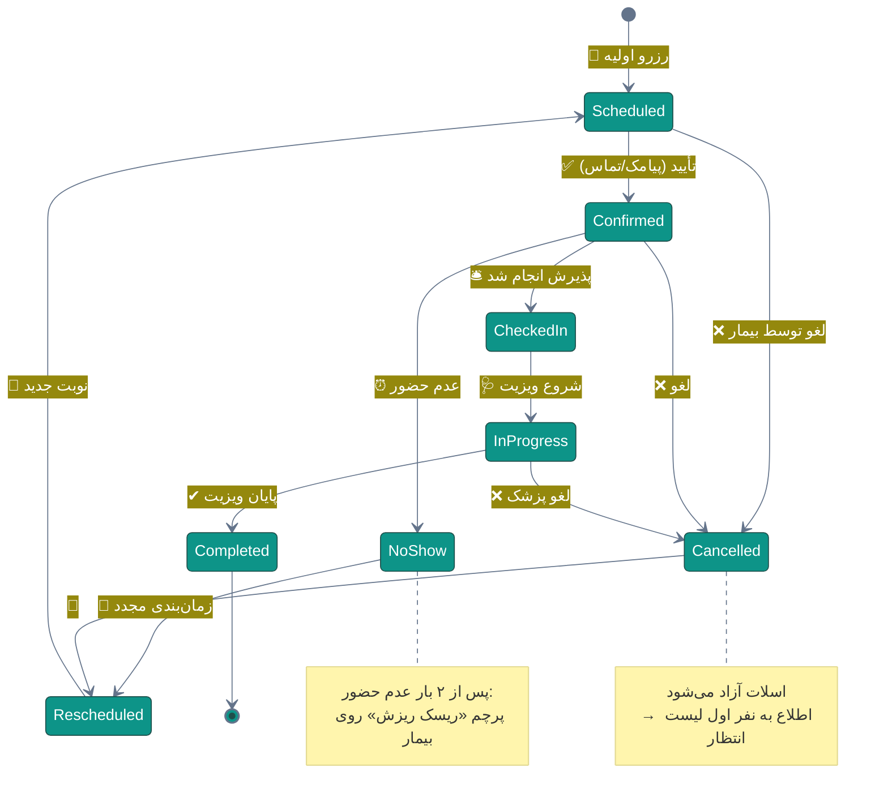
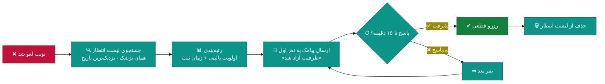
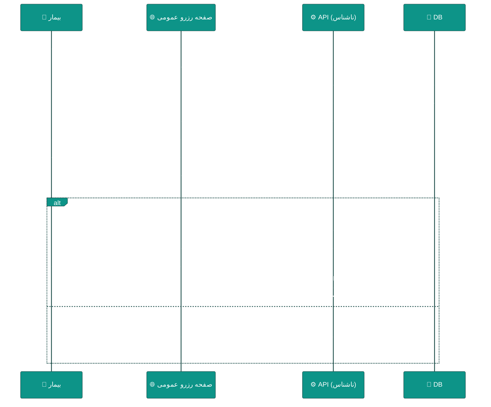
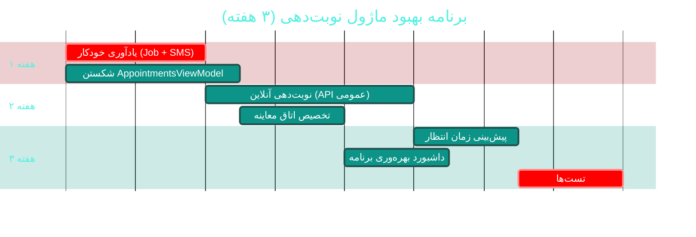

# 📅 ماژول نوبت‌دهی و زمان‌بندی (Appointments & Scheduling)

> **مسیر ماژول:** `appointments` · **لایسنس:** `Appointments` (+ `Waitlist`)
> **اولویت:** 🟠 بالا · **دشواری:** 🟡 متوسط · **زمان برآوردی:** ۳ هفته

---

## ۱. 📋 خلاصه ماژول

موتور زمان‌بندی درمانگاه: برنامه کاری پزشکان، ظرفیت اسلات‌ها، تداخل‌سنجی،
رزرو از منابع مختلف، غیبت پزشک، لیست انتظار و مدیریت اتاق‌های معاینه.

| ویژگی | مقدار |
|:---|:---|
| 🎯 هدف | بیشینه‌سازی بهره‌وری وقت پزشک با کمترین انتظار بیمار |
| 👤 کاربران اصلی | پذیرشگر · پزشک · مدیر |
| 🔗 وابستگی‌ها | `patients`, `doctors`, `receptions`, `sms`, `branches` |
| 📊 وضعیت فعلی | 🟢 عملیاتی — 🟡 نیازمند هوشمندسازی |

---

## ۲. 🎯 وضعیت فعلی در کدبیس

| لایه | فایل | خط | وضعیت |
|:---|:---|--:|:---|
| 🧬 Domain | `.../Scheduling/Appointment.cs` | — | 🟢 |
| 🧬 Domain | `.../Scheduling/DoctorSchedule.cs` | — | 🟢 |
| 🧬 Domain | `.../Scheduling/DoctorAbsence.cs` | — | 🟢 |
| 🧬 Domain | `.../Scheduling/ExaminationRoom.cs` | — | 🟢 |
| 🧬 Domain | `.../Scheduling/WaitlistEntry.cs` | — | 🟢 |
| 🧬 Domain | `.../Enums/AppointmentStatus.cs` · `AppointmentType.cs` · `AppointmentSource.cs` | — | 🟢 ۵ وضعیت |
| 🧬 Domain | `.../Events/AppointmentEvents.cs` | — | 🟢 |
| ⚙ App | `.../Features/Appointments/Commands/` · `Queries/` · `Waitlist/WaitlistFeatures.cs` | ۶۵۲ | 🟢 |
| 🌐 API | `.../Controllers/AppointmentsController.cs` | — | 🟢 |
| 🖥 Desktop | `.../ViewModels/AppointmentsViewModel.cs` | ۹۱۰ | 🟠 ۱۷ فرمان |
| 🖥 Desktop | `.../Views/AppointmentsView.xaml` · `AppointmentFormWindow.xaml` | — | 🟢 |

### نکات برجسته‌ی فعلی

✅ **۵ وضعیت ردیابی** نوبت (`AppointmentStatus`)
✅ **تداخل‌سنجی** در سطح دامنه
✅ **لیست انتظار (Waitlist)** با `WaitlistFeatures` مجزا
✅ **رویدادهای دامنه** برای تغییر وضعیت نوبت
✅ **منبع نوبت** (`AppointmentSource`) — حضوری/تلفنی/آنلاین

---

## ۳. 📊 نمودار چرخه‌ی حیات نوبت



### نمودار جریان لیست انتظار



---

## ۴. ⚠️ کاستی‌ها و ایرادها

| # | کاستی | 🎯 شدت | 📍 محل | 💥 پیامد |
|:--:|:---|:--:|:---|:---|
| W-01 | **نوبت‌دهی آنلاین ندارد** — بیمار باید تلفن بزند | 🔴 بالا | — | بارِ کاری پذیرش، از دست رفتن نوبت |
| W-02 | **بهینه‌سازی اسلات** بر اساس نوع خدمت نیست | 🟠 بالا | `DoctorSchedule` | ویزیت ۵ دقیقه‌ای اسلات ۳۰ دقیقه‌ای می‌گیرد |
| W-03 | **یادآوری خودکار** فقط دستی است | 🟠 بالا | `SmsQueue` | نرخ عدم حضور (No-Show) بالا |
| W-04 | `AppointmentsViewModel` با **۹۱۰ خط / ۱۷ فرمان** | 🟠 بالا | `ViewModels/` | سخت‌تست‌بودن |
| W-05 | **پیش‌بینی تأخیر** ندارد | 🟡 متوسط | — | بیمار در مطب معطل می‌ماند |
| W-06 | **الگوی تکرار** برای نوبت‌های دوره‌ای ندارد | 🟡 متوسط | Domain | بیمار مزمن هر بار باید رزرو کند |
| W-07 | **مدیریت اتاق معاینه** به نوبت متصل نیست | 🟡 متوسط | `ExaminationRoom` | تداخل رزرو اتاق |
| W-08 | **گزارش بهره‌وری اسلات‌ها** ندارد | 🟡 متوسط | `Reports` | مدیر نمی‌داند کدام ساعت‌ها خالی است |
| W-09 | **تقویم شمسی** در UI محدود است | 🔵 کم | `AppointmentsView` | تجربه کاربری ناهموار |

---

## ۵. ✨ امکانات پیشنهادی

| 🎯 # | امکان | 📝 شرح | 💰 ارزش | 🔧 دشواری | ⏱ |
|:--:|:---|:---|:--:|:--:|:--:|
| F-01 | 🌐 **نوبت‌دهی آنلاین** | صفحه رزرو عمومی بر اساس پزشک/تخصص/تاریخ | بسیار بالا | متوسط | ۲ هفته |
| F-02 | 🔔 **یادآوری خودکار چندمرحله‌ای** | ۴۸ساعت / ۲۴ساعت / ۲ساعت قبل (پیامک +push) | بسیار بالا | کم | ۴ روز |
| F-03 | 🧠 **بهینه‌سازی هوشمند اسلات** | مدت اسلات بر اساس نوع ویزیت + سابقه پزشک | بالا | متوسط | ۱ هفته |
| F-04 | ⏱ **پیش‌بینی زمان انتظار** | برآورد بر اساس میانگین تاریخی + صف فعلی | بالا | متوسط | ۵ روز |
| F-05 | 🔁 **نوبت‌های تکرارشونده** | الگوی هفتگی/ماهانه برای بیماران مزمن | متوسط | کم | ۴ روز |
| F-06 | 🏠 **تخصیص اتاق معاینه** | رزرو خودکار اتاق همراه نوبت | متوسط | کم | ۳ روز |
| F-07 | 📊 **داشبورد بهره‌وری برنامه** | نمودار heatmap ساعت‌های پُر و خالی | بالا | کم | ۴ روز |
| F-08 | 🩺 **تریاژ هوشمند** | اولویت‌بندی نوبت بر اساس علت مراجعه | بالا | متوسط | ۱ هفته |
| F-09 | 📱 **تأیید/لغو با یک کلیک از پیامک** | لینک امضا‌شده در پیامک | متوسط | کم | ۳ روز |
| F-10 | 🔄 **همگام‌سازی تقویم خارجی** | Google/Outlook Calendar (iCal) | متوسط | متوسط | ۱ هفته |

---

## ۶. 🛠 دستورالعمل پیاده‌سازی

### 📌 گام ۱ — یادآوری خودکار چندمرحله‌ای (F-02) — *سریع‌ترین برد*

**۱.۱ تعریف تنظیمات یادآوری**

```csharp
// 📄 src/Sahand.ClinicPro.Domain/Infrastructure/SystemSetting.cs (استفاده از موجود)
// کلیدهای جدید در ReferenceDataSeeder ثبت شوند:
//
//   "appointment.reminder.enabled"      = "true"
//   "appointment.reminder.offsets"      = "2880,1440,120"   (دقیقه قبل از نوبت)
//   "appointment.reminder.template48"   = "SMS_APPT_48H"
//   "appointment.reminder.template24"   = "SMS_APPT_24H"
//   "appointment.reminder.template2"    = "SMS_APPT_2H"
```

**۱.۲ Job پس‌زمینه با Hangfire**

```csharp
// 📄 src/Sahand.ClinicPro.Infrastructure/Services/Scheduling/AppointmentReminderJob.cs
using Microsoft.EntityFrameworkCore;
using Sahand.ClinicPro.Application.Interfaces;
using Sahand.ClinicPro.Domain.Entities.Scheduling;
using Sahand.ClinicPro.Domain.Enums;

namespace Sahand.ClinicPro.Infrastructure.Services.Scheduling;

/// <summary>
/// کار پس‌زمینه ارسال یادآوری نوبت — هر ۱۵ دقیقه اجرا می‌شود و نوبت‌هایی را
/// که در بازهٔ یادآوری قرار گرفته‌اند و هنوز یادآوری دریافت نکرده‌اند پیدا می‌کند.
/// طراحی «Idempotent» است: با فیلد ReminderStageSent از ارسال تکراری جلوگیری می‌شود.
/// </summary>
public class AppointmentReminderJob
{
    private readonly IServiceScopeFactory _scopeFactory;
    private readonly ISmsService _sms;
    private readonly ILogger<AppointmentReminderJob> _logger;

    /// <summary>سازنده با تزریق کارخانه اسکوپ (الگوی Singleton→Scoped)</summary>
    public AppointmentReminderJob(IServiceScopeFactory scopeFactory,
        ISmsService sms, ILogger<AppointmentReminderJob> logger)
    { _scopeFactory = scopeFactory; _sms = sms; _logger = logger; }

    /// <summary>اجرای دوره‌ای یادآوری‌ها</summary>
    public async Task RunAsync(CancellationToken ct = default)
    {
        // مراحل یادآوری بر حسب دقیقه
        var stages = new[] { 2880, 1440, 120 };

        using var scope = _scopeFactory.CreateScope();
        var uow = scope.ServiceProvider.GetRequiredService<IUnitOfWork>();

        foreach (var stage in stages)
        {
            var target = DateTime.UtcNow.AddMinutes(stage);
            var windowStart = target.AddMinutes(-8);
            var windowEnd = target.AddMinutes(8);

            var pending = await uow.Repository<Appointment>().QueryableNoTracking
                .Where(a => !a.IsDeleted
                            && a.Status == AppointmentStatus.Confirmed
                            && a.AppointmentDate >= windowStart
                            && a.AppointmentDate <= windowEnd
                            && a.ReminderStageSent < stage)
                .Include(a => a.Patient)
                .ToListAsync(ct);

            foreach (var appt in pending)
            {
                try
                {
                    await _sms.SendTemplatedAsync(
                        templateCode: stage switch
                        {
                            2880 => "SMS_APPT_48H",
                            1440 => "SMS_APPT_24H",
                            _    => "SMS_APPT_2H",
                        },
                        phoneNumber: appt.Patient.MobileNumber!,
                        parameters: new Dictionary<string, string>
                        {
                            ["PatientName"] = $"{appt.Patient.FirstName} {appt.Patient.LastName}",
                            ["Date"] = PersianDateHelper.ToShamsi(appt.AppointmentDate),
                            ["Time"] = appt.AppointmentDate.ToString("HH:mm"),
                            ["Doctor"] = appt.Doctor?.FullName ?? "پزشک معالج",
                        }, ct);

                    // ارتقای مرحله — جلوگیری از ارسال تکراری
                    var entity = await uow.Repository<Appointment>().GetByIdAsync(appt.Id, ct);
                    if (entity is not null)
                    {
                        entity.ReminderStageSent = stage;
                        uow.Repository<Appointment>().Update(entity);
                    }
                    await uow.SaveEntitiesAsync(ct);
                }
                catch (Exception ex)
                {
                    _logger.LogError(ex,
                        "خطا در ارسال یادآوری نوبت {AppointmentId} مرحله {Stage}", appt.Id, stage);
                }
            }
        }
    }
}
```

**۱.۳ فیلد جدید روی موجودیت**

```csharp
// 📄 src/Sahand.ClinicPro.Domain/Scheduling/Appointment.cs
// افزوده شود:

/// <summary>
/// آخرین مرحله یادآوری ارسال‌شده (بر حسب دقیقه پیش از نوبت).
/// مقدار ۰ یعنی هیچ یادآوری ارسال نشده. برای Idempotent بودن Job استفاده می‌شود.
/// </summary>
public int ReminderStageSent { get; set; } = 0;

/// <summary>تعداد دفعات لغو/عدم‌حضور پیاپی — برای پرچم ریسک ریزش</summary>
public int NoShowCount { get; set; } = 0;
```

**۱.۴ ثبت Job در Hangfire**

```csharp
// 📄 src/Sahand.ClinicPro.API/Program.cs (در بخش پیکربندی Hangfire موجود)
// پس از app.UseHangfireDashboard و فعال‌سازی Jobs:

if (builder.Configuration.GetValue<bool>("Jobs:Enabled"))
{
    RecurringJob.AddOrUpdate<AppointmentReminderJob>(
        "appointment-reminder",
        job => job.RunAsync(CancellationToken.None),
        "*/15 * * * *");          // هر ۱۵ دقیقه
}
```

**۱.۵ مایگریشن**

```bash
cd src/Sahand.ClinicPro.Infrastructure
dotnet ef migrations add Cycle49AppointmentReminder \
    --startup-project ../Sahand.ClinicPro.API
dotnet ef database update --startup-project ../Sahand.ClinicPro.API
```

---

### 📌 گام ۲ — نوبت‌دهی آنلاین (F-01)



**۲.۱ Endpoint عمومی (بدون احراز هویت)**

> ⚠️ **امنیت:** این اندپوینت‌ها **نباید** اطلاعات حساس بیمار را برگردانند.
> فقط نام پزشک، زمان خالی و نام اسلات. همچنین باید **Rate Limit شدید** (۱۰/دقیقه بر IP) داشته باشند.

```csharp
// 📄 src/Sahand.ClinicPro.API/Controllers/PublicAppointmentController.cs (جدید)
using Microsoft.AspNetCore.Mvc;
using Microsoft.AspNetCore.RateLimiting;

namespace Sahand.ClinicPro.API.Controllers;

/// <summary>
/// کنترلر عمومی نوبت‌دهی آنلاین — بدون احراز هویت.
/// فقط اطلاعاتِ حداقلیِ لازم برای رزرو را افشا می‌کند و با محدودیت نرخ محافظت می‌شود.
/// </summary>
[ApiController]
[Route("api/v1/public/appointments")]
[EnableRateLimiting("public-booking")]      // ۱۰ درخواست در دقیقه بر IP
public class PublicAppointmentController : ApiBaseController
{
    private readonly IMediator _mediator;

    /// <summary>سازنده</summary>
    public PublicAppointmentController(IMediator mediator) => _mediator = mediator;

    /// <summary>دریافت اسلات‌های خالی یک پزشک در یک روز</summary>
    /// <param name="doctorId">شناسه پزشک</param>
    /// <param name="date">تاریخ شمسی (۱۴۰۴/۰۷/۲۰)</param>
    [HttpGet("slots")]
    [ResponseCache(Duration = 30)]             // کش ۳۰ ثانیه‌ای
    public async Task<IActionResult> GetSlots([FromQuery] long doctorId,
        [FromQuery] string date, CancellationToken ct = default)
        => ToResponse(await _mediator.Send(new GetPublicSlotsQuery(doctorId, date), ct));

    /// <summary>رزرو نوبت توسط بیمار</summary>
    [HttpPost("book")]
    public async Task<IActionResult> Book([FromBody] PublicBookingRequest request,
        CancellationToken ct = default)
        => ToResponse(await _mediator.Send(new BookPublicAppointmentCommand(request), ct));
}
```

**۲.۲ ثبت Rate Limit**

```csharp
// 📄 src/Sahand.ClinicPro.API/Program.cs
builder.Services.AddRateLimiter(options =>
{
    options.AddPolicy("public-booking", context =>
        RateLimitPartition.GetFixedWindowLimiter(
            partitionKey: context.Connection.RemoteIpAddress?.ToString() ?? "unknown",
            factory: _ => new FixedWindowRateLimiterOptions
            {
                PermitLimit = 10,
                Window = TimeSpan.FromMinutes(1),
                QueueProcessingOrder = QueueProcessingOrder.OldestFirst,
                QueueLimit = 0,
            }));
});
app.UseRateLimiter();
```

---

### 📌 گام ۳ — پیش‌بینی زمان انتظار (F-04)

```csharp
// 📄 src/Sahand.ClinicPro.Application/Features/Appointments/Queries/PredictWaitTime/PredictWaitTimeQuery.cs
/// <summary>
/// پیش‌بینی زمان انتظار بیمار — بر اساس میانگین مدت ویزیتِ همان پزشک
/// در ۳۰ روز گذشته ضرب‌در تعداد نفراتِ جلوتر در صف، به‌علاوه انحرافِ معیار
/// برای نمایش بازه اطمینان.
/// </summary>
public record PredictWaitTimeQuery(long DoctorId, long ReceptionId)
    : IRequest<Result<WaitTimePredictionDto>>;

public class PredictWaitTimeQueryHandler
    : IRequestHandler<PredictWaitTimeQuery, Result<WaitTimePredictionDto>>
{
    private readonly IUnitOfWork _uow;

    public PredictWaitTimeQueryHandler(IUnitOfWork uow) => _uow = uow;

    public async Task<Result<WaitTimePredictionDto>> Handle(
        PredictWaitTimeQuery req, CancellationToken ct)
    {
        // ۱) میانگین مدت ویزیت پزشک در ۳۰ روز اخیر (دقیقه)
        var avgMinutes = await _uow.Repository<Visit>().QueryableNoTracking
            .Where(v => !v.IsDeleted && v.DoctorId == req.DoctorId
                        && v.StartTime >= DateTime.UtcNow.AddDays(-30)
                        && v.EndTime != null)
            .Select(v => EF.Functions.DateDiffMinute(v.StartTime, v.EndTime!.Value))
            .AverageAsync(ct);

        // ۲) چند نفر جلوتر هستند؟
        var aheadCount = await _uow.Repository<Reception>().QueryableNoTracking
            .CountAsync(r => !r.IsDeleted && r.DoctorId == req.DoctorId
                             && r.Status == ReceptionStatus.Waiting
                             && r.Id < req.ReceptionId, ct);

        var estimate = (int)Math.Ceiling(avgMinutes * aheadCount);

        return Result<WaitTimePredictionDto>.Success(new WaitTimePredictionDto(
            Minutes: estimate,
            AheadCount: aheadCount,
            AverageVisitMinutes: (int)avgMinutes,
            ConfidenceBandMinutes: (int)Math.Ceiling(estimate * 0.25),
            Message: aheadCount == 0
                ? "نوبت شما فرا رسیده است"
                : $"حدود {estimate} دقیقه ({aheadCount} نفر جلوتر)"));
    }
}

public record WaitTimePredictionDto(int Minutes, int AheadCount,
    int AverageVisitMinutes, int ConfidenceBandMinutes, string Message);
```

---

## ۷. 🧪 تست‌های الزامی

| 🧪 تست | 🎯 هدف |
|:---|:---|
| `GetSlots_RespectsDoctorSchedule` | اسلات خارج از برنامه کاری برنگردد |
| `GetSlots_ExcludesBookedSlots` | اسلات رزرو‌شده حذف شود |
| `GetSlots_ExcludesDoctorAbsence` | روزهای غیبت پزشک مسدود باشد |
| `BookAppointment_ConcurrentRequests_OnlyOneSucceeds` | **تست همزمانی حیاتی** |
| `ReminderJob_SendsOncePerStage` | Idempotent بودن Job |
| `ReminderJob_DoesNotResendAfterCancel` | نوبت لغو‌شده یادآوری نگیرد |
| `PredictWaitTime_NoQueue_ReturnsZero` | سناریوی صف خالی |
| `PublicBooking_RateLimitExceeded_429` | محدودیت نرخ |

**تست همزمانی (بسیار مهم):**
```csharp
[Fact]
public async Task BookAppointment_ConcurrentRequests_OnlyOneSucceeds()
{
    // Arrange: یک اسلات خالی
    var slotId = await SeedFreeSlotAsync();

    // Act: ۱۰ درخواست همزمان برای یک اسلات
    var tasks = Enumerable.Range(0, 10)
        .Select(_ => _mediator.Send(new BookPublicAppointmentCommand(
            new PublicBookingRequest { SlotId = slotId, NationalCode = "..." })))
        .ToArray();
    var results = await Task.WhenAll(tasks);

    // Assert: دقیقاً یک موفق
    results.Count(r => r.IsSuccess).Should().Be(1);
    results.Count(r => r.IsFailure).Should().Be(9);
}
```

---

## ۸. 📈 شاخص‌های موفقیت (KPI)

| 📊 شاخص | قبل | هدف |
|:---|:--:|:--:|
| 📉 نرخ عدم حضور (No-Show) | ~۱۸٪ | **< ۸٪** |
| 📞 تماس‌های تلفنی پذیرش برای نوبت | ۱۰۰٪ | **< ۳۰٪** (۷۰٪ آنلاین) |
| ⏱ میانگین انتظار بیمار | ~۲۵ دقیقه | **< ۱۲ دقیقه** |
| 📊 بهره‌وری اسلات پزشک | ~۶۵٪ | **> ۸۵٪** |
| 🧪 پوشش تست ماژول | ~۱۰٪ | **> ۷۰٪** |

---

## ۹. 🗓 برنامه زمانی



---

## 🔗 پیوندهای مرتبط

| 📄 سند | توضیح |
|:---|:---|
| [تحلیل جامع](../ANALYSIS-REPORT.md) | سند اصلی |
| [A03 — پذیرش و صف](A03-receptions-queue.md) | تبدیل نوبت به پذیرش |
| [C07 — پیامک](C07-sms-communication.md) | زیرساخت ارسال یادآوری |
| [D01 — پرتال بیمار](D01-patient-portal.md) | بستر نوبت‌دهی آنلاین |

---
<div align="center">📅 ۱۴۰۴/۰۷/۱۹ · 🔖 v1.0</div>
