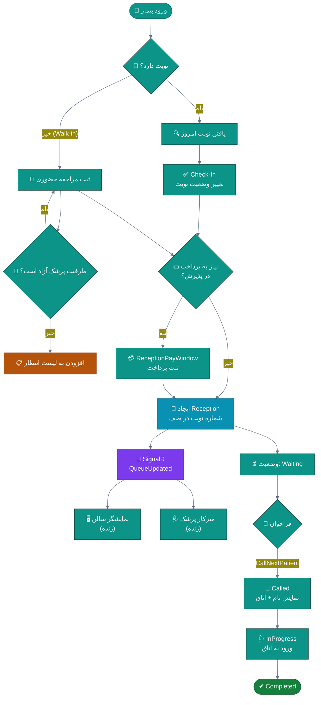
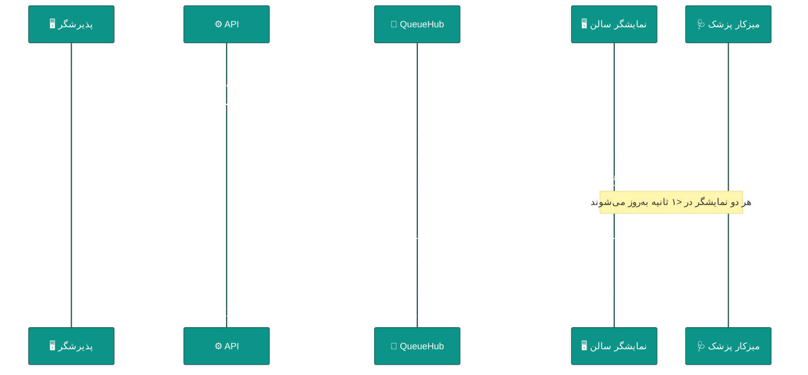
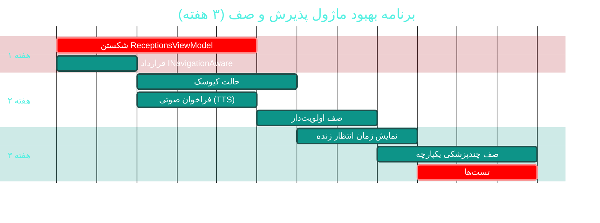

# 🛎 ماژول پذیرش، صف و لیست انتظار (Receptions, Queue & Waitlist)

> **مسیر ماژول:** `receptions` · **لایسنس:** `Receptions` + `Waitlist`
> **اولویت:** 🟠 بالا · **دشواری:** 🟡 متوسط · **زمان برآوردی:** ۳ هفته

---

## ۱. 📋 خلاصه ماژول

قلب تپنده‌ی عملیات روزانه: تبدیل نوبت یا مراجعه‌ی حضوری به «پذیرش»،
تشکیل صف پویا، فراخوان بیمار با **SignalR بلادرنگ**، پرداخت در پذیرش،
و مدیریت لیست انتظار هنگام تکمیل ظرفیت.

| ویژگی | مقدار |
|:---|:---|
| 🎯 هدف | جریانِ روانِ بیمار از ورود تا ورود به اتاق ویزیت |
| 👤 کاربران اصلی | پذیرشگر · پرستار · پزشک |
| 🔗 وابستگی‌ها | `patients`, `appointments`, `billing`, `visits`, `sms` |
| 📊 وضعیت فعلی | 🟢 عملیاتی — 🔴 بزرگ‌ترین ViewModel پروژه |

---

## ۲. 🎯 وضعیت فعلی در کدبیس

| لایه | فایل | خط | وضعیت |
|:---|:---|--:|:---|
| 🧬 Domain | `.../Scheduling/Reception.cs` | — | 🟢 |
| 🧬 Domain | `.../Scheduling/Queue.cs` | — | 🟢 |
| 🧬 Domain | `.../Scheduling/WaitlistEntry.cs` | — | 🟢 |
| 🧬 Domain | `.../Scheduling/ExaminationRoom.cs` | — | 🟢 |
| 🧬 Domain | `.../Enums/ReceptionStatus.cs` · `QueueStatus.cs` · `WaitlistStatus.cs` | — | 🟢 |
| ⚙ App | `.../Features/Receptions/CreateReception/` | — | 🟢 |
| ⚙ App | `.../Features/Receptions/GetTodayReceptions/` · `GetQueueStats/` · `UpdateReceptionStatus/` | — | 🟢 |
| ⚙ App | `.../Features/Visits/CallNextPatient/` · `GetVisitQueue/` | — | 🟢 |
| 🌐 API | `.../Controllers/ReceptionsController.cs` | — | 🟢 |
| 🖥 Desktop | **`.../ViewModels/ReceptionsViewModel.cs`** | **۱٬۳۱۶** | 🔴 **بزرگ‌ترین God VM** |
| 🖥 Desktop | `.../Views/ReceptionsView.xaml` · `ReceptionFormWindow` · `ReceptionPayWindow` | — | 🟢 |

### نکات برجسته‌ی فعلی

✅ **SignalR بلادرنگ** برای صف سالن — بدون نیاز به رفرش
✅ **فراخوان بعدی** با `CallNextPatient`
✅ **آمار لحظه‌ای صف** با `GetQueueStats`
✅ **پرداخت در پذیرش** با `ReceptionPayWindow`
✅ **لیست انتظار** کامل با `WaitlistFeatures`

> ⚠️ طبق `Directory.Build.props`، چرخه‌ی ۴۵ مشکلِ «نیامدن لیست اقلام مصرفی پذیرش»
> ناشی از **بارگذاری یک‌بارهٔ تک‌نمونه** بوده و با نوسازیِ هر بارِ صفحه حل شده است.
> این نشان می‌دهد **مدیریت چرخه حیات ViewModel** در این ماژول محل تکرار خطاست.

---

## ۳. 📊 نمودار جریان پذیرش



### نمودار توالیِ بلادرنگ (SignalR)



---

## ۴. ⚠️ کاستی‌ها و ایرادها

| # | کاستی | 🎯 شدت | 📍 محل | 💥 پیامد |
|:--:|:---|:--:|:---|:---|
| W-01 | **`ReceptionsViewModel` با ۱٬۳۱۶ خط** — بزرگ‌ترین فایل ViewModel پروژه | 🔴 بحرانی | `ViewModels/` | هر تغییر ریسک رگرسیون دارد |
| W-02 | **چرخه حیاتِ تک‌نمونه** باعث «کهنگی داده» می‌شود (چرخه ۴۵) | 🔴 بالا | DI / `MainWindowViewModel` | لیست اقلام مصرفی به‌روز نمی‌شود |
| W-03 | **نمایشگر سالن (Kiosk)** به‌عنوان حالت مجزا ندارد | 🟠 بالا | — | نمایش صف روی مانیتور سالن دشوار |
| W-04 | **صدای فراخوان (TTS)** ندارد | 🟠 بالا | — | بیمار متوجه فراخوان نمی‌شود |
| W-05 | **صف چندپزشکی** در یک نما ندارد | 🟡 متوسط | `ReceptionsView` | پذیرشگر باید تب عوض کند |
| W-06 | **تخمین زمان انتظار** نمایش داده نمی‌شود | 🟡 متوسط | UI | اضطراب بیمار |
| W-07 | **ارجاع داخلی** (پذیرش → آزمایشگاه) در صف نیست | 🟡 متوسط | Domain | بیمار دوباره در صف می‌ایستد |
| W-08 | **بازگشت به صف** پس از آزمایش ندارد | 🟡 متوسط | Domain | اختلال در جریان |
| W-09 | **آمار انتظار** (متوسط/بیشینه) گزارش نمی‌شود | 🔵 کم | `GetQueueStats` | مدیر نمی‌تواند بهبود بسنجد |

---

## ۵. ✨ امکانات پیشنهادی

| 🎯 # | امکان | 📝 شرح | 💰 ارزش | 🔧 دشواری | ⏱ |
|:--:|:---|:---|:--:|:--:|:--:|
| F-01 | 🖥 **حالت کیوسک / نمایشگر سالن** | نمای تمام‌صفحه، فقط‌خواندنی، خودکارِ به‌روز | بسیار بالا | کم | ۴ روز |
| F-02 | 🔊 **فراخوان صوتی (TTS)** | تبدیل متن به گفتار فارسی برای فراخوان | بسیار بالا | کم | ۳ روز |
| F-03 | 🧩 **شکستن ReceptionsViewModel** | تقسیم به ۵ زیر-ViewModel | بالا | متوسط | ۵ روز |
| F-04 | 📊 **صف چندپزشکی یکپارچه** | نمای ستونی همزمان همه پزشکان | بالا | متوسط | ۵ روز |
| F-05 | ⏱ **نمایش زمان انتظار زنده** | روی کارت هر بیمار + نمایشگر سالن | بالا | کم | ۳ روز |
| F-06 | 🔄 **جریانِ ارجاع داخلی و بازگشت** | خروج موقت از صف و بازگشت خودکار | بالا | متوسط | ۱ هفته |
| F-07 | 📱 **اعلان به موبایل بیمار** | push هنگام نزدیک‌شدن نوبت | بالا | متوسط | ۱ هفته |
| F-08 | 🎫 **چاپ رسید نوبت** | شماره صف + QR پیگیری | متوسط | کم | ۲ روز |
| F-09 | 📈 **داشبورد صف** | تحلیل گلوگاه‌های ساعتی | متوسط | کم | ۴ روز |
| F-10 | ♿ **صف اولویت‌دار (Priority Queue)** | اولویت سالمند/اورژانس/معلول | بالا | کم | ۳ روز |

---

## ۶. 🛠 دستورالعمل پیاده‌سازی

### 📌 گام ۱ — شکستن `ReceptionsViewModel` (F-03) — *ریشه‌ی اصلی خطاها*

**ساختار هدف:**

```
ReceptionsViewModel          (≈ ۲۲۰ خط — فقط هماهنگ‌کننده + ناوبری)
├── 🧩 ReceptionQueueViewModel     → صف امروز + فراخوان + SignalR
├── 🧩 ReceptionFormViewModel      → فرم ایجاد/ویرایش پذیرش
├── 🧩 ReceptionPaymentViewModel   → پرداخت در پذیرش
├── 🧩 ReceptionConsumablesViewModel → اقلام مصرفی (رفع مشکل چرخه ۴۵)
└── 🧩 ReceptionWaitlistViewModel  → لیست انتظار
```

**۱.۱ رفع ریشه‌ای مشکلِ کهنگی داده (W-02 / چرخه ۴۵)**

> 🔑 **علت ریشه‌ای:** ViewModelها باید `Transient` باشند تا با هر بار نمایش
> داده‌ی تازه بارگذاری کنند (الگوی «نمونه‌ی نو با هر ناوبری» که در چرخه ۴۲ معرفی شد).

```csharp
// 📄 src/Sahand.ClinicPro.Desktop/ViewModels/ReceptionConsumablesViewModel.cs (جدید)
using CommunityToolkit.Mvvm.ComponentModel;
using CommunityToolkit.Mvvm.Input;

namespace Sahand.ClinicPro.Desktop.ViewModels;

/// <summary>
/// زیر-ViewModel اقلام مصرفی پذیرش — چرخه ۴۵:
/// مشکل اصلی این بود که فهرست اقلام مصرفی در سازندهٔ یک ViewModel تک‌نمونه
/// یک‌بار بارگذاری می‌شد و با هر بار باز شدن صفحه تازه نمی‌شد. این کلاس با
/// الگوی «بارگذاری در هر ناوبری» (INavigationAware) آن را رفع می‌کند.
/// </summary>
public partial class ReceptionConsumablesViewModel : ObservableObject, INavigationAware
{
    private readonly IApiClient _api;

    /// <summary>فهرست اقلام مصرفی موجود</summary>
    public ObservableCollection<ConsumableItem> Items { get; } = new();

    /// <summary>اقلام انتخاب‌شده برای این پذیرش</summary>
    public ObservableCollection<ConsumableItem> Selected { get; } = new();

    /// <summary>در حال بارگذاری</summary>
    [ObservableProperty] private bool isBusy;

    /// <summary>پیام خطا</summary>
    [ObservableProperty] private string errorMessage = string.Empty;

    /// <summary>سازنده با تزریق کلاینت API</summary>
    public ReceptionConsumablesViewModel(IApiClient api) => _api = api;

    /// <summary>
    /// فراخوانی‌شده در هر بار ناوبری به صفحه — بارگذاری تازهٔ داده‌ها.
    /// این متد تضمین می‌کند داده هیچ‌گاه کهنه نمی‌ماند.
    /// </summary>
    public async Task OnNavigatedToAsync(CancellationToken ct = default)
    {
        await LoadAsync(ct);
    }

    /// <summary>بارگذاری اقلام مصرفی از سرور با مدیریت خطای صریح</summary>
    [RelayCommand]
    private async Task LoadAsync(CancellationToken ct = default)
    {
        IsBusy = true;
        ErrorMessage = string.Empty;
        try
        {
            var res = await _api.GetAsync<List<ConsumableItem>>("consumables?activeOnly=true", ct);
            Items.Clear();
            if (res?.Data is not null)
                foreach (var item in res.Data) Items.Add(item);
            else
                ErrorMessage = "پاسخی از سرور دریافت نشد";
        }
        catch (Exception ex)
        {
            // ⚠️ خطا دیگر پنهان نمی‌شود — این همان خلأ چرخه ۴۵ است
            ErrorMessage = $"خطا در بارگذاری اقلام مصرفی: {ex.Message}";
        }
        finally { IsBusy = false; }
    }
}
```

**۱.۲ قرارداد ناوبری**

```csharp
// 📄 src/Sahand.ClinicPro.Desktop/Services/INavigationAware.cs (جدید)
namespace Sahand.ClinicPro.Desktop.Services;

/// <summary>
/// قرارداد آگاهی از ناوبری — هر ViewModel که نیاز به بارگذاریِ تازه در هر
/// بار نمایش دارد این را پیاده‌سازی می‌کند. سرویس ناوبری پس از هر جابه‌جایی
/// متد OnNavigatedToAsync را فرا می‌خواند.
/// این الگو ریشهٔ دسته‌ای از خطاهای «داده کهنه می‌ماند» را می‌بندد.
/// </summary>
public interface INavigationAware
{
    /// <summary>فراخوانی پس از ناوبری به این صفحه</summary>
    Task OnNavigatedToAsync(CancellationToken ct = default);
}
```

```csharp
// 📄 src/Sahand.ClinicPro.Desktop/Services/NavigationService.cs
// در متد NavigateTo، پس از ساخت ViewModel:

if (viewModel is INavigationAware aware)
    _ = aware.OnNavigatedToAsync(CancellationToken.None);
```

---

### 📌 گام ۲ — حالت کیوسک + فراخوان صوتی (F-01, F-02)

**۲.۱ پنجره کیوسک**

```xml
<!-- 📄 src/Sahand.ClinicPro.Desktop/Views/KioskDisplayWindow.xaml (جدید) -->
<Window x:Class="Sahand.ClinicPro.Desktop.Views.KioskDisplayWindow"
        xmlns="http://schemas.microsoft.com/winfx/2006/xaml/presentation"
        xmlns:x="http://schemas.microsoft.com/winfx/2006/xaml"
        xmlns:md="http://materialdesigninxaml.net/winfx/xaml/themes"
        FlowDirection="RightToLeft"
        WindowState="Maximized"
        WindowStyle="None"
        ResizeMode="NoResize"
        Cursor="None"
        Background="{DynamicResource KioskBackgroundBrush}"
        FontFamily="{DynamicResource VazirmatnFont}">

    <Window.Resources>
        <!-- مقیاس بزرگ برای خوانایی از فاصله -->
        <Style x:Key="QueueNumberStyle" TargetType="TextBlock">
            <Setter Property="FontSize" Value="72"/>
            <Setter Property="FontWeight" Value="Bold"/>
            <Setter Property="HorizontalAlignment" Value="Center"/>
        </Style>
    </Window.Resources>

    <Grid>
        <Grid.RowDefinitions>
            <RowDefinition Height="Auto"/>   <!-- سربرگ با ساعت -->
            <RowDefinition Height="3*"/>     <!-- نوبت فعلی (بزرگ) -->
            <RowDefinition Height="4*"/>     <!-- نوبت‌های بعدی -->
        </Grid.RowDefinitions>

        <!-- سربرگ -->
        <Border Grid.Row="0" Padding="32,16">
            <Grid>
                <TextBlock Text="{Binding ClinicName}" FontSize="36" FontWeight="Bold"/>
                <TextBlock Text="{Binding CurrentTime}" FontSize="28"
                           HorizontalAlignment="Left"/>
            </Grid>
        </Border>

        <!-- نوبت در حال ویزیت -->
        <Border Grid.Row="1" Background="{DynamicResource PrimaryBrush}" Padding="48">
            <StackPanel VerticalAlignment="Center">
                <TextBlock Text="هم‌اکنون" FontSize="32" Opacity="0.8"
                           HorizontalAlignment="Center"/>
                <TextBlock Text="{Binding CurrentPatientName}"
                           Style="{StaticResource QueueNumberStyle}"/>
                <TextBlock Text="{Binding CurrentRoom}"
                           FontSize="40" HorizontalAlignment="Center"/>
            </StackPanel>
        </Border>

        <!-- نوبت‌های بعدی -->
        <ItemsControl Grid.Row="2" ItemsSource="{Binding UpcomingPatients}" Padding="32">
            <ItemsControl.ItemTemplate>
                <DataTemplate>
                    <Border Margin="0,8" Padding="24,12" CornerRadius="12"
                            Background="{DynamicResource SurfaceBrush}">
                        <Grid>
                            <TextBlock Text="{Binding QueueNumber}" FontSize="36" FontWeight="Bold"/>
                            <TextBlock Text="{Binding DisplayName}" FontSize="36"
                                       Margin="24,0,0,0"/>
                            <TextBlock Text="{Binding WaitMinutes, StringFormat='{}{0} دقیقه'}"
                                       FontSize="24" HorizontalAlignment="Left"/>
                        </Grid>
                    </Border>
                </DataTemplate>
            </ItemsControl.ItemTemplate>
        </ItemsControl>
    </Grid>
</Window>
```

**۲.۲ فراخوان صوتی (TTS)**

```csharp
// 📄 src/Sahand.ClinicPro.Desktop/Services/SpeechAnnouncer.cs (جدید)
using System.Speech.Synthesis;

namespace Sahand.ClinicPro.Desktop.Services;

/// <summary>
/// گوینده فراخوان — تبدیل متن به گفتار فارسی برای اعلام نوبت در سالن.
/// از SAPI ویندوز استفاده می‌کند (بدون نیاز به پکیج خارجی).
/// در صورت نبود صدای فارسی، بدون پرتاب خطا فقط لاگ می‌نویسد.
/// </summary>
public sealed class SpeechAnnouncer : IDisposable
{
    private readonly SpeechSynthesizer _synth = new();
    private readonly ILogger<SpeechAnnouncer> _logger;
    private bool _persianVoiceFound;

    /// <summary>سازنده — انتخاب بهترین صدای موجود</summary>
    public SpeechAnnouncer(ILogger<SpeechAnnouncer> logger)
    {
        _logger = logger;
        try
        {
            var voices = _synth.GetInstalledVoices();
            var persian = voices.FirstOrDefault(v =>
                v.VoiceInfo.Culture.Name.StartsWith("fa", StringComparison.OrdinalIgnoreCase));

            if (persian is not null)
            {
                _synth.SelectVoice(persian.VoiceInfo.Name);
                _persianVoiceFound = true;
            }
            else
            {
                _logger.LogWarning("صدای فارسی در سیستم نصب نیست — فراخوان صوتی غیرفعال است");
            }

            _synth.Rate = -1;      // کمی کندتر برای وضوح
            _synth.Volume = 100;
        }
        catch (Exception ex)
        {
            _logger.LogError(ex, "راه‌اندازی گوینده فراخوان ناموفق بود");
        }
    }

    /// <summary>اعلام فراخوان بیمار</summary>
    /// <param name="patientName">نام بیمار</param>
    /// <param name="roomName">نام اتاق</param>
    public void Announce(string patientName, string roomName)
    {
        if (!_persianVoiceFound) return;
        try
        {
            _synth.SpeakAsyncCancelAll();                 // لغو اعلان قبلی
            var text = $"بیمار محترم، {patientName}، لطفاً به {roomName} مراجعه فرمایید";
            _synth.SpeakAsync(text);
        }
        catch (Exception ex)
        {
            _logger.LogError(ex, "خطا در پخش فراخوان صوتی");
        }
    }

    /// <summary>آزادسازی منابع</summary>
    public void Dispose() { _synth.SpeakAsyncCancelAll(); _synth.Dispose(); }
}
```

**۲.۳ اتصال به رویداد SignalR**

```csharp
// 📄 src/Sahand.ClinicPro.Desktop/ViewModels/KioskDisplayViewModel.cs
// در سازنده، اشتراک در رویداد بلادرنگ:

_realtime.OnPatientCalled += (sender, args) =>
{
    // اجرا روی رشته UI
    Application.Current.Dispatcher.Invoke(() =>
    {
        CurrentPatientName = args.PatientName;
        CurrentRoom = args.RoomName;
        _announcer.Announce(args.PatientName, args.RoomName);
    });
};
```

---

### 📌 گام ۳ — صف اولویت‌دار (Priority Queue) (F-10)

```csharp
// 📄 src/Sahand.ClinicPro.Domain/Scheduling/Reception.cs
// افزوده شود:

/// <summary>
/// امتیاز اولویت در صف — عدد بزرگتر یعنی زودتر فراخوانده می‌شود.
/// مبنای آن: ۰ = عادی، ۱۰ = سالمند/باردار، ۲۰ = معلول، ۵۰ = اورژانس.
/// فیلدِ PriorityLevel در صف برای شفافیت ذخیره می‌شود.
/// </summary>
public int PriorityScore { get; set; }

/// <summary>سطح اولویت برای نمایش در UI</summary>
public PriorityLevel PriorityLevel { get; set; } = PriorityLevel.Normal;

/// <summary>زمان ورود به صف — برای شکستن تساوی (FIFO)</summary>
public DateTime QueuedAt { get; set; } = DateTime.UtcNow;
```

```csharp
// در GetVisitQueue — مرتب‌سازی جدید:
var queue = await _uow.Repository<Reception>().QueryableNoTracking
    .Where(r => !r.IsDeleted && r.DoctorId == doctorId
                && r.Status == ReceptionStatus.Waiting)
    .OrderByDescending(r => r.PriorityScore)   // ← اولویت
    .ThenBy(r => r.QueuedAt)                   // ← سپس نوبت ورود
    .ToListAsync(ct);
```

---

## ۷. 🧪 تست‌های الزامی

| 🧪 تست | 🎯 هدف |
|:---|:---|
| `CreateReception_FromAppointment_SetsCheckedIn` | تبدیل نوبت به پذیرش |
| `CreateReception_WalkIn_CreatesQueueEntry` | مراجعه حضوری |
| `CallNextPatient_ReturnsHighestPriorityFirst` | **اولویت رعایت شود** |
| `CallNextPatient_EmptyQueue_ReturnsFailure` | صف خالی |
| `CallNextPatient_NotifiesSignalR` | ارسال رویداد بلادرنگ |
| `GetQueueStats_ReturnsCorrectCounts` | صحت آمار |
| `ConsumablesViewModel_ReloadsOnEachNavigation` | **رفع چرخه ۴۵** |
| `Waitlist_AddAndPromote_Works` | جریان لیست انتظار |
| `Reception_Payment_CreatesInvoice` | یکپارچگی مالی |

---

## ۸. 📈 شاخص‌های موفقیت (KPI)

| 📊 شاخص | قبل | هدف |
|:---|:--:|:--:|
| ⏱ میانگین زمان انتظار در سالن | ~۲۵ دقیقه | **< ۱۲ دقیقه** |
| 🔊 نرخ شنیدن فراخوان | ~۶۰٪ | **> ۹۵٪** (صوت + نمایشگر) |
| 🐛 باگ‌های این ماژول در هر نسخه | ۸ مورد | **< ۲** |
| 📏 اندازه بزرگ‌ترین ViewModel | ۱٬۳۱۶ خط | **< ۳۰۰ خط** |
| 🔄 زمان به‌روزرسانی نمایشگر سالن | ~۲ ثانیه | **< ۵۰۰ms** |

---

## ۹. 🗓 برنامه زمانی



---

## 🔗 پیوندهای مرتبط

| 📄 سند | توضیح |
|:---|:---|
| [تحلیل جامع](../ANALYSIS-REPORT.md) | سند اصلی |
| [A02 — نوبت‌دهی](A02-appointments.md) | ورودی این ماژول |
| [A04 — ویزیت](A04-visits-soap.md) | خروجی این ماژول |
| [C06 — اعلان‌ها و بلادرنگ](C06-notifications-realtime.md) | زیرساخت SignalR |

---
<div align="center">📅 ۱۴۰۴/۰۷/۱۹ · 🔖 v1.0</div>
