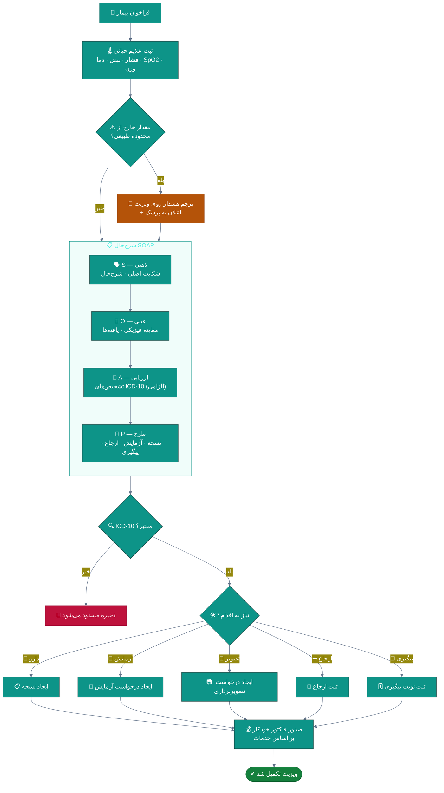
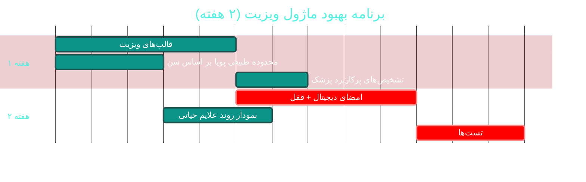

# 🩻 ماژول ویزیت و شرح‌حال بالینی (Visits & SOAP)

> **مسیر ماژول:** `visits` · **لایسنس:** `Visits`
> **اولویت:** 🟡 متوسط · **دشواری:** 🟡 متوسط · **زمان برآوردی:** ۲ هفته

---

## ۱. 📋 خلاصه ماژول

ثبت شرح‌حال پزشکی به روش **SOAP** (Subjective / Objective / Assessment / Plan) به‌همراه
علایم حیاتی، تشخیص‌های **ICD-10** الزامی، پیگیری و ارجاع. نقطه اتصالِ بالین و مالی.

| ویژگی | مقدار |
|:---|:---|
| 🎯 هدف | مستندسازی ساختاریافته و استانداردِ هر encounter بالینی |
| 👤 کاربران اصلی | پزشک · پرستار |
| 🔗 وابستگی‌ها | `patients`, `receptions`, `prescriptions`, `lab`, `billing` |
| 📊 وضعیت فعلی | 🟢 عملیاتی |

---

## ۲. 🎯 وضعیت فعلی در کدبیس

| لایه | فایل | خط | وضعیت |
|:---|:---|--:|:---|
| 🧬 Domain | `.../Clinical/Visit.cs` | — | 🟢 |
| 🧬 Domain | `.../Clinical/VitalSign.cs` | — | 🟢 |
| 🧬 Domain | `.../Clinical/Icd10Code.cs` | — | 🟢 + بذر ۱٬۱۷۰ خطی |
| 🧬 Domain | `.../Enums/VisitStatus.cs` · `VisitType.cs` · `Priority.cs` | — | 🟢 |
| 🧬 Domain | `.../Events/VisitEvents.cs` | — | 🟢 |
| ⚙ App | `.../Features/Visits/SaveVisit/` · `GetVisits/` · `GetVisitQueue/` · `CallNextPatient/` | — | 🟢 |
| 🌐 API | `.../Controllers/VisitsController.cs` · `EmrController.cs` | — | 🟢 |
| 🖥 Desktop | `.../ViewModels/VisitEditViewModel.cs` | ۹۱۳ | 🟠 |
| 🖥 Desktop | `.../ViewModels/DoctorVisitViewModel.cs` · `Views/VisitsView.xaml` · `VisitWindow.xaml` | — | 🟢 |

### نکات برجسته‌ی فعلی

✅ **ICD-10 الزامی** در ویزیت — انضباط بالینی خوب
✅ **علایم حیاتی** به‌عنوان موجودیت مستقل (`VitalSign`)
✅ **رویدادهای دامنه** (`VisitEvents`)
✅ **میزکار اختصاصی پزشک** (`DoctorVisitView`)

---

## ۳. 📊 نمودار جریان ویزیت



---

## ۴. ⚠️ کاستی‌ها و ایرادها

| # | کاستی | 🎯 شدت | 📍 محل | 💥 پیامد |
|:--:|:---|:--:|:---|:---|
| W-01 | `VisitEditViewModel` با **۹۱۳ خط** | 🟠 بالا | `ViewModels/` | منطق درهم‌تنیده |
| W-02 | **قالب‌های ویزیت (Templates)** برای تخصص‌های مختلف ندارد | 🟠 بالا | Domain | پزشک هر بار از صفر تایپ می‌کند |
| W-03 | **محدوده طبیعی علایم حیاتی** بر اساس سن تنظیم نمی‌شود | 🟠 بالا | `VitalSign` | هشدار اشتباه برای کودکان |
| W-04 | **تشخیص‌های تکراری/پرکاربرد پزشک** ذخیره نمی‌شود | 🟡 متوسط | — | کندی ورود داده |
| W-05 | **امضای دیجیتال پزشک** روی ویزیت ندارد | 🟡 متوسط | Domain | عدم اعتبار حقوقی |
| W-06 | **قفل ویرایش** پس از تأیید ندارد | 🟡 متوسط | `VisitStatus` | تغییر سابقه پزشکی |
| W-07 | **نسخه‌بندی ویزیت** (اصلاحیه) ندارد | 🟡 متوسط | Domain | اصلاح = بازنویسی |
| W-08 | **چک‌لیست‌های بالینی** (Checklist) ندارد | 🟡 متوسط | — | فراموشی مراحل استاندارد |
| W-09 | **صدور خودکار فاکتور** بر اساس خدمات ثبت‌شده ضعیف است | 🟡 متوسط | `SaveVisit` | درآمد از دست می‌رود |

---

## ۵. ✨ امکانات پیشنهادی

| 🎯 # | امکان | 📝 شرح | 💰 ارزش | 🔧 دشواری | ⏱ |
|:--:|:---|:---|:--:|:--:|:--:|
| F-01 | 📋 **قالب‌های ویزیت بر اساس تخصص** | SOAP از پیش‌پر شده برای هر تخصص | بسیار بالا | کم | ۵ روز |
| F-02 | 🌡 **محدوده طبیعی پویا بر اساس سن** | جدول مرجع سنی برای علایم حیاتی | بالا | کم | ۳ روز |
| F-03 | ⚡ **تشخیص‌های پرکاربرد پزشک** | فهرست شخصیِ ICD-10 با یک کلیک | بالا | کم | ۲ روز |
| F-04 | ✍ **امضای دیجیتال** | امضای رمزنگاری‌شده + قفل پس از امضا | بالا | متوسط | ۱ هفته |
| F-05 | ✅ **چک‌لیست‌های بالینی** | لیست استاندارد بر اساس تشخیص | بالا | کم | ۴ روز |
| F-06 | 🔒 **قفل ویرایش + نسخه‌بندی** | ویزیت امضا‌شده فقط با اصلاحیه تغییر کند | بالا | متوسط | ۵ روز |
| F-07 | 📊 **نمودار روند علایم حیاتی** | سری زمانی فشار/قند/وزن در پرونده | بالا | کم | ۴ روز |
| F-08 | 🧠 **پیشنهاد ICD-10 هوشمند** | بر اساس شکایت اصلی و سابقه | بسیار بالا | زیاد | ۳ هفته |
| F-09 | 📎 **پیوست چندرسانه‌ای** | تصویر زخم، صوت توضیح، PDF | متوسط | کم | ۳ روز |
| F-10 | 💰 **صدور خودکار فاکتور** | بر اساس خدماتِ ثبت‌شده در طرح | بالا | متوسط | ۵ روز |

---

## ۶. 🛠 دستورالعمل پیاده‌سازی

### 📌 گام ۱ — قالب‌های ویزیت بر اساس تخصص (F-01) — *بیشترین صرفه‌جویی*

**۱.۱ موجودیت قالب**

```csharp
// 📄 src/Sahand.ClinicPro.Domain/Clinical/VisitTemplate.cs (جدید)
namespace Sahand.ClinicPro.Domain.Entities.Clinical;

/// <summary>
/// قالب ویزیت — شرح‌حال از پیش‌تعریف‌شده برای یک تخصص یا پزشک خاص.
/// با هدف کاهش زمان تایپ پزشک و افزایش یکنواختی مستندات.
/// </summary>
public class VisitTemplate : AuditableEntity, ISoftDeletable
{
    /// <summary>نام قالب (مثلاً «ویزیت عمومی سرپایی»)</summary>
    public string Name { get; set; } = null!;

    /// <summary>شناسه تخصص مرتبط (تهی = عمومی)</summary>
    public long? SpecialtyId { get; set; }

    /// <summary>تخصص مرتبط</summary>
    public Specialty? Specialty { get; set; }

    /// <summary>شناسه پزشک (تهی = مشترک بین پزشکان آن تخصص)</summary>
    public long? DoctorId { get; set; }

    /// <summary>پزشک مالک قالب</summary>
    public Doctor? Doctor { get; set; }

    /// <summary>بخش ذهنی (S) پیش‌فرض</summary>
    public string? SubjectiveTemplate { get; set; }

    /// <summary>بخش عینی (O) پیش‌فرض</summary>
    public string? ObjectiveTemplate { get; set; }

    /// <summary>بخش ارزیابی (A) پیش‌فرض</summary>
    public string? AssessmentTemplate { get; set; }

    /// <summary>بخش طرح (P) پیش‌فرض</summary>
    public string? PlanTemplate { get; set; }

    /// <summary>کدهای ICD-10 پیشنهادی (JSON آرایه‌ای)</summary>
    public string SuggestedIcd10Json { get; set; } = "[]";

    /// <summary>قالب پیش‌فرض است</summary>
    public bool IsDefault { get; set; }

    /// <summary>ترتیب نمایش</summary>
    public int SortOrder { get; set; }
}
```

**۱.۲ پیکربندی EF**

```csharp
// 📄 src/Sahand.ClinicPro.Infrastructure/Persistence/Configurations/Clinical/VisitTemplateConfiguration.cs
using Microsoft.EntityFrameworkCore;
using Microsoft.EntityFrameworkCore.Metadata.Builders;
using Sahand.ClinicPro.Domain.Entities.Clinical;

namespace Sahand.ClinicPro.Infrastructure.Persistence.Configurations.Clinical;

/// <summary>پیکربندی قالب ویزیت</summary>
public class VisitTemplateConfiguration : IEntityTypeConfiguration<VisitTemplate>
{
    /// <summary>اعمال پیکربندی</summary>
    public void Configure(EntityTypeBuilder<VisitTemplate> builder)
    {
        builder.ToTable("VisitTemplates");
        builder.HasKey(t => t.Id);

        builder.Property(t => t.Name)
            .IsRequired()
            .HasMaxLength(200)
            .HasComment("نام قالب ویزیت");

        builder.Property(t => t.SubjectiveTemplate)
            .HasMaxLength(4000)
            .HasComment("بخش ذهنی پیش‌فرض");

        builder.Property(t => t.ObjectiveTemplate)
            .HasMaxLength(4000)
            .HasComment("بخش عینی پیش‌فرض");

        builder.Property(t => t.AssessmentTemplate)
            .HasMaxLength(4000)
            .HasComment("بخش ارزیابی پیش‌فرض");

        builder.Property(t => t.PlanTemplate)
            .HasMaxLength(4000)
            .HasComment("بخش طرح پیش‌فرض");

        builder.Property(t => t.SuggestedIcd10Json)
            .HasMaxLength(1000)
            .HasDefaultValue("[]")
            .HasComment("کدهای ICD-10 پیشنهادی (JSON)");

        builder.HasIndex(t => new { t.SpecialtyId, t.IsDeleted })
            .HasDatabaseName("IX_VisitTemplates_Specialty");

        builder.HasOne(t => t.Specialty)
            .WithMany()
            .HasForeignKey(t => t.SpecialtyId)
            .OnDelete(DeleteBehavior.SetNull);

        builder.HasOne(t => t.Doctor)
            .WithMany()
            .HasForeignKey(t => t.DoctorId)
            .OnDelete(DeleteBehavior.SetNull);
    }
}
```

**۱.۳ ثبت در DbContext و Seeder**

```csharp
// 📄 ClinicProDbContext.cs
public DbSet<VisitTemplate> VisitTemplates => Set<VisitTemplate>();

// 📄 BasicDataSeeder.cs — یک متد جدید:
private async Task SeedVisitTemplatesAsync(CancellationToken ct)
{
    if (await _context.VisitTemplates.AnyAsync(ct)) return;

    _context.VisitTemplates.AddRange(
        new VisitTemplate
        {
            Name = "ویزیت عمومی سرپایی",
            SortOrder = 1,
            IsDefault = true,
            SubjectiveTemplate = "شکایت اصلی: \nمدت: \nسابقه مشابه: ",
            ObjectiveTemplate = "هوشیار، علایم حیاتی ثبت شد.\nمعاینه شکم: نرم، بدون دفاع\n",
            AssessmentTemplate = "تشخیص اولیه: ",
            PlanTemplate = "۱. دارو طبق نسخه\n۲. آزمایش در صورت نیاز\n۳. پیگیری: ",
            SuggestedIcd10Json = "[\"Z00.0\",\"J06.9\"]",
        },
        new VisitTemplate
        {
            Name = "کنترل فشار خون",
            SortOrder = 2,
            SubjectiveTemplate = "آخرین اندازه‌گیری منزل: \nپایبندی به دارو: ",
            ObjectiveTemplate = "فشار خون نشسته: \nنبض: \nقلب: \n",
            AssessmentTemplate = "کنترل فشار خون: مطلوب / نامطلوب",
            PlanTemplate = "۱. ادامه دارو\n۲. اصلاح سبک زندگی\n۳. پیگیری یک ماهه",
            SuggestedIcd10Json = "[\"I10\"]",
        });
}
```

**۱.۴ مایگریشن**

```bash
cd src/Sahand.ClinicPro.Infrastructure
dotnet ef migrations add Cycle49VisitTemplates --startup-project ../Sahand.ClinicPro.API
dotnet ef database update --startup-project ../Sahand.ClinicPro.API
```

---

### 📌 گام ۲ — محدوده طبیعی پویا بر اساس سن (F-02)

```csharp
// 📄 src/Sahand.ClinicPro.Application/Common/Helpers/VitalSignReference.cs (جدید)
namespace Sahand.ClinicPro.Application.Common.Helpers;

/// <summary>
/// مرجع محدوده‌های طبیعی علایم حیاتی بر اساس سن.
/// مقادیر بر اساس راهنماهای بالینی استاندارد برای بزرگسالان و کودکان.
/// </summary>
public static class VitalSignReference
{
    /// <summary>محدوده طبیعی یک علامت حیاتی</summary>
    public record Range(double Min, double Max, string Unit);

    /// <summary>محدوده طبیعی فشار خون سیستولیک بر حسب سن</summary>
    public static Range Systolic(int ageYears) => ageYears switch
    {
        < 1    => new Range(70, 100, "mmHg"),
        < 6    => new Range(80, 110, "mmHg"),
        < 13   => new Range(90, 120, "mmHg"),
        < 18   => new Range(100, 125, "mmHg"),
        < 65   => new Range(90, 130, "mmHg"),
        _      => new Range(95, 145, "mmHg"),
    };

    /// <summary>محدوده طبیعی ضربان قلب بر حسب سن</summary>
    public static Range HeartRate(int ageYears) => ageYears switch
    {
        < 1    => new Range(100, 160, "bpm"),
        < 6    => new Range(80, 140, "bpm"),
        < 13   => new Range(70, 120, "bpm"),
        < 18   => new Range(60, 100, "bpm"),
        _      => new Range(60, 100, "bpm"),
    };

    /// <summary>محدوده طبیعی درصد اشباع اکسیژن</summary>
    public static Range OxygenSaturation(int _)
        => new(95, 100, "%");

    /// <summary>محدوده طبیعی دمای بدن</summary>
    public static Range Temperature(int _)
        => new(36.1, 37.5, "°C");

    /// <summary>محدوده طبیعی تعداد تنفس بر حسب سن</summary>
    public static Range RespiratoryRate(int ageYears) => ageYears switch
    {
        < 1    => new Range(30, 60, "/min"),
        < 6    => new Range(20, 40, "/min"),
        < 13   => new Range(18, 30, "/min"),
        _      => new Range(12, 20, "/min"),
    };

    /// <summary>
    /// ارزیابی یک مقدار نسبت به محدوده — خروجی مطابق Enum پروژه (AbnormalFlag)
    /// </summary>
    public static AbnormalFlag Evaluate(double value, Range range)
    {
        if (value < range.Min * 0.85) return AbnormalFlag.CriticalLow;
        if (value < range.Min)        return AbnormalFlag.Low;
        if (value > range.Max * 1.15) return AbnormalFlag.CriticalHigh;
        if (value > range.Max)        return AbnormalFlag.High;
        return AbnormalFlag.Normal;
    }
}
```

---

### 📌 گام ۳ — قفل ویرایش + امضای دیجیتال (F-04, F-06)

```csharp
// 📄 src/Sahand.ClinicPro.Domain/Clinical/Visit.cs — افزوده شود:

/// <summary>آیا ویزیت امضا شده است — پس از امضا فقط با اصلاحیه قابل تغییر</summary>
public bool IsSigned { get; set; }

/// <summary>زمان امضا</summary>
public DateTime? SignedAt { get; set; }

/// <summary>امضای دیجیتال (هش SHA-256 محتوا + شناسه امضاکننده)</summary>
public string? SignatureHash { get; set; }

/// <summary>شماره نسخه اصلاحیه — ۰ یعنی نسخه اصلی</summary>
public int AmendmentVersion { get; set; }
```

```csharp
// 📄 src/Sahand.ClinicPro.Application/Features/Visits/SignVisit/SignVisitCommand.cs
public record SignVisitCommand(long VisitId) : IRequest<Result>;

public class SignVisitCommandHandler : IRequestHandler<SignVisitCommand, Result>
{
    private readonly IUnitOfWork _uow;
    private readonly ICurrentUserService _currentUser;
    private readonly IDateTimeService _clock;

    public SignVisitCommandHandler(IUnitOfWork uow, ICurrentUserService currentUser,
        IDateTimeService clock)
    { _uow = uow; _currentUser = currentUser; _clock = clock; }

    public async Task<Result> Handle(SignVisitCommand req, CancellationToken ct)
    {
        var visit = await _uow.Repository<Visit>().GetByIdAsync(req.VisitId, ct);
        if (visit is null)
            return Result.Failure(Error.NotFound("ویزیت یافت نشد"));

        // گارد ۱: ICD-10 الزامی
        if (string.IsNullOrWhiteSpace(visit.Icd10CodesJson) ||
            visit.Icd10CodesJson == "[]")
            return Result.Failure(Error.Validation("ثبت حداقل یک کد ICD-10 پیش از امضا الزامی است"));

        // گارد ۲: امضای تکراری
        if (visit.IsSigned)
            return Result.Failure(Error.Conflict("این ویزیت قبلاً امضا شده است"));

        // گارد ۳: فقط پزشکِ ویزیت‌کننده
        if (visit.DoctorId != _currentUser.DoctorId)
            return Result.Failure(Error.Forbidden("فقط پزشک ویزیت‌کننده می‌تواند امضا کند"));

        // تولید امضا: هش محتوا + شناسه امضاکننده + زمان
        var payload = $"{visit.Id}|{visit.Subjective}|{visit.Objective}|" +
                      $"{visit.Assessment}|{visit.Plan}|{_currentUser.UserId}|" +
                      $"{_clock.UtcNow:O}";
        visit.SignatureHash = Convert.ToHexString(
            System.Security.Cryptography.SHA256.HashData(
                System.Text.Encoding.UTF8.GetBytes(payload)));
        visit.IsSigned = true;
        visit.SignedAt = _clock.UtcNow;

        _uow.Repository<Visit>().Update(visit);
        await _uow.SaveEntitiesAsync(ct);
        return Result.Success();
    }
}
```

> 🔒 **قانون طلایی:** پس از `IsSigned = true`، هیچ Command ویرایشی نباید اجازه تغییر دهد.
> این را در `SaveVisitCommandHandler` با یک گارد اعمال کنید:
> ```csharp
> if (visit.IsSigned)
>     return Result.Failure(Error.Validation(
>         "ویزیت امضا‌شده قابل ویرایش نیست — از «ثبت اصلاحیه» استفاده کنید"));
> ```

---

## ۷. 🧪 تست‌های الزامی

| 🧪 تست | 🎯 هدف |
|:---|:---|
| `SaveVisit_WithoutIcd10_ShouldFail` | الزامِ ICD-10 |
| `SignVisit_AlreadySigned_ShouldFail` | جلوگیری از امضای تکراری |
| `SignVisit_NotOwningDoctor_ShouldFail` | کنترل دسترسی |
| `EditSignedVisit_ShouldFail` | قفل پس از امضا |
| `VitalSign_ChildBloodPressure_UsesPediatricRange` | محدوده سنی |
| `VitalSign_CriticalValue_SetsFlag` | پرچم هشدار |
| `VisitTemplate_AppliesDefaultsToNewVisit` | کارکرد قالب |
| `AutoInvoice_FromVisitServices_CreatesLines` | یکپارچگی مالی |

---

## ۸. 📈 شاخص‌های موفقیت (KPI)

| 📊 شاخص | قبل | هدف |
|:---|:--:|:--:|
| ⏱ میانگین زمان مستندسازی ویزیت | ~۶ دقیقه | **< ۲٫۵ دقیقه** |
| 📋 نرخ استفاده از قالب | ۰٪ | **> ۷۰٪** |
| 🎯 دقت کدگذاری ICD-10 | ~۷۵٪ | **> ۹۵٪** |
| 🚩 هشدارهای اشتباه علایم حیاتی | ~۲۰٪ | **< ۳٪** |
| 📏 اندازه `VisitEditViewModel` | ۹۱۳ خط | **< ۳۰۰ خط** |

---

## ۹. 🗓 برنامه زمانی



---

## 🔗 پیوندهای مرتبط

| 📄 سند | توضیح |
|:---|:---|
| [تحلیل جامع](../ANALYSIS-REPORT.md) | سند اصلی |
| [A03 — پذیرش و صف](A03-receptions-queue.md) | ورودی این ماژول |
| [A06 — نسخه‌نویسی](A06-prescriptions-safety.md) | خروجی طرح درمان |
| [D03 — دستیار هوش مصنوعی](D03-ai-assistant.md) | پیشنهاد خودکار ICD-10 |

---
<div align="center">📅 ۱۴۰۴/۰۷/۱۹ · 🔖 v1.0</div>
