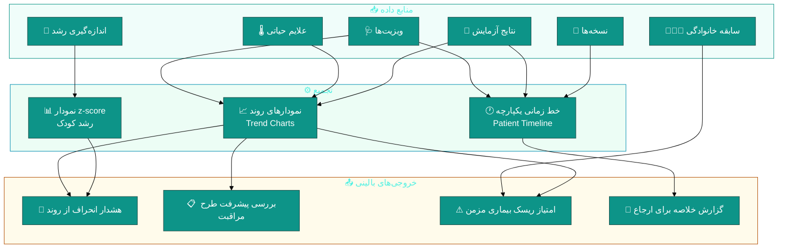
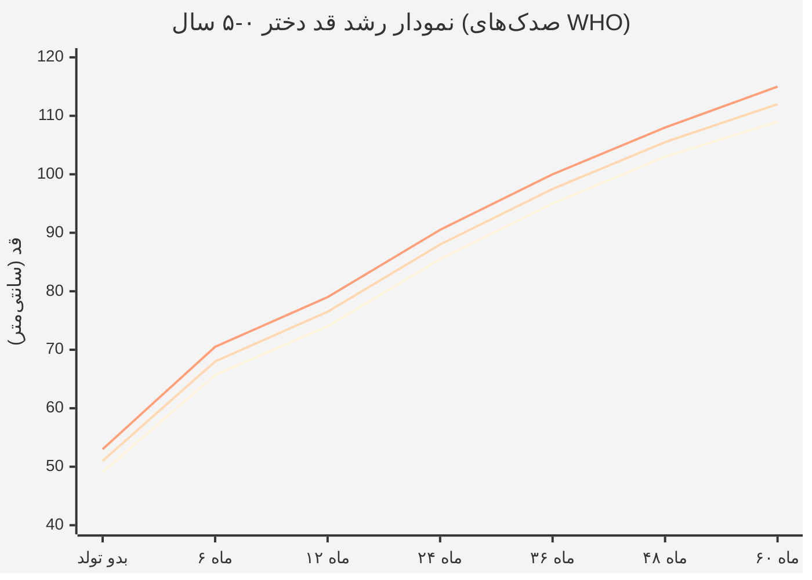
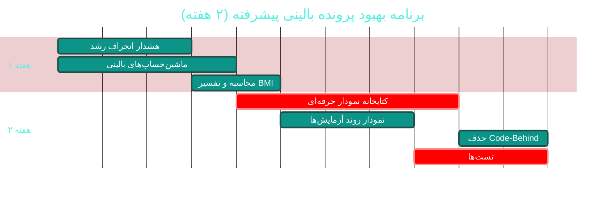

# ❤ ماژول پرونده بالینی پیشرفته (Advanced EMR)

> **مسیر ماژول:** `emr` · **لایسنس:** `EMR` + `Complementary`
> **اولویت:** 🟡 متوسط · **دشواری:** 🟡 متوسط · **زمان برآوردی:** ۲ هفته

---

## ۱. 📋 خلاصه ماژول

فراتر از ویزیت: **نمودار رشد WHO با z-score**، سابقه خانوادگی ۱۲ خویشاوندی،
طرح مراقبت بیماری‌های مزمن، روند علایم حیاتی، و پایش شاخص‌های سلامت در طول زمان.

| ویژگی | مقدار |
|:---|:---|
| 🎯 هدف | نگاه طولی (Longitudinal) به سلامت بیمار به‌جای نگاه تک‌ویزیتی |
| 👤 کاربران اصلی | پزشک · پرستار · متخصص اطفال |
| 🔗 وابستگی‌ها | `patients`, `visits`, `lab` |
| 📊 وضعیت فعلی | 🟢 عملیاتی — 🟡 پتانسیل بالای استفاده‌نشده |

---

## ۲. 🎯 وضعیت فعلی در کدبیس

| لایه | فایل | خط | وضعیت |
|:---|:---|--:|:---|
| 🧬 Domain | `.../Clinical/GrowthMeasurement.cs` | — | 🟢 |
| 🧬 Domain | `.../Clinical/FamilyHistory.cs` | — | 🟢 ۱۲ خویشاوندی |
| 🧬 Domain | `.../Clinical/ChronicCarePlan.cs` | — | 🟢 |
| 🧬 Domain | `.../Clinical/VitalSign.cs` | — | 🟢 |
| 🧬 Domain | `.../Enums/FamilyRelative.cs` · `CarePlanStatus.cs` · `HistoryType.cs` | — | 🟢 |
| 🧬 Shared | `src/Sahand.ClinicPro.Shared/Growth/` | ۷۷۳ | 🟢 مرجع WHO |
| ⚙ App | `.../Features/Patients/Commands/` (اندازه‌گیری رشد) | — | 🟢 |
| 🌐 API | `.../Controllers/EmrController.cs` | — | 🟢 |
| 🖥 Desktop | `.../ViewModels/AdvancedEmrViewModel.cs` | ۷۸۹ | 🟠 |
| 🖥 Desktop | `.../Views/AdvancedEmrView.xaml` (+ ۳۱۲ خط Code-Behind) | — | 🟠 |
| 🧪 تست | `tests/.../Growth/WhoGrowthReferenceTests.cs` | — | 🟢 موجود |

### نکات برجسته‌ی فعلی

✅ **مرجع رشد WHO** با تست اختصاصی (`WhoGrowthReferenceTests`) — سطح علمی بالا
✅ **محاسبه z-score** در `Shared/Growth`
✅ **۱۲ نسبت خویشاوندی** در سابقه خانوادگی
✅ **طرح مراقبت مزمن** با وضعیت (`CarePlanStatus`)
✅ **View تخصصی** با ۷۸۹ خط ViewModel

---

## ۳. 📊 نمودار داده‌های طولی سلامت



### نمودار رشد (z-score) — مفهوم



---

## ۴. ⚠️ کاستی‌ها و ایرادها

| # | کاستی | 🎯 شدت | 📍 محل | 💥 پیامد |
|:--:|:---|:--:|:---|:---|
| W-01 | **۳۱۲ خط Code-Behind** روی `AdvancedEmrView` | 🟠 بالا | `Views/` | نقض MVVM |
| W-02 | `AdvancedEmrViewModel` با **۷۸۹ خط** | 🟠 بالا | `ViewModels/` | — |
| W-03 | **نمودارها احتمالاً کنترل سفارشی** هستند نه کتابخانه نمودار | 🟠 بالا | `Controls/` | نگهداری دشوار، تعامل ضعیف |
| W-04 | **هشدار خودکار انحراف رشد** ندارد | 🟠 بالا | Domain | کوتاهی قد نادیده می‌ماند |
| W-05 | **پایش پیشرفت طرح مراقبت مزمن** خودکار نیست | 🟡 متوسط | `ChronicCarePlan` | طرح ثبت می‌شود اما پیگیری نمی‌شود |
| W-06 | **خلاصه بالینی قابل‌ارسال (Referral Summary)** ندارد | 🟡 متوسط | — | ارجاع دستی انجام می‌شود |
| W-07 | **نمودار روند آزمایش‌ها** در این ماژول نیست | 🟡 متوسط | — | پزشک باید بین صفحات جابه‌جا شود |
| W-08 | **شاخص توده بدنی (BMI) و تفسیر خودکار** ندارد | 🟡 متوسط | `GrowthMeasurement` | محاسبه دستی |
| W-09 | **مقایسه با استاندارد ملی ایران** (فقط WHO) | 🔵 کم | `Shared/Growth` | تفاوت جمعیتی |

---

## ۵. ✨ امکانات پیشنهادی

| 🎯 # | امکان | 📝 شرح | 💰 ارزش | 🔧 دشواری | ⏱ |
|:--:|:---|:---|:--:|:--:|:--:|
| F-01 | 🔔 **هشدار خودکار انحراف رشد** | z-score خارج از ±۲ → اعلان به پزشک | بالا | کم | ۳ روز |
| F-02 | 📊 **کتابخانه نمودار حرفه‌ای** | جایگزینی کنترل‌های دستی با LiveCharts2/ScottPlot | بالا | متوسط | ۱ هفته |
| F-03 | 📈 **نمودار روند آزمایش‌ها** | سری زمانی پارامترهای خونی با محدوده مرجع | بالا | کم | ۴ روز |
| F-04 | 🏥 **پایش خودکار طرح مراقبت مزمن** | یادآوری اقداماتِ سررسید + نمودار پیشرفت | بالا | متوسط | ۱ هفته |
| F-05 | 📄 **خلاصه بالینی ارجاع (Referral Summary)** | PDF یکپارچه برای ارسال به متخصص | بالا | کم | ۴ روز |
| F-06 | ⚖ **محاسبه و تفسیر خودکار BMI** | با طبقه‌بندی سنی | متوسط | کم | ۲ روز |
| F-07 | 🧮 **ماشین‌حساب‌های بالینی** | eGFR، CHA₂DS₂-VASc، ASCVD، فرمول کودکان | بالا | متوسط | ۱ هفته |
| F-08 | 🧬 **درخت خانوادگی (Pedigree)** | ترسیم گرافیکی ۳ نسل + الگوی وراثت | متوسط | متوسط | ۱ هفته |
| F-09 | 🎯 **امتیاز ریسک بیماری مزمن** | ترکیب شاخص‌ها → اولویت‌بندی پیگیری | بالا | متوسط | ۱ هفته |
| F-10 | 📱 **پایش از راه دور (RPM)** | ورود داده توسط بیمار از خانه | بالا | زیاد | ۳ هفته |

---

## ۶. 🛠 دستورالعمل پیاده‌سازی

### 📌 گام ۱ — هشدار خودکار انحراف رشد (F-01) — *سریع‌ترین برد*

```csharp
// 📄 src/Sahand.ClinicPro.Application/Features/Patients/Commands/AddGrowthMeasurement/AddGrowthMeasurementCommand.cs
// در Handler پس از ذخیره اندازه‌گیری — افزوده شود:

// ── ارزیابی z-score و صدور هشدار ─────────────────────────────
var zScores = WhoGrowthReference.CalculateAll(
    gender: patient.Gender,
    ageMonths: ageMonths,
    weightKg: request.WeightKg,
    heightCm: request.HeightCm,
    headCircumferenceCm: request.HeadCircumferenceCm);

var criticalDeviations = new List<string>();

if (Math.Abs(zScores.HeightForAge) >= 2)
    criticalDeviations.Add(
        $"قد برای سن: z = {zScores.HeightForAge:F2} " +
        $"(خارج از محدوده طبیعی ±۲)");

if (Math.Abs(zScores.WeightForAge) >= 2)
    criticalDeviations.Add(
        $"وزن برای سن: z = {zScores.WeightForAge:F2}");

if (Math.Abs(zScores.BmiForAge) >= 2)
    criticalDeviations.Add(
        $"BMI برای سن: z = {zScores.BmiForAge:F2}");

if (criticalDeviations.Count > 0)
{
    await _notifier.CreateAsync(new CreateNotificationRequest(
        UserId: patient.PrimaryDoctorUserId ?? 0,
        Title: "⚠ انحراف در منحنی رشد",
        Message: $"بیمار {patient.FirstName} {patient.LastName}:\n" +
                 string.Join("\n", criticalDeviations),
        Type: NotificationType.ClinicalAlert,
        Priority: NotificationPriority.High,
        ReferenceType: "growth",
        ReferenceId: measurement.Id), ct);

    _logger.LogInformation(
        "هشدار رشد برای بیمار {PatientId}: {Deviations}",
        request.PatientId, string.Join("، ", criticalDeviations));
}
```

---

### 📌 گام ۲ — جایگزینی کنترل‌های نمودار دستی (F-02)

> 🎯 **توصیه:** به‌جای نگهداری کنترل نمودار سفارشی، از یک کتابخانه استاندارد استفاده کنید.

```xml
<!-- گزینه ۱: LiveCharts2 (MIT — کاملاً رایگان، سازگار با رویکرد پروژه) -->
<PackageReference Include="LiveChartsCore.SkiaSharpView.WPF" Version="2.0.0-beta.700" />

<!-- گزینه ۲: ScottPlot (MIT — سبک و سریع برای نمودارهای علمی) -->
<PackageReference Include="ScottPlot.WPF" Version="5.0.*" />
```

> ⚠️ **نکته‌ی مهم برای این پروژه:** طبق `Directory.Packages.props`، تیم روی
> **آخرین نسخه‌ی رایگان** هر پکیج پین می‌کند و از نسخه‌های تجاری پرهیز دارد.
> هر دو گزینه بالا MIT هستند. قبل از افزودن، در `Directory.Packages.props`
> نسخه را ثبت و در `TODO.md` یادداشت کنید.

```csharp
// 📄 src/Sahand.ClinicPro.Desktop/ViewModels/AdvancedEmrViewModel.cs
// نمونه سری رشد با LiveCharts2:

using LiveChartsCore;
using LiveChartsCore.SkiaSharpView;
using SkiaSharp;

/// <summary>سری نمودار رشد بیمار</summary>
public ISeries[] GrowthSeries { get; private set; } = Array.Empty<ISeries>();

/// <summary>بارگذاری نمودار رشد با صدک‌های مرجع WHO</summary>
private void BuildGrowthChart()
{
    var patientPoints = Measurements
        .OrderBy(m => m.MeasuredAt)
        .Select(m => new ObservablePoint(ToMonths(m.AgeAtMeasurement), (double)m.HeightCm))
        .ToArray();

    GrowthSeries = new ISeries[]
    {
        // صدک ۳ (مرز پایین)
        new LineSeries<ObservablePoint>
        {
            Name = "صدک ۳",
            Values = ReferenceP3,
            Fill = null,
            Stroke = new SolidColorPaint(SKColors.LightGray) { StrokeThickness = 1 },
            GeometrySize = 0,
        },
        // صدک ۵۰ (میانه)
        new LineSeries<ObservablePoint>
        {
            Name = "صدک ۵۰ (میانه)",
            Values = ReferenceP50,
            Fill = null,
            Stroke = new SolidColorPaint(SKColors.Gray) { StrokeThickness = 1 },
            GeometrySize = 0,
        },
        // صدک ۹۷ (مرز بالا)
        new LineSeries<ObservablePoint>
        {
            Name = "صدک ۹۷",
            Values = ReferenceP97,
            Fill = null,
            Stroke = new SolidColorPaint(SKColors.LightGray) { StrokeThickness = 1 },
            GeometrySize = 0,
        },
        // ⭐ داده‌های واقعی بیمار — برجسته
        new LineSeries<ObservablePoint>
        {
            Name = "رشد بیمار",
            Values = patientPoints,
            Fill = null,
            Stroke = new SolidColorPaint(SKColors.Teal) { StrokeThickness = 3 },
            GeometrySize = 8,
            GeometryStroke = new SolidColorPaint(SKColors.Teal) { StrokeThickness = 2 },
            GeometryFill = new SolidColorPaint(SKColors.White),
        },
    };
}
```

---

### 📌 گام ۳ — ماشین‌حساب‌های بالینی (F-07)

```csharp
// 📄 src/Sahand.ClinicPro.Shared/Clinical/ClinicalCalculators.cs (جدید)
namespace Sahand.ClinicPro.Shared.Clinical;

/// <summary>
/// ماشین‌حساب‌های بالینی استاندارد — محاسباتِ تأییدشده برای پشتیبانی تصمیم.
/// همه متدها Pure و کاملاً قابل‌تست هستند (بدون وابستگی به دیتابیس).
/// </summary>
public static class ClinicalCalculators
{
    /// <summary>
    /// محاسبه نرخ فیلتراسیون گلومرولی (eGFR) به فرمول CKD-EPI 2021
    /// </summary>
    /// <param name="creatinineMgDl">کراتینین سرم (mg/dL)</param>
    /// <param name="ageYears">سن (سال)</param>
    /// <param name="isFemale">جنسیت مؤنث</param>
    /// <returns>eGFR بر حسب mL/min/1.73m²</returns>
    public static double EgfrCkdEpi2021(double creatinineMgDl, int ageYears, bool isFemale)
    {
        var kappa = isFemale ? 0.7 : 0.9;
        var alpha = isFemale ? -0.241 : -0.302;
        var factor = isFemale ? 1.012 : 1.0;

        var min = Math.Min(creatinineMgDl / kappa, 1.0);
        var max = Math.Max(creatinineMgDl / kappa, 1.0);

        return 142.0 * Math.Pow(min, alpha) * Math.Pow(max, -1.200)
               * Math.Pow(0.9938, ageYears) * factor;
    }

    /// <summary>مرحله بیماری مزمن کلیه بر اساس eGFR</summary>
    public static string CkdStage(double egfr) => egfr switch
    {
        >= 90  => "G1 — طبیعی یا بالا",
        >= 60  => "G2 — کاهش خفیف",
        >= 45  => "G3a — خفیف تا متوسط",
        >= 30  => "G3b — متوسط تا شدید",
        >= 15  => "G4 — شدید",
        _      => "G5 — نارسایی کلیه",
    };

    /// <summary>
    /// محاسبه امتیاز CHA₂DS₂-VASc برای ریسک سکته در فیبریلاسیون دهلیزی
    /// </summary>
    public static int Cha2Ds2Vasc(bool heartFailure, bool hypertension, int ageYears,
        bool diabetes, bool priorStroke, bool vascularDisease, bool isFemale)
    {
        var score = 0;
        if (heartFailure)    score += 1;
        if (hypertension)    score += 1;
        if (ageYears >= 75)  score += 2;
        else if (ageYears >= 65) score += 1;
        if (diabetes)        score += 1;
        if (priorStroke)     score += 2;
        if (vascularDisease) score += 1;
        if (isFemale)        score += 1;
        return score;
    }

    /// <summary>توصیه ضدانعقاد بر اساس امتیاز CHA₂DS₂-VASc</summary>
    public static string AnticoagulationAdvice(int score, bool isFemale) =>
        (score, isFemale) switch
        {
            (>= 2, _)   => "ضدانعقاد خوراکی توصیه می‌شود",
            (1, false)  => "می‌توان ضدانعقاد را در نظر گرفت",
            (1, true)   => "معمولاً بدون نیاز به ضدانعقاد",
            _           => "بدون نیاز به ضدانعقاد",
        };

    /// <summary>
    /// محاسبه شاخص توده بدنی (BMI)
    /// </summary>
    public static double Bmi(double weightKg, double heightCm)
    {
        if (heightCm <= 0) throw new ArgumentOutOfRangeException(nameof(heightCm));
        var h = heightCm / 100.0;
        return weightKg / (h * h);
    }

    /// <summary>تفسیر BMI برای بزرگسالان</summary>
    public static string InterpretBmi(double bmi) => bmi switch
    {
        < 16.0 => "لاغری شدید",
        < 18.5 => "کم‌وزن",
        < 25.0 => "وزن طبیعی",
        < 30.0 => "اضافه‌وزن",
        < 35.0 => "چاقی درجه ۱",
        < 40.0 => "چاقی درجه ۲",
        _      => "چاقی درجه ۳ (مرضی)",
    };

    /// <summary>مساحت سطح بدن به روش Mosteller</summary>
    public static double BsaMosteller(double weightKg, double heightCm)
        => Math.Sqrt(weightKg * heightCm / 3600.0);
}
```

**تست‌ها:**
```csharp
// 📄 tests/Sahand.ClinicPro.Application.UnitTests/Clinical/ClinicalCalculatorTests.cs
public class ClinicalCalculatorTests
{
    [Theory]
    [InlineData(1.0, 50, false, 97.9)]     // مرد ۵۰ ساله، کراتینین ۱
    [InlineData(1.0, 50, true, 98.7)]      // زن ۵۰ ساله
    [InlineData(2.0, 70, false, 37.5)]     // کاهش شدید
    public void Egfr_KnownCases_ReturnsExpected(double cr, int age, bool female, double expected)
    {
        var actual = ClinicalCalculators.EgfrCkdEpi2021(cr, age, female);
        actual.Should().BeApproximately(expected, 1.5);
    }

    [Theory]
    [InlineData(1.8, 180, 27.78)]
    [InlineData(70, 175, 22.86)]
    public void Bmi_ValidInputs_ReturnsExpected(double kg, double cm, double expected)
        => ClinicalCalculators.Bmi(kg, cm).Should().BeApproximately(expected, 0.05);

    [Fact]
    public void InterpretBmi_Obese_ReturnsCorrectCategory()
        => ClinicalCalculators.InterpretBmi(32).Should().Be("چاقی درجه ۱");
}
```

---

## ۷. 🧪 تست‌های الزامی

| 🧪 تست | 🎯 هدف |
|:---|:---|
| `WhoZScore_KnownValues_MatchesReference` | صحت z-score (موجود است — گسترش یابد) |
| `GrowthDeviation_BeyondTwoSigma_TriggersAlert` | هشدار خودکار |
| `GrowthChart_SeriesCount_Correct` | ساخت نمودار |
| `Egfr_KnownCases_ReturnsExpected` | ماشین‌حساب |
| `Cha2Ds2Vasc_AllFactors_Returns9` | سقف امتیاز |
| `Bmi_ZeroHeight_Throws` | مدیریت خطا |
| `CarePlan_OverdueActions_Identified` | پایش طرح مراقبت |
| `ReferralSummary_IncludesAllSections` | خلاصه ارجاع |

---

## ۸. 📈 شاخص‌های موفقیت (KPI)

| 📊 شاخص | قبل | هدف |
|:---|:--:|:--:|
| 📏 ثبت اندازه‌گیری رشد در ویزیت اطفال | ~۳۰٪ | **> ۹۰٪** |
| 🔔 شناسایی به‌موقع انحراف رشد | نامشخص | **> ۹۵٪** |
| 📈 پایش فعال طرح‌های مراقبت مزمن | ~۲۰٪ | **> ۷۵٪** |
| 🧮 استفاده از ماشین‌حساب‌های بالینی | ۰٪ | **> ۵۰٪** |
| 📏 Code-Behind این ماژول | ۳۱۲ خط | **< ۵۰ خط** |

---

## ۹. 🗓 برنامه زمانی



---

## 🔗 پیوندهای مرتبط

| 📄 سند | توضیح |
|:---|:---|
| [تحلیل جامع](../ANALYSIS-REPORT.md) | سند اصلی |
| [A01 — بیماران](A01-patients.md) | پرونده پایه |
| [A07 — آزمایشگاه](A07-laboratory.md) | منبع نمودار روند |
| [D03 — دستیار هوش مصنوعی](D03-ai-assistant.md) | تحلیل خودکار روندها |

---
<div align="center">📅 ۱۴۰۴/۰۷/۱۹ · 🔖 v1.0</div>
