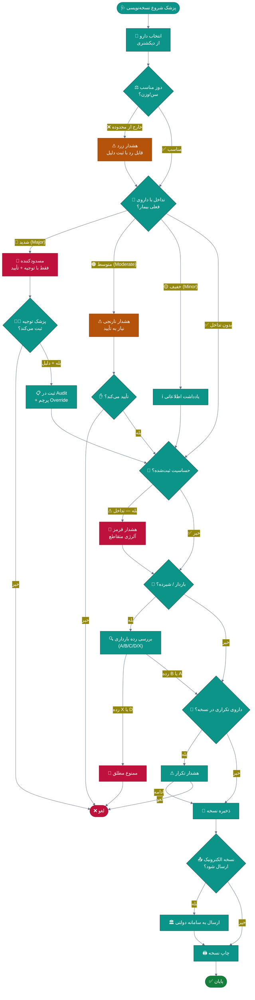
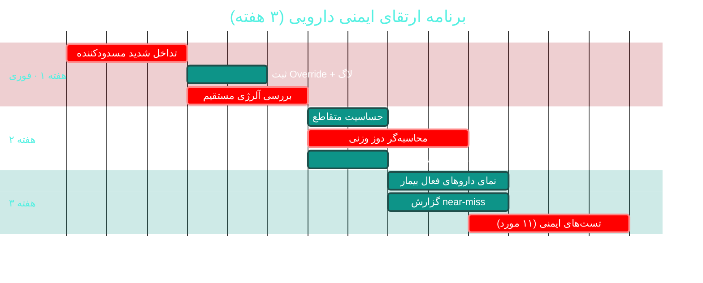

# 💊 ماژول نسخه‌نویسی و ایمنی دارویی (Prescriptions & Clinical Safety)

> **مسیر ماژول:** `prescriptions` · **لایسنس:** `Prescriptions` + `ClinicalSafety`
> **اولویت:** 🔴 بحرانی · **دشواری:** 🟡 متوسط · **زمان برآوردی:** ۳ هفته

---

## ۱. 📋 خلاصه ماژول

حیاتی‌ترین ماژول از نظر **ایمنی بیمار**: دیکشنری دارو، نسخه‌نویسی،
**تداخل‌سنجی خودکار**، قالب‌های سریع، بررسی دوز بر اساس سن/وزن،
هشدار بارداری و نسخه الکترونیک دولتی.

| ویژگی | مقدار |
|:---|:---|
| 🎯 هدف | جلوگیری از خطای دارویی قبل از وقوع |
| 👤 کاربران اصلی | پزشک · داروخانه |
| 🔗 وابستگی‌ها | `patients`, `visits`, `pharmacy`, `government (eRx)` |
| 📊 وضعیت فعلی | 🟢 عملیاتی — 🔴 نیازمند ارتقای ایمنی |

---

## ۲. 🎯 وضعیت فعلی در کدبیس

| لایه | فایل | خط | وضعیت |
|:---|:---|--:|:---|
| 🧬 Domain | `.../Clinical/Prescription.cs` · `PrescriptionItem.cs` | — | 🟢 |
| 🧬 Domain | `.../Clinical/Medication.cs` | — | 🟢 + بذر ۵٬۰۵۴ خطی |
| 🧬 Domain | `.../Clinical/DrugInteraction.cs` | — | 🟢 + ۶ فایل بذر تکمیلی |
| 🧬 Domain | `.../Clinical/PrescriptionTemplate.cs` | — | 🟢 |
| 🧬 Domain | `.../Enums/DrugInteractionSeverity.cs` · `MedicationRoute.cs` · `PregnancyCategory.cs` · `MedicationItemKind.cs` | — | 🟢 |
| ⚙ App | `.../Features/Prescriptions/CreatePrescription/` · `CheckInteractions/` · `SearchMedications/` · `PrescriptionTemplates/` · `SubmitElectronic/` · `GetPrescriptions/` | — | 🟢 |
| ⚙ App | `.../Common/Helpers/` (موتور ریسک) | — | 🟢 |
| 🌐 API | `.../Controllers/PrescriptionsController.cs` | — | 🟢 |
| 🖥 Desktop | `.../ViewModels/PrescriptionFormViewModel.cs` | ۹۵۵ | 🟠 ۱۳ فرمان |
| 🖥 Desktop | `.../Views/PrescriptionsView.xaml` · `PrescriptionFormWindow` · `PrescriptionDetailWindow` | — | 🟢 |
| 🧪 تست | `tests/.../Prescriptions/CheckInteractionsRiskEngineTests.cs` | — | 🟢 موجود |

### نکات برجسته‌ی فعلی

✅ **موتور تداخل‌سنجی** با تست اختصاصی (`CheckInteractionsRiskEngineTests`)
✅ **دیکشنری داروی بسیار گسترده** (بذر ۵٬۰۵۴ خط + ۵ فایل تکمیلی)
✅ **پایگاه تداخلات دارویی** با ۶ فایل بذر
✅ **دسته‌بندی شدت تداخل** (`DrugInteractionSeverity`)
✅ **رده بارداری** (`PregnancyCategory`) برای هر دارو
✅ **قالب‌های نسخه** برای سرعت

---

## ۳. 📊 نمودار جریان ایمنی دارویی



---

## ۴. ⚠️ کاستی‌ها و ایرادها

| # | کاستی | 🎯 شدت | 📍 محل | 💥 پیامد |
|:--:|:---|:--:|:---|:---|
| W-01 | **هشدار تداخل شدید احتمالاً غیرمسدودکننده است** | 🔴 بحرانی | `CheckInteractions` | خطر جانی برای بیمار |
| W-02 | **بررسی آلرژی/حساسیت** در مسیر نسخه‌نویسی کامل نیست | 🔴 بحرانی | Domain | واکنش آلرژیک |
| W-03 | **بررسی دوز بر اساس وزن/سطح بدن** ندارد | 🟠 بالا | `PrescriptionItem` | اوردوز در کودکان |
| W-04 | **بررسی تداخل با غذا/الکل** ندارد | 🟡 متوسط | Domain | کاهش اثر / عارضه |
| W-05 | **بررسی عملکرد کلیه/کبد** قبل از دوز ندارد | 🟠 بالا | Domain | تجمع دارو و مسمومیت |
| W-06 | **بررسی تداخل با بیماری زمینه‌ای** (Contraindication) ندارد | 🟠 بالا | Domain | منع مصرف نادیده گرفته می‌شود |
| W-07 | `PrescriptionFormViewModel` با **۹۵۵ خط / ۱۳ فرمان** | 🟠 بالا | `ViewModels/` | منطق ایمنی در UI پخش شده |
| W-08 | **تاریخچه نسخه‌های قبلی بیمار** در لحظه تجویز دیده نمی‌شود | 🟠 بالا | UI | تداخل با داروی در جریان |
| W-09 | **گزارش خطاهای دارویی نزدیک به وقوع (Near-miss)** ندارد | 🟡 متوسط | — | فرصت یادگیری از دست می‌رود |
| W-10 | پایگاه تداخلات در **۶ فایل بذر جدا** نگهداری می‌شود | 🟡 متوسط | `SeedData/` | نگهداری دشوار |

---

## ۵. ✨ امکانات پیشنهادی

| 🎯 # | امکان | 📝 شرح | 💰 ارزش | 🔧 دشواری | ⏱ |
|:--:|:---|:---|:--:|:--:|:--:|
| F-01 | 🛡 **تداخل شدید = مسدودکننده** | توقف ذخیره مگر با توجیه مکتوب + تأیید دوم | **حیاتی** | کم | ۳ روز |
| F-02 | 🤧 **بررسی آلرژی و حساسیت متقاطع** | فیلد آلرژی روی بیمار + مسدودسازی | **حیاتی** | کم | ۴ روز |
| F-03 | ⚖ **محاسبه‌گر دوز بر اساس وزن/سطح بدن** | mg/kg و mg/m² با سقف ایمنی | **حیاتی** | متوسط | ۱ هفته |
| F-04 | 🫘 **تنظیم دوز بر اساس عملکرد کلیه (eGFR)** | کاهش خودکار دوز در نارسایی | بالا | متوسط | ۱ هفته |
| F-05 | 🚫 **منع مصرف بر اساس بیماری زمینه‌ای** | ICD-10 بیمار × منع مصرف دارو | بالا | متوسط | ۱ هفته |
| F-06 | 📜 **نمای داروهای فعال بیمار** | پنل کناریِ نسخه‌های جاری هنگام تجویز | بالا | کم | ۳ روز |
| F-07 | 📊 **گزارش خطاهای نزدیک به وقوع** | ثبت Overrideها + تحلیل ماهانه | بالا | کم | ۳ روز |
| F-08 | 🍇 **تداخل با غذا و مکمل** | گسترش پایگاه تداخلات | متوسط | متوسط | ۱ هفته |
| F-09 | 📦 **یکپارچه‌سازی پایگاه تداخلات** | ادغام ۶ فایل بذر در یک منبع تمیز | متوسط | کم | ۳ روز |
| F-10 | 🔔 **پیگیری پایبندی به دارو** | یادآوری مصرف + گزارش adherence | متوسط | متوسط | ۱ هفته |

---

## ۶. 🛠 دستورالعمل پیاده‌سازی

### 📌 گام ۱ — تداخل شدید مسدودکننده + ثبت Override (F-01) — *فوری‌ترین*

**۱.۱ مدل نتیجه بررسی ایمنی**

```csharp
// 📄 src/Sahand.ClinicPro.Application/Features/Prescriptions/CheckInteractions/SafetyCheckResult.cs (جدید)
namespace Sahand.ClinicPro.Application.Features.Prescriptions.CheckInteractions;

/// <summary>
/// نتیجه ارزیابی ایمنی دارویی — تعیین می‌کند آیا ذخیره نسخه مجاز است یا خیر.
/// </summary>
/// <param name="CanProceed">آیا ادامه مجاز است</param>
/// <param name="IsBlocked">آیا مسدود شده (نیاز به توجیه مکتوب)</param>
/// <param name="Alerts">فهرست هشدارها</param>
public record SafetyCheckResult(
    bool CanProceed,
    bool IsBlocked,
    IReadOnlyList<SafetyAlert> Alerts)
{
    /// <summary>بدون هیچ هشداری</summary>
    public static SafetyCheckResult Clean() =>
        new(true, false, Array.Empty<SafetyAlert>());

    /// <summary>ساخت نتیجه از فهرست هشدارها</summary>
    public static SafetyCheckResult From(IEnumerable<SafetyAlert> alerts)
    {
        var list = alerts.ToList();
        return new SafetyCheckResult(
            CanProceed: !list.Any(a => a.Severity == AlertSeverity.Critical),
            IsBlocked:  list.Any(a => a.Severity == AlertSeverity.Critical),
            Alerts:     list);
    }
}

/// <summary>یک هشدار ایمنی</summary>
public record SafetyAlert(
    AlertSeverity Severity,
    string Title,
    string Detail,
    string? Recommendation);

/// <summary>شدت هشدار</summary>
public enum AlertSeverity
{
    /// <summary>اطلاعاتی — فقط نمایش</summary>
    Info,
    /// <summary>هشدار — نیاز به تأیید</summary>
    Warning,
    /// <summary>بحرانی — مسدودکننده، فقط با توجیه مکتوب</summary>
    Critical,
}
```

**۱.۲ گارد در Command اصلی**

```csharp
// 📄 src/Sahand.ClinicPro.Application/Features/Prescriptions/CreatePrescription/CreatePrescriptionCommand.cs
// تغییر رکورد فرمان برای پذیرش توجیه:

public record CreatePrescriptionCommand(
    CreatePrescriptionDto Dto,
    string? OverrideJustification = null,      // 🆕 توجیه پزشک
    bool AcknowledgedWarnings = false)         // 🆕 تأیید هشدارها
    : IRequest<Result<long>>;
```

```csharp
// در Handler، پس از اعتبارسنجی اولیه و پیش از ذخیره:

// ── گارد ایمنی دارویی ─────────────────────────────────────────
var safety = await _safetyEngine.EvaluateAsync(
    patientId: request.Dto.PatientId,
    items: request.Dto.Items,
    ct);

var criticals = safety.Alerts
    .Where(a => a.Severity == AlertSeverity.Critical)
    .ToList();

if (criticals.Count > 0)
{
    // مسدودکننده مگر با توجیه مکتوبِ معنادار
    if (string.IsNullOrWhiteSpace(request.OverrideJustification) ||
        request.OverrideJustification.Trim().Length < 15)
    {
        return Result<long>.Failure(Error.Validation(
            "این نسخه دارای تداخل بحرانی است و قابل ثبت نیست. " +
            "در صورت ضرورت بالینی، توجیه مکتوب (حداقل ۱۵ کاراکتر) ثبت کنید.",
            "PRESCRIPTION_CRITICAL_INTERACTION"));
    }

    // ثبت Override برای ممیزی و گزارش near-miss
    await _safetyLog.RecordOverrideAsync(new OverrideRecord(
        PrescriptionDraft: request.Dto,
        Alerts: criticals,
        Justification: request.OverrideJustification,
        UserId: _currentUser.UserId,
        OccurredAt: _clock.UtcNow), ct);

    _logger.LogWarning(
        "ثبت نسخه با تداخل بحرانی — پزشک {UserId}، بیمار {PatientId}، توجیه: {Justification}",
        _currentUser.UserId, request.Dto.PatientId, request.OverrideJustification);
}
else if (safety.Alerts.Any(a => a.Severity == AlertSeverity.Warning)
         && !request.AcknowledgedWarnings)
{
    return Result<long>.Failure(Error.Validation(
        "این نسخه دارای هشدار دارویی است. لطفاً هشدارها را مطالعه و تأیید کنید.",
        "PRESCRIPTION_WARNING_NOT_ACKNOWLEDGED"));
}
```

**۱.۳ موجودیت لاگ Override**

```csharp
// 📄 src/Sahand.ClinicPro.Domain/Clinical/PrescriptionOverrideLog.cs (جدید)
namespace Sahand.ClinicPro.Domain.Entities.Clinical;

/// <summary>
/// لاگ نادیده‌گرفتن هشدار ایمنی — منبع اصلی گزارش «خطاهای نزدیک به وقوع».
/// هر بار که پزشک یک هشدار بحرانی را با توجیه رد می‌کند، اینجا ثبت می‌شود
/// تا در گزارش ماهانه ایمنی تحلیل شود.
/// </summary>
public class PrescriptionOverrideLog : AuditableEntity
{
    /// <summary>شناسه بیمار</summary>
    public long PatientId { get; set; }

    /// <summary>شناسه نسخه (در صورت ثبت نهایی)</summary>
    public long? PrescriptionId { get; set; }

    /// <summary>کد داروی مسبب</summary>
    public string? MedicationCode { get; set; }

    /// <summary>نوع هشدار نادیده‌گرفته‌شده</summary>
    public string AlertType { get; set; } = string.Empty;

    /// <summary>شدت هشدار</summary>
    public string Severity { get; set; } = string.Empty;

    /// <summary>توجیه پزشک</summary>
    public string Justification { get; set; } = string.Empty;

    /// <summary>شناسه کاربر نادیده‌گیرنده</summary>
    public long UserId { get; set; }
}
```

---

### 📌 گام ۲ — بررسی آلرژی و حساسیت متقاطع (F-02)

```csharp
// 📄 src/Sahand.ClinicPro.Domain/People/PatientAllergy.cs (جدید)
namespace Sahand.ClinicPro.Domain.Entities.People;

/// <summary>
/// حساسیت دارویی بیمار — با قابلیت تعیین گروه متقاطع.
/// مثال: حساسیت به پنی‌سیلین → گروه متقاطع «بتالاکتام» شامل سفالوسپورین‌ها.
/// </summary>
public class PatientAllergy : AuditableEntity, ISoftDeletable
{
    /// <summary>شناسه بیمار</summary>
    public long PatientId { get; set; }

    /// <summary>بیمار</summary>
    public Patient Patient { get; set; } = null!;

    /// <summary>نوع حساسیت (دارو / غذا / محیطی)</summary>
    public AllergyType AllergyType { get; set; } = AllergyType.Medication;

    /// <summary>ماده حساسیت‌زا (نام دارو یا ماده)</summary>
    public string Allergen { get; set; } = null!;

    /// <summary>کد دارو در صورت اتصال به دیکشنری</summary>
    public long? MedicationId { get; set; }

    /// <summary>دارو (در صورت وجود در دیکشنری)</summary>
    public Medication? Medication { get; set; }

    /// <summary>گروه حساسیت متقاطع (مثلاً BetaLactam, NSAID, Sulfa)</summary>
    public string? CrossReactiveGroup { get; set; }

    /// <summary>شدت واکنش</summary>
    public AllergySeverity Severity { get; set; } = AllergySeverity.Moderate;

    /// <summary>شرح واکنش مشاهده‌شده</summary>
    public string? Reaction { get; set; }

    /// <summary>تاریخ اولین بروز</summary>
    public DateTime? FirstObservedAt { get; set; }
}

/// <summary>نوع حساسیت</summary>
public enum AllergyType { Medication, Food, Environmental, Contrast }

/// <summary>شدت واکنش آلرژیک</summary>
public enum AllergySeverity
{
    /// <summary>خفیف — کهیر موضعی</summary>
    Mild,
    /// <summary>متوسط — کهیر گسترده</summary>
    Moderate,
    /// <summary>شدید — آنژیوادم / برونکواسپاسم</summary>
    Severe,
    /// <summary>تهدیدکننده حیات — آنافیلاکسی</summary>
    LifeThreatening,
}
```

```csharp
// در موتور ایمنی — بررسی آلرژی:
private async Task<List<SafetyAlert>> CheckAllergiesAsync(long patientId,
    IReadOnlyList<PrescriptionItemDto> items, CancellationToken ct)
{
    var alerts = new List<SafetyAlert>();

    var allergies = await _uow.Repository<PatientAllergy>().QueryableNoTracking
        .Where(a => !a.IsDeleted && a.PatientId == patientId)
        .ToListAsync(ct);

    if (allergies.Count == 0) return alerts;

    foreach (var item in items)
    {
        var med = await _uow.Repository<Medication>()
            .QueryableNoTracking
            .FirstOrDefaultAsync(m => m.Id == item.MedicationId, ct);
        if (med is null) continue;

        // ۱) تطابق مستقیم
        var direct = allergies.FirstOrDefault(a =>
            a.MedicationId == med.Id ||
            med.Name.Contains(a.Allergen, StringComparison.OrdinalIgnoreCase));

        if (direct is not null)
        {
            alerts.Add(new SafetyAlert(
                AlertSeverity.Critical,
                $"حساسیت ثبت‌شده به {direct.Allergen}",
                $"بیمار سابقه واکنش «{direct.Reaction ?? "ثبت‌شده"}» به این دارو دارد.",
                "مصرف این دارو ممنوع است — داروی جایگزین انتخاب کنید"));
            continue;
        }

        // ۲) حساسیت متقاطع
        var cross = allergies.FirstOrDefault(a =>
            !string.IsNullOrWhiteSpace(a.CrossReactiveGroup) &&
            a.CrossReactiveGroup.Equals(med.CrossReactiveGroup,
                StringComparison.OrdinalIgnoreCase));

        if (cross is not null)
        {
            alerts.Add(new SafetyAlert(
                cross.Severity is AllergySeverity.Severe or AllergySeverity.LifeThreatening
                    ? AlertSeverity.Critical
                    : AlertSeverity.Warning,
                $"احتمال حساسیت متقاطع ({cross.CrossReactiveGroup})",
                $"بیمار به «{cross.Allergen}» حساسیت دارد که با این دارو هم‌گروه است.",
                "داروی خارج از این گروه انتخاب کنید"));
        }
    }

    return alerts;
}
```

---

### 📌 گام ۳ — محاسبه‌گر دوز بر اساس وزن (F-03)

```csharp
// 📄 src/Sahand.ClinicPro.Application/Common/Helpers/DoseCalculator.cs (جدید)
namespace Sahand.ClinicPro.Application.Common.Helpers;

/// <summary>
/// محاسبه‌گر دوز دارو بر اساس وزن و سطح بدن — برای جلوگیری از اوردوز در کودکان.
/// </summary>
public static class DoseCalculator
{
    /// <summary>محاسبه سطح بدن به روش Mosteller (m²)</summary>
    /// <param name="weightKg">وزن بر حسب کیلوگرم</param>
    /// <param name="heightCm">قد بر حسب سانتی‌متر</param>
    public static double BodySurfaceArea(double weightKg, double heightCm)
        => Math.Sqrt(weightKg * heightCm / 3600.0);

    /// <summary>نتیجه محاسبه دوز</summary>
    public record DoseResult(
        double ComputedDose,
        double MaxSafeDose,
        bool ExceedsMaximum,
        string Unit,
        string Message);

    /// <summary>
    /// محاسبه دوز بر اساس وزن (mg/kg) با اعمال سقف ایمنی بزرگسال
    /// </summary>
    /// <param name="dosePerKg">دوز بر حسب میلی‌گرم به‌ازای کیلوگرم</param>
    /// <param name="weightKg">وزن بیمار</param>
    /// <param name="maxAdultDose">سقف دوز بزرگسال (اختیاری)</param>
    public static DoseResult ByWeight(double dosePerKg, double weightKg,
        double? maxAdultDose = null)
    {
        if (weightKg <= 0)
            throw new DomainException("وزن بیمار باید بزرگ‌تر از صفر باشد");

        var computed = dosePerKg * weightKg;
        var max = maxAdultDose ?? double.MaxValue;
        var exceeds = computed > max;

        return new DoseResult(
            ComputedDose: Math.Round(computed, 2),
            MaxSafeDose: max,
            ExceedsMaximum: exceeds,
            Unit: "mg",
            Message: exceeds
                ? $"دوز محاسبه‌شده ({computed:F1} mg) از سقف ایمن ({max:F1} mg) بیشتر است — به سقف محدود شد"
                : $"دوز پیشنهادی: {computed:F1} mg ({dosePerKg} mg/kg × {weightKg} kg)");
    }

    /// <summary>محاسبه دوز بر اساس سطح بدن (mg/m²) — رایج در شیمی‌درمانی</summary>
    public static DoseResult ByBodySurfaceArea(double dosePerM2, double weightKg, double heightCm)
    {
        var bsa = BodySurfaceArea(weightKg, heightCm);
        var computed = dosePerM2 * bsa;

        return new DoseResult(
            ComputedDose: Math.Round(computed, 2),
            MaxSafeDose: double.MaxValue,
            ExceedsMaximum: false,
            Unit: "mg",
            Message: $"دوز: {computed:F1} mg ({dosePerM2} mg/m² × BSA {bsa:F2} m²)");
    }
}
```

---

## ۷. 🧪 تست‌های الزامی

| 🧪 تست | 🎯 هدف | اولویت |
|:---|:---|:--:|
| `CriticalInteraction_WithoutJustification_Blocked` | مسدودسازی مؤثر | 🔴 |
| `CriticalInteraction_WithShortJustification_Blocked` | توجیه باید معنادار باشد | 🔴 |
| `CriticalInteraction_WithValidJustification_Allowed` | مسیر ضرورت بالینی باز بماند | 🔴 |
| `CriticalInteraction_RecordsOverrideLog` | ممیزی کامل | 🔴 |
| `Allergy_DirectMatch_Blocked` | جلوگیری از واکنش آلرژیک | 🔴 |
| `Allergy_CrossReactive_Warns` | حساسیت متقاطع | 🟠 |
| `Dose_ChildWeight_ComputesCorrectly` | محاسبه درست | 🔴 |
| `Dose_ExceedsMaxAdult_Capped` | سقف ایمنی | 🔴 |
| `Pregnancy_CategoryX_Blocked` | ممنوع مطلق در بارداری | 🔴 |
| `Contraindication_WithPatientCondition_Warns` | منع مصرف | 🟠 |
| `WarningNotAcknowledged_Blocked` | تأیید هشدار اجباری | 🟠 |

**تست حیاتی:**
```csharp
[Fact]
public async Task CriticalInteraction_WithoutJustification_Blocked()
{
    // Arrange: بیمار با داروی فعال + داروی جدیدِ دارای تداخل Major
    var patientId = await SeedPatientWithActiveMedicationAsync("WARFARIN");
    var interactingMed = await GetMedicationByCodeAsync("ASPIRIN");

    // Act
    var result = await _mediator.Send(new CreatePrescriptionCommand(
        new CreatePrescriptionDto { PatientId = patientId, Items = new[] {
            new PrescriptionItemDto { MedicationId = interactingMed.Id } } }));

    // Assert
    result.IsFailure.Should().BeTrue();
    result.Error.Code.Should().Be("PRESCRIPTION_CRITICAL_INTERACTION");
}
```

---

## ۸. 📈 شاخص‌های موفقیت (KPI)

| 📊 شاخص | قبل | هدف |
|:---|:--:|:--:|
| 🚫 تداخل بحرانیِ ثبت‌شده بدون توجیه | نامشخص | **۰ مورد** |
| 📋 ثبت آلرژی برای بیماران | ۰٪ | **> ۸۰٪** |
| ⚠ خطاهای دارویی گزارش‌شده | نامشخص | **⬇ ۷۰٪** |
| 📊 نرخ Override (رد هشدار) | نامشخص | **< ۳٪** و همه مستند |
| 🧪 پوشش تست موتور ایمنی | ~۴۰٪ | **۱۰۰٪** |

---

## ۹. 🗓 برنامه زمانی



---

## 🔗 پیوندهای مرتبط

| 📄 سند | توضیح |
|:---|:---|
| [تحلیل جامع](../ANALYSIS-REPORT.md) | سند اصلی |
| [A04 — ویزیت](A04-visits-soap.md) | مبدأ صدور نسخه |
| [B07 — داروخانه](B07-pharmacy-inventory.md) | مصرف‌کننده نسخه |
| [D03 — دستیار هوش مصنوعی](D03-ai-assistant.md) | پیشنهاد جایگزین ایمن |

---
<div align="center">📅 ۱۴۰۴/۰۷/۱۹ · 🔖 v1.0</div>
