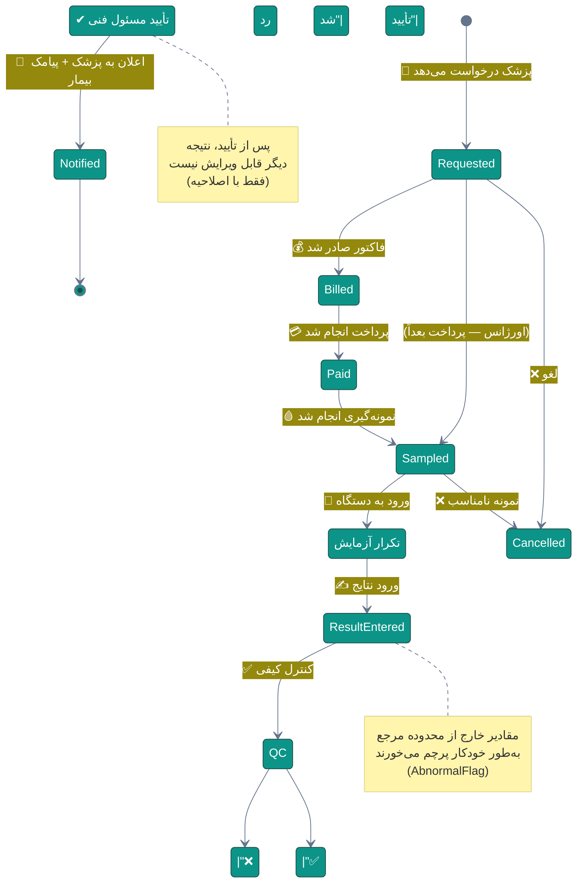
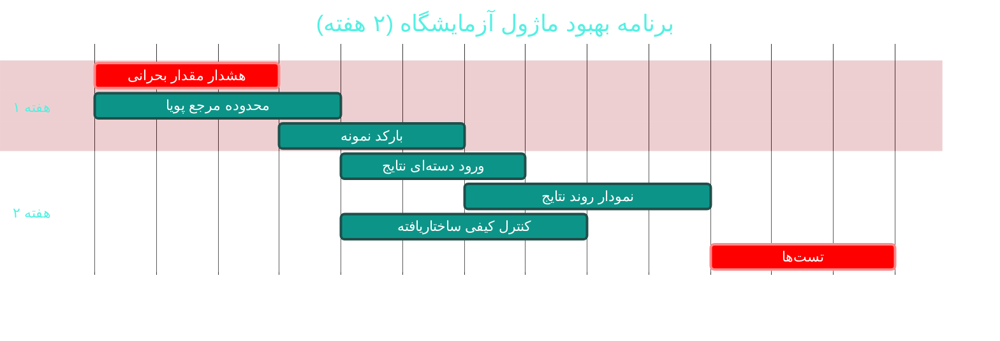

# 🧪 ماژول آزمایشگاه (Laboratory)

> **مسیر ماژول:** `lab` · **لایسنس:** `Lab`
> **اولویت:** 🟡 متوسط · **دشواری:** 🟡 متوسط · **زمان برآوردی:** ۲ هفته

---

## ۱. 📋 خلاصه ماژول

مدیریت چرخه‌ی کامل درخواست آزمایش: تعریف پنل‌ها و تست‌ها، ثبت درخواست،
جریان وضعیت، ورود نتایج، **کنترل کیفی**، پرچم مقادیر غیرطبیعی و گزارش‌گیری.

| ویژگی | مقدار |
|:---|:---|
| 🎯 هدف | رساندن نتیجه‌ی صحیح آزمایش به پزشک در کوتاه‌ترین زمان |
| 👤 کاربران اصلی | پزشک · تکنسین آزمایشگاه · پذیرشگر |
| 🔗 وابستگی‌ها | `patients`, `visits`, `billing`, `emr` |
| 📊 وضعیت فعلی | 🟢 عملیاتی |

---

## ۲. 🎯 وضعیت فعلی در کدبیس

| لایه | فایل | خط | وضعیت |
|:---|:---|--:|:---|
| 🧬 Domain | `.../Paraclinical/LabOrder.cs` · `LabOrderItem.cs` · `LabTest.cs` | — | 🟢 |
| 🧬 Domain | `.../Enums/LabOrderStatus.cs` · `LabItemStatus.cs` · `AbnormalFlag.cs` | — | 🟢 |
| 🧬 Domain | `.../Events/LabEvents.cs` | — | 🟢 |
| 🗄 Infra | `.../Seeders/SeedData/LabTestSeedData.cs` (۱٬۱۷۰ خط) | — | 🟢 بذر غنی |
| ⚙ App | `.../Features/Laboratory/LaboratoryFeatures.cs` | ۶۵۲ | 🟠 یکپارچه |
| 🌐 API | `.../Controllers/LabController.cs` | — | 🟢 |
| 🖥 Desktop | `.../ViewModels/LabViewModel.cs` · `LabResultViewModel.cs` | — | 🟢 |
| 🖥 Desktop | `.../Views/LabView.xaml` · `LabOrderFormWindow` · `LabResultWindow` | — | 🟢 |

### نکات برجسته‌ی فعلی

✅ **دیکشنری تست غنی** (بذر ۱٬۱۷۰ خط)
✅ **پرچم مقادیر غیرطبیعی** (`AbnormalFlag`) با سطوح
✅ **رویدادهای دامنه** برای آماده‌شدن نتیجه (`LabEvents`)
✅ **قالب پیامک** برای آماده‌شدن نتیجه (`SmsTemplateType.Result`)

---

## ۳. 📊 نمودار جریان آزمایش



---

## ۴. ⚠️ کاستی‌ها و ایرادها

| # | کاستی | 🎯 شدت | 📍 محل | 💥 پیامد |
|:--:|:---|:--:|:---|:---|
| W-01 | **محدوده مرجع بر اساس سن/جنس** احتمالاً ثابت است | 🟠 بالا | `LabTest` | پرچم اشتباه برای کودکان/زنان |
| W-02 | **یکپارچگی با دستگاه آزمایشگاه (LIS/HL7)** ندارد | 🟠 بالا | — | ورود دستی نتایج → خطای انسانی |
| W-03 | **کنترل کیفی (QC)** سطحی است | 🟠 بالا | Domain | نتیجه نادرست تأیید می‌شود |
| W-04 | **ورود دسته‌ای نتایج** ندارد | 🟡 متوسط | `LabResultWindow` | کندی برای پنل‌های بزرگ |
| W-05 | **تفسیر خودکار نتیجه** ندارد | 🟡 متوسط | — | پزشک باید خودش تحلیل کند |
| W-06 | **هشدار مقدار بحرانی (Critical Value)** فوری نیست | 🔴 بالا | — | تأخیر در اقدام حیاتی |
| W-07 | **نمودار روند نتایج** ندارد | 🟡 متوسط | UI | مقایسه با قبل دشوار |
| W-08 | **چاپ برچسب نمونه (Barcode)** ندارد | 🟡 متوسط | — | اشتباه در تطابق نمونه |
| W-09 | `LaboratoryFeatures.cs` **۶۵۲ خط یکپارچه** | 🟡 متوسط | `Features/` | — |

---

## ۵. ✨ امکانات پیشنهادی

| 🎯 # | امکان | 📝 شرح | 💰 ارزش | 🔧 دشواری | ⏱ |
|:--:|:---|:---|:--:|:--:|:--:|
| F-01 | 🚨 **هشدار فوری مقدار بحرانی** | اعلان قرمز به پزشک + پیامک فوری | **حیاتی** | کم | ۳ روز |
| F-02 | 📊 **محدوده مرجع پویا (سن/جنس)** | جدول مرجع چندبازه‌ای برای هر تست | بالا | کم | ۴ روز |
| F-03 | 🏷 **بارکد نمونه** | تولید و چاپ برچسب با بارکد | بالا | کم | ۳ روز |
| F-04 | 🔌 **اتصال به دستگاه (LIS/HL7 v2)** | دریافت خودکار نتایج | بسیار بالا | زیاد | ۳ هفته |
| F-05 | 📈 **نمودار روند نتایج** | سری زمانی هر پارامتر با محدوده مرجع | بالا | کم | ۴ روز |
| F-06 | 🧠 **تفسیر خودکار نتیجه** | تولید متن تفسیر بر اساس ترکیب نتایج | بالا | متوسط | ۲ هفته |
| F-07 | 📋 **ورود دسته‌ای نتایج** | جدول قابل‌ویرایش برای کل پنل | بالا | کم | ۳ روز |
| F-08 | ✅ **کنترل کیفی ساختاریافته** | نمونه کنترل + نمودار Levey-Jennings | بالا | متوسط | ۱ هفته |
| F-09 | 🖨 **گزارش چندستونه** | نتایج چند نوبت در یک ستون مقایسه‌ای | متوسط | کم | ۴ روز |
| F-10 | 🔔 **یادآوری نمونه‌گیری معوق** | پیگیری درخواست‌های پرداخت‌شده‌ی بی‌نمونه | متوسط | کم | ۲ روز |

---

## ۶. 🛠 دستورالعمل پیاده‌سازی

### 📌 گام ۱ — هشدار فوری مقدار بحرانی (F-01) — *فوری‌ترین*

**۱.۱ گسترش موجودیت تست**

```csharp
// 📄 src/Sahand.ClinicPro.Domain/Paraclinical/LabTest.cs — افزوده شود:

/// <summary>حد پایین بحرانی — مقدار کمتر از آن نیاز به اقدام فوری دارد</summary>
public double? CriticalLow { get; set; }

/// <summary>حد بالای بحرانی — مقدار بیشتر از آن نیاز به اقدام فوری دارد</summary>
public double? CriticalHigh { get; set; }

/// <summary>آیا مقدار بحرانی باید فوراً به پزشک اعلان شود</summary>
public bool NotifyOnCritical { get; set; } = true;
```

**۱.۲ سرویس تشخیص و اعلان**

```csharp
// 📄 src/Sahand.ClinicPro.Application/Features/Laboratory/CriticalValueService.cs (جدید)
namespace Sahand.ClinicPro.Application.Features.Laboratory;

/// <summary>
/// سرویس تشخیص و اعلان مقادیر بحرانی آزمایش — ایمنی بیمار.
/// هرگاه نتیجه‌ای خارج از محدوده بحرانی ثبت شود، بلافاصله پزشک معالج
/// و مسئول فنی را مطلع می‌کند (اعلان درون‌برنامه‌ای + پیامک فوری).
/// </summary>
public interface ICriticalValueService
{
    /// <summary>بررسی یک قلم نتیجه و صدور اعلان در صورت نیاز</summary>
    Task EvaluateAsync(long labOrderItemId, CancellationToken ct = default);
}

/// <summary>پیاده‌سازی سرویس مقادیر بحرانی</summary>
public class CriticalValueService : ICriticalValueService
{
    private readonly IUnitOfWork _uow;
    private readonly INotificationService _notifier;
    private readonly ISmsService _sms;
    private readonly ILogger<CriticalValueService> _logger;

    /// <summary>سازنده با تزریق وابستگی‌ها</summary>
    public CriticalValueService(IUnitOfWork uow, INotificationService notifier,
        ISmsService sms, ILogger<CriticalValueService> logger)
    { _uow = uow; _notifier = notifier; _sms = sms; _logger = logger; }

    /// <summary>ارزیابی یک قلم نتیجه</summary>
    public async Task EvaluateAsync(long labOrderItemId, CancellationToken ct = default)
    {
        var item = await _uow.Repository<LabOrderItem>().Queryable
            .Include(i => i.LabTest)
            .Include(i => i.LabOrder).ThenInclude(o => o.Patient)
            .Include(i => i.LabOrder).ThenInclude(o => o.Doctor)
            .FirstOrDefaultAsync(i => i.Id == labOrderItemId, ct);

        if (item?.LabTest is null || item.ResultNumeric is null) return;

        var value = item.ResultNumeric.Value;
        var test = item.LabTest;

        var isCritical =
            (test.CriticalLow.HasValue && value <= test.CriticalLow.Value) ||
            (test.CriticalHigh.HasValue && value >= test.CriticalHigh.Value);

        if (!isCritical) return;

        // پرچم روی نتیجه
        item.IsCritical = true;
        item.AbnormalFlag = value <= (test.CriticalLow ?? double.MinValue)
            ? AbnormalFlag.CriticalLow
            : AbnormalFlag.CriticalHigh;
        await _uow.SaveEntitiesAsync(ct);

        var patient = item.LabOrder.Patient;
        var doctor = item.LabOrder.Doctor;

        _logger.LogError(
            "🚨 مقدار بحرانی: {TestName} = {Value} برای بیمار {Patient} (سفارش {OrderId})",
            test.Name, value, patient.FullName, item.LabOrderId);

        // ۱) اعلان درون‌برنامه‌ای با بالاترین اولویت
        await _notifier.CreateAsync(new CreateNotificationRequest(
            UserId: doctor?.UserId ?? 0,
            Title: "🚨 نتیجه بحرانی آزمایش",
            Message: $"بیمار: {patient.FullName}\n" +
                     $"تست: {test.Name}\n" +
                     $"مقدار: {value} {test.Unit ?? ""}\n" +
                     $"محدوده بحرانی: {test.CriticalLow} تا {test.CriticalHigh}",
            Type: NotificationType.CriticalLabResult,
            Priority: NotificationPriority.Critical,
            ReferenceType: "lab",
            ReferenceId: item.LabOrderId), ct);

        // ۲) پیامک فوری به پزشک
        if (doctor?.MobileNumber is { Length: > 0 } docMobile)
        {
            await _sms.SendTemplatedAsync(
                templateCode: "SMS_LAB_CRITICAL",
                phoneNumber: docMobile,
                parameters: new Dictionary<string, string>
                {
                    ["PatientName"] = patient.FullName,
                    ["TestName"] = test.Name,
                    ["Value"] = $"{value} {test.Unit ?? ""}",
                }, ct);
        }

        // ۳) ثبت در لاگ عملیات برای ممیزی
        await _uow.SaveEntitiesAsync(ct);
    }
}
```

**۱.۳ فراخوانی در ورود نتیجه**

```csharp
// در LaboratoryFeatures.cs — پس از ذخیره نتیجه:
await _criticalValueService.EvaluateAsync(itemId, ct);
```

---

### 📌 گام ۲ — محدوده مرجع پویا بر اساس سن و جنس (F-02)

```csharp
// 📄 src/Sahand.ClinicPro.Domain/Paraclinical/LabReferenceRange.cs (جدید)
namespace Sahand.ClinicPro.Domain.Entities.Paraclinical;

/// <summary>
/// محدوده مرجع یک تست برای یک بازه سنی/جنسیتی خاص.
/// مثال: هموگلوبین مردان ۱۳.۵-۱۷.۵ ولی زنان ۱۲-۱۵.۵ و کودکان متفاوت است.
/// </summary>
public class LabReferenceRange : BaseEntity
{
    /// <summary>شناسه تست</summary>
    public long LabTestId { get; set; }

    /// <summary>تست مرتبط</summary>
    public LabTest LabTest { get; set; } = null!;

    /// <summary>جنسیت (تهی = هر دو)</summary>
    public Gender? Gender { get; set; }

    /// <summary>حداقل سن بر حسب روز (تهی = بدون محدودیت)</summary>
    public int? AgeMinDays { get; set; }

    /// <summary>حداکثر سن بر حسب روز (تهی = بدون محدودیت)</summary>
    public int? AgeMaxDays { get; set; }

    /// <summary>حد پایین طبیعی</summary>
    public double? NormalLow { get; set; }

    /// <summary>حد بالای طبیعی</summary>
    public double? NormalHigh { get; set; }

    /// <summary>متن نمایشی محدوده (برای گزارش)</summary>
    public string? DisplayText { get; set; }

    /// <summary>باردار؟</summary>
    public bool IsPregnant { get; set; }
}
```

```csharp
// 📄 src/Sahand.ClinicPro.Application/Common/Helpers/LabRangeResolver.cs (جدید)
/// <summary>
/// تعیین‌کننده محدوده مرجع مناسب برای یک بیمار — با اولویتِ
/// خاص‌ترین محدوده (بارداری > سن+جنس > فقط جنس > عمومی).
/// </summary>
public static class LabRangeResolver
{
    /// <summary>یافتن مناسب‌ترین محدوده</summary>
    public static LabReferenceRange? Resolve(
        IReadOnlyList<LabReferenceRange> ranges,
        int ageDays, Gender gender, bool isPregnant = false)
    {
        var candidates = ranges.Where(r =>
            (r.Gender is null || r.Gender == gender) &&
            (r.AgeMinDays is null || ageDays >= r.AgeMinDays) &&
            (r.AgeMaxDays is null || ageDays <= r.AgeMaxDays)).ToList();

        return candidates
            // اولویت ۱: محدوده بارداری در صورت بارداری
            .FirstOrDefault(r => isPregnant && r.IsPregnant)
            // اولویت ۲: خاص‌ترین (هر دو محدوده سن و جنس)
            ?? candidates.FirstOrDefault(r => r.Gender is not null
                                              && r.AgeMinDays is not null)
            // اولویت ۳: فقط جنس
            ?? candidates.FirstOrDefault(r => r.Gender is not null)
            // اولویت ۴: فقط سن
            ?? candidates.FirstOrDefault(r => r.AgeMinDays is not null)
            // اولویت ۵: عمومی
            ?? candidates.FirstOrDefault(r => r.Gender is null && r.AgeMinDays is null);
    }

    /// <summary>تعیین پرچم غیرطبیعی بر اساس محدوده</summary>
    public static AbnormalFlag Evaluate(double value, LabReferenceRange range,
        double? criticalLow = null, double? criticalHigh = null)
    {
        if (criticalLow.HasValue && value <= criticalLow) return AbnormalFlag.CriticalLow;
        if (criticalHigh.HasValue && value >= criticalHigh) return AbnormalFlag.CriticalHigh;
        if (range.NormalLow.HasValue && value < range.NormalLow) return AbnormalFlag.Low;
        if (range.NormalHigh.HasValue && value > range.NormalHigh) return AbnormalFlag.High;
        return AbnormalFlag.Normal;
    }
}
```

---

### 📌 گام ۳ — بارکد نمونه (F-03)

```csharp
// 📄 src/Sahand.ClinicPro.Application/Common/Helpers/BarcodeHelper.cs (جدید)
using System.Text;

namespace Sahand.ClinicPro.Application.Common.Helpers;

/// <summary>
/// تولیدکننده شناسه و بارکد نمونه آزمایش.
/// قالب پیشنهادی: L{سال۲رقمی}{ماه}{روز}-{شماره سفارش ۶رقمی}-{ردیف ۲رقمی}
/// مثال: L0419-000123-01
/// </summary>
public static class BarcodeHelper
{
    /// <summary>تولید شناسه نمونه خوانا</summary>
    public static string GenerateSampleId(long labOrderId, int itemIndex, DateTime date)
    {
        // استفاده از تقویم شمسی برای سازگاری با محیط
        var shamsi = PersianDateHelper.ToShamsi(date);
        var parts = shamsi.Split('/');
        var yy = parts[0][^2..];
        var mm = parts[1].PadLeft(2, '0');
        var dd = parts[2].PadLeft(2, '0');

        return $"L{yy}{mm}{dd}-{labOrderId:D6}-{itemIndex:D2}";
    }

    /// <summary>
    /// تولید رشته Code128 — مناسب برای چاپ با چاپگر حرارتی لیبل.
    /// برای چاپ واقعی، از یک فونت Code128 در WPF استفاده کنید.
    /// </summary>
    public static string ToCode128(string sampleId)
    {
        // محاسبه کاراکتر کنترلی Code128 (ساده‌شده برای subset B)
        var checksum = 104;   // Start Code B
        for (var i = 0; i < sampleId.Length; i++)
        {
            var code = Encoding.ASCII.GetBytes(sampleId[i].ToString())[0] - 32;
            checksum += code * (i + 1);
        }
        checksum %= 103;

        return $"{(char)(checksum + 32)}";   // کاراکتر کنترلی
    }
}
```

```xml
<!-- نمایش در WPF با فونت Code128 -->
<TextBlock Text="{Binding SampleId}"
           FontFamily="/Assets/Fonts/#Code128"
           FontSize="28"
           HorizontalAlignment="Center"/>
```

---

## ۷. 🧪 تست‌های الزامی

| 🧪 تست | 🎯 هدف | اولویت |
|:---|:---|:--:|
| `CriticalValue_BelowCriticalLow_FlagsAndNotifies` | هشدار حیاتی | 🔴 |
| `CriticalValue_AboveCriticalHigh_SendsSms` | اعلان به پزشک | 🔴 |
| `CriticalValue_NormalValue_NoNotification` | عدم اعلان بیهوده | 🔴 |
| `ReferenceRange_ChildVsAdult_DifferentRanges` | محدوده سنی | 🟠 |
| `ReferenceRange_Pregnant_UsesPregnantRange` | اولویت بارداری | 🟠 |
| `AbnormalFlag_Evaluate_AllCases` | همه پرچم‌ها | 🟠 |
| `SampleId_Format_Correct` | قالب بارکد | 🟡 |
| `LabOrder_StatusFlow_ValidTransitions` | جریان وضعیت | 🟠 |
| `BatchResultEntry_AllItemsSaved` | ورود دسته‌ای | 🟡 |

---

## ۸. 📈 شاخص‌های موفقیت (KPI)

| 📊 شاخص | قبل | هدف |
|:---|:--:|:--:|
| ⏱ زمان اعلان مقدار بحرانی به پزشک | نامشخص | **< ۲ دقیقه** |
| ❌ پرچم‌های اشتباه غیرطبیعی | ~۱۵٪ | **< ۲٪** |
| ⌛ میانگین زمان تحویل نتیجه | ~۴ ساعت | **< ۹۰ دقیقه** |
| 🏷 نرخ استفاده از بارکد نمونه | ۰٪ | **> ۹۵٪** |
| 🔌 اتصال خودکار به دستگاه | ۰٪ | **> ۶۰٪** (بلندمدت) |

---

## ۹. 🗓 برنامه زمانی



---

## 🔗 پیوندهای مرتبط

| 📄 سند | توضیح |
|:---|:---|
| [تحلیل جامع](../ANALYSIS-REPORT.md) | سند اصلی |
| [A04 — ویزیت](A04-visits-soap.md) | مبدأ درخواست آزمایش |
| [A08 — پاراکلینیک](A08-paraclinical.md) | ماژول خواهر |
| [D01 — پرتال بیمار](D01-patient-portal.md) | مشاهده نتایج توسط بیمار |

---
<div align="center">📅 ۱۴۰۴/۰۷/۱۹ · 🔖 v1.0</div>
