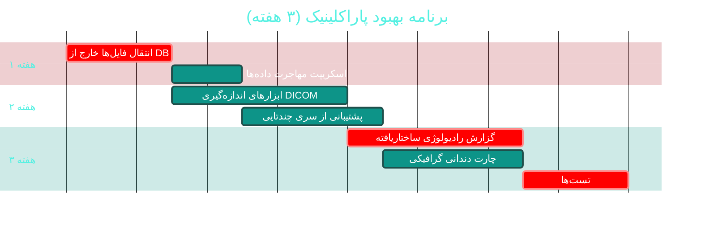

# 🩻 ماژول پاراکلینیک (Imaging · Dental · Eye · Physiotherapy)

> **مسیر ماژول:** `imaging` · `dental` · `eye` · `physiotherapy`
> **لایسنس:** `Imaging` · `Dental` · `Eye` · `Physiotherapy` · `Paraclinical`
> **اولویت:** 🟡 متوسط · **دشواری:** 🟠 بالا · **زمان برآوردی:** ۳ هفته

---

## ۱. 📋 خلاصه ماژول

چهار زیرسیستم تخصصی:
- **🩻 تصویربرداری** با نمایشگر DICOM داخلی
- **🦷 دندانپزشکی** با چارت دندانی و طرح درمان
- **👁 چشم‌پزشکی** با معاینه تخصصی
- **🏃 فیزیوتراپی** با جلسات درمانی

| ویژگی | مقدار |
|:---|:---|
| 🎯 هدف | مستندسازی تخصصیِ خدمات غیرآزمایشگاهی |
| 👤 کاربران اصلی | رادیولوژیست · دندانپزشک · اپتومتریست · فیزیوتراپیست |
| 🔗 وابستگی‌ها | `patients`, `visits`, `billing` |
| 📊 وضعیت فعلی | 🟢 عملیاتی — 🟠 نیازمند یکپارچه‌سازی |

---

## ۲. 🎯 وضعیت فعلی در کدبیس

| لایه | فایل | وضعیت |
|:---|:---|:---|
| 🧬 Domain | `.../Paraclinical/ImagingOrder.cs` · `ImagingFile.cs` | 🟢 |
| 🧬 Domain | `.../Paraclinical/DentalRecord.cs` · `DentalProcedure.cs` · `DentalTreatmentPlan.cs` | 🟢 |
| 🧬 Domain | `.../Paraclinical/EyeExamRecord.cs` | 🟢 |
| 🧬 Domain | `.../Paraclinical/PhysiotherapySession.cs` | 🟢 |
| 🧬 Domain | `.../Enums/ImagingModality.cs` · `ImagingOrderStatus.cs` · `DentalCondition.cs` · `TreatmentPlanStatus.cs` · `SessionStatus.cs` | 🟢 |
| 🧬 Shared | `src/Sahand.ClinicPro.Shared/Dicom/` | 🟢 |
| 🗄 Infra | `.../Services/` (درایورها) | 🟢 |
| 🌐 API | `.../Controllers/ParaclinicalController.cs` · `PeoplePhotosController.cs` | 🟢 |
| 🖥 Desktop | `.../Views/ImagingView.xaml` · `DentistryView.xaml` · `OphthalmologyView.xaml` · `PhysiotherapyView.xaml` · `DicomViewerWindow.xaml` | 🟢 |
| 🧪 تست | `tests/.../Dicom/DicomFileReaderTests.cs` | 🟢 موجود |

### نکات برجسته‌ی فعلی

✅ **نمایشگر DICOM داخلی** با پنجره/سطح تعاملی و بزرگ‌نمایی ۲۰-۸۰۰٪
✅ **خواننده فایل DICOM** با تست اختصاصی (`DicomFileReaderTests`)
✅ **چارت دندانی** با وضعیت‌های مختلف (`DentalCondition`)
✅ **طرح درمان** با وضعیت (`TreatmentPlanStatus`)
✅ **آپلود/دانلود فایل** با `PostFileAsync`/`PostFileAsync` روی `IApiClient`

---

## ۳. 📊 نمودار معماری پاراکلینیک

```mermaid
%%{init: {'theme':'base','themeVariables':{'primaryColor':'#0d9488','primaryTextColor':'#fff','lineColor':'#64748b'}}}%%
graph TB
    CORE["⚙ هسته مشترک<br/>سفارش · وضعیت · فاکتور"]

    CORE --> IMG["🩻 تصویربرداری"]
    CORE --> DEN["🦷 دندانپزشکی"]
    CORE --> EYE["👁 چشم‌پزشکی"]
    CORE --> PHY["🏃 فیزیوتراپی"]

    IMG --> MODAL["📡 روش‌ها (Modality)<br/>CR · DX · CT · MR · US · MG"]
    IMG --> DICOM["📁 نمایشگر DICOM<br/>Window/Level · Zoom"]
    IMG --> PACS["☁ PACS (آینده)"]

    DEN --> CHART["🦷 چارت دندانی<br/>۳۲ دندان × وضعیت"]
    DEN --> PLAN["📋 طرح درمان<br/>مراحل + هزینه"]
    DEN --> PROC["🔧 ثبت اقدامات"]

    EYE --> VA["👁 حدت بینایی<br/>دور · نزدیک"]
    EYE --> REF["🔍 رفرکشن"]
    EYE --> IOP["💧 فشار داخل چشم"]
    EYE --> FUND["🔬 فوندوسکوپی"]

    PHY --> SESS["📅 جلسات درمان"]
    PHY --> PROG["📈 پیشرفت<br/>مقیاس درد · دامنه حرکت"]
    PHY --> HOME["🏠 برنامه خانگی"]

    style CORE fill:#0d9488,stroke:#0f766e,color:#fff
    style IMG fill:#0891b2,stroke:#0e7490,color:#fff
    style DEN fill:#7c3aed,stroke:#6d28d9,color:#fff
    style EYE fill:#b45309,stroke:#92400e,color:#fff
    style PHY fill:#15803d,stroke:#166534,color:#fff
    style PACS fill:#94a3b8,stroke:#64748b,color:#fff,stroke-dasharray: 5 5
```



---

## ۴. ⚠️ کاستی‌ها و ایرادها

| # | کاستی | 🎯 شدت | 📍 محل | 💥 پیامد |
|:--:|:---|:--:|:---|:---|
| W-01 | **نمایشگر DICOM ابتدایی** — بدون اندازه‌گیری، حاشیه‌نویسی، سری | 🟠 بالا | `DicomViewerWindow` | کاربرد محدود برای رادیولوژیست |
| W-02 | **ذخیره‌سازی فایل در دیتابیس** احتمالاً (`ImagingFile`) | 🟠 بالا | Domain | حجم دیتابیس، کندی بکاپ |
| W-03 | **یکپارچگی PACS** ندارد | 🟠 بالا | — |منزوی بودن تصاویر |
| W-04 | **گزارش رادیولوژی ساختاریافته** ندارد | 🟠 بالا | — | گزارش در متن آزاد |
| W-05 | چهار زیرسیستم **هیچ یکپارچگی با هم** ندارند | 🟡 متوسط | — | تکرار کد |
| W-06 | **چارت دندانی گرافیکی** احتمالاً متنی است | 🟡 متوسط | `DentistryView` | تجربه کاربری ضعیف |
| W-07 | **تصاویر قبل/بعد** در دندانپزشکی و فیزیوتراپی ندارد | 🟡 متوسط | — | مستندسازی ناقص |
| W-08 | **امضای گزارش تخصصی** ندارد | 🟡 متوسط | Domain | عدم اعتبار حقوقی |
| W-09 | **مصرف لوازم** در اقدامات دندانپزشکی ثبت نمی‌شود | 🟡 متوسط | — | مغایرت انبار |

---

## ۵. ✨ امکانات پیشنهادی

| 🎯 # | امکان | 📝 شرح | 💰 ارزش | 🔧 دشواری | ⏱ |
|:--:|:---|:---|:--:|:--:|:--:|
| F-01 | 📏 **ابزارهای اندازه‌گیری DICOM** | خط‌کش، زاویه، ROI، چگالی | بالا | متوسط | ۱ هفته |
| F-02 | 🗂 **پشتیبانی از سری‌های چندتایی** | پیمایش تصاویر یک مطالعه | بالا | متوسط | ۵ روز |
| F-03 | 📝 **گزارش رادیولوژی ساختاریافته** | قالب + امضا + الحاق تصویر کلیدی | بسیار بالا | متوسط | ۱ هفته |
| F-04 | ☁ **یکپارچگی PACS (DICOM C-STORE)** | ارسال/دریافت استاندارد | بسیار بالا | زیاد | ۳ هفته |
| F-05 | 💾 **ذخیره‌سازی فایل خارج از دیتابیس** | فایل‌سیستم یا S3 + فقط مسیر در DB | بالا | کم | ۳ روز |
| F-06 | 🦷 **چارت دندانی گرافیکی تعاملی** | ۳۲ دندان قابل‌کلیک با وضعیت رنگی | بالا | متوسط | ۱ هفته |
| F-07 | 📸 **تصاویر قبل/بعد** | آلبوم مقایسه‌ای با کشویی | متوسط | کم | ۳ روز |
| F-08 | 📊 **نمودار پیشرفت فیزیوتراپی** | مقیاس درد + دامنه حرکت در طول جلسات | بالا | کم | ۳ روز |
| F-09 | 🔧 **ثبت مصرف لوازم در اقدامات** | کسر خودکار از انبار | بالا | متوسط | ۵ روز |
| F-10 | ✍ **امضای دیجیتال گزارش تخصصی** | قفل پس از امضا | بالا | کم | ۳ روز |

---

## ۶. 🛠 دستورالعمل پیاده‌سازی

### 📌 گام ۱ — انتقال فایل‌ها به خارج از دیتابیس (F-05) — *پیش‌نیاز بقیه*

> 🔑 **چرا اول این کار؟** تا وقتی تصاویر DICOM در دیتابیس ذخیره شوند،
> حجم آن منفجر می‌شود، بکاپ کند می‌شود و امکان یکپارچگی با PACS وجود ندارد.

**۱.۱ قرارداد ذخیره‌سازی**

```csharp
// 📄 src/Sahand.ClinicPro.Application/Interfaces/IFileStorage.cs (جدید)
namespace Sahand.ClinicPro.Application.Interfaces;

/// <summary>
/// قرارداد ذخیره‌سازی فایل — انتزاع روی فایل‌سیستم محلی، S3 یا Azure Blob.
/// با این انتزاع، ذخیره‌سازی بدون تغییر در لایه‌های بالا قابل تعویض است.
/// </summary>
public interface IFileStorage
{
    /// <summary>ذخیره فایل و بازگرداندن کلید یکتا</summary>
    Task<string> SaveAsync(string category, string fileName, byte[] content,
        CancellationToken ct = default);

    /// <summary>خواندن محتوای فایل بر اساس کلید</summary>
    Task<byte[]> ReadAsync(string storageKey, CancellationToken ct = default);

    /// <summary>حذف فایل</summary>
    Task DeleteAsync(string storageKey, CancellationToken ct = default);

    /// <summary>ایجاد نشانی موقت دسترسی (برای S3 Presigned URL)</summary>
    Task<string> GetTemporaryUrlAsync(string storageKey, TimeSpan expiry,
        CancellationToken ct = default);

    /// <summary>بررسی وجود فایل</summary>
    Task<bool> ExistsAsync(string storageKey, CancellationToken ct = default);
}
```

**۱.۲ پیاده‌سازی فایل‌سیستم محلی**

```csharp
// 📄 src/Sahand.ClinicPro.Infrastructure/Services/Storage/LocalFileStorage.cs (جدید)
namespace Sahand.ClinicPro.Infrastructure.Services.Storage;

/// <summary>
/// ذخیره‌ساز فایل روی فایل‌سیستم محلی — ساختار پوشه‌ای بر اساس دسته و تاریخ
/// برای جلوگیری از انباشته‌شدن میلیون‌ها فایل در یک پوشه.
/// ساختار: {Root}/{category}/{yyyy}/{MM}/{dd}/{guid}_{safeName}
/// </summary>
public class LocalFileStorage : IFileStorage
{
    private readonly string _root;
    private readonly ILogger<LocalFileStorage> _logger;

    /// <summary>سازنده با ریشه ذخیره‌سازی</summary>
    public LocalFileStorage(IConfiguration config, ILogger<LocalFileStorage> logger)
    {
        _root = config["Storage:RootPath"]
                ?? Path.Combine(
                    Environment.GetFolderPath(Environment.SpecialFolder.CommonApplicationData),
                    "SahandClinicPro", "Files");
        _logger = logger;
        Directory.CreateDirectory(_root);
    }

    /// <summary>ذخیره فایل</summary>
    public async Task<string> SaveAsync(string category, string fileName, byte[] content,
        CancellationToken ct = default)
    {
        var safeName = string.Concat(fileName
            .Select(c => Path.GetInvalidFileNameChars().Contains(c) ? '_' : c));

        var relative = Path.Combine(
            category,
            DateTime.UtcNow.ToString("yyyy"),
            DateTime.UtcNow.ToString("MM"),
            DateTime.UtcNow.ToString("dd"),
            $"{Guid.NewGuid():N}_{safeName}");

        var full = Path.Combine(_root, relative);
        Directory.CreateDirectory(Path.GetDirectoryName(full)!);
        await File.WriteAllBytesAsync(full, content, ct);

        _logger.LogDebug("فایل ذخیره شد: {RelativePath} ({Size} بایت)", relative, content.Length);
        return relative;      // کلید = مسیر نسبی
    }

    /// <summary>خواندن فایل</summary>
    public async Task<byte[]> ReadAsync(string storageKey, CancellationToken ct = default)
    {
        var full = Path.Combine(_root, storageKey);
        if (!File.Exists(full))
            throw new FileNotFoundException($"فایل یافت نشد: {storageKey}", storageKey);
        return await File.ReadAllBytesAsync(full, ct);
    }

    /// <summary>حذف فایل</summary>
    public Task DeleteAsync(string storageKey, CancellationToken ct = default)
    {
        var full = Path.Combine(_root, storageKey);
        if (File.Exists(full)) File.Delete(full);
        return Task.CompletedTask;
    }

    /// <summary>نشانی موقت — در ذخیره‌ساز محلی همان مسیر فیزیکی است</summary>
    public Task<string> GetTemporaryUrlAsync(string storageKey, TimeSpan expiry,
        CancellationToken ct = default)
        => Task.FromResult(Path.Combine(_root, storageKey));

    /// <summary>بررسی وجود</summary>
    public Task<bool> ExistsAsync(string storageKey, CancellationToken ct = default)
        => Task.FromResult(File.Exists(Path.Combine(_root, storageKey)));
}
```

**۱.۳ تغییر موجودیت**

```csharp
// 📄 src/Sahand.ClinicPro.Domain/Paraclinical/ImagingFile.cs
// جایگزینی فیلد باینری با مسیر:

/// <summary>کلید ذخیره‌سازی فایل (مسیر نسبی یا کلید S3) — جایگزین محتوای باینری</summary>
public string StorageKey { get; set; } = string.Empty;

/// <summary>حجم فایل بر حسب بایت</summary>
public long FileSizeBytes { get; set; }

/// <summary>هش SHA-256 برای تشخیص تکراری و صحت</summary>
public string? ContentHash { get; set; }

// ⚠️ فیلد قدیمی (byte[] Content) طی یک مایگریشنِ انتقالی داده‌ها حذف می‌شود
```

**۱.۴ ثبت در DI و مایگریشن**

```csharp
// 📄 DependencyInjection.cs
services.AddSingleton<IFileStorage, LocalFileStorage>();
// در صورت نیاز به S3:
// services.AddSingleton<IFileStorage, S3FileStorage>();
```

```bash
cd src/Sahand.ClinicPro.Infrastructure
dotnet ef migrations add Cycle49ImagingFileStorage --startup-project ../Sahand.ClinicPro.API
```

---

### 📌 گام ۲ — گزارش رادیولوژی ساختاریافته (F-03)

```csharp
// 📄 src/Sahand.ClinicPro.Domain/Paraclinical/RadiologyReport.cs (جدید)
namespace Sahand.ClinicPro.Domain.Entities.Paraclinical;

/// <summary>
/// گزارش رادیولوژی — ساختاریافته با امضای دیجیتال.
/// پس از امضا، گزارش قفل می‌شود و فقط با «اصلاحیه» تغییر می‌کند.
/// </summary>
public class RadiologyReport : AuditableEntity, ISoftDeletable
{
    /// <summary>شناسه سفارش تصویربرداری</summary>
    public long ImagingOrderId { get; set; }

    /// <summary>سفارش مرتبط</summary>
    public ImagingOrder ImagingOrder { get; set; } = null!;

    /// <summary>شناسه رادیولوژیست</summary>
    public long RadiologistId { get; set; }

    /// <summary>رادیولوژیست</summary>
    public Doctor Radiologist { get; set; } = null!;

    /// <summary>بخش «روش» (Technique)</summary>
    public string? Technique { get; set; }

    /// <summary>بخش «یافته‌ها» (Findings)</summary>
    public string Findings { get; set; } = null!;

    /// <summary>بخش «نتیجه‌گیری» (Impression)</summary>
    public string Impression { get; set; } = null!;

    /// <summary>توصیه‌ها</summary>
    public string? Recommendations { get; set; }

    /// <summary>کدهای تصویر کلیدی الحاقی (JSON)</summary>
    public string KeyImageIdsJson { get; set; } = "[]";

    /// <summary>آیا گزارش امضا شده</summary>
    public bool IsSigned { get; set; }

    /// <summary>زمان امضا</summary>
    public DateTime? SignedAt { get; set; }

    /// <summary>هش امضا</summary>
    public string? SignatureHash { get; set; }

    /// <summary>وضعیت گزارش</summary>
    public ReportStatus Status { get; set; } = ReportStatus.Draft;
}

/// <summary>وضعیت گزارش تخصصی</summary>
public enum ReportStatus
{
    /// <summary>پیش‌نویس</summary>
    Draft,
    /// <summary>در انتظار تأیید</summary>
    PendingReview,
    /// <summary>نهایی و امضا‌شده</summary>
    Final,
    /// <summary>اصلاح‌شده</summary>
    Amended,
}
```

---

### 📌 گام ۳ — چارت دندانی گرافیکی (F-06)

```xml
<!-- 📄 src/Sahand.ClinicPro.Desktop/Controls/DentalChart.xaml (جدید) -->
<UserControl x:Class="Sahand.ClinicPro.Desktop.Controls.DentalChart"
             xmlns="http://schemas.microsoft.com/winfx/2006/xaml/presentation"
             xmlns:x="http://schemas.microsoft.com/winfx/2006/xaml"
             FlowDirection="LeftToRight">

    <!-- چارت دندانی استاندارد FDI دو رقمی:
         ردیف بالا: 18..11 (راست) | 21..28 (چپ)
         ردیف پایین: 48..41 (راست) | 31..38 (چپ) -->

    <Grid Margin="16">
        <Grid.RowDefinitions>
            <RowDefinition Height="Auto"/>   <!-- فک بالا -->
            <RowDefinition Height="Auto"/>   <!-- خط میانی -->
            <RowDefinition Height="Auto"/>   <!-- فک پایین -->
        </Grid.RowDefinitions>

        <ItemsControl Grid.Row="0" ItemsSource="{Binding UpperTeeth}">
            <ItemsControl.ItemsPanel>
                <ItemsPanelTemplate>
                    <StackPanel Orientation="Horizontal"/>
                </ItemsPanelTemplate>
            </ItemsControl.ItemsPanel>
            <ItemsControl.ItemTemplate>
                <DataTemplate>
                    <Button Width="44" Height="56" Margin="2"
                            Command="{Binding DataContext.SelectToothCommand,
                                      RelativeSource={RelativeSource AncestorType=UserControl}}"
                            CommandParameter="{Binding Number}"
                            ToolTip="{Binding Description}">
                        <Button.Template>
                            <ControlTemplate TargetType="Button">
                                <Border x:Name="Bd"
                                        CornerRadius="6"
                                        BorderThickness="2"
                                        BorderBrush="{Binding ConditionBrush}"
                                        Background="{Binding ConditionBackground}">
                                    <StackPanel>
                                        <TextBlock Text="{Binding Number}"
                                                   FontSize="11" HorizontalAlignment="Center"/>
                                        <TextBlock Text="{Binding ConditionIcon}"
                                                   FontSize="14" HorizontalAlignment="Center"/>
                                    </StackPanel>
                                </Border>
                                <ControlTemplate.Triggers>
                                    <Trigger Property="IsMouseOver" Value="True">
                                        <Setter TargetName="Bd" Property="Opacity" Value="0.85"/>
                                    </Trigger>
                                </ControlTemplate.Triggers>
                            </ControlTemplate>
                        </Button.Template>
                    </Button>
                </DataTemplate>
            </ItemsControl.ItemTemplate>
        </ItemsControl>

        <!-- خط میانی -->
        <Rectangle Grid.Row="1" Height="2" Fill="{DynamicResource MaterialDesignDivider}"
                   Margin="0,8"/>

        <ItemsControl Grid.Row="2" ItemsSource="{Binding LowerTeeth}">
            <!-- مشابه بالا -->
        </ItemsControl>
    </Grid>
</UserControl>
```

```csharp
// 📄 src/Sahand.ClinicPro.Desktop/ViewModels/DentistryViewModel.cs — مدل دندان
/// <summary>نمای یک دندان در چارت</summary>
public partial class ToothViewModel : ObservableObject
{
    /// <summary>شماره دندان (استاندارد FDI دو رقمی)</summary>
    public int Number { get; set; }

    /// <summary>وضعیت فعلی</summary>
    [ObservableProperty] private DentalCondition condition;

    /// <summary>شرح وضعیت برای تولتیپ</summary>
    public string Description => Condition switch
    {
        DentalCondition.Healthy    => "سالم",
        DentalCondition.Caries     => "پوسیدگی",
        DentalCondition.Filled     => "پرشده",
        DentalCondition.Crown      => "روکش",
        DentalCondition.Extracted  => "کشیده‌شده",
        DentalCondition.Implant    => "ایمپلنت",
        DentalCondition.RootCanal  => "درمان ریشه",
        DentalCondition.Missing    => "غایب",
        _                          => "نامشخص",
    };

    /// <summary>آیکون وضعیت</summary>
    public string ConditionIcon => Condition switch
    {
        DentalCondition.Caries    => "●",
        DentalCondition.Filled    => "■",
        DentalCondition.Crown     => "▲",
        DentalCondition.Extracted => "✕",
        DentalCondition.Implant   => "⬢",
        _                         => "",
    };

    /// <summary>رنگ پس‌زمینه بر اساس وضعیت</summary>
    public string ConditionBackground => Condition switch
    {
        DentalCondition.Caries     => "#FEE2E2",
        DentalCondition.Filled     => "#DBEAFE",
        DentalCondition.Crown      => "#EDE9FE",
        DentalCondition.Extracted  => "#F3F4F6",
        DentalCondition.RootCanal  => "#FEF3C7",
        _                          => "#FFFFFF",
    };
}
```

---

## ۷. 🧪 تست‌های الزامی

| 🧪 تست | 🎯 هدف |
|:---|:---|
| `DicomFileReader_ValidFile_ParsesTags` *(موجود — گسترش یابد)* | خواندن DICOM |
| `FileStorage_SaveThenRead_ReturnsSameBytes` | صحت ذخیره‌سازی |
| `FileStorage_UnsafeFileName_Sanitized` | امنیت نام فایل |
| `ImagingOrder_StatusFlow_Valid` | جریان وضعیت |
| `RadiologyReport_Sign_ThenEdit_Blocked` | قفل پس از امضا |
| `DentalChart_ToothSelection_UpdatesCondition` | چارت تعاملی |
| `PhysioSession_ProgressChart_CalculatesTrend` | نمودار پیشرفت |
| `ConsumptionOnProcedure_DecrementsInventory` | کسر انبار |

---

## ۸. 📈 شاخص‌های موفقیت (KPI)

| 📊 شاخص | قبل | هدف |
|:---|:--:|:--:|
| 📏 ابزارهای اندازه‌گیری DICOM | ۰ | **۴ ابزار** |
| 💾 حجم دیتابیس (فایل‌های تصویری) | در DB | **خارج از DB** |
| 📝 گزارش‌های ساختاریافته | ۰٪ | **> ۹۰٪** |
| 🦷 استفاده از چارت گرافیکی | ۰٪ | **۱۰۰٪** |
| ⏱ زمان باز شدن یک مطالعه تصویری | ~۳ ثانیه | **< ۸۰۰ms** |

---

## ۹. 🗓 برنامه زمانی



---

## 🔗 پیوندهای مرتبط

| 📄 سند | توضیح |
|:---|:---|
| [تحلیل جامع](../ANALYSIS-REPORT.md) | سند اصلی |
| [A07 — آزمایشگاه](A07-laboratory.md) | ماژول خواهر |
| [B07 — داروخانه](B07-pharmacy-inventory.md) | کسر لوازم مصرفی |
| [D05 — مدیریت اسناد](D05-document-management.md) | زیرساخت ذخیره‌سازی مشترک |

---
<div align="center">📅 ۱۴۰۴/۰۷/۱۹ · 🔖 v1.0</div>
