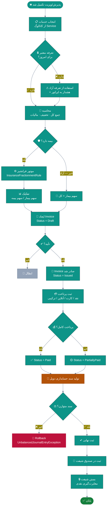
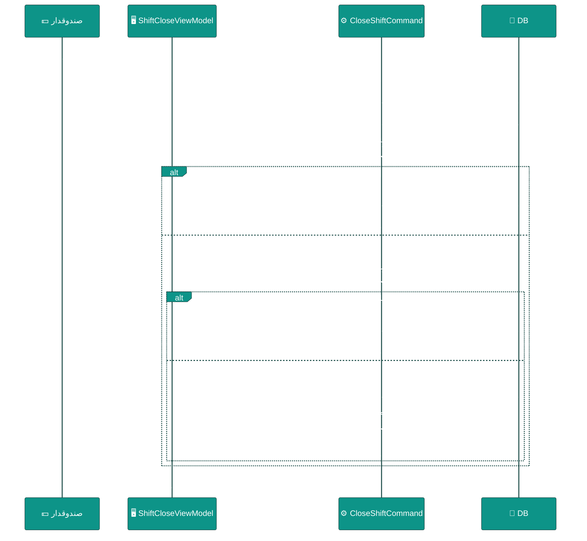
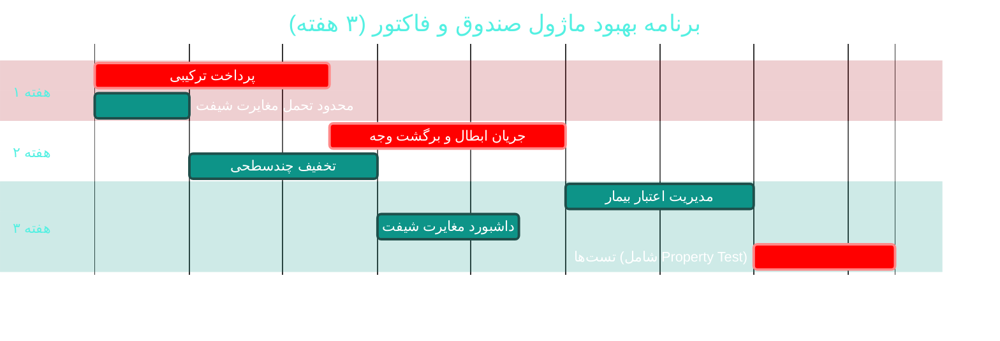

# 💵 ماژول صندوق، فاکتور و شیفت (Billing & Cash Register)

> **مسیر ماژول:** `invoices` · `payments` · **لایسنس:** `Billing` + `ShiftCash`
> **اولویت:** 🟠 بالا · **دشواری:** 🟡 متوسط · **زمان برآوردی:** ۳ هفته

---

## ۱. 📋 خلاصه ماژول

قلب مالی درمانگاه: تعریف خدمات و تعرفه‌ها، صدور فاکتور با پوشش بیمه،
ثبت پرداخت‌های چندروشه، صندوق و **بستن شیفت** با مغایرت‌گیری،
و تولید خودکار سند حسابداری دوبل.

| ویژگی | مقدار |
|:---|:---|
| 🎯 هدف | دقتِ ریالی در دریافت‌ها + تسویه شفاف شیفت |
| 👤 کاربران اصلی | صندوقدار · پذیرشگر · مدیر مالی |
| 🔗 وابستگی‌ها | `patients`, `receptions`, `visits`, `accounting`, `insurance` |
| 📊 وضعیت فعلی | 🟢 عملیاتی و بالغ |

---

## ۲. 🎯 وضعیت فعلی در کدبیس

| لایه | فایل | وضعیت |
|:---|:---|:---|
| 🧬 Domain | `.../Billing/Invoice.cs` · `InvoiceItem.cs` · `Payment.cs` | 🟢 |
| 🧬 Domain | `.../Billing/CashRegister.cs` · `Service.cs` · `ServiceCategory.cs` · `Tariff.cs` | 🟢 |
| 🧬 Domain | `.../Billing/Expense.cs` · `DoctorPayment.cs` | 🟢 |
| 🧬 Domain | `.../Billing/InsuranceClaim.cs` · `InsuranceCompany.cs` · `InsuranceFractionmentRule.cs` · `InsuranceInquiry.cs` | 🟢 |
| 🧬 Domain | `.../Events/BillingEvents.cs` | 🟢 |
| 🧬 Domain | `.../Enums/InvoiceStatus.cs` · `InvoiceType.cs` · `PaymentMethod.cs` · `CashRegisterStatus.cs` · `ShiftType.cs` | 🟢 |
| 🗄 Infra | `.../Seeders/SeedData/TariffSeedData.cs` | 🟢 |
| ⚙ App | `.../Features/Billing/CreateInvoice/` · `GetInvoices/` · `RecordPayment/` · `GetCashRegister/` · `Shifts/` | 🟢 |
| 🌐 API | `.../Controllers/InvoicesController.cs` · `PaymentsController.cs` | 🟢 |
| 🖥 Desktop | `.../Views/BillingView.xaml` · `InvoiceFormWindow` · `PaymentWindow` · `ShiftCloseWindow` · `ShiftReceiptPreviewWindow` | 🟢 |
| 🧪 تست | `tests/.../Billing/CloseShiftCommandTests.cs` | 🟢 موجود |

### نکات برجسته‌ی فعلی

✅ **سند حسابداری خودکار دوبل** هنگام پرداخت
✅ **بستن شیفت** با تست اختصاصی (`CloseShiftCommandTests`)
✅ **پوشش بیمه** یکپارچه با فاکتور
✅ **تعرفه‌ها** با بذر اختصاصی
✅ **رسید شیفت** با پیش‌نمایش چاپ (`ShiftReceiptPreviewWindow`)

---

## ۳. 📊 نمودار جریان مالی



### نمودار بستن شیفت



---

## ۴. ⚠️ کاستی‌ها و ایرادها

| # | کاستی | 🎯 شدت | 📍 محل | 💥 پیامد |
|:--:|:---|:--:|:---|:---|
| W-01 | **پرداخت ترکیبی** (نقد + کارت + بیمه) احتمالاً محدود است | 🟠 بالا | `Payment` | سناریوی رایج پوشش کامل ندارد |
| W-02 | **ابطال و برگشت وجه (Refund)** جریان رسمی ندارد | 🟠 بالا | Domain | اصلاح فقط با دستکاری دستی |
| W-03 | **تخفیف چندسطحی** (خدمت / فاکتور / بیمار) ندارد | 🟡 متوسط | `Invoice` | انعطاف‌ناپذیری تجاری |
| W-04 | **مالیات بر ارزش افزوده** پیکربندی‌پذیر نیست | 🟡 متوسط | `Invoice` | تغییر قانون = تغییر کد |
| W-05 | **صندوق چندگانه** (هر پذیرشگر یک صندوق) ندارد | 🟡 متوسط | `CashRegister` | تفکیک مسئولیت دشوار |
| W-06 | **گزارش مغایرت‌های شیفت** تحلیلی نیست | 🟡 متوسط | `Shifts/` | مدیر نمی‌تواند روند ببیند |
| W-07 | **چاپ رسید** قالب‌پذیر نیست | 🔵 کم | `ShiftReceiptPreviewWindow` | — |
| W-08 | **تاریخچه تغییرات فاکتور** در UI نیست | 🟡 متوسط | UI | عدم شفافیت ممیزی |
| W-09 | **سقف اعتبار / بدهی بیمار** کنترل نمی‌شود | 🟡 متوسط | Domain | بدهی‌های معوق پنهان |

---

## ۵. ✨ امکانات پیشنهادی

| 🎯 # | امکان | 📝 شرح | 💰 ارزش | 🔧 دشواری | ⏱ |
|:--:|:---|:---|:--:|:--:|:--:|
| F-01 | 💳 **پرداخت ترکیبی چندروشه** | نقد + کارت + بیمه + اعتبار در یک فاکتور | بسیار بالا | متوسط | ۱ هفته |
| F-02 | ↩ **جریان ابطال و برگشت وجه** | Refund با سند معکوس + تأیید مدیر | بسیار بالا | متوسط | ۱ هفته |
| F-03 | 🏷 **تخفیف چندسطحی** | درصد/مبلغ روی خدمت، فاکتور، و بیمار | بالا | کم | ۴ روز |
| F-04 | 🧾 **موتور مالیات پیکربندی‌پذیر** | نرخ متغیر + معافیت‌ها | بالا | متوسط | ۵ روز |
| F-05 | 🏦 **صندوق چندگانه** | هر کاربر صندوق مستقل با انتقال بین صندوق‌ها | بالا | متوسط | ۱ هفته |
| F-06 | 📊 **داشبورد مغایرت شیفت** | روند مغایرت‌ها + شناسایی الگو | بالا | کم | ۴ روز |
| F-07 | 💰 **مدیریت اعتبار و بدهی بیمار** | سقف اعتبار + یادآوری وصول | بالا | متوسط | ۱ هفته |
| F-08 | 🧾 **فاکتور الکترونیکی (صورت‌حساب)** | اتصال به سامانه مودیان | استراتژیک | زیاد | ۴ هفته |
| F-09 | 📱 **پرداخت آنلاین / درگاه** | اتصال به درگاه پرداخت ایرانی | بسیار بالا | متوسط | ۲ هفته |
| F-10 | 📈 **پیش‌بینی جریان نقدی** | بر اساس مطالبات بیمه + نوبت‌ها | متوسط | متوسط | ۱ هفته |

---

## ۶. 🛠 دستورالعمل پیاده‌سازی

### 📌 گام ۱ — پرداخت ترکیبی چندروشه (F-01)

**۱.۱ مدل درخواست پرداخت ترکیبی**

```csharp
// 📄 src/Sahand.ClinicPro.Application/DTOs/Billing/SplitPaymentRequest.cs (جدید)
namespace Sahand.ClinicPro.Application.DTOs.Billing;

/// <summary>
/// درخواست پرداخت ترکیبی — امکان تسویه یک فاکتور با چند روش همزمان.
/// مثال: ۲۰۰هزار نقد + ۳۰۰هزار کارتخوان + ۵۰۰هزار سهم بیمه.
/// </summary>
/// <param name="InvoiceId">شناسه فاکتور</param>
/// <param name="Components">اجزای پرداخت</param>
public record SplitPaymentRequest(long InvoiceId, IReadOnlyList<PaymentComponentDto> Components);

/// <summary>یک جزء پرداخت</summary>
/// <param name="Method">روش پرداخت</param>
/// <param name="Amount">مبلغ به ریال</param>
/// <param name="Reference">شماره پیگیری / رسید (برای کارت‌خوان و آنلاین)</param>
/// <param name="InsuranceCompanyId">بیمه (فقط برای روش بیمه)</param>
public record PaymentComponentDto(
    PaymentMethod Method,
    decimal Amount,
    string? Reference = null,
    long? InsuranceCompanyId = null);
```

**۱.۲ Command با اعتبارسنجی دقیق**

```csharp
// 📄 src/Sahand.ClinicPro.Application/Features/Billing/RecordPayment/RecordSplitPaymentCommand.cs
public record RecordSplitPaymentCommand(SplitPaymentRequest Request)
    : IRequest<Result<long>>;

public class RecordSplitPaymentCommandValidator : AbstractValidator<RecordSplitPaymentCommand>
{
    public RecordSplitPaymentCommandValidator()
    {
        RuleFor(x => x.Request.InvoiceId).GreaterThan(0);
        RuleFor(x => x.Request.Components).NotEmpty()
            .WithMessage("حداقل یک روش پرداخت انتخاب شود");
        RuleForEach(x => x.Request.Components).ChildRules(c =>
        {
            c.RuleFor(p => p.Amount).GreaterThan(0)
                .WithMessage("مبلغ هر جزء باید بزرگ‌تر از صفر باشد");
            c.RuleFor(p => p.Reference).NotEmpty()
                .When(p => p.Method is PaymentMethod.Card or PaymentMethod.Online)
                .WithMessage("برای پرداخت کارتی/آنلاین شماره پیگیری الزامی است");
            c.RuleFor(p => p.InsuranceCompanyId).NotNull()
                .When(p => p.Method == PaymentMethod.Insurance)
                .WithMessage("برای پرداخت بیمه‌ای انتخاب شرکت بیمه الزامی است");
        });
    }
}

public class RecordSplitPaymentCommandHandler
    : IRequestHandler<RecordSplitPaymentCommand, Result<long>>
{
    private readonly IUnitOfWork _uow;
    private readonly ICurrentUserService _currentUser;
    private readonly IDateTimeService _clock;

    public RecordSplitPaymentCommandHandler(IUnitOfWork uow,
        ICurrentUserService currentUser, IDateTimeService clock)
    { _uow = uow; _currentUser = currentUser; _clock = clock; }

    public async Task<Result<long>> Handle(RecordSplitPaymentCommand req, CancellationToken ct)
    {
        var invoice = await _uow.Repository<Invoice>()
            .Queryable
            .Include(i => i.Items)
            .FirstOrDefaultAsync(i => i.Id == req.Request.InvoiceId, ct);

        if (invoice is null)
            return Result<long>.Failure(Error.NotFound("فاکتور یافت نشد"));

        if (invoice.Status == InvoiceStatus.Cancelled)
            return Result<long>.Failure(Error.Validation("فاکتور ابطالی قابل پرداخت نیست"));

        // ── محاسبه مبالغ ──
        var alreadyPaid = await _uow.Repository<Payment>().QueryableNoTracking
            .Where(p => !p.IsDeleted && p.InvoiceId == invoice.Id)
            .SumAsync(p => (decimal?)p.Amount, ct) ?? 0m;

        var remaining = invoice.TotalAmount - alreadyPaid;
        var thisPayment = req.Request.Components.Sum(c => c.Amount);

        // ⚠️ گاردِ مهم: پرداختِ بیش از باقیمانده
        if (thisPayment > remaining)
            return Result<long>.Failure(Error.Validation(
                $"مجموع پرداخت ({thisPayment:N0}) از باقیمانده فاکتور ({remaining:N0}) بیشتر است"));

        await _uow.BeginTransactionAsync(ct);
        try
        {
            // ثبت هر جزء به‌صورت Payment مستقل
            foreach (var comp in req.Request.Components)
            {
                _uow.Repository<Payment>().Add(new Payment
                {
                    InvoiceId = invoice.Id,
                    Amount = comp.Amount,
                    Method = comp.Method,
                    Reference = comp.Reference,
                    InsuranceCompanyId = comp.InsuranceCompanyId,
                    PaymentDate = _clock.UtcNow,
                    ReceivedById = _currentUser.UserId,
                    Status = PaymentRecordStatus.Confirmed,
                });
            }

            // به‌روزرسانی وضعیت فاکتور
            var totalPaid = alreadyPaid + thisPayment;
            invoice.PaidAmount = totalPaid;
            invoice.Status = totalPaid >= invoice.TotalAmount
                ? InvoiceStatus.Paid
                : InvoiceStatus.PartiallyPaid;

            _uow.Repository<Invoice>().Update(invoice);
            await _uow.SaveEntitiesAsync(ct);

            // تولید سند حسابداری دوبل
            await _journalGenerator.CreateForPaymentAsync(invoice.Id, ct);

            await _uow.CommitTransactionAsync(ct);
            return Result<long>.Success(invoice.Id);
        }
        catch (UnbalancedJournalEntryException)
        {
            await _uow.RollbackTransactionAsync(ct);
            throw;      // سند نامتوازن — هرگز نباید رخ دهد، خطای سیستمی است
        }
        catch
        {
            await _uow.RollbackTransactionAsync(ct);
            throw;
        }
    }
}
```

---

### 📌 گام ۲ — جریان ابطال و برگشت وجه (F-02)

```csharp
// 📄 src/Sahand.ClinicPro.Application/Features/Billing/Refund/RefundInvoiceCommand.cs
public record RefundInvoiceCommand(long InvoiceId, decimal Amount,
    string Reason, bool RequiresApproval = true) : IRequest<Result<long>>;

public class RefundInvoiceCommandHandler : IRequestHandler<RefundInvoiceCommand, Result<long>>
{
    private readonly IUnitOfWork _uow;
    private readonly ICurrentUserService _currentUser;

    public RefundInvoiceCommandHandler(IUnitOfWork uow, ICurrentUserService currentUser)
    { _uow = uow; _currentUser = currentUser; }

    public async Task<Result<long>> Handle(RefundInvoiceCommand req, CancellationToken ct)
    {
        var invoice = await _uow.Repository<Invoice>().GetByIdAsync(req.InvoiceId, ct);
        if (invoice is null)
            return Result<long>.Failure(Error.NotFound("فاکتور یافت نشد"));

        // گارد ۱: فقط فاکتور پرداخت‌شده قابل برگشت است
        if (invoice.PaidAmount <= 0)
            return Result<long>.Failure(Error.Validation("فاکتور پرداخت‌نشده قابل برگشت نیست"));

        // گارد ۲: مبلغ برگشت از مبلغ پرداختی بیشتر نباشد
        if (req.Amount > invoice.PaidAmount)
            return Result<long>.Failure(Error.Validation(
                $"مبلغ برگشت ({req.Amount:N0}) از مبلغ پرداختی ({invoice.PaidAmount:N0}) بیشتر است"));

        // گارد ۳: برگشت‌های بزرگ نیاز به تأیید مدیر
        if (req.RequiresApproval && req.Amount > 5_000_000m
            && !await _currentUser.HasPermissionAsync("invoices.refund.approve", ct))
            return Result<long>.Failure(Error.Forbidden(
                "برگشت وجه بیش از ۵ میلیون ریال نیاز تأیید مدیر دارد"));

        await _uow.BeginTransactionAsync(ct);
        try
        {
            // ۱) ثبت پرداخت منفی (برگشت)
            _uow.Repository<Payment>().Add(new Payment
            {
                InvoiceId = invoice.Id,
                Amount = -req.Amount,                    // منفی = برگشت
                Method = PaymentMethod.Refund,
                Reference = req.Reason,
                PaymentDate = DateTime.UtcNow,
                ReceivedById = _currentUser.UserId,
                Status = PaymentRecordStatus.Confirmed,
            });

            // ۲) به‌روزرسانی وضعیت
            invoice.PaidAmount -= req.Amount;
            invoice.Status = invoice.PaidAmount <= 0
                ? InvoiceStatus.Refunded
                : InvoiceStatus.PartiallyPaid;

            _uow.Repository<Invoice>().Update(invoice);

            // ۳) سند حسابداری معکوس
            await _journalGenerator.CreateReversalAsync(invoice.Id, req.Amount, ct);

            await _uow.SaveEntitiesAsync(ct);
            await _uow.CommitTransactionAsync(ct);
            return Result<long>.Success(invoice.Id);
        }
        catch
        {
            await _uow.RollbackTransactionAsync(ct);
            throw;
        }
    }
}
```

> 📌 **نکته:** مجوز جدید `invoices.refund.approve` باید در `PermissionSeeder` ثبت شود.

---

### 📌 گام ۳ — بستن شیفت پیشرفته با حد تحمل (F-06)

```csharp
// 📄 src/Sahand.ClinicPro.Domain/Infrastructure/SystemSetting.cs — کلیدهای جدید:
//   "shift.tolerance.amount"  = "50000"      (حد مجاز مغایرت به ریال)
//   "shift.require.notes"     = "true"       (یادداشت اجباری هنگام مغایرت)
```

```csharp
// در CloseShiftCommandHandler — منطق مغایرت:
var expected = await CalculateExpectedCashAsync(registerId, ct);
var difference = command.CountedCash - expected;
var tolerance = await _settings.GetDecimalAsync("shift.tolerance.amount", 50_000m, ct);

var status = Math.Abs(difference) switch
{
    0                          => CashRegisterStatus.Balanced,
    <= var d when d <= tolerance => CashRegisterStatus.MinorDifference,
    _                          => CashRegisterStatus.NeedsReview,
};

// یادداشت اجباری در صورت مغایرت
if (difference != 0 && string.IsNullOrWhiteSpace(command.Notes))
    return Result.Failure(Error.Validation("ثبت علت مغایرت الزامی است"));

// اعلان به مدیر در صورت نیاز به بررسی
if (status == CashRegisterStatus.NeedsReview)
    await _notifier.CreateAsync(/* اعلان برای مدیر مالی */, ct);
```

---

## ۷. 🧪 تست‌های الزامی

| 🧪 تست | 🎯 هدف | اولویت |
|:---|:---|:--:|
| `CloseShift_Balanced_SetsCorrectStatus` *(موجود — گسترش یابد)* | بستن شیفت | 🔴 |
| `SplitPayment_MultipleMethods_CreatesAllPayments` | پرداخت ترکیبی | 🔴 |
| `SplitPayment_ExceedsRemaining_ShouldFail` | گارد مالی | 🔴 |
| `SplitPayment_CardWithoutReference_ShouldFail` | اعتبارسنجی | 🟠 |
| `Refund_ExceedsPaid_ShouldFail` | گارد برگشت | 🔴 |
| `Refund_LargeAmount_RequiresApproval` | کنترل دسترسی | 🔴 |
| `Refund_CreatesReversalJournal` | سند معکوس | 🔴 |
| `Invoice_DoubleEntry_AlwaysBalanced` | **تست ویژگی (Property Test)** | 🔴 |
| `ShiftDifference_BeyondTolerance_NeedsReview` | حد تحمل | 🟠 |

**تست ویژگی برای توازن حسابداری (بسیار ارزشمند):**
```csharp
[Property(MaxTest = 200)]
public Property Invoice_AnyPayment_DoubleEntryAlwaysBalanced()
{
    return Prop.ForAll<decimal>(amount =>
    {
        if (amount <= 0) return true;    // فیلتر ورودی نامعتبر

        var je = GenerateJournalForPayment(amount);

        return je.Lines.Sum(l => l.Debit) == je.Lines.Sum(l => l.Credit);
    });
}
```

---

## ۸. 📈 شاخص‌های موفقیت (KPI)

| 📊 شاخص | قبل | هدف |
|:---|:--:|:--:|
| 💳 پوشش سناریوی پرداخت ترکیبی | احتمالی محدود | **۱۰۰٪** |
| ↩ زمان انجام برگشت وجه | دستی | **< ۳ دقیقه** |
| ⚖ مغایرت شیفت (متوسط) | نامشخص | **< ۰٫۵٪** |
| 🧾 نرخ صدور سند حسابداری خودکار | ~۱۰۰٪ | **۱۰۰٪** (تست‌شده) |
| 🧪 پوشش تست ماژول | ~۳۰٪ | **> ۸۵٪** |

---

## ۹. 🗓 برنامه زمانی



---

## 🔗 پیوندهای مرتبط

| 📄 سند | توضیح |
|:---|:---|
| [تحلیل جامع](../ANALYSIS-REPORT.md) | سند اصلی |
| [B02 — حسابداری](B02-accounting.md) | سند دوبل |
| [B03 — بیمه](B03-insurance.md) | موتور فرانشیز |
| [B08 — گزارش‌ساز](B08-reports.md) | گزارش‌های مالی |

---
<div align="center">📅 ۱۴۰۴/۰۷/۱۹ · 🔖 v1.0</div>
