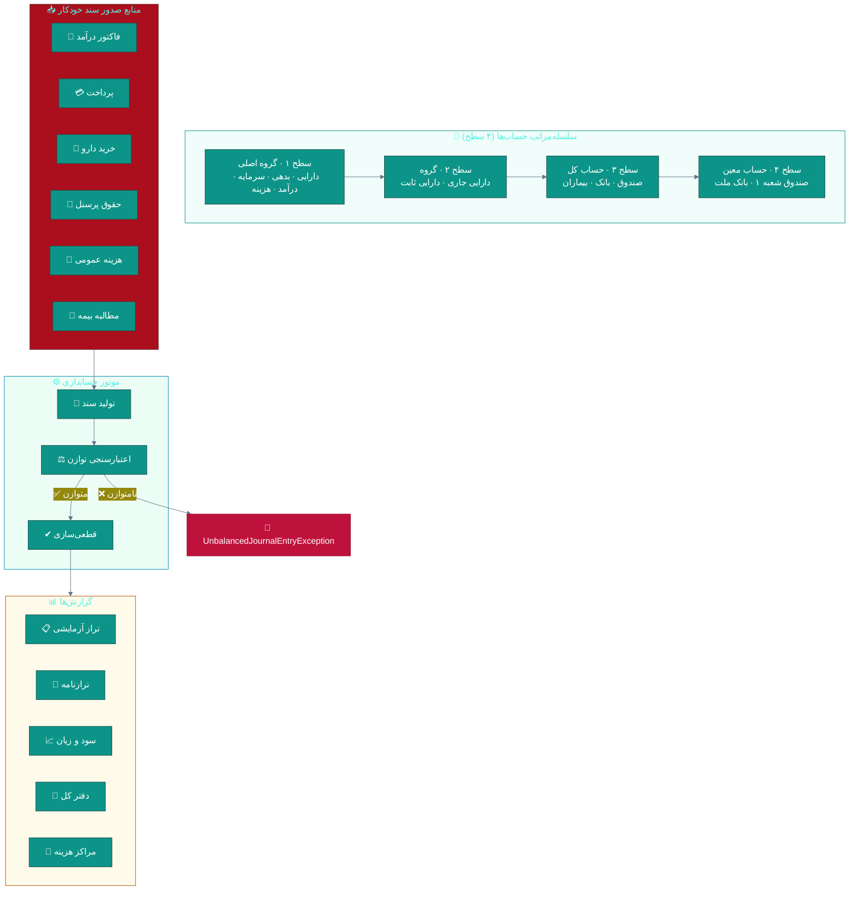
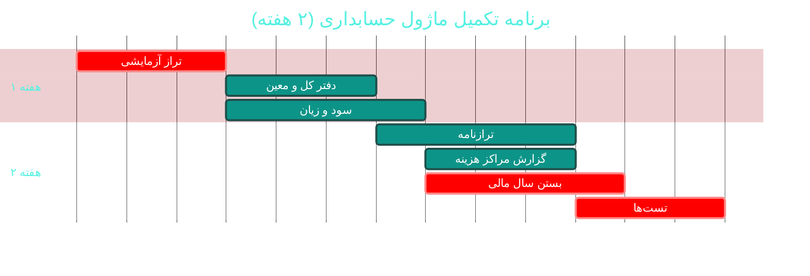

# 📒 ماژول حسابداری دوبل (Double-Entry Accounting)

> **مسیر ماژول:** `accounting` · **لایسنس:** `Accounting`
> **اولویت:** 🟠 بالا · **دشواری:** 🟡 متوسط · **زمان برآوردی:** ۲ هفته

---

## ۱. 📋 خلاصه ماژول

سیستم حسابداری **دوبل (Double-Entry)** واقعی با سلسله‌مراتب چهارسطحی حساب‌ها،
مراکز هزینه، سال‌های مالی، **قانون توازن** اجباری و تراز آزمایشی.

| ویژگی | مقدار |
|:---|:---|
| 🎯 هدف | تطابق کامل عملیات درمانگاه با اصول حسابداری |
| 👤 کاربران اصلی | حسابدار · مدیر |
| 🔗 وابستگی‌ها | `billing`, `payroll`, `pharmacy`, `reports` |
| 📊 وضعیت فعلی | 🟢 عملیاتی — 🟡 نیازمند تکمیل گزارش‌ها |

---

## ۲. 🎯 وضعیت فعلی در کدبیس

| لایه | فایل | وضعیت |
|:---|:---|:---|
| 🧬 Domain | `.../Accounting/AccountingAccount.cs` · `CostCenter.cs` · `FiscalYear.cs` | 🟢 |
| 🧬 Domain | `.../Accounting/JournalEntry.cs` · `JournalEntryLine.cs` | 🟢 |
| 🧬 Domain | `.../Enums/AccountLevel.cs` · `AccountNature.cs` · `AccountType.cs` · `JournalEntryStatus.cs` · `JournalReferenceType.cs` | 🟢 |
| 🧬 Domain | `.../Exceptions/UnbalancedJournalEntryException.cs` | 🟢 ⭐ عالی |
| 🗄 Infra | `.../Seeders/AccountingAccountSeeder.cs` | 🟢 |
| 🌐 API | `.../Controllers/AccountingController.cs` | 🟢 |
| 🖥 Desktop | `.../Views/AccountingView.xaml` · `JournalEntryDetailWindow.xaml` | 🟢 |

### نکات برجسته‌ی فعلی

✅ **`UnbalancedJournalEntryException` جداگانه** — نشانه‌ی طراحی درست
✅ **سلسله‌مراتب چهارسطحی** حساب‌ها (`AccountLevel`)
✅ **مراکز هزینه** (`CostCenter`) برای تفکیک دپارتمان‌ها
✅ **سال مالی** (`FiscalYear`) با امکان بستن
✅ **تولید خودکار سند** از فاکتور و پرداخت

---

## ۳. 📊 نمودار ساختار حسابداری



### نمودار توازن دوبل

```mermaid
%%{init: {'theme':'base'}}%%
---
config:
  sankey:
    showValues: false
---
sankey-beta
    Cash, Invoice, 500000
    Insurance, Invoice, 300000
    PatientShare, Invoice, 200000
    Invoice, Revenue, 800000
    Invoice, Cash Account, 200000
    Invoice, Receivable, 300000
```

---

## ۴. ⚠️ کاستی‌ها و ایرادها

| # | کاستی | 🎯 شدت | 📍 محل | 💥 پیامد |
|:--:|:---|:--:|:---|:---|
| W-01 | **ترازنامه و سود و زیان** احتمالاً ناقص یا در UI نیست | 🟠 بالا | `AccountingView` | حسابدار باید خروجی بگیرد |
| W-02 | **بستن سال مالی** جریان کامل ندارد | 🟠 بالا | `FiscalYear` | انتقال مانده به سال بعد دستی |
| W-03 | **دفتر کل و دفتر معین** گزارش‌گیری ندارد | 🟠 بالا | — | ردیابی یک حساب دشوار |
| W-04 | **سند دستی** توسط حسابدار احتمالاً محدود است | 🟡 متوسط | UI | اصلاحات دستی سخت |
| W-05 | **تطابق بانکی (Bank Reconciliation)** ندارد | 🟡 متوسط | — | مغایرت بانک پنهان می‌ماند |
| W-06 | **بودجه‌بندی** ندارد | 🟡 متوسط | — | عدم کنترل هزینه |
| W-07 | **مراکز هزینه** در گزارش‌ها استفاده نمی‌شود | 🟡 متوسط | `CostCenter` | سودآوری هر بخش نامشخص |
| W-08 | **تاریخچه حسابرسیِ اسناد** در UI نیست | 🟡 متوسط | UI | — |
| W-09 | **خروجی استاندارد** (برای دارایی/مالیات) ندارد | 🔵 کم | — | — |

---

## ۵. ✨ امکانات پیشنهادی

| 🎯 # | امکان | 📝 شرح | 💰 ارزش | 🔧 دشواری | ⏱ |
|:--:|:---|:---|:--:|:--:|:--:|
| F-01 | 📊 **تراز آزمایشی کامل** | بدهکار/بستانکار/مانده در همه سطوح | بسیار بالا | کم | ۳ روز |
| F-02 | 🏦 **ترازنامه (Balance Sheet)** | مطابق استاندارد حسابداری | بسیار بالا | متوسط | ۵ روز |
| F-03 | 📈 **صورت سود و زیان** | چندمرحله‌ای با مقایسه دوره‌ای | بسیار بالا | متوسط | ۵ روز |
| F-04 | 📖 **دفتر کل و معین** | ردیابی کامل هر حساب با فیلتر تاریخ | بالا | کم | ۳ روز |
| F-05 | 🔒 **بستن سال مالی** | انتقال خودکار مانده‌ها + قفل دوره | بالا | متوسط | ۱ هفته |
| F-06 | 🏦 **تطابق بانکی** | وارد کردن صورتحساب + مغایرت‌گیری | بالا | متوسط | ۱ هفته |
| F-07 | 📝 **سند دستی پیشرفته** | اسناد افتتاحیه، اصلاحی، تسعیر | بالا | کم | ۴ روز |
| F-08 | 🏢 **گزارش مراکز هزینه** | سودآوری تفکیکی هر دپارتمان | بالا | کم | ۴ روز |
| F-09 | 💰 **بودجه‌بندی و انحراف** | بودجه سالانه + گزارش انحراف ماهانه | متوسط | متوسط | ۱ هفته |
| F-10 | 📤 **خروجی استاندارد مالیاتی** | فرمت اظهارنامه / دفاتر قانونی | استراتژیک | زیاد | ۳ هفته |

---

## ۶. 🛠 دستورالعمل پیاده‌سازی

### 📌 گام ۱ — تراز آزمایشی (F-01) — *پایه‌ی همه گزارش‌ها*

```csharp
// 📄 src/Sahand.ClinicPro.Application/Features/Accounting/TrialBalance/TrialBalanceQuery.cs
namespace Sahand.ClinicPro.Application.Features.Accounting.TrialBalance;

/// <summary>
/// تراز آزمایشی — نمایش بدهکار/بستانکار و مانده هر حساب در یک بازه.
/// مبنای تمام گزارش‌های مالی بعدی (ترازنامه، سود و زیان) است.
/// </summary>
public record TrialBalanceQuery(long FiscalYearId, DateTime From, DateTime To,
    long? CostCenterId = null, int? MaxLevel = null)
    : IRequest<Result<TrialBalanceDto>>;

public class TrialBalanceQueryHandler : IRequestHandler<TrialBalanceQuery, Result<TrialBalanceDto>>
{
    private readonly IUnitOfWork _uow;

    public TrialBalanceQueryHandler(IUnitOfWork uow) => _uow = uow;

    public async Task<Result<TrialBalanceDto>> Handle(TrialBalanceQuery req, CancellationToken ct)
    {
        // ── ۱) جمع مبالغ به تفکیک حساب (یک Query — بدون N+1) ──
        var linesQuery = _uow.Repository<JournalEntryLine>().QueryableNoTracking
            .Include(l => l.JournalEntry)
            .Include(l => l.Account)
            .Where(l => !l.IsDeleted
                        && l.JournalEntry.FiscalYearId == req.FiscalYearId
                        && l.JournalEntry.EntryDate >= req.From
                        && l.JournalEntry.EntryDate <= req.To
                        && l.JournalEntry.Status == JournalEntryStatus.Posted
                        && (req.CostCenterId == null || l.CostCenterId == req.CostCenterId));

        var grouped = await linesQuery
            .GroupBy(l => new { l.AccountId, l.Account.Code, l.Account.Name,
                                l.Account.Level, l.Account.Nature })
            .Select(g => new TrialBalanceRow(
                g.Key.AccountId,
                g.Key.Code,
                g.Key.Name,
                g.Key.Level,
                g.Sum(l => l.Debit),
                g.Sum(l => l.Credit)))
            .ToListAsync(ct);

        // ── ۲) محاسبه مانده بر اساس ماهیت حساب ──
        var rows = grouped.Select(r =>
        {
            // ماهیت بدهکار: مانده = بدهکار − بستانکار
            // ماهیت بستانکار: مانده = بستانکار − بدهکار
            var balance = r.Nature == AccountNature.Debit
                ? r.TotalDebit - r.TotalCredit
                : r.TotalCredit - r.TotalDebit;

            return r with
            {
                Balance = balance,
                BalanceType = balance >= 0
                    ? (r.Nature == AccountNature.Debit ? "بدهکار" : "بستانکار")
                    : (r.Nature == AccountNature.Debit ? "بستانکار" : "بدهکار"),
            };
        })
        .Where(r => req.MaxLevel == null || r.Level <= req.MaxLevel)
        .OrderBy(r => r.Code)
        .ToList();

        // ── ۳) گارد حیاتی: جمع بدهکار و بستانکار باید برابر باشد ──
        var totalDebit = rows.Sum(r => r.TotalDebit);
        var totalCredit = rows.Sum(r => r.TotalCredit);

        if (totalDebit != totalCredit)
            _logger.LogError(
                "تراز آزمایشی نامتوازن: بدهکار {Debit} ≠ بستانکار {Credit}",
                totalDebit, totalCredit);

        return Result<TrialBalanceDto>.Success(new TrialBalanceDto(
            From: req.From, To: req.To,
            Rows: rows,
            TotalDebit: totalDebit,
            TotalCredit: totalCredit,
            IsBalanced: totalDebit == totalCredit));
    }
}

public record TrialBalanceRow(long AccountId, string Code, string Name, int Level,
    decimal TotalDebit, decimal TotalCredit, decimal Balance = 0, string BalanceType = "");

public record TrialBalanceDto(DateTime From, DateTime To,
    IReadOnlyList<TrialBalanceRow> Rows,
    decimal TotalDebit, decimal TotalCredit, bool IsBalanced);
```

---

### 📌 گام ۲ — صورت سود و زیان (F-03)

```csharp
// 📄 src/Sahand.ClinicPro.Application/Features/Accounting/ProfitLoss/ProfitLossQuery.cs
/// <summary>
/// صورت سود و زیان — درآمدها منهای هزینه‌ها در یک بازه،
/// با مقایسه دوره قبل و نمایش درصد تغییر.
/// </summary>
public record ProfitLossQuery(long FiscalYearId, DateTime From, DateTime To,
    long? BranchId = null) : IRequest<Result<ProfitLossDto>>;

public class ProfitLossQueryHandler : IRequestHandler<ProfitLossQuery, Result<ProfitLossDto>>
{
    private readonly IUnitOfWork _uow;

    public ProfitLossQueryHandler(IUnitOfWork uow) => _uow = uow;

    public async Task<Result<ProfitLossDto>> Handle(ProfitLossQuery req, CancellationToken ct)
    {
        var (from, to) = (req.From, req.To);
        var prevFrom = from.AddMonths(-((to - from).Days / 30 + 1));

        async Task<decimal> SumByTypeAsync(AccountType type, DateTime f, DateTime t)
            => await _uow.Repository<JournalEntryLine>().QueryableNoTracking
                .Include(l => l.JournalEntry)
                .Include(l => l.Account)
                .Where(l => !l.IsDeleted
                            && l.JournalEntry.FiscalYearId == req.FiscalYearId
                            && l.JournalEntry.EntryDate >= f
                            && l.JournalEntry.EntryDate <= t
                            && l.JournalEntry.Status == JournalEntryStatus.Posted
                            && l.Account.AccountType == type
                            && (req.BranchId == null || l.JournalEntry.BranchId == req.BranchId))
                .SumAsync(l => (decimal?)(l.Credit - l.Debit), ct) ?? 0m;

        // ── درآمدها ──
        var revenue      = await SumByTypeAsync(AccountType.Revenue, from, to);
        var prevRevenue  = await SumByTypeAsync(AccountType.Revenue, prevFrom, from);

        // ── هزینه‌ها ──
        var cogs         = await SumByTypeAsync(AccountType.CostOfGoodsSold, from, to);
        var expenses     = await SumByTypeAsync(AccountType.Expense, from, to);
        var prevExpenses = await SumByTypeAsync(AccountType.Expense, prevFrom, from);

        var grossProfit = revenue - cogs;
        var netProfit   = grossProfit - expenses;

        return Result<ProfitLossDto>.Success(new ProfitLossDto(
            From: from, To: to,
            Revenue: revenue,
            CostOfGoodsSold: cogs,
            GrossProfit: grossProfit,
            GrossMarginPercent: revenue > 0 ? (grossProfit / revenue) * 100 : 0,
            OperatingExpenses: expenses,
            NetProfit: netProfit,
            NetMarginPercent: revenue > 0 ? (netProfit / revenue) * 100 : 0,
            RevenueChangePercent: prevRevenue > 0
                ? ((revenue - prevRevenue) / prevRevenue) * 100 : 0,
            ExpenseChangePercent: prevExpenses > 0
                ? ((expenses - prevExpenses) / prevExpenses) * 100 : 0));
    }
}

public record ProfitLossDto(
    DateTime From, DateTime To,
    decimal Revenue,
    decimal CostOfGoodsSold,
    decimal GrossProfit,
    decimal GrossMarginPercent,
    decimal OperatingExpenses,
    decimal NetProfit,
    decimal NetMarginPercent,
    decimal RevenueChangePercent,
    decimal ExpenseChangePercent);
```

---

### 📌 گام ۳ — بستن سال مالی (F-05)

```csharp
// 📄 src/Sahand.ClinicPro.Application/Features/Accounting/CloseFiscalYear/CloseFiscalYearCommand.cs
public record CloseFiscalYearCommand(long FiscalYearId) : IRequest<Result>;

public class CloseFiscalYearCommandHandler : IRequestHandler<CloseFiscalYearCommand, Result>
{
    private readonly IUnitOfWork _uow;
    private readonly ICurrentUserService _currentUser;

    public CloseFiscalYearCommandHandler(IUnitOfWork uow, ICurrentUserService currentUser)
    { _uow = uow; _currentUser = currentUser; }

    public async Task<Result> Handle(CloseFiscalYearCommand req, CancellationToken ct)
    {
        var fy = await _uow.Repository<FiscalYear>().GetByIdAsync(req.FiscalYearId, ct);
        if (fy is null)
            return Result.Failure(Error.NotFound("سال مالی یافت نشد"));

        if (fy.IsClosed)
            return Result.Failure(Error.Conflict("این سال مالی قبلاً بسته شده است"));

        // ── گارد ۱: هیچ سند پیش‌نویسی باقی نمانده باشد ──
        var draftCount = await _uow.Repository<JournalEntry>().QueryableNoTracking
            .CountAsync(j => !j.IsDeleted
                             && j.FiscalYearId == req.FiscalYearId
                             && j.Status != JournalEntryStatus.Posted, ct);

        if (draftCount > 0)
            return Result.Failure(Error.Validation(
                $"{draftCount} سند پیش‌نویس باقی مانده — ابتدا آن‌ها را قطعی کنید"));

        // ── گارد ۲: فقط مدیر مالی ──
        if (!await _currentUser.HasPermissionAsync("accounting.closeyear", ct))
            return Result.Failure(Error.Forbidden("فقط مدیر مالی می‌تواند سال را ببندد"));

        await _uow.BeginTransactionAsync(ct);
        try
        {
            // ۱) انتقال مانده حساب‌های درآمد و هزینه به «سود و زیان انباشته»
            var pnl = await CalculateYearlyPnlAsync(req.FiscalYearId, ct);
            await CreateClosingEntryAsync(fy, pnl, ct);

            // ۲) قفل دوره
            fy.IsClosed = true;
            fy.ClosedAt = DateTime.UtcNow;
            fy.ClosedById = _currentUser.UserId;
            _uow.Repository<FiscalYear>().Update(fy);

            await _uow.SaveEntitiesAsync(ct);
            await _uow.CommitTransactionAsync(ct);
            return Result.Success();
        }
        catch
        {
            await _uow.RollbackTransactionAsync(ct);
            throw;
        }
    }
}
```

---

## ۷. 🧪 تست‌های الزامی

| 🧪 تست | 🎯 هدف | اولویت |
|:---|:---|:--:|
| `CreateJournal_Unbalanced_ThrowsException` | قانون توازن | 🔴 |
| `TrialBalance_AllEntries_DebitEqualsCredit` | توازن کل | 🔴 |
| `TrialBalance_FilterByCostCenter_ExcludesOthers` | فیلتر مرکز هزینه | 🟠 |
| `ProfitLoss_RevenueMinusExpenses_Correct` | محاسبه سود | 🔴 |
| `ProfitLoss_ZeroRevenue_NoDivideByZero` | مدیریت خطا | 🟠 |
| `CloseFiscalYear_WithDraftEntries_ShouldFail` | گارد پیش‌نویس | 🔴 |
| `CloseFiscalYear_AlreadyClosed_ShouldFail` | جلوگیری تکرار | 🔴 |
| `CloseFiscalYear_TransfersToRetainedEarnings` | انتقال مانده | 🔴 |
| `Accounting_PaymentInvoice_AutoJournalIsBalanced` | یکپارچگی مالی | 🔴 |

---

## ۸. 📈 شاخص‌های موفقیت (KPI)

| 📊 شاخص | قبل | هدف |
|:---|:--:|:--:|
| 📊 گزارش‌های مالی در دسترس | ~۲ | **۶** (تراز، سودزیان، ترازنامه، دفتر کل، مراکز هزینه، بودجه) |
| ⏱ زمان تهیه تراز آزمایشی | دستی | **< ۵ ثانیه** |
| 🔒 بستن سال مالی | دستی | **خودکار با ۲ گارد** |
| ⚖ نرخ اسناد نامتوازن | ۰٪ | **۰٪** (تست‌شده) |
| 🧪 پوشش تست قواعد حسابداری | ~۲۰٪ | **> ۹۰٪** |

---

## ۹. 🗓 برنامه زمانی



---

## 🔗 پیوندهای مرتبط

| 📄 سند | توضیح |
|:---|:---|
| [تحلیل جامع](../ANALYSIS-REPORT.md) | سند اصلی |
| [B01 — صندوق و فاکتور](B01-billing.md) | منبع اصلی اسناد |
| [B08 — گزارش‌ساز](B08-reports.md) | نمایش گزارش‌های مالی |
| [D04 — هوش تجاری](D04-bi-analytics.md) | تحلیل پیشرفته مالی |

---
<div align="center">📅 ۱۴۰۴/۰۷/۱۹ · 🔖 v1.0</div>
