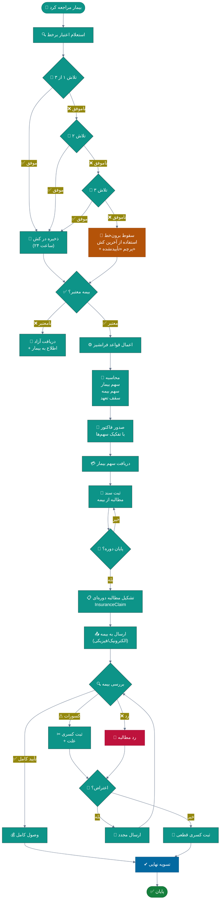
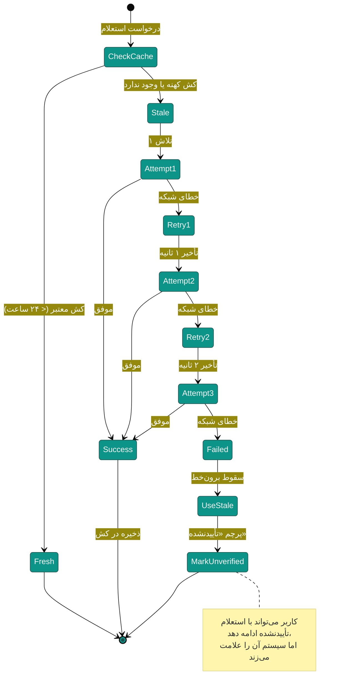
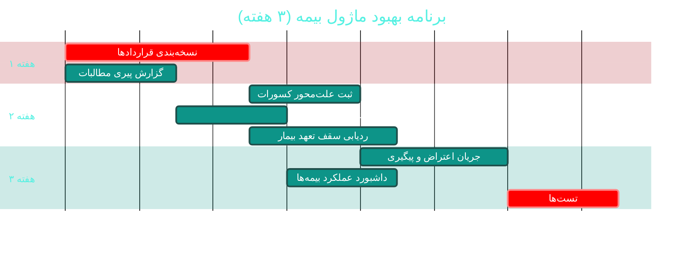

# 🛡 ماژول بیمه و تسویه مطالبات (Insurance & Claims)

> **مسیر ماژول:** `insurance` · **لایسنس:** `Insurance` + `InsuranceSettlement`
> **اولویت:** 🟠 بالا · **دشواری:** 🟠 بالا · **زمان برآوردی:** ۳ هفته

---

## ۱. 📋 خلاصه ماژول

مدیریت کامل چرخه‌ی بیمه: تعریف شرکت‌ها و قراردادها، **موتور فرانشیز (Fractionment)**،
استعلام برخط اعتبار با **سه تلاش + کش + سقوط برون‌خط**، تشکیل مطالبه دوره‌ای،
و پیگیری وصول و کسورات.

| ویژگی | مقدار |
|:---|:---|
| 🎯 هدف | بیشینه‌سازی وصول از بیمه‌ها با کمترین کسری |
| 👤 کاربران اصلی | صندوقدار · کارشناس بیمه · مدیر مالی |
| 🔗 وابستگی‌ها | `billing`, `patients`, `accounting`, `government` |
| 📊 وضعیت فعلی | 🟢 عملیاتی — 🟠 پیچیدگی بالا |

---

## ۲. 🎯 وضعیت فعلی در کدبیس

| لایه | فایل | وضعیت |
|:---|:---|:---|
| 🧬 Domain | `.../Billing/InsuranceCompany.cs` · `InsuranceClaim.cs` · `InsuranceFractionmentRule.cs` · `InsuranceInquiry.cs` | 🟢 |
| 🧬 Domain | `.../Enums/ClaimStatus.cs` · `InsuranceSystemType.cs` · `InsuranceType.cs` · `FractionmentRuleType.cs` | 🟢 |
| ⚙ App | `.../Features/Insurance/` · `.../Features/Insurance/Fractionment/` | 🟢 |
| 🗄 Infra | `.../Services/Insurance/OnlineInsuranceEligibilityService.cs` | 🟢 ⭐ استعلام برخط |
| 🌐 API | `.../Controllers/InsuranceController.cs` | 🟢 |
| 🖥 Desktop | `.../Views/InsuranceView.xaml` | 🟢 |
| 🧪 تست | `tests/.../Insurance/FractionmentCalculatorTests.cs` | 🟢 موجود |

### نکات برجسته‌ی فعلی

✅ **موتور فرانشیز** با تست اختصاصی (`FractionmentCalculatorTests`)
✅ **استعلام برخط سه‌تلاشی** با کش و سقوط برون‌خط — طراحی مقاوم عالی
✅ **چند نوع سیستم بیمه‌ای** (`InsuranceSystemType`)
✅ **قواعد فرانشیز منعطف** (`FractionmentRuleType`)
✅ **پیکربندی Timeout و Retry** در `appsettings.json`

---

## ۳. 📊 نمودار جریان بیمه



### نمودار پایداری استعلام برخط



---

## ۴. ⚠️ کاستی‌ها و ایرادها

| # | کاستی | 🎯 شدت | 📍 محل | 💥 پیامد |
|:--:|:---|:--:|:---|:---|
| W-01 | **تغییرات نرخ بیمه در طول زمان** نسخه‌بندی نمی‌شود | 🔴 بالا | `InsuranceCompany` | تسویه با نرخ اشتباه |
| W-02 | **کسورات** علت‌محور ثبت نمی‌شوند | 🟠 بالا | `InsuranceClaim` | عدم امکان تحلیل و پیگیری |
| W-03 | **اعتراض و پیگیری** جریان رسمی ندارد | 🟠 بالا | Domain | مطالبات ردشده فراموش می‌شوند |
| W-04 | **گزارش پیری مطالبات (Aging)** ندارد | 🟠 بالا | — | مطالبات معوق پنهان |
| W-05 | **سقف تعهد سالانه بیمار** ردیابی نمی‌شود | 🟠 بالا | Domain | اضافه‌دریافت از بیمه → کسر |
| W-06 | **پیش‌بینی وصول** ندارد | 🟡 متوسط | — | برنامه‌ریزی نقدی ضعیف |
| W-07 | **تطابق خودکار صورت‌حساب بیمه** ندارد | 🟡 متوسط | — | مغایرت‌گیری دستی |
| W-08 | **گزارش عملکرد هر بیمه** ندارد | 🟡 متوسط | — | تصمیم‌گیری برای تمدید قرارداد |
| W-09 | مستنداتِ قواعد فرانشیز در کد پراکنده است | 🟡 متوسط | `Fractionment/` | نگهداری دشوار |

---

## ۵. ✨ امکانات پیشنهادی

| 🎯 # | امکان | 📝 شرح | 💰 ارزش | 🔧 دشواری | ⏱ |
|:--:|:---|:---|:--:|:--:|:--:|
| F-01 | 📅 **نسخه‌بندی قراردادها و نرخ‌ها** | تاریخ اعتبار + نرخ‌های دوره‌ای | **حیاتی** | متوسط | ۱ هفته |
| F-02 | ✂ **ثبت علت‌محور کسورات** | کدهای استاندارد علت کسری | بالا | کم | ۳ روز |
| F-03 | 📢 **جریان اعتراض و پیگیری** | ثبت اعتراض + پیگیری + مهلت | بالا | متوسط | ۱ هفته |
| F-04 | 📊 **گزارش پیری مطالبات (Aging)** | دسته‌بندی ۳۰/۶۰/۹۰/۹۰+ روز | بسیار بالا | کم | ۳ روز |
| F-05 | 🎯 **ردیابی سقف تعهد بیمار** | مبلغ استفاده‌شده / سقف سالانه | بالا | متوسط | ۵ روز |
| F-06 | 🤖 **تطابق خودکار صورت‌حساب** | وارد کردن فایل بیمه + تطابق | بالا | متوسط | ۲ هفته |
| F-07 | 📈 **پیش‌بینی جریان وصول** | بر اساس میانگین تاریخی هر بیمه | بالا | متوسط | ۱ هفته |
| F-08 | 📋 **داشبورد عملکرد بیمه‌ها** | نرخ وصول · میانگین کسری · زمان وصول | بالا | کم | ۴ روز |
| F-09 | 🔔 **هشدار مطالبات معوق** | یادآوری پیگیری پس از N روز | بالا | کم | ۲ روز |
| F-10 | 📄 **خروجی استاندارد برای بیمه** | فرمت موردقبول هر بیمه | استراتژیک | زیاد | ۳ هفته |

---

## ۶. 🛠 دستورالعمل پیاده‌سازی

### 📌 گام ۱ — نسخه‌بندی قراردادها (F-01) — *ریشه‌ای‌ترین*

```csharp
// 📄 src/Sahand.ClinicPro.Domain/Billing/InsuranceContractVersion.cs (جدید)
namespace Sahand.ClinicPro.Domain.Entities.Billing;

/// <summary>
/// نسخه قرارداد بیمه — نرخ‌ها و شرایط در یک بازه زمانی مشخص.
/// وجود این موجودیت از خطای «تسویه با نرخ منقضی» جلوگیری می‌کند،
/// زیرا هر فاکتور به نسخه معتبر در تاریخ خودش ارجاع می‌دهد.
/// </summary>
public class InsuranceContractVersion : AuditableEntity, ISoftDeletable
{
    /// <summary>شرکت بیمه</summary>
    public long InsuranceCompanyId { get; set; }

    /// <summary>شرکت بیمه</summary>
    public InsuranceCompany InsuranceCompany { get; set; } = null!;

    /// <summary>شماره قرارداد</summary>
    public string ContractNumber { get; set; } = string.Empty;

    /// <summary>تاریخ شروع اعتبار</summary>
    public DateTime EffectiveFrom { get; set; }

    /// <summary>تاریخ پایان اعتبار (تهی = نامحدود)</summary>
    public DateTime? EffectiveTo { get; set; }

    /// <summary>درصد پوشش بیمه پایه</summary>
    public decimal BaseCoveragePercent { get; set; }

    /// <summary>سقف تعهد هر ویزیت</summary>
    public decimal? PerVisitCap { get; set; }

    /// <summary>سقف تعهد سالانه هر بیمار</summary>
    public decimal? AnnualCapPerPatient { get; set; }

    /// <summary>تعداد مجاز ویزیت در سال</summary>
    public int? MaxVisitsPerYear { get; set; }

    /// <summary>فرانشیز ثابت به ریال</summary>
    public decimal? FixedCopay { get; set; }

    /// <summary>قواعد خاص به‌صورت JSON (استثنائات خدمات)</summary>
    public string SpecialRulesJson { get; set; } = "{}";

    /// <summary>نسخه فعال است</summary>
    public bool IsActive { get; set; } = true;
}
```

```csharp
// 📄 src/Sahand.ClinicPro.Application/Common/Helpers/ContractVersionResolver.cs
/// <summary>
/// تعیین‌کننده نسخه معتبر قرارداد در یک تاریخ مشخص.
/// اولویت: بازه‌ای که تاریخ در آن قرار گیرد و IsActive باشد.
/// </summary>
public static class ContractVersionResolver
{
    public static InsuranceContractVersion? Resolve(
        IReadOnlyList<InsuranceContractVersion> versions, DateTime at)
        => versions
            .Where(v => v.IsActive
                        && v.EffectiveFrom <= at
                        && (v.EffectiveTo is null || v.EffectiveTo >= at))
            .OrderByDescending(v => v.EffectiveFrom)     // جدیدترین نسخه معتبر
            .FirstOrDefault();

    /// <summary>بررسی آیا بیمار به سقف تعهد رسیده است</summary>
    public static async Task<(bool Reached, decimal Used, decimal? Cap)> CheckAnnualCapAsync(
        InsuranceContractVersion version, long patientId, long companyId,
        IQueryable<Invoice> invoices, CancellationToken ct)
    {
        if (version.AnnualCapPerPatient is not { } cap)
            return (false, 0m, null);

        var yearStart = new DateTime(DateTime.UtcNow.Year, 1, 1);
        var used = await invoices
            .Where(i => !i.IsDeleted
                        && i.PatientId == patientId
                        && i.InsuranceCompanyId == companyId
                        && i.InvoiceDate >= yearStart)
            .SumAsync(i => (decimal?)(i.InsuranceShare ?? 0m), ct) ?? 0m;

        return (used >= cap, used, cap);
    }
}
```

---

### 📌 گام ۲ — گزارش پیری مطالبات (F-04)

```csharp
// 📄 src/Sahand.ClinicPro.Application/Features/Insurance/ClaimsAging/ClaimsAgingQuery.cs
namespace Sahand.ClinicPro.Application.Features.Insurance.ClaimsAging;

/// <summary>
/// گزارش پیری مطالبات بیمه — دسته‌بندی بر اساس زمان سپری‌شده از تاریخ ارسال.
/// این گزارش برای مدیریت جریان نقدی حیاتی است.
/// </summary>
public record ClaimsAgingQuery(long? InsuranceCompanyId = null)
    : IRequest<Result<ClaimsAgingDto>>;

public class ClaimsAgingQueryHandler : IRequestHandler<ClaimsAgingQuery, Result<ClaimsAgingDto>>
{
    private readonly IUnitOfWork _uow;

    public ClaimsAgingQueryHandler(IUnitOfWork uow) => _uow = uow;

    public async Task<Result<ClaimsAgingDto>> Handle(ClaimsAgingQuery req, CancellationToken ct)
    {
        var today = DateTime.UtcNow.Date;

        var claims = await _uow.Repository<InsuranceClaim>().QueryableNoTracking
            .Include(c => c.InsuranceCompany)
            .Where(c => !c.IsDeleted
                        && c.Status is ClaimStatus.Submitted or ClaimStatus.PartiallyPaid
                        && (req.InsuranceCompanyId == null
                            || c.InsuranceCompanyId == req.InsuranceCompanyId))
            .Select(c => new
            {
                c.Id,
                c.ClaimNumber,
                CompanyName = c.InsuranceCompany.Name,
                c.SubmittedAt,
                c.TotalAmount,
                c.PaidAmount,
            })
            .ToListAsync(ct);

        // دسته‌بندی بر اساس قدمت
        var buckets = new[] { 30, 60, 90 };
        var rows = claims.Select(c =>
        {
            var days = c.SubmittedAt.HasValue
                ? (int)(today - c.SubmittedAt.Value.Date).TotalDays
                : 0;

            var bucket = days switch
            {
                <= 30 => "۰-۳۰ روز",
                <= 60 => "۳۱-۶۰ روز",
                <= 90 => "۶۱-۹۰ روز",
                _     => "بیش از ۹۰ روز",
            };

            return new AgingRow(
                c.Id, c.ClaimNumber, c.CompanyName,
                c.SubmittedAt, days, bucket,
                c.TotalAmount - c.PaidAmount);
        }).ToList();

        var summary = rows
            .GroupBy(r => r.Bucket)
            .Select(g => new AgingBucket(g.Key, g.Count(), g.Sum(r => r.Outstanding)))
            .OrderBy(b => b.Bucket)
            .ToList();

        return Result<ClaimsAgingDto>.Success(new ClaimsAgingDto(
            AsOf: today,
            Rows: rows.OrderByDescending(r => r.DaysOutstanding).ToList(),
            Buckets: summary,
            TotalOutstanding: rows.Sum(r => r.Outstanding)));
    }
}

public record AgingRow(long ClaimId, string ClaimNumber, string CompanyName,
    DateTime? SubmittedAt, int DaysOutstanding, string Bucket, decimal Outstanding);

public record AgingBucket(string Bucket, int Count, decimal Amount);

public record ClaimsAgingDto(DateTime AsOf,
    IReadOnlyList<AgingRow> Rows,
    IReadOnlyList<AgingBucket> Buckets,
    decimal TotalOutstanding);
```

---

### 📌 گام ۳ — هشدار مطالبات معوق (F-09)

```csharp
// 📄 src/Sahand.ClinicPro.Infrastructure/Services/Insurance/OverdueClaimsJob.cs (جدید)
/// <summary>
/// کار پس‌زمینه شناسایی و اعلان مطالبات بیمه‌ای معوق.
/// هر روز اجرا می‌شود و مطالباتی را که بیش از حد آستانه معوق مانده‌اند
/// به مسئول بیمه اعلان می‌کند.
/// </summary>
public class OverdueClaimsJob
{
    private readonly IServiceScopeFactory _scopeFactory;
    private readonly ILogger<OverdueClaimsJob> _logger;

    /// <summary>سازنده</summary>
    public OverdueClaimsJob(IServiceScopeFactory scopeFactory,
        ILogger<OverdueClaimsJob> logger)
    { _scopeFactory = scopeFactory; _logger = logger; }

    /// <summary>اجرای روزانه</summary>
    public async Task RunAsync(CancellationToken ct = default)
    {
        using var scope = _scopeFactory.CreateScope();
        var uow = scope.ServiceProvider.GetRequiredService<IUnitOfWork>();
        var notifier = scope.ServiceProvider.GetRequiredService<INotificationService>();

        var thresholds = new[] { 45, 75, 120 };     // روز
        var today = DateTime.UtcNow.Date;

        foreach (var threshold in thresholds)
        {
            var cutoff = today.AddDays(-threshold);

            var overdue = await uow.Repository<InsuranceClaim>().QueryableNoTracking
                .Include(c => c.InsuranceCompany)
                .Where(c => !c.IsDeleted
                            && c.Status is ClaimStatus.Submitted or ClaimStatus.PartiallyPaid
                            && c.SubmittedAt <= cutoff
                            && c.LastRemindedAt < cutoff)     // فقط یک‌بار در هر آستانه
                .ToListAsync(ct);

            foreach (var claim in overdue)
            {
                await notifier.CreateAsync(new CreateNotificationRequest(
                    UserId: claim.AssignedUserId ?? 0,
                    Title: $"⏰ مطالبه معوق {threshold} روزه",
                    Message: $"مطالبه {claim.ClaimNumber} از «{claim.InsuranceCompany.Name}» " +
                             $"به مبلغ {(claim.TotalAmount - claim.PaidAmount):N0} ریال " +
                             $"بیش از {threshold} روز معوق مانده است.",
                    Type: NotificationType.FinanceAlert,
                    Priority: threshold >= 120 ? NotificationPriority.High
                                              : NotificationPriority.Normal,
                    ReferenceType: "claim",
                    ReferenceId: claim.Id), ct);
            }

            // به‌روزرسانی زمان آخرین یادآوری
            foreach (var claim in overdue)
            {
                var entity = await uow.Repository<InsuranceClaim>().GetByIdAsync(claim.Id, ct);
                if (entity is not null)
                {
                    entity.LastRemindedAt = today;
                    uow.Repository<InsuranceClaim>().Update(entity);
                }
            }
            await uow.SaveEntitiesAsync(ct);

            _logger.LogInformation(
                "بررسی مطالبات معوق آستانه {Threshold} روز: {Count} مورد", threshold, overdue.Count);
        }
    }
}
```

> 📌 فیلد `LastRemindedAt` باید به `InsuranceClaim` اضافه شود (مایگریشن جدید).

---

## ۷. 🧪 تست‌های الزامی

| 🧪 تست | 🎯 هدف | اولویت |
|:---|:---|:--:|
| `FractionmentCalculator_StandardCase_Correct` *(موجود)* | محاسبه سهم | 🔴 |
| `ContractVersion_ExpiredVersion_NotSelected` | نسخه‌بندی | 🔴 |
| `ContractVersion_OverlappingRanges_PicksLatest` | تداخل بازه | 🟠 |
| `AnnualCap_PatientExceeded_ShiftsToPatient` | سقف تعهد | 🔴 |
| `ClaimsAging_BucketBoundaries_Correct` | دسته‌بندی | 🟠 |
| `OverdueJob_DoesNotNotifyTwice` | Idempotent | 🟠 |
| `OfflineFallback_AllAttemptsFail_UsesCache` | **سقوط برون‌خط** | 🔴 |
| `Inquiry_SuccessfulAttempt_CachesResult` | کش | 🟠 |
| `Deduction_RecordsReasonCode` | علت کسری | 🟠 |

---

## ۸. 📈 شاخص‌های موفقیت (KPI)

| 📊 شاخص | قبل | هدف |
|:---|:--:|:--:|
| 💰 نرخ وصول مطالبات | ~۸۰٪ | **> ۹۵٪** |
| ⏱ میانگین زمان وصول | ~۷۵ روز | **< ۴۵ روز** |
| ✂ میانگین کسورات | ~۱۲٪ | **< ۵٪** |
| 📊 مطالبات معوق بالای ۹۰ روز | نامشخص | **< ۳٪** |
| 🔍 نرخ موفقیت استعلام برخط | ~۸۵٪ | **> ۹۷٪** |

---

## ۹. 🗓 برنامه زمانی



---

## 🔗 پیوندهای مرتبط

| 📄 سند | توضیح |
|:---|:---|
| [تحلیل جامع](../ANALYSIS-REPORT.md) | سند اصلی |
| [B01 — صندوق و فاکتور](B01-billing.md) | اعمال فرانشیز روی فاکتور |
| [B02 — حسابداری](B02-accounting.md) | ثبت مطالبه در دفاتر |
| [C10 — سامانه‌های دولتی](C12-government-integration.md) | یکپارچگی بیمه‌ای |

---
<div align="center">📅 ۱۴۰۴/۰۷/۱۹ · 🔖 v1.0</div>
