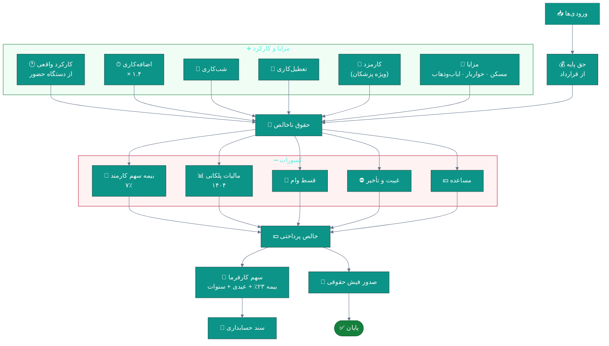
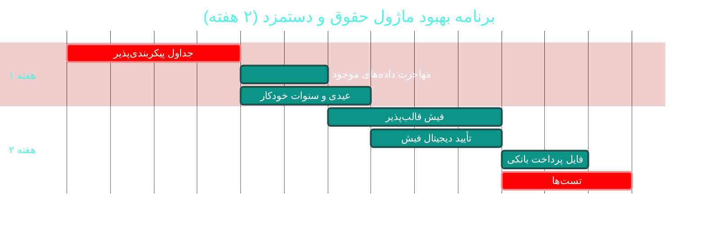

# 🧾 ماژول حقوق و دستمزد (Payroll)

> **مسیر ماژول:** `salaries` · **لایسنس:** `Payroll`
> **اولویت:** 🟡 متوسط · **دشواری:** 🟠 بالا · **زمان برآوردی:** ۲ هفته

---

## ۱. 📋 خلاصه ماژول

محاسبه و صدور فیش حقوقی بر اساس **قواعد سال ۱۴۰۴**: حق پایه، اضافه‌کاری (۱.۴×)،
کسر بیمه (۷٪)، مالیات پلکانی، مزایا، و کارکرد واقعی از دستگاه حضور و غیاب.

| ویژگی | مقدار |
|:---|:---|
| 🎯 هدف | محاسبه دقیق و قانونی حقوق + شفافیت برای پرسنل |
| 👤 کاربران اصلی | کارشناس منابع انسانی · مدیر مالی |
| 🔗 وابستگی‌ها | `hr`, `attendance`, `accounting` |
| 📊 وضعیت فعلی | 🟢 عملیاتی |

---

## ۲. 🎯 وضعیت فعلی در کدبیس

| لایه | فایل | وضعیت |
|:---|:---|:---|
| 🧬 Domain | `.../Personnel/EmployeeSalary.cs` | 🟢 |
| 🧬 Domain | `.../Billing/DoctorPayment.cs` | 🟢 پرداخت پزشک |
| 🧬 Domain | `.../Enums/SalaryStatus.cs` · `EmploymentType.cs` | 🟢 |
| ⚙ App | `.../Features/Payroll/` | 🟢 |
| 🌐 API | `.../Controllers/SalariesController.cs` | 🟢 |
| 🖥 Desktop | `.../Views/PayrollView.xaml` · `PayslipWindow.xaml` (۲۸۶ خط Code-Behind) · `EmployeeSalaryEditWindow` | 🟠 |
| 🖥 Desktop | `.../Views/CommissionReportWindow.xaml` · `DoctorPerformanceWindow.xaml` | 🟢 |
| 🧪 تست | `tests/.../Payroll/PayrollCalculatorTests.cs` | 🟢 موجود |

### نکات برجسته‌ی فعلی

✅ **قواعد ۱۴۰۴ پیاده‌سازی شده**: اضافه‌کاری ۱.۴×، بیمه ۷٪، مالیات پلکانی
✅ **اتصال به حضور واقعی دستگاه** (نه ورود دستی)
✅ **تست اختصاصی** (`PayrollCalculatorTests`)
✅ **گزارش کارمزد پزشکان** (`CommissionReportWindow`)
✅ **عملکرد پزشکان** (`DoctorPerformanceWindow`)

---

## ۳. 📊 نمودار محاسبه حقوق



### جدول مالیات پلکانی ۱۴۰۴ (نمونه)

| ردیف | بازه ماهانه (ریال) | نرخ |
|:--:|:---|:--:|
| ۱ | تا ۱۰۰٬۰۰۰٬۰۰۰ | معاف |
| ۲ | ۱۰۰٬۰۰۰٬۰۰۱ — ۱۴۰٬۰۰۰٬۰۰۰ | ۱۰٪ |
| ۳ | ۱۴۰٬۰۰۰٬۰۰۱ — ۲۰۰٬۰۰۰٬۰۰۰ | ۱۵٪ |
| ۴ | ۲۰۰٬۰۰۰٬۰۰۱ — ۳۰۰٬۰۰۰٬۰۰۰ | ۲۰٪ |
| ۵ | بیش از ۳۰۰٬۰۰۰٬۰۰۰ | ۲۵٪ |

> ⚠️ **هشدار مهم:** این ارقام باید در **تنظیمات سیستم** ذخیره شوند نه در کد،
> زیرا هر سال تغییر می‌کنند. (W-01)

---

## ۴. ⚠️ کاستی‌ها و ایرادها

| # | کاستی | 🎯 شدت | 📍 محل | 💥 پیامد |
|:--:|:---|:--:|:---|:---|
| W-01 | **جداول مالیات و بیمه در کد Hardcode** شده | 🔴 بالا | `PayrollCalculator` | هر سال نیاز به کامپایل و انتشار |
| W-02 | `PayslipWindow` دارای **۲۸۶ خط Code-Behind** | 🟠 بالا | `Views/` | نقض MVVM، چاپ سخت |
| W-03 | **تأیید و امضای فیش** ندارد | 🟡 متوسط | Domain | عدم تأیید دریافت |
| W-04 | **تاریخچه تغییرات فیش** پس از تأیید ندارد | 🟡 متوسط | Domain | دستکاری بدون رد |
| W-05 | **محاسبه عیدی و سنوات** خودکار نیست | 🟡 متوسط | — | محاسبه دستی و خطا |
| W-06 | **محاسبه بیمه بیکاری/بازنشستگی** ندارد | 🔵 کم | — | — |
| W-07 | **گزارش‌های قانونی** (لیست بیمه، مالیات) ندارد | 🟠 بالا | — | ارسال دستی |
| W-08 | **مقایسه حقوق بین دوره‌ها** ندارد | 🟡 متوسط | UI | — |

---

## ۵. ✨ امکانات پیشنهادی

| 🎯 # | امکان | 📝 شرح | 💰 ارزش | 🔧 دشواری | ⏱ |
|:--:|:---|:---|:--:|:--:|:--:|
| F-01 | ⚙ **جداول پیکربندی‌پذیر مالیات و بیمه** | ذخیره در DB + ویرایش از تنظیمات | **حیاتی** | کم | ۴ روز |
| F-02 | 🧾 **فیش حقوقی قالب‌پذیر** | استفاده از سیستم قالب چاپ موجود | بالا | کم | ۴ روز |
| F-03 | ✍ **تأیید و امضای دیجیتال فیش** | تأیید پرسنل + قفل پس از تأیید | بالا | کم | ۳ روز |
| F-04 | 🎁 **محاسبه خودکار عیدی و سنوات** | بر اساس قانون کار | بالا | متوسط | ۵ روز |
| F-05 | 📋 **گزارش‌های قانونی** | لیست بیمه · لیست مالیات · دیسکت | بسیار بالا | متوسط | ۲ هفته |
| F-06 | 📊 **مقایسه دوره‌ای حقوق** | نمودار تغییرات ماهانه | متوسط | کم | ۳ روز |
| F-07 | 🏦 **فایل پرداخت بانکی** | خروجی Excel/Text برای بانک | بالا | کم | ۳ روز |
| F-08 | 💼 **کارمزد پویای پزشکان** | قواعد چندسطحی (درآمدی/ثابت/ترکیبی) | بالا | متوسط | ۱ هفته |
| F-09 | 📈 **پیش‌بینی هزینه پرسنل** | بر اساس برنامه شیفت‌ها | متوسط | متوسط | ۱ هفته |
| F-10 | 🔔 **اعلان فیش صادرشده** | به پرسنل (پیامک/اعلان) | متوسط | کم | ۲ روز |

---

## ۶. 🛠 دستورالعمل پیاده‌سازی

### 📌 گام ۱ — جداول پیکربندی‌پذیر (F-01) — *فوری*

> 🔑 **چرا فوری؟** با شروع سال ۱۴۰۵، جداول تغییر می‌کنند و بدون این کار
> باید کد را تغییر داد و نسخه جدید منتشر کرد.

**۱.۱ موجودیت جدول مالیات**

```csharp
// 📄 src/Sahand.ClinicPro.Domain/Personnel/TaxBracket.cs (جدید)
namespace Sahand.ClinicPro.Domain.Entities.Personnel;

/// <summary>
/// پله مالیاتی — قابل ویرایش از تنظیمات، بدون نیاز به تغییر کد.
/// هر سال با ابلاغ بخشنامه جدید، ردیف‌های تازه‌ای با EffectiveFrom جدید درج می‌شوند
/// و ردیف‌های قدیمی برای محاسبات گذشته باقی می‌مانند.
/// </summary>
public class TaxBracket : BaseEntity
{
    /// <summary>سال مالی شمسی (مثلاً ۱۴۰۴)</summary>
    public int ShamsiYear { get; set; }

    /// <summary>حد پایین بازه (ریال)</summary>
    public decimal RangeFrom { get; set; }

    /// <summary>حد بالای بازه (تهی = نامحدود)</summary>
    public decimal? RangeTo { get; set; }

    /// <summary>نرخ مالیات (درصد)</summary>
    public decimal Rate { get; set; }

    /// <summary>مبلغ معافیت پایه (ریال)</summary>
    public decimal ExemptionAmount { get; set; }

    /// <summary>شماره ترتیب پله</summary>
    public int Order { get; set; }
}
```

```csharp
// 📄 src/Sahand.ClinicPro.Domain/Personnel/InsuranceRate.cs (جدید)
/// <summary>
/// نرخ‌های بیمه تأمین اجتماعی — قابل ویرایش از تنظیمات.
/// </summary>
public class InsuranceRate : BaseEntity
{
    /// <summary>سال مالی شمسی</summary>
    public int ShamsiYear { get; set; }

    /// <summary>سهم کارمند (درصد) — معمولاً ۷٪</summary>
    public decimal EmployeeSharePercent { get; set; } = 7m;

    /// <summary>سهم کارفرما (درصد) — معمولاً ۲۳٪</summary>
    public decimal EmployerSharePercent { get; set; } = 23m;

    /// <summary>سهم دولت (درصد) — معمولاً ۳٪</summary>
    public decimal GovernmentSharePercent { get; set; } = 3m;

    /// <summary>سقف حقوق مشمول بیمه (ریال)</summary>
    public decimal? MaxInsurableSalary { get; set; }

    /// <summary>حداقل دستمزد روزانه (ریال)</summary>
    public decimal DailyMinimumWage { get; set; }
}
```

**۱.۲ بازنویسی محاسبه‌گر با جداول پویا**

```csharp
// 📄 src/Sahand.ClinicPro.Application/Features/Payroll/PayrollCalculator.cs (بازنویسی)
namespace Sahand.ClinicPro.Application.Features.Payroll;

/// <summary>
/// محاسبه‌گر حقوق — نسخه پیکربندی‌پذیر.
/// همه نرخ‌ها از دیتابیس خوانده می‌شوند (نه ثابت در کد) تا تغییرات سالانه
/// بدون انتشار نسخه جدید ممکن باشد.
/// </summary>
public class PayrollCalculator
{
    private readonly IReadOnlyList<TaxBracket> _brackets;
    private readonly InsuranceRate _insurance;

    /// <summary>سازنده با جداول سال جاری</summary>
    public PayrollCalculator(IReadOnlyList<TaxBracket> brackets, InsuranceRate insurance)
    {
        _brackets = brackets.OrderBy(b => b.Order).ToList();
        _insurance = insurance;
    }

    /// <summary>محاسبه حقوق یک کارمند</summary>
    public PayrollResult Calculate(PayrollInput input)
    {
        // ── ۱) کارکرد و اضافه‌کاری ──
        var regularPay = input.BaseSalary;
        var overtimePay = input.OvertimeHours * input.HourlyRate * 1.4m;   // ضریب ۱.۴
        var nightPay = input.NightHours * input.HourlyRate * 0.35m;        // فوق‌العاده شب‌کاری
        var holidayPay = input.HolidayHours * input.HourlyRate * 1.4m;

        var gross = regularPay + overtimePay + nightPay + holidayPay
                    + input.Commission + input.Allowances;

        // ── ۲) کسر بیمه (سهم کارمند) ──
        var insurableBase = _insurance.MaxInsurableSalary.HasValue
            ? Math.Min(gross, _insurance.MaxInsurableSalary.Value)
            : gross;
        var insuranceDeduction = insurableBase * (_insurance.EmployeeSharePercent / 100m);

        // ── ۳) مالیات پلکانی روی مبلغ پس از کسر بیمه ──
        var taxable = Math.Max(0m, gross - insuranceDeduction);
        var tax = CalculateProgressiveTax(taxable);

        // ── ۴) سایر کسورات ──
        var absenceDeduction = input.AbsenceDays * input.DailyRate;
        var otherDeductions = input.LoanInstallment + input.AdvanceRepayment + absenceDeduction;

        // ── ۵) خالص پرداختی ──
        var net = gross - insuranceDeduction - tax - otherDeductions;

        // ── ۶) سهم کارفرما (هزینه واقعی کارفرما) ──
        var employerInsurance = insurableBase * (_insurance.EmployerSharePercent / 100m);
        var totalCost = gross + employerInsurance;

        return new PayrollResult(
            RegularPay: regularPay,
            OvertimePay: overtimePay,
            NightPay: nightPay,
            HolidayPay: holidayPay,
            Commission: input.Commission,
            Allowances: input.Allowances,
            GrossPay: gross,
            InsuranceDeduction: insuranceDeduction,
            TaxDeduction: tax,
            AbsenceDeduction: absenceDeduction,
            OtherDeductions: input.LoanInstallment + input.AdvanceRepayment,
            NetPay: net,
            EmployerInsurance: employerInsurance,
            TotalEmployerCost: totalCost);
    }

    /// <summary>محاسبه مالیات پلکانی</summary>
    private decimal CalculateProgressiveTax(decimal taxableIncome)
    {
        decimal totalTax = 0m;

        foreach (var bracket in _brackets)
        {
            if (taxableIncome <= bracket.RangeFrom) break;

            var taxableInBracket =
                (bracket.RangeTo.HasValue
                    ? Math.Min(taxableIncome, bracket.RangeTo.Value)
                    : taxableIncome) - bracket.RangeFrom;

            if (taxableInBracket > 0)
                totalTax += taxableInBracket * (bracket.Rate / 100m);
        }

        return Math.Round(totalTax, 0);
    }
}
```

**۱.۳ Seeder برای سال ۱۴۰۴**

```csharp
// 📄 src/Sahand.ClinicPro.Infrastructure/Persistence/Seeders/PayrollConfigSeeder.cs (جدید)
/// <summary>بذر جداول مالیات و بیمه — قابل ویرایش بعدی از تنظیمات</summary>
public class PayrollConfigSeeder : IDataSeeder
{
    private readonly ClinicProDbContext _context;
    public PayrollConfigSeeder(ClinicProDbContext context) => _context = context;
    public int Order => 55;

    public async Task SeedAsync(CancellationToken ct = default)
    {
        // فقط در صورت نبودِ داده برای سال جاری
        if (await _context.TaxBrackets.AnyAsync(b => b.ShamsiYear == 1404, ct)) return;

        _context.TaxBrackets.AddRange(
            new TaxBracket { ShamsiYear = 1404, RangeFrom = 0, RangeTo = 100_000_000,
                             Rate = 0,  ExemptionAmount = 100_000_000, Order = 1 },
            new TaxBracket { ShamsiYear = 1404, RangeFrom = 100_000_000, RangeTo = 140_000_000,
                             Rate = 10, Order = 2 },
            new TaxBracket { ShamsiYear = 1404, RangeFrom = 140_000_000, RangeTo = 200_000_000,
                             Rate = 15, Order = 3 },
            new TaxBracket { ShamsiYear = 1404, RangeFrom = 200_000_000, RangeTo = 300_000_000,
                             Rate = 20, Order = 4 },
            new TaxBracket { ShamsiYear = 1404, RangeFrom = 300_000_000, RangeTo = null,
                             Rate = 25, Order = 5 });

        if (!await _context.InsuranceRates.AnyAsync(r => r.ShamsiYear == 1404, ct))
            _context.InsuranceRates.Add(new InsuranceRate
            {
                ShamsiYear = 1404,
                EmployeeSharePercent = 7m,
                EmployerSharePercent = 23m,
                GovernmentSharePercent = 3m,
            });

        await _context.SaveChangesAsync(ct);
    }
}
```

```csharp
// 📄 DependencyInjection.cs
services.AddTransient<IDataSeeder, PayrollConfigSeeder>();
```

---

### 📌 گام ۲ — محاسبه خودکار عیدی و سنوات (F-04)

```csharp
// 📄 src/Sahand.ClinicPro.Application/Features/Payroll/EndOfServiceCalculator.cs (جدید)
/// <summary>
/// محاسبه‌گر پایان‌کار — عیدی، سنوات و مرخصی استفاده‌نشده
/// مطابق قانون کار ایران.
/// </summary>
public static class EndOfServiceCalculator
{
    /// <summary>
    /// محاسبه عیدی سالانه — معادل دو ماه آخرین حقوق پایه،
    /// با سقفِ سه برابر حداقل دستمزد روزانه × ۳۰ روز.
    /// </summary>
    public static decimal CalculateBonus(decimal lastBaseSalary, decimal dailyMinimumWage,
        int workedMonths)
    {
        var fullBonus = lastBaseSalary * 2m;                    // دو ماه پایه
        var legalCap = dailyMinimumWage * 30m * 3m;             // سقف قانونی
        var capped = Math.Min(fullBonus, legalCap);

        // نسبت‌بندی بر اساس ماه‌های کارکرد
        return Math.Round(capped * (workedMonths / 12m), 0);
    }

    /// <summary>
    /// محاسبه سنوات (حق سنوات پایان خدمت) —
    /// معادل یک ماه آخرین حقوق به‌ازای هر سال کارکرد.
    /// </summary>
    public static decimal CalculateSeniority(decimal lastBaseSalary, int workedYears)
        => Math.Round(lastBaseSalary * workedYears, 0);

    /// <summary>محاسبه ذخیره مرخصی استفاده‌نشده</summary>
    public static decimal CalculateUnusedLeave(decimal dailyRate, int unusedLeaveDays)
        => Math.Round(dailyRate * unusedLeaveDays, 0);

    /// <summary>گزارش کامل پایان‌کار</summary>
    public static EndOfServiceResult CalculateAll(EndOfServiceInput input)
        => new(
            CalculateBonus(input.LastBaseSalary, input.DailyMinimumWage, input.WorkedMonths),
            CalculateSeniority(input.LastBaseSalary, input.WorkedYears),
            CalculateUnusedLeave(input.DailyRate, input.UnusedLeaveDays));
}

public record EndOfServiceInput(decimal LastBaseSalary, decimal DailyRate,
    decimal DailyMinimumWage, int WorkedMonths, int WorkedYears, int UnusedLeaveDays);

/// <summary>
/// نتیجه محاسبه حقوق پایان خدمت
/// </summary>
/// <param name="Bonus">پاداش پایان خدمت</param>
/// <param name="Seniority">سنوات خدمت</param>
/// <param name="UnusedLeave">مانده مرخصی استفاده‌نشده</param>
public record EndOfServiceResult(decimal Bonus, decimal Seniority, decimal UnusedLeave)
{
    /// <summary>
    /// مجموع قابل پرداخت — به‌صورت محاسباتی استخراج می‌شود
    /// تا امکان ناهماهنگی با اجزا از بین برود
    /// </summary>
    public decimal Total => Bonus + Seniority + UnusedLeave;
}
```

---

## ۷. 🧪 تست‌های الزامی

| 🧪 تست | 🎯 هدف | اولویت |
|:---|:---|:--:|
| `PayrollCalculator_Overtime_UsesFactor1_4` *(موجود — گسترش)* | ضریب اضافه‌کاری | 🔴 |
| `PayrollCalculator_Insurance_UsesConfiguredRate` | نرخ پویا | 🔴 |
| `ProgressiveTax_MultipleBrackets_Correct` | پلکان مالیات | 🔴 |
| `ProgressiveTax_BelowExemption_Zero` | معافیت | 🔴 |
| `PayrollCalculator_NegativeNet_ShouldWarn` | مدیریت مرز | 🟠 |
| `EndOfService_Bonus_RespectsLegalCap` | سقف قانونی | 🟠 |
| `EndOfService_Seniority_ProportionalToYears` | سنوات | 🟠 |
| `Payslip_Signed_ThenEdited_Blocked` | قفل پس از تأیید | 🟠 |
| `TaxBracket_NewYear_DoesNotAffectOldCalculations` | نسخه‌بندی سالانه | 🔴 |

---

## ۸. 📈 شاخص‌های موفقیت (KPI)

| 📊 شاخص | قبل | هدف |
|:---|:--:|:--:|
| ⏱ زمان تغییر جداول سالانه | کامپایل + انتشار | **< ۵ دقیقه (از تنظیمات)** |
| ❌ نرخ خطای محاسبات حقوق | نامشخص | **< ۰٫۵٪** |
| 📋 گزارش‌های قانونی تولیدشده در سیستم | ۰ | **۳** (بیمه، مالیات، بانک) |
| 🧾 نرخ تأیید دیجیتال فیش | ۰٪ | **> ۸۵٪** |
| 🧪 پوشش تست محاسبات | ~۴۰٪ | **> ۹۵٪** |

---

## ۹. 🗓 برنامه زمانی



---

## 🔗 پیوندهای مرتبط

| 📄 سند | توضیح |
|:---|:---|
| [تحلیل جامع](../ANALYSIS-REPORT.md) | سند اصلی |
| [B05 — پرسنل](B05-hr-personnel.md) | منبع قراردادها |
| [B06 — حضور و غیاب](B06-attendance.md) | منبع کارکرد واقعی |
| [B02 — حسابداری](B02-accounting.md) | ثبت سند حقوق |

---
<div align="center">📅 ۱۴۰۴/۰۷/۱۹ · 🔖 v1.0</div>
