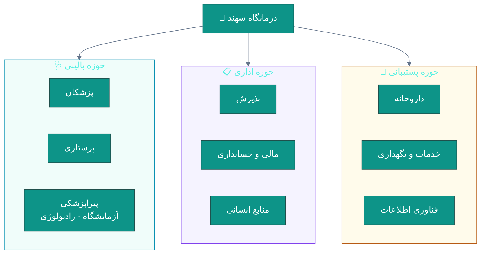
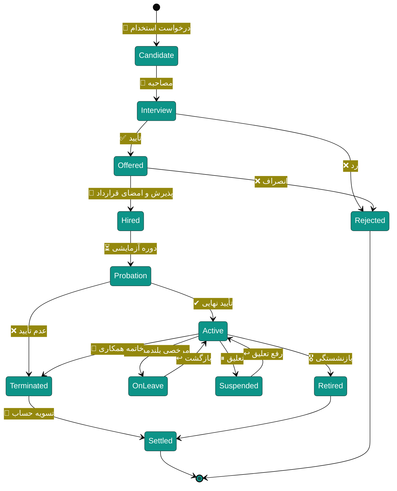
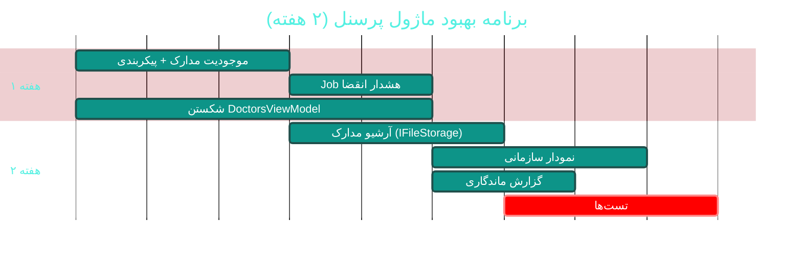

# 👔 ماژول پرسنل و منابع انسانی (HR & Personnel)

> **مسیر ماژول:** `hr` · **لایسنس:** `HR`
> **اولویت:** 🟡 متوسط · **دشواری:** 🟡 متوسط · **زمان برآوردی:** ۲ هفته

---

## ۱. 📋 خلاصه ماژول

مدیریت چرخه‌ی حیات کارکنان: استخدام، قراردادها، سازمان (دپارتمان‌ها و سمت‌ها)،
مرخصی‌ها، ارزیابی عملکرد، مدارک و گواهینامه‌ها، و خروج.

| ویژگی | مقدار |
|:---|:---|
| 🎯 هدف | سازماندهی نیروی انسانی و ردیابی وضعیت استخدامی |
| 👤 کاربران اصلی | مدیر منابع انسانی · مدیر |
| 🔗 وابستگی‌ها | `attendance`, `payroll`, `users`, `accounting` |
| 📊 وضعیت فعلی | 🟢 عملیاتی |

---

## ۲. 🎯 وضعیت فعلی در کدبیس

| لایه | فایل | وضعیت |
|:---|:---|:---|
| 🧬 Domain | `.../People/Employee.cs` · `Department.cs` · `Position.cs` | 🟢 |
| 🧬 Domain | `.../Personnel/PersonnelContract.cs` · `EmployeeLeave.cs` | 🟢 |
| 🧬 Domain | `.../Enums/EmploymentType.cs` · `ContractType.cs` · `ContractStatus.cs` · `EducationLevel.cs` · `MaritalStatus.cs` | 🟢 |
| 🧬 Domain | `.../People/Doctor.cs` · `Specialty.cs` | 🟢 |
| 🗄 Infra | مایگریشن `Cycle42SeedPositionsDepartments` | 🟢 ۳۰ سمت + ۱۷ دپارتمان |
| 🌐 API | `.../Controllers/HrController.cs` | 🟢 |
| 🖥 Desktop | `.../Views/PersonnelView.xaml` · `EmployeeFormWindow.xaml` · `DoctorsView.xaml` · `DoctorFormWindow.xaml` | 🟢 |
| 🖥 Desktop | `.../ViewModels/DoctorsViewModel.cs` | ۱٬۰۶۳ خط · ۲۱ فرمان 🟠 |

### نکات برجسته‌ی فعلی

✅ **بذر ۳۰ سمت + ۱۷ دپارتمان** (چرخه ۴۲)
✅ **قراردادها** با نوع و وضعیت (`ContractType`, `ContractStatus`)
✅ **سازمان تفکیک‌شده**: دپارتمان و سمت جداگانه
✅ **رفع خطای پاک‌شدن سمت/دپارتمان هنگام ویرایش** (چرخه ۴۲)

---

## ۳. 📊 نمودار سازمان و چرخه حیات





---

## ۴. ⚠️ کاستی‌ها و ایرادها

| # | کاستی | 🎯 شدت | 📍 محل | 💥 پیامد |
|:--:|:---|:---|:---|:---|
| W-01 | `DoctorsViewModel` با **۱٬۰۶۳ خط و ۲۱ فرمان** | 🟠 بالا | `ViewModels/` | سخت‌تست‌بودن |
| W-02 | **مدارک و گواهینامه‌ها** (پروانه طبابت، نظام پزشکی) ردیابی نمی‌شوند | 🟠 بالا | Domain | انقضای مجوزها پنهان می‌ماند |
| W-03 | **هشدار انقضای قرارداد** ندارد | 🟠 بالا | — | قرارداد بدون تمدید ادامه می‌یابد |
| W-04 | **ارزیابی عملکرد** ندارد | 🟡 متوسط | — | — |
| W-05 | **فرایند استخدام (Applicant Tracking)** ندارد | 🟡 متوسط | — | — |
| W-06 | **نمودار سازمانی (Org Chart)** ندارد | 🟡 متوسط | UI | — |
| W-07 | **گزارش ترک‌خدمت و ماندگاری** ندارد | 🟡 متوسط | `Reports` | — |
| W-08 | **تاریخچه تغییرات پرسنلی** (ترفیع، انتقال) ندارد | 🟡 متوسط | Domain | — |
| W-09 | **مدارک هویتی پرسنل** (کپی شناسنامه، مدرک تحصیلی) ندارد | 🔵 کم | — | — |

---

## ۵. ✨ امکانات پیشنهادی

| 🎯 # | امکان | 📝 شرح | 💰 ارزش | 🔧 دشواری | ⏱ |
|:--:|:---|:---|:--:|:--:|:--:|
| F-01 | 📜 **مدیریت مدارک و گواهینامه‌ها** | پروانه طبابت · نظام پزشکی · مدرک تحصیلی با تاریخ انقضا | بسیار بالا | کم | ۵ روز |
| F-02 | 🔔 **هشدار انقضا** | قرارداد · گواهینامه · بیمه مسئولیت | بسیار بالا | کم | ۳ روز |
| F-03 | 🧩 **شکستن DoctorsViewModel** | تقسیم به ۴ زیر-ViewModel | بالا | متوسط | ۵ روز |
| F-04 | 🏢 **نمودار سازمانی** | درخت تعاملی با کشویی | متوسط | کم | ۴ روز |
| F-05 | 📊 **ارزیابی عملکرد** | فرم دوره‌ای + امتیازدهی | بالا | متوسط | ۱ هفته |
| F-06 | 📈 **گزارش ماندگاری و ترک‌خدمت** | نرخ خروج · میانگین سنوات | بالا | کم | ۳ روز |
| F-07 | 📝 **فرایند استخدام** | ردیابی candidature از مصاحبه تا استخدام | متوسط | متوسط | ۲ هفته |
| F-08 | 📁 **آرشیو مدارک پرسنلی** | ذخیره فایل با استفاده از `IFileStorage` | بالا | کم | ۳ روز |
| F-09 | 🔄 **تاریخچه تغییرات پرسنلی** | ترفیع · انتقال · تغییر حقوق | متوسط | کم | ۳ روز |
| F-10 | 🎓 **مدیریت آموزش‌ها** | دوره‌های گذرانده + گواهی | متوسط | کم | ۳ روز |

---

## ۶. 🛠 دستورالعمل پیاده‌سازی

### 📌 گام ۱ — مدیریت مدارک و گواهینامه‌ها + هشدار انقضا (F-01, F-02)

**۱.۱ موجودیت مدرک پرسنلی**

```csharp
// 📄 src/Sahand.ClinicPro.Domain/Personnel/EmployeeCredential.cs (جدید)
namespace Sahand.ClinicPro.Domain.Entities.Personnel;

/// <summary>
/// مدرک / گواهینامه پرسنلی — با تاریخ انقضا و هشدار خودکار.
/// برای مدارک حیاتی (پروانه طبابت، نظام پزشکی) انقضا می‌تواند
/// فعالیت پرسنل را متوقف کند، بنابراین ExpiryAlertSent ردیابی می‌شود.
/// </summary>
public class EmployeeCredential : AuditableEntity, ISoftDeletable
{
    /// <summary>شناسه کارمند</summary>
    public long EmployeeId { get; set; }

    /// <summary>کارمند</summary>
    public Employee Employee { get; set; } = null!;

    /// <summary>نوع مدرک</summary>
    public CredentialType Type { get; set; }

    /// <summary>عنوان مدرک</summary>
    public string Title { get; set; } = null!;

    /// <summary>شماره مدرک / شماره نظام پزشکی</summary>
    public string? CredentialNumber { get; set; }

    /// <summary>مرجع صادرکننده</summary>
    public string? Issuer { get; set; }

    /// <summary>تاریخ صدور</summary>
    public DateTime? IssuedAt { get; set; }

    /// <summary>تاریخ انقضا (تهی = مادام‌العمر)</summary>
    public DateTime? ExpiresAt { get; set; }

    /// <summary>کلید فایل اسکن‌شده (از IFileStorage)</summary>
    public string? FileStorageKey { get; set; }

    /// <summary>مدرک حیاتی است — انقضای آن فعالیت را متوقف می‌کند</summary>
    public bool IsCritical { get; set; }

    /// <summary>آیا هشدار انقضا ارسال شده</summary>
    public bool ExpiryAlertSent { get; set; }

    /// <summary>یادداشت</summary>
    public string? Notes { get; set; }

    /// <summary>آیا منقضی شده است (محاسباتی)</summary>
    public bool IsExpired => ExpiresAt.HasValue && ExpiresAt.Value < DateTime.UtcNow;

    /// <summary>روزهای باقی‌مانده تا انقضا (منفی یعنی منقضی)</summary>
    public int? DaysToExpiry => ExpiresAt.HasValue
        ? (int)(ExpiresAt.Value - DateTime.UtcNow).TotalDays
        : null;
}

/// <summary>نوع مدرک پرسنلی</summary>
public enum CredentialType
{
    /// <summary>پروانه طبابت</summary>
    MedicalLicense,
    /// <summary>عضویت نظام پزشکی</summary>
    MedicalCouncil,
    /// <summary>مدرک تحصیلی</summary>
    Education,
    /// <summary>تخصص / فوق‌تخصص</summary>
    Specialty,
    /// <summary>گواهی دوره</summary>
    CourseCertificate,
    /// <summary>بیمه مسئولیت حرفه‌ای</summary>
    MalpracticeInsurance,
    /// <summary>گواهی عدم سوءپیشینه</summary>
    CriminalRecordCheck,
    /// <summary>معاینات طب کار</summary>
    OccupationalHealthExam,
    /// <summary>سایر</summary>
    Other,
}
```

**۱.۲ Job هشدار انقضا**

```csharp
// 📄 src/Sahand.ClinicPro.Infrastructure/Services/HR/CredentialExpiryJob.cs (جدید)
/// <summary>
/// کار پس‌زمینه هشدار انقضای مدارک پرسنلی و قراردادها.
/// روزانه اجرا می‌شود و در آستانه‌های ۹۰/۳۰/۷ روز و روز انقضا اعلان می‌فرستد.
/// </summary>
public class CredentialExpiryJob
{
    private readonly IServiceScopeFactory _scopeFactory;
    private readonly ILogger<CredentialExpiryJob> _logger;

    /// <summary>سازنده</summary>
    public CredentialExpiryJob(IServiceScopeFactory scopeFactory,
        ILogger<CredentialExpiryJob> logger)
    { _scopeFactory = scopeFactory; _logger = logger; }

    /// <summary>اجرای روزانه</summary>
    public async Task RunAsync(CancellationToken ct = default)
    {
        using var scope = _scopeFactory.CreateScope();
        var uow = scope.ServiceProvider.GetRequiredService<IUnitOfWork>();
        var notifier = scope.ServiceProvider.GetRequiredService<INotificationService>();

        var now = DateTime.UtcNow.Date;
        var thresholds = new[] { 90, 30, 7, 0, -1 };

        foreach (var threshold in thresholds)
        {
            var targetDate = now.AddDays(threshold);

            var expiring = await uow.Repository<EmployeeCredential>().Queryable
                .Include(c => c.Employee)
                .Where(c => !c.IsDeleted
                            && c.ExpiresAt.HasValue
                            && c.ExpiresAt.Value.Date == targetDate
                            && !c.ExpiryAlertSent)
                .ToListAsync(ct);

            foreach (var cred in expiring)
            {
                var priority = cred.IsCritical && threshold <= 7
                    ? NotificationPriority.Critical
                    : NotificationPriority.Normal;

                await notifier.CreateAsync(new CreateNotificationRequest(
                    UserId: cred.Employee.UserId ?? 0,
                    Title: threshold < 0
                        ? $"🚫 مدرک منقضی‌شده: {cred.Title}"
                        : threshold == 0
                            ? $"⚠ مدرک امروز منقضی می‌شود: {cred.Title}"
                            : $"⏰ انقضای مدرک تا {threshold} روز دیگر: {cred.Title}",
                    Message: $"{cred.Employee.FullName} — {cred.Title}\n" +
                             $"شماره: {cred.CredentialNumber ?? "—"}\n" +
                             $"تاریخ انقضا: {PersianDateHelper.ToShamsi(cred.ExpiresAt!.Value)}\n" +
                             (cred.IsCritical ? "⚠ این مدرک حیاتی است — تمدید فوری الزامی است" : ""),
                    Type: NotificationType.HrAlert,
                    Priority: priority,
                    ReferenceType: "credential",
                    ReferenceId: cred.Id), ct);

                cred.ExpiryAlertSent = threshold <= 0;   // فقط برای بازه‌های مثبت یک‌بار
                uow.Repository<EmployeeCredential>().Update(cred);
            }

            await uow.SaveEntitiesAsync(ct);

            if (expiring.Count > 0)
                _logger.LogInformation(
                    "هشدار انقضای مدارک آستانه {Threshold}: {Count} مورد", threshold, expiring.Count);
        }
    }
}
```

**۱.۳ ثبت در Hangfire**

```csharp
// 📄 Program.cs
RecurringJob.AddOrUpdate<CredentialExpiryJob>(
    "credential-expiry-check",
    job => job.RunAsync(CancellationToken.None),
    Cron.Daily(6));        // هر روز ساعت ۶ صبح
```

---

### 📌 گام ۲ — شکستن `DoctorsViewModel` (F-03)

```
DoctorsViewModel           (≈ ۲۰۰ خط — هماهنگ‌کننده)
├── 🧩 DoctorListViewModel      → فهرست، جستجو، فیلتر تخصص
├── 🧩 DoctorProfileViewModel   → اطلاعات فردی و تخصص
├── 🧩 DoctorScheduleViewModel  → برنامه کاری و غیبت‌ها
└── 🧩 DoctorPerformanceViewModel → عملکرد و رضایت
```

> 💡 **نکته:** `DoctorPerformanceWindow` از قبل وجود دارد — منطق آن باید
> به `DoctorPerformanceViewModel` منتقل شود نه اینکه دوباره نوشته شود.

---

## ۷. 🧪 تست‌های الزامی

| 🧪 تست | 🎯 هدف |
|:---|:---|
| `Credential_Expired_IsExpiredTrue` | محاسبه انقضا |
| `Credential_DaysToExpiry_Correct` | روزهای باقی‌مانده |
| `ExpiryJob_CriticalCredential_HighPriority` | اولویت اعلان |
| `ExpiryJob_AlreadyAlerted_NoDuplicate` | Idempotent |
| `Contract_ExpiringSoon_TriggersAlert` | قرارداد |
| `Employee_Terminate_SettlementCreated` | تسویه حساب |
| `Department_Delete_WithEmployees_Blocked` | یکپارچگی داده |
| `DoctorsViewModel_Split_CommandsWork` | بازسازی |

---

## ۸. 📈 شاخص‌های موفقیت (KPI)

| 📊 شاخص | قبل | هدف |
|:---|:--:|:--:|
| 📜 مدارک ثبت‌شده در سیستم | ۰٪ | **> ۹۰٪** |
| ⏱ شناسایی مدرک منقضی | دستی | **خودکار (روزانه)** |
| 📋 قراردادهای بدون تمدید به‌موقع | نامشخص | **< ۲٪** |
| 📏 اندازه `DoctorsViewModel` | ۱٬۰۶۳ خط | **< ۲۵۰ خط** |
| 📊 نرخ ماندگاری پرسنل (قابل‌اندازه‌گیری) | نامشخص | **قابل گزارش** |

---

## ۹. 🗓 برنامه زمانی



---

## 🔗 پیوندهای مرتبط

| 📄 سند | توضیح |
|:---|:---|
| [تحلیل جامع](../ANALYSIS-REPORT.md) | سند اصلی |
| [B04 — حقوق و دستمزد](B04-payroll.md) | مصرف‌کننده قراردادها |
| [B06 — حضور و غیاب](B06-attendance.md) | کارکرد پرسنل |
| [C01 — امنیت و نقش‌ها](C01-security-rbac.md) | حساب کاربری پرسنل |

---
<div align="center">📅 ۱۴۰۴/۰۷/۱۹ · 🔖 v1.0</div>
