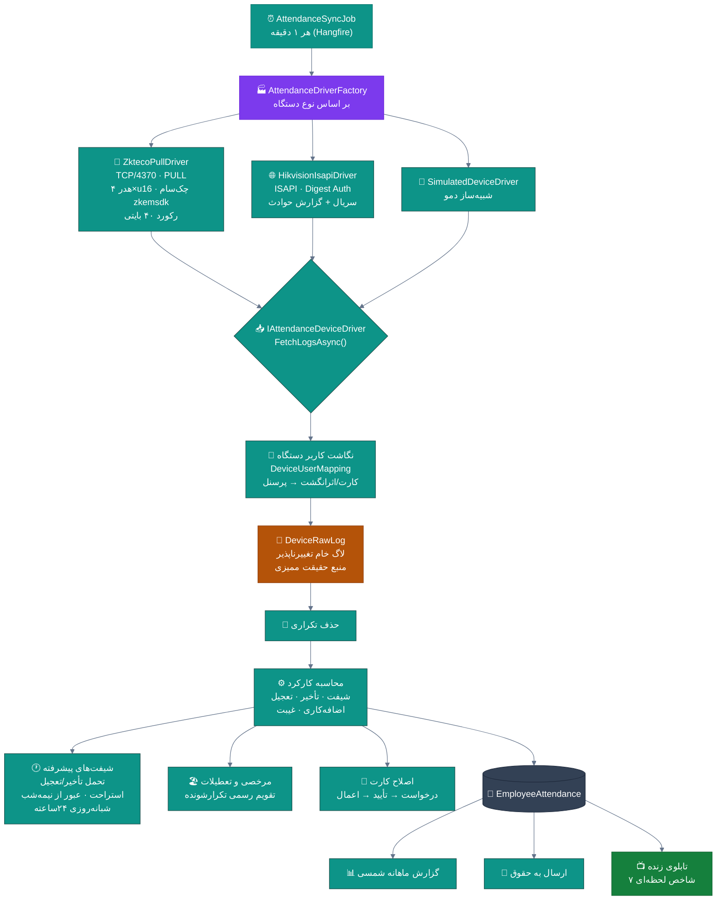
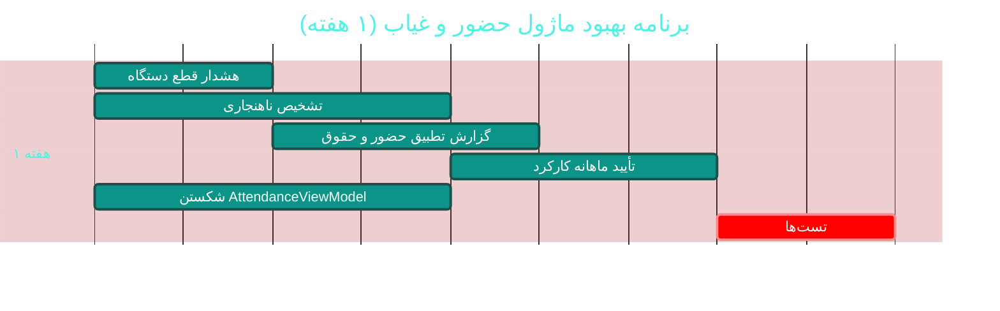

# 🕐 ماژول حضور و غیاب دستگاهی (Attendance & Devices)

> **مسیر ماژول:** `attendance` · **لایسنس:** `Attendance`
> **اولویت:** 🟢 کم (بالغ) · **دشواری:** 🟠 بالا · **زمان برآوردی:** ۱ هفته

---

## ۱. 📋 خلاصه ماژول

بالغ‌ترین و مستندترین ماژول پروژه: اتصال مستقیم به دستگاه‌های حضور و غیاب
با درایورهای اختصاصی (ZKTeco و Hikvision)، همگام‌سازی خودکار، لاگ خام تغییرناپذیر،
شیفت‌های پیشرفته، تخصیص الگودار، مرخصی و تعطیلات، اصلاح کارت، و گزارش ماهانه شمسی.

| ویژگی | مقدار |
|:---|:---|
| 🎯 هدف | استخراج خودکار و دقیق کارکرد واقعی پرسنل |
| 👤 کاربران اصلی | مدیر منابع انسانی · پرسنل |
| 🔗 وابستگی‌ها | `hr`, `payroll` |
| 📊 وضعیت فعلی | 🟢 **بالغ — الگوی بقیه ماژول‌ها** |

---

## ۲. 🎯 وضعیت فعلی در کدبیس

| لایه | فایل | وضعیت |
|:---|:---|:---|
| 🧬 Domain | `.../Personnel/AttendanceDevice.cs` · `DeviceRawLog.cs` · `DeviceUserMapping.cs` | 🟢 |
| 🧬 Domain | `.../Personnel/EmployeeAttendance.cs` · `EmployeeLeave.cs` · `EmployeeShiftAssignment.cs` · `AttendanceCorrection.cs` · `Holiday.cs` | 🟢 |
| 🧬 Domain | `.../Interfaces/IAttendanceDeviceDriver.cs` · `IAttendanceSync.cs` | 🟢 ⭐ انتزاع عالی |
| 🧬 Domain | `.../Enums/AttendanceStatus.cs` · `AttendanceDeviceEnums.cs` · `AbsenceType.cs` · `ShiftType.cs` · `LeaveType.cs` · `LeaveStatus.cs` | 🟢 |
| 🗄 Infra | `.../Services/Attendance/AttendanceDriverFactory.cs` | 🟢 الگوی Factory |
| 🗄 Infra | `.../Services/Attendance/ZktecoPullDriver.cs` | 🟢 پروتکل PULL روی TCP/۴۳۷۰ |
| 🗄 Infra | `.../Services/Attendance/HikvisionIsapiDriver.cs` | 🟢 ISAPI با Digest |
| 🗄 Infra | `.../Services/Attendance/SimulatedDeviceDriver.cs` | 🟢 شبیه‌ساز دمو |
| 🗄 Infra | `.../Services/Attendance/AttendanceSyncJob.cs` | 🟢 کار Hangfire هر دقیقه |
| ⚙ App | `.../Features/Attendance/AttendanceQueries.cs` | ۶۵۲ خط 🟢 |
| 🖥 Desktop | `.../Views/AttendanceView.xaml` · `ShiftsView.xaml` | 🟢 |
| 🖥 Desktop | `.../ViewModels/AttendanceViewModel.cs` | ۷۷۱ خط · ۱۴ فرمان 🟡 |
| 🧪 تست | `tests/.../Attendance/AttendanceCalculatorTests.cs` · `tests/Domain.UnitTests/Attendance/ShiftAssignmentDomainTests.cs` | 🟢 |
| 📐 مستند | `docs/design/07-attendance-module.md` | 🟢 |

---

## ۳. 📊 نمودار معماری درایورها



### نمودار محاسبه شیفت شبانه‌روزی

```mermaid
%%{init: {'theme':'base','themeVariables':{'primaryColor':'#0d9488','primaryTextColor':'#fff'}}}%%
gantt
    title سناریوهای شیفت — از عادی تا عبور از نیمه‌شب
    dateFormat HH:mm
    axisFormat %H:%M
    section شیفت روز
    شیفت ۰۸:۰۰-۱۶:۰۰          :done, s1, 08:00, 8h
    section شیفت شب (عبور از نیمه‌شب)
    شیفت ۲۲:۰۰-۰۶:۰۰          :active, s2, 22:00, 8h
    section شیفت شبانه‌روزی
    شیفت ۰۸:۰۰-۰۸:۰۰ (فردا)    :crit, s3, 08:00, 24h
    section استراحت میان‌شیفت
    استراحت ۱۲:۰۰-۱۳:۰۰       :s4, 12:00, 1h
```

---

## ۴. ⚠️ کاستی‌ها و ایرادها

| # | کاستی | 🎯 شدت | 📍 محل | 💥 پیامد |
|:--:|:---|:--:|:---|:---|
| W-01 | `AttendanceViewModel` با **۷۷۱ خط و ۱۴ فرمان** | 🟡 متوسط | `ViewModels/` | — |
| W-02 | **فقط ۲ برند دستگاه** پشتیبانی می‌شود | 🟡 متوسط | `Attendance/` | پوشش محدود بازار |
| W-03 | **تشخیص ناهنجاری** (ضربات مشکوک) ندارد | 🟡 متوسط | Domain | تقلب در کارت‌زدن |
| W-04 | **گزارش تطبیق حقوق و حضور** ندارد | 🟡 متوسط | — | مغایرت بین دو ماژول |
| W-05 | **تابلوی زنده** فقط در دسکتاپ است (نمایشگر سالن ندارد) | 🔵 کم | UI | — |
| W-06 | **هشدار قطع ارتباط دستگاه** ندارد | 🟡 متوسط | `AttendanceSyncJob` | توقف همگام‌سازی بی‌خبر |
| W-07 | **پشتیبان‌گیری از لاگ خام** جزو بکاپ نیست | 🔵 کم | — | — |

---

## ۵. ✨ امکانات پیشنهادی

| 🎯 # | امکان | 📝 شرح | 💰 ارزش | 🔧 دشواری | ⏱ |
|:--:|:---|:---|:--:|:--:|:--:|
| F-01 | 🚨 **هشدار قطع ارتباط دستگاه** | مانیتورینگ + اعلان پس از N دقیقه بی‌پاسخی | بالا | کم | ۲ روز |
| F-02 | 🔍 **تشخیص ناهنجاری کارت‌زدن** | الگوهای مشکوک (ضربات پشت‌سرهم، مکان غیرعادی) | بالا | متوسط | ۱ هفته |
| F-03 | 🔌 **درایورهای بیشتر** | Virdi · Suprema · Dahua · BioTime | بالا | متوسط | ۲ هفته |
| F-04 | 📊 **گزارش تطبیق حضور و حقوق** | مغایرت‌گیری خودکار بین دو ماژول | بالا | کم | ۳ روز |
| F-05 | 📺 **تابلوی زنده روی وب/نمایشگر** | نسخه تحت‌وب برای سالن | متوسط | متوسط | ۱ هفته |
| F-06 | 🧾 **تأیید ماهانه کارکرد توسط پرسنل** | امضای دیجیتال کارکرد | بالا | کم | ۳ روز |
| F-07 | 📤 **خروجی استاندارد برای حقوق** | فرمت موردقبول نرم‌افزارهای حقوقی | متوسط | کم | ۲ روز |
| F-08 | 🏖 **درخواست مرخصی آنلاین** | جریان درخواست→تأیید در سیستم/پرتال | بالا | متوسط | ۱ هفته |
| F-09 | 📈 **تحلیل الگوهای تأخیر** | شناسایی روندهای تأخیر مزمن | متوسط | کم | ۳ روز |
| F-10 | 🔐 **ورود/خروج با تشخیص چهره** | یکپارچگی با دوربین‌های هوشمند | بالا | زیاد | ۴ هفته |

---

## ۶. 🛠 دستورالعمل پیاده‌سازی

### 📌 گام ۱ — هشدار قطع ارتباط دستگاه (F-01)

```csharp
// 📄 src/Sahand.ClinicPro.Domain/Personnel/AttendanceDevice.cs — افزوده شود:

/// <summary>زمان آخرین همگام‌سازی موفق</summary>
public DateTime? LastSyncAt { get; set; }

/// <summary>تعداد تلاش‌های ناموفق پیاپی</summary>
public int ConsecutiveFailures { get; set; }

/// <summary>آیا هشدار قطع ارتباط ارسال شده</summary>
public bool OfflineAlertSent { get; set; }

/// <summary>آیا دستگاه از نظر سیستم آنلاین است</summary>
public bool IsOnline => LastSyncAt.HasValue
    && (DateTime.UtcNow - LastSyncAt.Value).TotalMinutes <= (SyncIntervalMinutes * 3);
```

```csharp
// 📄 AttendanceSyncJob.cs — در بلوک try/catchِ همگام‌سازی:

try
{
    var logs = await driver.FetchLogsAsync(device, ct);

    // ✅ موفقیت — بازنشانی شمارنده
    device.LastSyncAt = DateTime.UtcNow;
    device.ConsecutiveFailures = 0;
    device.OfflineAlertSent = false;      // آماده برای هشدار بعدی
    await ProcessLogsAsync(device, logs, ct);
}
catch (Exception ex)
{
    device.ConsecutiveFailures++;
    _logger.LogWarning(ex,
        "همگام‌سازی دستگاه {DeviceName} ناموفق (تلاش پیاپی: {Failures})",
        device.Name, device.ConsecutiveFailures);

    // پس از ۵ تلاش ناموفق پیاپی → اعلان
    if (device.ConsecutiveFailures >= 5 && !device.OfflineAlertSent)
    {
        await _notifier.CreateAsync(new CreateNotificationRequest(
            UserId: device.OwnerUserId ?? 0,
            Title: "📴 دستگاه حضور و غیاب قطع شده",
            Message: $"دستگاه «{device.Name}» ({device.IpAddress}) پس از " +
                     $"{device.ConsecutiveFailures} تلاش پاسخ نداد.\n" +
                     $"آخرین همگام‌سازی موفق: " +
                     $"{(device.LastSyncAt.HasValue
                         ? PersianDateHelper.ToShamsi(device.LastSyncAt.Value)
                         : "هرگز")}",
            Type: NotificationType.DeviceAlert,
            Priority: NotificationPriority.High,
            ReferenceType: "device",
            ReferenceId: device.Id), ct);

        device.OfflineAlertSent = true;
    }
}

uow.Repository<AttendanceDevice>().Update(device);
await uow.SaveEntitiesAsync(ct);
```

---

### 📌 گام ۲ — تشخیص ناهنجاری (F-02)

```csharp
// 📄 src/Sahand.ClinicPro.Application/Features/Attendance/AnomalyDetector.cs (جدید)
namespace Sahand.ClinicPro.Application.Features.Attendance;

/// <summary>
/// شناساگر ناهنجاری کارت‌زدن — الگوهای مشکوک را برای بررسی علامت می‌زند.
/// هدف: جلوگیری از تقلب («کارت‌زدن به‌جای همکار») بدون متهم‌کردن خودکار.
/// خروجی فقط «علامت برای بررسی» است، نه اقدام تنبیهی خودکار.
/// </summary>
public static class AnomalyDetector
{
    /// <summary>آستانه‌ها (بعداً به تنظیمات منتقل شود)</summary>
    private const int MinSecondsBetweenPunches = 30;
    private const int MaxPunchesPerDay = 12;

    /// <summary>بررسی ناهنجاری‌های یک روز کاری</summary>
    public static IReadOnlyList<AttendanceAnomaly> Detect(
        long employeeId, DateOnly date,
        IReadOnlyList<DeviceRawLog> punches)
    {
        var anomalies = new List<AttendanceAnomaly>();

        if (punches.Count == 0) return anomalies;

        // ── ۱) ضربات بیش از حد ──
        if (punches.Count > MaxPunchesPerDay)
            anomalies.Add(new AttendanceAnomaly(
                employeeId, date, AnomalyType.ExcessivePunches,
                $"تعداد {punches.Count} ضربه در یک روز (بیش از حد معمول)",
                Severity: AnomalySeverity.Medium));

        // ── ۲) ضربات خیلی نزدیک به هم ──
        var ordered = punches.OrderBy(p => p.PunchTime).ToList();
        for (var i = 1; i < ordered.Count; i++)
        {
            var gap = (ordered[i].PunchTime - ordered[i - 1].PunchTime).TotalSeconds;
            if (gap < MinSecondsBetweenPunches)
                anomalies.Add(new AttendanceAnomaly(
                    employeeId, date, AnomalyType.RapidSuccession,
                    $"دو ضربه با فاصله {gap:F0} ثانیه " +
                    $"(ساعت {ordered[i - 1].PunchTime:HH:mm} و {ordered[i].PunchTime:HH:mm})",
                    Severity: AnomalySeverity.High));
        }

        // ── ۳) ورود بدون خروج در روز قبل ──
        var lastPunch = ordered[^1];
        if (ordered.Count % 2 == 1)
            anomalies.Add(new AttendanceAnomaly(
                employeeId, date, AnomalyType.MissingExit,
                $"آخرین ضربه ({lastPunch.PunchTime:HH:mm}) بدون ثبت خروج است",
                Severity: AnomalySeverity.Low));

        return anomalies;
    }

    /// <summary>
    /// بررسی «کارت‌زدن گروهی مشکوک» — چند پرسنل که همزمان
    /// روی یک دستگاه کارت می‌زنند (الگوی رایج تقلب).
    /// </summary>
    public static IReadOnlyList<AttendanceAnomaly> DetectGroupPunches(
        DateOnly date, IReadOnlyList<(long EmployeeId, DateTime PunchTime)> allPunches,
        int groupThresholdSeconds = 10, int minGroupSize = 3)
    {
        var groups = allPunches
            .GroupBy(p => p.PunchTime.AddSeconds(
                -(long)(p.PunchTime.TimeOfDay.TotalSeconds % groupThresholdSeconds)))
            .Where(g => g.Count() >= minGroupSize)
            .ToList();

        return groups.Select(g => new AttendanceAnomaly(
            EmployeeId: 0,     // مربوط به گروه است نه فرد
            Date: date,
            Type: AnomalyType.SuspiciousGroup,
            Description: $"{g.Count()} نفر در بازه {groupThresholdSeconds} ثانیه " +
                         $"روی یک دستگاه کارت زده‌اند (ساعت {g.Key:HH:mm})",
            Severity: AnomalySeverity.High)).ToList();
    }
}

/// <summary>نوع ناهنجاری</summary>
public enum AnomalyType
{
    ExcessivePunches, RapidSuccession, MissingExit, SuspiciousGroup,
    DuplicatePunch, OutsideShiftWindow, WrongDeviceLocation,
}

/// <summary>شدت ناهنجاری</summary>
public enum AnomalySeverity { Low, Medium, High }

public record AttendanceAnomaly(long EmployeeId, DateOnly Date, AnomalyType Type,
    string Description, AnomalySeverity Severity);
```

---

### 📌 گام ۳ — تأیید ماهانه کارکرد توسط پرسنل (F-06)

```csharp
// 📄 src/Sahand.ClinicPro.Domain/Personnel/EmployeeAttendance.cs — افزوده شود:

/// <summary>آیا کارکرد ماه توسط پرسنل تأیید شده</summary>
public bool IsConfirmedByEmployee { get; set; }

/// <summary>زمان تأیید</summary>
public DateTime? ConfirmedAt { get; set; }

/// <summary>توضیح اختلاف در صورت تأیید مشروط</summary>
public string? DisputeNote { get; set; }
```

> 📌 **جریان:** در پایان ماه → اعلان به پرسنل → مشاهده کارکرد →
> تأیید یا ثبت اعتراض → در صورت اعتراض، اعلان به منابع انسانی →
> پس از حل، قفل شدن کارکرد ماهانه برای محاسبه حقوق.

---

## ۷. 🧪 تست‌های الزامی

| 🧪 تست | 🎯 هدف | اولویت |
|:---|:---|:--:|
| `AttendanceCalculator_StandardShift_Correct` *(موجود)* | محاسبه پایه | 🔴 |
| `ShiftAssignment_OvernightShift_CrossesMidnight` *(موجود)* | عبور از نیمه‌شب | 🔴 |
| `ShiftAssignment_24HourShift_Correct` | شیفت شبانه‌روزی | 🔴 |
| `ShiftAssignment_GracePeriod_TardyNotCounted` | تحمل تأخیر | 🟠 |
| `ZktecoDriver_Checksum_ValidatesCorrectly` | صحت پروتکل | 🟠 |
| `SyncJob_DuplicateLogs_NotInsertedTwice` | حذف تکراری | 🔴 |
| `AnomalyDetector_RapidPunches_Flagged` | تشخیص ناهنجاری | 🟠 |
| `AnomalyDetector_GroupPunch_Flagged` | کارت‌زدن گروهی | 🟠 |
| `DeviceOffline_After5Failures_Notifies` | هشدار قطع | 🟠 |

---

## ۸. 📈 شاخص‌های موفقیت (KPI)

| 📊 شاخص | قبل | هدف |
|:---|:--:|:--:|
| ⏱ زمان تشخیص قطع دستگاه | دستی | **< ۱۰ دقیقه** |
| 🔍 ناهنجاری‌های شناسایی‌شده | ۰ | **قابل گزارش** |
| 📊 نرخ تأیید ماهانه کارکرد | ۰٪ | **> ۹۰٪** |
| 🧪 پوشش تست ماژول | ~۵۰٪ | **> ۸۵٪** |
| 📏 اندازه `AttendanceViewModel` | ۷۷۱ خط | **< ۳۰۰ خط** |

---

## ۹. 🗓 برنامه زمانی



---

## 🔗 پیوندهای مرتبط

| 📄 سند | توضیح |
|:---|:---|
| [تحلیل جامع](../ANALYSIS-REPORT.md) | سند اصلی |
| [📐 سند طراحی ماژول](../../design/07-attendance-module.md) | مستند طراحی موجود |
| [B04 — حقوق و دستمزد](B04-payroll.md) | مصرف‌کننده کارکرد |
| [B05 — پرسنل](B05-hr-personnel.md) | نگاشت کاربران دستگاه |

---
<div align="center">📅 ۱۴۰۴/۰۷/۱۹ · 🔖 v1.0</div>
