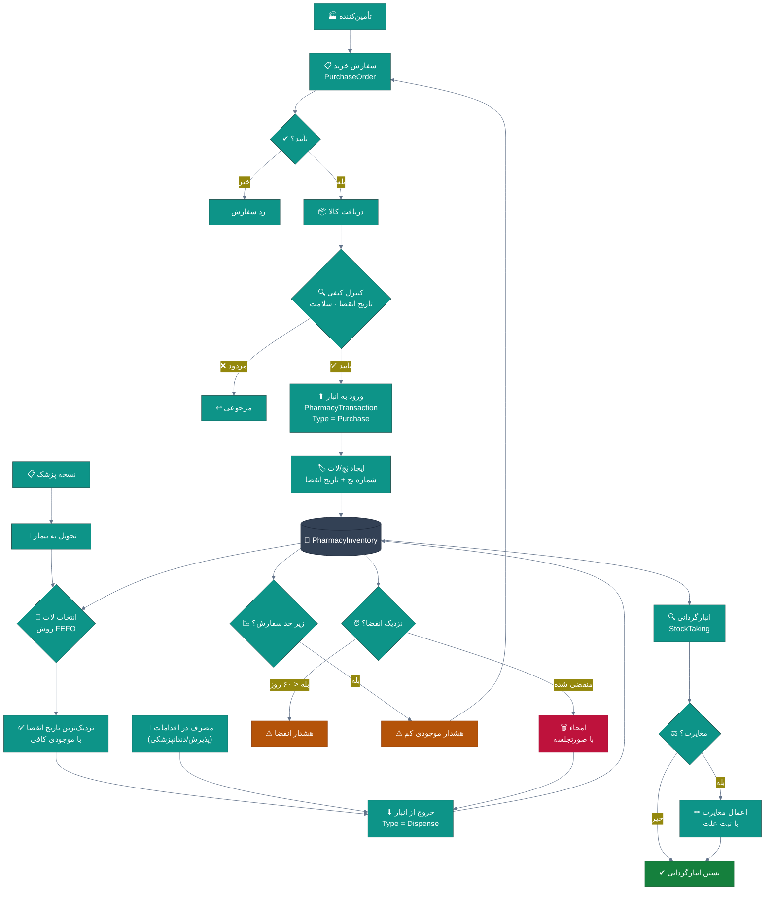
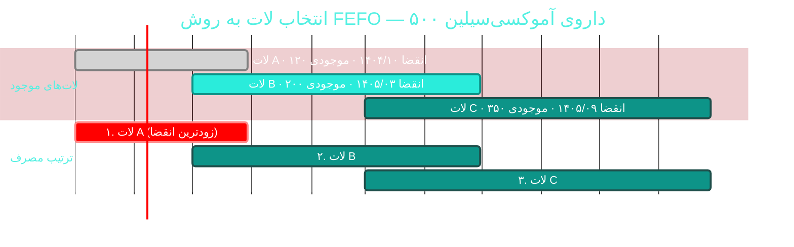
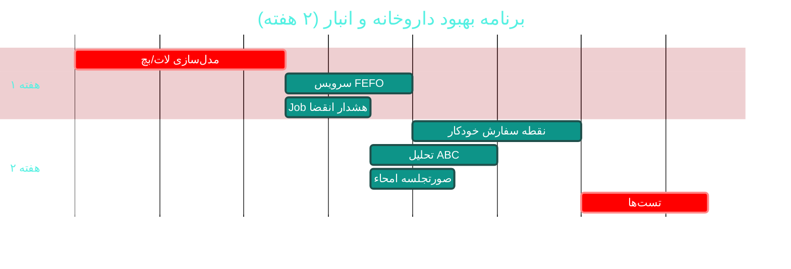

# 🏥 ماژول داروخانه و انبار (Pharmacy & Inventory)

> **مسیر ماژول:** `pharmacy` · **لایسنس:** `Pharmacy`
> **اولویت:** 🟡 متوسط · **دشواری:** 🟡 متوسط · **زمان برآوردی:** ۲ هفته

---

## ۱. 📋 خلاصه ماژول

مدیریت زنجیره تأمین دارو و لوازم مصرفی: موجودی، خرید از تأمین‌کنندگان،
**تحویل به روش FEFO** (اولین منقضی، اولین خروج)، هشدار موجودی و انقضا،
و **انبارگردانی با اعمال مغایرت**.

| ویژگی | مقدار |
|:---|:---|
| 🎯 هدف | همیشه داروی درست، با تاریخ معتبر، به مقدار کافی |
| 👤 کاربران اصلی | مسئول داروخانه · تدارکات · حسابدار |
| 🔗 وابستگی‌ها | `prescriptions`, `accounting`, `billing` |
| 📊 وضعیت فعلی | 🟢 عملیاتی |

---

## ۲. 🎯 وضعیت فعلی در کدبیس

| لایه | فایل | وضعیت |
|:---|:---|:---|
| 🧬 Domain | `.../Pharmacy/PharmacyInventory.cs` · `PharmacyTransaction.cs` | 🟢 |
| 🧬 Domain | `.../Pharmacy/PurchaseOrder.cs` · `PurchaseOrderItem.cs` | 🟢 |
| 🧬 Domain | `.../Pharmacy/StockTaking.cs` · `StockTakingItem.cs` · `Supplier.cs` | 🟢 |
| 🧬 Domain | `.../Events/PharmacyEvents.cs` | 🟢 |
| 🧬 Domain | `.../Enums/PharmacyTransactionType.cs` · `PharmacyReferenceType.cs` · `PurchaseOrderStatus.cs` · `StockTakingStatus.cs` · `SupplierType.cs` · `StorageType.cs` | 🟢 |
| 🗄 Infra | مایگریشن `Cycle43StocktakingScope` | 🟢 دامنه انبارگردانی |
| ⚙ App | `.../Features/Pharmacy/` | 🟢 |
| 🌐 API | `.../Controllers/PharmacyController.cs` · `ConsumablesController.cs` · `StocktakingsController.cs` | 🟢 |
| 🖥 Desktop | `.../Views/PharmacyView.xaml` · `PharmacyItemFormWindow` · `StockInFormWindow` · `StocktakingView.xaml` · `ConsumablesView.xaml` | 🟢 |
| 🧪 تست | `tests/.../StocktakingHandlerTests.cs` · `tests/.../Cycle43StockInDiagnostics.cs` · `tests/.../Cycle46ConsumablesFlowTests.cs` | 🟢 |

### نکات برجسته‌ی فعلی

✅ **تحویل FEFO** (First Expiry, First Out)
✅ **انبارگردانی با اعمال مغایرت** واقعی
✅ **ورود کالای دسته‌جمعی** (چرخه ۴۵)
✅ **هشدار موجودی و انقضا**
✅ **تفکیک دارو / لوازم مصرفی** (چرخه ۴۳)
✅ **چندین تست اختصاصی** برای انبارگردانی و جریان کالا

---

## ۳. 📊 نمودار جریان کالا



### نمودار FEFO



---

## ۴. ⚠️ کاستی‌ها و ایرادها

| # | کاستی | 🎯 شدت | 📍 محل | 💥 پیامد |
|:--:|:---|:--:|:---|:---|
| W-01 | **لات/بچ (Batch) به‌درستی مدل‌سازی نشده** — موجودی به‌صورت aggregate است | 🔴 بالا | `PharmacyInventory` | FEFO واقعی ممکن نیست |
| W-02 | **هشدار انقضا** احتمالاً فقط در UI است نه Job پس‌زمینه | 🟠 بالا | — | دارو بدون اطلاع منقضی می‌شود |
| W-03 | **نقطه سفارش (Reorder Point)** خودکار ندارد | 🟠 بالا | Domain | کمبود ناگهانی دارو |
| W-04 | **محاسبه میانگین قیمت تمام‌شده** (WAC) ندارد | 🟡 متوسط | — | سود واقعی داروخانه نامشخص |
| W-05 | **گزارش گردش کالا (ABC Analysis)** ندارد | 🟡 متوسط | — | سرمایه راکد ناشناخته |
| W-06 | **سریال‌سازی/ردیابی داروهای خاص** (تی‌تک) ندارد | 🟡 متوسط | — | عدم انطباق با سامانه ملی |
| W-07 | **یکپارچگی با سامانه دارویی کشور** ندارد | 🟠 بالا | — | ثبت دستی |
| W-08 | **مرجوعی از بیمار** جریان ندارد | 🟡 متوسط | — | — |
| W-09 | **امحاء با صورتجلسه** مستند نیست | 🟡 متوسط | — | عدم انطباق قانونی |

---

## ۵. ✨ امکانات پیشنهادی

| 🎯 # | امکان | 📝 شرح | 💰 ارزش | 🔧 دشواری | ⏱ |
|:--:|:---|:---|:--:|:--:|:--:|
| F-01 | 🏷 **مدل‌سازی لات/بچ واقعی** | موجودی به‌تفکیک لات با تاریخ انقضای مستقل | **حیاتی** | متوسط | ۱ هفته |
| F-02 | ⏰ **Job هشدار انقضا** | بررسی روزانه + اعلان در ۹۰/۶۰/۳۰ روز | بسیار بالا | کم | ۲ روز |
| F-03 | 📉 **نقطه سفارش خودکار** | پیشنهاد خرید بر اساس مصرف و موجودی | بسیار بالا | متوسط | ۵ روز |
| F-04 | 💰 **میانگین موزون قیمت تمام‌شده** | محاسبه بهای تمام‌شده و حاشیه سود | بالا | متوسط | ۵ روز |
| F-05 | 📊 **تحلیل ABC / گردش کالا** | طبقه‌بندی بر اساس ارزش مصرف | بالا | کم | ۳ روز |
| F-06 | 🔗 **یکپارچگی سامانه دارویی کشور** | ثبت و ردیابی (TTAC) | استراتژیک | زیاد | ۴ هفته |
| F-07 | ↩ **جریان مرجوعی بیمار** | برگشت دارو با کنترل سلامت | متوسط | کم | ۳ روز |
| F-08 | 🗑 **صورتجلسه امحاء** | مستندسازی امحاء با تأیید دو نفر | بالا | کم | ۳ روز |
| F-09 | 📱 **اسکن بارکد در انبارگردانی** | سرعت و دقت انبارگردانی | بالا | متوسط | ۱ هفته |
| F-10 | 🧊 **پایش دمای یخچال** | ثبت دوره‌ای برای داروهای زنجیره سرد | متوسط | متوسط | ۱ هفته |

---

## ۶. 🛠 دستورالعمل پیاده‌سازی

### 📌 گام ۱ — مدل‌سازی لات/بچ (F-01) — *پیش‌نیاز FEFO واقعی*

> 🔑 **مشکل فعلی:** `PharmacyInventory` احتمالاً یک رکورد به‌ازای هر دارو با
> یک ستون `ExpiryDate` دارد. با این مدل، اگر دو محموله با تاریخ انقضای متفاوت
> دریافت شود، یکی از تاریخ‌ها از دست می‌رود و FEFO واقعی غیرممکن است.

**۱.۱ موجودیت لات**

```csharp
// 📄 src/Sahand.ClinicPro.Domain/Pharmacy/InventoryBatch.cs (جدید)
namespace Sahand.ClinicPro.Domain.Entities.Pharmacy;

/// <summary>
/// لات (بچ) دارو — کوچک‌ترین واحد موجودی با تاریخ انقضای مستقل.
/// این موجودیت زیربنای تحویل واقعی به روش FEFO است:
/// هر دریافت، یک لات تازه با تاریخ انقضای خودش ایجاد می‌کند و
/// مصرف همیشه از نزدیک‌ترین تاریخ انقضا انجام می‌شود.
/// </summary>
public class InventoryBatch : AuditableEntity, ISoftDeletable
{
    /// <summary>شناسه کالا در انبار</summary>
    public long PharmacyInventoryId { get; set; }

    /// <summary>کالای انبار</summary>
    public PharmacyInventory PharmacyInventory { get; set; } = null!;

    /// <summary>شماره بچ کارخانه</summary>
    public string BatchNumber { get; set; } = null!;

    /// <summary>تاریخ تولید</summary>
    public DateTime? ManufacturedAt { get; set; }

    /// <summary>تاریخ انقضا</summary>
    public DateTime ExpiryDate { get; set; }

    /// <summary>تعداد اولیه هنگام ورود</summary>
    public decimal InitialQuantity { get; set; }

    /// <summary>تعداد باقی‌مانده</summary>
    public decimal RemainingQuantity { get; set; }

    /// <summary>قیمت خرید هر واحد (برای میانگین موزون)</summary>
    public decimal UnitCost { get; set; }

    /// <summary>قیمت فروش هر واحد</summary>
    public decimal UnitPrice { get; set; }

    /// <summary>تاریخ ورود به انبار</summary>
    public DateTime ReceivedAt { get; set; } = DateTime.UtcNow;

    /// <summary>تأمین‌کننده</summary>
    public long? SupplierId { get; set; }

    /// <summary>تأمین‌کننده</summary>
    public Supplier? Supplier { get; set; }

    /// <summary>لات قرنطینه است (منتظر کنترل کیفی)</summary>
    public bool IsQuarantined { get; set; }

    /// <summary>آیا منقضی شده</summary>
    public bool IsExpired => ExpiryDate < DateTime.UtcNow;

    /// <summary>روزهای باقی‌مانده تا انقضا</summary>
    public int DaysToExpiry => (int)(ExpiryDate - DateTime.UtcNow).TotalDays;
}
```

**۱.۲ سرویس انتخاب لات به روش FEFO**

```csharp
// 📄 src/Sahand.ClinicPro.Application/Features/Pharmacy/FefoAllocationService.cs (جدید)
namespace Sahand.ClinicPro.Application.Features.Pharmacy;

/// <summary>
/// سرویس تخصیص موجودی به روش FEFO (First Expiry, First Out).
/// دارو را از نزدیک‌ترین تاریخ انقضا برمی‌دارد تا ضایعات را کمینه کند.
/// </summary>
public interface IFefoAllocationService
{
    /// <summary>تخصیص مقدار درخواستی از لات‌های موجود</summary>
    Task<Result<FefoAllocationResult>> AllocateAsync(
        long inventoryId, decimal requestedQuantity, CancellationToken ct = default);
}

public class FefoAllocationService : IFefoAllocationService
{
    private readonly IUnitOfWork _uow;

    public FefoAllocationService(IUnitOfWork uow) => _uow = uow;

    public async Task<Result<FefoAllocationResult>> AllocateAsync(
        long inventoryId, decimal requestedQuantity, CancellationToken ct = default)
    {
        if (requestedQuantity <= 0)
            return Result<FefoAllocationResult>.Failure(
                Error.Validation("مقدار درخواستی باید بزرگ‌تر از صفر باشد"));

        var item = await _uow.Repository<PharmacyInventory>().GetByIdAsync(inventoryId, ct);
        if (item is null)
            return Result<FefoAllocationResult>.Failure(Error.NotFound("کالا یافت نشد"));

        // ── لات‌های قابل‌مصرف: موجودی دارد · منقضی نشده · قرنطینه نیست ──
        var batches = await _uow.Repository<InventoryBatch>().QueryableNoTracking
            .Where(b => !b.IsDeleted
                        && b.PharmacyInventoryId == inventoryId
                        && b.RemainingQuantity > 0
                        && !b.IsQuarantined
                        && b.ExpiryDate >= DateTime.UtcNow)      // منقضی حذف شود
            .OrderBy(b => b.ExpiryDate)                          // ⭐ FEFO: نزدیک‌ترین انقضا
            .ThenBy(b => b.ReceivedAt)                           // سپس قدیمی‌ترین دریافت
            .ToListAsync(ct);

        var available = batches.Sum(b => b.RemainingQuantity);
        if (available < requestedQuantity)
            return Result<FefoAllocationResult>.Failure(Error.Validation(
                $"موجودی کافی نیست. درخواست: {requestedQuantity}، موجود: {available}"));

        // ── تخصیص تدریجی ──
        var allocations = new List<BatchAllocation>();
        var remaining = requestedQuantity;

        foreach (var batch in batches)
        {
            if (remaining <= 0) break;

            var take = Math.Min(batch.RemainingQuantity, remaining);
            allocations.Add(new BatchAllocation(
                batch.Id, batch.BatchNumber, batch.ExpiryDate, take, batch.UnitPrice));
            remaining -= take;
        }

        return Result<FefoAllocationResult>.Success(new FefoAllocationResult(
            InventoryId: inventoryId,
            Allocations: allocations,
            TotalQuantity: requestedQuantity,
            TotalValue: allocations.Sum(a => a.Quantity * a.UnitPrice),
            NearestExpiry: allocations.Min(a => a.ExpiryDate)));
    }
}

public record BatchAllocation(long BatchId, string BatchNumber, DateTime ExpiryDate,
    decimal Quantity, decimal UnitPrice);

public record FefoAllocationResult(long InventoryId,
    IReadOnlyList<BatchAllocation> Allocations,
    decimal TotalQuantity, decimal TotalValue, DateTime NearestExpiry);
```

---

### 📌 گام ۲ — Job هشدار انقضا (F-02)

```csharp
// 📄 src/Sahand.ClinicPro.Infrastructure/Services/Pharmacy/ExpiryAlertJob.cs (جدید)
/// <summary>
/// کار پس‌زمینه هشدار انقضای دارو — روزانه اجرا می‌شود و در آستانه‌های
/// ۹۰/۶۰/۳۰/۷ روز مانده به انقضا اعلان می‌فرستد. هدف: جلوگیری از ضایعات دارویی.
/// </summary>
public class ExpiryAlertJob
{
    private readonly IServiceScopeFactory _scopeFactory;
    private readonly ILogger<ExpiryAlertJob> _logger;

    public ExpiryAlertJob(IServiceScopeFactory scopeFactory, ILogger<ExpiryAlertJob> logger)
    { _scopeFactory = scopeFactory; _logger = logger; }

    public async Task RunAsync(CancellationToken ct = default)
    {
        using var scope = _scopeFactory.CreateScope();
        var uow = scope.ServiceProvider.GetRequiredService<IUnitOfWork>();
        var notifier = scope.ServiceProvider.GetRequiredService<INotificationService>();

        var today = DateTime.UtcNow.Date;
        var thresholds = new[] { 90, 60, 30, 7 };

        foreach (var threshold in thresholds)
        {
            var targetDate = today.AddDays(threshold);

            var expiringBatches = await uow.Repository<InventoryBatch>().QueryableNoTracking
                .Include(b => b.PharmacyInventory)
                .Where(b => !b.IsDeleted
                            && b.RemainingQuantity > 0
                            && !b.IsQuarantined
                            && b.ExpiryDate.Date == targetDate)
                .ToListAsync(ct);

            if (expiringBatches.Count == 0) continue;

            var grouped = expiringBatches
                .GroupBy(b => b.PharmacyInventory.Name)
                .Select(g => new
                {
                    ItemName = g.Key,
                    TotalQty = g.Sum(b => b.RemainingQuantity),
                    TotalValue = g.Sum(b => b.RemainingQuantity * b.UnitCost),
                    NearestExpiry = g.Min(b => b.ExpiryDate),
                })
                .ToList();

            var message = string.Join("\n", grouped.Select(g =>
                $"💊 {g.ItemName}: {g.TotalQty:N0} واحد " +
                $"(ارزش {g.TotalValue:N0} ریال) — انقضا " +
                $"{PersianDateHelper.ToShamsi(g.NearestExpiry)}"));

            await notifier.CreateAsync(new CreateNotificationRequest(
                UserId: 0,          // مسئول داروخانه — از تنظیمات خوانده شود
                Title: $"⏰ داروهای رو به انقضا — {threshold} روز مانده",
                Message: message,
                Type: NotificationType.InventoryAlert,
                Priority: threshold <= 30 ? NotificationPriority.High
                                          : NotificationPriority.Normal,
                ReferenceType: "inventory-expiry",
                ReferenceId: null), ct);

            _logger.LogInformation(
                "هشدار انقضای {Threshold} روزه: {ItemCount} قلم کالا",
                threshold, grouped.Count);
        }
    }
}
```

---

### 📌 گام ۳ — نقطه سفارش خودکار (F-03)

```csharp
// 📄 src/Sahand.ClinicPro.Application/Features/Pharmacy/ReorderSuggestionService.cs (جدید)
/// <summary>
/// سرویس پیشنهاد سفارش خرید — بر اساس مصرف دوره گذشته و نقطه سفارش.
/// فرمول: اگر موجودی ≤ نقطه سفارش → پیشنهاد خرید به اندازه
///        (حداکثر موجودی − موجودی فعلی) یا (میانگین مصرف × روزهای تأمین)
/// </summary>
public class ReorderSuggestionService
{
    private readonly IUnitOfWork _uow;

    public ReorderSuggestionService(IUnitOfWork uow) => _uow = uow;

    /// <summary>محاسبه پیشنهادات خرید</summary>
    public async Task<IReadOnlyList<ReorderSuggestion>> GetSuggestionsAsync(
        CancellationToken ct = default)
    {
        var lookbackStart = DateTime.UtcNow.AddDays(-90);

        // ── مصرف ۹۰ روز گذشته به تفکیک کالا (یک Query) ──
        var consumption = await _uow.Repository<PharmacyTransaction>().QueryableNoTracking
            .Where(t => !t.IsDeleted
                        && t.TransactionDate >= lookbackStart
                        && t.TransactionType is PharmacyTransactionType.Dispense
                                              or PharmacyTransactionType.Consumption)
            .GroupBy(t => t.PharmacyInventoryId)
            .Select(g => new
            {
                InventoryId = g.Key,
                TotalOut = g.Sum(t => t.Quantity),
            })
            .ToDictionaryAsync(x => x.InventoryId, x => x.TotalOut, ct);

        // ── موجودی فعلی ──
        var items = await _uow.Repository<PharmacyInventory>().QueryableNoTracking
            .Where(i => !i.IsDeleted && i.IsActive)
            .ToListAsync(ct);

        var suggestions = new List<ReorderSuggestion>();

        foreach (var item in items)
        {
            var onHand = item.CurrentStock;
            var recorderPoint = item.ReorderPoint ?? 0;

            // فقط کالاهایی که به نقطه سفارش رسیده‌اند
            if (onHand > recorderPoint) continue;

            var usedIn90Days = consumption.GetValueOrDefault(item.Id, 0m);
            var avgDailyUsage = usedIn90Days / 90m;

            // مقدار پیشنهادی: تأمین برای N روز آینده + ضریب اطمینان
            var leadTimeDays = item.LeadTimeDays ?? 7;
            var safetyFactor = 1.5m;
            var suggested = Math.Ceiling(
                Math.Max(item.MaxStock ?? 0m, avgDailyUsage * leadTimeDays * safetyFactor)
                - onHand);

            if (suggested <= 0) continue;

            suggestions.Add(new ReorderSuggestion(
                InventoryId: item.Id,
                ItemName: item.Name,
                CurrentStock: onHand,
                ReorderPoint: recorderPoint,
                AverageDailyUsage: Math.Round(avgDailyUsage, 2),
                SuggestedQuantity: suggested,
                EstimatedCost: suggested * (item.LastPurchasePrice ?? 0m),
                Urgency: onHand <= 0 ? "بحرانی"
                       : onHand <= recorderPoint / 2m ? "بالا"
                       : "متوسط"));
        }

        return suggestions.OrderByDescending(s => s.Urgency).ToList();
    }
}

public record ReorderSuggestion(long InventoryId, string ItemName,
    decimal CurrentStock, decimal ReorderPoint, decimal AverageDailyUsage,
    decimal SuggestedQuantity, decimal EstimatedCost, string Urgency);
```

> 📌 فیلدهای `ReorderPoint`, `MaxStock`, `LeadTimeDays`, `LastPurchasePrice`
> باید به `PharmacyInventory` اضافه شوند (مایگریشن جدید).

---

## ۷. 🧪 تست‌های الزامی

| 🧪 تست | 🎯 هدف | اولویت |
|:---|:---|:--:|
| `Fefo_AllocatesNearestExpiryFirst` | **قانون FEFO** | 🔴 |
| `Fefo_SpansMultipleBatches` | تخصیص چندلاتی | 🔴 |
| `Fefo_ExcludesExpiredBatches` | حذف منقضی | 🔴 |
| `Fefo_ExcludesQuarantined` | حذف قرنطینه | 🟠 |
| `Fefo_InsufficientStock_Fails` | موجودی ناکافی | 🔴 |
| `Stocktaking_AppliesDifference` *(موجود)* | اعمال مغایرت | 🔴 |
| `ExpiryJob_30Days_HighPriority` | اولویت اعلان | 🟠 |
| `Reorder_BelowPoint_Suggests` | نقطه سفارش | 🟠 |
| `Reorder_ZeroStock_CriticalUrgency` | اولویت‌بندی | 🟠 |

---

## ۸. 📈 شاخص‌های موفقیت (KPI)

| 📊 شاخص | قبل | هدف |
|:---|:--:|:--:|
| 💊 ضایعات دارویی (انقضا) | ~۵٪ | **< ۱٪** |
| 📉 کمبود دارو (Stock-out) | نامشخص | **< ۱٪** |
| 🎯 دقت FEFO | نامشخص (احتمالی) | **۱۰۰٪** |
| 💰 ارزش سرمایه راکد | نامشخص | **قابل گزارش** |
| ⏱ شناسایی داروی رو به انقضا | دستی | **خودکار (روزانه)** |

---

## ۹. 🗓 برنامه زمانی



---

## 🔗 پیوندهای مرتبط

| 📄 سند | توضیح |
|:---|:---|
| [تحلیل جامع](../ANALYSIS-REPORT.md) | سند اصلی |
| [A06 — نسخه‌نویسی](A06-prescriptions-safety.md) | مصرف‌کننده دارو |
| [B02 — حسابداری](B02-accounting.md) | ثبت مالی خرید و مصرف |
| [A08 — پاراکلینیک](A08-paraclinical.md) | مصرف لوازم در اقدامات |

---
<div align="center">📅 ۱۴۰۴/۰۷/۱۹ · 🔖 v1.0</div>
