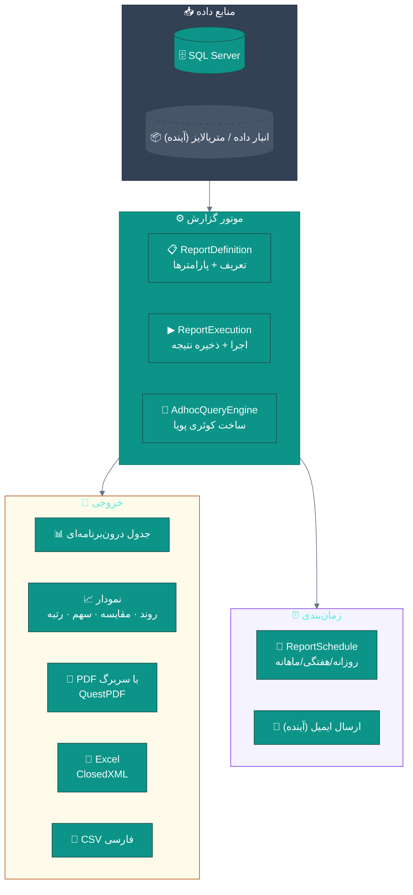
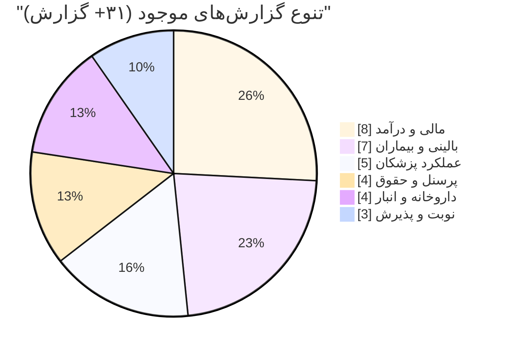
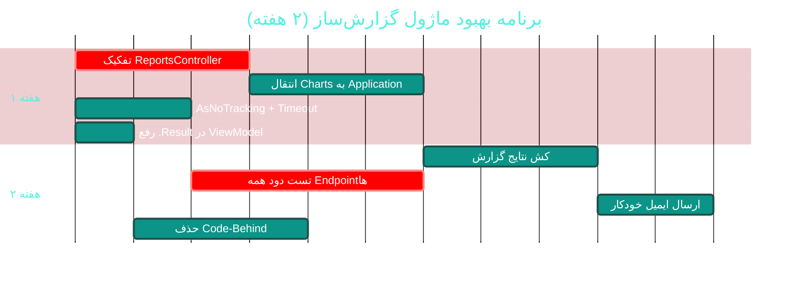

# 📊 ماژول گزارش‌ساز و تحلیل (Reports & Ad-hoc)

> **مسیر ماژول:** `reports` · **لایسنس:** `Reports` + `AdhocReports`
> **اولویت:** 🟠 بالا · **دشواری:** 🟠 بالا · **زمان برآوردی:** ۲ هفته

---

## ۱. 📋 خلاصه ماژول

۳۱+ گزارش واقعی، گزارش‌ساز آزاد (Ad-hoc)، خروجی **CSV فارسی / Excel / PDF**
با سربرگ درمانگاه، نمودارهای تحلیلی (۲۱+ گزارش نموداری)، و زمان‌بندی گزارش‌ها.

| ویژگی | مقدار |
|:---|:---|
| 🎯 هدف | تبدیل داده به تصمیم |
| 👤 کاربران اصلی | مدیر · حسابدار · پزشک |
| 🔗 وابستگی‌ها | همه ماژول‌ها |
| 📊 وضعیت فعلی | 🟢 غنی — 🔴 بزرگ‌ترین تمرکز کد در API |

---

## ۲. 🎯 وضعیت فعلی در کدبیس

| لایه | فایل | خط | وضعیت |
|:---|:---|--:|:---|
| 🧬 Domain | `.../Reporting/ReportDefinition.cs` · `ReportExecution.cs` · `ReportSchedule.cs` | — | 🟢 |
| 🧬 Domain | `.../Enums/ReportFrequency.cs` | — | 🟢 |
| ⚙ App | `.../Features/Reports/` · `.../Features/Reports/Adhoc/AdhocQueryEngine.cs` | ۷۴۶ | 🟢 |
| 🗄 Infra | `.../Services/Reporting/ReportPdfService.cs` | — | 🟢 |
| 🌐 API | **`.../Controllers/ReportsController.cs`** | **۱٬۲۲۸** | 🔴 بسیار بزرگ |
| 🌐 API | `ReportsController.ChartReports.cs` (+ ۳ فایل ChartReports2/3) | — | 🟠 partial |
| 🌐 API | `ReportsController.Pdf.cs` · `ReportsController.Adhoc.cs` | — | 🟠 |
| 🖥 Desktop | `.../ViewModels/ReportsViewModel.cs` · `ReportBrowserViewModel.cs` (۷۵۵) · `AdhocReportViewModel.cs` (۶۹۷) | — | 🟠 |
| 🖥 Desktop | `.../Views/ReportsView.xaml` · `ReportBrowserView.xaml` (**۳۳۴ خط Code-Behind**) · `AdhocReportWindow.xaml` | — | 🟠 |
| 🧪 تست | `AdhocReportEngineTests` · `ReportPdfServiceTests` · `Cycle48ReportsExecutionTests` | — | 🟢 |

### نکات برجسته‌ی فعلی

✅ **۳۱ گزارش کاملاً واقعی** با پارامترهای پویا
✅ **موتور گزارش‌ساز آزاد (Ad-hoc)** با تست اختصاصی
✅ **خروجی PDF با سربرگ درمانگاه** (QuestPDF)
✅ **خروجی Excel** (ClosedXML) و CSV فارسی
✅ **۲۱+ گزارش نموداری** (روند/مقایسه/سهم/رتبه)
✅ **زمان‌بندی گزارش‌ها** (`ReportSchedule`)

---

## ۳. 📊 نمودار معماری گزارش‌ساز



### انواع گزارش‌های موجود



---

## ۴. ⚠️ کاستی‌ها و ایرادها

| # | کاستی | 🎯 شدت | 📍 محل | 💥 پیامد |
|:--:|:---|:--:|:---|:---|
| W-01 | **`ReportsController` با ۱٬۲۲۸ خط + ۴ فایل partial** | 🔴 بالا | `API/Controllers/` | نگهداری بسیار دشوار |
| W-02 | **کوئری‌های مستقیم EF در کنترلر** به‌جای لایه Application | 🔴 بالا | `ReportsController` | نقض معماری لایه‌ای |
| W-03 | `.Result` در `ReportsViewModel` (خطوط ۸۴-۸۵) | 🟠 بالا | `ViewModels/` | بن‌بست بالقوه |
| W-04 | **`ReportBrowserView` با ۳۳۴ خط Code-Behind** | 🟠 بالا | `Views/` | نقض MVVM |
| W-05 | **گزارش‌های سنگین بدون Timeout/Cancellation** | 🟠 بالا | — | قفل شدن UI |
| W-06 | **`AsNoTracking` استفاده نمی‌شود** | 🟠 بالا | `Application/Reports` | حافظه و سرعت |
| W-07 | **کش نتایج گزارش** ندارد | 🟡 متوسط | — | اجرای تکراری کوئری سنگین |
| W-08 | **ارسال ایمیل گزارش‌های زمان‌بندی‌شده** ندارد | 🟡 متوسط | `ReportSchedule` | — |
| W-09 | **محدودیت حجم خروجی** ندارد | 🟡 متوسط | — | خروجی میلیونی ردیفی |

---

## ۵. ✨ امکانات پیشنهادی

| 🎯 # | امکان | 📝 شرح | 💰 ارزش | 🔧 دشواری | ⏱ |
|:--:|:---|:---|:--:|:--:|:--:|
| F-01 | 🏗 **تفکیک ReportsController به ۵ کنترلر** | Financial · Clinical · Performance · Hr · Charts | بالا | متوسط | ۳ روز |
| F-02 | ⚙ **انتقال منطق به لایه Application** | هر گزارش = یک Query Handler | بالا | متوسط | ۵ روز |
| F-03 | ⚡ **`AsNoTracking` + Timeout + Cancellation** | در همه Queryهای گزارش | بالا | کم | ۲ روز |
| F-04 | 💾 **کش نتایج گزارش** | با کلیدِ پارامترها + TTL | بالا | کم | ۳ روز |
| F-05 | 📊 **طراحی گزارش بصری (Drag & Drop)** | ساخت گزارش بدون کد | بسیار بالا | زیاد | ۳ هفته |
| F-06 | 📧 **ارسال ایمیل خودکار** | گزارش‌های زمان‌بندی‌شده | بالا | کم | ۳ روز |
| F-07 | 🗃 **جدول خلاصه / متریالایز ویو** | برای گزارش‌های سنگین | بسیار بالا | متوسط | ۱ هفته |
| F-08 | 📏 **محدودیت و صفحه‌بندی خروجی** | سقف ردیف + هشدار | متوسط | کم | ۲ روز |
| F-09 | 📈 **نمودارهای تعاملی حرفه‌ای** | کتابخانه نمودار + drill-down | بالا | متوسط | ۱ هفته |
| F-10 | 🎯 **داشبورد مدیریتی قابل‌شخصی‌سازی** | کاشی‌های چیدمان‌پذیر | بسیار بالا | متوسط | ۲ هفته |

---

## ۶. 🛠 دستورالعمل پیاده‌سازی

### 📌 گام ۱ — تفکیک `ReportsController` (F-01) — *ساختاری*

**ساختار هدف:**

```
📂 Controllers/
├── 📄 ReportsController.cs              (≈ ۲۵۰ خط — فقط مسیریابی مشترک)
├── 📄 ReportsFinancialController.cs     (درآمد · سود و زیان · مطالبات · صندوق)
├── 📄 ReportsClinicalController.cs      (بیماران · بیماری‌های مزمن · ویزیت‌ها)
├── 📄 ReportsPerformanceController.cs   (عملکرد پزشکان · کارمزد · رضایت)
├── 📄 ReportsHrController.cs            (حقوق · حضور · پرسنل)
├── 📄 ReportsChartController.cs         (ادغام ۳ فایل ChartReports)
└── 📄 ReportsExportController.cs        (PDF · Excel · CSV)
```

> ⚠️ **نکته‌ی مهم:** `ReportsController.ChartReports*.cs` حاوی
> **متدهای کمکی private** هستند (نه Endpoint)، بنابراین باید به یک
> **سرویس** منتقل شوند نه یک کنترلر جدید:

```csharp
// 📄 src/Sahand.ClinicPro.Application/Features/Reports/Charts/ChartReportBuilder.cs (جدید)
namespace Sahand.ClinicPro.Application.Features.Reports.Charts;

/// <summary>
/// سازنده پاسخ‌های نموداری — منتقل‌شده از ReportsController.ChartReports*.cs
/// طبق قرارداد تثبیت‌شده: روند → area، مقایسه → column، سهم → doughnut، رتبه → hbar.
/// این کلاس در لایه Application قرار می‌گیرد تا کنترلر فقط مسیریابی کند.
/// </summary>
public class ChartReportBuilder
{
    private readonly IUnitOfWork _uow;

    /// <summary>سازنده</summary>
    public ChartReportBuilder(IUnitOfWork uow) => _uow = uow;

    /// <summary>۱۱) درآمد به تفکیک شعبه — ماهیت مقایسه‌ای → ستونی</summary>
    public async Task<ChartResponse> BranchRevenueAsync(DateTime from, DateTime to,
        CancellationToken ct = default)
    {
        var invoices = await _uow.Repository<Invoice>().QueryableNoTracking
            .Where(i => i.InvoiceDate >= from && i.InvoiceDate <= to && !i.IsDeleted)
            .Select(i => new { i.BranchId, i.TotalAmount })
            .ToListAsync(ct);

        var branches = await _uow.Repository<Branch>().QueryableNoTracking
            .Where(b => !b.IsDeleted)
            .Select(b => new { b.Id, b.BranchName })
            .ToDictionaryAsync(b => b.Id, b => b.BranchName, ct);

        var byBranch = invoices
            .GroupBy(i => i.BranchId ?? 0L)
            .Select(g => new ChartPoint(
                g.Key == 0 ? "بدون شعبه" : branches.GetValueOrDefault(g.Key, $"شعبه #{g.Key}"),
                (double)g.Sum(x => x.TotalAmount)))
            .OrderByDescending(p => p.Value)
            .ToList();

        return new ChartResponse(
            Available: true,
            ChartType: "column",
            Title: "درآمد به تفکیک شعبه",
            Points: byBranch);
    }

    // … سایر ۲۰ گزارش نموداری به همین الگو منتقل می‌شوند
}

public record ChartPoint(string Label, double Value);

public record ChartResponse(bool Available, string ChartType, string Title,
    IReadOnlyList<ChartPoint> Points);
```

```csharp
// 📄 src/Sahand.ClinicPro.API/Controllers/ReportsChartController.cs (جدید)
[ApiController]
[Route("api/v1/reports/charts")]
public class ReportsChartController : ApiBaseController
{
    private readonly ChartReportBuilder _builder;

    public ReportsChartController(ChartReportBuilder builder) => _builder = builder;

    /// <summary>درآمد به تفکیک شعبه</summary>
    [HttpGet("branch-revenue")]
    [HasPermission("reports.view")]
    public async Task<IActionResult> BranchRevenue([FromQuery] DateTime from,
        [FromQuery] DateTime to, CancellationToken ct = default)
        => Ok(ApiResponse<ChartResponse>.Success(
            await _builder.BranchRevenueAsync(from, to, ct)));
}
```

---

### 📌 گام ۲ — عملکرد: `AsNoTracking` + Timeout + Cancellation (F-03)

```csharp
// 📄 الگوی استاندارد جدید برای همه Queryهای گزارش:

// ۱) ساخت CancellationToken با مهلت
using var cts = CancellationTokenSource.CreateLinkedTokenSource(ct);
cts.CancelAfter(TimeSpan.FromSeconds(30));      // مهلت ۳۰ ثانیه

// ۲) کوئری فقط‌خواندنی با Timeout
var rows = await _uow.Repository<Invoice>().QueryableNoTracking
    .AsNoTracking()                              // ⚡ بدون ردیابی تغییرات
    .AsSplitQuery()                              // ⚡ جلوگیری از Cartesian Explosion
    .Where(i => !i.IsDeleted && i.InvoiceDate >= from && i.InvoiceDate <= to)
    .Select(i => new { /* فقط ستون‌های لازم */ })
    .ToListAsync(cts.Token);
```

**یک Extension Helper برای یکنواختی:**

```csharp
// 📄 src/Sahand.ClinicPro.Application/Common/Helpers/ReportQueryHelpers.cs (جدید)
namespace Sahand.ClinicPro.Application.Common.Helpers;

/// <summary>
/// کمکی‌های یکنواخت برای Queryهای گزارش — تضمین می‌کند همه گزارش‌ها
/// از یک الگوی بهینه (فقط‌خواندنی · بدون ردیابی · با مهلت) پیروی کنند.
/// </summary>
public static class ReportQueryHelpers
{
    /// <summary>مهلت پیش‌فرض اجرای گزارش</summary>
    public static readonly TimeSpan DefaultReportTimeout = TimeSpan.FromSeconds(30);

    /// <summary>ساخت توکن با مهلت برای گزارش‌ها</summary>
    public static CancellationToken WithReportTimeout(this CancellationToken ct,
        TimeSpan? timeout = null)
    {
        var cts = CancellationTokenSource.CreateLinkedTokenSource(ct);
        cts.CancelAfter(timeout ?? DefaultReportTimeout);
        return cts.Token;
    }

    /// <summary>محدود کردن تعداد ردیف خروجی با هشدار</summary>
    public static (List<T> Rows, bool Truncated) CapResults<T>(
        List<T> rows, int maxRows = 50_000)
        => rows.Count > maxRows ? (rows.Take(maxRows).ToList(), true) : (rows, false);
}
```

---

### 📌 گام ۳ — کش نتایج گزارش (F-04)

```csharp
// 📄 src/Sahand.ClinicPro.Application/Common/Behaviors/ReportCachingBehavior.cs (جدید)
using MediatR;
using Microsoft.Extensions.Caching.Distributed;
using System.Text.Json;

namespace Sahand.ClinicPro.Application.Common.Behaviors;

/// <summary>
/// رفتار کش برای Queryهای گزارش — نتایج را بر اساس «نوع Query + پارامترها»
/// در کش توزیع‌شده ذخیره می‌کند. هر Query که رابط ICacheableReport را
/// پیاده‌سازی کند، به‌طور خودکار کش می‌شود.
/// </summary>
public class ReportCachingBehavior<TRequest, TResponse>
    : IPipelineBehavior<TRequest, TResponse>
    where TRequest : ICacheableReport
{
    private readonly IDistributedCache _cache;
    private readonly ILogger<ReportCachingBehavior<TRequest, TResponse>> _logger;

    public ReportCachingBehavior(IDistributedCache cache,
        ILogger<ReportCachingBehavior<TRequest, TResponse>> logger)
    { _cache = cache; _logger = logger; }

    public async Task<TResponse> Handle(TRequest request,
        RequestHandlerDelegate<TResponse> next, CancellationToken ct)
    {
        var key = request.CacheKey;

        var cached = await _cache.GetStringAsync(key, ct);
        if (cached is not null)
        {
            _logger.LogDebug("گزارش از کش بازیابی شد: {CacheKey}", key);
            return JsonSerializer.Deserialize<TResponse>(cached)!;
        }

        var response = await next(ct);

        await _cache.SetStringAsync(key, JsonSerializer.Serialize(response),
            new DistributedCacheEntryOptions
            {
                AbsoluteExpirationRelativeToNow = request.CacheDuration,
            }, ct);

        _logger.LogDebug("نتیجه گزارش در کش ذخیره شد: {CacheKey}", key);
        return response;
    }
}

/// <summary>قرارداد Queryهای قابل‌کش</summary>
public interface ICacheableReport
{
    /// <summary>کلید یکتای کش</summary>
    string CacheKey { get; }

    /// <summary>مدت اعتبار کش</summary>
    TimeSpan CacheDuration { get; }
}
```

```csharp
// 📄 DependencyInjection.cs (Application)
services.AddTransient(typeof(IPipelineBehavior<,>), typeof(ReportCachingBehavior<,>));
```

```csharp
// نمونه استفاده:
public record RevenueReportQuery(DateTime From, DateTime To, long? BranchId)
    : IRequest<Result<RevenueReportDto>>, ICacheableReport
{
    public string CacheKey =>
        $"report:revenue:{From:yyyyMMdd}:{To:yyyyMMdd}:{BranchId?.ToString() ?? "all"}";
    public TimeSpan CacheDuration => TimeSpan.FromMinutes(15);
}
```

---

### 📌 گام ۴ — رفع `.Result` در `ReportsViewModel` (W-03)

```csharp
// ❌ قبل — ReportsViewModel.cs:82-85
await Task.WhenAll(revenueTask, perfTask);
var revenue = revenueTask.Result;
var perf = perfTask.Result;

// ✅ بعد
var revenue = await revenueTask;
var perf = await perfTask;
// یا برای اجرای موازی با خطای مجزا:
var (revenueResult, perfResult) = await (
    _api.GetAsync<RevenueResponse>($"reports/daily-revenue?days={Days}"),
    _api.GetAsync<PerformanceResponse>($"reports/doctor-performance?days={Days}")
).WhenAll();
```

---

## ۷. 🧪 تست‌های الزامی

| 🧪 تست | 🎯 هدف | اولویت |
|:---|:---|:--:|
| `AdhocQueryEngine_ValidQuery_ReturnsRows` *(موجود)* | موتور آزاد | 🔴 |
| `AdhocQueryEngine_RejectsDangerousSql` | **امنیت** | 🔴 |
| `RevenueReport_DateRange_OnlyIncluded` | صحت فیلتر | 🔴 |
| `ReportCaching_SameParams_SecondFromCache` | کارکرد کش | 🟠 |
| `ReportCaching_DifferentParams_NotFromCache` | کلید درست | 🟠 |
| `ReportTimeout_LongQuery_Cancels` | مهلت | 🟠 |
| `ReportExport_Pdf_ContainsClinicHeader` | خروجی PDF | 🟠 |
| `ReportExport_Excel_ValidWorkbook` | خروجی Excel | 🟠 |
| `ChartBuilder_BranchRevenue_GroupsCorrectly` | نمودار | 🟠 |
| `ReportsApi_AllEndpoints_Return200` | **تست دود** | 🔴 |

**تست دود برای همه Endpointها (بسیار ارزشمند):**
```csharp
[Theory]
[InlineData("reports/daily-revenue?days=30")]
[InlineData("reports/doctor-performance?days=30")]
[InlineData("reports/patient-demographics")]
[InlineData("reports/chronic-diseases")]
// … همه Endpointها
public async Task Reports_Endpoint_ReturnsSuccess(string endpoint)
{
    var response = await _client.GetAsync($"/api/v1/{endpoint}");
    response.StatusCode.Should().Be(HttpStatusCode.OK);
}
```

---

## ۸. 📈 شاخص‌های موفقیت (KPI)

| 📊 شاخص | قبل | هدف |
|:---|:--:|:--:|
| 📏 اندازه `ReportsController` | ۱٬۲۲۸ خط | **< ۲۵۰ خط** |
| ⏱ زمان اجرای گزارش سنگین | ~۸ ثانیه | **< ۲ ثانیه** |
| 💾 نرخ برخورد کش | ۰٪ | **> ۵۰٪** |
| 🧪 پوشش Endpointها (تست دود) | ~۱۰٪ | **۱۰۰٪** |
| 📉 حافظه مصرفی گزارش‌ها | بالا | **⬇ ۳۵٪** |

---

## ۹. 🗓 برنامه زمانی



---

## 🔗 پیوندهای مرتبط

| 📄 سند | توضیح |
|:---|:---|
| [تحلیل جامع](../ANALYSIS-REPORT.md) | سند اصلی |
| [B09 — قالب‌های چاپ](B09-print-templates.md) | خروجی چاپی گزارش‌ها |
| [D04 — هوش تجاری](D04-bi-analytics.md) | تحلیل پیشرفته |
| [C11 — مقیاس‌پذیری پایگاه داده](C11-database-scalability.md) | بهینه‌سازی کوئری‌ها |

---
<div align="center">📅 ۱۴۰۴/۰۷/۱۹ · 🔖 v1.0</div>
