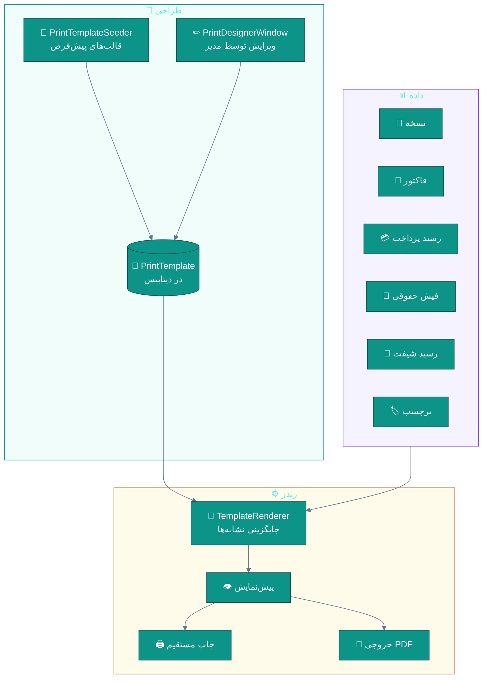
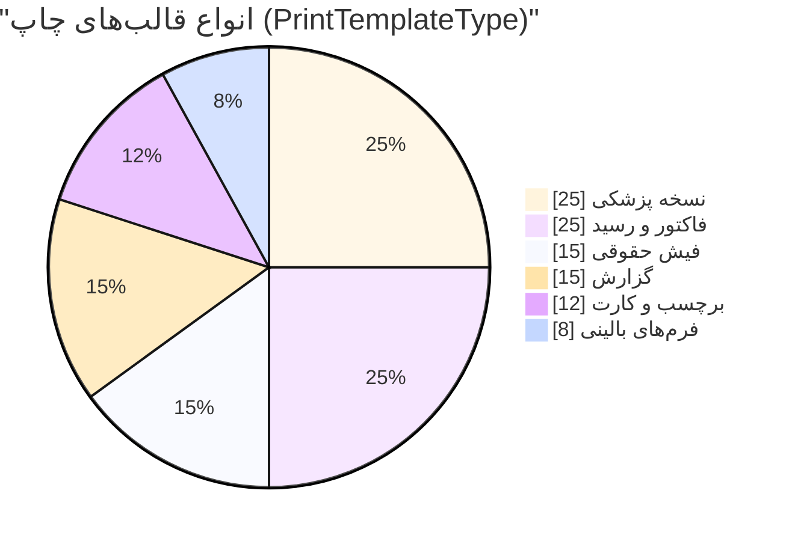
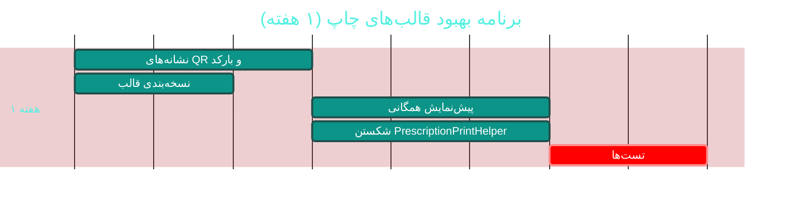

# 🖨 ماژول قالب‌های چاپ (Print Templates)

> **مسیر ماژول:** `printtemplates` · **لایسنس:** `PrintTemplates`
> **اولویت:** 🟢 کم · **دشواری:** 🟡 متوسط · **زمان برآوردی:** ۱ هفته

---

## ۱. 📋 خلاصه ماژول

سیستم قالب‌بندی چاپ: قالب‌های پیش‌فرض برای نسخه، فاکتور، رسید پرداخت،
فیش حقوقی، برچسب و گزارش‌ها — با امکان ویرایش توسط مدیر.
مبتنی بر داده (Data-Driven) با قابلیت تنظیم اندازه کاغذ، حاشیه و فیلترها.

| ویژگی | مقدار |
|:---|:---|
| 🎯 هدف | یکنواختی و حرفه‌ای‌بودن خروجی‌های چاپی درمانگاه |
| 👤 کاربران اصلی | مدیر · پذیرشگر · صندوقدار |
| 🔗 وابستگی‌ها | `prescriptions`, `billing`, `payroll`, `reports` |
| 📊 وضعیت فعلی | 🟢 عملیاتی و منعطف |

---

## ۲. 🎯 وضعیت فعلی در کدبیس

| لایه | فایل | وضعیت |
|:---|:---|:---|
| 🧬 Domain | `.../Reporting/PrintTemplate.cs` | 🟢 |
| 🧬 Domain | `.../Enums/PrintTemplateType.cs` | 🟢 |
| 🗄 Infra | `.../Seeders/PrintTemplateSeeder.cs` · `.../SeedData/PrintTemplateSeedData.cs` | 🟢 |
| 🗄 Infra | مایگریشن‌های `Cycle13PrintTemplates` · `Cycle31PaperSizeLength` · `Cycle31PrintTemplatePaperAndFilters` | 🟢 |
| ⚙ App | `.../Features/Reporting/PrintTemplates/` | 🟢 |
| ⚙ App | `.../Features/Reporting/PrintTemplates/` (رندرر) | 🟢 |
| 🌐 API | `.../Controllers/PrintTemplatesController.cs` | 🟢 |
| 🖥 Desktop | `.../Views/PrintDesignerWindow.xaml` · `PrescriptionPrintHelper.cs` (۷۶۴ خط) | 🟠 |
| 🧪 تست | `tests/.../Reporting/PrintTemplateRendererTests.cs` | 🟢 موجود |

### نکات برجسته‌ی فعلی

✅ **قالب‌های پیش‌فرض** با بذر اختصاصی
✅ **اندازه کاغذ و حاشیه** قابل تنظیم (چرخه ۳۱)
✅ **فیلترهای سفارشی** روی قالب
✅ **رندرر با تست اختصاصی** (`PrintTemplateRendererTests`)
✅ **طراح قالب** در دسکتاپ (`PrintDesignerWindow`)
✅ **کمکی چاپ نسخه** (`PrescriptionPrintHelper` — ۷۶۴ خط)

> 📝 طبق `Directory.Build.props`، چرخه ۲۰ «افزودن سقف طول اقلام قالب»
> و چرخه ۳۱ «اندازه کاغذ و فیلترها» را به این ماژول اضافه کرده‌اند —
> نشانه‌ی تکامل تدریجی و پاسخ به نیاز واقعی کاربر.

---

## ۳. 📊 نمودار معماری چاپ



### انواع قالب



---

## ۴. ⚠️ کاستی‌ها و ایرادها

| # | کاستی | 🎯 شدت | 📍 محل | 💥 پیامد |
|:--:|:---|:--:|:---|:---|
| W-01 | `PrescriptionPrintHelper` با **۷۶۴ خط** — منطق چاپ در کلاس کمکی | 🟠 بالا | `Desktop/Services/` | سخت‌تست‌بودن |
| W-02 | **موتور قالب متنی ساده** (جایگزینی نشانه) به‌جای قالب‌ساز واقعی | 🟡 متوسط | Renderer | محدودیت در طراحی پیچیده |
| W-03 | **پیش‌نمایش قبل از چاپ** احتمالاً در همه جا نیست | 🟡 متوسط | — | هدر رفت کاغذ |
| W-04 | **چاپ دسته‌ای** (چند سند پشت‌سرهم) ندارد | 🟡 متوسط | — | کندی |
| W-05 | **انتخاب چاپگر پیش‌فرض بر اساس نوع سند** ندارد | 🔵 کم | — | — |
| W-06 | **نسخه‌بندی قالب** ندارد | 🟡 متوسط | Domain | تغییر قالب، تاریخچه ندارد |
| W-07 | **بارکد/QR در قالب** پشتیبانی نمی‌شود | 🟡 متوسط | Renderer | عدم امکان ردیابی |
| W-08 | **لوگو و امضای دیجیتال** در قالب آسان نیست | 🟡 متوسط | Renderer | — |

---

## ۵. ✨ امکانات پیشنهادی

| 🎯 # | امکان | 📝 شرح | 💰 ارزش | 🔧 دشواری | ⏱ |
|:--:|:---|:---|:--:|:--:|:--:|
| F-01 | 🧩 **شکستن PrescriptionPrintHelper** | تفکیک به اجزای کوچک + انتقال به Application | بالا | متوسط | ۳ روز |
| F-02 | 🏷 **پشتیبانی بارکد و QR** | نشانه‌های `{{QR:...}}` در قالب | بالا | کم | ۳ روز |
| F-03 | 👁 **پیش‌نمایش همگانی** | قبل از هر چاپ | بالا | کم | ۳ روز |
| F-04 | 📚 **نسخه‌بندی قالب** | تاریخچه + امکان بازگشت | متوسط | کم | ۲ روز |
| F-05 | 🖨 **چاپ دسته‌ای** | چند سند با یک دستور | متوسط | کم | ۲ روز |
| F-06 | 🖇 **انتخاب چاپگر بر اساس نوع سند** | مثلاً نسخه → چاپگر A | متوسط | کم | ۲ روز |
| F-07 | 🎨 **قالب‌ساز بصری پیشرفته** | Drag & Drop با نشانه‌ها | بسیار بالا | زیاد | ۳ هفته |
| F-08 | ✍ **درج امضای دیجیتال در قالب** | تصویر امضا + مهر | بالا | متوسط | ۴ روز |
| F-09 | 📄 **خروجی PDF یکسان با چاپ** | تضمین WYSIWYG | بالا | متوسط | ۴ روز |
| F-10 | 🌐 **قالب‌های چندزبانه** | همراه با زیرساخت i18n | متوسط | متوسط | ۱ هفته |

---

## ۶. 🛠 دستورالعمل پیاده‌سازی

### 📌 گام ۱ — نشانه‌های بارکد و QR در قالب (F-02)

```csharp
// 📄 src/Sahand.ClinicPro.Application/Features/Reporting/PrintTemplates/TemplateTokenRenderer.cs
// گسترش رندرر موجود با نشانه‌های جدید:

/// <summary>
/// رندرر نشانه‌های ویژه در قالب چاپ.
/// نشانه‌های پشتیبانی‌شده:
///   {{Clinic.Name}}      → نام درمانگاه
///   {{Patient.FullName}} → نام بیمار
///   {{QR:TrackingCode}}  → تصویر QR از کد پیگیری
///   {{Barcode:SampleId}} → تصویر بارکد از شناسه نمونه
///   {{Signature:Doctor}} → تصویر امضای پزشک
/// </summary>
public class TemplateTokenRenderer
{
    private readonly IClinicInfoProvider _clinic;
    private readonly IQrCodeGenerator _qr;
    private readonly IBarcodeGenerator _barcode;

    /// <summary>سازنده</summary>
    public TemplateTokenRenderer(IClinicInfoProvider clinic,
        IQrCodeGenerator qr, IBarcodeGenerator barcode)
    { _clinic = clinic; _qr = qr; _barcode = barcode; }

    /// <summary>رندر یک قالب با داده‌های ارائه‌شده</summary>
    public async Task<string> RenderAsync(string template,
        IReadOnlyDictionary<string, object> data, CancellationToken ct = default)
    {
        var result = template;

        // ── نشانه‌های ساده: {{Name}} ──
        result = Regex.Replace(result, @"\{\{(\w+(?:\.\w+)?)\}\}", m =>
        {
            var key = m.Groups[1].Value;
            return data.TryGetValue(key, out var value)
                ? FormatValue(value)
                : string.Empty;          // نشانه ناشناخته → خالی
        });

        // ── نشانه‌های QR: {{QR:Key}} ──
        result = await ReplaceWithImageAsync(result, @"\{\{QR:(\w+)\}\}",
            async key => await _qr.GenerateDataUriAsync(
                data.TryGetValue(key, out var v) ? v.ToString() ?? "" : "", 200), ct);

        // ── نشانه‌های بارکد: {{Barcode:Key}} ──
        result = await ReplaceWithImageAsync(result, @"\{\{Barcode:(\w+)\}\}",
            async key => await _barcode.GenerateCode128DataUriAsync(
                data.TryGetValue(key, out var v) ? v.ToString() ?? "" : "", 300, 60), ct);

        // ── نشانه امضا: {{Signature:Role}} ──
        result = await ReplaceWithImageAsync(result, @"\{\{Signature:(\w+)\}\}",
            key => Task.FromResult(GetSignatureDataUri(key)), ct);

        return result;
    }

    private static async Task<string> ReplaceWithImageAsync(string input, string pattern,
        Func<string, Task<string>> generator, CancellationToken ct)
    {
        var matches = Regex.Matches(input, pattern);
        foreach (Match match in matches)
        {
            var key = match.Groups[1].Value;
            var dataUri = await generator(key);
            input = input.Replace(match.Value,
                $"");
        }
        return input;
    }

    private static string FormatValue(object value) => value switch
    {
        DateTime dt      => PersianDateHelper.ToShamsi(dt),
        decimal d        => d.ToString("N0", CultureInfo.GetCultureInfo("fa-IR")),
        int i            => i.ToString("N0", CultureInfo.GetCultureInfo("fa-IR")),
        bool b           => b ? "بله" : "خیر",
        null             => string.Empty,
        _                => value.ToString() ?? string.Empty,
    };

    private string GetSignatureDataUri(string role)
        => role switch
        {
            "Doctor" => _clinic.DoctorSignatureDataUri ?? string.Empty,
            "Admin"  => _clinic.AdminSignatureDataUri ?? string.Empty,
            _        => string.Empty,
        };
}
```

**تست:**
```csharp
[Fact]
public async Task Render_QrToken_ProducesImageTag()
{
    var renderer = CreateRenderer();
    var data = new Dictionary<string, object> { ["TrackingCode"] = "RX-1404-009821" };

    var html = await renderer.RenderAsync("کد: {{QR:TrackingCode}}", data);

    html.Should().Contain(" { ["Amount"] = 1250000m };
    var html = await renderer.RenderAsync("{{Amount}}", data);
    html.Should().Contain("۱,۲۵۰,۰۰۰");
}
```

---

### 📌 گام ۲ — نسخه‌بندی قالب (F-04)

```csharp
// 📄 src/Sahand.ClinicPro.Domain/Reporting/PrintTemplateVersion.cs (جدید)
namespace Sahand.ClinicPro.Domain.Entities.Reporting;

/// <summary>
/// نسخه قالب چاپ — هر ویرایش، یک نسخه تازه می‌سازد و قبلی باقی می‌ماند.
/// این کار امکان بازگشت به قالب قبلی و ردیابی تغییرات را فراهم می‌کند.
/// </summary>
public class PrintTemplateVersion : BaseEntity
{
    /// <summary>قالب اصلی</summary>
    public long PrintTemplateId { get; set; }

    /// <summary>قالب</summary>
    public PrintTemplate PrintTemplate { get; set; } = null!;

    /// <summary>شماره نسخه (افزایشی)</summary>
    public int VersionNumber { get; set; }

    /// <summary>محتوای قالب در این نسخه</summary>
    public string Content { get; set; } = null!;

    /// <summary>شرح تغییر</summary>
    public string? ChangeNote { get; set; }

    /// <summary>شناسه کاربر تغییردهنده</summary>
    public long ChangedByUserId { get; set; }

    /// <summary>زمان تغییر</summary>
    public DateTime ChangedAt { get; set; } = DateTime.UtcNow;

    /// <summary>نسخه فعلی است</summary>
    public bool IsCurrent { get; set; }
}
```

```csharp
// در PrintTemplateUpdateCommandHandler — پیش از اعمال تغییر:
var currentVersion = await _uow.Repository<PrintTemplateVersion>().QueryableNoTracking
    .Where(v => v.PrintTemplateId == template.Id && v.IsCurrent)
    .OrderByDescending(v => v.VersionNumber)
    .FirstOrDefaultAsync(ct);

// غیرفعال‌سازی نسخه فعلی
if (currentVersion is not null)
{
    var old = await _uow.Repository<PrintTemplateVersion>()
        .GetByIdAsync(currentVersion.Id, ct);
    if (old is not null) { old.IsCurrent = false; _uow.Repository<PrintTemplateVersion>().Update(old); }
}

// ایجاد نسخه جدید
_uow.Repository<PrintTemplateVersion>().Add(new PrintTemplateVersion
{
    PrintTemplateId = template.Id,
    VersionNumber = (currentVersion?.VersionNumber ?? 0) + 1,
    Content = request.NewContent,
    ChangeNote = request.ChangeNote,
    ChangedByUserId = _currentUser.UserId,
    IsCurrent = true,
});
```

---

### 📌 گام ۳ — شکستن `PrescriptionPrintHelper` (F-01)

```
PrescriptionPrintHelper (۷۶۴ خط)
├── 📄 PrescriptionPrintDataBuilder   → تجمیع داده‌های نسخه از API
├── 📄 PrescriptionHtmlComposer       → ساخت HTML از داده
├── 📄 PrescriptionPrintSettings      → تنظیمات کاغذ/حاشیه
└── 📄 PrescriptionPrintRenderer      → هماهنگ‌کننده نهایی
```

> 💡 **نکته:** منطقِ تجمیع داده بهتر است به لایه **Application** منتقل شود
> (`GetPrescriptionPrintDataQuery`) تا در نسخه وب/موبایل آینده هم قابل استفاده باشد.

---

## ۷. 🧪 تست‌های الزامی

| 🧪 تست | 🎯 هدف |
|:---|:---|
| `PrintTemplateRenderer_SimpleToken_Replaced` *(موجود)* | رندر پایه |
| `PrintTemplateRenderer_QrToken_ProducesImage` | QR |
| `PrintTemplateRenderer_Barcode_ProducesImage` | بارکد |
| `PrintTemplateRenderer_UnknownToken_Empty` | مدیریت خطا |
| `PrintTemplateRenderer_PersianNumbers_Formatted` | بومی‌سازی |
| `PrintTemplateRenderer_ShamsiDate_Formatted` | تقویم شمسی |
| `TemplateVersion_Edit_CreatesNewVersion` | نسخه‌بندی |
| `TemplateVersion_Restore_RevertsContent` | بازگشت |
| `Template_DefaultSeed_AllTypesExist` | بذر کامل |

---

## ۸. 📈 شاخص‌های موفقیت (KPI)

| 📊 شاخص | قبل | هدف |
|:---|:--:|:--:|
| 🏷 پشتیبانی بارکد/QR در قالب | ❌ | **✅** |
| 👁 نرخ پیش‌نمایش قبل از چاپ | ~۵۰٪ | **۱۰۰٪** |
| 📏 اندازه `PrescriptionPrintHelper` | ۷۶۴ خط | **< ۲۰۰ خط** |
| 📚 تاریخچه تغییرات قالب | ❌ | **✅ کامل** |
| 🧪 پوشش تست رندرر | ~۵۰٪ | **> ۹۰٪** |

---

## ۹. 🗓 برنامه زمانی



---

## 🔗 پیوندهای مرتبط

| 📄 سند | توضیح |
|:---|:---|
| [تحلیل جامع](../ANALYSIS-REPORT.md) | سند اصلی |
| [B08 — گزارش‌ساز](B08-reports.md) | خروجی چاپی گزارش‌ها |
| [A06 — نسخه‌نویسی](A06-prescriptions-safety.md) | چاپ نسخه |
| [D09 — چندزبانگی](D09-localization-i18n.md) | قالب‌های چندزبانه |

---
<div align="center">📅 ۱۴۰۴/۰۷/۱۹ · 🔖 v1.0</div>
