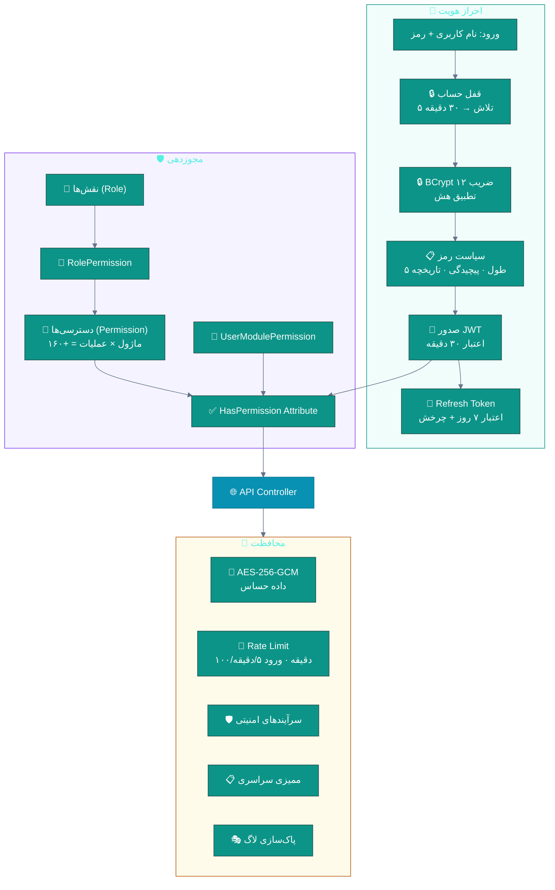
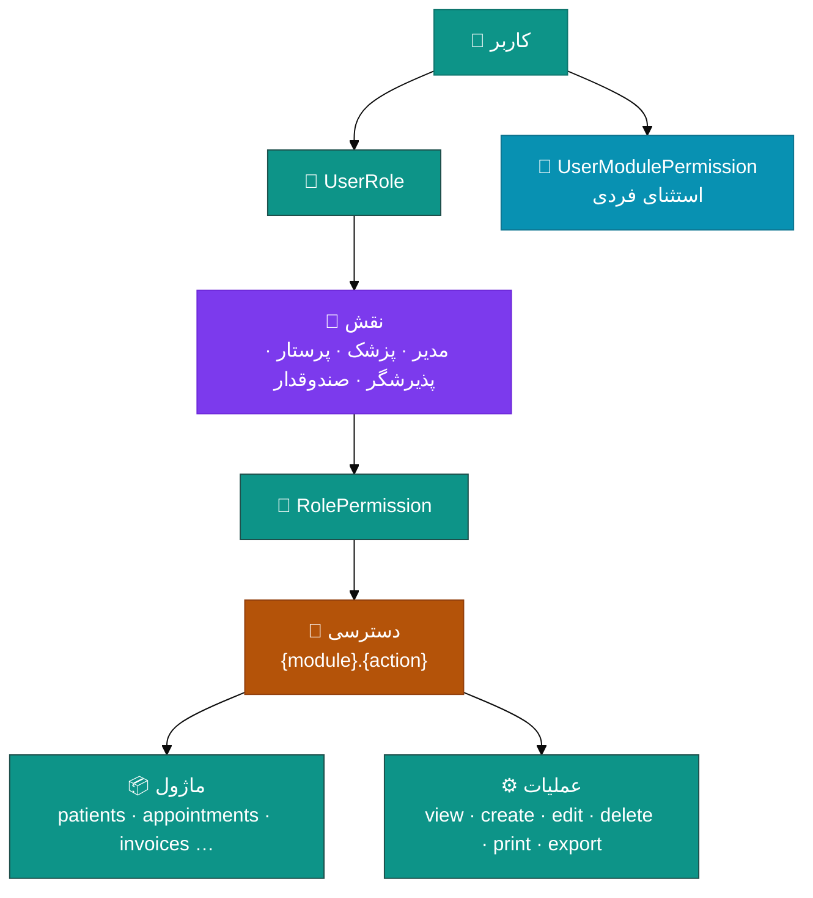
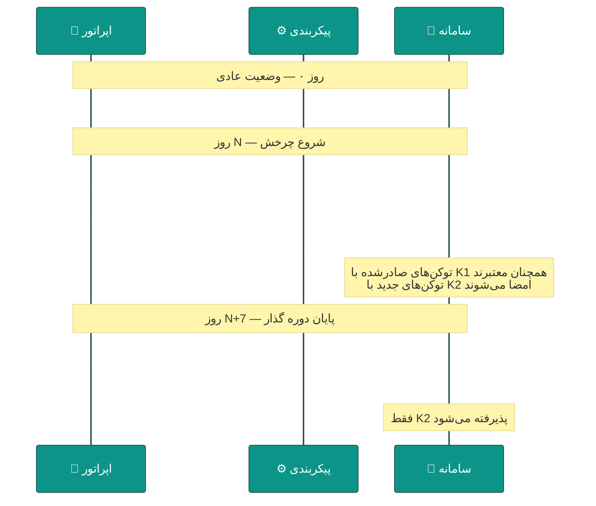
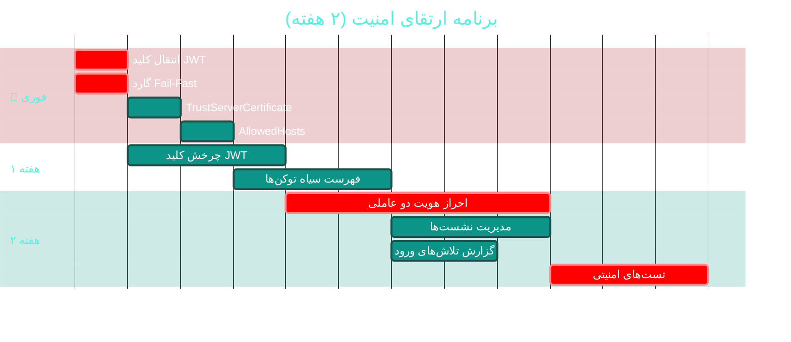

# 🔐 ماژول امنیت، کاربران و نقش‌ها (Security, Users & RBAC)

> **مسیر ماژول:** `users` · `roles` · `auth` · **لایسنس:** `Users` (هسته)
> **اولویت:** 🔴 **بحرانی** · **دشواری:** 🟠 بالا · **زمان برآوردی:** ۲ هفته

---

## ۱. 📋 خلاصه ماژول

لایه امنیتی سراسری: احراز هویت (BCrypt + JWT + Refresh)، مجوزدهی دانه‌ریز
(RBAC با ۱۶۰+ دسترسی)، مدیریت کاربران و نشست‌ها، سیاست رمز عبور و قفل حساب.

| ویژگی | مقدار |
|:---|:---|
| 🎯 هدف | حفاظت از داده‌های حساس پزشکی و مالی |
| 👤 کاربران اصلی | مدیر سیستم · همه کاربران |
| 🔗 وابستگی‌ها | **همه ماژول‌ها** |
| 📊 وضعیت فعلی | 🟢 طراحی خوب — 🔴 یک ایراد بحرانی در پیکربندی |

---

## ۲. 🎯 وضعیت فعلی در کدبیس

| لایه | فایل | وضعیت |
|:---|:---|:---|
| 🧬 Domain | `.../Security/User.cs` · `Role.cs` · `Permission.cs` · `RolePermission.cs` · `UserRole.cs` | 🟢 |
| 🧬 Domain | `.../Security/UserSession.cs` · `RefreshToken.cs` · `PasswordHistory.cs` · `UserModulePermission.cs` · `UserShortcut.cs` | 🟢 |
| 🗄 Infra | `.../Identity/PasswordHasher.cs` (BCrypt ضریب ۱۲) | 🟢 ⭐ |
| 🗄 Infra | `.../Identity/JwtTokenGenerator.cs` · `IdentityService.cs` · `CurrentUserService.cs` | 🟢 |
| 🗄 Infra | `.../Services/Security/EncryptionService.cs` (AES-256-GCM) | 🟢 ⭐ |
| 🗄 Infra | `.../Seeders/AdminSeeder.cs` · `RoleSeeder.cs` · `PermissionSeeder.cs` | 🟢 |
| 🌐 API | `.../Controllers/AuthController.cs` · `UsersController.cs` · `RolesController.cs` · `AdminController.cs` | 🟢 |
| 🌐 API | `.../Middleware/AuditLogMiddleware.cs` (۷۰۸ خط) | 🟢 |
| 🖥 Desktop | `.../Views/UsersView.xaml` · `UserFormWindow` · `RolePermissionView.xaml` · `LoginWindow.xaml` · `ChangePasswordWindow` | 🟢 |
| 🖥 Desktop | `.../ViewModels/AdminViewModel.cs` | ۸۱۱ خط · ۱۸ فرمان 🟠 |
| 🧪 تست | `tests/.../JwtKeyGuardTests.cs` | 🟢 ⭐ هوشمند |

### نکات برجسته‌ی فعلی

✅ **BCrypt با Work Factor ۱۲** — بالاتر از حداقل توصیه‌شده (۱۰)
✅ **AES-256-GCM** برای داده‌های حساس
✅ **تاریخچه ۵ رمز عبور** — جلوگیری از تکرار
✅ **قفل ۳۰ دقیقه پس از ۵ تلاش ناموفق**
✅ **JWT کوتاه‌عمر (۳۰ دقیقه) + چرخش Refresh Token**
✅ **۱۶۰+ دسترسی دانه‌ریز** (ماژول × عملیات)
✅ **`JwtKeyGuardTests`** — گاردِ کلید پیش‌فرض در Production
✅ **پاک‌سازی ستون‌های حساس در لاگ** (`SensitiveColumns` در `AuditLogMiddleware`)

---

## ۳. 📊 نمودار معماری امنیت



### سلسله‌مراتب مجوزها



---

## ۴. ⚠️ کاستی‌ها و ایرادها

### 🔴 بحرانی

| # | کاستی | 📍 محل | 💥 پیامد | 🩹 راهکار |
|:--:|:---|:---|:---|:---|
| **S-01** | **کلید JWT در `appsettings.json` Hardcode شده** | `API/appsettings.json` | 🔴 جعل توکن مدیر → دسترسی کامل به ۳۰۸ اندپوینت | Secret Manager + چرخش کلید |
| **S-02** | **`TrustServerCertificate=True` در رشته اتصال** | `API/appsettings.json` | 🟠 حمله MITM روی ترافیک DB | گواهی معتبر در Production |
| **S-03** | **`AllowedHosts: "*"`** | `API/appsettings.json` | 🟠 حمله Host Header Injection | محدود به دامنه‌های مجاز |

### 🟠 بالا

| # | کاستی | 📍 محل | 💥 پیامد |
|:--:|:---|:---|:---|
| **S-04** | **احراز هویت دو عاملی (2FA)** ندارد | Domain | حساب‌های مدیر آسیب‌پذیر |
| **S-05** | **چرخش خودکار کلید JWT** ندارد | `JwtTokenGenerator` | نشت بلندمدت |
| **S-06** | **باطل‌سازی فهرست توکن‌ها** ندارد (فقط Refresh) | `AuthController` | توکن JWT معتبر تا ۳۰ دقیقه پس از خروج |
| **S-07** | **سیاست رمز عبور** پیکربندی‌پذیر نیست | `Identity` | تغییر نیاز به کامپایل |
| **S-08** | `AdminViewModel` با **۸۱۱ خط و ۱۸ فرمان** | `ViewModels/` | سخت‌تست‌بودن |

### 🟡 متوسط

| # | کاستی | 📍 محل |
|:--:|:---|:---|
| **S-09** | **نشست‌های فعال قابل مدیریت نیستند** (عدم امکان قطع نشست از راه دور) | `UserSession` |
| **S-10** | **گزارش تلاش‌های ورود ناموفق** ندارد | — |
| **S-11** | **محدودیت IP** برای کاربران حساس ندارد | — |
| **S-12** | **انقضای خودکار رمز عبور** ندارد | `PasswordHistory` |
| **S-13** | **رمزنگاری ستون‌های حساس بیمار** (کد ملی) فقط در لاگ است نه در DB | — |

---

## ۵. ✨ امکانات پیشنهادی

| 🎯 # | امکان | 📝 شرح | 💰 ارزش | 🔧 دشواری | ⏱ |
|:--:|:---|:---|:--:|:--:|:--:|
| F-01 | 🔑 **انتقال کلید JWT به Secret Manager** | User-Secrets در توسعه، Env/KeyVault در Production | **حیاتی** | کم | ۲ ساعت |
| F-02 | 🔄 **چرخش خودکار کلید JWT** | کلید فعلی + قبلی، بدون باطل‌شدن توکن‌ها | بالا | متوسط | ۳ روز |
| F-03 | 📱 **احراز هویت دو عاملی (2FA/TOTP)** | Google Authenticator / پیامک | بسیار بالا | متوسط | ۱ هفته |
| F-04 | 🛑 **فهرست سیاه توکن‌ها** | باطل‌سازی فوری پس از خروج/تغییر رمز | بالا | کم | ۳ روز |
| F-05 | 📋 **مدیریت نشست‌های فعال** | مشاهده و قطع نشست از راه دور | بالا | کم | ۳ روز |
| F-06 | ⚙ **سیاست رمز عبور پیکربندی‌پذیر** | طول، پیچیدگی، انقضا از تنظیمات | متوسط | کم | ۲ روز |
| F-07 | 📊 **گزارش تلاش‌های ورود** | لاگ امنیتی + هشدار حمله | بالا | کم | ۲ روز |
| F-08 | 🌐 **محدودسازی IP** | برای نقش‌های حساس | متوسط | کم | ۲ روز |
| F-09 | 🔐 **رمزنگاری ستون‌های حساس بیمار** | کد ملی، تلفن در DB | بالا | متوسط | ۱ هفته |
| F-10 | 🧩 **شکستن AdminViewModel** | تقسیم به ۴ زیر-ViewModel | متوسط | متوسط | ۴ روز |

---

## ۶. 🛠 دستورالعمل پیاده‌سازی

### 📌 گام ۱ — انتقال کلید JWT (F-01) — *فوری‌ترین کار کل پروژه*

**۱.۱ پاک‌سازی `appsettings.json`**

```json
{
  "Jwt": {
    "SecretKey": "",
    "PreviousSecretKey": "",
    "Issuer": "Sahand.ClinicPro",
    "Audience": "Sahand.ClinicPro.Clients",
    "AccessTokenExpiryMinutes": 30,
    "RefreshTokenExpiryDays": 7
  }
}
```

**۱.۲ گارد در راه‌اندازی (Fail-Fast)**

```csharp
// 📄 src/Sahand.ClinicPro.API/Program.cs — پس از ساخت builder، پیش از app.Run()

// ── گارد امنیتی: کلید JWT باید در Production حتماً تنظیم شده باشد ──
var environment = builder.Environment;
var jwtSecret = builder.Configuration["Jwt:SecretKey"];

if (string.IsNullOrWhiteSpace(jwtSecret) || jwtSecret.Length < 32)
{
    if (environment.IsProduction())
    {
        // در Production بدون کلید معتبر، برنامه اصلاً بالا نمی‌آید
        throw new InvalidOperationException(
            "کلید JWT تنظیم نشده یا کوتاه‌تر از ۳۲ کاراکتر است. " +
            "در محیط Production باید از متغیر محیطی Jwt__SecretKey استفاده شود.");
    }

    // در توسعه: تولید کلید موقت تصادفی (هر بار اجرا متفاوت)
    var tempKey = Convert.ToBase64String(
        System.Security.Cryptography.RandomNumberGenerator.GetBytes(64));
    builder.Configuration["Jwt:SecretKey"] = tempKey;
    Log.Warning(
        "⚠ کلید JWT موقت برای توسعه تولید شد. این کلید پس از راه‌اندازی مجدد تغییر می‌کند.");
}
```

**۱.۳ تنظیم در محیط‌های مختلف**

```bash
# 🔧 توسعه — User Secrets
cd src/Sahand.ClinicPro.API
dotnet user-secrets init
dotnet user-secrets set "Jwt:SecretKey" "$(openssl rand -base64 48)"

# 🏭 Production ویندوز (IIS / Windows Service)
[System.Environment]::SetEnvironmentVariable("Jwt__SecretKey", "<کلید-تصادفی>", "Machine")

# 🐧 Production لینوکس (systemd)
# در فایل /etc/systemd/system/clinicpro.service:
# Environment="Jwt__SecretKey=<کلید-تصادفی>"

# ☁ Azure Key Vault
# builder.Configuration.AddAzureKeyVault(...)
```

**۱.۴ تأیید**

```bash
# بررسی عدم وجود کلید در مخزن
grep -rn "SecretKey" --include="*.json" src/ | grep -v '""'
# باید فقط مقدار خالی برگردد
```

> ✅ `JwtKeyGuardTests` موجود را توسعه دهید تا این مورد را هم پوشش دهد.

---

### 📌 گام ۲ — چرخش کلید JWT (F-02)

```csharp
// 📄 src/Sahand.ClinicPro.Infrastructure/Identity/JwtTokenGenerator.cs
// گسترش برای پذیرش کلید قبلی هنگام اعتبارسنجی:

/// <summary>
/// تولیدکننده و اعتبارسنج توکن JWT — با پشتیبانی از چرخش کلید.
/// هنگام اعتبارسنجی، ابتدا کلید فعلی امتحان می‌شود و در صورت شکست،
/// کلید قبلی. این اجازه می‌دهد کلید بدون باطل‌شدن توکن‌های در گردش چرخانده شود.
/// </summary>
public class JwtTokenGenerator
{
    private readonly string _currentKey;
    private readonly string? _previousKey;
    private readonly string _issuer;
    private readonly string _audience;
    private readonly int _accessTokenExpiryMinutes;

    /// <summary>سازنده</summary>
    public JwtTokenGenerator(IConfiguration config)
    {
        _currentKey = config["Jwt:SecretKey"]
                      ?? throw new InvalidOperationException("کلید JWT تنظیم نشده است");
        _previousKey = config["Jwt:PreviousSecretKey"];
        _issuer = config["Jwt:Issuer"] ?? "Sahand.ClinicPro";
        _audience = config["Jwt:Audience"] ?? "Sahand.ClinicPro.Clients";
        _accessTokenExpiryMinutes =
            int.TryParse(config["Jwt:AccessTokenExpiryMinutes"], out var m) ? m : 30;
    }

    /// <summary>تولید توکن دسترسی</summary>
    public string GenerateAccessToken(long userId, string username,
        IEnumerable<string> permissions)
    {
        var claims = new List<Claim>
        {
            new(ClaimTypes.NameIdentifier, userId.ToString()),
            new(ClaimTypes.Name, username),
            new(JwtRegisteredClaimNames.Jti, Guid.NewGuid().ToString()),
        };
        claims.AddRange(permissions.Select(p => new Claim("permission", p)));

        var key = new SymmetricSecurityKey(Encoding.UTF8.GetBytes(_currentKey));
        var credentials = new SigningCredentials(key, SecurityAlgorithms.HmacSha256);

        var token = new JwtSecurityToken(
            issuer: _issuer,
            audience: _audience,
            claims: claims,
            expires: DateTime.UtcNow.AddMinutes(_accessTokenExpiryMinutes),
            signingCredentials: credentials);

        return new JwtSecurityTokenHandler().WriteToken(token);
    }

    /// <summary>
    /// اعتبارسنجی توکن با تلاش روی کلید فعلی و سپس کلید قبلی (چرخش).
    /// </summary>
    public ClaimsPrincipal? ValidateToken(string token)
    {
        // تلاش ۱: کلید فعلی
        var principal = TryValidate(token, _currentKey);
        if (principal is not null) return principal;

        // تلاش ۲: کلید قبلی (در دوره گذارِ چرخش)
        if (!string.IsNullOrEmpty(_previousKey))
            return TryValidate(token, _previousKey);

        return null;
    }

    private ClaimsPrincipal? TryValidate(string token, string key)
    {
        try
        {
            var handler = new JwtSecurityTokenHandler();
            var parameters = new TokenValidationParameters
            {
                ValidateIssuerSigningKey = true,
                IssuerSigningKey = new SymmetricSecurityKey(Encoding.UTF8.GetBytes(key)),
                ValidateIssuer = true,
                ValidIssuer = _issuer,
                ValidateAudience = true,
                ValidAudience = _audience,
                ValidateLifetime = true,
                ClockSkew = TimeSpan.FromMinutes(1),      // تلورانس اختلاف ساعت
            };

            return handler.ValidateToken(token, parameters, out _);
        }
        catch (SecurityTokenException)
        {
            return null;      // این کلید کار نکرد — کلید بعدی امتحان شود
        }
    }
}
```

**فرایند چرخش (رویه عملیاتی):**



---

### 📌 گام ۳ — فهرست سیاه توکن‌ها (F-04)

```csharp
// 📄 src/Sahand.ClinicPro.Application/Interfaces/ITokenBlacklist.cs (جدید)
namespace Sahand.ClinicPro.Application.Interfaces;

/// <summary>
/// قرارداد فهرست سیاه توکن‌ها — برای باطل‌سازی فوری پس از خروج یا تغییر رمز.
/// پیاده‌سازی پیشنهادی: Redis با TTL برابر عمر باقی‌مانده توکن.
/// </summary>
public interface ITokenBlacklist
{
    /// <summary>افزودن توکن به فهرست سیاه</summary>
    Task BlacklistAsync(string jti, TimeSpan remainingLifetime, CancellationToken ct = default);

    /// <summary>بررسی سیاه‌بودن توکن</summary>
    Task<bool> IsBlacklistedAsync(string jti, CancellationToken ct = default);
}
```

```csharp
// 📄 src/Sahand.ClinicPro.Infrastructure/Services/Security/InMemoryTokenBlacklist.cs
/// <summary>
/// پیاده‌سازی درون‌حافظه‌ای — مناسب تک‌سروره.
/// برای چندسروره باید با Redis جایگزین شود.
/// </summary>
public class InMemoryTokenBlacklist : ITokenBlacklist
{
    private readonly System.Collections.Concurrent.ConcurrentDictionary<string, DateTime> _entries = new();
    private readonly ILogger<InMemoryTokenBlacklist> _logger;

    public InMemoryTokenBlacklist(ILogger<InMemoryTokenBlacklist> logger) => _logger = logger;

    public Task BlacklistAsync(string jti, TimeSpan remainingLifetime, CancellationToken ct = default)
    {
        _entries[jti] = DateTime.UtcNow.Add(remainingLifetime);
        _logger.LogInformation("توکن {Jti} باطل شد", jti);
        return Task.CompletedTask;
    }

    public Task<bool> IsBlacklistedAsync(string jti, CancellationToken ct = default)
        => Task.FromResult(_entries.TryGetValue(jti, out var expiry) && expiry > DateTime.UtcNow);
}
```

```csharp
// در AuthController.Logout — استخراج jti و افزودن به فهرست سیاه:
var jti = User.FindFirst(JwtRegisteredClaimNames.Jti)?.Value;
if (jti is not null)
{
    var exp = User.FindFirst(JwtRegisteredClaimNames.Exp)?.Value;
    var remaining = exp is not null && long.TryParse(exp, out var expSeconds)
        ? DateTimeOffset.FromUnixTimeSeconds(expSeconds) - DateTimeOffset.UtcNow
        : TimeSpan.FromMinutes(30);

    await _blacklist.BlacklistAsync(jti, remaining > TimeSpan.Zero ? remaining : TimeSpan.Zero, ct);
}
```

---

### 📌 گام ۴ — احراز هویت دو عاملی (F-03)

```csharp
// 📄 src/Sahand.ClinicPro.Domain/Security/UserTwoFactor.cs (جدید)
namespace Sahand.ClinicPro.Domain.Entities.Security;

/// <summary>
/// تنظیمات احراز هویت دو عاملی کاربر — مبتنی بر TOTP (RFC 6238)
/// سازگار با Google Authenticator، Microsoft Authenticator و مشابه.
/// </summary>
public class UserTwoFactor : BaseEntity
{
    /// <summary>شناسه کاربر</summary>
    public long UserId { get; set; }

    /// <summary>کاربر</summary>
    public User User { get; set; } = null!;

    /// <summary>کلید مخفی TOTP (Base32)</summary>
    public string SecretKey { get; set; } = null!;

    /// <summary>آیا فعال شده است</summary>
    public bool IsEnabled { get; set; }

    /// <summary>روش ارسال کد</summary>
    public TwoFactorMethod Method { get; set; } = TwoFactorMethod.Totp;

    /// <summary>کدهای بازیابی (JSON آرایه — هرکدام یک‌بار مصرف)</summary>
    public string RecoveryCodesJson { get; set; } = "[]";

    /// <summary>تاریخ فعال‌سازی</summary>
    public DateTime? EnabledAt { get; set; }
}

/// <summary>روش دوعاملی</summary>
public enum TwoFactorMethod
{
    /// <summary>برنامه authenticator (TOTP)</summary>
    Totp,
    /// <summary>پیامک</summary>
    Sms,
    /// <summary>ایمیل</summary>
    Email,
}
```

> 📌 بستهٔ پیشنهادی: `Otp.NET` (MIT) یا پیاده‌سازی مستقل RFC 6238.

---

## ۷. 🧪 تست‌های الزامی

| 🧪 تست | 🎯 هدف | اولویت |
|:---|:---|:--:|
| `JwtKeyGuard_DefaultKeyInProduction_Throws` *(موجود — گسترش)* | Fail-Fast | 🔴 |
| `JwtKeyGuard_MissingKey_Throws` | Fail-Fast | 🔴 |
| `TokenRotation_OldKeyStillValid` | چرخش کلید | 🔴 |
| `TokenRotation_ExpiredPreviousKey_Rejected` | پایان دوره گذار | 🟠 |
| `Blacklist_AfterLogout_TokenRejected` | باطل‌سازی | 🔴 |
| `Password_PreviouslyUsed_Rejected` | تاریخچه ۵ رمز | 🔴 |
| `Login_5FailedAttempts_LocksAccount` | قفل حساب | 🔴 |
| `Login_LockedAccount_Rejected` | قفل مؤثر | 🔴 |
| `Permission_WithoutRole_Denied` | RBAC | 🔴 |
| `AuditLog_SensitiveColumns_Masked` | پاک‌سازی لاگ | 🔴 |
| `TwoFactor_WrongCode_Rejected` | 2FA | 🟠 |
| `TwoFactor_RecoveryCode_SingleUse` | کد بازیابی | 🟠 |

---

## ۸. 📈 شاخص‌های موفقیت (KPI)

| 📊 شاخص | قبل | هدف |
|:---|:--:|:--:|
| 🔑 کلیدهای محرمانه در مخزن | **۱** | **۰** |
| 📱 پوشش 2FA برای مدیران | ۰٪ | **۱۰۰٪** |
| ⏱ زمان باطل‌سازی توکن پس از خروج | ۳۰ دقیقه | **لحظه‌ای** |
| 🔄 چرخش کلید | دستی + انتشار | **بدون توقف** |
| 🧪 پوشش تست امنیتی | ~۳۰٪ | **> ۹۰٪** |

---

## ۹. 🗓 برنامه زمانی



---

## 🔗 پیوندهای مرتبط

| 📄 سند | توضیح |
|:---|:---|
| [تحلیل جامع](../ANALYSIS-REPORT.md) | سند اصلی — [BUG-01](#) |
| [C02 — ممیزی و انطباق](C02-audit-compliance.md) | لاگ عملیات |
| [C09 — سامانه لایسنس](C09-licensing.md) | امضای RSA |
| [D09 — چندزبانگی](D09-localization-i18n.md) | — |

---
<div align="center">📅 ۱۴۰۴/۰۷/۱۹ · 🔖 v1.0</div>
