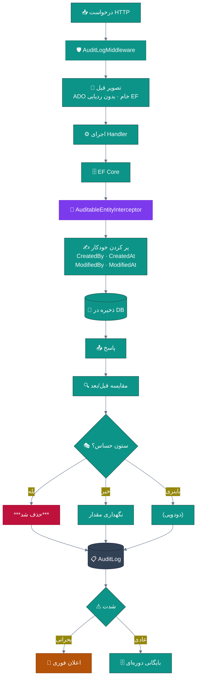
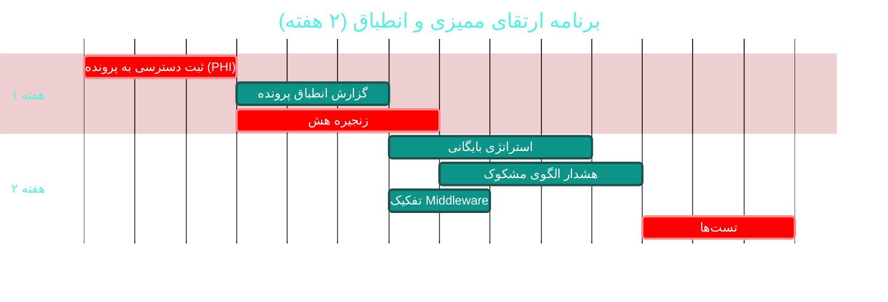

# 📋 ماژول ممیزی و انطباق (Audit & Compliance)

> **مسیر ماژول:** `auditlogs` · **لایسنس:** `Audit` (هسته)
> **اولویت:** 🟠 بالا · **دشواری:** 🟡 متوسط · **زمان برآوردی:** ۲ هفته

---

## ۱. 📋 خلاصه ماژول

ثبت تغییرناپذیرِ هر عملیات حساس: چه کسی، چه زمانی، چه تغییری، از چه مقداری به چه مقداری.
پیاده‌سازی‌شده در دو سطح: **Interceptor سطح EF** و **Middleware سطح HTTP** —
با پاک‌سازی خودکار ستون‌های حساس.

| ویژگی | مقدار |
|:---|:---|
| 🎯 هدف | ردیابی کامل برای انطباق با مقررات حریم‌خصوصی پزشکی |
| 👤 کاربران اصلی | مدیر · مسئول انطباق · حسابرس |
| 🔗 وابستگی‌ها | **سراسری** (Cross-Cutting) |
| 📊 وضعیت فعلی | 🟢 بسیار خوب |

---

## ۲. 🎯 وضعیت فعلی در کدبیس

| لایه | فایل | خط | وضعیت |
|:---|:---|--:|:---|
| 🧬 Domain | `.../Infrastructure/AuditLog.cs` | — | 🟢 |
| 🧬 Domain | `.../Enums/AuditActionType.cs` · `AuditSeverity.cs` | — | 🟢 |
| 🗄 Infra | `.../Interceptors/AuditableEntityInterceptor.cs` | — | 🟢 ⭐ سطح داده |
| 🌐 API | **`.../Middleware/AuditLogMiddleware.cs`** | **۷۰۸** | 🟠 سطح HTTP |
| 🌐 API | `.../Controllers/AdminController.cs` (بخش AuditLog) | — | 🟢 |
| 🖥 Desktop | `.../Views/AuditLogView.xaml` | — | 🟢 |

### نکات برجسته‌ی فعلی

✅ **دو سطح ثبت**: EF Interceptor (تغییرات موجودیت) + HTTP Middleware (درخواست‌ها)
✅ **ثبت مقدار قدیم و جدید (Old/New)** — برای بازسازی کامل
✅ **پاک‌سازی خودکار ستون‌های حساس** (`SensitiveColumns` → `***حذف شد***`)
✅ **مدیریت فایل‌های باینری** (`(دودویی)` به‌جای محتوا)
✅ **سطوح شدت** (`AuditSeverity`)
✅ **خواندن سطر قدیم با ADO خام** قبل از تغییر — بدون تداخل با هندلر

> 💡 **نکته‌ی فنی مثبت:** در `AuditLogMiddleware` برای خواندن مقدار قبلی،
> از **ADO.NET خام** استفاده شده (نه EF) تا ردیابی تغییرات EF را مختل نکند —
> یک تصمیم معماری آگاهانه و درست.

---

## ۳. 📊 نمودار جریان ممیزی



### نمودار سطوح ممیزی

```mermaid
%%{init: {'theme':'base','themeVariables':{'primaryColor':'#0d9488','primaryTextColor':'#fff'}}}%%
graph LR
    subgraph L1["سطح ۱ · موجودیت"]
        A1["Created / Modified / Deleted"]
        A2["چه کسی · چه زمانی"]
    end
    subgraph L2["سطح ۲ · مقدار"]
        B1["Old Value → New Value"]
        B2["به‌صورت JSON"]
    end
    subgraph L3["سطح ۳ · درخواست"]
        C1["Endpoint · Method"]
        C2["IP · User-Agent"]
        C3["زمان پاسخ"]
    end
    subgraph L4["سطح ۴ · تجاری"]
        D1["گزارش تغییرات حساس"]
        D2["ردیابی دسترسی به پرونده"]
        D3["گواهی انطباق"]
    end

    L1 --> L2 --> L3 --> L4
    style L1 fill:#f0fdfa,stroke:#0d9488
    style L2 fill:#ecfdf5,stroke:#0891b2
    style L3 fill:#f5f3ff,stroke:#7c3aed
    style L4 fill:#fffbeb,stroke:#b45309
```



---

## ۴. ⚠️ کاستی‌ها و ایرادها

| # | کاستی | 🎯 شدت | 📍 محل | 💥 پیامد |
|:--:|:---|:--:|:---|:---|
| W-01 | `AuditLogMiddleware` با **۷۰۸ خط** | 🟠 بالا | `API/Middleware/` | نگهداری دشوار |
| W-02 | **لاگ ممیزی حجم بالایی تولید می‌کند** — استراتژی بایگانی ندارد | 🟠 بالا | — | رشد بی‌رویه دیتابیس |
| W-03 | **دسترسی به پرونده بیمار (View)** ثبت نمی‌شود | 🔴 بالا | — | **عدم انطباق** — مهم‌ترین نیاز حریم‌خصوصی |
| W-04 | **گزارش انطباق** (چه کسی پرونده X را دیده) ندارد | 🟠 بالا | — | پاسخ به بیمار/ناظر ممکن نیست |
| W-05 | **امضای دیجیتال/زنجیره هش** روی لاگ‌ها ندارد | 🟠 بالا | Domain | امکان دستکاری لاگ |
| W-06 | **جستجوی پیشرفته** در لاگ (بازه، کاربر، موجودیت) محدود است | 🟡 متوسط | `AuditLogView` | — |
| W-07 | **هشدار بر اساس الگو** (دسترسی‌های مشکوک) ندارد | 🟡 متوسط | — | نفوذ داخلی شناسایی نمی‌شود |
| W-08 | **نگهداشت (Retention Policy)** پیکربندی‌پذیر نیست | 🟡 متوسط | — | — |
| W-09 | **خروجی قابل ارائه به ناظر** ندارد | 🟡 متوسط | — | — |

---

## ۵. ✨ امکانات پیشنهادی

| 🎯 # | امکان | 📝 شرح | 💰 ارزش | 🔧 دشواری | ⏱ |
|:--:|:---|:---|:--:|:--:|:--:|
| F-01 | 👁 **ثبت دسترسی به پرونده (PHI Access Log)** | هر بار مشاهده پرونده بیمار ثبت شود | **حیاتی** | کم | ۳ روز |
| F-02 | 🧾 **گزارش انطباق پرونده** | «چه کسی، کی، پرونده X را دیده» | بسیار بالا | کم | ۳ روز |
| F-03 | 🔗 **زنجیره هش (Hash Chain)** | هر رکورد هشِ رکورد قبلی را دارد → ضد دستکاری | بسیار بالا | متوسط | ۴ روز |
| F-04 | 🗄 **استراتژی بایگانی و نگهداشت** | انتقال لاگ‌های قدیمی + پاک‌سازی پس از N سال | بالا | متوسط | ۴ روز |
| F-05 | 🚨 **هشدار الگوی مشکوک** | دسترسی حجمی به پرونده‌ها · ساعات غیرعادی | بالا | متوسط | ۵ روز |
| F-06 | 🔍 **جستجوی پیشرفته** | فیلتر ترکیبی + خروجی | بالا | کم | ۳ روز |
| F-07 | 📄 **گزارش قابل ارائه به ناظر** | PDF امضا‌شده از فعالیت یک دوره | متوسط | کم | ۳ روز |
| F-08 | 🧩 **تفکیک AuditLogMiddleware** | تقسیم به ۳ کلاس کوچک | بالا | کم | ۲ روز |
| F-09 | ⚡ **نوشتن ناهمزمان (Fire & Forget)** | کاهش تأخیر درخواست | متوسط | متوسط | ۳ روز |
| F-10 | 🔐 **رمزنگاری لاگ‌های حساس** | محرمانگی بیشتر | متوسط | کم | ۳ روز |

---

## ۶. 🛠 دستورالعمل پیاده‌سازی

### 📌 گام ۱ — ثبت دسترسی به پرونده بیمار (F-01) — *مهم‌ترین نیاز انطباق*

> 🔑 **چرا حیاتی است؟** در نظام‌های سلامت، مهم‌ترین سؤال حسابرسی این است:
> «چه کسی پرونده این بیمار را دیده است؟» ثبت تغییرات کافی نیست —
> **مشاهده** هم باید ثبت شود.

**۱.۱ موجودیت لاگ دسترسی**

```csharp
// 📄 src/Sahand.ClinicPro.Domain/Infrastructure/PhiAccessLog.cs (جدید)
namespace Sahand.ClinicPro.Domain.Entities.Infrastructure;

/// <summary>
/// لاگ دسترسی به اطلاعات سلامت محافظت‌شده (PHI).
/// برخلاف AuditLog که «تغییرات» را ثبت می‌کند، این موجودیت
/// هر «مشاهده» پرونده بیمار را ثبت می‌کند — الزامِ اصلیِ
/// مقررات حریم‌خصوصی در نظام‌های سلامت.
/// </summary>
public class PhiAccessLog : BaseEntity
{
    /// <summary>شناسه بیمار whose record was accessed</summary>
    public long PatientId { get; set; }

    /// <summary>بیمار</summary>
    public Patient Patient { get; set; } = null!;

    /// <summary>شناسه کاربر دسترسی‌دهنده</summary>
    public long UserId { get; set; }

    /// <summary>کاربر</summary>
    public User User { get; set; } = null!;

    /// <summary>زمان دسترسی</summary>
    public DateTime AccessedAt { get; set; } = DateTime.UtcNow;

    /// <summary>نوع دسترسی</summary>
    public PhiAccessKind AccessKind { get; set; }

    /// <summary>بخش مشاهده‌شده (ویزیت / نسخه / آزمایش / مالی)</summary>
    public string? Section { get; set; }

    /// <summary>دلیل دسترسی (اختیاری — برای دسترسی‌های اضطراری)</summary>
    public string? Reason { get; set; }

    /// <summary>نشانی IP</summary>
    public string? IpAddress { get; set; }

    /// <summary>شناسه درخواست (برای ردیابی)</summary>
    public string? RequestId { get; set; }

    /// <summary>آیا دسترسی اضطراری (Break-Glass) بوده</summary>
    public bool IsEmergencyAccess { get; set; }
}

/// <summary>نوع دسترسی به اطلاعات سلامت</summary>
public enum PhiAccessKind
{
    /// <summary>مشاهده خلاصه پرونده</summary>
    ViewSummary,
    /// <summary>مشاهده جزئیات</summary>
    ViewDetail,
    /// <summary>جستجو در فهرست بیماران</summary>
    Search,
    /// <summary>چاپ یا خروجی</summary>
    Print,
    /// <summary>صادر کردن داده</summary>
    Export,
}
```

**۱.۲ سرویس ثبت**

```csharp
// 📄 src/Sahand.ClinicPro.Application/Interfaces/IPhiAccessLogger.cs (جدید)
namespace Sahand.ClinicPro.Application.Interfaces;

/// <summary>
/// ثبت‌کننده دسترسی به اطلاعات سلامت — باید در همه Endpointهایی که
/// داده بیمار برمی‌گردانند فراخوانی شود.
/// </summary>
public interface IPhiAccessLogger
{
    /// <summary>ثبت یک دسترسی</summary>
    Task LogAsync(long patientId, PhiAccessKind kind, string? section = null,
        string? reason = null, CancellationToken ct = default);
}
```

**۱.۳ Attribute برای ثبت خودکار**

```csharp
// 📄 src/Sahand.ClinicPro.API/Filters/LogPhiAccessAttribute.cs (جدید)
using Microsoft.AspNetCore.Mvc.Filters;

namespace Sahand.ClinicPro.API.Filters;

/// <summary>
/// صفت ثبت خودکار دسترسی به اطلاعات سلامت.
/// با قرارگرفتن روی هر اکشنی که داده بیمار برمی‌گرداند،
/// به‌طور خودکار یک رکورد PHI Access ثبت می‌شود.
/// </summary>
/// <example>
/// [HttpGet("{id}")]
/// [HasPermission("patients.view")]
/// [LogPhiAccess(PhiAccessKind.ViewDetail, Section = "summary")]
/// public async Task&lt;IActionResult&gt; GetById(long id) { … }
/// </example>
[AttributeUsage(AttributeTargets.Method, AllowMultiple = false)]
public sealed class LogPhiAccessAttribute : ActionFilterAttribute
{
    private readonly PhiAccessKind _kind;
    private readonly string _section;

    /// <summary>سازنده</summary>
    /// <param name="kind">نوع دسترسی</param>
    /// <param name="section">بخش مشاهده‌شده</param>
    public LogPhiAccessAttribute(PhiAccessKind kind, string section = "")
    { _kind = kind; _section = section; }

    /// <summary>پس از اجرای اکشن — ثبت دسترسی (فقط در صورت موفقیت)</summary>
    public override async Task OnResultExecutionAsync(
        ResultExecutingContext context, ResultExecutionDelegate next)
    {
        await next();       // ابتدا اکشن اجرا شود

        // فقط درخواست‌های موفق ثبت شوند
        if (context.HttpContext.Response.StatusCode >= 400) return;

        var logger = context.HttpContext.RequestServices
            .GetService<IPhiAccessLogger>();
        if (logger is null) return;

        // استخراج شناسه بیمار از مسیر (مانند /api/v1/patients/123)
        var patientId = ExtractPatientId(context);
        if (patientId is null) return;

        var currentUser = context.HttpContext.RequestServices
            .GetRequiredService<ICurrentUserService>();

        await logger.LogAsync(
            patientId.Value, _kind, _section,
            reason: null,
            ct: context.HttpContext.RequestAborted);
    }

    private static long? ExtractPatientId(ResultExecutingContext context)
    {
        if (context.RouteData.Values.TryGetValue("id", out var idValue)
            && long.TryParse(idValue?.ToString(), out var id))
            return id;

        // تلاش از Query String
        if (context.HttpContext.Request.Query.TryGetValue("patientId", out var q)
            && long.TryParse(q.ToString(), out var qid))
            return qid;

        return null;
    }
}
```

**۱.۴ استفاده روی کنترلرها**

```csharp
// 📄 PatientsController.cs
/// <summary>دریافت جزئیات بیمار</summary>
[HttpGet("{id}")]
[HasPermission("patients.view")]
[LogPhiAccess(PhiAccessKind.ViewDetail, "summary")]      // 🆕
public async Task<IActionResult> GetById(long id, CancellationToken ct = default)
    => ToResponse(await _mediator.Send(new GetPatientByIdQuery(id), ct));

/// <summary>تاریخچه ویزیت‌های بیمار</summary>
[HttpGet("{id}/visits")]
[HasPermission("visits.view")]
[LogPhiAccess(PhiAccessKind.ViewDetail, "visits")]        // 🆕
public async Task<IActionResult> GetVisits(long id, CancellationToken ct = default)
    => ToResponse(await _mediator.Send(new GetPatientVisitsQuery(id), ct));
```

---

### 📌 گام ۲ — زنجیره هش ضد دستکاری (F-03)

```csharp
// 📄 src/Sahand.ClinicPro.Domain/Infrastructure/AuditLog.cs — افزوده شود:

/// <summary>
/// هش این رکورد — شامل هش رکورد قبلی (زنجیره).
/// با این مکانیزم، حذف یا تغییر هر رکوردِ میانی، اعتبار کل زنجیره را
/// از بین می‌برد و قابل تشخیص است.
/// </summary>
public string? EntryHash { get; set; }

/// <summary>هش رکورد قبلی در زنجیره</summary>
public string? PreviousHash { get; set; }
```

```csharp
// 📄 src/Sahand.ClinicPro.Infrastructure/Services/Audit/AuditHashChain.cs (جدید)
using System.Security.Cryptography;
using System.Text;

namespace Sahand.ClinicPro.Infrastructure.Services.Audit;

/// <summary>
/// زنجیره هش برای لاگ ممیزی — تضمین یکپارچگی و عدم انکار.
/// هر رکورد هشِ رکورد قبلی را در خود دارد؛ بنابراین تغییر یا حذف
/// هر رکورد میانی، در هنگام بازبینی (Verify) شناسایی می‌شود.
/// </summary>
public static class AuditHashChain
{
    /// <summary>هش آغازین زنجیره</summary>
    public const string GenesisHash = "GENESIS-SAHAND-CLINICPRO-2026";

    /// <summary>محاسبه هش یک رکورد</summary>
    public static string ComputeHash(long id, DateTime timestamp, long? userId,
        string action, string entityName, string? oldValue, string? newValue,
        string previousHash)
    {
        var payload = string.Join('|',
            id,
            timestamp.ToString("O", CultureInfo.InvariantCulture),
            userId?.ToString() ?? "-",
            action,
            entityName,
            oldValue ?? "-",
            newValue ?? "-",
            previousHash);

        return Convert.ToHexString(
            SHA256.HashData(Encoding.UTF8.GetBytes(payload)));
    }

    /// <summary>
    /// بازرسی یکپارچگی زنجیره — برای گزارش انطباق.
    /// </summary>
    /// <returns>نخستین رکوردِ مخدوش یا null اگر زنجیره سالم است</returns>
    public static long? VerifyChain(IReadOnlyList<AuditLog> logs)
    {
        if (logs.Count == 0) return null;

        var expectedPrevious = GenesisHash;

        foreach (var log in logs.OrderBy(l => l.Id))
        {
            // رکورد اول باید به هش آغازین متصل باشد
            if (log.Id == logs.Min(l => l.Id) && log.PreviousHash != GenesisHash)
                return log.Id;

            var recomputed = ComputeHash(
                log.Id, log.CreatedAt, log.UserId, log.Action,
                log.EntityName, log.OldValues, log.NewValues,
                log.PreviousHash ?? "");

            if (!string.Equals(recomputed, log.EntryHash, StringComparison.Ordinal))
                return log.Id;      // این رکورد دستکاری شده

            expectedPrevious = log.EntryHash ?? "";
        }

        return null;      // زنجیره سالم
    }
}
```

**تست:**
```csharp
[Fact]
public void VerifyChain_TamperedMiddleRecord_Detected()
{
    var logs = CreateChainOfTen();

    // دستکاری رکورد میانی
    logs[5].NewValues = "دستکاری‌شده";

    var broken = AuditHashChain.VerifyChain(logs);

    broken.Should().NotBeNull();
    broken.Should().Be(logs[5].Id);
}

[Fact]
public void VerifyChain_IntactChain_ReturnsNull()
{
    var logs = CreateChainOfTen();
    AuditHashChain.VerifyChain(logs).Should().BeNull();
}
```

---

### 📌 گام ۳ — گزارش انطباق پرونده (F-02)

```csharp
// 📄 src/Sahand.ClinicPro.Application/Features/Audit/PatientAccessReport/PatientAccessReportQuery.cs
/// <summary>
/// گزارش دسترسی به پرونده یک بیمار — پاسخ به این سؤال که
/// «چه کسی، در چه زمانی و به چه بخشی از پرونده این بیمار دسترسی داشته است؟»
/// این گزارش برای پاسخ‌گویی به بیمار و نهاد ناظر ضروری است.
/// </summary>
public record PatientAccessReportQuery(long PatientId, DateTime? From = null,
    DateTime? To = null) : IRequest<Result<PatientAccessReportDto>>;

public class PatientAccessReportQueryHandler
    : IRequestHandler<PatientAccessReportQuery, Result<PatientAccessReportDto>>
{
    private readonly IUnitOfWork _uow;

    public PatientAccessReportQueryHandler(IUnitOfWork uow) => _uow = uow;

    public async Task<Result<PatientAccessReportDto>> Handle(
        PatientAccessReportQuery req, CancellationToken ct)
    {
        var from = req.From ?? DateTime.UtcNow.AddYears(-1);
        var to = req.To ?? DateTime.UtcNow;

        var accesses = await _uow.Repository<PhiAccessLog>().QueryableNoTracking
            .Include(a => a.User)
            .Where(a => a.PatientId == req.PatientId
                        && a.AccessedAt >= from && a.AccessedAt <= to)
            .OrderByDescending(a => a.AccessedAt)
            .Select(a => new AccessRow(
                a.AccessedAt,
                a.User.Username,
                a.User.FullName,
                a.AccessKind,
                a.Section,
                a.IpAddress,
                a.IsEmergencyAccess))
            .ToListAsync(ct);

        var summary = accesses
            .GroupBy(a => new { a.Username, a.FullName })
            .Select(g => new AccessSummary(
                g.Key.Username, g.Key.FullName, g.Count(), g.Max(a => a.AccessedAt)))
            .OrderByDescending(s => s.AccessCount)
            .ToList();

        return Result<PatientAccessReportDto>.Success(new PatientAccessReportDto(
            PatientId: req.PatientId,
            From: from, To: to,
            Rows: accesses,
            ByUser: summary,
            TotalAccesses: accesses.Count,
            EmergencyAccesses: accesses.Count(a => a.IsEmergencyAccess)));
    }
}
```

---

## ۷. 🧪 تست‌های الزامی

| 🧪 تست | 🎯 هدف | اولویت |
|:---|:---|:--:|
| `PhiAccess_ViewPatient_Logged` | ثبت مشاهده | 🔴 |
| `PhiAccess_FailedRequest_NotLogged` | فقط موفق | 🟠 |
| `HashChain_Intact_Verifies` | یکپارچگی | 🔴 |
| `HashChain_Tampered_Detected` | ضد دستکاری | 🔴 |
| `HashChain_DeletedMiddle_Detected` | ضد حذف | 🔴 |
| `PatientAccessReport_GroupsByUser` | صحت گزارش | 🟠 |
| `AuditLog_SensitiveColumn_Masked` *(موجود)* | پاک‌سازی | 🔴 |
| `AuditLog_BinaryColumn_NotLogged` | مدیریت باینری | 🟠 |
| `AuditRetention_OlderThanPolicy_Purged` | نگهداشت | 🟠 |
| `SuspiciousPattern_BulkAccess_Alerted` | تشخیص نفوذ | 🟠 |

---

## ۸. 📈 شاخص‌های موفقیت (KPI)

| 📊 شاخص | قبل | هدف |
|:---|:--:|:--:|
| 👁 ثبت مشاهده پرونده | ❌ | **✅ ۱۰۰٪** |
| 🔗 یکپارچگی زنجیره هش | ❌ | **✅ قابل بازرسی** |
| ⏱ زمان پاسخ به درخواست انطباق | روزها | **< ۵ دقیقه** |
| 💾 رشد سالانه لاگ | کنترل‌نشده | **با سیاست نگهداشت** |
| 📏 اندازه `AuditLogMiddleware` | ۷۰۸ خط | **< ۳۰۰ خط** |

---

## ۹. 🗓 برنامه زمانی



---

## 🔗 پیوندهای مرتبط

| 📄 سند | توضیح |
|:---|:---|
| [تحلیل جامع](../ANALYSIS-REPORT.md) | سند اصلی |
| [C01 — امنیت و RBAC](C01-security-rbac.md) | احراز هویت |
| [C04 — آرشیو](C04-archive.md) | بایگانی لاگ‌های قدیمی |
| [C03 — بکاپ](C03-backup.md) | حفاظت از لاگ‌ها |

---
<div align="center">📅 ۱۴۰۴/۰۷/۱۹ · 🔖 v1.0</div>
