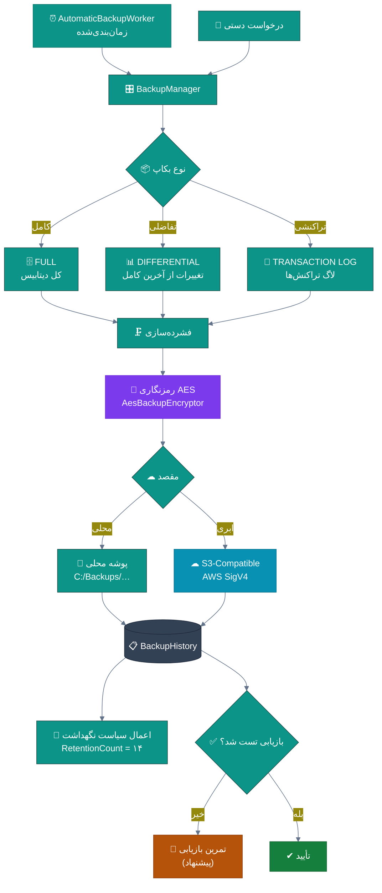
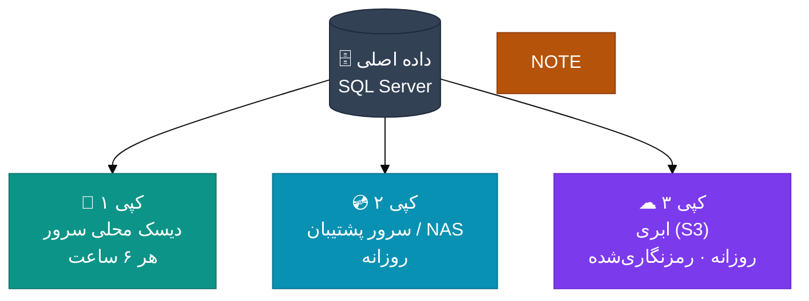
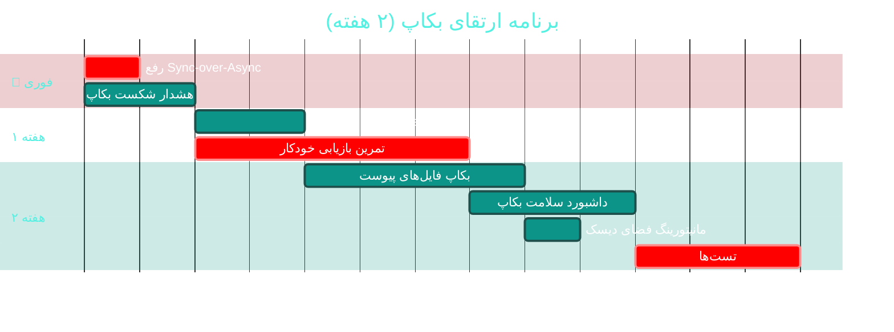

# 💾 ماژول بکاپ و بکاپ ابری (Backup & Cloud Backup)

> **مسیر ماژول:** `backup` · **لایسنس:** `Backup` + `CloudBackup`
> **اولویت:** 🟠 بالا · **دشواری:** 🟠 بالا · **زمان برآوردی:** ۲ هفته

---

## ۱. 📋 خلاصه ماژول

بکاپ خودکار سه‌سطحی از دیتابیس و فایل‌ها، با رمزنگاری AES،
ذخیره‌سازی محلی و ابری (S3-Compatible با امضای AWS v4)،
و **تست بازیابی** — آخرین خط دفاع در برابر فاجعه.

| ویژگی | مقدار |
|:---|:---|
| 🎯 هدف | تضمین بازیابی داده‌ها در بدترین سناریو |
| 👤 کاربران اصلی | مدیر سیستم · مدیر |
| 🔗 وابستگی‌ها | `settings`, `audit`, `archive` |
| 📊 وضعیت فعلی | 🟢 عملیاتی — 🔴 یک ایراد بحرانی در مسیر درخواست |

---

## ۲. 🎯 وضعیت فعلی در کدبیس

| لایه | فایل | خط | وضعیت |
|:---|:---|--:|:---|
| 🧬 Domain | `.../Infrastructure/BackupHistory.cs` | — | 🟢 |
| 🧬 Domain | `.../Enums/BackupStatus.cs` · `BackupType.cs` | — | 🟢 |
| 🧬 Domain | `.../Interfaces/ICloudBackupStorage.cs` | — | 🟢 ⭐ انتزاع |
| 🗄 Infra | `.../Services/Backup/BackupManager.cs` · `BackupJob.cs` | — | 🟢 |
| 🗄 Infra | `.../Services/Backup/AutomaticBackupWorker.cs` | — | 🟢 HostedService |
| 🗄 Infra | `.../Services/Backup/Cloud/CloudBackupService.cs` | — | 🟢 |
| 🗄 Infra | `.../Services/Backup/Cloud/AesBackupEncryptor.cs` | — | 🟢 ⭐ رمزنگاری |
| 🗄 Infra | `.../Services/Backup/Cloud/AwsV4Signer.cs` | — | 🟢 ⭐ امضای استاندارد |
| 🗄 Infra | `.../Services/Backup/Cloud/S3CompatibleCloudStorage.cs` | — | 🟢 |
| 🗄 Infra | `.../Services/Backup/Cloud/LocalFolderCloudStorage.cs` | — | 🟢 |
| 🌐 API | **`.../Controllers/BackupController.cs`** | **۶۴۶** | 🔴 شامل Sync-over-Async |
| 🖥 Desktop | `.../ViewModels/BackupViewModel.cs` | ۸۱۷ | 🟠 ۱۵ فرمان |
| 🖥 Desktop | `.../Views/BackupView.xaml` | — | 🟢 |
| 🧪 تست | `BackupJobTests` · `CloudBackupTests` | — | 🟢 موجود |

### نکات برجسته‌ی فعلی

✅ **امضای AWS Signature V4** پیاده‌سازی‌شده دستی — سازگار با هر S3-Compatible
✅ **رمزنگاری AES** برای بکاپ‌های ابری
✅ **انتزاع `ICloudBackupStorage`** — قابل تعویض بین S3 و پوشه محلی
✅ **سه سطح بکاپ** (کامل / تفاضلی / تراکنشی)
✅ **تست‌های اختصاصی** برای Job و بکاپ ابری
✅ **سقف نگهداری** (`RetentionCount: 14`)

---

## ۳. 📊 نمودار معماری بکاپ



### استراتژی ۳-۲-۱ پیشنهادی



---

## ۴. ⚠️ کاستی‌ها و ایرادها

### 🔴 بحرانی

| # | کاستی | 📍 محل | 💥 پیامد |
|:--:|:---|:---|:---|
| **W-01** | **`GetAwaiter().GetResult()` در Property Getter** | `BackupController.cs:456` | 🔴 **توقف کل API** تحت بارِ همزمان به `backup/cloud/*` |
| **W-02** | **تست بازیابی خودکار ندارد** | — | 🔴 بکاپ‌هایی که معلوم نیست قابل بازیابی هستند! |
| **W-03** | **هشدار شکست بکاپ** ندارد | — | 🔴 توقف خاموش بکاپ‌ها |

### 🟠 بالا

| # | کاستی | 📍 محل |
|:--:|:---|:---|
| **W-04** | `BackupViewModel` با **۸۱۷ خط و ۱۵ فرمان** | `ViewModels/` |
| **W-05** | **اعلان پس از بکاپ موفق/ناموفق** ندارد | — |
| **W-06** | **مانیتورینگ فضای دیسک مقصد** ندارد | — |
| **W-07** | **بکاپ فایل‌های پیوست** (تصاویر، DICOM) جزو بکاپ نیست | — |
| **W-08** | **گزارش روند حجم بکاپ** ندارد | — |

### 🟡 متوسط

| # | کاستی | 📍 محل |
|:--:|:---|:---|
| **W-09** | مسیر پیش‌فرض `C:/Backups/...` ویندوزی است | `appsettings.json` |
| **W-10** | **بکاپ تفاضلی** بازیابی پیچیده‌ای دارد بدون راهنما | — |
| **W-11** | **تست یکپارچگی فایل بکاپ** (Checksum) ندارد | — |

---

## ۵. ✨ امکانات پیشنهادی

| 🎯 # | امکان | 📝 شرح | 💰 ارزش | 🔧 دشواری | ⏱ |
|:--:|:---|:---|:--:|:--:|:--:|
| F-01 | 🚨 **رفع Sync-over-Async** | ناهمزمان‌سازی `CloudSvc` | **حیاتی** | کم | ۳ ساعت |
| F-02 | 🧪 **تست بازیابی خودکار (Restore Drill)** | بازیابی در محیط ایزوله + تأیید | **حیاتی** | متوسط | ۱ هفته |
| F-03 | 🔔 **هشدار شکست بکاپ** | اعلان فوری پس از N شکست پیاپی | بالا | کم | ۲ روز |
| F-04 | ✅ **تست یکپارچگی (Checksum)** | بررسی SHA-256 پس از بکاپ | بالا | کم | ۲ روز |
| F-05 | 📊 **داشبورد سلامت بکاپ** | وضعیت · حجم · آخرین موفقیت | بالا | کم | ۳ روز |
| F-06 | 📁 **بکاپ فایل‌های پیوست** | یکپارچه با `IFileStorage` | بسیار بالا | متوسط | ۴ روز |
| F-07 | 💽 **مانیتورینگ فضای دیسک** | هشدار پیش از پرشدن | بالا | کم | ۱ روز |
| F-08 | 🧩 **شکستن BackupViewModel** | تقسیم به ۳ زیر-ViewModel | متوسط | متوسط | ۴ روز |
| F-09 | 🗓 **برنامه بازیابی مستند (DRP)** | رویه مکتوب + تمرین دوره‌ای | بالا | کم | ۳ روز |
| F-10 | 🔐 **کلیدهای چرخان برای رمزنگاری** | مدیریت کلید رمزنگاری بکاپ | متوسط | متوسط | ۳ روز |

---

## ۶. 🛠 دستورالعمل پیاده‌سازی

### 📌 گام ۱ — رفع Sync-over-Async (F-01) — *فوری*

**مشکل فعلی:**
```csharp
// ❌ BackupController.cs:453-457
private CloudBackupService CloudSvc =>
    _cloudService ??= new CloudBackupService(
        BuildCloudConfigAsync(CancellationToken.None).GetAwaiter().GetResult(),  // ❌
        NullLogger<CloudBackupService>.Instance);
```

**راهکار:**
```csharp
// ✅ BackupController.cs — جایگزینی با متد ناهمزمان + قفل

private readonly SemaphoreSlim _cloudInitLock = new(1, 1);
private CloudBackupService? _cloudService;

/// <summary>
/// دسترسی ناهمزمان به سرویس بکاپ ابری — با قفل برای جلوگیری از
/// مقداردهی همزمان توسط چند درخواست.
/// این نسخه جایگزین Propertyِ همزمانِ قبلی می‌شود که با
/// GetAwaiter().GetResult() رشته درخواست را مسدود می‌کرد.
/// </summary>
private async Task<CloudBackupService> GetCloudServiceAsync(CancellationToken ct)
{
    if (_cloudService is not null) return _cloudService;

    await _cloudInitLock.WaitAsync(ct);
    try
    {
        if (_cloudService is not null) return _cloudService;   // بررسی مجدد پس از قفل

        var config = await BuildCloudConfigAsync(ct);
        _cloudService = new CloudBackupService(config,
            NullLogger<CloudBackupService>.Instance);
        return _cloudService;
    }
    finally
    {
        _cloudInitLock.Release();
    }
}

// در هر اکشنی که از CloudSvc استفاده می‌کرد:
// ❌ قبل:  var svc = CloudSvc;
// ✅ بعد:  var svc = await GetCloudServiceAsync(ct);
```

> ✅ این تغییر در **تحلیل جامع** به‌عنوان **BUG-02** ثبت شده است.

---

### 📌 گام ۲ — تست بازیابی خودکار (F-02) — *مهم‌ترین*

> 🔑 **اصل طلایی:** «بکاپی که بازیابی نشده باشد، بکاپ نیست.»

**۲.۱ سرویس تمرین بازیابی**

```csharp
// 📄 src/Sahand.ClinicPro.Infrastructure/Services/Backup/RestoreDrillService.cs (جدید)
namespace Sahand.ClinicPro.Infrastructure.Services.Backup;

/// <summary>
/// سرویس تمرین بازیابی — جدیدترین فایل بکاپ را در یک پایگاه داده
/// موقت بازیابی می‌کند و سلامت آن را تأیید می‌نماید.
/// این تنها راه اطمینان از «قابل‌بازیابی‌بودن» بکاپ‌هاست.
/// </summary>
public class RestoreDrillService
{
    private readonly IConfiguration _config;
    private readonly ILogger<RestoreDrillService> _logger;
    private readonly INotificationService _notifier;

    public RestoreDrillService(IConfiguration config,
        ILogger<RestoreDrillService> logger, INotificationService notifier)
    { _config = config; _logger = logger; _notifier = notifier; }

    /// <summary>اجرای تمرین بازیابی</summary>
    public async Task<RestoreDrillResult> RunAsync(CancellationToken ct = default)
    {
        var startedAt = DateTime.UtcNow;
        var tempDbName = $"ClinicPro_RestoreDrill_{startedAt:yyyyMMddHHmmss}";

        try
        {
            // ۱) یافتن جدیدترین بکاپ موفق
            var latestBackup = await FindLatestSuccessfulBackupAsync(ct);
            if (latestBackup is null)
                return RestoreDrillResult.Failure("هیچ بکاپ موفقی یافت نشد");

            // ۲) بازیابی در پایگاه موقت
            await RestoreToTempDatabaseAsync(latestBackup.FilePath, tempDbName, ct);

            // ۳) تأیید سلامت
            var checks = await RunHealthChecksAsync(tempDbName, ct);

            var allPassed = checks.All(c => c.Passed);

            if (allPassed)
                _logger.LogInformation(
                    "✅ تمرین بازیابی موفق — بکاپ {Backup} در {Seconds:F1} ثانیه تأیید شد",
                    latestBackup.FilePath, (DateTime.UtcNow - startedAt).TotalSeconds);
            else
            {
                _logger.LogError(
                    "❌ تمرین بازیابی ناموفق — {FailedChecks} بررسی شکست خورد",
                    checks.Count(c => !c.Passed));

                await _notifier.CreateAsync(new CreateNotificationRequest(
                    UserId: 0,
                    Title: "🚨 تمرین بازیابی ناموفق بود",
                    Message: string.Join("\n",
                        checks.Where(c => !c.Passed).Select(c => $"❌ {c.Name}: {c.Detail}")),
                    Type: NotificationType.SystemAlert,
                    Priority: NotificationPriority.Critical,
                    ReferenceType: "restore-drill", ReferenceId: null), ct);
            }

            return new RestoreDrillResult(
                Success: allPassed,
                BackupFilePath: latestBackup.FilePath,
                TempDatabase: tempDbName,
                Checks: checks,
                Elapsed: DateTime.UtcNow - startedAt);
        }
        catch (Exception ex)
        {
            _logger.LogError(ex, "خطای بحرانی در تمرین بازیابی");
            return RestoreDrillResult.Failure(ex.Message);
        }
        finally
        {
            // ۴) همیشه پایگاه موقت پاک شود
            await DropTempDatabaseAsync(tempDbName, ct);
        }
    }

    /// <summary>بررسی‌های سلامت پس از بازیابی</summary>
    private async Task<IReadOnlyList<HealthCheckResult>> RunHealthChecksAsync(
        string dbName, CancellationToken ct)
    {
        var results = new List<HealthCheckResult>();

        // بررسی ۱: تعداد رکوردهای جدول‌های کلیدی
        results.Add(await CountCheckAsync(dbName, "Patients", 1, ct));
        results.Add(await CountCheckAsync(dbName, "Users", 1, ct));
        results.Add(await CountCheckAsync(dbName, "Invoices", 0, ct));

        // بررسی ۲: یکپارچگی ارجاعی — هر فاکتور باید بیمار داشته باشد
        results.Add(await OrphanCheckAsync(dbName,
            "Invoices", "PatientId", "Patients", ct));

        // بررسی ۳: اجرای یک کوئری واقعی
        results.Add(await QueryCheckAsync(dbName, ct));

        return results;
    }
}
```

**۲.۲ زمان‌بندی هفتگی**

```csharp
// 📄 Program.cs
RecurringJob.AddOrUpdate<RestoreDrillService>(
    "restore-drill",
    svc => svc.RunAsync(CancellationToken.None),
    Cron.Weekly(DayOfWeek.Friday, 2));      // جمعه‌ها ساعت ۲ بامداد
```

---

### 📌 گام ۳ — هشدار شکست بکاپ (F-03)

```csharp
// در AutomaticBackupWorker — پس از هر تلاش:

if (!result.Success)
{
    _consecutiveFailures++;

    if (_consecutiveFailures >= 2)      // پس از ۲ شکست پیاپی
    {
        await NotifyFailureAsync(result, _consecutiveFailures, ct);
    }
}
else
{
    if (_consecutiveFailures > 0)
    {
        // پیام بهبود
        await NotifyRecoveryAsync(ct);
    }
    _consecutiveFailures = 0;
}
```

```csharp
/// <summary>اعلان شکست بکاپ با بالاترین اولویت</summary>
private async Task NotifyFailureAsync(BackupResult result, int failures, CancellationToken ct)
{
    await _notifier.CreateAsync(new CreateNotificationRequest(
        UserId: 0,
        Title: $"🚨 شکست بکاپ — {failures} بار پیاپی",
        Message: $"بکاپ خودکار در {DateTime.UtcNow:yyyy/MM/dd HH:mm} ناموفق بود.\n" +
                 $"علت: {result.ErrorMessage}\n" +
                 $"مقصد: {result.Destination}\n\n" +
                 "⚠ تا رفع مشکل، داده‌ها محافظت نمی‌شوند!",
        Type: NotificationType.SystemAlert,
        Priority: NotificationPriority.Critical,
        ReferenceType: "backup",
        ReferenceId: result.BackupHistoryId), ct);

    // ارسال پیامک به مدیر (در صورت تنظیم)
    var adminMobile = _config["Backup:AlertMobileNumber"];
    if (!string.IsNullOrEmpty(adminMobile))
        await _sms.SendAsync(adminMobile,
            "🚨 خطا: بکاپ خودکار درمانگاه ناموفق بود — بررسی فوری لازم است", ct);
}
```

---

### 📌 گام ۴ — بکاپ فایل‌های پیوست (F-06)

```csharp
// 📄 گسترش BackupJob برای شامل‌کردن فایل‌ها:

/// <summary>بکاپ فایل‌های پیوست (تصاویر، DICOM، اسناد)</summary>
private async Task<string> BackupAttachmentsAsync(string targetFolder, CancellationToken ct)
{
    var storageRoot = _config["Storage:RootPath"];
    if (string.IsNullOrEmpty(storageRoot))
        return "مسیر ذخیره‌سازی تنظیم نشده — فایل‌ها بکاپ نشدند";

    var dest = Path.Combine(targetFolder, "attachments");
    Directory.CreateDirectory(dest);

    // کپی افزایشی فقط فایل‌های جدید یا تغییریافته
    var copied = 0;
    var skipped = 0;

    foreach (var file in Directory.EnumerateFiles(storageRoot, "*", SearchOption.AllDirectories))
    {
        var relative = Path.GetRelativePath(storageRoot, file);
        var target = Path.Combine(dest, relative);
        Directory.CreateDirectory(Path.GetDirectoryName(target)!);

        var sourceInfo = new FileInfo(file);
        var targetInfo = new FileInfo(target);

        if (targetInfo.Exists
            && targetInfo.Length == sourceInfo.Length
            && targetInfo.LastWriteTimeUtc >= sourceInfo.LastWriteTimeUtc)
        {
            skipped++;                    // تغییر نکرده — کپی مجدد لازم نیست
            continue;
        }

        await using var src = File.OpenRead(file);
        await using var dst = File.Create(target);
        await src.CopyToAsync(dst, ct);
        copied++;
    }

    var message = $"فایل‌ها: {copied} کپی شد، {skipped} بدون تغییر";
    _logger.LogInformation("بکاپ پیوست‌ها: {Message}", message);
    return message;
}
```

---

## ۷. 🧪 تست‌های الزامی

| 🧪 تست | 🎯 هدف | اولویت |
|:---|:---|:--:|
| `BackupJob_CreatesBackupFile` *(موجود)* | ایجاد بکاپ | 🔴 |
| `CloudBackup_EncryptThenDecrypt_RoundTrip` *(موجود)* | رمزنگاری | 🔴 |
| `AwsV4Signer_KnownTestCase_MatchesExpected` | امضای استاندارد | 🔴 |
| `RestoreDrill_HealthyBackup_AllChecksPass` | تست بازیابی | 🔴 |
| `RestoreDrill_CorruptBackup_Detected` | تشخیص خرابی | 🔴 |
| `RestoreDrill_AlwaysDropsTempDb` | پاک‌سازی | 🟠 |
| `BackupFailure_After2Attempts_Notifies` | هشدار | 🔴 |
| `BackupSuccess_AfterFailure_NotifiesRecovery` | اعلان بهبود | 🟠 |
| `AttachmentBackup_UnchangedFile_Skipped` | کپی افزایشی | 🟠 |
| `RetentionPolicy_ExceedsCount_DeletesOldest` | نگهداشت | 🟠 |

---

## ۸. 📈 شاخص‌های موفقیت (KPI)

| 📊 شاخص | قبل | هدف |
|:---|:--:|:--:|
| 🧪 نرخ تمرین بازیابی موفق | ۰٪ (انجام نمی‌شود) | **۱۰۰٪ هفتگی** |
| ⏱ زمان تشخیص شکست بکاپ | نامشخص (دستی) | **< ۳۰ دقیقه** |
| 📁 پوشش بکاپ فایل‌ها | ❌ فقط DB | **✅ DB + فایل‌ها** |
| 🚨 Sync-over-Async در مسیر درخواست | ۱ مورد | **۰** |
| 📏 اندازه `BackupViewModel` | ۸۱۷ خط | **< ۳۰۰ خط** |

---

## ۹. 🗓 برنامه زمانی



---

## 🔗 پیوندهای مرتبط

| 📄 سند | توضیح |
|:---|:---|
| [تحلیل جامع](../ANALYSIS-REPORT.md) | سند اصلی — [BUG-02](#) |
| [C04 — آرشیو](C04-archive.md) | مکمل بکاپ |
| [C02 — ممیزی](C02-audit-compliance.md) | حفاظت از لاگ‌ها |
| [A08 — پاراکلینیک](A08-paraclinical.md) | منبع فایل‌های حجیم |

---
<div align="center">📅 ۱۴۰۴/۰۷/۱۹ · 🔖 v1.0</div>
