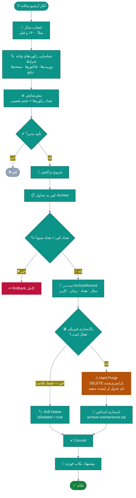
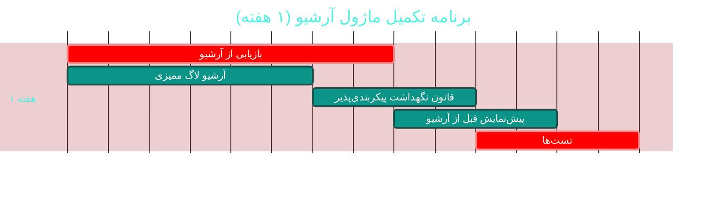

# 🗄 ماژول آرشیو سالانه (Archive)

> **مسیر ماژول:** `archive` · **لایسنس:** `Archive`
> **اولویت:** 🟢 کم · **دشواری:** 🟡 متوسط · **زمان برآوردی:** ۱ هفته

---

## ۱. 📋 خلاصه ماژول

انتقال داده‌های قدیمی (بیش از N سال) از جداول عملیاتی به جداول آرشیو،
برای حفظ عملکرد دیتابیس در حالی که داده‌ها برای بازیابی در دسترس می‌مانند.
با امکان **پاک‌سازی فیزیکی** (Hard Purge) پس از اطمینان از آرشیو.

| ویژگی | مقدار |
|:---|:---|
| 🎯 هدف | حفظ سرعت سیستم در بلندمدت بدون از دست دادن تاریخچه |
| 👤 کاربران اصلی | مدیر سیستم · مدیر |
| 🔗 وابستگی‌ها | `patients`, `visits`, `billing`, `backup` |
| 📊 وضعیت فعلی | 🟢 عملیاتی و ایمن |

---

## ۲. 🎯 وضعیت فعلی در کدبیس

| لایه | فایل | وضعیت |
|:---|:---|:---|
| 🧬 Domain | `.../Infrastructure/ArchiveRecord.cs` | 🟢 |
| 🗄 Infra | `.../Services/Archive/ArchiveService.cs` | 🟢 ⭐ ایمن |
| 📐 مستند | `docs/guides/archive-maintenance.sql` | 🟢 اسکریپت نگهداشت |
| 🧪 تست | `tests/.../ArchiveServiceTests.cs` | 🟢 موجود |

### نکات برجسته‌ی فعلی

✅ **SQL Injection صفر** — کوئری DELETE پارامتری‌شده با نام جدول از **لیست سفید داخلی**
✅ **براکت‌گذاری و دوبرابرکردن براکت‌ها** (`tableName.Replace("]", "]]")`) — محافظت کامل
✅ **رفع هشدار EF1002** با الحاق رشته به‌جای interpolation (مستندشده در کد)
✅ **اسکریپت بازسازی ایندکس** پس از حذف فیزیکی
✅ **گارد Idempotent** در مایگریشن‌ها

> 💡 **نکته‌ی مثبت قابل‌توجه:** کامنتِ `HardPurgeAsync` در `ArchiveService.cs`
> دقیقاً توضیح می‌دهد که چرا از الحاق رشته استفاده شده (رفع EF1002) و
> چرا تزریق نام جدول غیرممکن است. این سطح از **مستندسازیِ «چرا»** کمیاب است.

---

## ۳. 📊 نمودار جریان آرشیو



### چرخه حیات داده


---

## ۴. ⚠️ کاستی‌ها و ایرادها

| # | کاستی | 🎯 شدت | 📍 محل | 💥 پیامد |
|:--:|:---|:--:|:---|:---|
| W-01 | **بازیابی داده آرشیو‌شده** جریان معکوس ندارد | 🟠 بالا | `ArchiveService` | بیمار قدیمی برمی‌گردد اما داده‌اش در دسترس نیست |
| W-02 | **قانون نگهداشت پیکربندی‌پذیر نیست** (چند سال نگه داریم؟) | 🟠 بالا | — | — |
| W-03 | **آرشیو لاگ ممیزی** انجام نمی‌شود (بزرگ‌ترین جدول!) | 🟠 بالا | — | رشد بی‌رویه AuditLog |
| W-04 | **پیش‌نمایش قبل از آرشیو** در UI ندارد | 🟡 متوسط | — | ریسک عملیات ناخواسته |
| W-05 | **زمان‌بندی خودکار** ندارد | 🟡 متوسط | — | باید دستی اجرا شود |
| W-06 | **گزارش فضای آزادشده** ندارد | 🟡 متوسط | — | عدم دیدن سود عملیات |
| W-07 | **آرشیو فایل‌های پیوست** ندارد | 🟡 متوسط | — | — |
| W-08 | **تأیید دوم (Two-person rule)** ندارد | 🟡 متوسط | Domain | خطای انسانی برگشت‌ناپذیر |

---

## ۵. ✨ امکانات پیشنهادی

| 🎯 # | امکان | 📝 شرح | 💰 ارزش | 🔧 دشواری | ⏱ |
|:--:|:---|:---|:--:|:--:|:--:|
| F-01 | ↩ **بازیابی از آرشیو** | برگرداندن داده آرشیو‌شده به جداول عملیاتی | بسیار بالا | متوسط | ۴ روز |
| F-02 | ⚙ **قانون نگهداشت پیکربندی‌پذیر** | تعداد سال برای هر نوع داده | بالا | کم | ۲ روز |
| F-03 | 📋 **آرشیو لاگ ممیزی** | بزرگ‌ترین جدول — بیشترین سود | بسیار بالا | کم | ۳ روز |
| F-04 | 👁 **پیش‌نمایش قبل از آرشیو** | تعداد + حجم + تأثیر | بالا | کم | ۲ روز |
| F-05 | ⏰ **زمان‌بندی خودکار سالانه** | اجرا در ابتدای سال شمسی | بالا | کم | ۲ روز |
| F-06 | 📊 **گزارش فضای آزادشده** | قبل/بعد + نمودار رشد | متوسط | کم | ۲ روز |
| F-07 | 📁 **آرشیو فایل‌های پیوست** | انتقال فایل‌های قدیمی به storage سرد | بالا | متوسط | ۴ روز |
| F-08 | 👥 **تأیید دو نفره** | برای Hard Purge | بالا | کم | ۲ روز |
| F-09 | 🔍 **جستجو در داده آرشیو‌شده** | بدون نیاز به بازیابی | بسیار بالا | متوسط | ۱ هفته |
| F-10 | 🧊 **ذخیره‌سازی سرد (Cold Storage)** | انتقال به S3 Glacier و مشابه | متوسط | زیاد | ۲ هفته |

---

## ٦. 🛠 دستورالعمل پیاده‌سازی

### 📌 گام ۱ — بازیابی از آرشیو (F-01)

```csharp
// 📄 src/Sahand.ClinicPro.Application/Features/Archive/RestoreArchive/RestoreArchiveCommand.cs
namespace Sahand.ClinicPro.Application.Features.Archive.RestoreArchive;

/// <summary>
/// فرمان بازیابی داده آرشیو‌شده — عملیات معکوس آرشیو.
/// کاربرد اصلی: بیمار قدیمی مراجعه می‌کند و پزشک به سوابق ۵ سال پیش نیاز دارد.
/// </summary>
/// <param name="ArchiveRecordId">شناسه رکورد آرشیو</param>
/// <param name="Scope">محدوده بازیابی (همه یا یک بیمار خاص)</param>
public record RestoreArchiveCommand(long ArchiveRecordId, ArchiveRestoreScope Scope,
    long? PatientId = null, string Reason = "") : IRequest<Result<int>>;

/// <summary>محدوده بازیابی</summary>
public enum ArchiveRestoreScope
{
    /// <summary>همه رکوردهای آن سال</summary>
    All,
    /// <summary>فقط رکوردهای یک بیمار</summary>
    SinglePatient,
    /// <summary>فقط یک نوع موجودیت</summary>
    SingleEntityType,
}

public class RestoreArchiveCommandHandler : IRequestHandler<RestoreArchiveCommand, Result<int>>
{
    private readonly IUnitOfWork _uow;
    private readonly ICurrentUserService _currentUser;
    private readonly ILogger<RestoreArchiveCommandHandler> _logger;

    public RestoreArchiveCommandHandler(IUnitOfWork uow, ICurrentUserService currentUser,
        ILogger<RestoreArchiveCommandHandler> logger)
    { _uow = uow; _currentUser = currentUser; _logger = logger; }

    public async Task<Result<int>> Handle(RestoreArchiveCommand req, CancellationToken ct)
    {
        var record = await _uow.Repository<ArchiveRecord>().GetByIdAsync(req.ArchiveRecordId, ct);
        if (record is null)
            return Result<int>.Failure(Error.NotFound("رکورد آرشیو یافت نشد"));

        if (record.IsRestored)
            return Result<int>.Failure(Error.Conflict("این آرشیو قبلاً بازیابی شده است"));

        // گارد: بازیابی عملیات حساس است
        if (req.Scope == ArchiveRestoreScope.All
            && !await _currentUser.HasPermissionAsync("archive.restore.all", ct))
            return Result<int>.Failure(Error.Forbidden(
                "بازیابی کامل نیاز به دسترسی ویژه دارد"));

        await _uow.BeginTransactionAsync(ct);
        try
        {
            var restored = 0;

            // بازگرداندن هر دسته — الگوی یکسان
            restored += await RestoreEntityAsync<Visit>(record.Year, req, ct);
            restored += await RestoreEntityAsync<Prescription>(record.Year, req, ct);
            restored += await RestoreEntityAsync<Invoice>(record.Year, req, ct);
            restored += await RestoreEntityAsync<LabOrder>(record.Year, req, ct);

            // به‌روزرسانی رکورد آرشیو
            record.IsRestored = true;
            record.RestoredAt = DateTime.UtcNow;
            record.RestoredByUserId = _currentUser.UserId;
            record.RestoreReason = req.Reason;
            record.RestoredRecordsCount = restored;

            _uow.Repository<ArchiveRecord>().Update(record);
            await _uow.SaveEntitiesAsync(ct);
            await _uow.CommitTransactionAsync(ct);

            _logger.LogInformation(
                "بازیابی آرشیو سال {Year}: {Count} رکورد توسط کاربر {UserId}",
                record.Year, restored, _currentUser.UserId);

            return Result<int>.Success(restored);
        }
        catch
        {
            await _uow.RollbackTransactionAsync(ct);
            throw;
        }
    }
}
```

> 📌 **نکته:** برای پیاده‌سازی واقعی `RestoreEntityAsync<T>` باید
> جداول آرشیو متناظر (مانند `VisitsArchive`) تعریف شوند.

---

### 📌 گام ۲ — آرشیو لاگ ممیزی (F-03) — *بیشترین صرفه‌جویی*

> 🔑 **چرا مهم؟** جدول `AuditLog` احتمالاً **بزرگ‌ترین جدول سیستم** است،
> زیرا هر تغییر در هر موجودیت را ثبت می‌کند. آرشیو سالانه آن بیشترین
> تأثیر را بر اندازه دیتابیس و سرعت بکاپ دارد.

```csharp
// 📄 src/Sahand.ClinicPro.Infrastructure/Services/Archive/AuditLogArchiveJob.cs (جدید)
/// <summary>
/// کار پس‌زمینه آرشیو لاگ ممیزی — لاگ‌های قدیمی‌تر از دوره نگهداشت را
/// به جدول بایگانی منتقل می‌کند. این بزرگ‌ترین صرفه‌جویی فضای سیستم است.
/// </summary>
public class AuditLogArchiveJob
{
    private readonly IServiceScopeFactory _scopeFactory;
    private readonly ILogger<AuditLogArchiveJob> _logger;

    public AuditLogArchiveJob(IServiceScopeFactory scopeFactory,
        ILogger<AuditLogArchiveJob> logger)
    { _scopeFactory = scopeFactory; _logger = logger; }

    /// <summary>اجرای ماهانه</summary>
    public async Task RunAsync(CancellationToken ct = default)
    {
        using var scope = _scopeFactory.CreateScope();
        var uow = scope.ServiceProvider.GetRequiredService<IUnitOfWork>();
        var config = scope.ServiceProvider.GetRequiredService<IConfiguration>();

        // دوره نگهداشت از تنظیمات (پیش‌فرض ۳ سال)
        var retentionYears = config.GetValue<int>("Audit:RetentionYears", 3);
        var cutoff = DateTime.UtcNow.AddYears(-retentionYears);

        _logger.LogInformation(
            "آرشیو لاگ ممیزی — قدیمی‌تر از {Cutoff} (نگهداشت {Years} سال)",
            cutoff.ToString("yyyy-MM-dd"), retentionYears);

        // انتقال دسته‌ای برای جلوگیری از قفل طولانی
        const int batchSize = 5000;
        var totalArchived = 0;

        while (!ct.IsCancellationRequested)
        {
            var batch = await uow.Repository<AuditLog>().QueryableNoTracking
                .Where(a => a.CreatedAt < cutoff && !a.IsArchived)
                .OrderBy(a => a.Id)
                .Take(batchSize)
                .ToListAsync(ct);

            if (batch.Count == 0) break;

            await using var tx = await uow.BeginTransactionAsync(ct);
            try
            {
                // انتقال به جدول بایگانی
                foreach (var log in batch)
                {
                    _uow.Repository<AuditLogArchive>().Add(new AuditLogArchive
                    {
                        OriginalId = log.Id,
                        UserId = log.UserId,
                        Action = log.Action,
                        EntityName = log.EntityName,
                        EntityId = log.EntityId,
                        OldValues = log.OldValues,
                        NewValues = log.NewValues,
                        IpAddress = log.IpAddress,
                        Severity = log.Severity,
                        CreatedAt = log.CreatedAt,
                        EntryHash = log.EntryHash,          // ⭐ حفظ زنجیره هش
                        PreviousHash = log.PreviousHash,
                    });
                }

                // علامت‌گذاری به‌جای حذف فوری (امن‌تر)
                var ids = batch.Select(b => b.Id).ToList();
                var entities = await uow.Repository<AuditLog>().Queryable
                    .Where(a => ids.Contains(a.Id))
                    .ToListAsync(ct);
                foreach (var e in entities) e.IsArchived = true;

                await uow.SaveEntitiesAsync(ct);
                await tx.CommitAsync(ct);

                totalArchived += batch.Count;
                _logger.LogDebug("دسته‌ای از {Count} لاگ بایگانی شد", batch.Count);
            }
            catch
            {
                await tx.RollbackAsync(ct);
                throw;
            }
        }

        _logger.LogInformation("مجموعاً {Count} لاگ ممیزی بایگانی شد", totalArchived);
    }
}
```

---

### 📌 گام ۳ — قانون نگهداشت پیکربندی‌پذیر (F-02)

```json
// appsettings.json
{
  "Archive": {
    "RetentionYears": {
      "AuditLog": 3,
      "Visit": 7,
      "Prescription": 7,
      "Invoice": 10,
      "LabOrder": 5,
      "Notification": 1,
      "PerformanceMetric": 1
    },
    "AutoRunOnShamsiNewYear": true,
    "RequireDoubleApprovalForPurge": true,
    "PreviewBeforeExecute": true
  }
}
```

```csharp
// در ArchiveService — خواندن قانون به‌جای مقدار ثابت:
var retentionYears = _config.GetValue<int>($"Archive:RetentionYears:{entityName}", 7);
var cutoff = DateTime.UtcNow.AddYears(-retentionYears);
```

---

## ۷. 🧪 تست‌های الزامی

| 🧪 تست | 🎯 هدف | اولویت |
|:---|:---|:--:|
| `ArchiveService_CopiesRecords_Correct` *(موجود — گسترش)* | صحت کپی | 🔴 |
| `ArchiveService_HardPurge_WhiteListTableOnly` | **امنیت** | 🔴 |
| `ArchiveService_MaliciousTableName_Rejected` | **ضد تزریق** | 🔴 |
| `ArchiveService_Rollback_OnCountMismatch` | یکپارچگی | 🔴 |
| `AuditArchive_OlderThanRetention_Moved` | انتقال | 🟠 |
| `AuditArchive_PreservesHashChain` | حفظ یکپارچگی | 🟠 |
| `AuditArchive_BatchProcessing_NoLongLock` | عملکرد | 🟠 |
| `RestoreArchive_AlreadyRestored_Fails` | جلوگیری تکرار | 🟠 |
| `RestoreArchive_SinglePatient_ScopeRespected` | محدوده | 🟠 |

---

## ۸. 📈 شاخص‌های موفقیت (KPI)

| 📊 شاخص | قبل | هدف |
|:---|:--:|:--:|
| ↩ امکان بازیابی از آرشیو | ❌ | **✅** |
| 📋 آرشیو لاگ ممیزی | ❌ | **✅ ماهانه** |
| ⚙ قوانین نگهداشت | ثابت در کد | **پیکربندی‌پذیر** |
| 💾 کاهش حجم دیتابیس عملیاتی | ۰٪ | **۲۰-۳۵٪** |
| 🔒 حوادث امنیتی آرشیو | ۰ | **۰** (تست‌شده) |

---

## ۹. 🗓 برنامه زمانی



---

## 🔗 پیوندهای مرتبط

| 📄 سند | توضیح |
|:---|:---|
| [تحلیل جامع](../ANALYSIS-REPORT.md) | سند اصلی |
| [C02 — ممیزی](C02-audit-compliance.md) | مبدأ بیشترین حجم داده |
| [C03 — بکاپ](C03-backup.md) | مکمل آرشیو |
| [📐 اسکریپت نگهداشت](../../guides/archive-maintenance.sql) | مستند موجود |

---
<div align="center">📅 ۱۴۰۴/۰۷/۱۹ · 🔖 v1.0</div>
