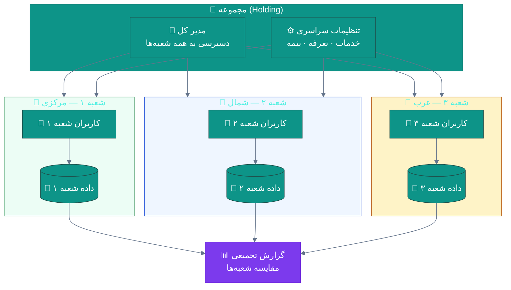
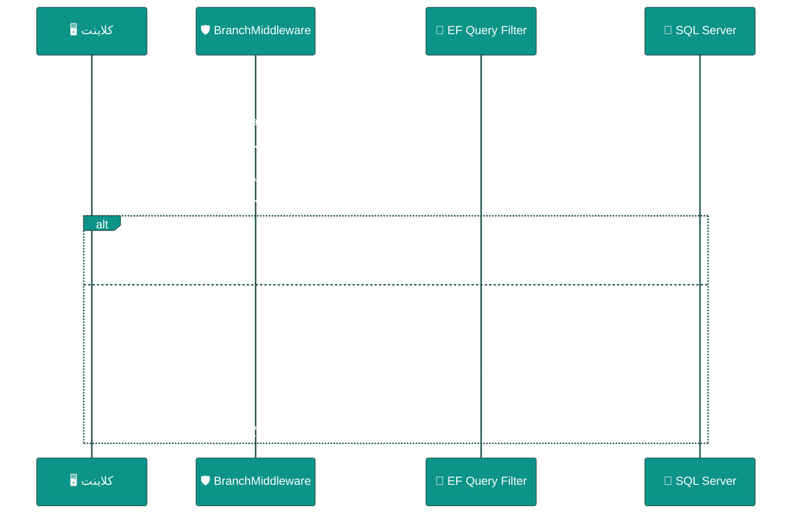
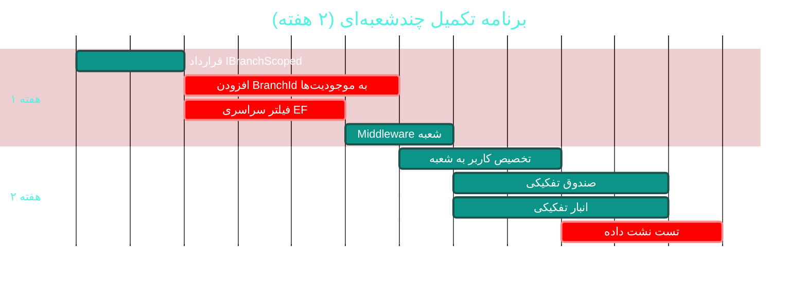

# 🏘 ماژول چندشعبه‌ای (Multi-Branch)

> **مسیر ماژول:** `branches` · **لایسنس:** `Branches`
> **اولویت:** 🟡 متوسط · **دشواری:** 🟠 بالا · **زمان برآوردی:** ۲ هفته

---

## ۱. 📋 خلاصه ماژول

پشتیبانی از چند شعبه/مطب با فیلتر سراسری داده‌ها بر اساس شعبه،
تخصیص کاربران به شعبه، گزارش‌های تفکیکی، و مدیریت متمرکز.

| ویژگی | مقدار |
|:---|:---|
| 🎯 هدف | مدیریت چند مطب در یک نصب، با تفکیک کامل داده |
| 👤 کاربران اصلی | مدیر مجموعه · مدیر هر شعبه |
| 🔗 وابستگی‌ها | **تقریباً همه ماژول‌های داده‌ای** |
| 📊 وضعیت فعلی | 🟡 پایه پیاده شده — 🟠 تفکیک ناقص |

---

## ۲. 🎯 وضعیت فعلی در کدبیس

| لایه | فایل | وضعیت |
|:---|:---|:---|
| 🧬 Domain | `.../People/Branch.cs` | 🟢 |
| 🗄 Infra | `.../SeedData/LocationSeedData.cs` | 🟢 |
| 🗄 Infra | `.../Configurations/People/BranchConfiguration.cs` | 🟢 |
| 🌐 API | `.../Controllers/BranchesController.cs` | 🟢 |
| 🌐 API | فیلتر سراسری با هدر `X-Branch-Id` | 🟡 نامشخص |
| 🖥 Desktop | `.../Views/BranchesView.xaml` | 🟢 |
| ⚙ App | ستون `BranchId` روی `Invoice` و برخی موجودیت‌ها | 🟡 ناقص |

---

## ۳. 📊 نمودار معماری چندشعبه‌ای



### نمودار فیلتر سراسری



---

## ۴. ⚠️ کاستی‌ها و ایرادها

| # | کاستی | 🎯 شدت | 📍 محل | 💥 پیامد |
|:--:|:---|:--:|:---|:---|
| W-01 | **`BranchId` روی همه موجودیت‌ها نیست** | 🔴 بالا | Domain | تفکیک داده ناقص — نشت بین شعب |
| W-02 | **فیلتر سراسری EF (Global Query Filter)** احتمالاً اعمال نشده | 🔴 بالا | `ClinicProDbContext` | هر Query باید دستی فیلتر شود → فراموشی = نشت |
| W-03 | **تخصیص کاربر به شعبه** مشخص نیست | 🟠 بالا | `User` | کاربر می‌تواند به همه داده‌ها برسد |
| W-04 | **گزارش تجمیعی بین‌شعبه‌ای** محدود است | 🟠 بالا | `Reports` | مدیر نمی‌تواند مقایسه کند |
| W-05 | **انتقال بیمار بین شعب** ندارد | 🟡 متوسط | — | پرونده تکراری |
| W-06 | **موجودی انبار تفکیکی** ندارد | 🟠 بالا | `Pharmacy` | داروخانه مشترک مدیریت نمی‌شود |
| W-07 | **صندوق تفکیکی هر شعبه** ندارد | 🟠 بالا | `CashRegister` | اختلاط مالی |
| W-08 | **تنظیمات اختصاصی هر شعبه** ندارد | 🟡 متوسط | `SystemSetting` | — |
| W-09 | **نوبت‌دهی بین‌شعبه‌ای** ندارد | 🟡 متوسط | `Appointment` | — |

---

## ۵. ✨ امکانات پیشنهادی

| 🎯 # | امکان | 📝 شرح | 💰 ارزش | 🔧 دشواری | ⏱ |
|:--:|:---|:---|:--:|:--:|:--:|
| F-01 | 🔒 **فیلتر سراسری EF (Global Query Filter)** | خودکار روی همه Queryها | **حیاتی** | متوسط | ۳ روز |
| F-02 | 🏷 **افزودن BranchId به همه موجودیت‌ها** | یکپارچگی مدل | **حیاتی** | متوسط | ۵ روز |
| F-03 | 👤 **تخصیص کاربر به شعبه** | یک یا چند شعبه با شعبه پیش‌فرض | بسیار بالا | کم | ۳ روز |
| F-04 | 💰 **صندوق تفکیکی هر شعبه** | هر شعبه صندوق مستقل | بسیار بالا | متوسط | ۵ روز |
| F-05 | 🏥 **انبار تفکیکی هر شعبه** | موجودی مستقل + انتقال بین شعب | بسیار بالا | متوسط | ۱ هفته |
| F-06 | 📊 **داشبورد مقایسه‌ای شعب** | KPI در کنار هم | بالا | کم | ۳ روز |
| F-07 | 🔄 **انتقال بیمار/پرونده بین شعب** | بدون ایجاد پرونده تکراری | بالا | متوسط | ۴ روز |
| F-08 | ⚙ **تنظیمات اختصاصی شعبه** | بازنویسی تنظیمات سراسری | متوسط | کم | ۳ روز |
| F-09 | 📅 **نوبت‌دهی بین‌شعبه‌ای** | ارجاع بیمار به شعبه دیگر | متوسط | متوسط | ۵ روز |
| F-10 | 🧾 **فاکتور و حسابداری تفکیکی** | سود و زیان به تفکیک شعبه | بسیار بالا | متوسط | ۱ هفته |

---

## ۶. 🛠 دستورالعمل پیاده‌سازی

### 📌 گام ۱ — فیلتر سراسری EF (F-01) — *حیاتی‌ترین*

> 🔑 **مشکل:** بدون فیلتر سراسری، هر Query جدید باید دستی `Where(x => x.BranchId == …)`
> داشته باشد. فراموشی در یک Query = **نشت داده‌های پزشکی بین شعب**.

**۱.۱ قرارداد موجودیتِ آگاه از شعبه**

```csharp
// 📄 src/Sahand.ClinicPro.Domain/Common/IBranchScoped.cs (جدید)
namespace Sahand.ClinicPro.Domain.Common;

/// <summary>
/// قرارداد موجودیت‌های وابسته به شعبه.
/// هر موجودیتی که این را پیاده کند، به‌طور خودکار توسط
/// فیلتر سراسری EF بر اساس شعبه کاربر فیلتر می‌شود.
/// </summary>
public interface IBranchScoped
{
    /// <summary>شناسه شعبه</summary>
    long? BranchId { get; set; }
}
```

**۱.۲ سرویس زمینه شعبه**

```csharp
// 📄 src/Sahand.ClinicPro.Application/Interfaces/IBranchContext.cs (جدید)
namespace Sahand.ClinicPro.Application.Interfaces;

/// <summary>
/// زمینه شعبه جاری — شعبه‌ای که درخواست در چارچوب آن اجرا می‌شود.
/// مقدار null یعنی «همه شعبه‌ها» (فقط مدیر کل).
/// </summary>
public interface IBranchContext
{
    /// <summary>شناسه شعبه جاری (null = همه)</summary>
    long? CurrentBranchId { get; }

    /// <summary>آیا کاربر به همه شعبه‌ها دسترسی دارد</summary>
    bool CanSeeAllBranches { get; }

    /// <summary>فهرست شعب مجاز کاربر</summary>
    IReadOnlyList<long> AllowedBranchIds { get; }
}
```

**۱.۳ اعمال فیلتر سراسری در DbContext**

```csharp
// 📄 ClinicProDbContext.cs — در OnModelCreating، پس از ApplyConfigurations:

private void ConfigureBranchFilters(ModelBuilder modelBuilder)
{
    // یافتن همه موجودیت‌های آگاه از شعبه با Reflection
    var branchScopedTypes = modelBuilder.Model.GetEntityTypes()
        .Where(t => typeof(IBranchScoped).IsAssignableFrom(t.ClrType))
        .ToList();

    foreach (var entityType in branchScopedTypes)
    {
        // ساخت عبارت: e => e.BranchId == null || AllowedBranchIds.Contains(e.BranchId)
        var parameter = Expression.Parameter(entityType.ClrType, "e");
        var branchIdProperty = Expression.Property(parameter, nameof(IBranchScoped.BranchId));

        // e.BranchId == null  (داده‌های سراسری — بدون شعبه)
        var isNull = Expression.Equal(
            branchIdProperty,
            Expression.Constant(null, typeof(long?)));

        // _branchContext.AllowedBranchIds.Contains(e.BranchId.Value)
        var contextField = Expression.Field(
            Expression.Constant(this), nameof(_branchContext));
        var allowedProperty = Expression.Property(
            contextField, nameof(IBranchContext.AllowedBranchIds));

        var containsMethod = typeof(Enumerable).GetMethods()
            .First(m => m.Name == nameof(Enumerable.Contains)
                        && m.GetParameters().Length == 2)
            .MakeGenericMethod(typeof(long));

        var branchIdValue = Expression.Property(branchIdProperty, "Value");
        var contains = Expression.Call(null, containsMethod, allowedProperty, branchIdValue);

        // ترکیب: (BranchId == null) OR Contains(BranchId)
        var body = Expression.OrElse(isNull, contains);
        var lambda = Expression.Lambda(body, parameter);

        modelBuilder.Entity(entityType.ClrType).HasQueryFilter(lambda);

        // ایندکس برای کارایی فیلتر
        modelBuilder.Entity(entityType.ClrType)
            .HasIndex(nameof(IBranchScoped.BranchId))
            .HasDatabaseName($"IX_{entityType.GetTableName()}_BranchId");
    }
}
```

> ⚠️ **هشدار درباره کارایی:** EF فیلتر سراسری را **کش نمی‌کند** اگر
> `_branchContext` فیلدِ نمونه باشد. برای کارایی بهتر، از
> `DbCommandInterceptor` یا پارامترهای صریح استفاده کنید.

**۱.۴ گزینه ساده‌تر و ایمن‌تر: `DbCommandInterceptor`**

```csharp
// 📄 جایگزین ساده — اگر Reflection پیچیده است،
// می‌توانید فقط روی چند موجودیت کلیدی فیلتر صریح بگذارید:

modelBuilder.Entity<Patient>().HasQueryFilter(p =>
    _branchContext.CanSeeAllBranches
    || p.BranchId == null
    || p.BranchId == _branchContext.CurrentBranchId);

modelBuilder.Entity<Invoice>().HasQueryFilter(i =>
    _branchContext.CanSeeAllBranches
    || i.BranchId == null
    || i.BranchId == _branchContext.CurrentBranchId);

modelBuilder.Entity<Appointment>().HasQueryFilter(a =>
    _branchContext.CanSeeAllBranches
    || a.BranchId == null
    || a.BranchId == _branchContext.CurrentBranchId);

// ادامه برای سایر موجودیت‌های کلیدی…
```

---

### 📌 گام ۲ — Middleware استخراج شعبه

```csharp
// 📄 src/Sahand.ClinicPro.API/Middleware/BranchResolutionMiddleware.cs (جدید)
namespace Sahand.ClinicPro.API.Middleware;

/// <summary>
/// میان‌افزار تعیین شعبه جاری از هدر X-Branch-Id.
/// اگر کاربر به شعبه درخواستی دسترسی نداشته باشد، درخواست رد می‌شود.
/// </summary>
public class BranchResolutionMiddleware
{
    private readonly RequestDelegate _next;
    private const string BranchHeaderName = "X-Branch-Id";

    public BranchResolutionMiddleware(RequestDelegate next) => _next = next;

    public async Task InvokeAsync(HttpContext context,
        IBranchContext branchContext, ICurrentUserService currentUser)
    {
        // آیا مسیر نیاز به تفکیک شعبه دارد؟
        if (context.Request.Headers.TryGetValue(BranchHeaderName, out var headerValue)
            && long.TryParse(headerValue.ToString(), out var requestedBranchId))
        {
            // بررسی دسترسی کاربر به این شعبه
            if (!branchContext.CanSeeAllBranches
                && !branchContext.AllowedBranchIds.Contains(requestedBranchId))
            {
                context.Response.StatusCode = StatusCodes.Status403Forbidden;
                await context.Response.WriteAsJsonAsync(new
                {
                    isSuccess = false,
                    message = "شما به این شعبه دسترسی ندارید",
                });
                return;      // ⛔ درخواست متوقف می‌شود
            }

            // تنظیم شعبه جاری
            if (branchContext is BranchContext mutable)
                mutable.SetBranch(requestedBranchId);
        }

        await _next(context);
    }
}
```

```csharp
// 📄 Program.cs
app.UseMiddleware<BranchResolutionMiddleware>();
// باید پس از UseAuthentication و پیش از UseEndpoints باشد
```

---

### 📌 گام ۳ — تخصیص کاربر به شعبه (F-03)

```csharp
// 📄 src/Sahand.ClinicPro.Domain/Security/UserBranch.cs (جدید)
namespace Sahand.ClinicPro.Domain.Entities.Security;

/// <summary>
/// تخصیص کاربر به شعبه — تعیین می‌کند کاربر به داده‌های کدام شعبه دسترسی دارد.
/// </summary>
public class UserBranch : BaseEntity
{
    /// <summary>شناسه کاربر</summary>
    public long UserId { get; set; }

    /// <summary>کاربر</summary>
    public User User { get; set; } = null!;

    /// <summary>شناسه شعبه</summary>
    public long BranchId { get; set; }

    /// <summary>شعبه</summary>
    public Branch Branch { get; set; } = null!;

    /// <summary>شعبه پیش‌فرض کاربر است</summary>
    public bool IsDefault { get; set; }

    /// <summary>دسترسی فقط‌خواندنی است</summary>
    public bool IsReadOnly { get; set; }
}
```

---

### 📌 گام ۴ — صندوق و انبار تفکیکی (F-04, F-05)

```csharp
// 📄 CashRegister.cs — افزوده شود:
/// <summary>شناسه شعبه — هر شعبه صندوق مستقل دارد</summary>
public long? BranchId { get; set; }

/// <summary>شعبه</summary>
public Branch? Branch { get; set; }
```

```csharp
// 📄 PharmacyInventory.cs — تغییر کلید یکتا برای تفکیک شعبه:
// ❌ قبل: یکتا بر اساس کد کالا
builder.HasIndex(i => i.ItemCode).IsUnique();

// ✅ بعد: یکتا بر اساس کد کالا + شعبه
builder.HasIndex(i => new { i.ItemCode, i.BranchId }).IsUnique();
```

> ⚠️ **هشدار:** این تغییر نیاز به **برنامه مهاجرت داده** دارد —
> رکوردهای موجود باید به شعبه پیش‌فرض تخصیص یابند پیش از اعمال ایندکس یکتا.

---

## ۷. 🧪 تست‌های الزامی

| 🧪 تست | 🎯 هدف | اولویت |
|:---|:---|:--:|
| `BranchFilter_UserOfBranch1_CannotSeeBranch2Patients` | **نشت داده** | 🔴 |
| `BranchFilter_Admin_SeesAllBranches` | دسترسی کامل | 🔴 |
| `BranchFilter_NullBranchId_VisibleToAll` | داده سراسری | 🔴 |
| `BranchHeader_UnauthorizedBranch_Returns403` | امنیت مسیر | 🔴 |
| `BranchHeader_NoHeader_UsesDefaultBranch` | رفتار پیش‌فرض | 🟠 |
| `Invoice_CreatedInBranch1_HasBranchId` | ثبت شعبه | 🔴 |
| `CashRegister_PerBranch_SeparateBalances` | تفکیک مالی | 🟠 |
| `Inventory_SameCodeDifferentBranch_Allowed` | انبار تفکیکی | 🟠 |
| `TransferPatient_BetweenBranches_NoDuplicate` | انتقال پرونده | 🟠 |
| `ConsolidatedReport_SumsAllBranches` | گزارش تجمیعی | 🟠 |

**تست حیاتی نشت داده:**
```csharp
[Fact]
public async Task BranchFilter_UserOfBranch1_CannotSeeBranch2Patients()
{
    // Arrange
    await SeedPatientAsync("علی", branchId: 1);
    await SeedPatientAsync("مریم", branchId: 2);
    var branch1User = await LoginAsAsync("user1", branchId: 1);

    // Act
    var result = await branch1User.GetAsync<List<PatientDto>>("patients");

    // Assert — فقط بیمار شعبه ۱
    result.Data.Should().HaveCount(1);
    result.Data.Single().FirstName.Should().Be("علی");
}
```

---

## ۸. 📈 شاخص‌های موفقیت (KPI)

| 📊 شاخص | قبل | هدف |
|:---|:--:|:--:|
| 🔒 پوشش فیلتر شعبه | نامشخص (احتمالاً جزئی) | **۱۰۰٪ موجودیت‌ها** |
| 🚨 حوادث نشت داده بین شعب | نامشخص | **۰** (تست‌شده) |
| 💰 صندوق تفکیکی | ❌ | **✅ هر شعبه** |
| 🏥 انبار تفکیکی | ❌ | **✅ هر شعبه** |
| 📊 گزارش مقایسه‌ای شعب | محدود | **✅ کامل** |

---

## ۹. 🗓 برنامه زمانی



---

## 🔗 پیوندهای مرتبط

| 📄 سند | توضیح |
|:---|:---|
| [تحلیل جامع](../ANALYSIS-REPORT.md) | سند اصلی |
| [C01 — امنیت و RBAC](C01-security-rbac.md) | کنترل دسترسی |
| [B07 — داروخانه](B07-pharmacy-inventory.md) | انبار تفکیکی |
| [C11 — مقیاس‌پذیری پایگاه داده](C11-database-scalability.md) | ایندکس‌گذاری |

---
<div align="center">📅 ۱۴۰۴/۰۷/۱۹ · 🔖 v1.0</div>
