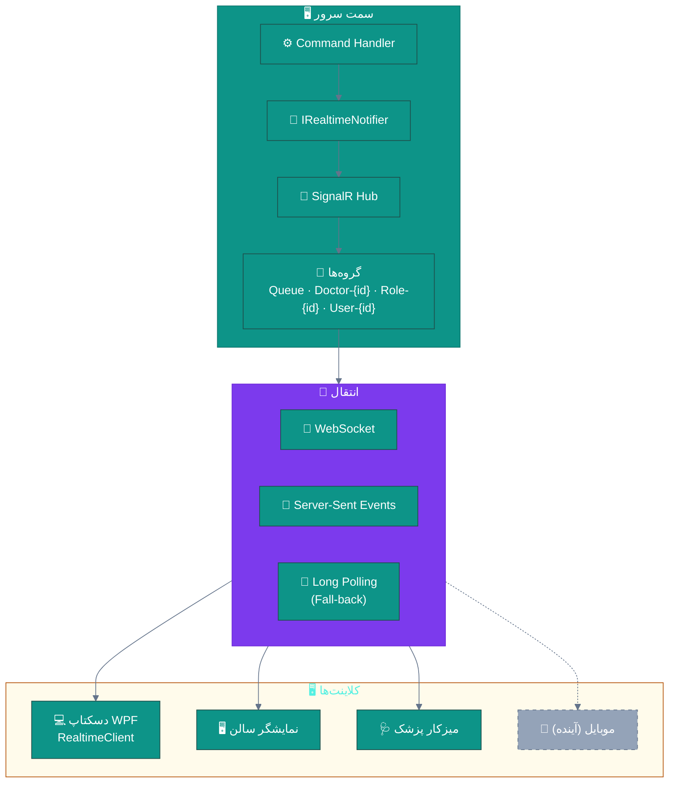
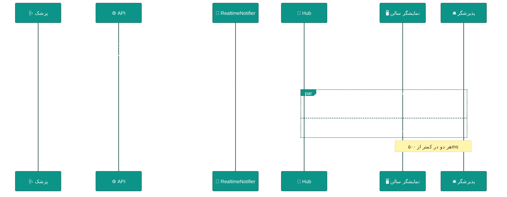
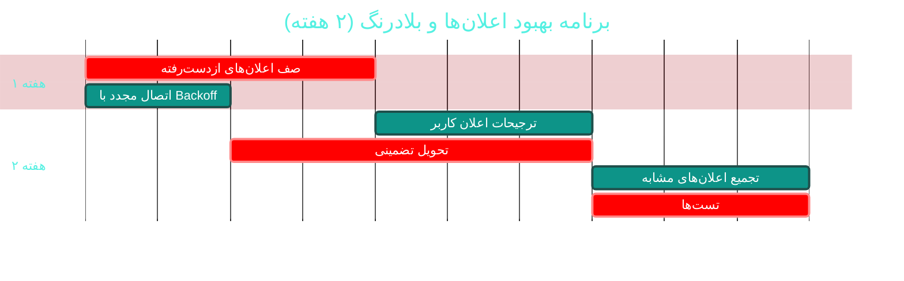

# 🔔 ماژول اعلان‌ها و بلادرنگ (Notifications & Realtime)

> **مسیر ماژول:** `notifications` · **لایسنس:** هسته + `Realtime`
> **اولویت:** 🟡 متوسط · **دشواری:** 🟡 متوسط · **زمان برآوردی:** ۲ هفته

---

## ۱. 📋 خلاصه ماژول

اعلان‌های درون‌برنامه‌ای و ارتباط بلادرنگ با **SignalR**: صف سالن،
زنگ فراخوان، به‌روزرسانی لحظه‌ای وضعیت، و اعلان‌های بالینی/مالی فوری.

| ویژگی | مقدار |
|:---|:---|
| 🎯 هدف | رساندن پیام درست، به فرد درست، در لحظه درست |
| 👤 کاربران اصلی | همه کاربران |
| 🔗 وابستگی‌ها | `receptions`, `lab`, `pharmacy`, `users`, `hr` |
| 📊 وضعیت فعلی | 🟢 عملیاتی |

---

## ۲. 🎯 وضعیت فعلی در کدبیس

| لایه | فایل | وضعیت |
|:---|:---|:---|
| 🧬 Domain | `.../Communication/Notification.cs` | 🟢 |
| 🧬 Domain | `.../Enums/NotificationType.cs` · `NotificationPriority.cs` | 🟢 |
| ⚙ App | `.../Features/Notifications/` · `CreateNotification/` | 🟢 |
| ⚙ App | `.../Interfaces/IRealtimeNotifier.cs` · `IWaitlistNotifier.cs` | 🟢 ⭐ انتزاع خوب |
| 🌐 API | `.../Controllers/NotificationsController.cs` | 🟢 |
| 🌐 API | `.../Hubs/` · `.../Realtime/` | 🟢 SignalR |
| 🖥 Desktop | `.../Services/RealtimeClient.cs` (SignalR Client) | 🟢 |
| 🖥 Desktop | `.../Views/NotificationsView.xaml` · `ToastNotification` | 🟢 |
| 🧪 تست | `tests/.../Realtime/SignalRRealtimeNotifierTests.cs` · `tests/.../Realtime/RealtimeContractTests.cs` | 🟢 ⭐ |

### نکات برجسته‌ی فعلی

✅ **SignalR Hub** با **تست قرارداد** (`RealtimeContractTests`) — بررسی تطابق سرور/کلاینت
✅ **انتزاع `IRealtimeNotifier`** — قابل تعویض بدون تغییر فراخوان‌ها
✅ **سطوح اولویت** (`NotificationPriority`)
✅ **کلاینت SignalR در دسکتاپ** با مدیریت توکن
✅ **توست اعلان** با طراحی اختصاصی (چرخه ۴۵ رفع بریده‌شدن)

> 💡 **نکته‌ی مثبت:** وجود `RealtimeContractTests` نشان می‌دهد تیم متوجه
> خطرِ «ناهمزمانی قرارداد سرور و کلاینت» در SignalR شده است — یک ریسک رایج.

---

## ۳. 📊 نمودار معماری بلادرنگ



### نمودار توالی رویداد فراخوان



---

## ۴. ⚠️ کاستی‌ها و ایرادها

| # | کاستی | 🎯 شدت | 📍 محل | 💥 پیامد |
|:--:|:---|:--:|:---|:---|
| W-01 | **اتصال SignalR بیکار بسته نمی‌شود** | 🟠 بالا | `RealtimeClient` | مصرف منبع سرور |
| W-02 | **صف اعلان‌های ازدست‌رفته** هنگام قطع اتصال ندارد | 🟠 بالا | — | اعلان بحرانی از دست می‌رود |
| W-03 | **ترجیحات اعلان کاربر** (کانال و سکوت) ندارد | 🟡 متوسط | `Notification` | مزاحمت برای کاربر |
| W-04 | **تجمیع اعلان‌های مشابه** ندارد | 🟡 متوسط | — | چند اعلان تکراری |
| W-05 | **تاریخچه خوانده/نخوانده** در UI محدود است | 🟡 متوسط | — | — |
| W-06 | **تحویل تضمینی (Guaranteed Delivery)** ندارد | 🟠 بالا | — | اعلان بحرانی ممکن است نرسد |
| W-07 | **اتصال مجدد خودکار با Backoff** احتمالاً ساده است | 🟡 متوسط | `RealtimeClient` | طوفان اتصال مجدد |
| W-08 | **مانیتورینگ اتصال‌های فعال** ندارد | 🟡 متوسط | — | — |
| W-09 | **نمایشگر سالن (Kiosk)** از همین کانال استفاده می‌کند | 🟡 متوسط | — | مصرف دوبرابر |

---

## ۵. ✨ امکانات پیشنهادی

| 🎯 # | امکان | 📝 شرح | 💰 ارزش | 🔧 دشواری | ⏱ |
|:--:|:---|:---|:--:|:--:|:--:|
| F-01 | 📥 **صف اعلان‌های ازدست‌رفته** | ذخیره در DB + تحویل پس از اتصال مجدد | بسیار بالا | متوسط | ۴ روز |
| F-02 | 🔄 **اتصال مجدد با Backoff نمایی** | ۱s → ۲s → ۴s → ۸s … سقف ۳۰s | بالا | کم | ۲ روز |
| F-03 | ⚙ **ترجیحات اعلان کاربر** | کانال · ساعات سکوت · دسته‌ها | بالا | کم | ۳ روز |
| F-04 | 🧩 **تجمیع اعلان‌های مشابه** | «۳ پیام جدید» به‌جای ۳ اعلان | متوسط | کم | ۳ روز |
| F-05 | ✅ **تحویل تضمینی برای بحرانی‌ها** | تأیید دریافت + تلاش مجدد | بسیار بالا | متوسط | ۵ روز |
| F-06 | 📊 **داشبورد سلامت اتصال‌ها** | تعداد فعال · قطعی‌ها · تأخیر | متوسط | کم | ۲ روز |
| F-07 | 🔕 **حالت مزاحم نشوید (DND)** | غیرفعال موقت به‌جز بحرانی | متوسط | کم | ۲ روز |
| F-08 | 📱 **اعلان Push موبایل** | برای اپ آینده | بالا | زیاد | ۲ هفته |
| F-09 | 🔔 **زنگ و صدای سفارشی** | برای انواع اعلان | متوسط | کم | ۲ روز |
| F-10 | 📈 **تحلیل اثربخشی اعلان** | نرخ خوانده‌شدن · زمان پاسخ | متوسط | کم | ۳ روز |

---

## ۶. 🛠 دستورالعمل پیاده‌سازی

### 📌 گام ۱ — صف اعلان‌های ازدست‌رفته (F-01)

```csharp
// 📄 src/Sahand.ClinicPro.Domain/Communication/NotificationDelivery.cs (جدید)
namespace Sahand.ClinicPro.Domain.Entities.Communication;

/// <summary>
/// رکورد تحویل اعلان — برای تحویل تضمینی اعلان‌های بحرانی.
/// تا زمانی که کلاینت دریافت را تأیید نکند، «در انتظار» می‌ماند
/// و پس از اتصال مجدد دوباره ارسال می‌شود.
/// </summary>
public class NotificationDelivery : BaseEntity
{
    /// <summary>شناسه اعلان</summary>
    public long NotificationId { get; set; }

    /// <summary>اعلان</summary>
    public Notification Notification { get; set; } = null!;

    /// <summary>شناسه کاربر گیرنده</summary>
    public long UserId { get; set; }

    /// <summary>وضعیت تحویل</summary>
    public DeliveryStatus Status { get; set; } = DeliveryStatus.Pending;

    /// <summary>تعداد تلاش‌ها</summary>
    public int AttemptCount { get; set; }

    /// <summary>زمان اولین تلاش</summary>
    public DateTime? FirstAttemptAt { get; set; }

    /// <summary>زمان تحویل موفق</summary>
    public DateTime? DeliveredAt { get; set; }

    /// <summary>زمان خوانده‌شدن</summary>
    public DateTime? ReadAt { get; set; }

    /// <summary>آخرین خطا</summary>
    public string? LastError { get; set; }

    /// <summary>زمان انقضای تلاش</summary>
    public DateTime? ExpiresAt { get; set; }
}

/// <summary>وضعیت تحویل</summary>
public enum DeliveryStatus
{
    /// <summary>در انتظار ارسال</summary>
    Pending,
    /// <summary>ارسال‌شده — منتظر تأیید</summary>
    Sent,
    /// <summary>تحویل‌شده (تأیید دریافت رسید)</summary>
    Delivered,
    /// <summary>خوانده‌شده</summary>
    Read,
    /// <summary>ناموفق (پس از اتمام تلاش‌ها)</summary>
    Failed,
    /// <summary>منقضی‌شده</summary>
    Expired,
}
```

```csharp
// 📄 در RealtimeNotifier — ثبت رکورد تحویل برای اعلان‌های مهم:
public async Task NotifyUserAsync(long userId, NotificationPayload payload,
    CancellationToken ct = default)
{
    // ۱) ذخیره اعلان
    var notification = await CreateNotificationAsync(userId, payload, ct);

    // ۲) ثبت رکورد تحویل
    _uow.Repository<NotificationDelivery>().Add(new NotificationDelivery
    {
        NotificationId = notification.Id,
        UserId = userId,
        Status = DeliveryStatus.Pending,
        ExpiresAt = payload.Priority == NotificationPriority.Critical
            ? DateTime.UtcNow.AddHours(24)      // بحرانی: تلاش تا ۲۴ ساعت
            : DateTime.UtcNow.AddHours(2),      // عادی: تلاش تا ۲ ساعت
    });
    await _uow.SaveEntitiesAsync(ct);

    // ۳) ارسال بلادرنگ
    await _hubContext.Clients.User(userId.ToString())
        .SendAsync("NotificationReceived", payload, ct);
}
```

```csharp
// 📄 Endpoint تأیید دریافت (توسط کلاینت پس از دریافت فراخوانی می‌شود):
[HttpPost("{id}/ack")]
[HasPermission("notifications.view")]
public async Task<IActionResult> Acknowledge(long id, CancellationToken ct = default)
    => ToResponse(await _mediator.Send(new AcknowledgeNotificationCommand(id), ct));
```

---

### 📌 گام ۲ — اتصال مجدد با Backoff نمایی (F-02)

```csharp
// 📄 src/Sahand.ClinicPro.Desktop/Services/RealtimeClient.cs — گسترش:

private static readonly TimeSpan[] RetryDelays =
{
    TimeSpan.FromSeconds(1),
    TimeSpan.FromSeconds(2),
    TimeSpan.FromSeconds(4),
    TimeSpan.FromSeconds(8),
    TimeSpan.FromSeconds(15),
    TimeSpan.FromSeconds(30),      // سقف
};

/// <summary>
/// مدیریت قطع اتصال با تأخیر نمایی و jitter.
/// jitter (تصادفی‌سازی) برای جلوگیری از «طوفان اتصال مجدد» ضروری است:
/// وقتی سرور برای لحظه‌ای قطع می‌شود، همه کلاینت‌ها نباید همزمان تلاش کنند.
/// </summary>
private void ConfigureReconnection()
{
    _connection = new HubConnectionBuilder()
        .WithUrl($"{_baseUrl}/hubs/clinic", options =>
        {
            options.AccessTokenProvider = () => Task.FromResult<string?>(_tokenManager.Token);
        })
        .WithAutomaticReconnect(new ExponentialBackoffRetryPolicy(RetryDelays))
        .Build();

    // ── رویدادهای چرخه حیات ──
    _connection.Reconnecting += OnReconnecting;
    _connection.Reconnected += OnReconnected;
    _connection.Closed += OnClosed;
}

private Task OnReconnecting(Exception? ex)
{
    _logger.LogWarning(ex, "اتصال بلادرنگ قطع شد — در حال تلاش مجدد");
    ConnectionState = RealtimeConnectionState.Reconnecting;
    ConnectionStateChanged?.Invoke(this, ConnectionState);
    return Task.CompletedTask;
}

private async Task OnReconnected(string? connectionId)
{
    _logger.LogInformation("اتصال بلادرنگ برقرار شد: {ConnectionId}", connectionId);
    ConnectionState = RealtimeConnectionState.Connected;
    ConnectionStateChanged?.Invoke(this, ConnectionState);

    // ⭐ پس از اتصال مجدد، اعلان‌های ازدست‌رفته را دریافت کن
    await FetchMissedNotificationsAsync();
}

private async Task FetchMissedNotificationsAsync()
{
    try
    {
        var pending = await _api.GetAsync<List<NotificationDto>>(
            "notifications/pending", CancellationToken.None);

        if (pending?.Data is null) return;

        foreach (var notification in pending.Data)
        {
            await _api.PostAsync($"notifications/{notification.Id}/ack", null,
                CancellationToken.None);

            Application.Current.Dispatcher.Invoke(() =>
                NotificationReceived?.Invoke(this, notification));
        }

        _logger.LogInformation("{Count} اعلان ازدست‌رفته دریافت شد", pending.Data.Count);
    }
    catch (Exception ex)
    {
        _logger.LogError(ex, "خطا در دریافت اعلان‌های ازدست‌رفته");
    }
}
```

**سیاست تأخیر با Jitter:**

```csharp
// 📄 src/Sahand.ClinicPro.Desktop/Services/ExponentialBackoffRetryPolicy.cs (جدید)
/// <summary>
/// سیاست تلاش مجدد با تأخیر نمایی و jitter تصادفی.
/// jitter مانع از «طوفان اتصال مجدد» می‌شود: وقتی سرور دوباره بالا می‌آید،
/// صدها کلاینت همزمان به آن هجوم نمی‌برند.
/// </summary>
public sealed class ExponentialBackoffRetryPolicy : IRetryPolicy
{
    private static readonly Random Jitter = new();
    private readonly TimeSpan[] _delays;

    /// <summary>سازنده با جدول تأخیرها</summary>
    public ExponentialBackoffRetryPolicy(TimeSpan[] delays) => _delays = delays;

    /// <summary>تعیین زمان انتظار پیش از تلاش بعدی</summary>
    public TimeSpan? NextRetryDelay(RetryContext retryContext)
    {
        var index = Math.Min(retryContext.PreviousRetryCount, _delays.Length - 1);
        var baseDelay = _delays[index];

        // اعمال jitter تا ۳۰٪ — جلوگیری از همزمانی
        var jitterMs = (int)(baseDelay.TotalMilliseconds * 0.3);
        var actualMs = baseDelay.TotalMilliseconds + Jitter.Next(-jitterMs, jitterMs);

        return TimeSpan.FromMilliseconds(Math.Max(500, actualMs));
    }
}
```

---

### 📌 گام ۳ — ترجیحات اعلان کاربر (F-03)

```csharp
// 📄 src/Sahand.ClinicPro.Domain/Communication/NotificationPreference.cs (جدید)
namespace Sahand.ClinicPro.Domain.Entities.Communication;

/// <summary>
/// ترجیحات اعلان کاربر — تعیین می‌کند کدام اعلان‌ها از کدام کانال
/// و در چه ساعاتی دریافت شوند. اعلان‌های بحرانی همیشه ارسال می‌شوند.
/// </summary>
public class NotificationPreference : BaseEntity
{
    /// <summary>کاربر</summary>
    public long UserId { get; set; }

    /// <summary>کاربر</summary>
    public User User { get; set; } = null!;

    /// <summary>نوع اعلان (تهی = همه انواع)</summary>
    public NotificationType? NotificationType { get; set; }

    /// <summary>کانال درون‌برنامه‌ای فعال است</summary>
    public bool InAppEnabled { get; set; } = true;

    /// <summary>کانال پیامک فعال است</summary>
    public bool SmsEnabled { get; set; }

    /// <summary>کانال ایمیل فعال است</summary>
    public bool EmailEnabled { get; set; }

    /// <summary>ساعات سکوت — شروع (مثلاً ۲۰:۰۰)</summary>
    public TimeOnly? QuietHoursStart { get; set; }

    /// <summary>ساعات سکوت — پایان (مثلاً ۰۸:۰۰)</summary>
    public TimeOnly? QuietHoursEnd { get; set; }

    /// <summary>در ساعات سکوت فقط بحرانی‌ها ارسال شوند</summary>
    public bool QuietHoursAllowCritical { get; set; } = true;
}
```

```csharp
// در NotificationService — اعمال ترجیحات پیش از ارسال:
private async Task<bool> ShouldSendAsync(long userId, NotificationPayload payload,
    CancellationToken ct)
{
    // اعلان‌های بحرانی همیشه ارسال می‌شوند
    if (payload.Priority == NotificationPriority.Critical) return true;

    var prefs = await GetPreferencesAsync(userId, payload.Type, ct);
    if (prefs is null) return true;      // بدون ترجیح = ارسال

    // بررسی کانال
    if (!prefs.InAppEnabled) return false;

    // بررسی ساعات سکوت
    if (prefs.QuietHoursStart is { } start && prefs.QuietHoursEnd is { } end)
    {
        var now = TimeOnly.FromDateTime(DateTime.Now);
        var inQuietHours = start <= end
            ? now >= start && now <= end
            : now >= start || now <= end;      // عبور از نیمه‌شب

        if (inQuietHours && !(prefs.QuietHoursAllowCritical
                              && payload.Priority == NotificationPriority.Critical))
            return false;
    }

    return true;
}
```

---

## ۷. 🧪 تست‌های الزامی

| 🧪 تست | 🎯 هدف | اولویت |
|:---|:---|:--:|
| `RealtimeContract_ServerClient_Match` *(موجود)* | قرارداد | 🔴 |
| `SignalRNotifier_SendsToCorrectGroup` *(موجود)* | گروه‌بندی | 🔴 |
| `Notification_Critical_AlwaysSent` | اولویت بحرانی | 🔴 |
| `Notification_QuietHours_NonCriticalSuppressed` | ساعات سکوت | 🟠 |
| `Notification_QuietHours_CriticalStillSent` | استثنا | 🟠 |
| `MissedNotification_AfterReconnect_Delivered` | صف ازدست‌رفته | 🔴 |
| `MissedNotification_Acknowledged_NotRepeated` | Idempotent | 🟠 |
| `RetryPolicy_Backoff_IncreasesExponentially` | تأخیر نمایی | 🟠 |
| `RetryPolicy_HasJitter_NotSynchronized` | ضد طوفان | 🟠 |
| `NotificationPreference_DisabledChannel_NotSent` | ترجیحات | 🟠 |

---

## ۸. 📈 شاخص‌های موفقیت (KPI)

| 📊 شاخص | قبل | هدف |
|:---|:--:|:--:|
| 📥 نرخ تحویل اعلان‌های بحرانی | نامشخص | **۱۰۰٪** |
| ⏱ تأخیر تحویل بلادرنگ | ~۲ ثانیه | **< ۵۰۰ms** |
| 🔄 بازیابی پس از قطع اتصال | دستی | **خودکار < ۳۰ ثانیه** |
| 🔕 رضایت از عدم مزاحمت | نامشخص | **قابل تنظیم** |
| 🧪 پوشش تست قرارداد | خوب | **۱۰۰٪ رویدادها** |

---

## ۹. 🗓 برنامه زمانی



---

## 🔗 پیوندهای مرتبط

| 📄 سند | توضیح |
|:---|:---|
| [تحلیل جامع](../ANALYSIS-REPORT.md) | سند اصلی |
| [A03 — پذیرش و صف](A03-receptions-queue.md) | مصرف‌کننده اصلی |
| [C07 — پیامک](C07-sms-communication.md) | کانال مکمل |
| [D01 — پرتال بیمار](D01-patient-portal.md) | کانال آینده |

---
<div align="center">📅 ۱۴۰۴/۰۷/۱۹ · 🔖 v1.0</div>
