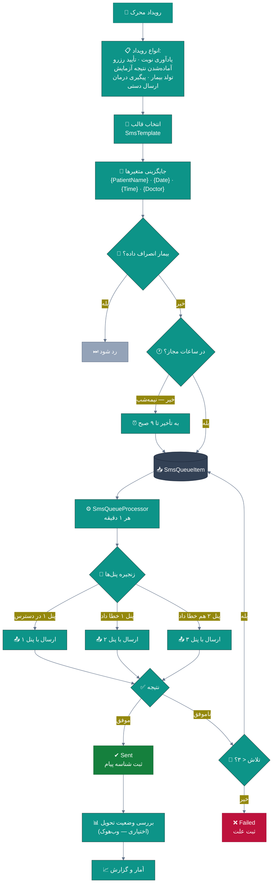
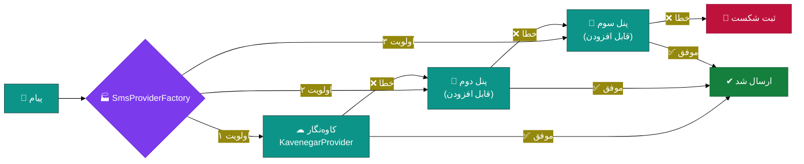
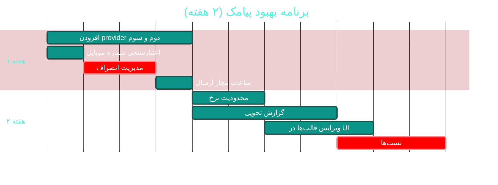

# 💬 ماژول پیامک و ارتباطات (SMS & Communication)

> **مسیر ماژول:** `sms` · **لایسنس:** `Sms`
> **اولویت:** 🟡 متوسط · **دشواری:** 🟡 متوسط · **زمان برآوردی:** ۲ هفته

---

## ۱. 📋 خلاصه ماژول

ارسال پیامک از طریق **زنجیره جایگزینی پنل‌ها**، صف پیام‌ها با Hangfire،
قالب‌های پیام متغیردار، آمار تحویل، و یکپارچگی با رویدادهای سیستم
(یادآوری نوبت، آماده‌شدن جواب آزمایش، پیگیری درمان).

| ویژگی | مقدار |
|:---|:---|
| 🎯 هدف | ارتباط مؤثر و به‌موقع با بیمار |
| 👤 کاربران اصلی | پذیرشگر · مدیر · سیستم (خودکار) |
| 🔗 وابستگی‌ها | `patients`, `appointments`, `lab`, `settings` |
| 📊 وضعیت فعلی | 🟢 عملیاتی و مقاوم |

---

## ۲. 🎯 وضعیت فعلی در کدبیس

| لایه | فایل | وضعیت |
|:---|:---|:---|
| 🧬 Domain | `.../Communication/SmsMessage.cs` · `SmsProvider.cs` · `SmsQueueItem.cs` · `SmsTemplate.cs` | 🟢 |
| 🧬 Domain | `.../Enums/SmsStatus.cs` · `SmsMessageType.cs` · `SmsRecipientType.cs` · `SmsReferenceType.cs` · `SmsTemplateType.cs` | 🟢 |
| 🗄 Infra | `.../Services/SMS/SmsService.cs` | 🟢 |
| 🗄 Infra | `.../Services/SMS/SmsProviderFactory.cs` | 🟢 ⭐ زنجیره جایگزینی |
| 🗄 Infra | `.../Services/SMS/SmsQueueProcessor.cs` | 🟢 کار پس‌زمینه |
| 🗄 Infra | `.../Services/SMS/Providers/KavenegarProvider.cs` | 🟢 |
| 🗄 Infra | `BasicDataSeeder` — بذر قالب‌های پیامک | 🟢 |
| 🌐 API | `.../Controllers/SmsController.cs` | 🟢 |
| 🖥 Desktop | `.../Views/SmsView.xaml` | 🟢 |

### نکات برجسته‌ی فعلی

✅ **زنجیره جایگزینی پنل‌ها (Fallback Chain)** — در صورت خطای یک پنل، پنل بعدی
✅ **صف پیام با Hangfire** — ارسال ناهمزمان و مقاوم
✅ **قالب‌های متغیردار** با بذر پیش‌فرض (یادآوری نوبت، آماده‌شدن نتیجه)
✅ **ثبت کامل وضعیت** (`SmsStatus`)
✅ **گروه‌بندی گیرندگان** (`SmsRecipientType`)
✅ **پیکربندی در appsettings** (API Key, Sender)

---

## ۳. 📊 نمودار جریان ارسال



### زنجیره جایگزینی پنل‌ها



---

## ۴. ⚠️ کاستی‌ها و ایرادها

| # | کاستی | 🎯 شدت | 📍 محل | 💥 پیامد |
|:--:|:---|:--:|:---|:---|
| W-01 | **فقط یک provider** (کاوه‌نگار) پیاده شده — زنجیره عملاً تک‌عضوی | 🟠 بالا | `Sms/Providers/` | وابستگی به یک فروشنده |
| W-02 | **اعتبارسنجی شماره موبایل** پیش از ارسال ندارد | 🟡 متوسط | `SmsService` | هزینه پیام‌های ناموفق |
| W-03 | **محدودیت نرخ (Rate Limit)** ندارد | 🟡 متوسط | — | مسدودشدن پنل توسط فروشنده |
| W-04 | **گزارش وضعیت تحویل (Delivery Report)** ندارد | 🟡 متوسط | — | عدم اطمینان از رسیدن |
| W-05 | **انصراف بیمار از پیامک (Opt-out)** ندارد | 🟠 بالا | — | مزاحمت + ریسک قانونی |
| W-06 | **ساعات مجاز ارسال** رعایت نمی‌شود | 🟡 متوسط | — | ارسال در نیمه‌شب |
| W-07 | **تحلیل هزینه پیامک** ندارد | 🟡 متوسط | — | هزینه کنترل‌نشده |
| W-08 | **پیامک تعاملی (لینک تأیید/لغو)** ندارد | 🟡 متوسط | — | — |
| W-09 | **قالب‌های پیامک در UI قابل ویرایش نیستند** | 🟡 متوسط | `SmsView` | نیاز به تغییر کد |

---

## ۵. ✨ امکانات پیشنهادی

| 🎯 # | امکان | 📝 شرح | 💰 ارزش | 🔧 دشواری | ⏱ |
|:--:|:---|:---|:--:|:--:|:--:|
| F-01 | 🔌 **افزودن ۲-۳ provider جدید** | پنل‌های رایج ایرانی | بالا | کم | ۴ روز |
| F-02 | 🚫 **مدیریت انصراف (Opt-out)** | لغو اشتراک با کلمه کلیدی | بسیار بالا | کم | ۲ روز |
| F-03 | 🕐 **ساعات مجاز ارسال** | عدم ارسال ۲۲-۸ صبح | بالا | کم | ۱ روز |
| F-04 | 📊 **گزارش تحویل (Delivery Report)** | وب‌هوک از پنل | بالا | متوسط | ۴ روز |
| F-05 | 🚦 **محدودیت نرخ** | سقف پیام در دقیقه/روز | بالا | کم | ۲ روز |
| F-06 | ✏ **ویرایش قالب‌ها در UI** | بدون نیاز به کد | بالا | کم | ۳ روز |
| F-07 | 🔗 **پیامک تعاملی** | لینک امضا‌شده برای تأیید/لغو نوبت | بسیار بالا | متوسط | ۴ روز |
| F-08 | 💰 **تحلیل هزینه و بازگشت** | هزینه هر کمپین در برابر نرخ پاسخ | متوسط | کم | ۳ روز |
| F-09 | ✅ **اعتبارسنجی شماره** | فرمت موبایل ایرانی | بالا | کم | ۱ روز |
| F-10 | 📧 **کانال ایمیل** | مشابه پیامک برای بیماران | متوسط | متوسط | ۱ هفته |

---

## ۶. 🛠 دستورالعمل پیاده‌سازی

### 📌 گام ۱ — افزودن provider جدید (F-01)

**۱.۱ قرارداد provider موجود را بررسی کنید**

```csharp
// 📄 مسیر احتمالی: src/Sahand.ClinicPro.Application/Interfaces/ISmsProvider.cs
// یا src/Sahand.ClinicPro.Infrastructure/Services/SMS/ISmsProvider.cs
```

**۱.۲ پیاده‌سازی provider جدید**

```csharp
// 📄 src/Sahand.ClinicPro.Infrastructure/Services/SMS/Providers/SmsIrProvider.cs (جدید)
using System.Net.Http.Json;

namespace Sahand.ClinicPro.Infrastructure.Services.SMS.Providers;

/// <summary>
/// ارائه‌دهنده پیامک «پنل پیامکی ایرانی» — دومین گزینه در زنجیره جایگزینی.
/// الگوی پیاده‌سازی دقیقاً مشابه KavenegarProvider است تا
/// SmsProviderFactory بتواند بدون تغییر از آن استفاده کند.
/// </summary>
public class SmsIrProvider : ISmsProvider
{
    private readonly IHttpClientFactory _httpFactory;
    private readonly IConfiguration _config;
    private readonly ILogger<SmsIrProvider> _logger;

    /// <summary>نام نمایشی ارائه‌دهنده</summary>
    public string Name => "SmsIr";

    /// <summary>اولویت در زنجیره (کمتر = زودتر)</summary>
    public int Priority => 2;

    /// <summary>سازنده</summary>
    public SmsIrProvider(IHttpClientFactory httpFactory, IConfiguration config,
        ILogger<SmsIrProvider> logger)
    { _httpFactory = httpFactory; _config = config; _logger = logger; }

    /// <summary>بررسی در دسترس‌بودن تنظیمات این ارائه‌دهنده</summary>
    public bool IsConfigured =>
        !string.IsNullOrWhiteSpace(_config["Sms:SmsIr:ApiKey"]);

    /// <summary>ارسال یک پیامک</summary>
    public async Task<SmsSendResult> SendAsync(string phoneNumber, string message,
        CancellationToken ct = default)
    {
        if (!IsConfigured)
            return SmsSendResult.Failure("کلید API تنظیم نشده است");

        try
        {
            var client = _httpFactory.CreateClient(nameof(SmsIrProvider));
            client.BaseAddress = new Uri("https://api.sms.ir/");

            var request = new
            {
                mobile = phoneNumber,
                templateId = 0,          // الگوی مستقیم
                parameters = new[] { new { name = "Message", value = message } },
            };

            var response = await client.PostAsJsonAsync("v1/send/bulk", request, ct);

            if (!response.IsSuccessStatusCode)
            {
                var errorBody = await response.Content.ReadAsStringAsync(ct);
                _logger.LogWarning(
                    "خطای ارسال پیامک از طریق SmsIr: {Status} — {Body}",
                    response.StatusCode, errorBody);
                return SmsSendResult.Failure($"خطای HTTP {response.StatusCode}");
            }

            var result = await response.Content
                .ReadFromJsonAsync<SmsIrResponse>(cancellationToken: ct);

            return result?.Status == 1
                ? SmsSendResult.Success(result.Data?.MessageId?.ToString() ?? "")
                : SmsSendResult.Failure(result?.Message ?? "خطای نامشخص");
        }
        catch (TaskCanceledException) when (!ct.IsCancellationRequested)
        {
            // Timeout — مهم است که از «لغو واقعی» تفکیک شود
            return SmsSendResult.Failure("مهلت ارسال به پایان رسید");
        }
        catch (Exception ex)
        {
            _logger.LogError(ex, "خطای غیرمنتظره در ارسال پیامک از طریق SmsIr");
            return SmsSendResult.Failure(ex.Message);
        }
    }

    private sealed record SmsIrResponse(int Status, string? Message,
        SmsIrData? Data);

    private sealed record SmsIrData(long? MessageId, decimal? Cost);
}
```

**۱.۳ ثبت در DI و Factory**

```csharp
// 📄 DependencyInjection.cs
services.AddScoped<ISmsProvider, KavenegarProvider>();
services.AddScoped<ISmsProvider, SmsIrProvider>();        // 🆕
// نیازی به تغییر SmsProviderFactory نیست — با reflection یا IEnumerable پیدا می‌شوند

// 📄 Program.cs — ثبت HttpClient با نام
builder.Services.AddHttpClient(nameof(SmsIrProvider), client =>
{
    client.Timeout = TimeSpan.FromSeconds(15);
    client.DefaultRequestHeaders.Add("X-API-KEY",
        builder.Configuration["Sms:SmsIr:ApiKey"] ?? "");
});
```

**۱.۴ پیکربندی**

```json
{
  "Sms": {
    "Kavenegar": { "ApiKey": "", "Sender": "10004346" },
    "SmsIr": { "ApiKey": "", "TemplateId": 0 },
    "FallbackOrder": ["Kavenegar", "SmsIr"],
    "MaxRetries": 3,
    "AllowedHours": { "From": "08:00", "To": "22:00" },
    "RateLimit": { "PerMinute": 60, "PerDay": 2000 }
  }
}
```

---

### 📌 گام ۲ — مدیریت انصراف بیمار (F-02)

```csharp
// 📄 src/Sahand.ClinicPro.Domain/People/Patient.cs — افزوده شود:

/// <summary>بیمار از دریافت پیامک انصراف داده است</summary>
public bool SmsOptOut { get; set; }

/// <summary>زمان انصراف</summary>
public DateTime? SmsOptedOutAt { get; set; }

/// <summary>بیمار از دریافت پیامک تبلیغاتی انصراف داده (نه پیام‌های درمانی)</summary>
public bool MarketingOptOut { get; set; }
```

```csharp
// 📄 src/Sahand.ClinicPro.Application/Features/Sms/SendSms/SendSmsCommand.cs
// گارد در Handler:

// ── گارد ۱: انصراف بیمار ──
if (patient?.SmsOptOut == true)
{
    _logger.LogInformation(
        "ارسال پیامک به بیمار {PatientId} لغو شد — بیمار انصراف داده است", patientId);
    return Result.Failure(Error.Validation("بیمار از دریافت پیامک انصراف داده است"));
}

// ── گارد ۲: پیام‌های تبلیغاتی ──
if (request.Type == SmsMessageType.Marketing && patient?.MarketingOptOut == true)
    return Result.Failure(Error.Validation("بیمار از دریافت پیام تبلیغاتی انصراف داده است"));

// ── گارد ۳: اعتبارسنجی شماره ──
if (!IranianPhoneNumber.IsValidMobile(request.PhoneNumber))
    return Result.Failure(Error.Validation(
        $"شماره موبایل «{request.PhoneNumber}» معتبر نیست"));

// ── گارد ۴: ساعات مجاز (به‌جز پیام‌های فوری) ──
if (request.Priority != SmsPriority.Urgent && !IsWithinAllowedHours())
{
    // به تأخیر می‌افتد به‌جای رد شدن
    return await DeferToAllowedHoursAsync(request, ct);
}
```

```csharp
// 📄 src/Sahand.ClinicPro.Shared/Helpers/IranianPhoneNumber.cs (جدید)
/// <summary>
/// اعتبارسنج و نرمال‌ساز شماره موبایل ایرانی.
/// الگوهای معتبر: ۰۹xxxxxxxxx · +۹۸۹xxxxxxxxx · ۹xxxxxxxxx
/// پیش‌شماره‌های معتبر اپراتورها: ۹۰ ۹۱ ۹۲ ۹۳ ۹۴ ۹۹ ۹۰۱ ۹۰۲ ۹۰۳ ۹۰۵ ۹۳۰ …
/// </summary>
public static class IranianPhoneNumber
{
    private static readonly string[] ValidPrefixes =
    {
        "90", "91", "92", "93", "94", "99",
        "901", "902", "903", "904", "905", "930", "933", "935", "936",
        "937", "938", "939", "941", "942", "910", "911", "912", "913",
        "914", "915", "916", "917", "918", "919", "921", "922", "931",
        "932", "990", "991", "992", "993", "994",
    };

    /// <summary>بررسی اعتبار شماره موبایل</summary>
    public static bool IsValidMobile(string? phone)
    {
        if (string.IsNullOrWhiteSpace(phone)) return false;

        var normalized = Normalize(phone);
        if (normalized is null) return false;

        return normalized.Length == 10
               && normalized.StartsWith('9')
               && ValidPrefixes.Any(p => normalized.StartsWith(p, StringComparison.Ordinal));
    }

    /// <summary>
    /// نرمال‌سازی به فرمت ۹xxxxxxxxx (بدون پیشوند کشور و صفر).
    /// خروجی null یعنی شماره نامعتبر است.
    /// </summary>
    public static string? Normalize(string phone)
    {
        if (string.IsNullOrWhiteSpace(phone)) return null;

        // حذف همه چیز به‌جز رقم
        var digits = new string(phone.Where(char.IsDigit).ToArray());

        return digits switch
        {
            // ۰۹۱۲۳۴۵۶۷۸۹ → ۹۱۲۳۴۵۶۷۸۹
            var d when d.Length == 11 && d.StartsWith("09") => d[1..],
            // ۹۸۹۱۲۳۴۵۶۷۸۹ → ۹۱۲۳۴۵۶۷۸۹
            var d when d.Length == 12 && d.StartsWith("98") => d[2..],
            // ۰۰۹۸۹۱۲۳۴۵۶۷۸۹ → ۹۱۲۳۴۵۶۷۸۹
            var d when d.Length == 14 && d.StartsWith("0098") => d[4..],
            // ۹۱۲۳۴۵۶۷۸۹
            var d when d.Length == 10 => d,
            _ => null,
        };
    }

    /// <summary>قالب‌بندی نمایشی: ۰۹۱۲ ۳۴۵ ۶۷۸۹</summary>
    public static string Format(string phone)
    {
        var n = Normalize(phone);
        return n is null ? phone : $"0{n[..3]} {n[3..6]} {n[6..]}";
    }
}
```

---

### 📌 گام ۳ — محدودیت نرخ (F-05)

```csharp
// 📄 src/Sahand.ClinicPro.Infrastructure/Services/SMS/SmsRateLimiter.cs (جدید)
/// <summary>
/// محدودکننده نرخ ارسال پیامک — جلوگیری از مسدودشدن پنل توسط فروشنده.
/// از الگوی «سطل نشانه» (Token Bucket) استفاده می‌کند.
/// </summary>
public class SmsRateLimiter
{
    private readonly IMemoryCache _cache;
    private readonly int _perMinute;
    private readonly int _perDay;

    public SmsRateLimiter(IMemoryCache cache, IConfiguration config)
    {
        _cache = cache;
        _perMinute = config.GetValue<int>("Sms:RateLimit:PerMinute", 60);
        _perDay = config.GetValue<int>("Sms:RateLimit:PerDay", 2000);
    }

    /// <summary>بررسی و مصرف یک سهمیه</summary>
    public bool TryConsume()
    {
        var now = DateTime.UtcNow;

        // ── سقف دقیقه‌ای ──
        var minuteKey = $"sms:rate:{now:yyyyMMddHHmm}";
        var minuteCount = _cache.GetOrCreate(minuteKey, entry =>
        {
            entry.AbsoluteExpirationRelativeToNow = TimeSpan.FromMinutes(2);
            return 0;
        });

        if (minuteCount >= _perMinute) return false;
        _cache.Set(minuteKey, minuteCount + 1, TimeSpan.FromMinutes(2));

        // ── سقف روزانه ──
        var dayKey = $"sms:rate:{now:yyyyMMdd}";
        var dayCount = _cache.GetOrCreate(dayKey, entry =>
        {
            entry.AbsoluteExpirationRelativeToNow = TimeSpan.FromDays(2);
            return 0;
        });

        if (dayCount >= _perDay) return false;
        _cache.Set(dayKey, dayCount + 1, TimeSpan.FromDays(2));

        return true;
    }
}
```

---

## ۷. 🧪 تست‌های الزامی

| 🧪 تست | 🎯 هدف | اولویت |
|:---|:---|:--:|
| `SmsQueue_Process_SendsMessage` | صف | 🔴 |
| `SmsProvider_Fallback_UsesSecondProvider` | **زنجیره جایگزینی** | 🔴 |
| `SmsProvider_AllFail_MarksFailed` | شکست کامل | 🔴 |
| `PhoneNumber_ValidMobile_Accepted` | اعتبارسنجی | 🔴 |
| `PhoneNumber_Landline_Rejected` | رد تلفن ثابت | 🟠 |
| `PhoneNumber_Normalize_AllFormats` | نرمال‌سازی | 🟠 |
| `SmsOptOut_PatientOptedOut_NotSent` | **انصراف** | 🔴 |
| `SmsQuietHours_DeferredToMorning` | ساعات مجاز | 🟠 |
| `RateLimiter_ExceedsMinute_Rejected` | محدودیت نرخ | 🟠 |
| `Template_Render_VariablesReplaced` | رندر قالب | 🟠 |

---

## ۸. 📈 شاخص‌های موفقیت (KPI)

| 📊 شاخص | قبل | هدف |
|:---|:--:|:--:|
| 🔌 تعداد providerهای فعال | ۱ | **۳** |
| 📤 نرخ تحویل موفق | ~۹۰٪ | **> ۹۸٪** |
| 🚫 احترام به انصراف بیمار | ❌ | **✅ ۱۰۰٪** |
| 💰 هزینه پیام‌های ناموفق | ~۱۰٪ | **< ۲٪** |
| ⏱ زمان ارسال پس از رویداد | ~۵ دقیقه | **< ۱ دقیقه** |

---

## ۹. 🗓 برنامه زمانی



---

## 🔗 پیوندهای مرتبط

| 📄 سند | توضیح |
|:---|:---|
| [تحلیل جامع](../ANALYSIS-REPORT.md) | سند اصلی |
| [A02 — نوبت‌دهی](A02-appointments.md) | یادآوری نوبت |
| [C06 — اعلان‌ها](C06-notifications-realtime.md) | کانال درون‌برنامه‌ای |
| [D07 — CRM و بازاریابی](D07-crm-marketing.md) | کمپین‌های پیامکی |

---
<div align="center">📅 ۱۴۰۴/۰۷/۱۹ · 🔖 v1.0</div>
