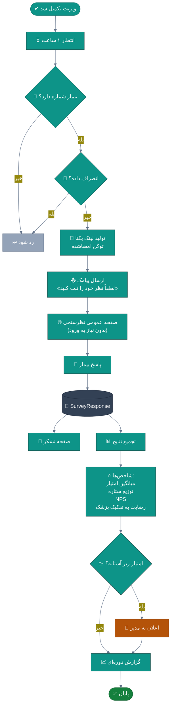
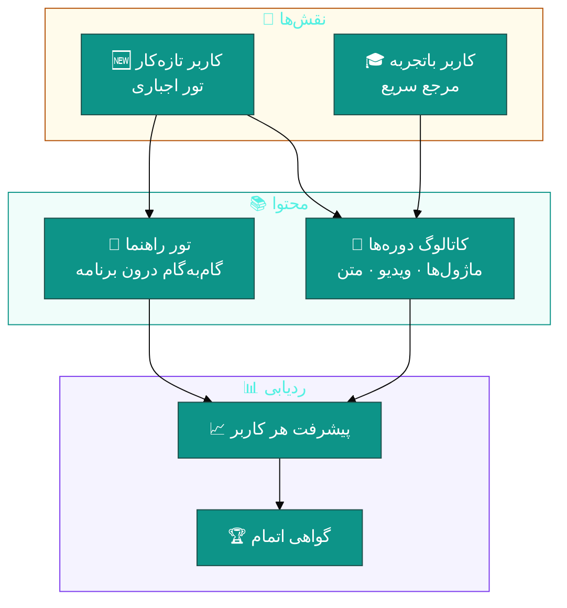
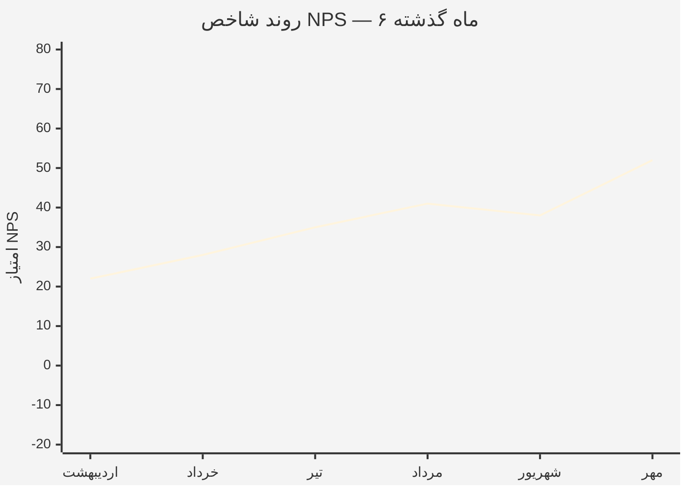
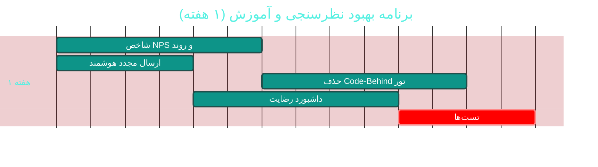

# 📝 ماژول نظرسنجی و آموزش (Surveys & Training)

> **مسیر ماژول:** `surveys` · `training` · **لایسنس:** `Survey` + `Training`
> **اولویت:** 🟢 کم · **دشواری:** 🟢 کم · **زمان برآوردی:** ۱ هفته

---

## ۱. 📋 خلاصه ماژول

دو زیرسیستم مکمل:
- **📝 نظرسنجی**: سازنده پویا سوالات، ارسال لینک پیامکی پس از ویزیت،
  میانگین امتیاز پزشکان و توزیع ستاره
- **🎓 آموزش**: مرکز آموزش، تور راهنمای تعاملی، و ردیابی پیشرفت یادگیری

| ویژگی | مقدار |
|:---|:---|
| 🎯 هدف | سنجش رضایت بیمار + تسریع یادگیری کاربران |
| 👤 کاربران اصلی | مدیر · پزشکان · کاربران تازه‌کار |
| 🔗 وابستگی‌ها | `patients`, `doctors`, `sms`, `reports` |
| 📊 وضعیت فعلی | 🟢 عملیاتی |

---

## ۲. 🎯 وضعیت فعلی در کدبیس

| لایه | فایل | خط | وضعیت |
|:---|:---|--:|:---|
| 🧬 Domain | `.../Communication/Survey.cs` · `SurveyResponse.cs` | — | 🟢 |
| 🧬 Domain | `.../Enums/SurveyType.cs` | — | 🟢 |
| 🌐 API | `.../Controllers/SurveysController.cs` | — | 🟢 |
| 🌐 API | `.../Controllers/TrainingController.cs` | — | 🟢 |
| 🖥 Desktop | `.../Views/SurveyView.xaml` | — | 🟢 |
| 🖥 Desktop | `.../Views/TrainingCenterView.xaml` | — | 🟢 |
| 🖥 Desktop | **`.../Views/GuidedTourWindow.xaml`** (+ **۳۲۲ خط Code-Behind**) | — | 🟠 |
| 🧪 تست | `tests/.../SurveyFlowTests.cs` | — | 🟢 |
| 🧪 تست | `tests/.../TrainingProgressEndpointTests.cs` · `tests/.../TrainingCatalogTests.cs` | — | 🟢 |

### نکات برجسته‌ی فعلی

✅ **سازنده پویا سوالات** (امتیاز / متن / چندگزینه‌ای)
✅ **ارسال لینک پیامکی** پس از ویزیت
✅ **میانگین امتیاز پزشکان** و توزیع ستاره
✅ **تور راهنمای تعاملی (Guided Tour)** با پوشش RTL (چرخه ۳۸)
✅ **مرکز آموزش** با کاتالوگ و ردیابی پیشرفت
✅ **سه مجموعه تست** برای جریان نظرسنجی و آموزش

---

## ۳. 📊 نمودار جریان نظرسنجی



### نمودار معماری آموزش



---

## ۴. ⚠️ کاستی‌ها و ایرادها

| # | کاستی | 🎯 شدت | 📍 محل | 💥 پیامد |
|:--:|:---|:--:|:---|:---|
| W-01 | **`GuidedTourWindow` با ۳۲۲ خط Code-Behind** | 🟠 بالا | `Views/` | نقض MVVM |
| W-02 | **تور راهنما فقط یک‌بار نمایش داده می‌شود** — بدون مسیر یادگیری | 🟡 متوسط | — | — |
| W-03 | **تحلیل متنی نظرات** (بازخورد آزاد) ندارد | 🟡 متوسط | — | بینش از دست می‌رود |
| W-04 | **مقایسه دوره‌ای رضایت** (روند ماهانه) ندارد | 🟡 متوسط | — | — |
| W-05 | **ارسال مجدد نظرسنجی** برای پاسخ‌نداده‌ها ندارد | 🟡 متوسط | — | نرخ پاسخ پایین |
| W-06 | **شاخص NPS** محاسبه نمی‌شود | 🟡 متوسط | — | — |
| W-07 | **نظرسنجی در پرتال بیمار** (بدون پیامک) ندارد | 🟡 متوسط | — | — |
| W-08 | **تست A/B برای قالب‌های پیامک** ندارد | 🔵 کم | — | — |
| W-09 | **گواهی آموزش** قابل چاپ نیست | 🔵 کم | — | — |

---

## ۵. ✨ امکانات پیشنهادی

| 🎯 # | امکان | 📝 شرح | 💰 ارزش | 🔧 دشواری | ⏱ |
|:--:|:---|:---|:--:|:--:|:--:|
| F-01 | 📊 **شاخص NPS و تحلیل روند** | محاسبه استاندارد + نمودار ماهانه | بالا | کم | ۳ روز |
| F-02 | 🧠 **تحلیل متنی نظرات** | استخراج موضوعات پرتکرار از پاسخ‌های آزاد | بالا | متوسط | ۱ هفته |
| F-03 | 🔄 **ارسال مجدد هوشمند** | فقط برای پاسخ‌نداده‌ها، حداکثر ۲ بار | متوسط | کم | ۲ روز |
| F-04 | 🧭 **مسیر یادگیری مرحله‌ای** | تور پیشرفته + تور هر ماژول | بالا | متوسط | ۱ هفته |
| F-05 | 🏆 **گواهی آموزش قابل چاپ** | با استفاده از سیستم قالب چاپ | متوسط | کم | ۲ روز |
| F-06 | 🌐 **نظرسنجی در پرتال بیمار** | بدون نیاز به پیامک | بالا | متوسط | ۳ روز |
| F-07 | 📈 **داشبورد رضایت** | تجمیع همه شاخص‌ها در یک نما | بالا | کم | ۳ روز |
| F-08 | 🎯 **نظرسنجی هدفمند** | بر اساس نوع خدمت / پزشک / شعبه | متوسط | کم | ۳ روز |
| F-09 | 🧩 **حذف Code-Behind تور** | انتقال منطق به ViewModel | بالا | کم | ۳ روز |
| F-10 | 🎓 **آزمون و ارزیابی** | پس از هر دوره آموزشی | متوسط | متوسط | ۴ روز |

---

## ۶. 🛠 دستورالعمل پیاده‌سازی

### 📌 گام ۱ — شاخص NPS و تحلیل روند (F-01)

```csharp
// 📄 src/Sahand.ClinicPro.Application/Features/Surveys/Nps/NpsCalculationQuery.cs (جدید)
namespace Sahand.ClinicPro.Application.Features.Surveys.Nps;

/// <summary>
/// محاسبه شاخص خالص مروجان (NPS) — استاندارد جهانی سنجش وفاداری.
/// فرمول: %مروجان (امتیاز ۹-۱۰) − %شاکیان (امتیاز ۰-۶)
/// بازه خروجی: ۱۰۰- تا ۱۰۰+
/// </summary>
public record NpsCalculationQuery(DateTime From, DateTime To,
    long? DoctorId = null, long? BranchId = null)
    : IRequest<Result<NpsResultDto>>;

public class NpsCalculationQueryHandler
    : IRequestHandler<NpsCalculationQuery, Result<NpsResultDto>>
{
    private readonly IUnitOfWork _uow;

    public NpsCalculationQueryHandler(IUnitOfWork uow) => _uow = uow;

    public async Task<Result<NpsResultDto>> Handle(NpsCalculationQuery req, CancellationToken ct)
    {
        var scores = await _uow.Repository<SurveyResponse>().QueryableNoTracking
            .Include(r => r.Survey)
            .Where(r => !r.IsDeleted
                        && r.SubmittedAt >= req.From
                        && r.SubmittedAt <= req.To
                        && r.Score.HasValue
                        && (req.DoctorId == null || r.DoctorId == req.DoctorId)
                        && (req.BranchId == null || r.BranchId == req.BranchId))
            .Select(r => r.Score!.Value)
            .ToListAsync(ct);

        if (scores.Count == 0)
            return Result<NpsResultDto>.Success(new NpsResultDto(
                Score: 0, Promoters: 0, Passives: 0, Detractors: 0,
                TotalResponses: 0, PromoterPercent: 0, DetractorPercent: 0,
                Interpretation: "داده‌ای برای این بازه وجود ندارد"));

        // ── دسته‌بندی ──
        var promoters = scores.Count(s => s >= 9);      // مروجان
        var passives = scores.Count(s => s is 7 or 8);  // خنثی‌ها
        var detractors = scores.Count(s => s <= 6);     // شاکیان

        var promoterPercent = (decimal)promoters / scores.Count * 100;
        var detractorPercent = (decimal)detractors / scores.Count * 100;
        var nps = (int)Math.Round(promoterPercent - detractorPercent);

        return Result<NpsResultDto>.Success(new NpsResultDto(
            Score: nps,
            Promoters: promoters,
            Passives: passives,
            Detractors: detractors,
            TotalResponses: scores.Count,
            PromoterPercent: Math.Round(promoterPercent, 1),
            DetractorPercent: Math.Round(detractorPercent, 1),
            Interpretation: nps switch
            {
                >= 70  => "عالی — بیماران شما مروج فعال هستند",
                >= 50  => "بسیار خوب",
                >= 30  => "خوب",
                >= 0   => "نیاز به بهبود",
                _      => "بحرانی — نیاز به اقدام فوری",
            }));
    }
}

public record NpsResultDto(int Score, int Promoters, int Passives, int Detractors,
    int TotalResponses, decimal PromoterPercent, decimal DetractorPercent,
    string Interpretation);
```

**نمودار روند ماهانه:**



---

### 📌 گام ۲ — ارسال مجدد هوشمند (F-03)

```csharp
// 📄 src/Sahand.ClinicPro.Infrastructure/Services/Surveys/SurveyReminderJob.cs (جدید)
/// <summary>
/// کار پس‌زمینه ارسال مجدد نظرسنجی — فقط برای بیمارانی که
/// پاسخ نداده‌اند، با حداکثر ۲ بار یادآوری و فاصله ۳ روز.
/// </summary>
public class SurveyReminderJob
{
    private readonly IServiceScopeFactory _scopeFactory;
    private readonly ILogger<SurveyReminderJob> _logger;

    public SurveyReminderJob(IServiceScopeFactory scopeFactory,
        ILogger<SurveyReminderJob> logger)
    { _scopeFactory = scopeFactory; _logger = logger; }

    /// <summary>اجرای روزانه</summary>
    public async Task RunAsync(CancellationToken ct = default)
    {
        using var scope = _scopeFactory.CreateScope();
        var uow = scope.ServiceProvider.GetRequiredService<IUnitOfWork>();
        var sms = scope.ServiceProvider.GetRequiredService<ISmsService>();

        const int maxReminders = 2;
        const int daysBetween = 3;

        // نظرسنجی‌های ارسال‌شده که پاسخ ندارند
        var pending = await uow.Repository<SurveyResponse>().Queryable
            .Include(r => r.Patient)
            .Where(r => !r.IsDeleted
                        && !r.IsCompleted
                        && r.ReminderCount < maxReminders
                        && r.SentAt.HasValue
                        && r.SentAt.Value <= DateTime.UtcNow.AddDays(-daysBetween))
            .ToListAsync(ct);

        var sent = 0;
        foreach (var response in pending)
        {
            try
            {
                if (response.Patient?.SmsOptOut == true) continue;
                if (string.IsNullOrWhiteSpace(response.Patient?.MobileNumber)) continue;

                await sms.SendTemplatedAsync(
                    templateCode: "SMS_SURVEY_REMINDER",
                    phoneNumber: response.Patient.MobileNumber,
                    parameters: new Dictionary<string, string>
                    {
                        ["PatientName"] = response.Patient.FirstName,
                        ["SurveyLink"] = response.PublicLink ?? "",
                    }, ct);

                response.ReminderCount++;
                response.LastReminderAt = DateTime.UtcNow;
                uow.Repository<SurveyResponse>().Update(response);
                sent++;
            }
            catch (Exception ex)
            {
                _logger.LogError(ex,
                    "خطا در ارسال یادآوری نظرسنجی {SurveyResponseId}", response.Id);
            }
        }

        await uow.SaveEntitiesAsync(ct);
        _logger.LogInformation("یادآوری نظرسنجی: {Count} پیام ارسال شد", sent);
    }
}
```

> 📌 فیلدهای `ReminderCount` و `LastReminderAt` باید به `SurveyResponse` اضافه شوند.

---

### 📌 گام ۳ — حذف Code-Behind از تور راهنما (F-09)

```csharp
// 📄 src/Sahand.ClinicPro.Desktop/ViewModels/GuidedTourViewModel.cs (جدید)
using CommunityToolkit.Mvvm.ComponentModel;
using CommunityToolkit.Mvvm.Input;

namespace Sahand.ClinicPro.Desktop.ViewModels;

/// <summary>
/// مدل تور راهنما — جایگزین منطق ۳۲۲ خطی Code-Behind در GuidedTourWindow.
/// با این انتقال، جریان تور قابل‌تست می‌شود و پنجره تنها نمایشگر باقی می‌ماند.
/// </summary>
public partial class GuidedTourViewModel : ObservableObject
{
    private readonly ITourProgressService _progress;

    /// <summary>گام‌های تور</summary>
    public ObservableCollection<TourStep> Steps { get; } = new();

    /// <summary>اندیس گام جاری</summary>
    [ObservableProperty] private int currentIndex;

    /// <summary>آیا تور تکمیل شده</summary>
    [ObservableProperty] private bool isCompleted;

    /// <summary>گام جاری</summary>
    public TourStep? CurrentStep =>
        CurrentIndex >= 0 && CurrentIndex < Steps.Count ? Steps[CurrentIndex] : null;

    /// <summary>آیا در گام آخر هستیم</summary>
    public bool IsLastStep => CurrentIndex == Steps.Count - 1;

    /// <summary>درصد پیشرفت</summary>
    public double ProgressPercent =>
        Steps.Count == 0 ? 0 : (CurrentIndex + 1) * 100.0 / Steps.Count;

    /// <summary>سازنده</summary>
    public GuidedTourViewModel(ITourProgressService progress) => _progress = progress;

    /// <summary>بارگذاری گام‌ها</summary>
    public async Task LoadStepsAsync(CancellationToken ct = default)
    {
        var steps = await _progress.GetStepsAsync(ct);
        Steps.Clear();
        foreach (var step in steps) Steps.Add(step);
        CurrentIndex = 0;
    }

    /// <summary>رفتن به گام بعدی</summary>
    [RelayCommand(CanExecute = nameof(CanGoNext))]
    private async Task NextAsync()
    {
        if (CurrentStep is not null)
            await _progress.MarkStepCompletedAsync(CurrentStep.Id);

        if (IsLastStep)
        {
            IsCompleted = true;
            await _progress.MarkTourCompletedAsync();
            return;
        }

        CurrentIndex++;
        OnPropertyChanged(nameof(IsLastStep));
        OnPropertyChanged(nameof(ProgressPercent));
    }

    private bool CanGoNext => !IsCompleted && CurrentIndex < Steps.Count;

    /// <summary>بازگشت به گام قبلی</summary>
    [RelayCommand(CanExecute = nameof(CanGoBack))]
    private void Back()
    {
        if (CurrentIndex > 0) CurrentIndex--;
    }

    private bool CanGoBack => CurrentIndex > 0;

    /// <summary>رد کردن تور</summary>
    [RelayCommand]
    private async Task SkipAsync() => await _progress.MarkTourSkippedAsync();
}

/// <summary>یک گام از تور راهنما</summary>
public record TourStep(string Id, string Title, string Description,
    string TargetElementName, string? ImagePath);
```

---

## ۷. 🧪 تست‌های الزامی

| 🧪 تست | 🎯 هدف |
|:---|:---|
| `SurveyFlow_Complete_ReturnsSuccess` *(موجود)* | جریان کامل |
| `SurveyFlow_ExpiredToken_Rejected` | امنیت لینک |
| `SurveyFlow_DuplicateSubmission_Prevented` | یکتایی |
| `Nps_AllPromoters_Returns100` | سقف شاخص |
| `Nps_AllDetractors_ReturnsMinus100` | کف شاخص |
| `Nps_NoData_ReturnsZero` | مدیریت خالی |
| `Reminder_MaxTwoTimes_Enforced` | محدودیت یادآوری |
| `Reminder_OptedOut_NotSent` | احترام به انصراف |
| `TrainingProgress_MarkComplete_Updates` *(موجود)* | پیشرفت |
| `TourViewModel_Next_AdvancesIndex` | بازسازی MVVM |

---

## ۸. 📈 شاخص‌های موفقیت (KPI)

| 📊 شاخص | قبل | هدف |
|:---|:--:|:--:|
| 📝 نرخ پاسخ به نظرسنجی | ~۱۵٪ | **> ۳۵٪** |
| ⭐ امتیاز رضایت (از ۵) | نامشخص | **> ۴٫۲** |
| 📊 شاخص NPS | محاسبه نمی‌شود | **> ۴۰** |
| 🎓 نرخ اتمام تور آموزشی | نامشخص | **> ۸۰٪** |
| 📏 Code-Behind تور | ۳۲۲ خط | **< ۴۰ خط** |

---

## ۹. 🗓 برنامه زمانی



---

## 🔗 پیوندهای مرتبط

| 📄 سند | توضیح |
|:---|:---|
| [تحلیل جامع](../ANALYSIS-REPORT.md) | سند اصلی |
| [C07 — پیامک](C07-sms-communication.md) | ارسال لینک نظرسنجی |
| [D01 — پرتال بیمار](D01-patient-portal.md) | نظرسنجی در پرتال |
| [D07 — CRM](D07-crm-marketing.md) | تحلیل وفاداری |

---
<div align="center">📅 ۱۴۰۴/۰۷/۱۹ · 🔖 v1.0</div>
