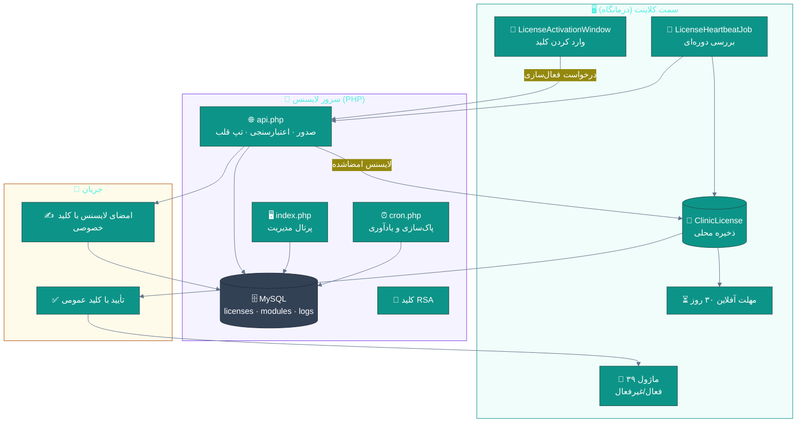
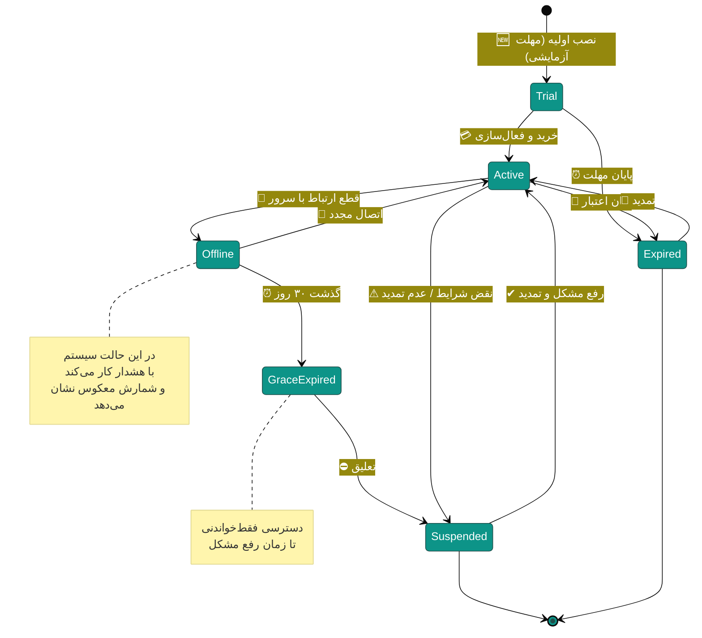
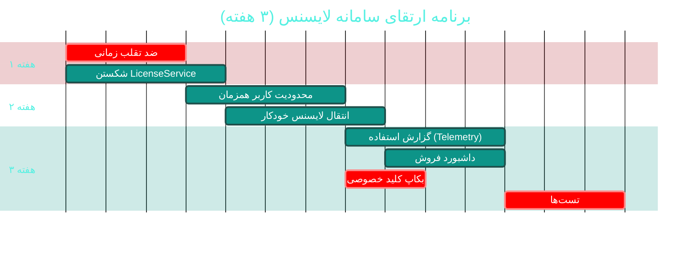

# 🔑 ماژول سامانه لایسنس (Licensing)

> **مسیر ماژول:** `license` · **لایسنس:** هسته (همیشه فعال)
> **اولویت:** 🟠 بالا · **دشواری:** 🟠 بالا · **زمان برآوردی:** ۳ هفته

---

## ۱. 📋 خلاصه ماژول

سامانه مدیریت حق‌استفاده: صدور و اعتبارسنجی لایسنس با **امضای RSA**،
**اثر انگشت سخت‌افزاری**، **تپ قلب (Heartbeat)** دوره‌ای، **مهلت آفلاین**،
و **۳۹ ماژول قابل فعال‌سازی جداگانه**.

| ویژگی | مقدار |
|:---|:---|
| 🎯 هدف | محافظت از درآمد + فعال‌سازی ماژولار متناسب با نیاز مشتری |
| 👤 کاربران اصلی | مدیر · تیم فروش · پشتیبانی |
| 🔗 وابستگی‌ها | همه ماژول‌ها · سرور PHP خارجی |
| 📊 وضعیت فعلی | 🟢 بالغ — 🟠 پیچیدگی بالا |

---

## ۲. 🎯 وضعیت فعلی در کدبیس

| بخش | فایل | خط | وضعیت |
|:---|:---|--:|:---|
| 🧬 Domain | `.../Licensing/ClinicLicense.cs` · `LicenseCheckLog.cs` | — | 🟢 |
| 🧬 Domain | `.../Enums/LicenseStatus.cs` · `LicenseType.cs` · `LicenseValidationResult.cs` | — | 🟢 |
| 🧬 Domain | `.../Events/LicenseEvents.cs` | — | 🟢 |
| 🗄 Infra | **`.../Services/License/LicenseService.cs`** | **۱٬۱۵۱** | 🟠 بسیار بزرگ |
| 🗄 Infra | `.../Services/License/LicenseHeartbeatJob.cs` | — | 🟢 |
| 🗄 Infra | `.../Persistence/Repositories/LicenseRepository.cs` | — | 🟢 |
| 🌐 API | `.../Controllers/LicenseController.cs` | — | 🟢 |
| 🖥 Desktop | `.../Views/LicenseActivationWindow.xaml` · `LicenseStatusView.xaml` | — | 🟢 |
| 🧪 تست | `tests/.../LicensePortalHelperTests.cs` · `tests/.../LicenseSignatureCompatibilityTests.cs` | — | 🟢 |
| 🐘 **سرور PHP** | `src/LicenseServer.Php/` | **۲٬۸۹۲** | 🟢 |
| 🐘 | `api.php` · `index.php` · `install.php` · `cron.php` · `inc/functions.php` · `inc/pages.inc.php` · `inc/schema.sql` | — | 🟢 |
| 🔄 CI | `.github/workflows/ci.yml` → job `license-e2e` (۳۴ تست) | — | 🟢 ⭐ |

### نکات برجسته‌ی فعلی

✅ **امضای RSA** برای اعتبارسنجی لایسنس
✅ **اثر انگشت سخت‌افزاری** (Hardware Fingerprint)
✅ **تپ قلب (Heartbeat)** با کار پس‌زمینه
✅ **مهلت آفلاین ۳۰ روزه** (`OfflineGraceDays`)
✅ **۳۹ ماژول** قابل فعال‌سازی مستقل
✅ **سرور PHP بدون Composer** — فقط PHP 8 + MySQL (مناسب هاست اشتراکی)
✅ **۳۴ تست E2E در CI** برای سرور لایسنس
✅ **تست سازگاری امضا** (`LicenseSignatureCompatibilityTests`)

---

## ۳. 📊 نمودار معماری لایسنس



### نمودار وضعیت لایسنس



---

## ۴. ⚠️ کاستی‌ها و ایرادها

| # | کاستی | 🎯 شدت | 📍 محل | 💥 پیامد |
|:--:|:---|:--:|:---|:---|
| W-01 | **`LicenseService` با ۱٬۱۵۱ خط** | 🟠 بالا | `Infrastructure/Services/` | نگهداری بسیار دشوار |
| W-02 | **دور زدن لایسنس** با تغییر ساعت سیستم احتمالاً ممکن است | 🔴 بالا | — | از دست رفتن درآمد |
| W-03 | **لایسنس اشتراکی (Concurrent Users)** ندارد | 🟡 متوسط | — | امکان استفاده فراتر از قرارداد |
| W-04 | **مدیریت کلید RSA در سرور PHP** — فایل `inc/` با `.htaccess` محافظت شده | 🟡 متوسط | `LicenseServer.Php/inc/` | وابسته به پیکربندی هاست |
| W-05 | **گزارش استفاده (Telemetry)** ندارد | 🟡 متوسط | — | عدم آگاهی از الگوی استفاده |
| W-06 | **لایسنس آزمایشی خودکار** از پرتال ندارد | 🟡 متوسط | — | فرایند دستی |
| W-07 | **انتقال لایسنس بین دستگاه‌ها** محدود است | 🟡 متوسط | — | نارضایتی هنگام تعویض سرور |
| W-08 | **بکاپ از کلید خصوصی** رویه ندارد | 🟠 بالا | — | از دست رفتن کلید = توقف صدور |
| W-09 | **امضای زمانی (Timestamp)** روی لایسنس ندارد | 🟡 متوسط | — | — |

---

## ۵. ✨ امکانات پیشنهادی

| 🎯 # | امکان | 📝 شرح | 💰 ارزش | 🔧 دشواری | ⏱ |
|:--:|:---|:---|:--:|:--:|:--:|
| F-01 | 🕐 **ضد تقلب زمانی** | ذخیره آخرین زمان معتبر + تشخیص عقب‌کشیدن ساعت | **حیاتی** | کم | ۳ روز |
| F-02 | 🧩 **شکستن LicenseService** | تفکیک به ۴ کلاس | بالا | متوسط | ۴ روز |
| F-03 | 👥 **محدودیت کاربر همزمان** | کنترل تعداد نشست‌های فعال | بالا | متوسط | ۵ روز |
| F-04 | 🔄 **انتقال لایسنس خودکار** | جابه‌جایی بین دستگاه‌ها با محدودیت | بالا | متوسط | ۴ روز |
| F-05 | 📊 **گزارش استفاده (Telemetry)** | آمار استفاده از ماژول‌ها | بالا | متوسط | ۵ روز |
| F-06 | 🆓 **لایسنس آزمایشی خودکار** | صدور آنی از پرتال با مهلت ۱۴ روز | بالا | کم | ۳ روز |
| F-07 | 🔐 **بکاپ و بازیابی کلید** | رویه مستند + ابزار | بالا | کم | ۲ روز |
| F-08 | ⏱ **امضای زمانی معتبر (TSA)** | جلوگیری از جعل تاریخ انقضا | متوسط | زیاد | ۲ هفته |
| F-09 | 💳 **پرداخت آنلاین در پرتال** | خرید مستقیم لایسنس | بسیار بالا | زیاد | ۳ هفته |
| F-10 | 📋 **داشبورد فروش** | مشتریان · تمدیدها · درآمد ماهانه | بالا | متوسط | ۴ روز |

---

## ۶. 🛠 دستورالعمل پیاده‌سازی

### 📌 گام ۱ — ضد تقلب زمانی (F-01) — *مهم‌ترین*

> 🔑 **مشکل:** اگر لایسنس فقط با مقایسه `DateTime.Now < ExpiryDate` اعتبارسنجی شود،
> کاربر با **عقب کشیدن ساعت سیستم** می‌تواند تا ابد از آن استفاده کند.

**۱.۱ ذخیره آخرین زمان معتبر**

```csharp
// 📄 src/Sahand.ClinicPro.Domain/Licensing/ClinicLicense.cs — افزوده شود:

/// <summary>
/// آخرین زمانِ تأیید‌شده (از منبع معتبر) — برای تشخیص دستکاری ساعت.
/// اگر ساعت سیستم از این مقدار عقب‌تر برود، یعنی کاربر ساعت را
/// عقب کشیده است و لایسنس باید وارد حالت مشکوک شود.
/// </summary>
public DateTime? LastValidatedAtUtc { get; set; }

/// <summary>تعداد دفعات تشخیص دستکاری زمان</summary>
public int ClockTamperCount { get; set; }

/// <summary>آیا زمان آخرین بررسی قابل اعتماد است</summary>
public bool ClockTrusted { get; set; } = true;
```

**۱.۲ منطق تشخیص**

```csharp
// 📄 در LicenseService — متد اعتبارسنجی محلی:

/// <summary>
/// بررسی یکپارچگی زمان — تشخیص عقب‌کشیدن ساعت سیستم.
/// </summary>
private ClockIntegrityResult CheckClockIntegrity(ClinicLicense license)
{
    var now = _clock.UtcNow;

    // اولین اجرا — baseline ثبت شود
    if (license.LastValidatedAtUtc is null)
        return ClockIntegrityResult.FirstRun(now);

    var lastValid = license.LastValidatedAtUtc.Value;

    // ── تلورانس: ۲۴ ساعت برای تغییرات مشروع (سفر، DST، تنظیم سرور) ──
    const int toleranceHours = -24;

    if (now < lastValid.AddHours(toleranceHours))
    {
        // 🚩 ساعت بیش از ۲۴ ساعت عقب کشیده شده
        return ClockIntegrityResult.Tampered(
            $"ساعت سیستم {Math.Abs((now - lastValid).TotalDays):F0} روز عقب کشیده شده است. " +
            $"آخرین تأیید معتبر: {lastValid:yyyy/MM/dd}");
    }

    // ── بررسی پرش غیرعادی به جلو (کمتر خطرناک اما قابل توجه) ──
    if (now > lastValid.AddDays(400))
        return ClockIntegrityResult.Suspicious(
            "پرش زمانی غیرعادی به جلو تشخیص داده شد");

    return ClockIntegrityResult.Ok(now);
}

public record ClockIntegrityResult(bool IsTrusted, DateTime NewBaseline, string? Message)
{
    public static ClockIntegrityResult Ok(DateTime now)
        => new(true, now, null);

    public static ClockIntegrityResult FirstRun(DateTime now)
        => new(true, now, null);

    public static ClockIntegrityResult Tampered(string message)
        => new(false, DateTime.MinValue, message);

    public static ClockIntegrityResult Suspicious(string message)
        => new(true, DateTime.MinValue, message);
}
```

**۱.۳ اعمال در اعتبارسنجی**

```csharp
public async Task<LicenseValidationResult> ValidateAsync(CancellationToken ct = default)
{
    var license = await _repository.GetActiveAsync(ct);
    if (license is null) return LicenseValidationResult.NoLicense;

    // ── گارد یکپارچگی زمان ──
    var clockCheck = CheckClockIntegrity(license);
    if (!clockCheck.IsTrusted)
    {
        license.ClockTamperCount++;
        license.ClockTrusted = false;
        await _repository.UpdateAsync(license, ct);

        _logger.LogWarning("🚩 دستکاری زمان تشخیص داده شد: {Message}", clockCheck.Message);

        // پس از ۳ بار تشخیص، لایسنس تعلیق می‌شود
        if (license.ClockTamperCount >= 3)
        {
            license.Status = LicenseStatus.Suspended;
            await _repository.UpdateAsync(license, ct);
            return LicenseValidationResult.ClockTampering;
        }
    }
    else
    {
        license.LastValidatedAtUtc = clockCheck.NewBaseline;
        license.ClockTrusted = true;
    }

    // ادامه بررسی‌های عادی (امضا، انقضا، ماژول‌ها) …
}
```

---

### 📌 گام ۲ — شکستن `LicenseService` (F-02)

```
LicenseService (۱٬۱۵۱ خط)
├── 📄 LicenseValidator       → اعتبارسنجی امضا، انقضا، اثرانگشت
├── 📄 LicenseClockGuard      → یکپارچگی زمان (بالا)
├── 📄 LicenseModuleResolver  → تعیین ماژول‌های فعال
├── 📄 LicenseHeartbeatService → ارتباط با سرور
└── 📄 LicenseActivationService → فعال‌سازی و انتقال
```

---

### 📌 گام ۳ — محدودیت کاربر همزمان (F-03)

```csharp
// 📄 src/Sahand.ClinicPro.Infrastructure/Services/License/ConcurrentUserGuard.cs (جدید)
/// <summary>
/// نگهبان کاربران همزمان — محدود کردن تعداد نشست‌های فعال
/// مطابق تعداد مجاز در لایسنس.
/// </summary>
public class ConcurrentUserGuard
{
    private readonly IDistributedCache _cache;
    private readonly ILogger<ConcurrentUserGuard> _logger;

    public ConcurrentUserGuard(IDistributedCache cache,
        ILogger<ConcurrentUserGuard> logger)
    { _cache = cache; _logger = logger; }

    /// <summary>ثبت ورود یک کاربر</summary>
    public async Task<bool> TryAcquireSeatAsync(long licenseId, string sessionId,
        int maxSeats, CancellationToken ct = default)
    {
        var key = $"license:{licenseId}:seats";

        // مجموعه نشست‌های فعال با TTL ۳۰ دقیقه (تطابق با عمر توکن دسترسی)
        var seats = await _cache.GetStringAsync(key, ct);
        var active = string.IsNullOrEmpty(seats)
            ? new HashSet<string>()
            : System.Text.Json.JsonSerializer.Deserialize<HashSet<string>>(seats)!;

        // نشست تکراری مجاز است (همان کاربر از همان نشست)
        if (active.Contains(sessionId)) return true;

        if (active.Count >= maxSeats)
        {
            _logger.LogWarning(
                "ظرفیت لایسنس پر است: {Active}/{Max}", active.Count, maxSeats);
            return false;
        }

        active.Add(sessionId);
        await _cache.SetStringAsync(key,
            System.Text.Json.JsonSerializer.Serialize(active),
            new DistributedCacheEntryOptions
            {
                AbsoluteExpirationRelativeToNow = TimeSpan.FromHours(8),
            }, ct);

        return true;
    }

    /// <summary>آزادسازی صندلی هنگام خروج</summary>
    public async Task ReleaseSeatAsync(long licenseId, string sessionId,
        CancellationToken ct = default)
    {
        var key = $"license:{licenseId}:seats";
        var seats = await _cache.GetStringAsync(key, ct);
        if (string.IsNullOrEmpty(seats)) return;

        var active = System.Text.Json.JsonSerializer
            .Deserialize<HashSet<string>>(seats)!;

        if (active.Remove(sessionId))
            await _cache.SetStringAsync(key,
                System.Text.Json.JsonSerializer.Serialize(active), ct);
    }
}
```

---

## ۷. 🧪 تست‌های الزامی

| 🧪 تست | 🎯 هدف | اولویت |
|:---|:---|:--:|
| `LicenseSignature_ValidSignature_Accepted` *(موجود)* | امضا | 🔴 |
| `LicenseSignature_TamperedPayload_Rejected` | ضد جعل | 🔴 |
| `LicenseSignature_CompatibilityAcrossVersions` *(موجود)* | سازگاری | 🔴 |
| `ClockGuard_ClockRolledBack_Detected` | **ضد تقلب** | 🔴 |
| `ClockGuard_3Violations_Suspends` | تعلیق | 🔴 |
| `ClockGuard_MinorClockAdjust_Tolerated` | تلورانس | 🟠 |
| `Heartbeat_ServerUnreachable_EntersGrace` | مهلت آفلاین | 🔴 |
| `Heartbeat_GraceExpired_Restricts` | محدودسازی | 🔴 |
| `ConcurrentSeats_ExceedsMax_Rejected` | محدودیت | 🟠 |
| `ModuleGate_DisabledModule_Hidden` | دروازه ماژول | 🔴 |

**تست ضد تقلب زمان (بسیار مهم):**
```csharp
[Fact]
public async Task ClockGuard_ClockRolledBack_Detected()
{
    // Arrange: لایسنس با آخرین تأییدِ ۳۰ روز پیش
    var license = new ClinicLicense
    {
        LastValidatedAtUtc = DateTime.UtcNow.AddDays(-30),
        ExpiryDate = DateTime.UtcNow.AddDays(-5),      // منقضی شده
    };
    _clock.SetNow(DateTime.UtcNow.AddDays(-30));       // ⏪ کاربر ساعت را عقب کشید

    // Act
    var result = await _licenseService.ValidateAsync();

    // Assert — حتی با ساعت عقب‌کشیده‌شده، نباید معتبر باشد
    result.Should().NotBe(LicenseValidationResult.Valid);
}
```

---

## ۸. 📈 شاخص‌های موفقیت (KPI)

| 📊 شاخص | قبل | هدف |
|:---|:--:|:--:|
| 🕐 مقاومت در برابر دستکاری ساعت | ❌ | **✅** |
| 👥 کنترل کاربر همزمان | ❌ | **✅** |
| 📏 اندازه `LicenseService` | ۱٬۱۵۱ خط | **< ۳۰۰ خط** |
| 🔄 سهولت انتقال لایسنس | دستی | **خودکار** |
| 🧪 پوشش تست لایسنس | ~۵۰٪ | **> ۹۰٪** |

---

## ۹. 🗓 برنامه زمانی



---

## 🔗 پیوندهای مرتبط

| 📄 سند | توضیح |
|:---|:---|
| [تحلیل جامع](../ANALYSIS-REPORT.md) | سند اصلی |
| [C01 — امنیت](C01-security-rbac.md) | رمزنگاری |
| [C10 — خودکارسازی انتشار](C10-release-automation.md) | تحویل نسخه |
| [📐 تصمیم پرتال لایسنس](../../DECISION-LicensePortal.md) | مستند تصمیم |

---
<div align="center">📅 ۱۴۰۴/۰۷/۱۹ · 🔖 v1.0</div>
