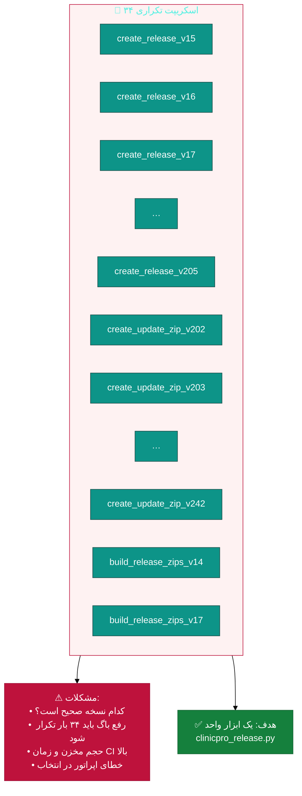
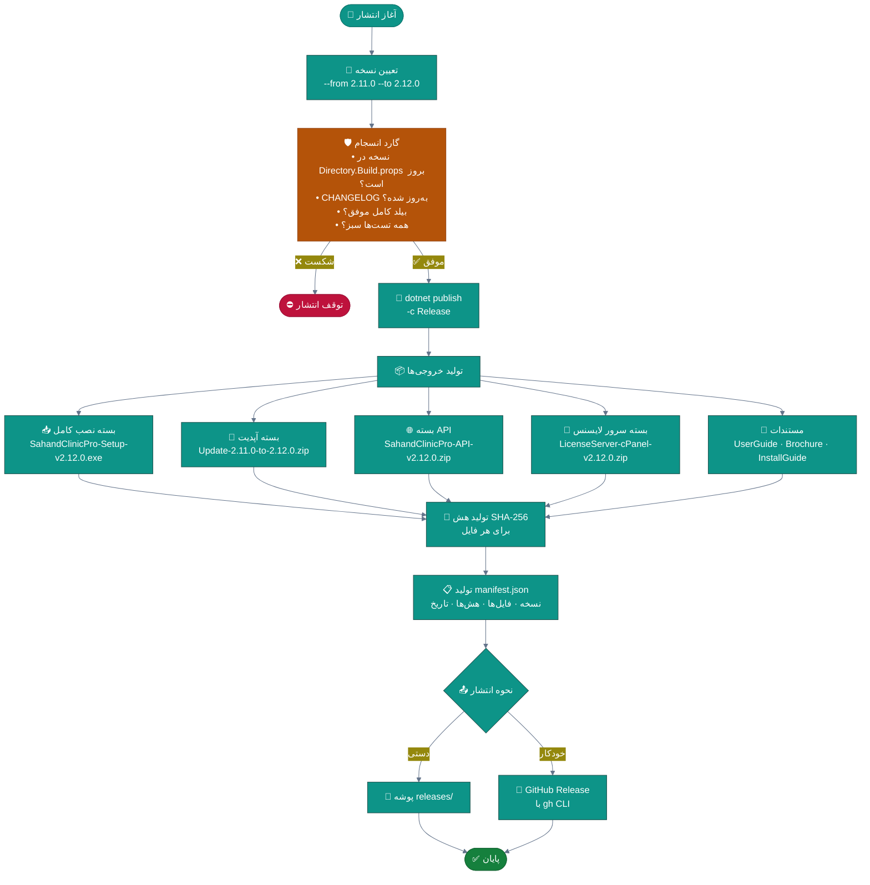
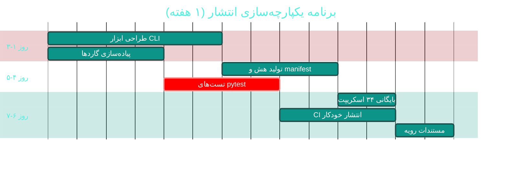

# 📦 ماژول خودکارسازی انتشار (Release Automation)

> **مسیر:** `scripts/` (۱۲۷ فایل · ۳۳٬۸۱۶ خط) · `installer/`
> **اولویت:** 🟠 بالا · **دشواری:** 🟢 کم · **زمان برآوردی:** ۱ هفته

---

## ۱. 📋 خلاصه ماژول

ابزارهای ساخت، بسته‌بندی، حسابرسی و انتشار نسخه‌های ClinicPro:
تولید فایل‌های ZIP برای آپدیت و نصب کامل، تولید بروشور و کاتالوگ فرم‌ها،
تولید تصاویر محیط برنامه، حسابرسی کد، و نصب‌کننده ویندوز (Inno Setup).

| ویژگی | مقدار |
|:---|:---|
| 🎯 هدف | انتشار تکرارپذیر، سریع و بدون خطای انسانی |
| 👤 کاربران اصلی | تیم توسعه · مدیر انتشار |
| 🔗 وابستگی‌ها | CI/CD · `docs/` · `installer/` |
| 📊 وضعیت فعلی | 🔴 **تورم شدید — ۳۴ اسکریپت تکراری** |

---

## ۲. 🎯 وضعیت فعلی در کدبیس

| دسته | تعداد | خط | وضعیت |
|:---|:--:|--:|:---|
| 🐍 کل اسکریپت‌های پایتون | **۱۲۷** | **۳۳٬۸۱۶** | 🔴 تورم |
| 📦 `create_release_v*.py` | ۱۰ | — | 🔴 تکراری |
| 📦 `create_update_zip_v*.py` | ۲۰ | — | 🔴 تکراری |
| 📦 `build_release_zips_v*.py` | ۴ | — | 🔴 تکراری |
| 📦 `build_release_assets_v20.py` | ۱ | — | 🔴 تکراری |
| 🔍 `audit_*.py` (حسابرسی) | ۷ | — | 🟢 مفید |
| 🖼 `generate_form_screenshots.py` | ۱ | ۱٬۱۱۵ | 🟢 مفید |
| 📖 `build_brochure.py` | ۱ | — | 🟢 مفید |
| 🧱 `step*_*.py` (تولید کد) | ~۶۰ | — | 🟡 تاریخی |
| 📦 `installer/SahandClinicPro.iss` | ۱ | — | 🟢 |
| 📦 `installer/BUILD-INSTALLER.bat` · `INSTALL-SERVER.bat` | ۲ | — | 🟢 |
| 🔄 `.github/workflows/ci.yml` | ۱ | — | 🟢 |

### تحلیل تکرار



> 📊 **تخمین:** اگر هر اسکریپت به‌طور متوسط ۳۰۰ خط داشته باشد،
> حدود **۱۰٬۰۰۰ خط کد تکراری** وجود دارد که می‌تواند به
> **~۶۰۰ خط** کاهش یابد — **صرفه‌جویی ۹۴ درصدی**.

---

## ۳. 📊 نمودار جریان انتشار پیشنهادی



---

## ۴. ⚠️ کاستی‌ها و ایرادها

| # | کاستی | 🎯 شدت | 📍 محل | 💥 پیامد |
|:--:|:---|:--:|:---|:---|
| W-01 | **۳۴ اسکریپت بسته‌ساز تکراری** | 🔴 بالا | `scripts/` | سردرگمی، بدهی نگهداری |
| W-02 | **هیچ تستی برای اسکریپت‌ها** وجود ندارد | 🟠 بالا | — | خرابی خاموش |
| W-03 | **گارد انسجام** در برخی اسکریپت‌هاست و در برخی نیست | 🟠 بالا | — | انتشار ناقص |
| W-04 | **نسخه در چند فایل تکرار شده** (`Directory.Build.props`, اسکریپت, ISS) | 🟠 بالا | — | ناهماهنگی نسخه |
| W-05 | **هش و امضای خروجی‌ها** ندارد | 🟡 متوسط | — | عدم اطمینان از سلامت فایل |
| W-06 | **انتشار فقط دستی** — CI آن را انجام نمی‌دهد | 🟡 متوسط | `ci.yml` | کندی و خطا |
| W-07 | **فایل manifest ماشین‌خوان** ندارد | 🟡 متوسط | — | آپدیت خودکار ممکن نیست |
| W-08 | **اسکریپت‌های تولید کد (`step*.py`)** در مخزن مانده‌اند | 🟡 متوسط | `scripts/` | حجم بی‌فایده |
| W-09 | **مستنداتِ نحوه انتشار** متمرکز نیست | 🟡 متوسط | — | وابستگی به فرد |

---

## ۵. ✨ امکانات پیشنهادی

| 🎯 # | امکان | 📝 شرح | 💰 ارزش | 🔧 دشواری | ⏱ |
|:--:|:---|:---|:--:|:--:|:--:|
| F-01 | 🔧 **ابزار CLI یکپارچه** | یک اسکریپت با زیرفرمان‌ها | **حیاتی** | کم | ۳ روز |
| F-02 | 🛡 **گارد انسجام سراسری** | بررسی خودکار پیش از انتشار | بسیار بالا | کم | ۲ روز |
| F-03 | 🔐 **تولید هش و manifest** | SHA-256 + فایل JSON | بالا | کم | ۱ روز |
| F-04 | 🔢 **منبع واحد نسخه** | خواندن از `Directory.Build.props` | بالا | کم | ۱ روز |
| F-05 | 🧪 **تست برای ابزار انتشار** | pytest برای مسیرهای بحرانی | بالا | کم | ۲ روز |
| F-06 | 🤖 **انتشار خودکار در CI** | با تگ Git | بسیار بالا | متوسط | ۳ روز |
| F-07 | 🗄 **بایگانی اسکریپت‌های تاریخی** | انتقال `step*.py` به `scripts/archive/` | متوسط | کم | ۱ ساعت |
| F-08 | 📋 **مستندات رویه انتشار** | فایل `RELEASE-PROCESS.md` | بالا | کم | ۳ ساعت |
| F-09 | 🔄 **آپدیت خودکار در کلاینت** | بررسی manifest و دانلود | بسیار بالا | زیاد | ۳ هفته |
| F-10 | 📊 **گزارش تغییرات خودکار** | استخراج از Git log | متوسط | کم | ۲ روز |

---

## ۶. 🛠 دستورالعمل پیاده‌سازی

### 📌 گام ۱ — ابزار CLI یکپارچه (F-01)

**۱.۱ ساختار پیشنهادی**

```
📂 scripts/
├── 📄 clinicpro_release.py          ⭐ ابزار اصلی (جدید)
├── 📄 release_config.py             پیکربندی مشترک (جدید)
├── 📂 release_lib/                  کتابخانه (جدید)
│   ├── 📄 __init__.py
│   ├── 📄 version.py                خواندن/نوشتن نسخه
│   ├── 📄 builders.py               ساخت بسته‌ها
│   ├── 📄 guards.py                 گاردهای انسجام
│   └── 📄 manifest.py               تولید هش و manifest
├── 📂 tests/                        تست‌های ابزار (جدید)
│   └── 📄 test_release.py
├── 📂 archive/                      🗄 اسکریپت‌های تاریخی (منتقل شوند)
│   ├── step01_*.py … stepU3_*.py
│   └── create_release_v15.py … create_update_zip_v242.py
├── 📄 generate_form_screenshots.py  🟢 نگه داشته شود (مفید)
├── 📄 build_brochure.py             🟢 نگه داشته شود
└── 📄 audit_*.py                    🟢 نگه داشته شود (۷ فایل)
```

**۱.۲ ابزار اصلی**

```python
#!/usr/bin/env python3
# -*- coding: utf-8 -*-
"""
╔══════════════════════════════════════════════════════════════════╗
║  ابزار یکپارچه انتشار — Sahand ClinicPro                          ║
║  جایگزین ۳۴ اسکریپت تکراری create_release_* / create_update_zip_* ║
╚══════════════════════════════════════════════════════════════════╝

نمونه استفاده:
    # بررسی آمادگی (بدون تغییر)
    python scripts/clinicpro_release.py check --to 2.12.0

    # ساخت همه بسته‌ها
    python scripts/clinicpro_release.py release --to 2.12.0

    # فقط بسته آپدیت
    python scripts/clinicpro_release.py update-zip --from 2.11.0 --to 2.12.0

    # انتشار روی GitHub
    python scripts/clinicpro_release.py publish --to 2.12.0
"""
from __future__ import annotations

import argparse
import hashlib
import json
import re
import shutil
import subprocess
import sys
from dataclasses import dataclass, field
from datetime import datetime, timezone
from pathlib import Path

# ─────────────────────────────────────────────────────────────────
# ثابت‌ها
# ─────────────────────────────────────────────────────────────────
ROOT = Path(__file__).resolve().parent.parent
BUILD_PROPS = ROOT / "Directory.Build.props"
OUTPUT_DIR = ROOT / "releases"
CHANGELOG = ROOT / "CHANGELOG.md"


@dataclass
class ReleaseConfig:
    """پیکربندی انتشار — همه مسیرها در یکجا."""

    version: str
    previous_version: str | None = None
    channel: str = "stable"
    output_dir: Path = field(default_factory=lambda: OUTPUT_DIR)
    dry_run: bool = False

    @property
    def version_dir(self) -> Path:
        return self.output_dir / f"v{self.version}"


# ─────────────────────────────────────────────────────────────────
# مدیریت نسخه
# ─────────────────────────────────────────────────────────────────
class VersionManager:
    """خواندن و به‌روزرسانی نسخه از منبع واحد (Directory.Build.props)."""

    PATTERN = re.compile(r"<Version>(?P<version>[^<]+)</Version>")

    @staticmethod
    def read() -> str:
        """خواندن نسخه فعلی از Directory.Build.props."""
        content = BUILD_PROPS.read_text(encoding="utf-8-sig")
        match = VersionManager.PATTERN.search(content)
        if not match:
            raise RuntimeError("تگ <Version> در Directory.Build.props یافت نشد")
        return match.group("version").strip()

    @staticmethod
    def update(new_version: str, dry_run: bool = False) -> None:
        """به‌روزرسانی نسخه در منبع واحد."""
        content = BUILD_PROPS.read_text(encoding="utf-8-sig")
        updated = VersionManager.PATTERN.sub(
            f"<Version>{new_version}</Version>", content, count=1
        )
        if dry_run:
            print(f"  [DRY-RUN] به‌روزرسانی نسخه به {new_version}")
            return
        BUILD_PROPS.write_text(updated, encoding="utf-8-sig")
        print(f"  ✅ نسخه به {new_version} به‌روز شد")


# ─────────────────────────────────────────────────────────────────
# گاردهای انسجام
# ─────────────────────────────────────────────────────────────────
class ReleaseGuards:
    """گاردهای پیش از انتشار — جلوگیری از انتشار ناقص."""

    @staticmethod
    def run_all(config: ReleaseConfig) -> list[str]:
        """اجرای همه گاردها؛ خروجی = فهرست خطاها."""
        errors: list[str] = []

        errors += ReleaseGuards._check_version_consistency(config)
        errors += ReleaseGuards._check_changelog(config)
        errors += ReleaseGuards._check_working_tree_clean()
        errors += ReleaseGuards._check_no_debug_settings()

        return errors

    @staticmethod
    def _check_version_consistency(config: ReleaseConfig) -> list[str]:
        """نسخه درخواستی باید با Directory.Build.props مطابقت داشته باشد."""
        actual = VersionManager.read()
        if actual != config.version:
            return [
                f"❌ ناهماهنگی نسخه: درخواست {config.version} "
                f"اما Directory.Build.props می‌گوید {actual}"
            ]
        return []

    @staticmethod
    def _check_changelog(config: ReleaseConfig) -> list[str]:
        """CHANGELOG باید برای این نسخه مدخل داشته باشد."""
        content = CHANGELOG.read_text(encoding="utf-8")
        if config.version not in content:
            return [f"❌ نسخه {config.version} در CHANGELOG.md ثبت نشده است"]
        return []

    @staticmethod
    def _check_working_tree_clean() -> list[str]:
        """مخزن نباید تغییرات ذخیره‌نشده داشته باشد."""
        result = subprocess.run(
            ["git", "status", "--porcelain"],
            capture_output=True, text=True, cwd=ROOT,
        )
        if result.stdout.strip():
            return ["❌ مخزن تغییرات ذخیره‌نشده دارد — ابتدا کامیت کنید"]
        return []

    @staticmethod
    def _check_no_debug_settings() -> list[str]:
        """بررسی تنظیمات خطرناک در appsettings."""
        errors = []
        settings = ROOT / "src" / "Sahand.ClinicPro.API" / "appsettings.json"
        if settings.exists():
            content = settings.read_text(encoding="utf-8-sig")
            if "Change-In-Production" in content:
                errors.append(
                    "❌ کلید پیش‌فرض JWT در appsettings.json باقی مانده است "
                    "— پیش از انتشار حتماً منتقل شود"
                )
        return errors


# ─────────────────────────────────────────────────────────────────
# تولید هش و manifest
# ─────────────────────────────────────────────────────────────────
def sha256_file(path: Path) -> str:
    """محاسبه هش SHA-256 یک فایل."""
    digest = hashlib.sha256()
    with path.open("rb") as handle:
        for chunk in iter(lambda: handle.read(1024 * 1024), b""):
            digest.update(chunk)
    return digest.hexdigest()


def build_manifest(config: ReleaseConfig, artifacts: list[Path]) -> Path:
    """تولید فایل manifest.json برای آپدیت خودکار."""
    manifest = {
        "version": config.version,
        "previousVersion": config.previous_version,
        "channel": config.channel,
        "releasedAt": datetime.now(timezone.utc).isoformat(),
        "files": [
            {
                "name": artifact.name,
                "size": artifact.stat().st_size,
                "sha256": sha256_file(artifact),
            }
            for artifact in artifacts
        ],
    }
    target = config.version_dir / "manifest.json"
    target.write_text(
        json.dumps(manifest, ensure_ascii=False, indent=2), encoding="utf-8"
    )
    return target


# ─────────────────────────────────────────────────────────────────
# ساخت بسته‌ها
# ─────────────────────────────────────────────────────────────────
def build_release(config: ReleaseConfig) -> list[Path]:
    """ساخت همه بسته‌های انتشار."""
    out = config.version_dir
    out.mkdir(parents=True, exist_ok=True)
    artifacts: list[Path] = []

    # ۱) انتشار دسکتاپ و API
    print("🔨 در حال انتشار پروژه‌ها…")
    for project in ("Sahand.ClinicPro.Desktop", "Sahand.ClinicPro.API"):
        if config.dry_run:
            print(f"  [DRY-RUN] dotnet publish {project}")
            continue
        subprocess.run(
            ["dotnet", "publish",
             str(ROOT / "src" / project / f"{project}.csproj"),
             "-c", "Release", "-o", str(out / project)],
            check=True, cwd=ROOT,
        )
        print(f"  ✅ {project}")

    # ۲) بسته آپدیت (فقط فایل‌های تغییریافته)
    if config.previous_version:
        artifacts.append(_build_update_zip(config))

    # ۳) بسته کامل
    artifacts.append(_build_full_zip(config, out))

    # ۴) مستندات
    artifacts += _collect_docs(config, out)

    return artifacts


def _build_update_zip(config: ReleaseConfig) -> Path:
    """ساخت بسته آپدیت بین دو نسخه."""
    name = f"Update-{config.previous_version}-to-{config.version}.zip"
    target = config.version_dir / name
    if not config.dry_run:
        shutil.make_archive(str(target.with_suffix("")), "zip",
                            config.version_dir / "Sahand.ClinicPro.Desktop")
    print(f"  ✅ بسته آپدیت: {name}")
    return target


def _build_full_zip(config: ReleaseConfig, out: Path) -> Path:
    """ساخت بسته کامل نصب."""
    name = f"SahandClinicPro-Full-v{config.version}.zip"
    target = config.version_dir / name
    if not config.dry_run:
        shutil.make_archive(str(target.with_suffix("")), "zip", out)
    print(f"  ✅ بسته کامل: {name}")
    return target


def _collect_docs(config: ReleaseConfig, out: Path) -> list[Path]:
    """گردآوری مستندات قابل توزیع."""
    docs = []
    for candidate in (ROOT / "docs" / "guides").glob("*.html"):
        target = out / candidate.name
        if not config.dry_run:
            shutil.copy2(candidate, target)
        docs.append(target)
    return docs


# ─────────────────────────────────────────────────────────────────
# رابط خط فرمان
# ─────────────────────────────────────────────────────────────────
def main() -> int:
    parser = argparse.ArgumentParser(
        description="ابزار یکپارچه انتشار Sahand ClinicPro",
        formatter_class=argparse.RawDescriptionHelpFormatter,
    )
    sub = parser.add_subparsers(dest="command", required=True)

    # ── check ──
    p_check = sub.add_parser("check", help="بررسی آمادگی انتشار (بدون تغییر)")
    p_check.add_argument("--to", required=True, help="نسخه مقصد")

    # ── release ──
    p_release = sub.add_parser("release", help="ساخت همه بسته‌ها")
    p_release.add_argument("--to", required=True)
    p_release.add_argument("--from", dest="from_version")
    p_release.add_argument("--channel", default="stable")
    p_release.add_argument("--dry-run", action="store_true")

    # ── update-zip ──
    p_update = sub.add_parser("update-zip", help="ساخت فقط بسته آپدیت")
    p_update.add_argument("--from", dest="from_version", required=True)
    p_update.add_argument("--to", required=True)

    # ── publish ──
    p_publish = sub.add_parser("publish", help="انتشار روی GitHub Release")
    p_publish.add_argument("--to", required=True)
    p_publish.add_argument("--dry-run", action="store_true")

    args = parser.parse_args()

    config = ReleaseConfig(
        version=args.to,
        previous_version=getattr(args, "from_version", None),
        channel=getattr(args, "channel", "stable"),
        dry_run=getattr(args, "dry_run", False),
    )

    # ── گاردها ──
    print("🛡 بررسی گاردهای انسجام…")
    errors = ReleaseGuards.run_all(config)
    if errors:
        for error in errors:
            print(f"  {error}")
        print("\n⛔ انتشار متوقف شد — خطاها را رفع کنید")
        return 1
    print("  ✅ همه گاردها گذشتند")

    if args.command == "check":
        print("\n✅ آماده انتشار")
        return 0

    # ── ساخت ──
    print(f"\n📦 ساخت بسته‌های نسخه {config.version}…")
    artifacts = build_release(config)

    manifest = build_manifest(config, artifacts)
    print(f"\n📋 manifest تولید شد: {manifest.relative_to(ROOT)}")

    # ── انتشار ──
    if args.command == "publish":
        files = " ".join(f'"{a}"' for a in artifacts + [manifest])
        cmd = f'gh release create "v{config.version}" {files} --generate-notes'
        if config.dry_run:
            print(f"  [DRY-RUN] {cmd}")
        else:
            subprocess.run(cmd, shell=True, check=True, cwd=ROOT)
        print("  ✅ انتشار شد")

    print(f"\n🎉 نسخه {config.version} با موفقیت آماده شد")
    return 0


if __name__ == "__main__":
    sys.exit(main())
```

**۱.۳ تست برای ابزار**

```python
# 📄 scripts/tests/test_release.py (جدید)
"""تست‌های ابزار انتشار — مسیرهای بحرانی."""
import json
from pathlib import Path

import pytest

from release_lib.version import VersionManager
from release_lib.guards import ReleaseGuards
from release_lib.manifest import sha256_file, build_manifest


class TestVersionManager:
    """تست‌های مدیریت نسخه."""

    def test_read_version_returns_semver(self):
        """نسخه خوانده‌شده باید الگوی SemVer داشته باشد."""
        version = VersionManager.read()
        assert version.count(".") >= 1, f"نسخه نامعتبر: {version}"

    def test_pattern_matches_expected_format(self):
        """الگوی جستجو باید تگ Version را پیدا کند."""
        match = VersionManager.PATTERN.search("<Version>2.12.0</Version>")
        assert match is not None
        assert match.group("version") == "2.12.0"


class TestGuards:
    """تست‌های گارد انسجام."""

    def test_version_mismatch_produces_error(self, tmp_path):
        """ناهماهنگی نسخه باید خطا تولید کند."""
        config = ReleaseConfig(version="9.9.9")   # عمداً غلط
        errors = ReleaseGuards._check_version_consistency(config)
        assert errors, "ناهماهنگی نسخه باید شناسایی شود"

    def test_changelog_missing_entry_produces_error(self):
        """نبود مدخل در CHANGELOG باید خطا تولید کند."""
        config = ReleaseConfig(version="99.99.99")
        errors = ReleaseGuards._check_changelog(config)
        assert errors, "نبود مدخل CHANGELOG باید شناسایی شود"


class TestManifest:
    """تست‌های تولید manifest."""

    def test_sha256_known_content(self, tmp_path):
        """هش باید برای محتوای معلوم، مقدار معلوم بدهد."""
        sample = tmp_path / "sample.txt"
        sample.write_text("sahand", encoding="utf-8")
        digest = sha256_file(sample)
        assert len(digest) == 64          # هش SHA-256 = ۶۴ کاراکتر hex
        assert digest == sha256_file(sample)   # تکرارپذیر

    def test_manifest_contains_all_artifacts(self, tmp_path):
        """manifest باید همه فایل‌ها را با هش دربر بگیرد."""
        file_a = tmp_path / "a.txt"
        file_a.write_text("A", encoding="utf-8")
        config = ReleaseConfig(version="2.12.0", output_dir=tmp_path)

        manifest_path = build_manifest(config, [file_a])
        data = json.loads(manifest_path.read_text(encoding="utf-8"))

        assert data["version"] == "2.12.0"
        assert len(data["files"]) == 1
        assert data["files"][0]["name"] == "a.txt"
        assert "sha256" in data["files"][0]
```

---

### 📌 گام ۲ — بایگانی اسکریپت‌های تاریخی (F-07)

```bash
cd /home/user/Sahand_ClinicPro

# ۱) ایجاد پوشه بایگانی
mkdir -p scripts/archive

# ۲) انتقال اسکریپت‌های تکراری بسته‌ساز
git mv scripts/create_release_v*.py scripts/archive/
git mv scripts/create_update_zip_v*.py scripts/archive/
git mv scripts/build_release_zips_v*.py scripts/archive/
git mv scripts/build_release_assets_v20.py scripts/archive/

# ۳) انتقال اسکریپت‌های تولید کد تاریخی
git mv scripts/step*.py scripts/archive/

# ۴) افزودن یادداشت راهنما
cat > scripts/archive/README.md << 'EOF'
# 🗄 بایگانی اسکریپت‌های تاریخی

این پوشه شامل اسکریپت‌هایی است که **دیگر استفاده نمی‌شوند** اما برای
مراجعه تاریخی نگه داشته شده‌اند:

- `create_release_v*.py` / `create_update_zip_v*.py` — ۳۴ نسخهٔ تکراری
  از بسته‌ساز که توسط **`../clinicpro_release.py`** جایگزین شده‌اند.
- `step*.py` — اسکریپت‌های تولید اولیهٔ کد پروژه (تاریخی).

⚠️ از این اسکریپت‌ها برای انتشار جدید استفاده نکنید.
📖 راهنما: `../../docs/analysis/modules/C10-release-automation.md`
EOF
```

> ✅ **صرفه‌جویی مورد انتظار:** ~۱۰٬۰۰۰ خط کد تکراری → ۰

---

### 📌 گام ۳ — انتشار خودکار در CI (F-06)

```yaml
# 📄 .github/workflows/release.yml (جدید)
name: 🚀 انتشار نسخه

on:
  push:
    tags: [ 'v*.*.*' ]          # با تگ v2.12.0 اجرا می‌شود
  workflow_dispatch:
    inputs:
      version:
        description: 'نسخه مورد نظر (مثال: 2.12.0)'
        required: true

permissions:
  contents: write

jobs:
  release:
    runs-on: windows-latest      # برای ساخت WPF لازم است
    steps:
      - name: دریافت سورس
        uses: actions/checkout@v4

      - name: نصب .NET 8
        uses: actions/setup-dotnet@v4
        with:
          dotnet-version: '8.0.x'

      - name: نصب پایتون
        uses: actions/setup-python@v5
        with:
          python-version: '3.12'

      - name: نصب وابستگی‌های پایتون
        run: pip install pytest

      - name: تست ابزار انتشار
        run: pytest scripts/tests -v

      - name: تعیین نسخه
        id: version
        run: |
          if ("${{ github.event.inputs.version }}") {
            echo "value=${{ github.event.inputs.version }}" >> $env:GITHUB_OUTPUT
          } else {
            $tag = "${{ github.ref_name }}" -replace '^v',''
            echo "value=$tag" >> $env:GITHUB_OUTPUT
          }
        shell: pwsh

      - name: بررسی آمادگی
        run: python scripts/clinicpro_release.py check --to ${{ steps.version.outputs.value }}

      - name: ساخت بسته‌ها
        run: python scripts/clinicpro_release.py release --to ${{ steps.version.outputs.value }}

      - name: انتشار روی GitHub
        run: python scripts/clinicpro_release.py publish --to ${{ steps.version.outputs.value }}
        env:
          GH_TOKEN: ${{ secrets.GITHUB_TOKEN }}
```

---

### 📌 گام ۴ — مستندات رویه انتشار (F-08)

خلاصه‌ی رویه (جزئیات در `docs/guides/RELEASE-PROCESS.md`):


---

## ۷. 🧪 تست‌های الزامی

| 🧪 تست | 🎯 هدف |
|:---|:---|
| `test_read_version_returns_semver` | خواندن نسخه |
| `test_version_mismatch_produces_error` | گارد نسخه |
| `test_changelog_missing_entry_produces_error` | گارد CHANGELOG |
| `test_sha256_known_content` | صحت هش |
| `test_manifest_contains_all_artifacts` | کامل‌بودن manifest |
| `test_dirty_working_tree_blocks_release` | گارد مخزن |
| `test_default_jwt_key_blocks_release` | **گارد امنیتی** |
| `test_update_zip_naming_convention` | نام‌گذاری |

---

## ۸. 📈 شاخص‌های موفقیت (KPI)

| 📊 شاخص | قبل | هدف |
|:---|:--:|:--:|
| 🐍 تعداد اسکریپت‌های بسته‌ساز | **۳۴** | **۱** |
| 📏 خطوط کد تکراری | ~۱۰٬۰۰۰ | **~۶۰۰** |
| ⏱ زمان آماده‌سازی انتشار | ~۴۵ دقیقه | **< ۵ دقیقه** |
| 🛡 گاردهای انسجام | پراکنده | **۴ گارد یکپارچه** |
| 🧪 تست ابزار انتشار | ۰ | **۸ تست** |
| 🔐 هش و manifest | ❌ | **✅** |

---

## ۹. 🗓 برنامه زمانی



---

## 🔗 پیوندهای مرتبط

| 📄 سند | توضیح |
|:---|:---|
| [تحلیل جامع](../ANALYSIS-REPORT.md) | — [BUG-05](#) |
| [C09 — سامانه لایسنس](C09-licensing.md) | تحویل لایسنس |
| [C11 — مقیاس‌پذیری پایگاه داده](C11-database-scalability.md) | بیلد و مایگریشن |
| [📁 پوشه installer](../../../installer/README.md) | نصب‌کننده |

---
<div align="center">📅 ۱۴۰۴/۰۷/۱۹ · 🔖 v1.0</div>
