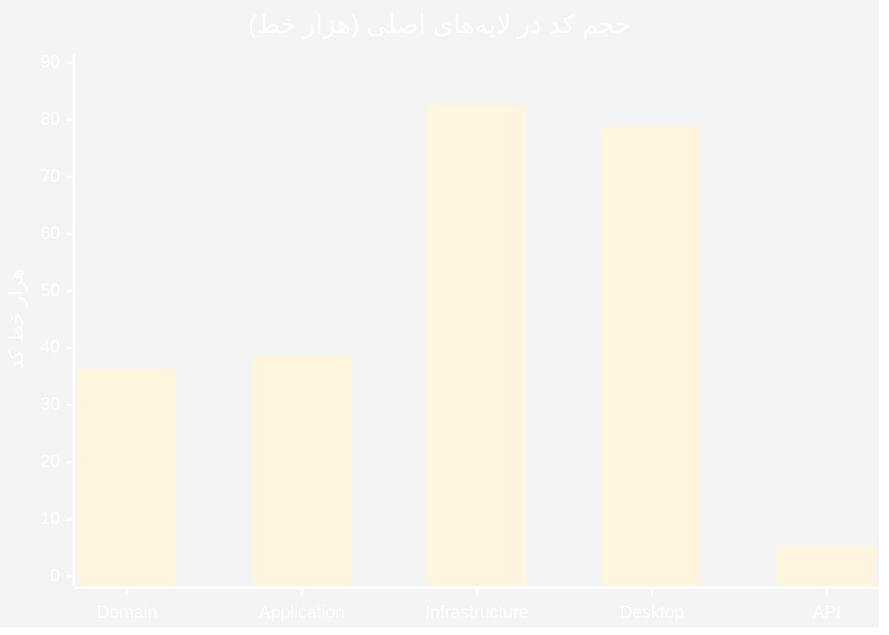
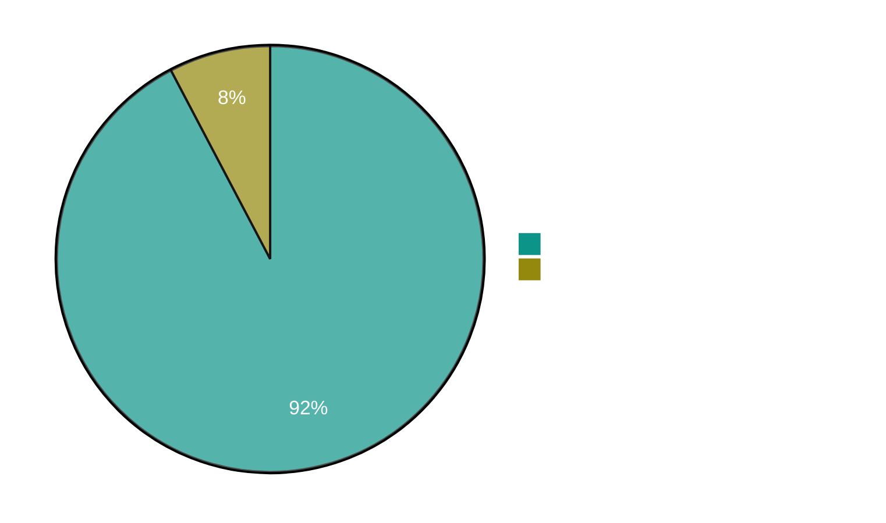
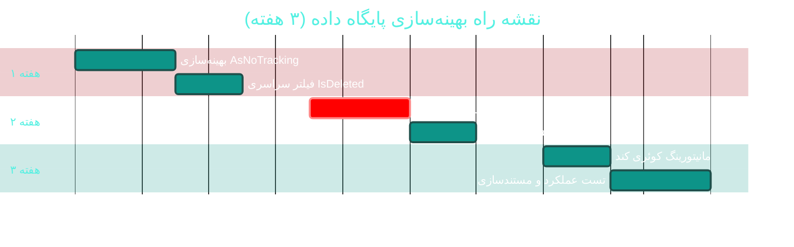

# 🗄 ماژول مقیاس‌پذیری پایگاه داده (Database Scalability)

> **مسیر ماژول:** `Infrastructure/Persistence/**`
> **لایسنس:** core · **اولویت:** 🟠 بالا · **دشواری:** 🟡 متوسط · **زمان برآوردی:** ۳ هفته

---

## ۱. 📋 خلاصه ماژول

سامانه ClinicPro دارای **۱۱۲ موجودیت** است که در یک `DbContext` واحد
(`ClinicProDbContext` با ۵۴۹ خط) مدیریت می‌شوند و حدود **۲۲۵٬۲۸۷ خط کد مایگریشن**
تولید کرده‌اند. این حجم بالا، زمان راه‌اندازی و ریسک مایگریشن را افزایش داده است.

| ویژگی | مقدار |
|:---|:---|
| 🎯 هدف | حفظ کارایی پایگاه داده در حجم بالا و ساده‌سازی تکامل مدل |
| 👤 کاربران اصلی | توسعه‌دهندگان، مدیر فنی |
| 🔗 وابستگی‌ها | EF Core 8.0.31 · SQL Server · کلیه ماژول‌ها |
| 📊 وضعیت فعلی | 🟠 نیازمند بهینه‌سازی جدی |

---

## ۲. 🎯 وضعیت فعلی در کدبیس

| آیتم | فایل | خط | تعداد | وضعیت |
|:---|:---|:--:|--:|:---|
| موجودیت‌ها (`DbSet`) | `Persistence/ClinicProDbContext.cs` | ۵۴۹ | **۱۱۲** | 🟠 سنگین |
| تنظیمات Fluent | `Persistence/Configurations/**` | — | ۱۱۰ | 🟢 |
| مایگریشن‌ها | `Persistence/Migrations/**` | **۲۲۵٬۲۸۷** | ۳۵ | 🔴 بسیار سنگین |
| Snapshot مدل | `ClinicProDbContextModelSnapshot.cs` | **۱۱٬۸۲۴** | ۱ | 🔴 |
| کوئری‌های ردیابی‌نشده | سراسر کدبیس | — | ۲۰ `AsNoTracking` | 🔴 کم |
| فراخوانی همزمان | سراسر کدبیس | — | ۲۶۰ `ToListAsync` | 🟢 |
| دسترسی مستقیم به `DbSet` | بیرون `Infrastructure` | — | ۱۱ | 🟡 |
| `IDbConnection` مستقیم (Dapper) | `Services/CatalogService.cs` | — | ۱ | 🟡 |

### 📊 توزیع حجم کدبیس (LOC)



> 📌 حجم بالای `Infrastructure` عمدتاً ناشی از مایگریشن‌ها (۲۲۵ هزار خط) و
> تنظیمات Fluent است.

---

## ۳. 📊 نمودار وضعیت کوئری‌ها



> ⚠️ کوئری‌های خواندن‌محور نباید Change Tracker را درگیر کنند.
> **تنها ۷٪** از کوئری‌ها از `AsNoTracking` استفاده می‌کنند.

---

## ۴. ⚠️ کاستی‌ها و ایرادها

| # | کاستی | 🎯 شدت | 📍 محل | 💥 پیامد |
|:--:|:---|:--:|:---|:---|
| W-01 | **مایگریشن‌های عظیم** (۲۲۵ هزار خط) | 🔴 بحرانی | `Persistence/Migrations/**` | زمان بیلد، حجم مخزن، ریسک خطا |
| W-02 | **فقدان `AsNoTracking`** در اکثر کوئری‌های خواندن | 🔴 بحرانی | سراسر کدبیس | مصرف حافظه، کاهش سرعت |
| W-03 | **`DbContext` غول‌پیکر** (۱۱۲ موجودیت) | 🟠 بالا | `ClinicProDbContext.cs` | زمان راه‌اندازی طولانی |
| W-04 | **نبود `HasQueryFilter` سراسری** برای `IsDeleted` | 🟠 بالا | سراسر کدبیس | خطر نشت داده‌های حذف‌شده |
| W-05 | **عدم استفاده از `IAsyncEnumerable`** برای مجموعه‌های بزرگ | 🟠 بالا | ماژول گزارشات | اشغال حافظه |
| W-06 | **نبود Split Query** برای `Include`های چندگانه | 🟡 متوسط | سراسر کدبیس | پدیده Cartesian Explosion |
| W-07 | **فقدان ایندکس ترکیبی** برای الگوهای پرتکرار | 🟡 متوسط | `Configurations/**` | کندی کوئری‌ها |
| W-08 | **نبود Batch/ Bulk operation** برای عملیات دسته‌ای | 🟡 متوسط | سراسر کدبیس | Round-tripهای زیاد |
| W-09 | **عدم مانیتورینگ کوئری‌های کند** | 🟡 متوسط | — | عدم شناسایی گلوگاه |
| W-10 | **نبود مکانیزم برای جداول تاریخچه (Temporal Tables)** | 🟢 پایین | — | محدودیت ردیابی تغییرات |

---

## ۵. ✨ امکانات پیشنهادی

| 🎯 # | امکان | 📝 شرح | 💰 ارزش | 🔧 دشواری | ⏱ زمان |
|:--:|:---|:---|:--:|:--:|:--:|
| F-01 | 🚀 **بهینه‌سازی `AsNoTracking`** | اعمال در تمام کوئری‌های خواندن | ⭐⭐⭐⭐⭐ | 🟡 متوسط | ۳ روز |
| F-02 | 📦 **فشرده‌سازی مایگریشن‌ها** | ادغام ۳۵ مایگریشن در یک Baseline | ⭐⭐⭐⭐⭐ | 🟡 متوسط | ۳ روز |
| F-03 | 🔍 **فیلتر سراسری `IsDeleted`** | `HasQueryFilter` در `OnModelCreating` | ⭐⭐⭐⭐⭐ | 🟢 کم | ۲ روز |
| F-04 | ⚡ **Split Query** برای `Include`های سنگین | جلوگیری از Cartesian Explosion | ⭐⭐⭐⭐ | 🟢 کم | ۲ روز |
| F-05 | 📑 **ایندکس‌های ترکیبی** | بر اساس الگوهای واقعی کوئری | ⭐⭐⭐⭐ | 🟡 متوسط | ۳ روز |
| F-06 | 🌊 **`IAsyncEnumerable`** برای گزارشات | پردازش جریانی نتایج | ⭐⭐⭐⭐ | 🟡 متوسط | ۳ روز |
| F-07 | 🔧 **جداسازی DbContext به Bounded Contextها** | تقسیم ۱۱۲ موجودیت | ⭐⭐⭐ | 🔴 زیاد | ۳ هفته |
| F-08 | 📊 **مانیتورینگ کوئری‌های کند** | لاگ و هشدار خودکار | ⭐⭐⭐⭐ | 🟢 کم | ۲ روز |
| F-09 | 🔄 **Bulk Operations** | کتابخانه یا روش دسته‌ای | ⭐⭐⭐ | 🟡 متوسط | ۴ روز |
| F-10 | 🕐 **Temporal Tables** | نگهداری تاریخچه تغییرات | ⭐⭐⭐ | 🟡 متوسط | ۱ هفته |
| F-11 | 🧪 **تست عملکرد (Performance Tests)** | اندازه‌گیری خودکار | ⭐⭐⭐⭐ | 🟡 متوسط | ۳ روز |
| F-12 | 🧹 **پاک‌سازی مایگریشن‌های بدون Designer** | رفع ۷ مایگریشن ناقص | ⭐⭐⭐ | 🟢 کم | ۱ روز |

---

## ۶. 🛠 دستورالعمل پیاده‌سازی (۵ گام)

### 📌 گام ۱ — فعال‌سازی `AsNoTracking` سراسری (F-01)

**۱.۱ افزودن extension برای Apply**

در `Infrastructure/Persistence/Extensions/QueryableExtensions.cs` (جدید):

```csharp
namespace Sahand.ClinicPro.Infrastructure.Persistence.Extensions;

public static class QueryableExtensions
{
    /// <summary>
    /// اعمال AsNoTracking با قابلیت بازگشت به حالت ردیابی برای سناریوهای خاص
    /// </summary>
    public static IQueryable<T> AsReadOnly<T>(this IQueryable<T> query, bool track = false)
        where T : class
    {
        return track ? query : query.AsNoTracking();
    }
}
```

**۱.۲ اعمال در `Repository` (پیشنهاد)**

در `Infrastructure/Persistence/Repositories/Repository.cs`،
متد `QueryableNoTracking` (اگر موجود باشد) به عنوان پیش‌فرض خواندن قرار گیرد.
در غیر این صورت، متد زیر اضافه شود:

```csharp
public IQueryable<T> QueryableNoTracking() => _dbSet.AsNoTracking();
```

**۱.۳ بازبینی دستی کوئری‌های بحرانی**

الگوی تبدیل:

```csharp
// ❌ قبل — Change Tracker فعال (سنگین)
var patients = await context.Patients
    .Where(p => p.IsActive)
    .ToListAsync(cancellationToken);

// ✅ بعد — بدون ردیابی (بهینه برای خواندن)
var patients = await context.Patients
    .AsNoTracking()
    .Where(p => p.IsActive)
    .ToListAsync(cancellationToken);
```

> ⚠️ برای عملیات **ویرایش/حذف** همچنان از حالت Tracking استفاده کنید.

---

### 📌 گام ۲ — فشرده‌سازی مایگریشن‌ها (F-02)

**۲.۱ ایجاد Baseline**

```bash
cd src/Sahand.ClinicPro.Infrastructure

# ۱) حذف پوشه مایگریشن‌های فعلی (پس از پشتیبان‌گیری)
#    و ایجاد مایگریشن اولیهٔ یکپارچه
dotnet ef migrations add Cycle49ConsolidatedBaseline \
    --startup-project ../Sahand.ClinicPro.API \
    --context ClinicProDbContext

# ۲) بررسی خروجی
dotnet ef migrations script --startup-project ../Sahand.ClinicPro.API

# ۳) حذف مایگریشن‌های قدیمی (با تأیید مدیر فنی)
```

> ⚠️ **هشدار:** این عملیات برای پایگاه داده‌های **تولید** نیازمند برنامه‌ریزی دقیق و
> ایجاد اسکریپت دستی است. در محیط توسعه، پس از حذف دیتابیس قابل انجام است.

**۲.۲ مایگریشن بدون Designer**

۷ مایگریشن فاقد فایل Designer هستند که می‌تواند باعث خطا در `dotnet ef` شود.
بررسی و رفع:

```bash
# یافتن مایگریشن‌های بدون Designer
cd src/Sahand.ClinicPro.Infrastructure/Persistence/Migrations
for f in *.cs; do
  base="${f%.cs}"
  if [ ! -f "${base}.Designer.cs" ] && [[ "$base" != *"ModelSnapshot"* ]]; then
    echo "بدون Designer: $base"
  fi
done
```

---

### 📌 گام ۳ — فیلتر سراسری حذف منطقی (F-03)

**۳.۱ تعریف Interface**

در `Domain/Interfaces/ISoftDeletable.cs` (جدید — بررسی تکراری نبودن):

```csharp
namespace Sahand.ClinicPro.Domain.Interfaces;

/// <summary>
/// نشان‌دهنده موجودیتی که حذف منطقی (Soft Delete) را پشتیبانی می‌کند
/// </summary>
public interface ISoftDeletable
{
    bool IsDeleted { get; set; }
    DateTime? DeletedAtUtc { get; set; }
    string? DeletedBy { get; set; }
}
```

**۳.۲ اعمال خودکار در `OnModelCreating`**

در `Persistence/ClinicProDbContext.cs`:

```csharp
protected override void OnModelCreating(ModelBuilder modelBuilder)
{
    base.OnModelCreating(modelBuilder);

    // اعمال خودکار تنظیمات
    modelBuilder.ApplyConfigurationsFromAssembly(typeof(ClinicProDbContext).Assembly);

    // ✅ فیلتر سراسری برای حذف منطقی
    foreach (var entityType in modelBuilder.Model.GetEntityTypes())
    {
        if (typeof(ISoftDeletable).IsAssignableFrom(entityType.ClrType))
        {
            var parameter = Expression.Parameter(entityType.ClrType, "e");
            var property = Expression.Property(parameter, nameof(ISoftDeletable.IsDeleted));
            var filter = Expression.Lambda(
                Expression.Equal(property, Expression.Constant(false)),
                parameter);

            modelBuilder.Entity(entityType.ClrType).HasQueryFilter(filter);
        }
    }
}
```

> ⚠️ برای دسترسی به داده‌های حذف‌شده از `.IgnoreQueryFilters()` استفاده شود.

---

### 📌 گام ۴ — مانیتورینگ کوئری‌های کند (F-08)

**۴.۱ Interceptor**

در `Infrastructure/Persistence/Interceptors/SlowQueryInterceptor.cs` (جدید):

```csharp
using Microsoft.EntityFrameworkCore.Diagnostics;
using System.Data.Common;

namespace Sahand.ClinicPro.Infrastructure.Persistence.Interceptors;

/// <summary>
/// ثبت و هشدار برای کوئری‌هایی که زمان اجرای آن‌ها از آستانه فراتر می‌رود
/// </summary>
public class SlowQueryInterceptor : DbCommandInterceptor
{
    private readonly ILogger<SlowQueryInterceptor> _logger;
    private readonly int _thresholdMs;

    public SlowQueryInterceptor(
        ILogger<SlowQueryInterceptor> logger,
        IConfiguration configuration)
    {
        _logger = logger;
        _thresholdMs = configuration.GetValue<int>("Database:SlowQueryThresholdMs", 1000);
    }

    public override DbDataReader ReaderExecuted(
        DbCommand command,
        CommandExecutedEventData eventData,
        DbDataReader result)
    {
        LogIfSlow(command, eventData);
        return base.ReaderExecuted(command, eventData, result);
    }

    public override async ValueTask<DbDataReader> ReaderExecutedAsync(
        DbCommand command,
        CommandExecutedEventData eventData,
        DbDataReader result,
        CancellationToken cancellationToken = default)
    {
        LogIfSlow(command, eventData);
        return await base.ReaderExecutedAsync(command, eventData, result, cancellationToken);
    }

    private void LogIfSlow(DbCommand command, CommandExecutedEventData eventData)
    {
        if (eventData.Duration.TotalMilliseconds < _thresholdMs) return;

        _logger.LogWarning(
            "🐢 کوئری کند شناسایی شد: {Duration}ms — {Command}",
            eventData.Duration.TotalMilliseconds,
            command.CommandText.Length > 500
                ? command.CommandText[..500] + "…"
                : command.CommandText);
    }
}
```

**۴.۲ ثبت در DI**

در `Infrastructure/DependencyInjection.cs`:

```csharp
services.AddSingleton<SlowQueryInterceptor>();

services.AddDbContext<ClinicProDbContext>((provider, options) =>
{
    options.UseSqlServer(connectionString);
    options.AddInterceptors(provider.GetRequiredService<SlowQueryInterceptor>());
});
```

---

### 📌 گام ۵ — مایگریشن نهایی

```bash
cd src/Sahand.ClinicPro.Infrastructure
dotnet ef migrations add Cycle49DatabaseScalability \
    --startup-project ../Sahand.ClinicPro.API --context ClinicProDbContext
dotnet ef database update --startup-project ../Sahand.ClinicPro.API
```

---

## ۷. 🧪 تست‌های پیشنهادی

| # | نام تست | 🎯 هدف |
|:--:|:---|:---|
| ۱ | `Test_QueryFilter_SoftDelete_ExcludesDeleted` | اطمینان از عدم نمایش حذف‌شده‌ها |
| ۲ | `Test_SlowQueryInterceptor_LogsOverThreshold` | مانیتورینگ عمل کند |
| ۳ | `Test_PatientQuery_UsesNoTracking` | بررسی عدم ردیابی |
| ⁴ | `Test_ModelSnapshot_MatchesDatabase` | انسجام مدل و دیتابیس |
| ۵ | `Test_BulkInsert_Performance` | عملکرد عملیات دسته‌ای |
| ۶ | `Test_SplitQuery_NoCartesianExplosion` | بهینه‌سازی Include |

اجرا:

```bash
dotnet test tests/Sahand.ClinicPro.Infrastructure.IntegrationTests \
    --filter "FullyQualifiedName~DatabaseScalability"
```

---

## ۸. 📈 شاخص‌های کلیدی عملکرد (KPI)

| شاخص | وضعیت فعلی | 🎯 هدف |
|:---|:--:|:--:|
| ⏱ زمان اجرای کوئری لیست بیماران (>۱۰هزار رکورد) | ~۲ ثانیه | **< ۳۰۰ میلی‌ثانیه** |
| 💾 مصرف حافظه Change Tracker | بالا | **کاهش ۷۰٪** |
| 📦 حجم مایگریشن‌ها | ۲۲۵٬۲۸۷ خط | **< ۳۰٬۰۰۰ خط** |
| 🚀 زمان راه‌اندازی DbContext | نامشخص | **< ۵۰۰ میلی‌ثانیه** |
| 🐢 تعداد کوئری‌های کند (>۱s) در روز | نامشخص | **۰** |
| 📊 پوشش مانیتورینگ عملکرد | ۰٪ | **۱۰۰٪** |

---

## ۹. 🗓 برنامه زمانی پیشنهادی



---

## 🔗 پیوندهای مرتبط

- [C01 — امنیت و کنترل دسترسی](C01-security-rbac.md)
- [C03 — پشتیبان‌گیری و بازیابی](C03-backup.md)
- [C10 — خودکارسازی انتشار](C10-release-automation.md)
- [خلاصه اجرایی مدیریتی](../ANALYSIS-REPORT.md)

---
<div align="center">📅 ۱۴۰۴/۰۷/۱۹ · 🔖 v1.0</div>
