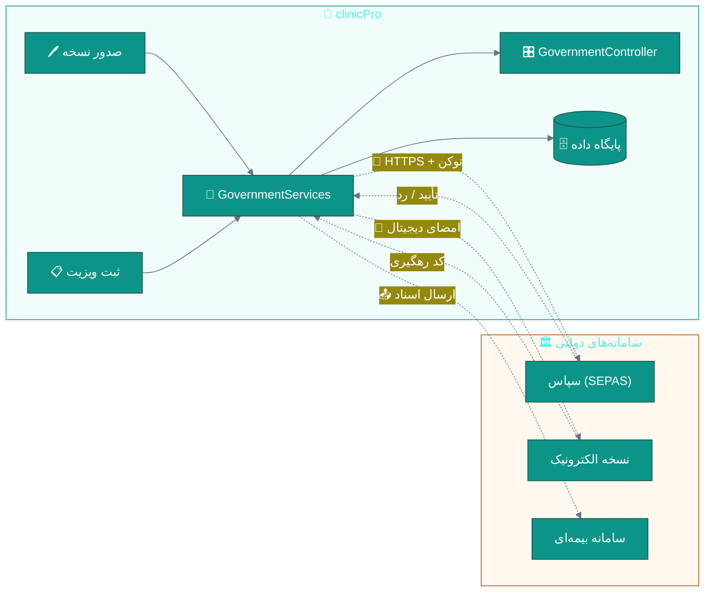
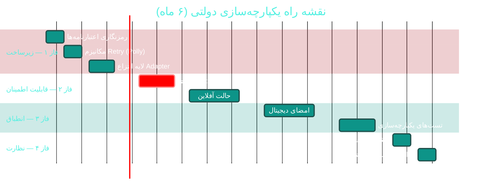

# 🏛 ماژول یکپارچه‌سازی با سامانه‌های دولتی (سپاس، نسخه الکترونیک، سامانه‌های بیمه‌ای)

> **مسیر ماژول:** `Domain/Integration/**` · `Infrastructure/Services/Government/**` · `API/Controllers/GovernmentController.cs`
> **لایسنس:** ir-gov (وابسته به قوانین ایران) · **اولویت:** 🟠 بالا · **دشواری:** 🔴 بسیار بالا · **زمان برآوردی:** ۶–۹ ماه

---

## ۱. 📋 خلاصه ماژول

یکپارچه‌سازی با سامانه‌های دولتی و بیمه‌ای ایران برای ارسال داده‌ها،
دریافت تأییدیه و انطباق با الزامات قانونی:

- **سپاس (SEPAS)** — سامانه پرونده الکترونیک سلامت وزارت بهداشت
- **نسخه الکترونیک** — سامانه نسخه‌نویسی الکترونیک سازمان بیمه سلامت
- **سامانه‌های بیمه‌ای** — ارسال و پیگیری اسناد درمانی

| ویژگی | مقدار |
|:---|:---|
| 🎯 هدف | انطباق قانونی و تبادل داده با سامانه‌های ملی سلامت |
| 👤 کاربران اصلی | پزشکان، منشی‌ها، مدیر درمانگاه |
| 🔗 وابستگی‌ها | API سپاس · نسخه الکترونیک · بیمه‌ها · اینترنت پایدار |
| 📊 وضعیت فعلی | 🟠 زیرساخت موجود، تکمیل و سخت‌سازی لازم |

---

## ۲. 🎯 وضعیت فعلی در کدبیس

| لایه | فایل | خط | وضعیت |
|:---|:---|:--:|:---|
| 🏛 موجودیت‌ها | `Domain/Integration/**` | ۶ فایل | 🟢 |
| 🏷 Enums | `Domain/Enums/**` | ۷ فایل | 🟢 |
| 🔧 سرویس‌ها | `Infrastructure/Services/Government/GovernmentServices.cs` | ۱۰٬۲۷۷ بایت | 🟠 |
| 🎛 رابط‌ها | `Application/Interfaces/IGovernmentServices.cs` | — | 🟢 |
| 🌐 API | `API/Controllers/GovernmentController.cs` | — | 🟠 |
| 🖥 دسکتاپ | `Desktop/Views/SepasView.xaml` · `EPrescriptionView.xaml` · `ComplementaryView.xaml` | — | 🟠 |

### 📁 موجودیت‌های موجود

| موجودیت | فایل | نقش |
|:---|:---|:---|
| `SepasTransaction` | `Domain/Integration/SepasTransaction.cs` | تراکنش‌های ارسالی به سپاس |
| `SibSystemRecord` | `Domain/Integration/SibSystemRecord.cs` | رکوردهای سامانه یکپارچه بهداشت |
| `ElectronicPrescription` | `Domain/Integration/ElectronicPrescription.cs` | نسخه‌های الکترونیک صادرشده |
| `ReferralRecord` | `Domain/Integration/ReferralRecord.cs` | ارجاعات |
| `ApiCredential` | `Domain/Integration/ApiCredential.cs` | اعتبارنامه‌های اتصال |
| `ApiCallLog` | `Domain/Integration/ApiCallLog.cs` | لاگ فراخوانی‌ها |

### 🏷 Enums

```
SepasTransactionType · SibServiceType · ElectronicPrescriptionStatus
ReferralStatus · ReferralType · PrescriptionStatus · PrescriptionType
```

---

## ۳. 📊 نمودار معماری یکپارچه‌سازی



---

## ۴. ⚠️ کاستی‌ها و ایرادها

| # | کاستی | 🎯 شدت | 📍 محل | 💥 پیامد |
|:--:|:---|:--:|:---|:---|
| W-01 | **فقدان مکانیزم Retry/Resilency** در فراخوانی APIها | 🔴 بحرانی | `GovernmentServices.cs` | از دست رفتن تراکنش‌ها هنگام قطعی شبکه |
| W-02 | **عدم وجود صف ارسال (Outbox)** | 🔴 بحرانی | — | عدم اطمینان از تحویل |
| W-03 | **ذخیره‌سازی اعتبارنامه‌ها بدون رمزنگاری** | 🔴 بحرانی | `ApiCredential.cs` | نشت اطلاعات حساس |
| W-04 | **نبود امضای دیجیتال** برای نسخه‌ها | 🟠 بالا | — | عدم پذیرش توسط سامانه |
| W-05 | **عدم تطبیق با تغییرات API دولتی** | 🟠 بالا | — | شکست ناگهانی یکپارچه‌سازی |
| W-06 | **نبود مانیتورینگ و هشدار** برای خطاهای ارسال | 🟠 بالا | — | کشف دیرهنگام مشکلات |
| W-07 | **فقدان تست یکپارچه‌سازی** | 🟠 بالا | — | ریسک بالای خطا |
| W-08 | **عدم پشتیبانی از حالت آفلاین** | 🟡 متوسط | — | توقف کار درمانگاه هنگام قطعی |
| W-09 | **نبود گزارش انطباق** برای ممیزی | 🟡 متوسط | — | مشکل در بازرسی‌ها |
| W-10 | **نبود مستندات فنی به‌روز** | 🟡 متوسط | — | وابستگی به دانش فردی |

---

## ۵. ✨ امکانات پیشنهادی

| 🎯 # | امکان | 📝 شرح | 💰 ارزش | 🔧 دشواری | ⏱ زمان |
|:--:|:---|:---|:--:|:--:|:--:|
| F-01 | 🔄 **مکانیزم Retry با Polly** | تلاش مجدد با Backoff نمایی | ⭐⭐⭐⭐⭐ | 🟡 متوسط | ۳ روز |
| F-02 | 📤 **الگوی Outbox** | صف ارسال تضمین‌شده | ⭐⭐⭐⭐⭐ | 🟠 بالا | ۱ هفته |
| F-03 | 🔐 **رمزنگاری اعتبارنامه‌ها** | استفاده از `IDataProtector` | ⭐⭐⭐⭐⭐ | 🟢 کم | ۲ روز |
| F-04 | ✍ **امضای دیجیتال** | امضای نسخه‌ها با گواهی | ⭐⭐⭐⭐ | 🟠 بالا | ۲ هفته |
| F-05 | 🔌 **لایه انتزاع Adapter** | جداسازی وابستگی به API دولتی | ⭐⭐⭐⭐⭐ | 🟡 متوسط | ۱ هفته |
| F-06 | 📊 **داشبورد مانیتورینگ** | نمایش وضعیت ارسال‌ها | ⭐⭐⭐⭐ | 🟡 متوسط | ۳ روز |
| F-07 | 🔔 **هشدار خطاها** | اعلان خودکار به مدیر | ⭐⭐⭐⭐ | 🟢 کم | ۲ روز |
| F-08 | 🧪 **تست‌های یکپارچه‌سازی** | با Mock Server | ⭐⭐⭐⭐⭐ | 🟡 متوسط | ۱ هفته |
| F-09 | 📴 **حالت آفلاین** | صف محلی و ارسال بعدی | ⭐⭐⭐⭐ | 🟠 بالا | ۲ هفته |
| F-10 | 📋 **گزارش انطباق** | خروجی برای ممیزی | ⭐⭐⭐ | 🟢 کم | ۳ روز |
| F-11 | 🔄 **نسخه‌بندی API** | پشتیبانی از چند نسخه | ⭐⭐⭐ | 🟡 متوسط | ۱ هفته |
| F-12 | 📖 **مستندات فنی** | راهنمای یکپارچه‌سازی | ⭐⭐⭐ | 🟢 کم | ۳ روز |

---

## ۶. 🛠 دستورالعمل پیاده‌سازی (۵ گام)

### 📌 گام ۱ — رمزنگاری اعتبارنامه‌ها (F-03)

**۱.۱ بررسی وضعیت فعلی**

در `Domain/Integration/ApiCredential.cs` باید بررسی شود که
فیلدهای حساس (`Token`، `Secret`) به صورت متن ساده ذخیره نشوند.

**۱.۲ پیاده‌سازی محافظت**

در `Infrastructure/Services/Government/CredentialProtector.cs` (جدید):

```csharp
using Microsoft.AspNetCore.DataProtection;

namespace Sahand.ClinicPro.Infrastructure.Services.Government;

/// <summary>
/// محافظت از اعتبارنامه‌های سامانه‌های دولتی با استفاده از Data Protection
/// </summary>
public class CredentialProtector
{
    private readonly IDataProtector _protector;

    public CredentialProtector(IDataProtectionProvider provider)
    {
        _protector = provider.CreateProtector("Sahand.ClinicPro.Government.Credentials.v1");
    }

    /// <summary>
    /// رمزنگاری مقدار حساس
    /// </summary>
    public string Protect(string plainValue)
    {
        if (string.IsNullOrWhiteSpace(plainValue)) return plainValue;
        return _protector.Protect(plainValue);
    }

    /// <summary>
    /// رمزگشایی مقدار حساس
    /// </summary>
    public string Unprotect(string protectedValue)
    {
        if (string.IsNullOrWhiteSpace(protectedValue)) return protectedValue;
        try
        {
            return _protector.Unprotect(protectedValue);
        }
        catch (CryptographicException)
        {
            // کلید تغییر کرده یا مقدار دستکاری شده است
            throw new InvalidOperationException(
                "اعتبارنامه قابل رمزگشایی نیست — احتمالاً کلید حفاظت تغییر کرده است");
        }
    }
}
```

**۱.۳ ثبت در DI**

در `Infrastructure/DependencyInjection.cs`:

```csharp
services.AddDataProtection()
    .SetApplicationName("SahandClinicPro")
    .PersistKeysToFileSystem(new DirectoryInfo(keysPath));

services.AddScoped<CredentialProtector>();
```

---

### 📌 گام ۲ — مکانیزم Retry با Polly (F-01)

**۲.۱ افزودن بسته**

در `Directory.Packages.props`:

```xml
<PackageVersion Include="Polly" Version="8.4.2" />
<PackageVersion Include="Microsoft.Extensions.Http.Polly" Version="8.0.31" />
```

**۲.۲ پیکربندی HttpClient**

در `Infrastructure/DependencyInjection.cs`:

```csharp
services.AddHttpClient<IGovernmentServices, GovernmentServices>(client =>
{
    client.Timeout = TimeSpan.FromSeconds(30);
})
.AddPolicyHandler(GetRetryPolicy())
.AddPolicyHandler(GetCircuitBreakerPolicy());

static IAsyncPolicy<HttpResponseMessage> GetRetryPolicy()
{
    return HttpPolicyExtensions
        .HandleTransientHttpError()                        // 5xx و 408
        .OrResult(msg => msg.StatusCode == HttpStatusCode.TooManyRequests)
        .WaitAndRetryAsync(
            retryCount: 3,
            sleepDurationProvider: attempt =>
                TimeSpan.FromSeconds(Math.Pow(2, attempt)),   // ۲، ۴، ۸ ثانیه
            onRetry: (outcome, timespan, attempt, context) =>
            {
                // لاگ تلاش مجدد
            });
}

static IAsyncPolicy<HttpResponseMessage> GetCircuitBreakerPolicy()
{
    return HttpPolicyExtensions
        .HandleTransientHttpError()
        .CircuitBreakerAsync(
            handledEventsAllowedBeforeBreaking: 5,
            durationOfBreak: TimeSpan.FromMinutes(1));
}
```

---

### 📌 گام ۳ — الگوی Outbox برای ارسال تضمین‌شده (F-02)

**۳.۱ موجودیت**

در `Domain/Integration/OutboxMessage.cs` (جدید):

```csharp
namespace Sahand.ClinicPro.Domain.Integration;

/// <summary>
/// پیام صف ارسال — تضمین تحویل به سامانه‌های خارجی حتی در صورت قطعی
/// </summary>
public class OutboxMessage : BaseEntity
{
    public string Destination { get; set; } = default!;     // Sepas | EPrescription | Insurance
    public string Endpoint { get; set; } = default!;
    public string Payload { get; set; } = default!;         // JSON
    public OutboxStatus Status { get; set; } = OutboxStatus.Pending;
    public int AttemptCount { get; set; }
    public DateTime? NextAttemptAtUtc { get; set; }
    public DateTime? SentAtUtc { get; set; }
    public string? LastError { get; set; }
    public string? ExternalReference { get; set; }          // کد رهگیری
}

/// <summary>
/// وضعیت پیام در صف ارسال
/// </summary>
public enum OutboxStatus
{
    Pending = 1,
    Processing = 2,
    Sent = 3,
    Failed = 4,
    DeadLetter = 5
}
```

**۳.۲ Job پردازش**

در `Infrastructure/Jobs/OutboxProcessorJob.cs` (جدید):

```csharp
using Hangfire;

namespace Sahand.ClinicPro.Infrastructure.Jobs;

/// <summary>
/// پردازش صف ارسال به سامانه‌های دولتی — هر ۲ دقیقه
/// </summary>
public class OutboxProcessorJob
{
    private readonly IUnitOfWork _unitOfWork;
    private readonly IGovernmentServices _governmentServices;
    private readonly ILogger<OutboxProcessorJob> _logger;

    public OutboxProcessorJob(
        IUnitOfWork unitOfWork,
        IGovernmentServices governmentServices,
        ILogger<OutboxProcessorJob> logger)
    {
        _unitOfWork = unitOfWork;
        _governmentServices = governmentServices;
        _logger = logger;
    }

    [AutomaticRetry(Attempts = 0)]
    public async Task ProcessAsync(CancellationToken cancellationToken = default)
    {
        var now = DateTime.UtcNow;

        var pending = await _unitOfWork.Repository<OutboxMessage>()
            .Queryable
            .Where(m => m.Status == OutboxStatus.Pending
                     && (m.NextAttemptAtUtc == null || m.NextAttemptAtUtc <= now))
            .OrderBy(m => m.CreatedAtUtc)
            .Take(50)
            .ToListAsync(cancellationToken);

        foreach (var message in pending)
        {
            message.Status = OutboxStatus.Processing;
            message.AttemptCount++;

            var result = await _governmentServices.SendAsync(
                message.Destination, message.Endpoint, message.Payload, cancellationToken);

            if (result.Success)
            {
                message.Status = OutboxStatus.Sent;
                message.SentAtUtc = now;
                message.ExternalReference = result.ReferenceId;
                message.LastError = null;
            }
            else
            {
                message.LastError = result.ErrorMessage;
                if (message.AttemptCount >= 5)
                {
                    message.Status = OutboxStatus.DeadLetter;
                    _logger.LogError(
                        "❌ پیام {Id} پس از {Count} تلاش وارد DeadLetter شد: {Error}",
                        message.Id, message.AttemptCount, result.ErrorMessage);
                }
                else
                {
                    message.Status = OutboxStatus.Pending;
                    // Backoff نمایی: ۲، ۴، ۸، ۱۶ دقیقه
                    message.NextAttemptAtUtc =
                        now.AddMinutes(Math.Pow(2, message.AttemptCount));
                }
            }
        }

        await _unitOfWork.SaveEntitiesAsync(cancellationToken);
    }
}
```

**۳.۳ ثبت Job**

در `API/Program.cs`:

```csharp
RecurringJob.AddOrUpdate<OutboxProcessorJob>(
    "outbox-processor",
    job => job.ProcessAsync(CancellationToken.None),
    "*/2 * * * *");      // هر ۲ دقیقه
```

---

### 📌 گام ۴ — لایه انتزاع Adapter (F-05)

**۴.۱ رابط عمومی**

در `Application/Interfaces/IGovernmentAdapter.cs` (جدید):

```csharp
namespace Sahand.ClinicPro.Application.Interfaces;

/// <summary>
/// نتیجه ارسال به سامانه خارجی
/// </summary>
public record GovernmentSendResult(
    bool Success,
    string? ReferenceId,
    string? ErrorMessage);

/// <summary>
/// انتزاع ارتباط با یک سامانه دولتی — جداسازی وابستگی از پیاده‌سازی
/// </summary>
public interface IGovernmentAdapter
{
    /// <summary>نام سامانه (مثال: Sepas)</summary>
    string Destination { get; }

    /// <summary>نسخه API پشتیبانی‌شده</summary>
    string ApiVersion { get; }

    /// <summary>ارسال داده به سامانه</summary>
    Task<GovernmentSendResult> SendAsync(
        string endpoint,
        string payload,
        CancellationToken cancellationToken = default);

    /// <summary>بررسی سلامت اتصال</summary>
    Task<bool> HealthCheckAsync(CancellationToken cancellationToken = default);
}
```

**۴.۲ ثبت چندگانه**

در `Infrastructure/DependencyInjection.cs`:

```csharp
services.AddScoped<IGovernmentAdapter, SepasAdapter>();
services.AddScoped<IGovernmentAdapter, EPrescriptionAdapter>();
services.AddScoped<IGovernmentAdapter, InsuranceAdapter>();

// انتخاب بر اساس مقصد
services.AddScoped<IGovernmentAdapterFactory, GovernmentAdapterFactory>();
```

> ✅ با این الگو، تغییرات API دولتی تنها در یک کلاس اعمال می‌شود.

---

### 📌 گام ۵ — مایگریشن

```bash
cd src/Sahand.ClinicPro.Infrastructure
dotnet ef migrations add Cycle49GovernmentOutbox \
    --startup-project ../Sahand.ClinicPro.API --context ClinicProDbContext
dotnet ef database update --startup-project ../Sahand.ClinicPro.API
```

---

## ۷. 🧪 تست‌های پیشنهادی

| # | نام تست | 🎯 هدف |
|:--:|:---|:---|
| ۱ | `Test_CredentialProtector_RoundTrip` | رمزنگاری/رمزگشایی صحیح |
| ۲ | `Test_RetryPolicy_RetriesOnTransientError` | تلاش مجدد در خطای گذرا |
| ۳ | `Test_Outbox_FailedMessageGoesToDeadLetter` | مدیریت شکست نهایی |
| ۴ | `Test_Adapter_HealthCheck` | بررسی سلامت اتصال |
| ۵ | `Test_SepasAdapter_Serialization` | صحت قالب داده ارسالی |
| ۶ | `Test_Outbox_ExponentialBackoff` | زمان‌بندی تلاش مجدد |

اجرا:

```bash
dotnet test tests/Sahand.ClinicPro.Application.UnitTests \
    --filter "FullyQualifiedName~Government"
```

---

## ۸. 📈 شاخص‌های کلیدی عملکرد (KPI)

| شاخص | وضعیت فعلی | 🎯 هدف |
|:---|:--:|:--:|
| 📤 نرخ تحویل موفق به سپاس | نامشخص | **> ۹۹٫۵٪** |
| ⏱ میانگین زمان ارسال | نامشخص | **< ۳ ثانیه** |
| 🔄 نرخ تلاش مجدد | ۰٪ | **خودکار (۳ تلاش)** |
| 🔐 اعتبارنامه‌های رمزنگاری‌شده | ۰٪ | **۱۰۰٪** |
| 📊 پوشش مانیتورینگ | ۰٪ | **۱۰۰٪** |
| 🧪 پوشش تست | نامشخص | **> ۷۰٪** |

---

## ۹. 🗓 برنامه زمانی پیشنهادی



---

## 🔗 پیوندهای مرتبط

- [A06 — نسخه‌نویسی و ایمنی دارو](A06-prescriptions-safety.md)
- [B03 — بیمه و مطالبات](B03-insurance.md)
- [C01 — امنیت و کنترل دسترسی](C01-security-rbac.md)
- [C02 — حسابرسی و انطباق](C02-audit-compliance.md)
- [مستند طراحی ماژول حضور و غیاب](../../design/07-attendance-module.md)

---
<div align="center">📅 ۱۴۰۴/۰۷/۱۹ · 🔖 v1.0</div>
