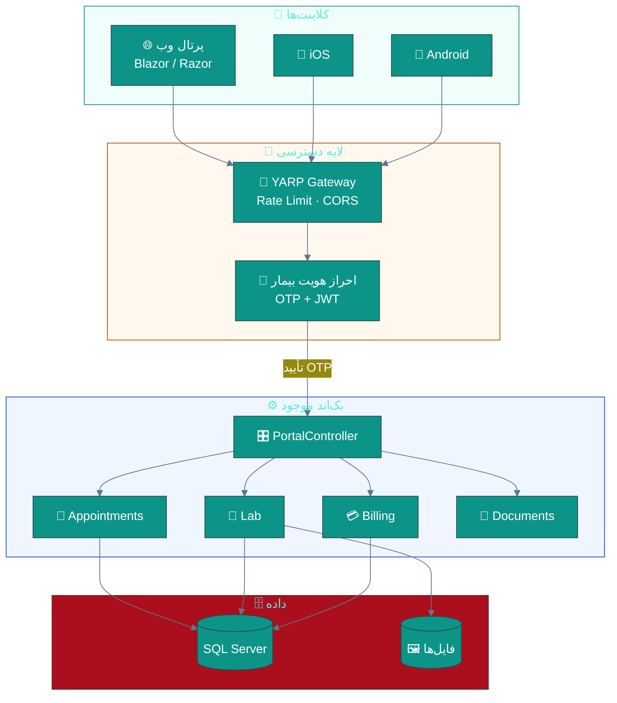
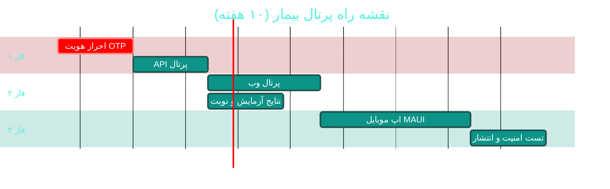

# 🌐 پرتال بیمار و اپلیکیشن موبایل

> **لایسنس:** addon-portal · **اولویت:** 🟠 بالا · **دشواری:** 🟡 متوسط · **زمان برآوردی:** ۸–۱۰ هفته

---

## ۱. 📋 خلاصه ماژول

پرتال وب و اپلیکیشن موبایل بیمار که دسترسی خودکارآمد به نتایج آزمایش،
نوبت‌ها، سوابق پزشکی، نسخه‌ها و صورتحساب‌ها را فراهم می‌کند
و مسیرهای ارتباطی پرهزینه (تلفن، حضور فیزیکی) را حذف می‌کند.

| ویژگی | مقدار |
|:---|:---|
| 🎯 هدف | خودکارسازی تعامل بیمار و کاهش بار پذیرش |
| 👤 کاربران اصلی | بیماران، همراهان |
| 🔗 وابستگی‌ها | API عمومی جدید · درگاه پرداخت · احراز هویت OTP |
| 📊 وضعیت فعلی | ❌ وجود ندارد |

### ✨ جدول ویژگی‌ها

| # | ویژگی | شرح | اولویت |
|:--:|:---|:---|:--:|
| ۱ | 🧪 نتایج آزمایش | مشاهده و دانلود PDF نتایج | 🔴 حیاتی |
| ۲ | 📅 مدیریت نوبت | رزرو، تغییر، لغو آنلاین | 🔴 حیاتی |
| ۳ | 📋 سوابق پزشکی | خلاصه ویزیت‌ها و تشخیص‌ها | 🟠 بالا |
| ۴ | 💊 نسخه‌ها | مشاهده نسخه‌های فعلی و گذشته | 🟠 بالا |
| ۵ | 💳 پرداخت آنلاین | پرداخت صورتحساب و پیش‌پرداخت | 🟠 بالا |
| ۶ | 🔔 یادآوری هوشمند | اعلان نوبت و مصرف دارو | 🟡 متوسط |
| ۷ | 👨‍👩‍👧 حساب خانواده | مدیریت اعضای خانواده | 🟡 متوسط |
| ۸ | 💬 پیام امن | ارتباط با پزشک/منشی | 🟢 پایین |
| ۹ | 📝 فرم‌های پیش‌ویزیت | تکمیل آنلاین شرح‌حال | 🟡 متوسط |
| ۱۰ | ⭐ امتیاز و نظر | ثبت بازخورد پس از ویزیت | 🟢 پایین |

---

## ۲. 🎯 وضعیت فعلی در کدبیس

| لایه | فایل/مسیر | وضعیت |
|:---|:---|:---|
| 🌐 پرتال وب | — | ❌ **وجود ندارد** |
| 📱 اپ موبایل | — | ❌ **وجود ندارد** |
| 🔐 احراز هویت بیمار | `API/Controllers/AuthController.cs` | 🟡 فقط کارکنان |
| 📅 نوبت‌دهی | `API/Controllers/AppointmentsController.cs` | 🟢 آماده |
| 🧪 نتایج آزمایش | `API/Controllers/LabController.cs` | 🟢 آماده |
| 💳 پرداخت | `Application/Features/Billing/**` | 🟡 حضوری |
| 📨 پیامک | `Infrastructure/Sms/KavenegarProvider.cs` | 🟢 زیرساخت آماده |

> 💡 **نکته مثبت:** بیش از **۷۰٪ زیرساخت مورد نیاز** (نوبت، آزمایش، پیامک)
> در API موجود است. پرتال عمدتاً یک **لایه نمایش جدید** با
> احراز هویت متفاوت است — نه بازنویسی بک‌اند.

---

## ۳. 📊 نمودار معماری



---

## ۴. 🛠 دستورالعمل پیاده‌سازی

### 📌 گام ۱ — احراز هویت بیمار (OTP)

**۱.۱ مدل درخواست**

در `Application/Features/Portal/LoginWithOtp/LoginWithOtpCommand.cs` (جدید):

```csharp
using FluentValidation;
using MediatR;
using Sahand.ClinicPro.Application.Common;
using Sahand.ClinicPro.Domain.Common;

namespace Sahand.ClinicPro.Application.Features.Portal.LoginWithOtp;

/// <summary>
/// ارسال کد یک‌بارمصرف برای ورود بیمار به پرتال
/// </summary>
/// <param name="MobileNumber">شماره همراه بیمار (فرمت 09xxxxxxxxx)</param>
public record LoginWithOtpCommand(string MobileNumber)
    : IRequest<Result<LoginWithOtpResponse>>;

/// <summary>پاسخ ارسال کد یک‌بارمصرف</summary>
/// <param name="MaskedMobile">شماره همراه با پوشش برای نمایش</param>
/// <param name="ExpiresInSeconds">زمان اعتبار کد بر حسب ثانیه</param>
public record LoginWithOtpResponse(string MaskedMobile, int ExpiresInSeconds);

/// <summary>اعتبارسنجی شماره همراه</summary>
public class LoginWithOtpCommandValidator : AbstractValidator<LoginWithOtpCommand>
{
    public LoginWithOtpCommandValidator()
    {
        RuleFor(x => x.MobileNumber)
            .NotEmpty().WithMessage("شماره همراه الزامی است")
            .Matches(@"^09\d{9}$").WithMessage("قالب شماره همراه صحیح نیست");
    }
}

/// <summary>مدیریت ارسال کد یک‌بارمصرف</summary>
public class LoginWithOtpCommandHandler
    : IRequestHandler<LoginWithOtpCommand, Result<LoginWithOtpResponse>>
{
    private readonly IUnitOfWork _unitOfWork;
    private readonly ILogger<LoginWithOtpCommandHandler> _logger;

    public LoginWithOtpCommandHandler(
        IUnitOfWork unitOfWork,
        ILogger<LoginWithOtpCommandHandler> logger)
    {
        _unitOfWork = unitOfWork;
        _logger = logger;
    }

    public async Task<Result<LoginWithOtpResponse>> Handle(
        LoginWithOtpCommand request,
        CancellationToken cancellationToken)
    {
        // جستجوی بیمار با شماره همراه
        var patient = await _unitOfWork.Repository<Domain.Entities.Patient>()
            .Queryable
            .FirstOrDefaultAsync(p => p.MobileNumber == request.MobileNumber,
                                 cancellationToken);

        if (patient is null)
            return Result<LoginWithOtpResponse>.Failure(
                Error.NotFound("بیماری با این شماره همراه یافت نشد"));

        // تولید کد ۶ رقمی
        var code = Random.Shared.Next(100000, 999999).ToString();

        // TODO: ذخیره هش کد با انقضا در جداول PortalOtpCode
        // TODO: ارسال از طریق ISmsService.SendTemplatedAsync

        _logger.LogInformation("کد ورود برای بیمار ارسال شد");

        var masked = request.MobileNumber[..4] + "*****" + request.MobileNumber[7..];
        return Result<LoginWithOtpResponse>.Success(
            new LoginWithOtpResponse(masked, 120));
    }
}
```

### 📌 گام ۲ — کنترلر پرتال

در `API/Controllers/Portal/PatientPortalController.cs` (جدید):

```csharp
using MediatR;
using Microsoft.AspNetCore.Authorization;
using Microsoft.AspNetCore.Mvc;
using Microsoft.AspNetCore.RateLimiting;

namespace Sahand.ClinicPro.API.Controllers.Portal;

/// <summary>
/// کنترلر پرتال بیمار — دسترسی با نقش Patient
/// </summary>
[ApiController]
[Route("api/v1/portal/[controller]")]
[Authorize(Roles = "Patient")]
[EnableRateLimiting("portal")]
public class PatientPortalController : ControllerBase
{
    private readonly IMediator _mediator;
    private readonly ICurrentUserService _currentUser;

    public PatientPortalController(IMediator mediator, ICurrentUserService currentUser)
    {
        _mediator = mediator;
        _currentUser = currentUser;
    }

    /// <summary>خلاصه داشبورد بیمار</summary>
    [HttpGet("summary")]
    public async Task<IActionResult> GetSummary(CancellationToken cancellationToken)
    {
        var query = new GetPatientPortalSummaryQuery(
            _currentUser.PatientId!.Value);
        var result = await _mediator.Send(query, cancellationToken);
        return result.IsSuccess ? Ok(result.Value) : BadRequest(result.Error);
    }

    /// <summary>فهرست نتایج آزمایش‌های بیمار</summary>
    [HttpGet("lab-results")]
    public async Task<IActionResult> GetLabResults(CancellationToken cancellationToken)
    {
        var query = new GetPatientLabResultsQuery(_currentUser.PatientId!.Value);
        var result = await _mediator.Send(query, cancellationToken);
        return result.IsSuccess ? Ok(result.Value) : BadRequest(result.Error);
    }

    /// <summary>دانلود PDF نتیجه آزمایش</summary>
    [HttpGet("lab-results/{id:guid}/pdf")]
    public async Task<IActionResult> DownloadLabResultPdf(
        Guid id, CancellationToken cancellationToken)
    {
        var query = new GetLabResultPdfQuery(id, _currentUser.PatientId!.Value);
        var result = await _mediator.Send(query, cancellationToken);
        if (result.IsFailure) return BadRequest(result.Error);
        return File(result.Value.Content, "application/pdf", result.Value.FileName);
    }
}
```

### 📌 گام ۳ — اپ موبایل (.NET MAUI)

```
📂 src/Sahand.ClinicPro.Mobile/
├── 📄 Sahand.ClinicPro.Mobile.csproj
├── 📄 MauiProgram.cs
├── 📂 ViewModels/
│   ├── 📄 LoginViewModel.cs
│   ├── 📄 DashboardViewModel.cs
│   ├── 📄 AppointmentsViewModel.cs
│   └── 📄 LabResultsViewModel.cs
├── 📂 Views/
│   ├── 📄 LoginPage.xaml
│   ├── 📄 DashboardPage.xaml
│   └── 📄 LabResultsPage.xaml
└── 📂 Services/
    ├── 📄 PortalApiClient.cs
    └── 📄 SecureTokenStore.cs
```

> 💡 **توصیه:** از **.NET MAUI** استفاده کنید تا با تیم C# فعلی
> هم‌راستا باشد و کد ViewModel با دسکتاپ اشتراک گذاشته شود.

### 📌 گام ۴ — مایگریشن

```bash
cd src/Sahand.ClinicPro.Infrastructure
dotnet ef migrations add Cycle49PatientPortal \
    --startup-project ../Sahand.ClinicPro.API --context ClinicProDbContext
dotnet ef database update --startup-project ../Sahand.ClinicPro.API
```

---

## ۵. ⚠️ کاستی‌ها و ریسک‌ها

| # | ریسک | شدت | راهکار |
|:--:|:---|:--:|:---|
| W-01 | نشت داده بیماران دیگر (IDOR) | 🔴 بحرانی | فیلتر اجباری بر اساس `PatientId` از توکن |
| W-02 | حمله Brute-force به OTP | 🔴 بحرانی | Rate Limit + قفل پس از ۵ تلاش |
| W-03 | در دسترس بودن نتایج پیش از تأیید پزشک | 🟠 بالا | فیلد `IsReleasedToPatient` |
| W-04 | نبود رضایت‌نامه آگاهانه | 🟠 بالا | ثبت پذیرش شرایط در اولین ورود |
| W-05 | وابستگی به اینترنت بیمار | 🟡 متوسط | کش محلی در اپ |

---

## ۶. 📈 شاخص‌های موفقیت (KPI)

| شاخص | هدف |
|:---|:--:|
| 📞 کاهش تماس‌های تلفنی پذیرش | **≥ ۴۰٪** |
| 🌐 نرخ فعال‌سازی پرتال توسط بیماران | **≥ ۳۰٪ در ۶ ماه** |
| 📅 سهم نوبت‌های رزرو آنلاین | **≥ ۲۵٪** |
| ⭐ رضایت بیمار (NPS) | **> ۵۰** |
| ⏱ زمان بارگذاری صفحه | **< ۲ ثانیه** |

---

## ۷. 🗓 برنامه زمانی



---

## 🔗 پیوندهای مرتبط

- [A02 — نوبت‌دهی و زمان‌بندی](A02-appointments.md)
- [A07 — آزمایشگاه (LIS)](A07-laboratory.md)
- [C01 — امنیت و کنترل دسترسی](C01-security-rbac.md)
- [C07 — پیامک و ارتباطات](C07-sms-communication.md)
- [D02 — درمان از راه دور](D02-telemedicine.md)
- [D03 — دستیار بالینی هوش مصنوعی](D03-ai-assistant.md)
- [D05 — مدیریت اسناد](D05-document-management.md)

---
<div align="center">📅 ۱۴۰۴/۰۷/۱۹ · 🔖 v1.0</div>
