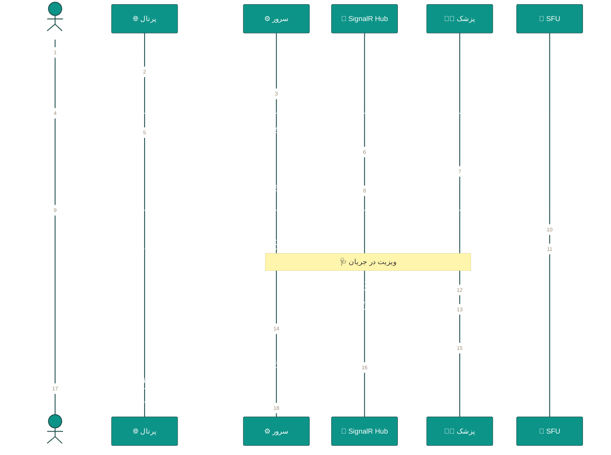
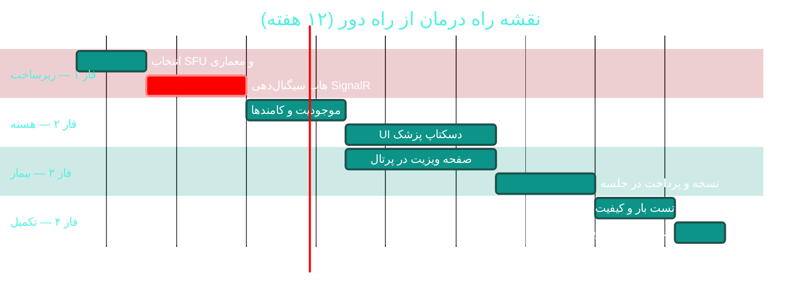

# 🎥 درمان از راه دور (Telemedicine / ویدیوویزیت)

> **لایسنس:** addon-telemed · **اولویت:** 🟠 بالا · **دشواری:** 🔴 زیاد · **زمان برآوردی:** ۱۰–۱۲ هفته

---

## ۱. 📋 خلاصه ماژول

ویدیوویزیت یکپارچه با نوبت‌دهی، پذیرش و پرونده الکترونیک،
به‌گونه‌ای که ویزیت مجازی دقیقاً همان مسیر ویزیت حضوری را طی کند
(نوبت → انتظار → SOAP → نسخه → صورتحساب).

| ویژگی | مقدار |
|:---|:---|
| 🎯 هدف | گسترش دسترسی بیماران و کاهش مراجعات غیرضروری |
| 👤 کاربران اصلی | پزشکان، بیماران |
| 🔗 وابستگی‌ها | WebRTC/SFU · نوبت‌دهی · نسخه الکترونیک · پرداخت آنلاین |
| 📊 وضعیت فعلی | ❌ وجود ندارد |

### ✨ جدول ویژگی‌ها

| # | ویژگی | شرح | اولویت |
|:--:|:---|:---|:--:|
| ۱ | 🎬 اتاق ویدیو | ویدیو/صدا دوطرفه با کیفیت تطبیقی | 🔴 حیاتی |
| ۲ | 📅 یکپارچگی با نوبت | لینک اختصاصی در نوبت مجازی | 🔴 حیاتی |
| ۳ | 🖊 نسخه در حین ویزیت | صدور نسخه بدون خروج از جلسه | 🔴 حیاتی |
| ۴ | 💬 چت متنی | ارسال پیام و فایل در جلسه | 🟠 بالا |
| ۵ | 📤 اشتراک فایل | ارسال تصویر/مدرک توسط بیمار | 🟠 بالا |
| ۶ | 🩺 اتاق انتظار مجازی | صف انتظار با اعلان | 🟠 بالا |
| ۷ | 🔒 ضبط با رضایت | ضبط جلسه با رضایت‌نامه | 🟡 متوسط |
| ۸ | 📊 کیفیت اتصال | نمایش وضعیت شبکه دو طرف | 🟡 متوسط |
| ۹ | 🧪 سنجش دستگاه‌ها | بررسی دوربین/میکروفون پیش از ورود | 🟡 متوسط |
| ۱۰ | 📝 خلاصه خودکار | یادداشت ویزیت از چت | 🟢 پایین |

---

## ۲. 🎯 وضعیت فعلی در کدبیس

| لایه | فایل/مسیر | وضعیت |
|:---|:---|:---|
| 🎬 زیرساخت ویدیو | — | ❌ **وجود ندارد** |
| 📅 نوبت‌دهی | `API/Controllers/AppointmentsController.cs` | 🟢 آماده |
| 🖊 نسخه‌نویسی | `Application/Features/Prescriptions/**` | 🟢 آماده |
| 📋 SOAP | `Desktop/ViewModels/AdvancedEmr/**` | 🟢 آماده |
| 🔔 اعلان بلادرنگ | SignalR Hub موجود | 🟢 آماده |
| 💳 پرداخت آنلاین | — | ❌ نیازمند توسعه |

> 💡 **نکته کلیدی:** زیرساخت **SignalR** در پروژه موجود است و می‌تواند
> برای سیگنال‌دهی (Signaling) WebRTC استفاده شود —
> نیازی به سرور سیگنال جداگانه نیست.

---

## ۳. 📊 نمودار جریان ویزیت مجازی



---

## ۴. 🛠 دستورالعمل پیاده‌سازی

### 📌 گام ۱ — موجودیت جلسه

در `Domain/Entities/TelemedicineSession.cs` (جدید):

```csharp
namespace Sahand.ClinicPro.Domain.Entities;

/// <summary>
/// جلسه درمان از راه دور — اتصال ویدیوویزیت به نوبت و ویزیت
/// </summary>
public class TelemedicineSession : BaseEntity
{
    public Guid AppointmentId { get; set; }
    public Guid PatientId { get; set; }
    public Guid DoctorId { get; set; }

    /// <summary>شناسه عمومی جلسه (برای لینک بیمار)</summary>
    public string RoomCode { get; set; } = default!;

    /// <summary>توکن دسترسی بیمار — یک‌بارمصرف</summary>
    public string PatientJoinTokenHash { get; set; } = default!;

    public TelemedicineSessionStatus Status { get; set; }
        = TelemedicineSessionStatus.Scheduled;

    public DateTime? PatientJoinedAtUtc { get; set; }
    public DateTime? DoctorJoinedAtUtc { get; set; }
    public DateTime? StartedAtUtc { get; set; }
    public DateTime? EndedAtUtc { get; set; }

    /// <summary>مدت واقعی جلسه بر حسب ثانیه</summary>
    public int? DurationSeconds { get; set; }

    /// <summary>آیا رضایت‌نامه ضبط دریافت شده است</summary>
    public bool RecordingConsentGiven { get; set; }

    /// <summary>میانگین کیفیت اتصال (۰ تا ۱۰۰)</summary>
    public int? AverageQualityScore { get; set; }

    public string? DisconnectReason { get; set; }

    // Navigation
    public Appointment Appointment { get; set; } = default!;
    public Patient Patient { get; set; } = default!;
    public Doctor Doctor { get; set; } = default!;
}

/// <summary>وضعیت جلسه درمان از راه دور</summary>
public enum TelemedicineSessionStatus
{
    Scheduled = 1,
    WaitingRoom = 2,
    InProgress = 3,
    Completed = 4,
    Cancelled = 5,
    Failed = 6
}
```

### 📌 گام ۲ — سیگنال‌دهی WebRTC روی SignalR موجود

در `API/Hubs/TelemedicineHub.cs` (جدید):

```csharp
using Microsoft.AspNetCore.Authorization;
using Microsoft.AspNetCore.SignalR;

namespace Sahand.ClinicPro.API.Hubs;

/// <summary>
/// هاب سیگنال‌دهی WebRTC برای ویدیوویزیت
/// </summary>
[Authorize]
public class TelemedicineHub : Hub
{
    private readonly ILogger<TelemedicineHub> _logger;

    public TelemedicineHub(ILogger<TelemedicineHub> logger) => _logger = logger;

    /// <summary>ورود بیمار به اتاق انتظار مجازی</summary>
    public async Task JoinWaitingRoom(string roomCode)
    {
        await Groups.AddToGroupAsync(Context.ConnectionId, $"room-{roomCode}");
        _logger.LogInformation("بیمار وارد اتاق انتظار {Room} شد", roomCode);

        // اطلاع به پزشکِ مرتبط
        await Clients.Group($"doctor-{roomCode}")
            .SendAsync("PatientWaiting", new { RoomCode = roomCode });
    }

    /// <summary>پزشک جلسه را آغاز می‌کند</summary>
    public async Task StartSession(string roomCode)
    {
        await Clients.Group($"room-{roomCode}")
            .SendAsync("SessionStarted", new { RoomCode = roomCode });
    }

    /// <summary>ارسال پیشنهاد اتصال (SDP Offer)</summary>
    public async Task SendOffer(string roomCode, string sdp)
    {
        await Clients.OthersInGroup($"room-{roomCode}")
            .SendAsync("ReceiveOffer", sdp);
    }

    /// <summary>ارسال پاسخ اتصال (SDP Answer)</summary>
    public async Task SendAnswer(string roomCode, string sdp)
    {
        await Clients.OthersInGroup($"room-{roomCode}")
            .SendAsync("ReceiveAnswer", sdp);
    }

    /// <summary>ارسال نامزدهای ICE برای عبور از NAT</summary>
    public async Task SendIceCandidate(string roomCode, string candidate)
    {
        await Clients.OthersInGroup($"room-{roomCode}")
            .SendAsync("ReceiveIceCandidate", candidate);
    }

    /// <summary>گزارش کیفیت اتصال جهت مانیتورینگ</summary>
    public async Task ReportQuality(string roomCode, int score)
    {
        await Clients.Group($"doctor-{roomCode}")
            .SendAsync("QualityChanged", new { RoomCode = roomCode, Score = score });
    }
}
```

### 📌 گام ۳ — کامند شروع جلسه

در `Application/Features/Telemedicine/StartSession/StartSessionCommand.cs` (جدید):

```csharp
using FluentValidation;
using MediatR;
using Sahand.ClinicPro.Application.Common;
using Sahand.ClinicPro.Domain.Common;

namespace Sahand.ClinicPro.Application.Features.Telemedicine.StartSession;

/// <summary>آغاز جلسه ویدیوویزیت توسط پزشک</summary>
/// <param name="AppointmentId">شناسه نوبت مجازی</param>
public record StartSessionCommand(Guid AppointmentId)
    : IRequest<Result<StartSessionResponse>>;

/// <summary>پاسخ آغاز جلسه</summary>
/// <param name="SessionId">شناسه جلسه</param>
/// <param name="RoomCode">کد اتاق برای اتصال بیمار</param>
public record StartSessionResponse(Guid SessionId, string RoomCode);

/// <summary>اعتبارسنجی آغاز جلسه</summary>
public class StartSessionCommandValidator : AbstractValidator<StartSessionCommand>
{
    public StartSessionCommandValidator()
    {
        RuleFor(x => x.AppointmentId)
            .NotEmpty().WithMessage("شناسه نوبت الزامی است");
    }
}

/// <summary>مدیریت آغاز جلسه ویدیوویزیت</summary>
public class StartSessionCommandHandler
    : IRequestHandler<StartSessionCommand, Result<StartSessionResponse>>
{
    private readonly IUnitOfWork _unitOfWork;
    private readonly ICurrentUserService _currentUser;
    private readonly ILogger<StartSessionCommandHandler> _logger;

    public StartSessionCommandHandler(
        IUnitOfWork unitOfWork,
        ICurrentUserService currentUser,
        ILogger<StartSessionCommandHandler> logger)
    {
        _unitOfWork = unitOfWork;
        _currentUser = currentUser;
        _logger = logger;
    }

    public async Task<Result<StartSessionResponse>> Handle(
        StartSessionCommand request,
        CancellationToken cancellationToken)
    {
        var appointment = await _unitOfWork.Repository<Domain.Entities.Appointment>()
            .Queryable
            .FirstOrDefaultAsync(a => a.Id == request.AppointmentId, cancellationToken);

        if (appointment is null)
            return Result<StartSessionResponse>.Failure(
                Error.NotFound("نوبت یافت نشد"));

        // فقط پزشکِ نوبت می‌تواند جلسه را آغاز کند
        if (!await _currentUser.HasPermissionAsync("telemedicine.start")
            && appointment.DoctorId != _currentUser.DoctorId)
            return Result<StartSessionResponse>.Failure(
                Error.Forbidden("فقط پزشک مربوطه می‌تواند جلسه را آغاز کند"));

        var session = new Domain.Entities.TelemedicineSession
        {
            AppointmentId = appointment.Id,
            PatientId = appointment.PatientId,
            DoctorId = appointment.DoctorId,
            RoomCode = GenerateRoomCode(),
            Status = Domain.Entities.TelemedicineSessionStatus.InProgress,
            StartedAtUtc = DateTime.UtcNow
        };

        await _unitOfWork.Repository<Domain.Entities.TelemedicineSession>()
            .AddAsync(session, cancellationToken);
        await _unitOfWork.SaveEntitiesAsync(cancellationToken);

        _logger.LogInformation(
            "جلسه ویدیوویزیت {Room} برای نوبت {Appt} آغاز شد",
            session.RoomCode, appointment.Id);

        return Result<StartSessionResponse>.Success(
            new StartSessionResponse(session.Id, session.RoomCode));
    }

    /// <summary>تولید کد اتاق تصادفی و غیرقابل حدس</summary>
    private static string GenerateRoomCode()
        => Convert.ToBase64String(Guid.NewGuid().ToByteArray())
               .Replace("/", "-").Replace("+", "_")[..12];
}
```

### 📌 گام ۴ — مایگریشن

```bash
cd src/Sahand.ClinicPro.Infrastructure
dotnet ef migrations add Cycle49TelemedicineSession \
    --startup-project ../Sahand.ClinicPro.API --context ClinicProDbContext
dotnet ef database update --startup-project ../Sahand.ClinicPro.API
```

---

## ۵. ⚠️ کاستی‌ها و ریسک‌ها

| # | ریسک | شدت | راهکار |
|:--:|:---|:--:|:---|
| W-01 | نفوذ به جلسه توسط شخص ثالث | 🔴 بحرانی | توکن یک‌بارمصرف + انقضای کوتاه |
| W-02 | قطع جلسه به دلیل شبکه ضعیف | 🟠 بالا | کیفیت تطبیقی + reconnect خودکار |
| W-03 | انطباق با مقررات نسخه مجازی | 🟠 بالا | بررسی الزامات وزارت بهداشت |
| W-04 | بار سرور در ویدیوی همزمان | 🟠 بالا | استفاده از SFU ابری (LiveKit/Agora) |
| W-05 | نبود امضای دیجیتال نسخه مجازی | 🟡 متوسط | یکپارچه با [C12](C12-government-integration.md) |
| W-06 | حریم خصوصی در ضبط | 🟡 متوسط | رضایت‌نامه صریح + ذخیره رمزنگاری‌شده |

---

## ۶. 📈 شاخص‌های موفقیت (KPI)

| شاخص | هدف |
|:---|:--:|
| 🎬 نرخ موفقیت اتصال جلسات | **≥ ۹۵٪** |
| ⏱ زمان انتظار بیمار در اتاق مجازی | **< ۵ دقیقه** |
| 📅 سهم ویزیت‌های مجازی از کل | **۱۵٪ در سال اول** |
| ⭐ رضایت از کیفیت ویدیو | **≥ ۴/۵ از ۵** |
| 🔌 نرخ قطعی میان‌جلسه | **< ۳٪** |

---

## ۷. 🗓 برنامه زمانی



---

## 🔗 پیوندهای مرتبط

- [A02 — نوبت‌دهی و زمان‌بندی](A02-appointments.md)
- [A04 — ویزیت و SOAP](A04-visits-soap.md)
- [A06 — نسخه‌نویسی و ایمنی دارو](A06-prescriptions-safety.md)
- [C06 — اعلان‌ها و بلادرنگ](C06-notifications-realtime.md)
- [C12 — یکپارچه‌سازی دولتی](C12-government-integration.md)
- [D01 — پرتال بیمار](D01-patient-portal.md)
- [D10 — API عمومی و مارکت‌پلیس](D10-public-api-marketplace.md)

---
<div align="center">📅 ۱۴۰۴/۰۷/۱۹ · 🔖 v1.0</div>
