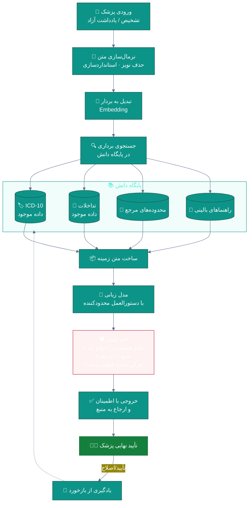
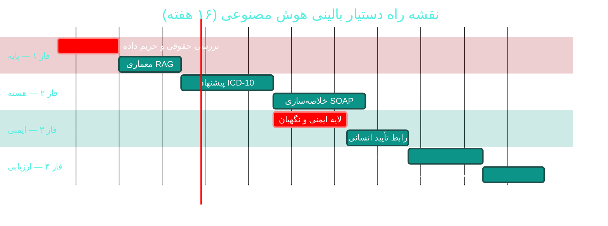

# 🤖 دستیار بالینی هوش مصنوعی (Clinical AI Assistant)

> **لایسنس:** addon-ai · **اولویت:** 🟠 بالا · **دشواری:** 🔴 زیاد · **زمان برآوردی:** ۱۲–۱۶ هفته

---

## ۱. 📋 خلاصه ماژول

دستیار هوش مصنوعی که پزشک را در **تصمیم‌گیری بالینی** یاری می‌کند:
پیشنهاد کد ICD-10، خلاصه‌سازی ویزیت، هشدار تداخل دارویی هوشمند،
و استخراج داده از متن آزاد — **بدون جایگزینی قضاوت پزشک**.

| ویژگی | مقدار |
|:---|:---|
| 🎯 هدف | کاهش خطای بالینی و بار مستندسازی پزشک |
| 👤 کاربران اصلی | پزشکان |
| 🔗 وابستگی‌ها | سرویس LLM · داده ICD-10 · پایگاه تداخلات دارویی |
| 📊 وضعیت فعلی | ❌ وجود ندارد |

### ✨ جدول ویژگی‌ها

| # | ویژگی | شرح | اولویت |
|:--:|:---|:---|:--:|
| ۱ | 🏷 پیشنهاد ICD-10 | از متن تشخیص به کد استاندارد | 🔴 حیاتی |
| ۲ | 📝 خلاصه‌سازی ویزیت | SOAP خودکار از یادداشت | 🔴 حیاتی |
| ۳ | ⚠ هشدار تداخل هوشمند | فراتر از تطبیق ساده | 🔴 حیاتی |
| ۴ | 🔍 استخراج موجودیت | دارو، دوز، تشخیص از متن | 🟠 بالا |
| ۵ | 📊 پیش‌بینی خطر | بر اساس سوابق بیمار | 🟠 بالا |
| ۶ | 🩺 پاسخ به پرسش بالینی | بر پایه منابع معتبر | 🟡 متوسط |
| ۷ | 🌐 ترجمه اصطلاحات | فارسی ⇄ انگلیسی پزشکی | 🟡 متوسط |
| ۸ | 📋 تکمیل خودکار فرم | پیشنهاد تکمیل فیلدها | 🟢 پایین |
| ۹ | 🎙 تبدیل گفتار به متن | دیکته شرح‌حال | 🟡 متوسط |
| ۱۰ | 🔎 بازیابی مشابه | یافتن بیماران مشابه | 🟢 پایین |

---

## ۲. 🎯 وضعیت فعلی در کدبیس

| لایه | فایل/مسیر | وضعیت |
|:---|:---|:---|
| 🤖 سرویس هوش مصنوعی | — | ❌ **وجود ندارد** |
| 📚 داده ICD-10 | `Infrastructure/Persistence/SeedData/Icd10*.*` | 🟢 **موجود** |
| 💊 تداخلات دارویی | `Infrastructure/Persistence/SeedData/DrugInteraction*.*` | 🟢 **موجود** |
| 🧮 ماشین‌حساب‌های بالینی | پیشنهادی در [A05](A05-emr-advanced.md) | 🟡 |
| 📋 پرونده الکترونیک | `Desktop/ViewModels/AdvancedEmr/**` | 🟢 آماده |

> 💡 **امتیاز بزرگ:** داده‌های **ICD-10** و **تداخلات دارویی** از قبل
> در پروژه موجود هستند. این یعنی دستیار هوش مصنوعی می‌تواند
> به‌صورت **مبتنی بر بازیابی (RAG)** روی داده‌های موجود ساخته شود
> بدون نیاز به آموزش مدل اختصاصی.

---

## ۳. 📊 نمودار معماری RAG



---

## ۴. 🛠 دستورالعمل پیاده‌سازی

### 📌 گام ۱ — رابط سرویس

در `Application/Interfaces/IClinicalAiService.cs` (جدید):

```csharp
namespace Sahand.ClinicPro.Application.Interfaces;

/// <summary>
/// پیشنهاد کد تشخیصی همراه با میزان اطمینان
/// </summary>
/// <param name="Code">کد ICD-10</param>
/// <param name="TitleFa">عنوان فارسی</param>
/// <param name="TitleEn">عنوان انگلیسی</param>
/// <param name="Confidence">میزان اطمینان بین ۰ تا ۱</param>
/// <param name="Rationale">دلیل انتخاب این کد</param>
public record IcdSuggestion(
    string Code,
    string TitleFa,
    string TitleEn,
    double Confidence,
    string Rationale);

/// <summary>
/// خلاصه خودکار ویزیت در قالب SOAP
/// </summary>
public record SoapSummaryDraft(
    string Subjective,
    string Objective,
    string Assessment,
    string Plan,
    IReadOnlyList<string> Warnings);

/// <summary>
/// سرویس دستیار بالینی هوش مصنوعی
/// </summary>
public interface IClinicalAiService
{
    /// <summary>
    /// پیشنهاد کدهای ICD-10 بر اساس متن تشخیص
    /// </summary>
    Task<IReadOnlyList<IcdSuggestion>> SuggestIcdCodesAsync(
        string diagnosisText,
        int maxSuggestions = 5,
        CancellationToken cancellationToken = default);

    /// <summary>
    /// تولید پیش‌نویس خلاصه SOAP از یادداشت آزاد پزشک
    /// </summary>
    Task<SoapSummaryDraft> DraftSoapSummaryAsync(
        string freeTextNote,
        Guid patientId,
        CancellationToken cancellationToken = default);

    /// <summary>
    /// بررسی تداخل دارویی با توضیح بالینی
    /// </summary>
    Task<IReadOnlyList<ClinicalAlert>> AnalyzeDrugInteractionsAsync(
        IReadOnlyList<string> medicationNames,
        Guid patientId,
        CancellationToken cancellationToken = default);
}

/// <summary>
/// هشدار بالینی تولیدشده توسط دستیار هوش مصنوعی
/// </summary>
public record ClinicalAlert(
    string Severity,
    string Title,
    string Description,
    string RecommendedAction,
    string? SourceReference);
```

### 📌 گام ۲ — لایه ایمنی (بسیار مهم)

در `Infrastructure/Services/AI/Guardrails.cs` (جدید):

```csharp
namespace Sahand.ClinicPro.Infrastructure.Services.AI;

/// <summary>
/// محدودیت‌های ایمنی برای خروجی مدل زبانی
/// </summary>
public static class ClinicalAiGuardrails
{
    /// <summary>
    /// دستورالعمل سیستمی که مدل را محدود می‌کند
    /// </summary>
    public const string SystemPrompt = """
        شما یک دستیار مستندسازی بالینی هستید، نه پزشک.

        قوانین سخت‌گیرانه:
        ۱. هرگز تشخیص قطعی ارائه ندهید؛ فقط کدهای محتمل را پیشنهاد کنید.
        ۲. هرگز دوز دارو یا دستور درمانی قطعی صادر نکنید.
        ۳. اگر اطمینان کمتر از ۵۰٪ است، صریحاً اعلام کنید "اطمینان کافی نیست".
        ۴. هر پیشنهاد باید همراه با دلیل و منبع باشد.
        ۵. اگر داده کافی نیست، بگویید "داده ناکافی است" نه حدس.
        ۶. خروجی فقط در قالب JSON درخواستی باشد.
        ۷. از ارائه نظر درباره موارد اورژانسی خودداری کنید و
           ارجاع فوری به پزشک را توصیه کنید.
        """;

    /// <summary>
    /// بررسی اینکه خروجی مدل حاوی ادعای خطرناک نباشد
    /// </summary>
    public static bool IsSafe(string modelOutput)
    {
        var redFlags = new[]
        {
            "قطعاً", "حتماً مصرف کنید", "نیازی به مراجعه نیست",
            "تشخیص نهایی", "درمان قطعی"
        };

        return !redFlags.Any(flag =>
            modelOutput.Contains(flag, StringComparison.OrdinalIgnoreCase));
    }
}
```

### 📌 گام ۳ — کامند پیشنهاد ICD-10

در `Application/Features/ClinicalAi/SuggestIcd/SuggestIcdCommand.cs` (جدید):

```csharp
using FluentValidation;
using MediatR;
using Sahand.ClinicPro.Application.Common;
using Sahand.ClinicPro.Domain.Common;

namespace Sahand.ClinicPro.Application.Features.ClinicalAi.SuggestIcd;

/// <summary>پیشنهاد کدهای ICD-10 برای متن تشخیص</summary>
/// <param name="DiagnosisText">متن آزاد تشخیص پزشک</param>
public record SuggestIcdCommand(string DiagnosisText)
    : IRequest<Result<IReadOnlyList<IcdSuggestionDto>>>;

/// <summary>کد پیشنهادی برای نمایش در رابط کاربر</summary>
public record IcdSuggestionDto(
    string Code, string TitleFa, double Confidence, string Rationale);

/// <summary>اعتبارسنجی درخواست پیشنهاد کد</summary>
public class SuggestIcdCommandValidator : AbstractValidator<SuggestIcdCommand>
{
    public SuggestIcdCommandValidator()
    {
        RuleFor(x => x.DiagnosisText)
            .NotEmpty().WithMessage("متن تشخیص الزامی است")
            .MinimumLength(3).WithMessage("متن تشخیص بسیار کوتاه است")
            .MaximumLength(2000).WithMessage("متن تشخیص بسیار طولانی است");
    }
}

/// <summary>مدیریت پیشنهاد کد ICD-10</summary>
public class SuggestIcdCommandHandler
    : IRequestHandler<SuggestIcdCommand, Result<IReadOnlyList<IcdSuggestionDto>>>
{
    private readonly IClinicalAiService _aiService;
    private readonly ILogger<SuggestIcdCommandHandler> _logger;

    public SuggestIcdCommandHandler(
        IClinicalAiService aiService,
        ILogger<SuggestIcdCommandHandler> logger)
    {
        _aiService = aiService;
        _logger = logger;
    }

    public async Task<Result<IReadOnlyList<IcdSuggestionDto>>> Handle(
        SuggestIcdCommand request,
        CancellationToken cancellationToken)
    {
        var suggestions = await _aiService.SuggestIcdCodesAsync(
            request.DiagnosisText, maxSuggestions: 5, cancellationToken);

        if (suggestions.Count == 0)
            return Result<IReadOnlyList<IcdSuggestionDto>>.Failure(
                Error.NotFound("کد مناسبی برای این متن یافت نشد"));

        // فقط پیشنهادهای با اطمینان بالا نمایش داده می‌شوند
        var filtered = suggestions
            .Where(s => s.Confidence >= 0.5)
            .Select(s => new IcdSuggestionDto(s.Code, s.TitleFa, s.Confidence, s.Rationale))
            .ToList();

        _logger.LogInformation(
            "{Count} کد ICD-10 برای متن پیشنهاد شد", filtered.Count);

        return Result<IReadOnlyList<IcdSuggestionDto>>.Success(filtered);
    }
}
```

### 📌 گام ۴ — ثبت در DI و نمایش در رابط کاربر

در `Infrastructure/DependencyInjection.cs`:

```csharp
services.Configure<ClinicalAiOptions>(
    configuration.GetSection("ClinicalAi"));

services.AddHttpClient<IClinicalAiService, ClinicalAiService>(client =>
{
    client.Timeout = TimeSpan.FromSeconds(60);
});
```

در `appsettings.json`:

```json
{
  "ClinicalAi": {
    "Enabled": true,
    "Provider": "OpenAI",
    "Model": "gpt-4o-mini",
    "MaxTokens": 1500,
    "Temperature": 0.1,
    "RequireHumanConfirmation": true,
    "MinConfidence": 0.5
  }
}
```

> ⚠️ **کلید API هرگز نباید در `appsettings.json` باشد** —
> از User Secrets در توسعه و Key Vault در تولید استفاده کنید.
> (مرتبط: [C01 — امنیت](C01-security-rbac.md))

### 📌 گام ۵ — مایگریشن

```bash
cd src/Sahand.ClinicPro.Infrastructure
dotnet ef migrations add Cycle49ClinicalAiFeedback \
    --startup-project ../Sahand.ClinicPro.API --context ClinicProDbContext
dotnet ef database update --startup-project ../Sahand.ClinicPro.API
```

---

## ۵. ⚠️ کاستی‌ها و ریسک‌ها

| # | ریسک | شدت | راهکار |
|:--:|:---|:--:|:---|
| W-01 | توهم مدل (Hallucination) منجر به کد غلط | 🔴 بحرانی | RAG روی داده موجود + تأیید اجباری انسانی |
| W-02 | ارسال داده بیمار به سرویس خارجی | 🔴 بحرانی | ناشناس‌سازی پیش از ارسال · قرارداد محرمانگی |
| W-03 | اتکای بیش‌ازحد پزشک به پیشنهاد | 🟠 بالا | نمایش اطمینان · آموزش · محدودیت در موارد حساس |
| W-04 | هزینه فراخوانی API | 🟡 متوسط | کش نتایج · محدودیت نرخ |
| W-05 | عدم انطباق با مقررات داده سلامت | 🟠 بالا | بررسی حقوقی پیش از استقرار |
| W-06 | کندی پاسخ در ساعات شلوغ | 🟡 متوسط | پردازش ناهمزمان + نمایش تدریجی |

---

## ۶. 📈 شاخص‌های موفقیت (KPI)

| شاخص | هدف |
|:---|:--:|
| 🎯 دقت پیشنهاد ICD-10 (Top-3) | **≥ ۸۵٪** |
| 📝 صرفه‌جویی زمان مستندسازی | **≥ ۳۰٪** |
| ⚠ کاهش خطای کدگذاری | **≥ ۵۰٪** |
| 👨‍⚕ نرخ پذیرش پیشنهاد توسط پزشک | **≥ ۶۰٪** |
| ⏱ زمان پاسخ‌گویی | **< ۵ ثانیه** |

---

## ۷. 🗓 برنامه زمانی



---

## 🔗 پیوندهای مرتبط

- [A04 — ویزیت و SOAP](A04-visits-soap.md)
- [A05 — پرونده الکترونیک پیشرفته](A05-emr-advanced.md)
- [A06 — نسخه‌نویسی و ایمنی دارو](A06-prescriptions-safety.md)
- [C01 — امنیت و کنترل دسترسی](C01-security-rbac.md)
- [C02 — حسابرسی و انطباق](C02-audit-compliance.md)
- [D04 — هوش تجاری](D04-bi-analytics.md)

---
<div align="center">📅 ۱۴۰۴/۰۷/۱۹ · 🔖 v1.0</div>
