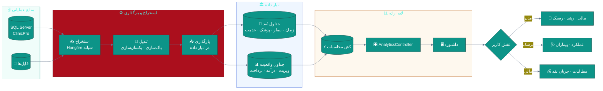
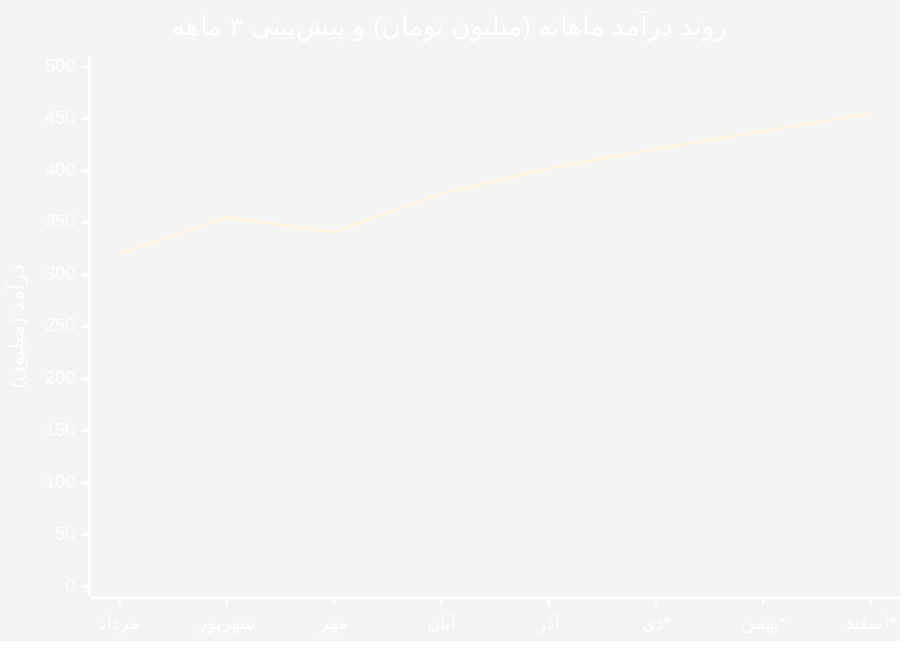
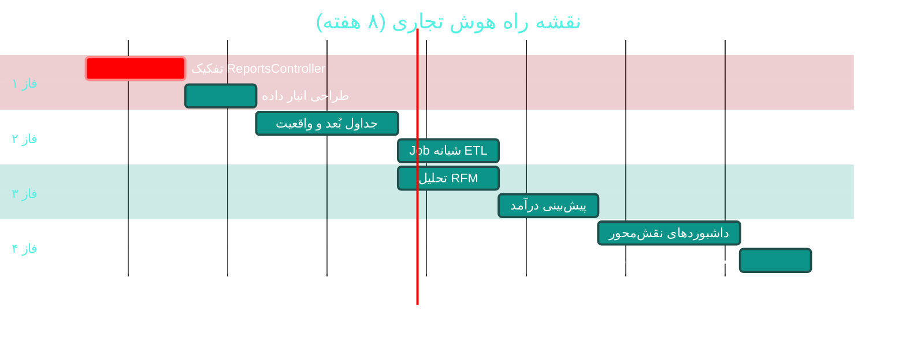

# 📈 هوش تجاری و تحلیل‌های پیشرفته (BI & Analytics)

> **لایسنس:** addon-bi · **اولویت:** 🟠 بالا · **دشواری:** 🟡 متوسط · **زمان برآوردی:** ۶–۸ هفته

---

## ۱. 📋 خلاصه ماژول

تبدیل داده‌های عملیاتی ClinicPro به **بینش مدیریتی**: پیش‌بینی درآمد،
تحلیل رفتار بیماران (RFM)، سنجش عملکرد پزشکان، و داشبوردهای نقش‌محور
که تصمیم‌گیری را از حدس به داده منتقل می‌کند.

| ویژگی | مقدار |
|:---|:---|
| 🎯 هدف | تصمیم‌گیری مبتنی بر داده برای مدیریت درمانگاه |
| 👤 کاربران اصلی | مدیر درمانگاه، مدیر مالی، پزشکان |
| 🔗 وابستگی‌ها | انبار داده · ابزار نمودار · داده‌های موجود |
| 📊 وضعیت فعلی | 🟡 پایه موجود، فاقد لایه تحلیلی |

### ✨ جدول ویژگی‌ها

| # | ویژگی | شرح | اولویت |
|:--:|:---|:---|:--:|
| ۱ | 📊 داشبورد نقش‌محور | نمای متفاوت برای مدیر/پزشک/مالی | 🔴 حیاتی |
| ۲ | 💰 پیش‌بینی درآمد | بر اساس روند تاریخی | 🟠 بالا |
| ۳ | 🎯 تحلیل RFM بیماران | بخش‌بندی بر اساس تازگی/تکرار/مبلغ | 🟠 بالا |
| ۴ | 👨‍⚕ کارت امتیازی پزشک | بهره‌وری، رضایت، درآمد | 🟠 بالا |
| ۵ | 📉 تحلیل ریزش بیمار | شناسایی بیماران از‌دست‌رفته | 🟡 متوسط |
| ۶ | 🕐 تحلیل ساعات پیک | بهینه‌سازی تخصیص منابع | 🟡 متوسط |
| ۷ | 🧾 تحلیل مطالبات | پیری مطالبات بیمه‌ای | 🟠 بالا |
| ۸ | 💊 تحلیل مصرف دارو | پرمصرف‌ترین و حاشیه سود | 🟡 متوسط |
| ۹ | 📤 خروجی Excel/PDF | گزارش‌های زمان‌بندی‌شده | 🟢 پایین |
| ۱۰ | 🔔 هشدار ناهنجاری | کاهش ناگهانی مراجعات | 🟡 متوسط |

---

## ۲. 🎯 وضعیت فعلی در کدبیس

| لایه | فایل/مسیر | خط | وضعیت |
|:---|:---|:--:|:---|
| 🎛 گزارشات | `API/Controllers/ReportsController.cs` | ۱٬۱۰۴ | 🟠 سنگین |
| 🖥 داشبورد | `Desktop/ViewModels/DashboardViewModel.cs` | — | 🟡 پایه |
| 📊 نمودارها | ClosedXML / QuestPDF در `Directory.Packages.props` | — | 🟢 آماده |
| 🗄 انبار داده | — | — | ❌ **وجود ندارد** |
| ⚙ پردازش تحلیلی (OLAP) | — | — | ❌ **وجود ندارد** |
| ⏱ کش گزارشات | پیشنهادی در [B08](B08-reports.md) | — | 🟡 |

> ⚠️ **چالش اصلی:** `ReportsController` با **۱٬۱۰۴ خط** یک God Controller
> است. پیش از افزودن تحلیل‌های جدید باید
> به شش کنترلر مجزا تفکیک شود (جزئیات در [B08](B08-reports.md)).

---

## ۳. 📊 نمودار معماری انبار داده



---

## ۴. 🛠 دستورالعمل پیاده‌سازی

### 📌 گام ۱ — جداسازی کنترلر (پیش‌نیاز)

پیش از هر چیز `ReportsController` باید تفکیک شود:

```
📂 API/Controllers/Reports/
├── 📄 FinancialReportsController.cs     گزارشات مالی
├── 📄 ClinicalReportsController.cs      گزارشات بالینی
├── 📄 OperationalReportsController.cs   گزارشات عملیاتی
├── 📄 InventoryReportsController.cs     گزارشات انبار
├── 📄 HrReportsController.cs            گزارشات منابع انسانی
└── 📄 AnalyticsController.cs            ⭐ تحلیل‌های جدید
```

### 📌 گام ۲ — جداول واقعیت و بُعد

**۲.۱ بُعد زمان**

در `Domain/Analytics/DimDate.cs` (جدید):

```csharp
namespace Sahand.ClinicPro.Domain.Analytics;

/// <summary>
/// بُعد زمان برای تحلیل‌های چندبُعدی — شامل تاریخ شمسی
/// </summary>
public class DimDate
{
    public int DateKey { get; set; }              // 14040719
    public DateTime GregorianDate { get; set; }
    public string PersianDate { get; set; } = default!;   // 1404/07/19
    public int PersianYear { get; set; }
    public int PersianMonth { get; set; }
    public int PersianDay { get; set; }
    public string PersianMonthName { get; set; } = default!;
    public int GregorianYear { get; set; }
    public int GregorianMonth { get; set; }
    public int DayOfWeek { get; set; }
    public string DayNameFa { get; set; } = default!;
    public bool IsHoliday { get; set; }
    public bool IsWeekend { get; set; }
    public int Quarter { get; set; }
}

/// <summary>
/// جدول واقعیت ویزیت — قلب تحلیل‌های عملیاتی
/// </summary>
public class FactVisit
{
    public long Id { get; set; }
    public int DateKey { get; set; }
    public Guid PatientKey { get; set; }
    public Guid DoctorKey { get; set; }
    public Guid BranchKey { get; set; }
    public Guid? ServiceKey { get; set; }
    public Guid? InsuranceKey { get; set; }

    public int VisitCount { get; set; } = 1;
    public decimal GrossAmount { get; set; }
    public decimal DiscountAmount { get; set; }
    public decimal InsuranceShare { get; set; }
    public decimal PatientShare { get; set; }
    public decimal NetAmount { get; set; }
    public int WaitMinutes { get; set; }
    public int DurationMinutes { get; set; }
    public bool IsFirstVisit { get; set; }

    public DimDate Date { get; set; } = default!;
}
```

### 📌 گام ۳ — تحلیل RFM بیماران

در `Application/Features/Analytics/RfmAnalysis/RfmAnalysisQuery.cs` (جدید):

```csharp
using MediatR;
using Sahand.ClinicPro.Application.Common;
using Sahand.ClinicPro.Domain.Common;

namespace Sahand.ClinicPro.Application.Features.Analytics.RfmAnalysis;

/// <summary>تحلیل RFM برای بخش‌بندی بیماران</summary>
public record RfmAnalysisQuery(DateTime FromUtc, DateTime ToUtc)
    : IRequest<Result<RfmAnalysisResult>>;

/// <summary>
/// نتیجه تحلیل RFM
/// </summary>
/// <param name="Segments">توزیع بیماران در هر بخش</param>
/// <param name="TotalPatients">تعداد کل بیماران تحلیل‌شده</param>
public record RfmAnalysisResult(
    IReadOnlyList<RfmSegmentDto> Segments,
    int TotalPatients);

/// <summary>یک بخش از تحلیل RFM</summary>
public record RfmSegmentDto(
    string SegmentName,
    string Description,
    int PatientCount,
    decimal Percentage,
    decimal AverageRecencyDays,
    decimal AverageFrequency,
    decimal AverageMonetary,
    string RecommendedAction);

/// <summary>مدیریت تحلیل RFM</summary>
public class RfmAnalysisQueryHandler
    : IRequestHandler<RfmAnalysisQuery, Result<RfmAnalysisResult>>
{
    private readonly IUnitOfWork _unitOfWork;
    private readonly ILogger<RfmAnalysisQueryHandler> _logger;

    public RfmAnalysisQueryHandler(
        IUnitOfWork unitOfWork,
        ILogger<RfmAnalysisQueryHandler> logger)
    {
        _unitOfWork = unitOfWork;
        _logger = logger;
    }

    public async Task<Result<RfmAnalysisResult>> Handle(
        RfmAnalysisQuery request,
        CancellationToken cancellationToken)
    {
        // محاسبه شاخص‌های R و F و M برای هر بیمار در بازه
        var patientMetrics = await _unitOfWork.Repository<Domain.Analytics.FactVisit>()
            .QueryableNoTracking
            .Where(v => v.Date.GregorianDate >= request.FromUtc
                     && v.Date.GregorianDate <= request.ToUtc)
            .GroupBy(v => v.PatientKey)
            .Select(g => new
            {
                PatientKey = g.Key,
                LastVisit = g.Max(v => v.Date.GregorianDate),
                Frequency = g.Count(),
                Monetary = g.Sum(v => v.NetAmount)
            })
            .ToListAsync(cancellationToken);

        if (patientMetrics.Count == 0)
            return Result<RfmAnalysisResult>.Failure(
                Error.NotFound("داده‌ای برای این بازه یافت نشد"));

        var today = DateTime.UtcNow.Date;

        // امتیازدهی ۱ تا ۵ با روش Quintile
        var scored = patientMetrics
            .Select(p => new
            {
                p.PatientKey,
                Recency = (today - p.LastVisit.Date).Days,
                p.Frequency,
                p.Monetary
            })
            .ToList();

        var recencyQuintiles = Quintile(scored.Select(s => (double)s.Recency).ToList());
        var frequencyQuintiles = Quintile(scored.Select(s => (double)s.Frequency).ToList());
        var monetaryQuintiles = Quintile(scored.Select(s => (double)s.Monetary).ToList());

        // بخش‌بندی بر اساس ترکیب امتیازها
        var segments = scored
            .Select(s => new
            {
                s.PatientKey,
                R = Score(recencyQuintiles, s.Recency, ascending: false),
                F = Score(frequencyQuintiles, s.Frequency, ascending: true),
                M = Score(monetaryQuintiles, (double)s.Monetary, ascending: true)
            })
            .GroupBy(s => Classify(s.R, s.F, s.M))
            .Select(g => new RfmSegmentDto(
                g.Key.Name, g.Key.Description, g.Count(),
                Math.Round((decimal)g.Count() / scored.Count * 100, 1),
                g.Average(x => x.R), g.Average(x => x.F), g.Average(x => x.M),
                g.Key.RecommendedAction))
            .OrderByDescending(s => s.PatientCount)
            .ToList();

        _logger.LogInformation(
            "تحلیل RFM برای {Count} بیمار انجام شد", scored.Count);

        return Result<RfmAnalysisResult>.Success(
            new RfmAnalysisResult(segments, scored.Count));
    }

    /// <summary>محاسبه مرزهای پنجک</summary>
    private static List<double> Quintile(List<double> values)
    {
        var sorted = values.OrderBy(v => v).ToList();
        return new[] { 0.2, 0.4, 0.6, 0.8 }
            .Select(q => sorted[(int)(sorted.Count * q)])
            .ToList();
    }

    /// <summary>تبدیل مقدار به امتیاز ۱ تا ۵</summary>
    private static int Score(List<double> quintiles, double value, bool ascending)
    {
        var score = 1;
        foreach (var q in quintiles)
        {
            if (value > q) score++;
        }
        return ascending ? score : 6 - score;
    }

    /// <summary>تعیین بخش بر اساس امتیاز RFM</summary>
    private static (string Name, string Description, string RecommendedAction)
        Classify(int r, int f, int m)
    {
        if (r >= 4 && f >= 4 && m >= 4)
            return ("🏆 قهرمانان", "تازگی، تکرار و مبلغ بالا",
                    "حفظ با برنامه وفاداری و تخفیف ویژه");
        if (r >= 4 && f <= 2)
            return ("🌱 جدید", "مراجعه اخیر اما تکرار کم",
                    "تشویق به مراجعه دوم با پیگیری");
        if (r <= 2 && f >= 4)
            return ("⚠ در معرض ریزش", "تکرار بالا اما عدم مراجعه اخیر",
                    "تماس فعال و یادآوری");
        if (r <= 2 && f <= 2)
            return ("💤 خفته", "عدم مراجعه طولانی",
                    "کمپین بازگشت یا حذف از لیست فعال");
        return ("📊 متوسط", "بیماران با رفتار معمولی", "نگهداری استاندارد");
    }
}
```

### 📌 گام ۴ — پیش‌بینی درآمد

در `Application/Features/Analytics/RevenueForecast/RevenueForecastQuery.cs` (جدید):

```csharp
namespace Sahand.ClinicPro.Application.Features.Analytics.RevenueForecast;

/// <summary>پیش‌بینی درآمد ماه‌های آتی</summary>
/// <param name="HistoryMonths">تعداد ماه‌های تاریخچه مورد استفاده</param>
/// <param name="ForecastMonths">تعداد ماه‌های پیش‌بینی</param>
public record RevenueForecastQuery(int HistoryMonths, int ForecastMonths)
    : IRequest<Result<RevenueForecastResult>>;

/// <summary>نتیجه پیش‌بینی درآمد</summary>
public record RevenueForecastResult(
    IReadOnlyList<ForecastPointDto> History,
    IReadOnlyList<ForecastPointDto> Forecast,
    decimal TrendPercent,
    string TrendDirection);

/// <summary>یک نقطه از سری زمانی درآمد</summary>
public record ForecastPointDto(
    string PersianMonth,
    decimal Actual,
    decimal? Predicted,
    decimal? LowerBound,
    decimal? UpperBound);

/// <summary>
/// پیش‌بینی با رگرسیون خطی ساده روی روند ماهانه
/// </summary>
public class RevenueForecastQueryHandler
    : IRequestHandler<RevenueForecastQuery, Result<RevenueForecastResult>>
{
    private readonly IUnitOfWork _unitOfWork;

    public RevenueForecastQueryHandler(IUnitOfWork unitOfWork)
        => _unitOfWork = unitOfWork;

    public async Task<Result<RevenueForecastResult>> Handle(
        RevenueForecastQuery request,
        CancellationToken cancellationToken)
    {
        var from = DateTime.UtcNow.AddMonths(-request.HistoryMonths);

        var monthly = await _unitOfWork.Repository<Domain.Analytics.FactVisit>()
            .QueryableNoTracking
            .Where(v => v.Date.GregorianDate >= from)
            .GroupBy(v => new { v.Date.PersianYear, v.Date.PersianMonth })
            .Select(g => new
            {
                g.Key.PersianYear,
                g.Key.PersianMonth,
                MonthName = g.Max(v => v.Date.PersianMonthName),
                Revenue = g.Sum(v => v.NetAmount)
            })
            .OrderBy(x => x.PersianYear).ThenBy(x => x.PersianMonth)
            .ToListAsync(cancellationToken);

        if (monthly.Count < 3)
            return Result<RevenueForecastResult>.Failure(
                Error.Validation("برای پیش‌بینی حداقل ۳ ماه داده نیاز است"));

        // رگرسیون خطی: y = a + b*x
        var n = monthly.Count;
        var xs = Enumerable.Range(1, n).Select(i => (double)i).ToList();
        var ys = monthly.Select(m => (double)m.Revenue).ToList();

        var meanX = xs.Average();
        var meanY = ys.Average();
        var b = xs.Zip(ys, (x, y) => (x - meanX) * (y - meanY)).Sum()
              / xs.Sum(x => Math.Pow(x - meanX, 2));
        var a = meanY - b * meanX;

        // انحراف استاندارد باقیمانده برای بازه اطمینان
        var residuals = xs.Zip(ys, (x, y) => y - (a + b * x)).ToList();
        var stdError = Math.Sqrt(residuals.Sum(r => r * r) / (n - 2));

        var history = monthly
            .Select((m, i) => new ForecastPointDto(
                $"{m.PersianYear}/{m.PersianMonth:D2}", m.Revenue, null, null, null))
            .ToList();

        var forecast = Enumerable.Range(1, request.ForecastMonths)
            .Select(k =>
            {
                var x = n + k;
                var predicted = a + b * x;
                return new ForecastPointDto(
                    $"+{k} ماه",
                    0m,
                    Math.Max(0m, (decimal)predicted),
                    Math.Max(0m, (decimal)(predicted - 1.96 * stdError)),
                    (decimal)(predicted + 1.96 * stdError));
            })
            .ToList();

        var trendPercent = meanY != 0 ? (decimal)(b / meanY * 100) : 0m;
        var direction = trendPercent > 2 ? "📈 صعودی"
                      : trendPercent < -2 ? "📉 نزولی" : "➡ ثابت";

        return Result<RevenueForecastResult>.Success(
            new RevenueForecastResult(history, forecast, trendPercent, direction));
    }
}
```

### 📌 گام ۵ — Job شبانه انبار داده

در `Infrastructure/Jobs/AnalyticsRefreshJob.cs` (جدید):

```csharp
using Hangfire;

namespace Sahand.ClinicPro.Infrastructure.Jobs;

/// <summary>
/// به‌روزرسانی شبانه جداول تحلیلی — ساعت ۲ بامداد
/// </summary>
public class AnalyticsRefreshJob
{
    private readonly IUnitOfWork _unitOfWork;
    private readonly ILogger<AnalyticsRefreshJob> _logger;

    public AnalyticsRefreshJob(
        IUnitOfWork unitOfWork,
        ILogger<AnalyticsRefreshJob> logger)
    {
        _unitOfWork = unitOfWork;
        _logger = logger;
    }

    [AutomaticRetry(Attempts = 3)]
    public async Task RefreshAsync(CancellationToken cancellationToken = default)
    {
        _logger.LogInformation("شروع به‌روزرسانی جداول تحلیلی");

        // ۱) اطمینان از وجود بُعد زمان برای ۳ سال آینده
        await EnsureDimDateAsync(cancellationToken);

        // ۲) بازسازی جدول واقعیت ویزیت برای ۳ ماه اخیر
        await RebuildFactVisitAsync(cancellationToken);

        _logger.LogInformation("به‌روزرسانی جداول تحلیلی پایان یافت");
    }

    private async Task EnsureDimDateAsync(CancellationToken ct)
    {
        // TODO: تولید رکوردهای بُعد زمان با تقویم شمسی
        await Task.CompletedTask;
    }

    private async Task RebuildFactVisitAsync(CancellationToken ct)
    {
        // TODO: بازسازی افزایشی جدول واقعیت
        await Task.CompletedTask;
    }
}
```

در `API/Program.cs`:

```csharp
RecurringJob.AddOrUpdate<AnalyticsRefreshJob>(
    "analytics-refresh",
    job => job.RefreshAsync(CancellationToken.None),
    Cron.Daily(2));
```

### 📌 گام ۶ — مایگریشن

```bash
cd src/Sahand.ClinicPro.Infrastructure
dotnet ef migrations add Cycle49AnalyticsWarehouse \
    --startup-project ../Sahand.ClinicPro.API --context ClinicProDbContext
dotnet ef database update --startup-project ../Sahand.ClinicPro.API
```

---

## ۵. 📊 نمودار نمونه داشبورد مدیریتی



> *ماه‌های ستاره‌دار پیش‌بینی‌شده هستند.

---

## ۶. ⚠️ کاستی‌ها و ریسک‌ها

| # | ریسک | شدت | راهکار |
|:--:|:---|:--:|:---|
| W-01 | کندی کوئری‌های تحلیلی روی پایگاه عملیاتی | 🔴 بحرانی | انبار داده مجزا |
| W-02 | `ReportsController` ۱٬۱۰۴ خط | 🟠 بالا | تفکیک به ۶ کنترلر |
| W-03 | داده ناقص یا ناسازگار | 🟠 بالا | اعتبارسنجی در ETL |
| W-04 | تفسیر نادرست شاخص‌ها | 🟡 متوسط | مستندسازی تعاریف |
| W-05 | قدیمی بودن داده در داشبورد | 🟡 متوسط | نمایش زمان آخرین به‌روزرسانی |

---

## ۷. 📈 شاخص‌های موفقیت (KPI)

| شاخص | هدف |
|:---|:--:|
| ⏱ زمان بارگذاری داشبورد | **< ۳ ثانیه** |
| 🎯 دقت پیش‌بینی درآمد (MAPE) | **< ۱۵٪** |
| 📊 تعداد داشبوردهای نقش‌محور | **۳** |
| 🔄 تناوب به‌روزرسانی انبار داده | **روزانه** |
| 📉 کاهش زمان تهیه گزارش مدیریتی | **≥ ۸۰٪** |

---

## ۸. 🗓 برنامه زمانی



---

## 🔗 پیوندهای مرتبط

- [B01 — صورتحساب و دریافت](B01-billing.md)
- [B02 — حسابداری](B02-accounting.md)
- [B03 — بیمه و مطالبات](B03-insurance.md)
- [B08 — گزارشات](B08-reports.md)
- [C11 — مقیاس‌پذیری پایگاه داده](C11-database-scalability.md)
- [D07 — CRM و بازاریابی](D07-crm-marketing.md)

---
<div align="center">📅 ۱۴۰۴/۰۷/۱۹ · 🔖 v1.0</div>
