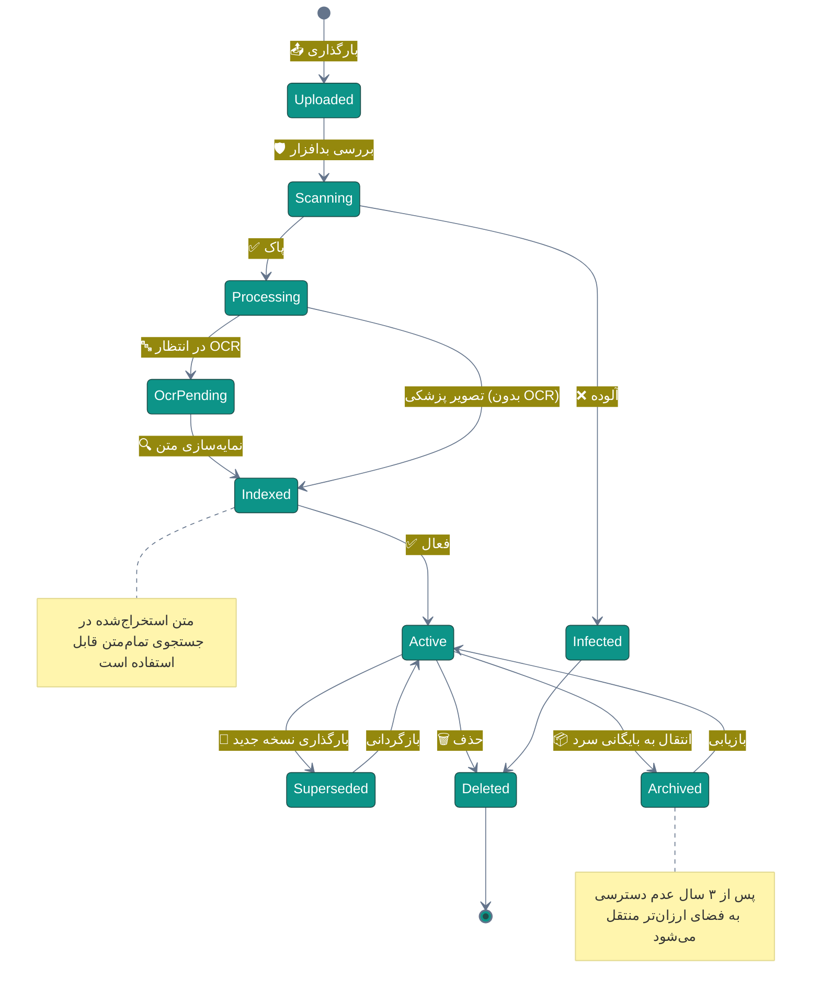
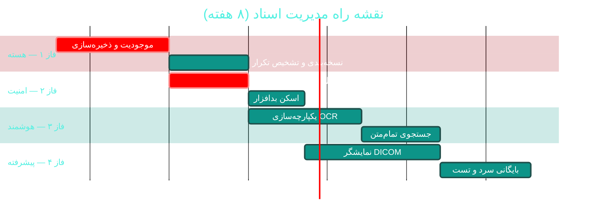

# 📁 مدیریت اسناد و تصاویر پزشکی (DMS / PACS)

> **لایسنس:** addon-dms · **اولویت:** 🟠 بالا · **دشواری:** 🟡 متوسط · **زمان برآوردی:** ۶–۸ هفته

---

## ۱. 📋 خلاصه ماژول

سیستم مدیریت اسناد با نسخه‌بندی، جستجوی تمام‌متن، OCR فارسی،
و یکپارچگی با استانداردهای تصویربرداری پزشکی (DICOM/PACS)
تا هر مدرک بیمار — از کارت ملی تا تصویر رادیولوژی —
در یک مکان امن، جستجوپذیر و نسخه‌دار باشد.

| ویژگی | مقدار |
|:---|:---|
| 🎯 هدف | حذف اسناد کاغذی و یکپارچه‌سازی مدارک پراکنده |
| 👤 کاربران اصلی | پذیرش، پزشکان، بایگانی |
| 🔗 وابستگی‌ها | فضای ذخیره‌سازی · OCR · پروتکل DICOM |
| 📊 وضعیت فعلی | 🟡 پراکنده |

### ✨ جدول ویژگی‌ها

| # | ویژگی | شرح | اولویت |
|:--:|:---|:---|:--:|
| ۱ | 📤 بارگذاری و ذخیره | آپلود با پیش‌نمایش | 🔴 حیاتی |
| ۲ | 🔖 نسخه‌بندی | تاریخچه تغییرات هر سند | 🔴 حیاتی |
| ۳ | 🔍 جستجوی تمام‌متن | روی محتوای استخراج‌شده OCR | 🟠 بالا |
| ۴ | 🔤 OCR فارسی | استخراج متن از تصویر | 🟠 بالا |
| ۵ | 🏷 برچسب‌گذاری | دسته‌بندی انعطاف‌پذیر | 🟠 بالا |
| ۶ | 🖼 نمایش DICOM | مشاهده تصاویر پزشکی | 🟠 بالا |
| ۷ | 🔐 کنترل دسترسی سطح سند | محدودیت بر اساس نقش | 🔴 حیاتی |
| ۸ | 📦 بایگانی سرد | انتقال خودکار اسناد قدیمی | 🟡 متوسط |
| ۹ | 🔗 پیوند به بیمار/ویزیت | اتصال به پرونده | 🔴 حیاتی |
| ۱۰ | 📊 گزارش ممیزی دسترسی | ثبت هر مشاهده | 🟡 متوسط |

---

## ۲. 🎯 وضعیت فعلی در کدبیس

| لایه | فایل/مسیر | خط | وضعیت |
|:---|:---|:--:|:---|
| 💾 ذخیره‌سازی فایل | پیشنهادی در [A08](A08-paraclinical.md) | — | 🟡 |
| 🖼 نمایش تصویربرداری | `Desktop/Views/Imaging/**` | — | 🟡 پایه |
| 🦷 چارت دندانپزشکی | `Desktop/Views/DentalChart.xaml` | — | 🟢 |
| 📄 چاپ اسناد | `Desktop/Utilities/Print/**` | ۱٬۴۸۵ | 🟢 |
| 🔍 جستجوی متن | — | — | ❌ |
| 🔤 OCR | — | — | ❌ |
| 📦 استاندارد DICOM | — | — | ❌ کامل |

> 💡 **فرصت:** زیرساخت `IFileStorage` پیشنهادی در
> [A08 — پاراکلینیک](A08-paraclinical.md) می‌تواند
> ستون فقرات این ماژول باشد — از دوباره‌کاری پرهیز کنید.

---

## ۳. 📊 نمودار چرخه عمر سند



---

## ۴. 🛠 دستورالعمل پیاده‌سازی

### 📌 گام ۱ — موجودیت سند

در `Domain/Entities/DocumentRecord.cs` (جدید):

```csharp
namespace Sahand.ClinicPro.Domain.Entities;

/// <summary>
/// رکورد یک سند پزشکی با پشتیبانی از نسخه‌بندی و بایگانی
/// </summary>
public class DocumentRecord : BaseEntity
{
    /// <summary>شناسه بیمار مرتبط (اختیاری برای اسناد اداری)</summary>
    public Guid? PatientId { get; set; }

    /// <summary>شناسه ویزیت مرتبط</summary>
    public Guid? VisitId { get; set; }

    /// <summary>عنوان سند</summary>
    public string Title { get; set; } = default!;

    /// <summary>نوع سند</summary>
    public DocumentKind Kind { get; set; } = DocumentKind.Other;

    /// <summary>مسیر ذخیره‌سازی فیزیکی</summary>
    public string StoragePath { get; set; } = default!;

    /// <summary>هش SHA-256 برای تشخیص تغییر و جلوگیری از تکرار</summary>
    public string ContentHash { get; set; } = default!;

    /// <summary>اندازه فایل بر حسب بایت</summary>
    public long SizeBytes { get; set; }

    /// <summary>نوع MIME</summary>
    public string ContentType { get; set; } = default!;

    /// <summary>شماره نسخه</summary>
    public int Version { get; set; } = 1;

    /// <summary>شناسه سند والد در صورت نسخه‌برداری</summary>
    public Guid? ParentDocumentId { get; set; }

    /// <summary>آیا این نسخه جایگزین شده است</summary>
    public bool IsSuperseded { get; set; }

    /// <summary>متن استخراج‌شده توسط OCR برای جستجو</summary>
    public string? ExtractedText { get; set; }

    /// <summary>برچسب‌ها با جداکننده ویرگول</summary>
    public string? Tags { get; set; }

    /// <summary>سطح محرمانگی برای کنترل دسترسی</summary>
    public DocumentSensitivity Sensitivity { get; set; }
        = DocumentSensitivity.Normal;

    /// <summary>وضعیت بایگانی</summary>
    public bool IsArchived { get; set; }

    public DateTime? ArchivedAtUtc { get; set; }

    /// <summary>تاریخ آخرین دسترسی برای سیاست بایگانی سرد</summary>
    public DateTime? LastAccessedAtUtc { get; set; }

    public Guid UploadedByUserId { get; set; }

    // Navigation
    public Patient? Patient { get; set; }
    public Visit? Visit { get; set; }
}

/// <summary>نوع سند پزشکی</summary>
public enum DocumentKind
{
    NationalId = 1,
    InsuranceCard = 2,
    ConsentForm = 3,
    LabResult = 4,
    RadiologyImage = 5,
    RadiologyReport = 6,
    PrescriptionScan = 7,
    ReferralLetter = 8,
    DischargeSummary = 9,
    Contract = 10,
    Other = 99
}

/// <summary>سطح محرمانگی سند</summary>
public enum DocumentSensitivity
{
    Normal = 1,
    Confidential = 2,
    Restricted = 3      // فقط پزشک معالج و مدیر
}
```

### 📌 گام ۲ — سرویس ذخیره‌سازی

در `Application/Interfaces/IDocumentStorage.cs` (جدید):

```csharp
namespace Sahand.ClinicPro.Application.Interfaces;

/// <summary>
/// انتزاع لایه ذخیره‌سازی اسناد — قابل تعویض بین محلی، S3 یا Azure Blob
/// </summary>
public interface IDocumentStorage
{
    /// <summary>ذخیره فایل و بازگرداندن مسیر منطقی</summary>
    Task<string> SaveAsync(
        Stream content,
        string fileName,
        string contentType,
        CancellationToken cancellationToken = default);

    /// <summary>خواندن محتوای فایل</summary>
    Task<Stream> ReadAsync(
        string storagePath,
        CancellationToken cancellationToken = default);

    /// <summary>حذف فایل</summary>
    Task DeleteAsync(
        string storagePath,
        CancellationToken cancellationToken = default);

    /// <summary>تولید لینک موقت دانلود (بدون افشای کلید)</summary>
    Task<string> GetSignedUrlAsync(
        string storagePath,
        TimeSpan expiry,
        CancellationToken cancellationToken = default);

    /// <summary>انتقال به لایه بایگانی سرد</summary>
    Task ArchiveAsync(
        string storagePath,
        CancellationToken cancellationToken = default);
}
```

### 📌 گام ۳ — کامند بارگذاری با تشخیص تکرار

در `Application/Features/Documents/UploadDocument/UploadDocumentCommand.cs` (جدید):

```csharp
using FluentValidation;
using MediatR;
using Sahand.ClinicPro.Application.Common;
using Sahand.ClinicPro.Domain.Common;

namespace Sahand.ClinicPro.Application.Features.Documents.UploadDocument;

/// <summary>بارگذاری سند جدید برای بیمار</summary>
/// <param name="PatientId">شناسه بیمار</param>
/// <param name="Title">عنوان سند</param>
/// <param name="Kind">نوع سند</param>
/// <param name="Content">محتوای فایل</param>
/// <param name="FileName">نام فایل</param>
/// <param name="ContentType">نوع MIME</param>
/// <param name="Tags">برچسب‌ها</param>
public record UploadDocumentCommand(
    Guid PatientId,
    string Title,
    DocumentKind Kind,
    byte[] Content,
    string FileName,
    string ContentType,
    string? Tags)
    : IRequest<Result<UploadDocumentResponse>>;

/// <summary>نتیجه بارگذاری سند</summary>
public record UploadDocumentResponse(Guid DocumentId, int Version, bool IsDuplicate);

/// <summary>اعتبارسنجی بارگذاری سند</summary>
public class UploadDocumentCommandValidator : AbstractValidator<UploadDocumentCommand>
{
    private static readonly string[] AllowedTypes =
    {
        "image/jpeg", "image/png", "image/tiff", "application/pdf",
        "application/dicom"
    };

    private const long MaxSizeBytes = 50 * 1024 * 1024;   // ۵۰ مگابایت

    public UploadDocumentCommandValidator()
    {
        RuleFor(x => x.PatientId).NotEmpty().WithMessage("شناسه بیمار الزامی است");
        RuleFor(x => x.Title).NotEmpty().WithMessage("عنوان سند الزامی است")
            .MaximumLength(200).WithMessage("عنوان بسیار طولانی است");
        RuleFor(x => x.Content).NotEmpty().WithMessage("فایل خالی است");
        RuleFor(x => x.Content.Length)
            .LessThanOrEqualTo(MaxSizeBytes)
            .WithMessage("حداکثر حجم فایل ۵۰ مگابایت است");
        RuleFor(x => x.ContentType)
            .Must(t => AllowedTypes.Contains(t))
            .WithMessage("نوع فایل مجاز نیست");
    }
}

/// <summary>مدیریت بارگذاری سند با تشخیص تکرار بر اساس هش</summary>
public class UploadDocumentCommandHandler
    : IRequestHandler<UploadDocumentCommand, Result<UploadDocumentResponse>>
{
    private readonly IUnitOfWork _unitOfWork;
    private readonly IDocumentStorage _storage;
    private readonly ICurrentUserService _currentUser;
    private readonly IOcrService _ocr;
    private readonly ILogger<UploadDocumentCommandHandler> _logger;

    public UploadDocumentCommandHandler(
        IUnitOfWork unitOfWork,
        IDocumentStorage storage,
        ICurrentUserService currentUser,
        IOcrService ocr,
        ILogger<UploadDocumentCommandHandler> logger)
    {
        _unitOfWork = unitOfWork;
        _storage = storage;
        _currentUser = currentUser;
        _ocr = ocr;
        _logger = logger;
    }

    public async Task<Result<UploadDocumentResponse>> Handle(
        UploadDocumentCommand request,
        CancellationToken cancellationToken)
    {
        // ۱) محاسبه هش برای تشخیص تکرار
        var hash = Convert.ToHexString(
            System.Security.Cryptography.SHA256.HashData(request.Content));

        var existing = await _unitOfWork.Repository<Domain.Entities.DocumentRecord>()
            .QueryableNoTracking
            .FirstOrDefaultAsync(d => d.ContentHash == hash, cancellationToken);

        if (existing is not null)
            return Result<UploadDocumentResponse>.Success(
                new UploadDocumentResponse(existing.Id, existing.Version, true));

        // ۲) ذخیره فایل
        using var stream = new MemoryStream(request.Content);
        var path = await _storage.SaveAsync(
            stream, request.FileName, request.ContentType, cancellationToken);

        // ۳) استخراج متن برای جستجو (در صورت تصویر یا PDF)
        string? extractedText = null;
        if (request.ContentType.StartsWith("image/") ||
            request.ContentType == "application/pdf")
        {
            extractedText = await _ocr.ExtractTextAsync(
                request.Content, request.ContentType, cancellationToken);
        }

        // ۴) ثبت رکورد
        var document = new Domain.Entities.DocumentRecord
        {
            PatientId = request.PatientId,
            Title = request.Title,
            Kind = request.Kind,
            StoragePath = path,
            ContentHash = hash,
            SizeBytes = request.Content.Length,
            ContentType = request.ContentType,
            Version = 1,
            ExtractedText = extractedText,
            Tags = request.Tags,
            UploadedByUserId = _currentUser.UserId!.Value
        };

        await _unitOfWork.Repository<Domain.Entities.DocumentRecord>()
            .AddAsync(document, cancellationToken);
        await _unitOfWork.SaveEntitiesAsync(cancellationToken);

        _logger.LogInformation(
            "سند {Title} با شناسه {Id} برای بیمار ثبت شد", request.Title, document.Id);

        return Result<UploadDocumentResponse>.Success(
            new UploadDocumentResponse(document.Id, 1, false));
    }
}
```

### 📌 گام ۴ — کنترل دسترسی سطح سند

در `Application/Features/Documents/GetDocument/GetDocumentQuery.cs` (جدید):

```csharp
namespace Sahand.ClinicPro.Application.Features.Documents.GetDocument;

/// <summary>دریافت سند با بررسی مجوز دسترسی</summary>
public record GetDocumentQuery(Guid DocumentId)
    : IRequest<Result<DocumentDownloadDto>>;

/// <summary>اطلاعات دانلود سند</summary>
public record DocumentDownloadDto(
    string FileName, string ContentType, Stream Content);

/// <summary>
/// مدیریت دریافت سند — اعمال سطح محرمانگی و ثبت ممیزی دسترسی
/// </summary>
public class GetDocumentQueryHandler
    : IRequestHandler<GetDocumentQuery, Result<DocumentDownloadDto>>
{
    private readonly IUnitOfWork _unitOfWork;
    private readonly IDocumentStorage _storage;
    private readonly ICurrentUserService _currentUser;

    public GetDocumentQueryHandler(
        IUnitOfWork unitOfWork,
        IDocumentStorage storage,
        ICurrentUserService currentUser)
    {
        _unitOfWork = unitOfWork;
        _storage = storage;
        _currentUser = currentUser;
    }

    public async Task<Result<DocumentDownloadDto>> Handle(
        GetDocumentQuery request,
        CancellationToken cancellationToken)
    {
        var document = await _unitOfWork.Repository<Domain.Entities.DocumentRecord>()
            .QueryableNoTracking
            .FirstOrDefaultAsync(d => d.Id == request.DocumentId, cancellationToken);

        if (document is null)
            return Result<DocumentDownloadDto>.Failure(
                Error.NotFound("سند یافت نشد"));

        // اسناد بسیار محرمانه فقط برای پزشک معالج و مدیر
        if (document.Sensitivity == Domain.Entities.DocumentSensitivity.Restricted
            && !await _currentUser.HasPermissionAsync("documents.restricted.read"))
            return Result<DocumentDownloadDto>.Failure(
                Error.Forbidden("دسترسی به این سند محدود شده است"));

        var content = await _storage.ReadAsync(document.StoragePath, cancellationToken);

        // TODO: ثبت در لاگ دسترسی به اطلاعات سلامت (PhiAccessLog)

        return Result<DocumentDownloadDto>.Success(
            new DocumentDownloadDto(document.Title, document.ContentType, content));
    }
}
```

### 📌 گام ۵ — Job بایگانی سرد

در `Infrastructure/Jobs/DocumentArchiveJob.cs` (جدید):

```csharp
using Hangfire;

namespace Sahand.ClinicPro.Infrastructure.Jobs;

/// <summary>
/// انتقال خودکار اسناد قدیمی به بایگانی سرد — هفتگی
/// </summary>
public class DocumentArchiveJob
{
    private readonly IUnitOfWork _unitOfWork;
    private readonly IDocumentStorage _storage;
    private readonly ILogger<DocumentArchiveJob> _logger;

    public DocumentArchiveJob(
        IUnitOfWork unitOfWork,
        IDocumentStorage storage,
        ILogger<DocumentArchiveJob> logger)
    {
        _unitOfWork = unitOfWork;
        _storage = storage;
        _logger = logger;
    }

    [AutomaticRetry(Attempts = 2)]
    public async Task ArchiveOldDocumentsAsync(
        CancellationToken cancellationToken = default)
    {
        var threshold = DateTime.UtcNow.AddYears(-3);

        var candidates = await _unitOfWork.Repository<Domain.Entities.DocumentRecord>()
            .Queryable
            .Where(d => !d.IsArchived
                     && (d.LastAccessedAtUtc == null
                         || d.LastAccessedAtUtc < threshold))
            .OrderBy(d => d.LastAccessedAtUtc)
            .Take(500)
            .ToListAsync(cancellationToken);

        foreach (var document in candidates)
        {
            await _storage.ArchiveAsync(document.StoragePath, cancellationToken);
            document.IsArchived = true;
            document.ArchivedAtUtc = DateTime.UtcNow;
        }

        await _unitOfWork.SaveEntitiesAsync(cancellationToken);

        _logger.LogInformation(
            "{Count} سند به بایگانی سرد منتقل شد", candidates.Count);
    }
}
```

در `API/Program.cs`:

```csharp
RecurringJob.AddOrUpdate<DocumentArchiveJob>(
    "document-archive",
    job => job.ArchiveOldDocumentsAsync(CancellationToken.None),
    Cron.Weekly(DayOfWeek.Saturday, 3));
```

### 📌 گام ۶ — مایگریشن

```bash
cd src/Sahand.ClinicPro.Infrastructure
dotnet ef migrations add Cycle49DocumentManagement \
    --startup-project ../Sahand.ClinicPro.API --context ClinicProDbContext
dotnet ef database update --startup-project ../Sahand.ClinicPro.API
```

---

## ۵. ⚠️ کاستی‌ها و ریسک‌ها

| # | ریسک | شدت | راهکار |
|:--:|:---|:--:|:---|
| W-01 | بارگذاری فایل مخرب | 🔴 بحرانی | اسکن بدافزار + محدودیت نوع/حجم |
| W-02 | دسترسی غیرمجاز به اسناد محرمانه | 🔴 بحرانی | کنترل دسترسی سطح سند (F-07) |
| W-03 | افشای مسیر فایل (Path Traversal) | 🔴 بحرانی | تولید نام تصادفی توسط سرور |
| W-04 | پر شدن فضای دیسک | 🟠 بالا | سهمیه‌بندی + مانیتورینگ فضا |
| W-05 | از دست رفتن فایل هنگام قطعی | 🟠 بالا | ذخیره‌سازی ابری با افزونگی |
| W-06 | دقت پایین OCR فارسی | 🟡 متوسط | بررسی دسته‌ای و بازبینی انسانی |
| W-07 | عدم پشتیبانی کامل DICOM | 🟡 متوسط | استفاده از نمایشگر تخصصی خارجی |

---

## ۶. 📈 شاخص‌های موفقیت (KPI)

| شاخص | هدف |
|:---|:--:|
| 📄 سهم اسناد دیجیتال از کل | **≥ ۹۰٪** |
| 🔍 دقت جستجوی تمام‌متن | **≥ ۹۰٪** |
| 🔤 دقت OCR فارسی | **≥ ۸۵٪** |
| ⏱ زمان یافتن یک سند | **< ۱۰ ثانیه** |
| 💾 صرفه‌جویی فضای بایگانی سرد | **≥ ۶۰٪** |
| 🔐 رخداد دسترسی غیرمجاز | **۰** |

---

## ۷. 🗓 برنامه زمانی



---

## 🔗 پیوندهای مرتبط

- [A05 — پرونده الکترونیک پیشرفته](A05-emr-advanced.md)
- [A07 — آزمایشگاه (LIS)](A07-laboratory.md)
- [A08 — پاراکلینیک و تصویربرداری](A08-paraclinical.md)
- [B09 — قالب‌های چاپ](B09-print-templates.md)
- [C02 — حسابرسی و انطباق](C02-audit-compliance.md)
- [C03 — پشتیبان‌گیری و بازیابی](C03-backup.md)
- [C04 — بایگانی و نگهداری داده](C04-archive.md)

---
<div align="center">📅 ۱۴۰۴/۰۷/۱۹ · 🔖 v1.0</div>
