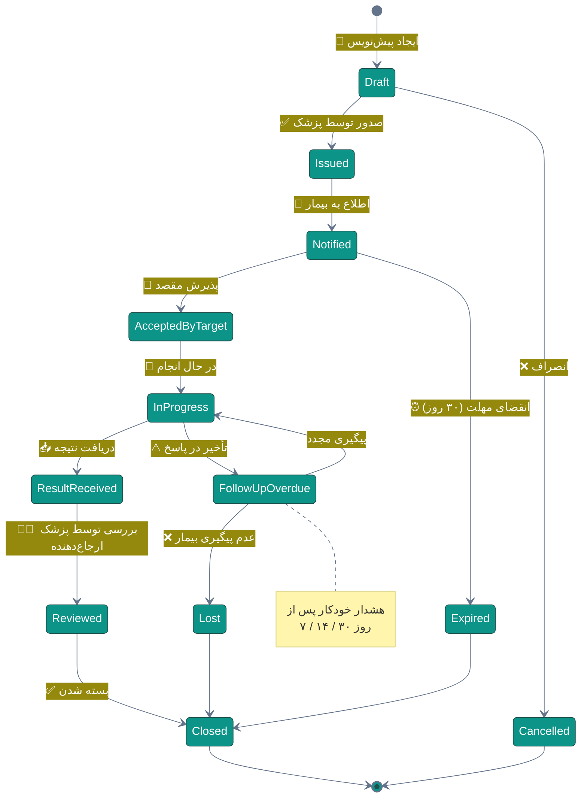
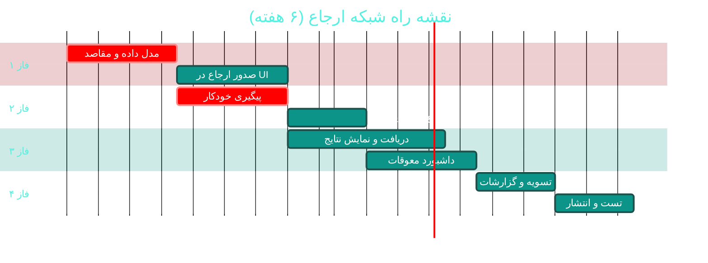

# 🔗 شبکه ارجاع (Referral Network)

> **لایسنس:** addon-referral · **اولویت:** 🟡 متوسط · **دشواری:** 🟡 متوسط · **زمان برآوردی:** ۵–۶ هفته

---

## ۱. 📋 خلاصه ماژول

مدیریت کامل چرخه ارجاع: ارجاع بیمار به پزشک متخصص یا آزمایشگاه بیرونی،
پیگیری وضعیت، دریافت نتیجه و بازگشت به چرخه درمان —
به‌طوری که هیچ ارجاعی «گم» نشود.

| ویژگی | مقدار |
|:---|:---|
| 🎯 هدف | پیگیری کامل ارجاعات و افزایش تکمیل چرخه درمان |
| 👤 کاربران اصلی | پزشکان، پذیرش، بیماران |
| 🔗 وابستگی‌ها | پرتال همکار · پیامک · [C12 دولتی](C12-government-integration.md) |
| 📊 وضعیت فعلی | 🟡 پایه موجود |

### ✨ جدول ویژگی‌ها

| # | ویژگی | شرح | اولویت |
|:--:|:---|:---|:--:|
| ۱ | 📝 صدور ارجاع | با دلیل بالینی و اولویت | 🔴 حیاتی |
| ۲ | 🏥 دفترچه همکاران | فهرست متخصصان و مراکز | 🔴 حیاتی |
| ۳ | 📊 پیگیری وضعیت | از صدور تا بازگشت نتیجه | 🔴 حیاتی |
| ۴ | ⏰ هشدار تأخیر | یادآوری ارجاعات معوق | 🟠 بالا |
| ۵ | 📨 اطلاع‌رسانی به بیمار | پیامک زمان و آدرس | 🟠 بالا |
| ۶ | 📥 دریافت نتیجه | بارگذاری یا پورتال همکار | 🟠 بالا |
| ۷ | 🔄 ارجاع داخلی | به پزشک دیگر درمانگاه | 🟡 متوسط |
| ۸ | 💰 تسویه با همکار | محاسبه حق‌الزحمه ارجاع | 🟡 متوسط |
| ۹ | 📈 تحلیل شبکه | پرمخاطب‌ترین مقاصد | 🟢 پایین |
| ۱۰ | ⭐ امتیازدهی همکار | کیفیت و سرعت پاسخ | 🟢 پایین |

---

## ۲. 🎯 وضعیت فعلی در کدبیس

| لایه | فایل/مسیر | وضعیت |
|:---|:---|:---|
| 🏛 موجودیت | `Domain/Integration/ReferralRecord.cs` | 🟢 **موجود** |
| 🏷 Enums | `Domain/Enums/ReferralStatus.cs` · `ReferralType.cs` | 🟢 **موجود** |
| 🖥 رابط کاربر | `Desktop/Views/ComplementaryView.xaml` | 🟡 |
| 🎛 ViewModel | `Desktop/ViewModels/ComplementaryViewModel.cs` | 🟡 |
| 📨 اطلاع‌رسانی | `Infrastructure/Sms/KavenegarProvider.cs` | 🟢 |
| ⏰ پیگیری خودکار | — | ❌ **وجود ندارد** |
| 🏥 دفترچه همکاران | — | ❌ **وجود ندارد** |

> 💡 **امتیاز:** موجودیت `ReferralRecord` و enumهای مربوطه
> از قبل در `Domain/Integration/` وجود دارند و با سامانه‌های دولتی
> نیز هم‌راستا هستند (مرتبط: [C12](C12-government-integration.md)).
> این ماژول عمدتاً **تکمیل جریان کاری** است.

---

## ۳. 📊 نمودار چرخه ارجاع



---

## ۴. 🛠 دستورالعمل پیاده‌سازی

### 📌 گام ۱ — دفترچه همکاران

در `Domain/Entities/ReferralTarget.cs` (جدید):

```csharp
namespace Sahand.ClinicPro.Domain.Entities;

/// <summary>
/// مقصد ارجاع — پزشک متخصص، آزمایشگاه یا مرکز تصویربرداری خارجی
/// </summary>
public class ReferralTarget : BaseEntity
{
    /// <summary>نام مرکز یا پزشک</summary>
    public string Name { get; set; } = default!;

    /// <summary>نوع مقصد</summary>
    public ReferralTargetType Type { get; set; }

    /// <summary>تخصص (در صورت پزشک)</summary>
    public string? Specialty { get; set; }

    /// <summary>نام پزشک مسئول</summary>
    public string? ContactPerson { get; set; }

    /// <summary>شماره تماس</summary>
    public string PhoneNumber { get; set; } = default!;

    /// <summary>نشانی</summary>
    public string? Address { get; set; }

    /// <summary>شهر</summary>
    public string City { get; set; } = default!;

    /// <summary>کد نظام پزشکی یا شناسه ملی</summary>
    public string? LicenseNumber { get; set; }

    /// <summary>آیا طرف قرارداد است</summary>
    public bool IsContracted { get; set; }

    /// <summary>درصد حق‌الزحمه ارجاع‌دهنده</summary>
    public decimal? CommissionPercent { get; set; }

    /// <summary>میانگین زمان پاسخ‌گویی بر حسب روز</summary>
    public decimal? AverageResponseDays { get; set; }

    /// <summary>امتیاز کیفیت (۰ تا ۵)</summary>
    public decimal? QualityRating { get; set; }

    public bool IsActive { get; set; } = true;

    /// <summary>یادداشت داخلی</summary>
    public string? Notes { get; set; }
}

/// <summary>نوع مقصد ارجاع</summary>
public enum ReferralTargetType
{
    SpecialistDoctor = 1,
    Laboratory = 2,
    ImagingCenter = 3,
    Hospital = 4,
    RehabilitationCenter = 5,
    InternalDepartment = 6,
    Other = 99
}
```

### 📌 گام ۲ — تکمیل موجودیت ارجاع

فیلدهای پیشنهادی برای افزودن به `Domain/Integration/ReferralRecord.cs`:

| فیلد | نوع | کاربرد |
|:---|:---|:---|
| `ReferralTargetId` | `Guid?` | پیوند به مقصد |
| `Priority` | `ReferralPriority` | عادی / فوری / اورژانسی |
| `ClinicalReason` | `string` | دلیل بالینی ارجاع |
| `ProvisionalDiagnosis` | `string?` | تشخیص احتمالی |
| `RequestedService` | `string` | خدمت درخواستی |
| `DueDate` | `DateTime?` | مهلت انجام |
| `ResultReceivedAtUtc` | `DateTime?` | زمان دریافت نتیجه |
| `ResultSummary` | `string?` | خلاصه نتیجه |
| `ResultDocumentId` | `Guid?` | پیوند به سند ([D05](D05-document-management.md)) |
| `ReviewedByDoctorId` | `Guid?` | پزشک بررسی‌کننده |
| `ReviewedAtUtc` | `DateTime?` | زمان بررسی |
| `ReminderCount` | `int` | تعداد یادآوری‌های ارسالی |

در `Domain/Enums/ReferralPriority.cs` (جدید):

```csharp
namespace Sahand.ClinicPro.Domain.Enums;

/// <summary>اولویت ارجاع</summary>
public enum ReferralPriority
{
    /// <summary>عادی — مهلت ۳۰ روز</summary>
    Routine = 1,
    /// <summary>فوری — مهلت ۷ روز</summary>
    Urgent = 2,
    /// <summary>اورژانسی — مهلت ۲۴ ساعت</summary>
    Emergency = 3
}
```

### 📌 گام ۳ — کامند صدور ارجاع

در `Application/Features/Referrals/IssueReferral/IssueReferralCommand.cs` (جدید):

```csharp
using FluentValidation;
using MediatR;
using Sahand.ClinicPro.Application.Common;
using Sahand.ClinicPro.Domain.Common;

namespace Sahand.ClinicPro.Application.Features.Referrals.IssueReferral;

/// <summary>صدور ارجاع جدید برای بیمار</summary>
/// <param name="PatientId">شناسه بیمار</param>
/// <param name="VisitId">شناسه ویزیت مرتبط</param>
/// <param name="ReferralTargetId">شناسه مقصد ارجاع</param>
/// <param name="Priority">اولویت ارجاع</param>
/// <param name="ClinicalReason">دلیل بالینی ارجاع</param>
/// <param name="RequestedService">خدمت درخواستی</param>
public record IssueReferralCommand(
    Guid PatientId,
    Guid VisitId,
    Guid ReferralTargetId,
    ReferralPriority Priority,
    string ClinicalReason,
    string RequestedService)
    : IRequest<Result<IssueReferralResponse>>;

/// <summary>نتیجه صدور ارجاع</summary>
public record IssueReferralResponse(
    Guid ReferralId, string ReferralCode, DateTime DueDate);

/// <summary>اعتبارسنجی صدور ارجاع</summary>
public class IssueReferralCommandValidator : AbstractValidator<IssueReferralCommand>
{
    public IssueReferralCommandValidator()
    {
        RuleFor(x => x.PatientId).NotEmpty().WithMessage("شناسه بیمار الزامی است");
        RuleFor(x => x.VisitId).NotEmpty().WithMessage("شناسه ویزیت الزامی است");
        RuleFor(x => x.ReferralTargetId)
            .NotEmpty().WithMessage("مقصد ارجاع الزامی است");
        RuleFor(x => x.ClinicalReason)
            .NotEmpty().WithMessage("دلیل بالینی ارجاع الزامی است")
            .MinimumLength(10).WithMessage("دلیل ارجاع بسیار کوتاه است")
            .MaximumLength(1000).WithMessage("دلیل ارجاع بسیار طولانی است");
        RuleFor(x => x.RequestedService)
            .NotEmpty().WithMessage("خدمت درخواستی الزامی است")
            .MaximumLength(200).WithMessage("نام خدمت بسیار طولانی است");
    }
}

/// <summary>مدیریت صدور ارجاع با تعیین خودکار مهلت</summary>
public class IssueReferralCommandHandler
    : IRequestHandler<IssueReferralCommand, Result<IssueReferralResponse>>
{
    private readonly IUnitOfWork _unitOfWork;
    private readonly ICurrentUserService _currentUser;
    private readonly ILogger<IssueReferralCommandHandler> _logger;

    public IssueReferralCommandHandler(
        IUnitOfWork unitOfWork,
        ICurrentUserService currentUser,
        ILogger<IssueReferralCommandHandler> logger)
    {
        _unitOfWork = unitOfWork;
        _currentUser = currentUser;
        _logger = logger;
    }

    public async Task<Result<IssueReferralResponse>> Handle(
        IssueReferralCommand request,
        CancellationToken cancellationToken)
    {
        // ۱) بررسی وجود مقصد و فعال بودن آن
        var target = await _unitOfWork.Repository<Domain.Entities.ReferralTarget>()
            .QueryableNoTracking
            .FirstOrDefaultAsync(t => t.Id == request.ReferralTargetId,
                                 cancellationToken);

        if (target is null)
            return Result<IssueReferralResponse>.Failure(
                Error.NotFound("مقصد ارجاع یافت نشد"));

        if (!target.IsActive)
            return Result<IssueReferralResponse>.Failure(
                Error.Conflict("این مقصد ارجاع غیرفعال است"));

        // ۲) تعیین مهلت بر اساس اولویت
        var dueDate = request.Priority switch
        {
            ReferralPriority.Emergency => DateTime.UtcNow.AddDays(1),
            ReferralPriority.Urgent => DateTime.UtcNow.AddDays(7),
            _ => DateTime.UtcNow.AddDays(30)
        };

        // ۳) تولید کد یکتای ارجاع
        var code = $"REF-{DateTime.UtcNow:yyyyMM}-{Guid.NewGuid().ToString()[..6].ToUpperInvariant()}";

        // ۴) ثبت ارجاع
        // TODO: تکمیل با فیلدهای جدول ReferralRecord موجود
        // var referral = new Domain.Integration.ReferralRecord { ... }

        _logger.LogInformation(
            "ارجاع {Code} برای بیمار {Patient} به مقصد {Target} صادر شد",
            code, request.PatientId, target.Name);

        // TODO: ارسال پیامک اطلاع‌رسانی به بیمار از طریق ISmsService

        return Result<IssueReferralResponse>.Success(
            new IssueReferralResponse(Guid.NewGuid(), code, dueDate));
    }
}
```

### 📌 گام ۴ — Job پیگیری ارجاعات معوق

در `Infrastructure/Jobs/ReferralFollowUpJob.cs` (جدید):

```csharp
using Hangfire;

namespace Sahand.ClinicPro.Infrastructure.Jobs;

/// <summary>
/// پیگیری خودکار ارجاعات معوق — روزانه ساعت ۹ صبح
/// </summary>
public class ReferralFollowUpJob
{
    private readonly IUnitOfWork _unitOfWork;
    private readonly ISmsService _smsService;
    private readonly ILogger<ReferralFollowUpJob> _logger;

    public ReferralFollowUpJob(
        IUnitOfWork unitOfWork,
        ISmsService smsService,
        ILogger<ReferralFollowUpJob> logger)
    {
        _unitOfWork = unitOfWork;
        _smsService = smsService;
        _logger = logger;
    }

    [AutomaticRetry(Attempts = 3)]
    public async Task FollowUpAsync(CancellationToken cancellationToken = default)
    {
        var now = DateTime.UtcNow;

        // ارجاعات باز که مهلت آن‌ها گذشته یا نزدیک است
        var overdue = await _unitOfWork.Repository<Domain.Integration.ReferralRecord>()
            .Queryable
            .Where(r => r.Status == Domain.Enums.ReferralStatus.Issued
                     && r.ResultReceivedAtUtc == null
                     && r.CreatedAtUtc < now.AddDays(-7))
            .ToListAsync(cancellationToken);

        foreach (var referral in overdue)
        {
            var daysElapsed = (now - referral.CreatedAtUtc).Days;

            // ارسال یادآوری در روزهای ۷، ۱۴ و ۳۰
            var shouldRemind = daysElapsed switch
            {
                >= 30 when referral.ReminderCount < 3 => true,
                >= 14 when referral.ReminderCount < 2 => true,
                >= 7 when referral.ReminderCount < 1 => true,
                _ => false
            };

            if (!shouldRemind) continue;

            // TODO: ارسال پیامک یادآوری به بیمار
            // await _smsService.SendTemplatedAsync(...)

            referral.ReminderCount++;
            _logger.LogInformation(
                "یادآوری شماره {Count} برای ارجاع {Id} ارسال شد",
                referral.ReminderCount, referral.Id);
        }

        await _unitOfWork.SaveEntitiesAsync(cancellationToken);
    }
}
```

در `API/Program.cs`:

```csharp
RecurringJob.AddOrUpdate<ReferralFollowUpJob>(
    "referral-followup",
    job => job.FollowUpAsync(CancellationToken.None),
    Cron.Daily(9));
```

### 📌 گام ۵ — مایگریشن

```bash
cd src/Sahand.ClinicPro.Infrastructure
dotnet ef migrations add Cycle49ReferralNetwork \
    --startup-project ../Sahand.ClinicPro.API --context ClinicProDbContext
dotnet ef database update --startup-project ../Sahand.ClinicPro.API
```

---

## ۵. ⚠️ کاستی‌ها و ریسک‌ها

| # | ریسک | شدت | راهکار |
|:--:|:---|:--:|:---|
| W-01 | گم‌شدن ارجاعات بدون پیگیری | 🔴 بحرانی | Job خودکار + داشبورد معوقات |
| W-02 | ارجاع به مقصد غیرفعال یا منقضی | 🟠 بالا | اعتبارسنجی در زمان صدور |
| W-03 | عدم دریافت نتیجه از مرکز مقصد | 🟠 بالا | پورتال همکار + ورود دستی |
| W-04 | ناهماهنگی با سامانه ارجاع دولتی | 🟠 بالا | یکپارچه با [C12](C12-government-integration.md) |
| W-05 | محاسبه نادرست حق‌الزحمه ارجاع | 🟡 متوسط | قرارداد مکتوب + تأیید مالی |
| W-06 | اطلاعات قدیمی دفترچه همکاران | 🟡 متوسط | بازبینی دوره‌ای |

---

## ۶. 📈 شاخص‌های موفقیت (KPI)

| شاخص | هدف |
|:---|:--:|
| 📊 نرخ تکمیل چرخه ارجاع | **≥ ۸۰٪** |
| ⏱ میانگین زمان دریافت نتیجه | **< ۷ روز** |
| ⚠ ارجاعات معوق بیش از ۳۰ روز | **< ۵٪** |
| 🔄 نرخ بازگشت بیمار پس از ارجاع | **≥ ۷۰٪** |
| 🏥 تعداد مقاصد فعال در شبکه | **≥ ۲۰** |

---

## ۷. 🗓 برنامه زمانی



---

## 🔗 پیوندهای مرتبط

- [A04 — ویزیت و SOAP](A04-visits-soap.md)
- [A07 — آزمایشگاه (LIS)](A07-laboratory.md)
- [A08 — پاراکلینیک و تصویربرداری](A08-paraclinical.md)
- [B03 — بیمه و مطالبات](B03-insurance.md)
- [C07 — پیامک و ارتباطات](C07-sms-communication.md)
- [C12 — یکپارچه‌سازی دولتی](C12-government-integration.md)
- [D05 — مدیریت اسناد](D05-document-management.md)

---
<div align="center">📅 ۱۴۰۴/۰۷/۱۹ · 🔖 v1.0</div>
