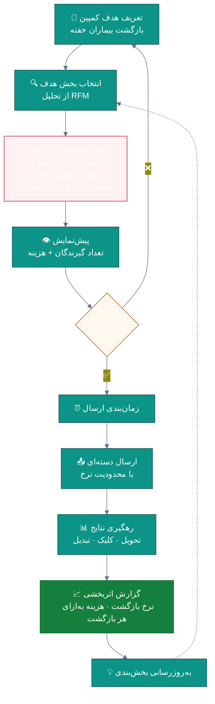
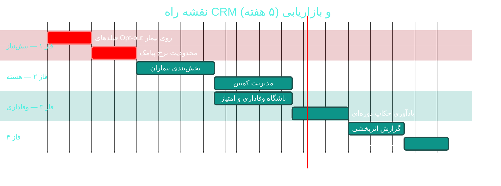

# 📣 مدیریت ارتباط با بیمار و بازاریابی (CRM & Loyalty)

> **لایسنس:** addon-crm · **اولویت:** 🟠 بالا · **دشواری:** 🟢 کم · **زمان برآوردی:** ۴–۵ هفته

---

## ۱. 📋 خلاصه ماژول

ابزارهای حفظ و بازگشت بیمار: کمپین‌های پیامکی هدفمند، باشگاه وفاداری،
یادآوری‌های خودکار و تحلیل ریزش — با هدف افزایش
**ارزش طول عمر بیمار (LTV)**.

| ویژگی | مقدار |
|:---|:---|
| 🎯 هدف | افزایش تکرار مراجعه و کاهش ریزش بیماران |
| 👤 کاربران اصلی | مدیر درمانگاه، مسئول بازاریابی |
| 🔗 وابستگی‌ها | زیرساخت پیامک · داده مراجعات · [D04 تحلیل](D04-bi-analytics.md) |
| 📊 وضعیت فعلی | 🟡 زیرساخت آماده، ماژول ندارد |

### ✨ جدول ویژگی‌ها

| # | ویژگی | شرح | اولویت |
|:--:|:---|:---|:--:|
| ۱ | 🎯 بخش‌بندی بیماران | بر اساس رفتار و ویژگی | 🔴 حیاتی |
| ۲ | 📨 کمپین پیامکی | ارسال هدفمند با قالب | 🔴 حیاتی |
| ۳ | 🎁 باشگاه وفاداری | امتیاز و پاداش | 🟠 بالا |
| ۴ | ⏰ یادآوری خودکار | نوبت، چکاپ دوره‌ای | 🔴 حیاتی |
| ۵ | 📉 تحلیل ریزش | شناسایی و بازگشت | 🟠 بالا |
| ۶ | 🎂 پیام مناسبتی | تولد، اعیاد | 🟢 پایین |
| ۷ | 📊 سنجش اثربخشی | نرخ بازگشت کمپین | 🟠 بالا |
| ۸ | 🚫 مدیریت انصراف | احترام به Opt-out | 🔴 حیاتی |
| ۹ | 🎫 کد تخفیف | تولید و رهگیری | 🟡 متوسط |
| ۱۰ | 📋 فرم نظرسنجی | پیوند با [C08](C08-survey-training.md) | 🟡 متوسط |

---

## ۲. 🎯 وضعیت فعلی در کدبیس

| لایه | فایل/مسیر | وضعیت |
|:---|:---|:---|
| 📨 زیرساخت پیامک | `Infrastructure/Sms/KavenegarProvider.cs` | 🟢 **آماده** |
| 📨 ارسال قالبی | `ISmsService.SendTemplatedAsync` | 🟢 **آماده** |
| 👤 داده بیمار | `Domain/Entities/Patient.cs` | 🟢 **آماده** |
| 📅 داده نوبت | `Domain/Entities/Appointment.cs` | 🟢 **آماده** |
| 📝 نظرسنجی | [C08 — نظرسنجی و آموزش](C08-survey-training.md) | 🟡 |
| 🎯 بخش‌بندی | تحلیل RFM در [D04](D04-bi-analytics.md) | 🟡 |
| 🚫 قابلیت انصراف (Opt-out) | پیشنهادی در [C07](C07-sms-communication.md) | ❌ |

> ⚠️ **الزام قانونی:** پیش از هرگونه ارسال تبلیغاتی،
> فیلدهای `SmsOptOut` و `MarketingOptOut` روی `Patient`
> باید پیاده‌سازی شوند (جزئیات در [C07](C07-sms-communication.md)).

---

## ۳. 📊 نمودار جریان کمپین



---

## ۴. 🛠 دستورالعمل پیاده‌سازی

### 📌 گام ۱ — موجودیت‌های کمپین

در `Domain/Entities/MarketingCampaign.cs` (جدید):

```csharp
namespace Sahand.ClinicPro.Domain.Entities;

/// <summary>
/// کمپین ارتباط با بیماران — ارسال هدفمند پیامک یا اعلان
/// </summary>
public class MarketingCampaign : BaseEntity
{
    /// <summary>عنوان کمپین</summary>
    public string Name { get; set; } = default!;

    /// <summary>هدف کمپین</summary>
    public CampaignGoal Goal { get; set; }

    /// <summary>کانال ارسال</summary>
    public CampaignChannel Channel { get; set; }

    /// <summary>متن پیام با نشانه‌های قابل جایگزینی</summary>
    public string MessageTemplate { get; set; } = default!;

    /// <summary>معیار بخش‌بندی به صورت JSON</summary>
    public string SegmentCriteriaJson { get; set; } = default!;

    /// <summary>وضعیت کمپین</summary>
    public CampaignStatus Status { get; set; } = CampaignStatus.Draft;

    /// <summary>زمان‌بندی ارسال</summary>
    public DateTime? ScheduledAtUtc { get; set; }

    public DateTime? StartedAtUtc { get; set; }
    public DateTime? CompletedAtUtc { get; set; }

    /// <summary>تعداد کل گیرندگان</summary>
    public int TotalRecipients { get; set; }

    /// <summary>تعداد ارسال‌های موفق</summary>
    public int DeliveredCount { get; set; }

    /// <summary>تعداد تبدیل‌ها (مراجعه پس از کمپین)</summary>
    public int ConversionCount { get; set; }

    /// <summary>هزینه برآوردی ارسال</summary>
    public decimal EstimatedCost { get; set; }

    public Guid CreatedByUserId { get; set; }

    /// <summary>کد تخفیف مرتبط</summary>
    public Guid? DiscountCodeId { get; set; }
}

/// <summary>هدف کمپین</summary>
public enum CampaignGoal
{
    RecallDormant = 1,        // بازگشت بیماران خفته
    PeriodicCheckup = 2,      // یادآوری چکاپ دوره‌ای
    SeasonalOffer = 3,        // پیشنهاد فصلی
    BirthdayGreeting = 4,     // تبریک تولد
    ServiceAnnouncement = 5,  // معرفی خدمت جدید
    PostVisitFollowUp = 6     // پیگیری پس از ویزیت
}

/// <summary>کانال ارسال</summary>
public enum CampaignChannel
{
    Sms = 1,
    PushNotification = 2,
    InAppMessage = 3,
    Email = 4
}

/// <summary>وضعیت کمپین</summary>
public enum CampaignStatus
{
    Draft = 1,
    Scheduled = 2,
    Sending = 3,
    Completed = 4,
    Cancelled = 5,
    Failed = 6
}
```

### 📌 گام ۲ — باشگاه وفاداری

در `Domain/Entities/LoyaltyAccount.cs` (جدید):

```csharp
namespace Sahand.ClinicPro.Domain.Entities;

/// <summary>
/// حساب وفاداری بیمار — امتیاز بر اساس مراجعات و پرداخت‌ها
/// </summary>
public class LoyaltyAccount : BaseEntity
{
    public Guid PatientId { get; set; }

    /// <summary>موجودی امتیاز فعلی</summary>
    public int PointsBalance { get; set; }

    /// <summary>مجموع امتیازهای کسب‌شده در طول زمان</summary>
    public int LifetimePoints { get; set; }

    /// <summary>سطح عضویت</summary>
    public LoyaltyTier Tier { get; set; } = LoyaltyTier.Bronze;

    /// <summary>تاریخ آخرین کسب امتیاز</summary>
    public DateTime? LastEarnedAtUtc { get; set; }

    public Patient Patient { get; set; } = default!;
}

/// <summary>سطح عضویت در باشگاه بیماران</summary>
public enum LoyaltyTier
{
    Bronze = 1,     // ۰ تا ۵۰۰ امتیاز
    Silver = 2,     // ۵۰۱ تا ۲۰۰۰
    Gold = 3,       // ۲۰۰۱ تا ۵۰۰۰
    Platinum = 4    // بالای ۵۰۰۰
}

/// <summary>
/// تراکنش امتیاز — کسب یا مصرف
/// </summary>
public class LoyaltyTransaction : BaseEntity
{
    public Guid LoyaltyAccountId { get; set; }

    /// <summary>مقدار تغییر (مثبت = کسب، منفی = مصرف)</summary>
    public int Points { get; set; }

    /// <summary>دلیل تغییر امتیاز</summary>
    public string Reason { get; set; } = default!;

    /// <summary>نوع منبع امتیاز</summary>
    public LoyaltySource Source { get; set; }

    /// <summary>شناسه منبع (صورتحساب، ارجاع و غیره)</summary>
    public Guid? SourceId { get; set; }

    /// <summary>تاریخ انقضای امتیازهای کسب‌شده</summary>
    public DateTime? ExpiresAtUtc { get; set; }

    public LoyaltyAccount LoyaltyAccount { get; set; } = default!;
}

/// <summary>منبع کسب امتیاز</summary>
public enum LoyaltySource
{
    Visit = 1,
    Payment = 2,
    Referral = 3,          // معرفی بیمار جدید
    SurveyCompletion = 4,
    ReviewSubmission = 5,
    ManualAdjustment = 6,
    Redemption = 7         // مصرف امتیاز
}
```

### 📌 گام ۳ — سرویس بخش‌بندی

در `Application/Interfaces/IPatientSegmentationService.cs` (جدید):

```csharp
namespace Sahand.ClinicPro.Application.Interfaces;

/// <summary>
/// معیار بخش‌بندی بیماران برای کمپین‌های هدفمند
/// </summary>
public class SegmentCriteria
{
    /// <summary>حداقل روز از آخرین مراجعه</summary>
    public int? MinDaysSinceLastVisit { get; set; }

    /// <summary>حداکثر روز از آخرین مراجعه</summary>
    public int? MaxDaysSinceLastVisit { get; set; }

    /// <summary>حداقل تعداد مراجعات</summary>
    public int? MinVisitCount { get; set; }

    /// <summary>حداقل مجموع پرداختی</summary>
    public decimal? MinTotalSpent { get; set; }

    /// <summary>محدود کردن به بیماران دارای نوبت در بازه</summary>
    public DateOnly? HadAppointmentAfter { get; set; }

    /// <summary>محدود کردن به بیماران یک پزشک خاص</summary>
    public Guid? DoctorId { get; set; }

    /// <summary>محدود کردن به یک گروه سنی</summary>
    public int? MinAge { get; set; }
    public int? MaxAge { get; set; }

    /// <summary>محدود کردن به یک شعبه</summary>
    public Guid? BranchId { get; set; }
}

/// <summary>
/// سرویس بخش‌بندی بیماران — تبدیل معیار به فهرست گیرندگان
/// </summary>
public interface IPatientSegmentationService
{
    /// <summary>
    /// محاسبه فهرست بیماران منطبق با معیار — با رعایت انصراف
    /// </summary>
    Task<IReadOnlyList<Guid>> ResolveRecipientsAsync(
        SegmentCriteria criteria,
        bool excludeOptedOut = true,
        CancellationToken cancellationToken = default);

    /// <summary>
    /// برآورد تعداد گیرندگان بدون ارسال واقعی
    /// </summary>
    Task<int> EstimateRecipientCountAsync(
        SegmentCriteria criteria,
        CancellationToken cancellationToken = default);
}
```

### 📌 گام ۴ — کامند اجرای کمپین

در `Application/Features/Marketing/RunCampaign/RunCampaignCommand.cs` (جدید):

```csharp
using FluentValidation;
using MediatR;
using Sahand.ClinicPro.Application.Common;
using Sahand.ClinicPro.Domain.Common;

namespace Sahand.ClinicPro.Application.Features.Marketing.RunCampaign;

/// <summary>اجرای یک کمپین زمان‌بندی‌شده</summary>
/// <param name="CampaignId">شناسه کمپین</param>
public record RunCampaignCommand(Guid CampaignId)
    : IRequest<Result<RunCampaignResponse>>;

/// <summary>نتیجه اجرای کمپین</summary>
public record RunCampaignResponse(int TotalRecipients, int DeliveredCount);

/// <summary>اعتبارسنجی اجرای کمپین</summary>
public class RunCampaignCommandValidator : AbstractValidator<RunCampaignCommand>
{
    public RunCampaignCommandValidator()
    {
        RuleFor(x => x.CampaignId).NotEmpty().WithMessage("شناسه کمپین الزامی است");
    }
}

/// <summary>
/// مدیریت اجرای کمپین — با رعایت محدودیت نرخ و احترام به انصراف
/// </summary>
public class RunCampaignCommandHandler
    : IRequestHandler<RunCampaignCommand, Result<RunCampaignResponse>>
{
    private readonly IUnitOfWork _unitOfWork;
    private readonly IPatientSegmentationService _segmentation;
    private readonly ISmsService _smsService;
    private readonly ISmsRateLimiter _rateLimiter;
    private readonly ILogger<RunCampaignCommandHandler> _logger;

    public RunCampaignCommandHandler(
        IUnitOfWork unitOfWork,
        IPatientSegmentationService segmentation,
        ISmsService smsService,
        ISmsRateLimiter rateLimiter,
        ILogger<RunCampaignCommandHandler> logger)
    {
        _unitOfWork = unitOfWork;
        _segmentation = segmentation;
        _smsService = smsService;
        _rateLimiter = rateLimiter;
        _logger = logger;
    }

    public async Task<Result<RunCampaignResponse>> Handle(
        RunCampaignCommand request,
        CancellationToken cancellationToken)
    {
        var campaign = await _unitOfWork.Repository<Domain.Entities.MarketingCampaign>()
            .Queryable
            .FirstOrDefaultAsync(c => c.Id == request.CampaignId, cancellationToken);

        if (campaign is null)
            return Result<RunCampaignResponse>.Failure(
                Error.NotFound("کمپین یافت نشد"));

        if (campaign.Status != Domain.Entities.CampaignStatus.Scheduled)
            return Result<RunCampaignResponse>.Failure(
                Error.Conflict("فقط کمپین‌های زمان‌بندی‌شده قابل اجرا هستند"));

        campaign.Status = Domain.Entities.CampaignStatus.Sending;
        campaign.StartedAtUtc = DateTime.UtcNow;

        // ۱) حل بخش هدف (با حذف خودکار بیماران منصرف)
        var recipients = await _segmentation.ResolveRecipientsAsync(
            criteria: System.Text.Json.JsonSerializer
                .Deserialize<SegmentCriteria>(campaign.SegmentCriteriaJson)!,
            excludeOptedOut: true,
            cancellationToken: cancellationToken);

        campaign.TotalRecipients = recipients.Count;

        // ۲) ارسال با رعایت محدودیت نرخ
        var delivered = 0;
        foreach (var patientId in recipients)
        {
            if (!await _rateLimiter.TryConsumeAsync(cancellationToken))
            {
                _logger.LogWarning("محدودیت نرخ پیامک فعال شد — ارسال متوقف می‌شود");
                break;
            }

            // TODO: دریافت شماره همراه و شخصی‌سازی پیام
            // var sent = await _smsService.SendTemplatedAsync(...);
            // if (sent) delivered++;
        }

        campaign.DeliveredCount = delivered;
        campaign.Status = Domain.Entities.CampaignStatus.Completed;
        campaign.CompletedAtUtc = DateTime.UtcNow;

        await _unitOfWork.SaveEntitiesAsync(cancellationToken);

        _logger.LogInformation(
            "کمپین {Name}: از {Total} گیرنده، {Delivered} ارسال موفق",
            campaign.Name, campaign.TotalRecipients, delivered);

        return Result<RunCampaignResponse>.Success(
            new RunCampaignResponse(campaign.TotalRecipients, delivered));
    }
}
```

### 📌 گام ۵ — Job یادآوری چکاپ دوره‌ای

در `Infrastructure/Jobs/PeriodicCheckupReminderJob.cs` (جدید):

```csharp
using Hangfire;

namespace Sahand.ClinicPro.Infrastructure.Jobs;

/// <summary>
/// یادآوری چکاپ دوره‌ای برای بیمارانی که بیش از یک سال مراجعه نداشته‌اند
/// </summary>
public class PeriodicCheckupReminderJob
{
    private readonly IUnitOfWork _unitOfWork;
    private readonly ISmsService _smsService;
    private readonly ILogger<PeriodicCheckupReminderJob> _logger;

    public PeriodicCheckupReminderJob(
        IUnitOfWork unitOfWork,
        ISmsService smsService,
        ILogger<PeriodicCheckupReminderJob> logger)
    {
        _unitOfWork = unitOfWork;
        _smsService = smsService;
        _logger = logger;
    }

    [AutomaticRetry(Attempts = 2)]
    public async Task SendRemindersAsync(
        CancellationToken cancellationToken = default)
    {
        var oneYearAgo = DateTime.UtcNow.AddYears(-1);
        var thirteenMonthsAgo = DateTime.UtcNow.AddMonths(-13);

        // بیمارانی که آخرین مراجعه آن‌ها بین ۱۲ تا ۱۳ ماه پیش بوده
        var candidates = await _unitOfWork.Repository<Domain.Entities.Patient>()
            .QueryableNoTracking
            .Where(p => p.IsActive
                     && !p.MarketingOptOut
                     && p.LastVisitDateUtc != null
                     && p.LastVisitDateUtc >= thirteenMonthsAgo
                     && p.LastVisitDateUtc <= oneYearAgo)
            .Select(p => new { p.Id, p.FirstName, p.MobileNumber })
            .ToListAsync(cancellationToken);

        // TODO: ارسال دسته‌ای با قالب یادآوری چکاپ

        _logger.LogInformation(
            "{Count} بیمار برای یادآوری چکاپ دوره‌ای شناسایی شدند",
            candidates.Count);
    }
}
```

در `API/Program.cs`:

```csharp
RecurringJob.AddOrUpdate<PeriodicCheckupReminderJob>(
    "checkup-reminder",
    job => job.SendRemindersAsync(CancellationToken.None),
    Cron.Monthly(1, 10));   // روز دهم هر ماه
```

### 📌 گام ۶ — مایگریشن

```bash
cd src/Sahand.ClinicPro.Infrastructure
dotnet ef migrations add Cycle49CrmMarketing \
    --startup-project ../Sahand.ClinicPro.API --context ClinicProDbContext
dotnet ef database update --startup-project ../Sahand.ClinicPro.API
```

---

## ۵. ⚠️ کاستی‌ها و ریسک‌ها

| # | ریسک | شدت | راهکار |
|:--:|:---|:--:|:---|
| W-01 | ارسال پیام ناخواسته (نقض حریم) | 🔴 بحرانی | فیلدهای Opt-out + ثبت رضایت |
| W-02 | جریمه اپراتور به‌دلیل ارسال انبوه | 🔴 بحرانی | محدودیت نرخ ([C07](C07-sms-communication.md)) |
| W-03 | آزار بیمار با پیام‌های مکرر | 🟠 بالا | حداکثر ۲ پیام در ماه |
| W-04 | محاسبه نادرست امتیاز وفاداری | 🟡 متوسط | تراکنش‌های بازگشت‌پذیر |
| W-05 | ارسال در ساعات نامناسب | 🟡 متوسط | ساعات سکوت ([C06](C06-notifications-realtime.md)) |
| W-06 | هزینه بالای پیامک بدون بازگشت | 🟡 متوسط | پیش‌نمایش هزینه پیش از ارسال |

---

## ۶. 📈 شاخص‌های موفقیت (KPI)

| شاخص | هدف |
|:---|:--:|
| 🔄 نرخ بازگشت بیماران خفته | **≥ ۲۰٪** |
| 📨 نرخ تحویل موفق پیامک | **≥ ۹۵٪** |
| 🎁 نرخ عضویت در باشگاه | **≥ ۴۰٪** |
| 📉 کاهش نرخ ریزش سالانه | **≥ ۱۵٪** |
| 💰 بازگشت سرمایه کمپین (ROI) | **≥ ۳ برابر** |
| 🚫 نرخ انصراف از دریافت | **< ۵٪** |

---

## ۷. 🗓 برنامه زمانی



---

## 🔗 پیوندهای مرتبط

- [A01 — مدیریت بیماران](A01-patients.md)
- [A02 — نوبت‌دهی و زمان‌بندی](A02-appointments.md)
- [C06 — اعلان‌ها و بلادرنگ](C06-notifications-realtime.md)
- [C07 — پیامک و ارتباطات](C07-sms-communication.md)
- [C08 — نظرسنجی و آموزش](C08-survey-training.md)
- [D01 — پرتال بیمار](D01-patient-portal.md)
- [D04 — هوش تجاری](D04-bi-analytics.md)

---
<div align="center">📅 ۱۴۰۴/۰۷/۱۹ · 🔖 v1.0</div>
